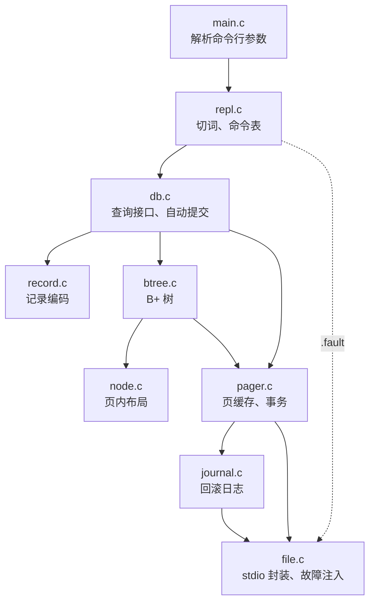
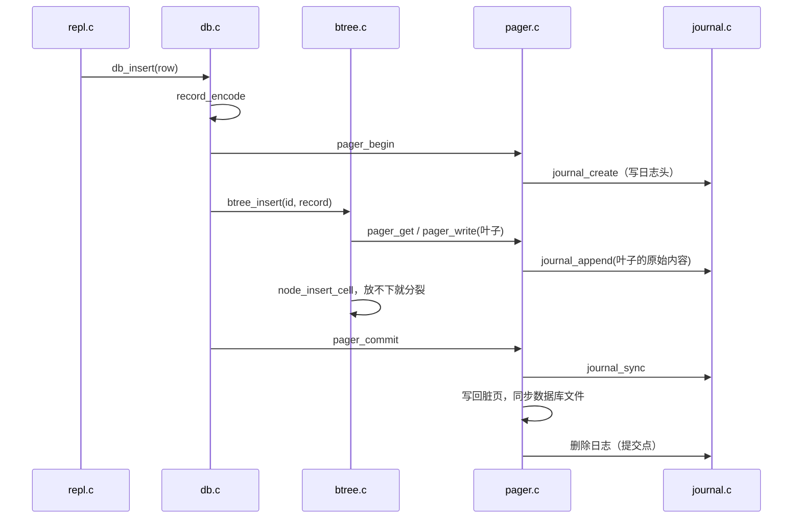

# MdrDB

MdrDB 是一个教学用的单文件数据库，用标准 C11 写成，Windows（MinGW）和 Linux 共用同一份代码。它有固定大小页面的数据库文件、带缓存的页管理器（pager）、B+ 树索引、记录编码、一个命令行界面（REPL），以及基于回滚日志（rollback journal）的事务与崩溃恢复。教程第五部分的 7.1～7.3 节以这份代码为基础讲解。

整个项目约 3000 行（含注释），测试约 1700 行，规模与 [**_Let's Build a Simple Database_**](https://cstack.github.io/db_tutorial/) 相近，一周之内可以读完。

## 项目目标

1. 让读者亲手实现并观察数据库存储引擎的几个基本部件：页、页缓存、B+ 树、记录格式、日志和恢复。
2. 每个模块只做一件事，接口窄，依赖只指向下层，可以按顺序逐个读懂。
3. 只用标准 C 的 stdio，不依赖任何平台接口，在 Windows 和 Linux 上行为一致。
4. 用自动化测试说明代码是对的，其中包括一个在每一次写操作处模拟崩溃、再检查恢复结果的测试。

MdrDB 只有一张模式固定的表 `(id, name, email)`：`id` 是 32 位无符号整数主键，`name` 最多 32 字节，`email` 最多 255 字节。命令行支持 `insert`、`select`、`delete`、`begin`、`commit`、`rollback`，以及若干以 `.` 开头、用来观察内部状态的元命令。

## 目录结构

```text
MdrDB/
├── CMakeLists.txt      CMake 构建：静态库、命令行程序、测试
├── Makefile            没有 CMake 时的构建方式
├── include/
│   └── mdrdb.h         公共接口：db_open、db_insert、db_scan 等
├── src/
│   ├── format.h        页大小、大端序整数的读写
│   ├── file.h/.c       文件层：stdio 封装、故障注入
│   ├── journal.h/.c    回滚日志的格式、写入与回放
│   ├── pager.h/.c      页缓存、页的分配、事务
│   ├── node.h/.c       B+ 树节点在页面里的布局
│   ├── btree.h/.c      B+ 树：查找、插入与分裂、删除、游标、检查
│   ├── record.h/.c     varint 与记录编码
│   ├── db.c            查询接口：编码、自动提交、观察命令
│   ├── repl.h/.c       命令行界面
│   └── main.c          程序入口
└── tests/
    ├── test.h          极简测试框架
    ├── test_record.c   varint 与记录编码
    ├── test_node.c     节点页面的布局
    ├── test_journal.c  日志格式、撕裂的记录、校验和
    ├── test_pager.c    页缓存、事务、热日志恢复
    ├── test_btree.c    插入、分裂、查找、删除、遍历
    ├── test_crash.c    在每一次写操作处崩溃，再检查恢复
    └── test_repl.c     端到端：脚本输入，逐字比较输出
```

各源文件的行数（含注释）：

| 文件 | 行数 | 文件 | 行数 |
|:---|---:|:---|---:|
| `btree.c` | 724 | `journal.c` | 139 |
| `pager.c` | 503 | `record.c` | 100 |
| `repl.c` | 329 | `main.c` | 71 |
| `db.c` | 302 | 头文件合计 | 493 |
| `node.c` | 222 | 测试合计 | 1668 |
| `file.c` | 169 | | |

## 构建与测试

### CMake

在本目录下执行：

```bash
cmake -S . -B build
cmake --build build
ctest --test-dir build
```

在 Linux（gcc 14.2，CMake 3.31）上的输出：

```text
Internal ctest changing into directory: /home/minsecrus/tutorial/work/review-MdrDB/MdrDB/build
Test project /home/minsecrus/tutorial/work/review-MdrDB/MdrDB/build
    Start 1: record
1/7 Test #1: record ...........................   Passed    0.00 sec
    Start 2: node
2/7 Test #2: node .............................   Passed    0.00 sec
    Start 3: journal
3/7 Test #3: journal ..........................   Passed    0.01 sec
    Start 4: pager
4/7 Test #4: pager ............................   Passed    0.03 sec
    Start 5: btree
5/7 Test #5: btree ............................   Passed    0.41 sec
    Start 6: crash
6/7 Test #6: crash ............................   Passed    0.17 sec
    Start 7: repl
7/7 Test #7: repl .............................   Passed    0.01 sec

100% tests passed, 0 tests failed out of 7

Total Test time (real) =   0.63 sec
```

Windows 上用 MinGW 时请加 `-G Ninja`。本仓库的路径里有中文目录 `项目`，CMake 生成的 Makefile 用的是绝对路径，`mingw32-make` 按系统代码页解释这些路径，会报 `No rule to make target`；Ninja 没有这个问题：

```bash
cmake -S . -B build -G Ninja
cmake --build build
ctest --test-dir build
```

警告默认按错误处理（`-Werror` 或 `/WX`）。换了编译器、遇到新的警告时，可以先用 `-DMDRDB_WARNINGS_AS_ERRORS=OFF` 关掉。

### Makefile

```bash
make          # 构建 build-make/mdrdb 和全部测试
make test     # 构建并运行全部测试
make clean    # 删除 build-make
```

Makefile 需要 GNU make 和 POSIX shell。Windows 上请在 Git Bash 或 MSYS2 里运行 `mingw32-make` 和 `mingw32-make test`。

测试在构建目录里运行，生成的临时数据库文件结束时自行删除。`test_crash` 会打印它覆盖了多少个崩溃点：

```text
== test_crash
     62 crash points, 0 recovered incorrectly
ok   test_crash_at_every_write
     recovery interrupted 8 times, then completed
ok   test_crash_during_recovery
     8 crash points while creating, 0 recovered incorrectly
ok   test_crash_while_creating
4842 checks, 0 failed
```

在 Linux 上可以加上 AddressSanitizer 和 UndefinedBehaviorSanitizer 再跑一遍，检查越界访问、内存泄漏和未定义行为：

```bash
make BUILD=build-asan \
     CFLAGS="-std=c11 -O1 -g -fno-omit-frame-pointer -fsanitize=address,undefined" test
```

## 快速体验

把命令逐行写进文本文件 `demo.txt`，用重定向喂给程序。`--echo` 让程序把读到的命令打印在提示符后面，输出和交互操作时一样：

```text
$ ./build/mdrdb --echo demo.db < demo.txt
mdrdb> insert 1 alice alice@example.com
ok
mdrdb> insert 2 bob bob@example.com
ok
mdrdb> insert 3 carol carol@example.com
ok
mdrdb> select
(1, alice, alice@example.com)
(2, bob, bob@example.com)
(3, carol, carol@example.com)
(3 rows)
mdrdb> select 2
(2, bob, bob@example.com)
(1 row)
mdrdb> delete 2
ok
mdrdb> select 1 10
(1, alice, alice@example.com)
(3, carol, carol@example.com)
(2 rows)
mdrdb> begin
ok
mdrdb> insert 4 dave dave@example.com
ok
mdrdb> rollback
ok
mdrdb> .page 1
page 1: leaf
  cells 2, free bytes 4020, content start 4036, next leaf 0
  cell 0: offset 4066, size 30, key 1
  cell 1: offset 4036, size 30, key 3
mdrdb> .check
ok: rows 2, leaf pages 1, internal pages 0, height 1
mdrdb> .info
file: demo.db
page size: 4096, page count: 2
cache: 64 frames, hits 40, misses 2, spills 0
journal: pages saved 6, pages restored at open 0
transaction: none
mdrdb> .exit
```

`.fault n` 让进程在再完成 n 次写操作之后直接退出，用来演示崩溃恢复。下面三次写操作（创建日志、写日志头、把叶子的原始内容写进日志）完成之后，进程在把新内容写回数据库文件时退出；再次打开时，程序发现日志还在，把原始页写回：

```text
$ printf '.fault 3\ninsert 4 dave dave@example.com\n' | ./build/mdrdb --echo demo.db
mdrdb> .fault 3
fault: the process will crash after 3 writes
mdrdb> insert 4 dave dave@example.com
fault: simulated crash
$ printf 'select\n' | ./build/mdrdb --echo demo.db
recovery: 1 page restored from the journal
mdrdb> select
(1, alice, alice@example.com)
(3, carol, carol@example.com)
(2 rows)
mdrdb>
```

插入 300 行之后，`.tree` 显示根变成了内部节点：

```text
$ for i in $(seq 1 300); do echo "insert $i user$i user$i@example.com"; done > rows.txt
$ ./build/mdrdb big.db < rows.txt > /dev/null
$ printf '.tree\n' | ./build/mdrdb --echo big.db
mdrdb> .tree
internal 1: 4 keys
  leaf 2: 61 keys (1..61)
  key 62
  leaf 3: 60 keys (62..121)
  key 122
  leaf 4: 57 keys (122..178)
  key 179
  leaf 5: 57 keys (179..235)
  key 236
  leaf 6: 65 keys (236..300)
mdrdb>
```

全部命令见 `.help`。

## 架构



每一层只调用下层：

1. `file.c` 按偏移读写整块数据。它关闭了 stdio 的缓冲，每次 `fwrite` 都直接交给操作系统，数据到达操作系统的顺序与代码顺序一致。
2. `journal.c` 只关心日志文件的格式：追加原始页、同步、回放。
3. `pager.c` 把文件看成一组编号的页。上层用 `pager_get` 取页、`pager_write` 声明要修改、`pager_unpin` 用完归还；它负责缓存、换出、分配新页，以及事务的开始、提交和回滚。
4. `node.c` 只处理一页之内的字节：页头、单元格指针数组、单元格。它不知道页从哪里来。
5. `btree.c` 在 pager 提供的页上实现 B+ 树，键是 `uint32_t`，负载是任意字节。
6. `record.c` 把一行的 `name` 和 `email` 编码成负载。
7. `db.c` 把以上几层组合成面向“行”的接口，并在用户没有显式开启事务时，让每条修改语句自成一个事务。

## 文件格式

所有多字节整数都按大端序存放，读写时逐字节拼装（见 `format.h`）。

### 数据库文件

文件由 4096 字节的页组成。第 0 页是文件头，B+ 树的根固定在第 1 页。

| 偏移 | 长度 | 内容 |
|---:|---:|:---|
| 0 | 16 | 魔数 `MdrDB format 1`，不足部分补 0 |
| 16 | 4 | 页大小，4096 |
| 20 | 4 | 页数，包括第 0 页 |

```text
$ xxd -l 32 fmt.db
00000000: 4d64 7244 4220 666f 726d 6174 2031 0000  MdrDB format 1..
00000010: 0000 1000 0000 0002 0000 0000 0000 0000  ................
```

B+ 树的每个节点占一页，叶子和内部节点用同一种布局：

| 偏移 | 长度 | 内容 |
|---:|---:|:---|
| 0 | 1 | 节点类型：1 为叶子，2 为内部节点 |
| 1 | 1 | 保留，写 0 |
| 2 | 2 | 单元格数量 |
| 4 | 2 | 单元格内容区的起点 |
| 6 | 2 | 保留，写 0 |
| 8 | 4 | 叶子：右邻叶子的页号，0 表示没有；内部节点：最右孩子的页号 |
| 12 | 2 × n | 单元格指针数组，按键升序排列 |

单元格从页尾往前存放，指针数组从页头往后增长，中间是空闲空间。删除单元格时把内容区重新挤紧，空闲空间始终是一整块。

叶子单元格是“键（4 字节）、负载长度（2 字节）、负载”，内部单元格是“键（4 字节）、孩子页号（4 字节）”。内部节点第 i 个孩子里的键都小于第 i 个键、不小于第 i − 1 个键。

负载就是记录：`name` 的长度（varint）、`name`、`email` 的长度（varint）、`email`。主键已经是单元格的键，不再放进记录。下面是第 1 页的页头、指针数组和 `alice` 这一行的单元格：

```text
$ xxd -s 4096 -l 16 fmt.db
00001000: 0100 0002 0fc4 0000 0000 0000 0fe2 0fc4  ................
$ xxd -s 8162 -l 30 fmt.db
00001fe2: 0000 0001 0018 0561 6c69 6365 1161 6c69  .......alice.ali
00001ff2: 6365 4065 7861 6d70 6c65 2e63 6f6d       ce@example.com
```

### 回滚日志

日志与数据库文件同名，后缀 `-journal`。文件头 16 字节：魔数 `MDBJRNL1`、页大小、前 12 字节的 CRC-32。之后每条记录是“页号（4 字节）、页的原始内容（4096 字节）、前两项的 CRC-32（4 字节）”。

```text
$ xxd -l 24 fmt.db-journal
00000000: 4d44 424a 524e 4c31 0000 1000 cf55 f7f7  MDBJRNL1.....U..
00000010: 0000 0001 0100 0002                      ........
```

日志里不记录条数，回放读到文件尾或者遇到第一条校验和不对的记录就停。SQLite 的做法是在日志内容同步之后才把条数写进日志头，两种做法依据的是同一条规则：日志同步之前，数据库文件里的页不会被覆盖。

## 关键数据结构

`page` 是缓存里的一个页框。`pins` 大于 0 时这一页正被上层使用，不能换出；`last_used` 是一个每次取页加 1 的计数，换出时选最小的：

```c
typedef struct page {
    uint32_t pgno;
    int pins;
    bool in_use;
    bool dirty;
    uint64_t last_used;
    uint8_t data[DB_PAGE_SIZE];
} page;
```

`pager`（定义在 `pager.c` 里，对外不透明）除了页框数组，还记着事务开始时的页数 `orig_page_count` 和位图 `journaled`。只有页号小于 `orig_page_count` 的页需要进日志，位图保证每页只记一次原貌。

`tree_path` 记录从根到叶子经过的页和每层走的孩子编号。插入引起分裂时，沿着它逐层修改父节点，节点里不需要存父指针。

`cell_list` 是分裂时的临时区：节点原有的单元格加上新单元格，合计可能超过一页，先排在这里，再按字节数一分为二。两半一定都装得下，前提是每个单元格的负载都不超过 `BTREE_MAX_PAYLOAD`。插入的数据都检查过这一条，磁盘上的字节却不可信，所以 `load_node` 每取一页，除了用 `node_validate` 检查页内布局，还要检查负载长度，超长的单元格按文件损坏处理。

`btree_cursor` 记着“哪个叶子、第几个单元格”和这个单元格的键，不钉住页面，每走一步重新取页。走到下一个单元格时，新的键必须比记下的键大；文件损坏、叶子链绕回前面时，遍历因此会报告 `DB_CORRUPT`，而不是一圈圈走下去。

## 执行路径

### 插入一行



1. `repl.c` 切词、查命令表、检查参数，调用 `db_insert`。
2. `db.c` 把 `name`、`email` 编码成记录。没有显式事务时先 `pager_begin`。
3. `btree_insert` 从根下降到叶子，记下路径；键已存在就返回 `DB_DUPLICATE`，这时还没修改任何页。
4. 叶子放得下就直接插入。放不下就 `split_node`：原有单元格加新单元格按字节数分成两半，右半放进新页，右半的第一个键作为分隔键插入父节点；父节点放不下就继续向上。根放不下时 `grow_root` 先把根的内容搬到新页，树长高一层，根仍在第 1 页。
5. 语句成功就提交；语句中途出错（例如读页失败）就回滚整个事务。

### 点查与范围查询

`select <id>` 走 `db_find` → `btree_find`：从根下降到叶子，在叶子里二分查找。`select` 和 `select <a> <b>` 走 `db_scan`：`btree_seek` 定位到第一个不小于 `a` 的键，`btree_next` 沿叶子链向右，直到键大于 `b`。删除不合并页面，链上可能有空叶子，游标会跳过它们。

### 提交、回滚与恢复

`pager_commit` 依次做四件事：同步日志；写回所有脏页；同步数据库文件；删除日志。删除日志就是提交点：在它之前崩溃，下次打开时日志还在，事务被撤销；在它之后，事务生效。

缓存满时，脏页可以在提交之前就写回数据库文件（统计里的 `spills`），前提是它的原始内容已经进了日志并且日志已经同步，`write_back` 每次写之前都会检查这一点。

`pager_rollback` 丢弃全部缓存，用日志把原始页写回数据库文件，同步后删除日志。打开数据库时发现日志还在（热日志，hot journal），走的是同一段回放代码。回放只是把原始页再写一遍，中途再崩溃也没关系，下次打开会从头再回放。

事务开始后新分配的页不进日志：回滚恢复了文件头里的页数，这些页落在页数之外，自然作废。标准 C 不能截短文件，这些页留在文件尾部，之后分配新页时会被重新使用。

新建数据库时，文件头直接写进文件，不经过日志：这时还没有需要保护的数据。写到一半被打断，文件不足一页，已有的字节又都与新库的文件头相同，下次打开时 `open_file` 据此认出这种情况，重写文件头；空文件是其中最简单的一种。

## 测试

| 测试 | 内容 |
|:---|:---|
| `test_record` | varint 的编解码与字节布局；记录的往返；拒绝越界、多余字节、过长字段 |
| `test_node` | 单元格按指针有序而不按地址有序；删除后内容区紧凑；`node_validate` 拒绝损坏的页 |
| `test_journal` | 日志的字节布局；回放；只写了一半的记录；长度完整但内容损坏的记录；损坏的日志头 |
| `test_pager` | 新文件的文件头；提交后重新打开；回滚恢复内容和页数；页框不够时的换出；热日志恢复；钉住与 `DB_CACHE_FULL`；只写了一半的文件头 |
| `test_btree` | 顺序、逆序、随机插入几千个键，树长到三层；删除一半、删光再插入；游标遍历；只有 4 个页框时的分裂；损坏的页：负载超长、叶子链成环 |
| `test_crash` | 见下文 |
| `test_repl` | 把一段命令脚本喂给 `repl_run`，逐字比较输出；重新打开后数据仍在；提交失败时提示事务已回滚 |

每次检查树之后，测试都确认 `pager_pinned(p) == 0`，没有忘记归还的页。

`test_crash` 先在不注入故障的情况下跑一遍工作负载（自动提交的插入和删除、一个跨多个叶子的显式事务、一个被回滚的事务），用 `fault_write_count` 数出它一共有 N 次写操作。然后对 k = 0, 1, …, N 各来一次：重建初始数据库，用 `fault_arm(k, FAULT_RETURN_ERROR)` 让第 k + 1 次写操作成为崩溃点（这次写只写进一半，之后的写全部失败），关闭后重新打开。恢复后的数据库必须通过 `db_check`，内容必须等于测试里并行维护的模型在最后一次成功提交后的状态。第二个测试先制造一个最大的热日志，再让恢复过程本身在每一次写操作处崩溃，最后检查数据库回到了事务开始前的样子。第三个测试在新建数据库的每一次写操作处崩溃，其中包括文件头只写进一半的情形，再次打开时都必须得到一个完好的空库。

`file.c` 的故障注入只模拟进程崩溃：已经交给操作系统的数据都会保留下来。断电时，没有同步的数据可能丢失、写入顺序也可能被打乱，这个模型测不出漏掉 `journal_sync` 或 `file_sync` 一类的错误。

## 已知限制

1. 只保证进程崩溃后的一致性。`file_sync` 只调用 `fflush`，数据只是交给了操作系统；要在断电后也不丢数据，需要 `fsync`（POSIX）或 `FlushFileBuffers`（Windows），它们不属于标准 C。
2. 单进程、单线程使用，没有文件锁。两个进程同时打开同一个数据库，结果无法预料。
3. 删除不合并页面，空间不回收，文件只增不减。
4. 只有一张模式固定的表，没有 SQL，没有二级索引。键只能是 32 位无符号整数。
5. 一行的长度有上限（`name` 32 字节、`email` 255 字节），没有溢出页。
6. 文件不超过 2 GiB：文件偏移用 `long` 表示，Windows 上它只有 32 位。
7. 页缓存用顺序查找定位页框，换出时扫描全部页框找最久未用的一页，页框很多时会变慢。
8. 分裂总是对半分，按键递增顺序插入时，左边的叶子都只有半满（见上面的 `.tree` 输出）。

## 扩展任务

1. 在 `file_sync` 里按平台调用 `fsync` 或 `FlushFileBuffers`，把 POSIX 代码放进单独的源文件。思考：POSIX 上创建和删除日志之后，为什么还要同步日志所在的目录。
2. 给故障注入加一个掉电模型：崩溃时，上次同步之后的写入随机丢掉一部分。然后故意删掉 `write_back` 里的 `journal_sync`，验证新模型能发现这个错误，而现在的测试发现不了。
3. 实现删除时的借位与合并，把空出来的页挂到文件头里的空闲页链表上，分配新页时优先复用；`btree_check` 增加最小填充率的检查。
4. 按键递增顺序插入时，让左边的叶子保持满，只把新键放进新页（SQLite 的 `balance_quick` 就是这样做的），比较前后 `.tree` 的输出和页数。
5. 把页框查找换成散列表，把 LRU 换成 CLOCK 算法，用 `.info` 的统计比较命中率。
6. 加一条 `update <id> <name> <email>` 命令：新记录与旧记录一样长时原地覆盖，否则删除后重新插入，并把它加进 `test_crash` 的工作负载。
7. 显式事务里一条语句出错时，现在会回滚整个事务。实现语句级回滚（statement journal），只撤销出错的那一条。
8. 把回滚日志换成预写日志（write-ahead log，WAL）：修改写进日志末尾，提交只追加一个提交记录，读页时先查日志，再由检查点（checkpoint）写回数据库文件。
9. 用溢出页支持任意长的字段；或者在文件头里记录多个根页号，支持多张表和按 `name` 的二级索引。
10. 用 C11 `fopen` 的 `"x"` 模式实现一个锁文件，阻止两个进程同时打开同一个数据库，并考虑进程崩溃后留下的锁文件怎么处理。

## 参考资料

1. [**_Let's Build a Simple Database_**](https://cstack.github.io/db_tutorial/)（cstack）：命令行界面和 B+ 树的整体规模参照了它。
2. [**_Atomic Commit In SQLite_**](https://www.sqlite.org/atomiccommit.html)：回滚日志的提交步骤、提交点和热日志。
3. [**_Database File Format_**](https://www.sqlite.org/fileformat2.html)（SQLite）：B 树页面的布局、单元格指针数组、varint。
4. [**_How To Corrupt An SQLite Database File_**](https://www.sqlite.org/howtocorrupt.html)：同步、文件锁、文件系统可能出错的地方。
5. [**_How SQLite Is Tested_**](https://www.sqlite.org/testing.html)：崩溃测试和 I/O 错误测试的思路。
6. [**_Encoding_**](https://protobuf.dev/programming-guides/encoding/)（Protocol Buffers）：varint 的编码方式。
7. [**_fsync(2)_**](https://man7.org/linux/man-pages/man2/fsync.2.html)（Linux man-pages）与 [**_FlushFileBuffers_**](https://learn.microsoft.com/en-us/windows/win32/api/fileapi/nf-fileapi-flushfilebuffers)（Microsoft Learn）。
8. Alex Petrov，**_Database Internals_**（O'Reilly，2019，ISBN 978-1-492-04034-7）：槽式页面、B 树的实现与恢复。
