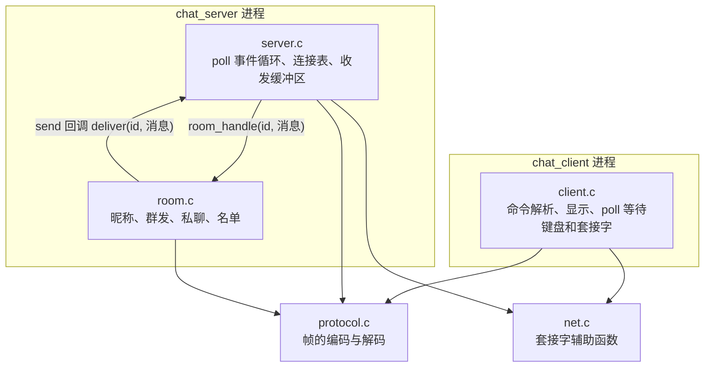
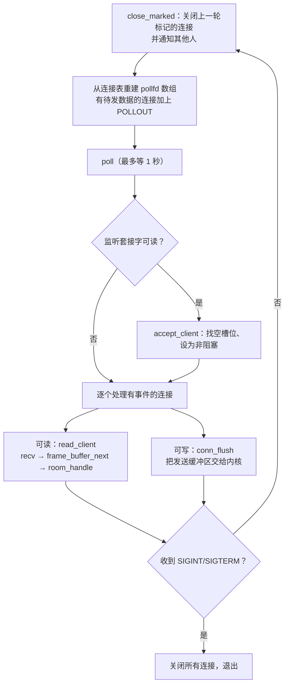
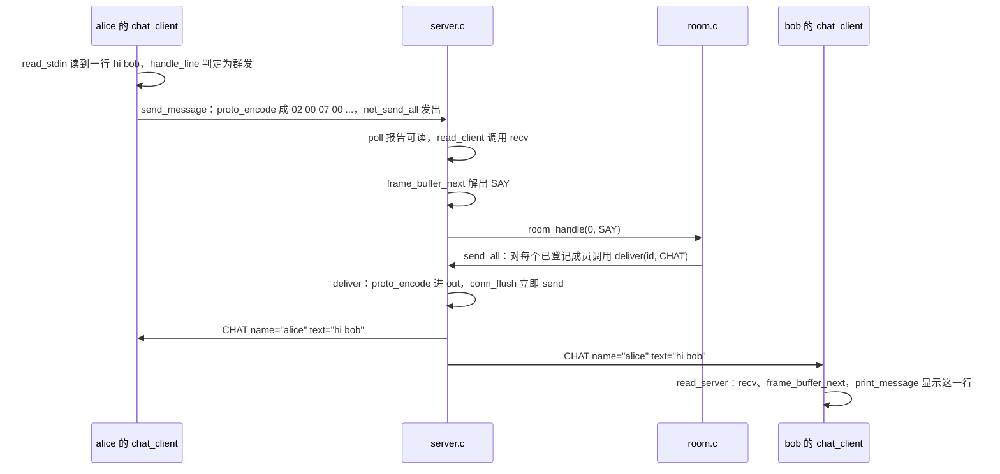
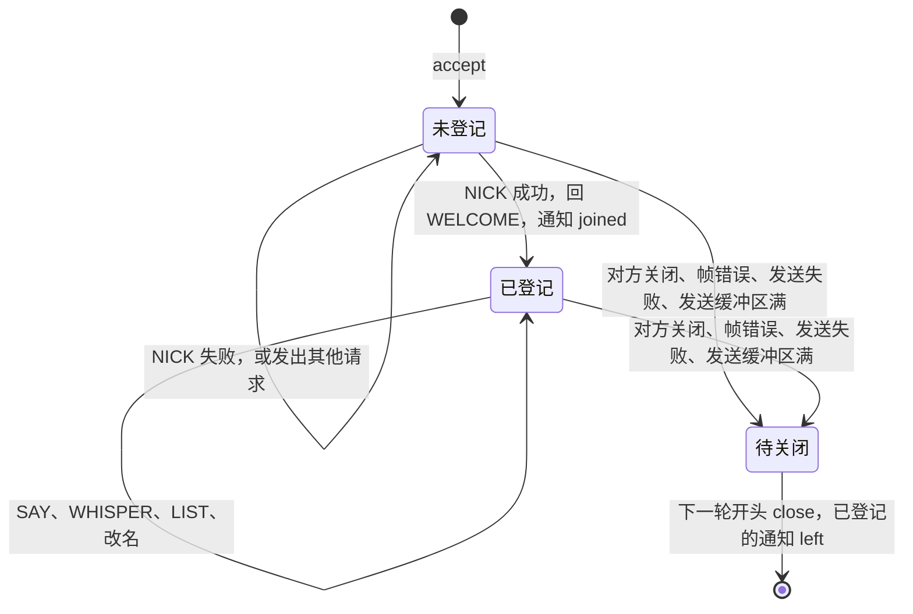

# Mdr Chat Room

一个教学用的多人聊天室：POSIX TCP 服务器 `chat_server` 和命令行客户端 `chat_client`。服务器在单个线程里用 `poll()` 同时服务多个连接，双方用一套自定义的长度前缀二进制协议通信，支持昵称、群发、私聊和在线名单。

配套正文是第五部分「项目案例」第 3 章：[项目概述](../../../docs/教程/正文/项目案例/Mdr_Chat_Room/3_1_项目概述.md)、[协议、消息与执行路径](../../../docs/教程/正文/项目案例/Mdr_Chat_Room/3_2_协议_消息与执行路径.md)、[测试与扩展任务](../../../docs/教程/正文/项目案例/Mdr_Chat_Room/3_3_测试与扩展任务.md)。

## 1. 项目目标

读完并动手改过这个项目，应当能够：

1. 在 TCP 字节流上设计和实现一个有明确边界的消息格式，正确处理拆包与粘包。
2. 用 `poll()` 写出单线程、非阻塞的服务器：接受连接、读、写、关闭都不会让整个进程停下来。
3. 把程序分成协议、业务、网络三层，让业务规则可以脱离套接字单独测试。
4. 为网络程序写三个层次的测试：纯函数的单元测试、用假网络层的逻辑测试、启动真实进程的集成测试。

项目刻意保持小：产品代码约 1300 行（含注释），测试约 600 行。它不做加密、持久化、多线程，也不追求上万并发；连接超时、`epoll`、优雅关闭等话题留给下一章的 Mdr Server。

## 2. 目录结构

```text
Mdr_Chat_Room/
├── CMakeLists.txt        CMake 构建与 CTest 测试登记
├── Makefile              没有 CMake 时的简易构建（GNU make）
├── include/
│   ├── protocol.h        线路格式：帧的布局、消息类型、编解码接口
│   ├── room.h            聊天室规则的接口，以及给网络层的发送回调类型
│   └── net.h             套接字辅助函数
├── src/
│   ├── protocol.c        帧的编码、解码与接收缓冲区（只用 ISO C）
│   ├── room.c            昵称登记、群发、私聊、在线名单（只用 ISO C）
│   ├── net.c             getaddrinfo、监听、连接、非阻塞、完整发送（POSIX）
│   ├── server.c          poll 事件循环、连接表、收发缓冲区、延迟关闭（POSIX）
│   └── client.c          命令解析、同时等待键盘和服务器、显示消息（POSIX）
└── tests/
    ├── check.h           极简的断言宏
    ├── test_protocol.c   协议的单元测试
    ├── test_room.c       聊天室规则的测试，用假的网络层记录发出的消息
    └── integration.sh    集成测试：真实的服务器、客户端进程和原始字节
```

`protocol.c` 和 `room.c` 只依赖 ISO C 标准库，在 Windows 上也能编译和测试；其余三个源文件需要 POSIX 套接字和 `poll()`，只在 Linux、macOS 等类 Unix 系统上构建。

## 3. 构建与测试

### 3.1 CMake（Linux、macOS）

需要 CMake 3.20 以上和支持 C11 的 GCC 或 Clang。

```sh
cmake -S . -B build
cmake --build build -j2
ctest --test-dir build --output-on-failure
```

在 Debian 13（GCC 14.2）上的输出（省略了开头的目录行）：

```text
    Start 1: protocol
1/3 Test #1: protocol .........................   Passed    0.00 sec
    Start 2: room
2/3 Test #2: room .............................   Passed    0.00 sec
    Start 3: integration
3/3 Test #3: integration ......................   Passed    2.14 sec

100% tests passed, 0 tests failed out of 3

Total Test time (real) =   2.14 sec
```

加上 AddressSanitizer 和 UBSan 再测一遍，可以发现越界访问、使用已释放的内存、有符号溢出等错误；服务器退出时 LeakSanitizer 还会检查内存泄漏。UBSan 默认只打印报告、程序照常运行，测试照样判为通过，所以这个选项还加了 `-fno-sanitize-recover=all`，让它一报错就终止程序：

```sh
cmake -S . -B build-asan -DCHAT_SANITIZE=ON
cmake --build build-asan -j2
ctest --test-dir build-asan --output-on-failure
```

`CMakeLists.txt` 给 GCC 和 Clang 打开了 `-Wall -Wextra -Wpedantic -Werror`，任何警告都会让构建失败。

### 3.2 Makefile

```sh
make -j2                       # 编译到 build/
make test                      # 单元测试 + 集成测试
make unit                      # 只跑单元测试
make clean && make SANITIZE=1 test
```

### 3.3 Windows

在 Windows 上只构建 `chat_core` 库和两个单元测试。用 MinGW-w64 时：

```sh
cmake -S . -B build -G Ninja
cmake --build build
ctest --test-dir build
```

或者直接 `mingw32-make unit`（Makefile 里用到 `mkdir -p` 和 `rm -rf`，需要 PATH 中有 Git for Windows 或 MSYS2 提供的 `sh`）。`MinGW Makefiles` 生成器配合 `mingw32-make` 处理不了路径里的中文（本仓库的 `code/项目/`），会报 `No rule to make target`；换用 Ninja，或把目录复制到纯英文路径下即可。

### 3.4 集成测试用的端口

集成测试默认在 `127.0.0.1:24680` 上启动服务器。端口被占用时，用环境变量换一个：

```sh
CHAT_TEST_PORT=25000 ctest --test-dir build --output-on-failure
```

## 4. 运行

开三个终端。服务器默认监听 `127.0.0.1:20000`，`-v` 打印每次读到的字节和收发的每条消息：

```sh
./build/chat_server -v          # 终端 1
./build/chat_client alice       # 终端 2
./build/chat_client bob         # 终端 3
```

两个程序都接受 `-h 主机` 和 `-p 端口`。客户端的命令：

| 输入 | 作用 |
|:---|:---|
| 普通的一行文字 | 发给所有人 |
| `/nick 新昵称` | 改昵称 |
| `/msg 昵称 内容` | 私聊 |
| `/list` | 查看在线名单 |
| `/help` | 显示命令列表 |
| `/quit` | 立即退出 |
| Ctrl-D | 不再发送，收完服务器的回复后退出 |

一次真实的会话：alice 先进入，bob 随后进入；alice 说了一句话，bob 用中文私聊 alice，alice 查看名单，bob 改名为 robert，最后两人先后离开。alice 的终端：

```text
connected to 127.0.0.1:24680, type /help for commands
* welcome to Mdr Chat Room, alice (1 online)
* bob joined
<alice> hi bob
[private] <bob> 你好，私聊一下
* online: alice bob
* bob is now known as robert
```

bob 的终端（他最后按了 Ctrl-D）：

```text
connected to 127.0.0.1:24680, type /help for commands
* welcome to Mdr Chat Room, bob (2 online)
<alice> hi bob
* bob is now known as robert
* alice left
connection closed by server
```

`chat_server -v` 的日志，`[#0]` 是连接编号：

```text
listening on 127.0.0.1:24680
[#0] connected from 127.0.0.1:53932
[#0] read 9 byte(s): 01 00 06 05 61 6c 69 63 65
[#0] recv NICK name="alice" text=""
[#0] send WELCOME name="alice" text="welcome to Mdr Chat Room, alice (1 online)"
[#1] connected from 127.0.0.1:53948
[#1] read 7 byte(s): 01 00 04 03 62 6f 62
[#1] recv NICK name="bob" text=""
[#1] send WELCOME name="bob" text="welcome to Mdr Chat Room, bob (2 online)"
[#0] send NOTICE name="" text="bob joined"
[#0] read 10 byte(s): 02 00 07 00 68 69 20 62 6f 62
[#0] recv SAY name="" text="hi bob"
[#0] send CHAT name="alice" text="hi bob"
[#1] send CHAT name="alice" text="hi bob"
[#1] read 30 byte(s): 03 00 1b 05 61 6c 69 63 65 e4 bd a0 e5 a5 bd ef bc 8c e7 a7 81 e8 81 8a e4 b8 80 e4 b8 8b
[#1] recv WHISPER name="alice" text="你好，私聊一下"
[#0] send PRIVATE name="bob" text="你好，私聊一下"
[#0] read 4 byte(s): 04 00 01 00
[#0] recv LIST name="" text=""
[#0] send USERS name="" text="alice bob"
[#1] read 10 byte(s): 01 00 07 06 72 6f 62 65 72 74
[#1] recv NICK name="robert" text=""
[#0] send NOTICE name="" text="bob is now known as robert"
[#1] send NOTICE name="" text="bob is now known as robert"
[#0] disconnected
[#1] send NOTICE name="" text="alice left"
[#1] disconnected
server stopped
```

客户端的标准输入不必是终端。输入结束时客户端只关闭发送方向，继续接收到服务器关闭连接为止，所以可以把命令从管道送进去（此时 alice 在线）：

```text
$ printf 'hello from a pipe\n/list\n' | ./build/chat_client -p 24680 bob 2>&1
connected to 127.0.0.1:24680, type /help for commands
* welcome to Mdr Chat Room, bob (2 online)
<bob> hello from a pipe
* online: alice bob
connection closed by server
```

## 5. 协议

### 5.1 帧格式

TCP 只保证字节按顺序到达，不保留发送时的边界：一条消息可能要好几次 `recv` 才收全，几条消息也可能一次 `recv` 就全部收到。所以每条消息在开头写明自己的长度。编码后的一条消息称为一帧：

| 偏移 | 长度（字节） | 字段 | 说明 |
|:---|:---|:---|:---|
| 0 | 1 | `type` | 消息类型，见 5.2 |
| 1 | 2 | `body_len` | 帧体长度，大端序，1～1041 |
| 3 | 1 | `name_len` | `name` 的字节数，0～16 |
| 4 | `name_len` | `name` | 昵称 |
| 4 + `name_len` | 其余 | `text` | 正文，0～1024 字节 |

前 3 字节是帧头，其后 `body_len` 字节是帧体，一帧最长 1044 字节。`name` 和 `text` 不带结尾的 `'\0'`，也不得含控制字符（0x00～0x1F 和 0x7F），否则服务器会把 ESC 序列、换行等转发到别人的终端上；其余字节原样传送，所以 UTF-8 编码的中文可以直接发。昵称只能由 1～16 个 ASCII 字母、数字、`_`、`-` 组成。

### 5.2 消息类型

客户端发出的类型小于 0x80，服务器发出的类型最高位为 1；请求与它引起的消息只差最高位。

| 值 | 名称 | 方向 | name | text |
|:---|:---|:---|:---|:---|
| 0x01 | NICK | 客户端 → 服务器 | 想用的昵称 | — |
| 0x02 | SAY | 客户端 → 服务器 | — | 群发的内容 |
| 0x03 | WHISPER | 客户端 → 服务器 | 接收者 | 私聊的内容 |
| 0x04 | LIST | 客户端 → 服务器 | — | — |
| 0x81 | WELCOME | 服务器 → 客户端 | 登记成功的昵称 | 欢迎词 |
| 0x82 | CHAT | 服务器 → 客户端 | 发言者 | 内容 |
| 0x83 | PRIVATE | 服务器 → 客户端 | 发送者 | 内容 |
| 0x84 | USERS | 服务器 → 客户端 | — | 以空格分隔的在线昵称 |
| 0x85 | NOTICE | 服务器 → 客户端 | — | 系统通知，如 `alice joined` |
| 0x86 | ERROR | 服务器 → 客户端 | — | 出错原因 |

连接建立后先要用 NICK 登记昵称，登记之前发出的其他请求都得到 ERROR `register a nickname first`。

### 5.3 字节示例

上面日志里的几帧：

```text
01 00 06 05 61 6c 69 63 65     NICK    body_len=6  name="alice"
02 00 07 00 68 69 20 62 6f 62  SAY     body_len=7  text="hi bob"
04 00 01 00                    LIST    body_len=1  两个字段都为空
```

用 bash 的 `/dev/tcp` 直接写字节（alice 仍在线）：先在登记之前发一帧 SAY，再在同一个连接上发 NICK `eve` 和 LIST。服务器的三帧回复被一次读了出来：

```text
$ exec 4<>/dev/tcp/127.0.0.1/24680
$ printf '\x02\x00\x03\x00hi' >&4
$ printf '\x01\x00\x04\x03eve\x04\x00\x01\x00' >&4
$ timeout 1 cat <&4 | od -An -tx1
 86 00 1a 00 72 65 67 69 73 74 65 72 20 61 20 6e
 69 63 6b 6e 61 6d 65 20 66 69 72 73 74 81 00 2c
 03 65 76 65 77 65 6c 63 6f 6d 65 20 74 6f 20 4d
 64 72 20 43 68 61 74 20 52 6f 6f 6d 2c 20 65 76
 65 20 28 32 20 6f 6e 6c 69 6e 65 29 84 00 0a 00
 61 6c 69 63 65 20 65 76 65
```

依次是 ERROR `register a nickname first`、WELCOME（name 为 `eve`）和 USERS `alice eve`。

### 5.4 两类错误

帧错误指类型未知、`body_len` 超出范围、`name_len` 与帧体不符，或字段里有控制字符。字节流一旦解析出错，就无法确定下一帧从哪里开始，所以服务器回一帧 ERROR（内容如 `bad frame length`）后断开这个连接。

请求错误指昵称不合法或已被占用、私聊对象不存在、未登记就发言。帧本身没有问题，服务器回 ERROR，连接照常保持。

## 6. 架构



依赖只朝一个方向：

- `protocol.c` 只管字节和消息之间的转换，不知道谁在发、发给谁。
- `room.c` 只管聊天规则。它通过成员编号认识每个连接，处理完一条消息后调用网络层提供的 `send` 回调，至于消息何时、怎样写进套接字，它不知道。
- `server.c` 只管连接：接受、读、写、关闭。它不知道昵称和聊天规则，收到完整的一帧就交给 `room_handle`。
- `net.c` 收拢 `getaddrinfo`、`bind`、`connect` 这些固定步骤，返回普通的文件描述符。

## 7. 关键数据结构

### 7.1 消息与接收缓冲区（protocol.h）

```c
typedef struct {
    msg_type type;
    char name[PROTO_NICK_MAX + 1];
    char text[PROTO_TEXT_MAX + 1];
} message;

typedef struct {
    unsigned char data[PROTO_FRAME_MAX];
    size_t len;
} frame_buffer;
```

`message` 是解码之后的样子，两个字段都以 `'\0'` 结尾。`frame_buffer` 是接收端的缓冲区：调用方把 `recv` 读到的字节追加到 `data[len]` 之后，再反复调用 `frame_buffer_next` 取出完整的帧。容量正好是一帧的上限，因为每次读完都会取走所有完整的帧，剩下的只能是不完整的半帧，而半帧所属的整帧不会超过上限，所以下一次 `recv` 总有空间。

### 7.2 聊天室（room.h）

```c
typedef void room_send_fn(void *ctx, int member_id, const message *msg);

typedef struct {
    bool registered;
    char nick[PROTO_NICK_MAX + 1];
} room_member;

typedef struct {
    room_member members[ROOM_CAPACITY];
    room_send_fn *send;
    void *ctx;
} chat_room;
```

成员编号就是 `members` 的下标。`send` 和 `ctx` 由网络层在 `room_init` 时提供；测试里换成一个把消息记进数组的函数，聊天规则就能在没有套接字的情况下测试。

### 7.3 连接表（server.c）

```c
typedef struct {
    int fd;
    bool closing;
    frame_buffer in;
    unsigned char out[OUTBUF_SIZE];
    size_t out_len;
} connection;

typedef struct {
    int listen_fd;
    bool verbose;
    connection conns[ROOM_CAPACITY];
    chat_room room;
} chat_server;
```

几条在整个程序里始终成立的约定：

1. `conns[i]` 与 `room.members[i]` 是同一个连接，编号 `i` 是两层之间唯一的联系。
2. `fd == -1` 表示槽位空闲。
3. `out_len > 0` 时才向 `poll` 要 `POLLOUT`；发送缓冲区满了，说明对方长期不读，直接断开它。
4. 发现连接该关闭时只把 `closing` 置为真，下一轮循环开头由 `close_marked` 统一关闭。这样处理事件的途中连接表不会变化，`deliver` 在群发循环里发现某个连接坏了，也不会重入 `room_leave`。

`chat_server` 里有 32 个 16 KiB 的发送缓冲区，约 0.5 MiB，所以 `main` 把它定义为 `static` 对象，而不放在栈上。

## 8. 执行路径

### 8.1 服务器主循环



### 8.2 一条群发消息的旅程



### 8.3 连接的生命周期



## 9. 测试

| 文件 | 层次 | 内容 |
|:---|:---|:---|
| `tests/test_protocol.c` | 单元测试 | 编码结果逐字节对照格式说明；长度字段的大端序；往返编解码；最大帧；每个真前缀都是 `PROTO_INCOMPLETE`；字节一个一个到达；几帧挤在一次读取里；各种坏帧；昵称规则 |
| `tests/test_room.c` | 逻辑测试 | 用假的网络层记录聊天室发出的每条消息：登记与加入通知、昵称冲突、未登记发言、群发只到已登记成员、私聊只到接收者、名单顺序、改名、离开后昵称释放、客户端冒充服务器消息 |
| `tests/integration.sh` | 集成测试 | 真实的服务器和四个客户端进程：登记与冲突、群发、中文、私聊、名单、改名、逐字节发送的 NICK、一次写出的两帧 SAY、坏帧只断开肇事连接、从管道输入（最后一行没有换行符，半关闭后仍收到回复）、私聊不外泄、`/quit` 与 Ctrl-D、SIGTERM 后服务器正常退出 |

集成测试不用固定时长的 `sleep` 等结果，而是在输出文件里反复查找期望的那一行，最多等 5 秒，任何一项失败就打印相关输出并退出。写它时踩过两个坑，正文第 3.3 节有详细分析：

1. 客户端的标准输出接到文件时是全缓冲的，不调用 `setvbuf(stdout, NULL, _IOLBF, 0)`，脚本就一直看不到客户端打印的消息。
2. 后启动的客户端会继承脚本里先打开的命名管道写端，脚本关闭 bob 的写端后 bob 仍读不到输入结束。所以启动客户端时要关闭 3～6 号描述符。

## 10. 已知限制

1. 明文传输，没有身份验证：谁都可以用任何空闲的昵称。
2. 昵称区分大小写，`Alice` 和 `alice` 是两个人；只允许 ASCII 字符。
3. 容量固定：最多 32 个连接（`ROOM_CAPACITY`），正文最长 1024 字节。改大容量时，`room.c` 里的静态断言会提醒同时改大 `PROTO_TEXT_MAX`，因为在线名单要装进一条消息。
4. 没有超时：一个连上来却不登记、也不发数据的客户端会一直占着槽位。
5. 慢客户端的处理很粗暴：16 KiB 的发送缓冲区满了就断开，不做限速，也不提示。
6. 断开连接时直接丢弃还没发出去的数据；回给坏帧发送者的 ERROR 只是尽力而为。
7. `poll` 每轮都要传入并检查全部描述符，代价与连接数成正比，适合几十个连接，不适合上万个。
8. 信号与 `poll` 之间的竞争用 1 秒超时兜底，而不是自管道或 `ppoll`，最坏情况下收到 SIGTERM 后 1 秒才退出。
9. 客户端没有行编辑：正在输入时收到的消息会插进当前行的显示里。
10. 只有一个聊天室，没有频道，也不保存历史。

## 11. 扩展任务

大致由易到难排列：

| 任务 | 要求与提示 | 主要改动 |
|:---|:---|:---|
| `/me` 动作消息 | `/me waves` 显示为 `* alice waves`。新增一对消息类型，体会改协议时要同步修改哪些地方，并补上单元测试和集成测试 | protocol.h、protocol.c、room.c、client.c、tests/ |
| 昵称不区分大小写 | 登记和查找时不区分大小写，显示时保留原样 | room.c、test_room.c |
| 关闭前通知 | 收到 SIGTERM 后先向所有人发 NOTICE `server is shutting down`，尽量发完发送缓冲区再退出 | server.c |
| 未登记连接的超时 | 记录连接建立的时刻（`clock_gettime(CLOCK_MONOTONIC, ...)`），10 秒内不登记就断开；`poll` 的超时改为到最近一个截止时刻的距离 | server.c |
| 防刷屏 | 每个成员一个令牌桶：每秒补 1 个令牌，最多存 5 个，超额时回 ERROR。想清楚当前时间从哪里来，它才仍能单独测试 | room.h、room.c |
| 最近消息回放 | 用环形缓冲区保存最近 20 条群发，新成员登记后先收到它们 | room.c |
| 多个频道 | `/join #name`；群发只到同频道的成员，`/list` 只列出同频道的人 | protocol.h、room.c、client.c |
| 用自管道处理信号 | 信号处理函数向管道写一个字节，把管道的读端加进 `poll`，去掉 1 秒超时 | server.c |
| 模糊测试解码器 | 用 libFuzzer 或 AFL++ 给 `proto_decode` 喂随机字节，配合 AddressSanitizer 运行 | 新建 tests/fuzz_decode.c |
| 换成 epoll | 在 Linux 上用 `epoll_wait` 替换 `poll`，比较两种写法在连接增减时要维护的状态，为 Mdr Server 热身 | server.c |

## 12. 参考资料

1. [***POSIX.1-2024: poll***](https://pubs.opengroup.org/onlinepubs/9799919799/functions/poll.html)
2. [***Linux man-pages: poll(2)、accept(2)、send(2)、shutdown(2)、socket(7)、signal(7)、pipe(7)***](https://man7.org/linux/man-pages/)
3. [***Beej's Guide to Network Programming***](https://beej.us/guide/bgnet/)，第 7.2 节 `poll()`、第 7.4 节部分发送、第 7.6 节聊天程序的数据封装
4. ***The Linux Programming Interface*** (ISBN 978-1-59327-220-3)，第 56～61 章套接字，第 63 章其他 I/O 模型
5. ***UNIX Network Programming, Volume 1, Third Edition*** (ISBN 978-0-13-141155-5)，第 6 章 I/O 复用，第 16 章非阻塞 I/O
6. [***RFC 2812: Internet Relay Chat: Client Protocol***](https://www.rfc-editor.org/rfc/rfc2812)，文本行协议的聊天系统，可与本项目的长度前缀格式对照
7. [***GNU Bash Reference Manual: Redirections***](https://www.gnu.org/software/bash/manual/html_node/Redirections.html)，`/dev/tcp`
8. [***CMake Documentation: ctest(1)***](https://cmake.org/cmake/help/latest/manual/ctest.1.html)
