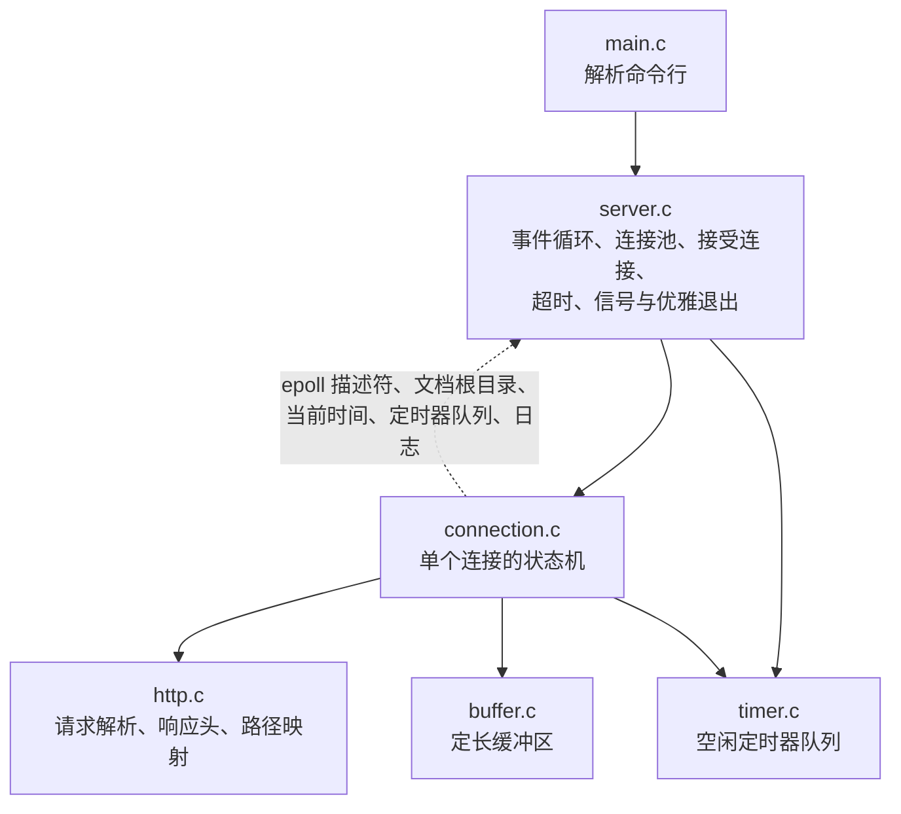
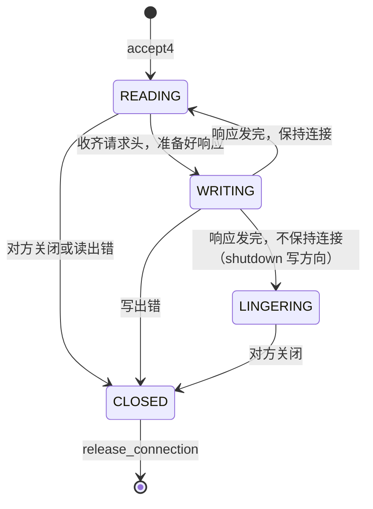

# Mdr Server

Mdr Server 是教程“项目案例”部分第 4 章使用的教学项目：一个单线程、事件驱动的 HTTP/1.1 静态文件服务器。它用 Linux 的 epoll 和非阻塞套接字同时服务多个连接，支持 GET 与 HEAD、长连接（keep-alive）与流水线（pipelining），用定时器关闭空闲连接，限制并发连接数和请求头大小，收到 SIGINT 或 SIGTERM 时优雅退出。

服务器本体约 1900 行 C11 代码（含注释和空行），测试约 1400 行。代码按“读者一周内能读完”来组织：每个模块只做一件事，注释解释为什么这样写。配套教程：

1. [4.1 Mdr Server 项目概述](../../../docs/教程/正文/项目案例/Mdr_Server/4_1_项目概述.md)
2. [4.2 Mdr Server：连接生命周期与事件分发](../../../docs/教程/正文/项目案例/Mdr_Server/4_2_连接生命周期与事件分发.md)
3. [4.3 Mdr Server：资源管理、健壮性与测试](../../../docs/教程/正文/项目案例/Mdr_Server/4_3_资源管理_健壮性与测试.md)

阅读之前最好学过系统编程部分的文件描述符、信号、套接字编程、非阻塞 I/O 与 I/O 多路复用、事件循环这几章。

## 项目目标

和第 3 章的 Mdr Chat Room 相比，本项目把 `poll` 换成 epoll，协议换成标准的 HTTP/1.1，并补上那一章留下的连接超时、资源上限和优雅退出。读完并动手改过这个项目，应当能够：

1. 用 epoll 写出单线程的事件驱动服务器，说清楚水平触发模式下每个状态该登记什么事件、为什么。
2. 把一个连接的处理写成显式的状态机：读请求、写响应、关闭各是一个状态，每个状态只等一种事件。
3. 用定长缓冲区处理 TCP 字节流：半个请求要攒齐，连在一起的几个请求要拆开，大文件要分段发送、跟着客户端的速度走。
4. 给服务器定下资源上限（连接数、描述符、内存、请求头大小、空闲时间），并让程序在达到上限时有确定的行为。
5. 写对关闭流程：单个连接分阶段关闭，整个服务器收到信号后优雅退出。
6. 为网络程序写单元测试和启动真实进程的集成测试，并用 Sanitizer 检查内存错误。

## 目录结构

```text
Mdr_Server/
├── CMakeLists.txt
├── Makefile               没有 CMake 时使用
├── include/
│   ├── buffer.h           定长字节缓冲区
│   ├── timer.h            空闲超时定时器队列
│   ├── http.h             请求解析、响应头、请求目标到文件路径
│   ├── connection.h       单个连接的状态机
│   └── server.h           事件循环、连接池、信号与退出
├── src/
│   ├── buffer.c
│   ├── timer.c
│   ├── http.c
│   ├── connection.c
│   ├── server.c
│   └── main.c             解析命令行
├── tests/
│   ├── unit_test.c        可移植模块的单元测试
│   └── integration_test.c 启动真实服务器的集成测试（Linux）
└── www/                   演示用的文档根目录
```

## 构建与测试

### Linux

需要 GCC 或 Clang，以及 CMake 3.20 以上（也可以只用 make）。在本目录下执行：

```bash
cmake -S . -B build/cmake
cmake --build build/cmake -j2
ctest --test-dir build/cmake --output-on-failure
```

集成测试默认使用 20080 端口。端口被占用时，在配置时换一个：`cmake -S . -B build/cmake -DMDR_SERVER_TEST_PORT=20081`。

在 Debian 13（GCC 14.2、CMake 3.31）上的输出：

```text
    Start 1: unit
1/2 Test #1: unit .............................   Passed    0.00 sec
    Start 2: integration
2/2 Test #2: integration ......................   Passed    2.32 sec

100% tests passed, 0 tests failed out of 2
```

没有 CMake 时用 Makefile，产物放在 `build/make/` 下：

```bash
make -j2
make test               # 换端口：make PORT=20081 test
```

用 AddressSanitizer 和 UndefinedBehaviorSanitizer 跑全部测试（产物放在 `build/asan/`）：

```bash
SAN="-fsanitize=address,undefined -fno-omit-frame-pointer"
make BUILD=build/asan CFLAGS="-O1 -g $SAN" LDFLAGS="$SAN" test
```

编译选项为 `-std=c11 -Wall -Wextra -Wpedantic -Werror`。如果新版编译器多出的警告让构建失败，可以先用 `-DMDR_SERVER_WERROR=OFF`（CMake）或 `make WERROR=`（Makefile）关掉 `-Werror`。

### Windows

服务器依赖 epoll，只能在 Linux 上构建；在 Windows 上想运行它，可以用 WSL。缓冲区、定时器和 HTTP 三个模块只用标准 C，可以用 MinGW 编译并运行单元测试（在 cmd、PowerShell 和 Git Bash 里都可以执行，Makefile 在 Windows 上固定用 cmd.exe 执行命令）：

```bash
mingw32-make unit-test
```

也可以用 CMake。本仓库的路径里有中文（`code/项目/`），CMake 的“MinGW Makefiles”生成器生成的规则在这种路径下找不到源文件，请改用 Ninja 生成器；Makefile 用的是相对路径，不受影响：

```bash
cmake -G Ninja -S . -B build/cmake
cmake --build build/cmake
ctest --test-dir build/cmake
```

## 运行

```bash
./build/cmake/mdr_server -p 8080 -r www
```

然后在浏览器中打开 `http://127.0.0.1:8080/`。

| 选项 | 含义 | 默认值 |
| :--- | :--- | :--- |
| `-b ADDR` | 监听的 IPv4 地址 | `127.0.0.1` |
| `-p PORT` | 端口 | `8080` |
| `-r DIR` | 文档根目录 | `www` |
| `-c N` | 最大并发连接数 | `1024` |
| `-m BYTES` | 请求头的最大字节数 | `8192` |
| `-t MS` | 空闲超时（毫秒） | `10000` |
| `-q` | 只输出错误 | |
| `-v` | 另外输出连接的建立、关闭和超时 | |

服务器默认只监听 `127.0.0.1`，别的机器连不上。要对外提供服务，需要显式写 `-b 0.0.0.0`，这时请先确认文档根目录里没有不该公开的文件。

下面是一次实际运行的记录：端口 26083，空闲超时 2 秒，`-v` 打开连接日志。

```text
$ ./build/cmake/mdr_server -p 26083 -t 2000 -v

$ curl -i http://127.0.0.1:26083/hello.txt
HTTP/1.1 200 OK
Date: Sun, 18 Oct 2026 06:22:24 GMT
Server: Mdr_Server
Content-Type: text/plain; charset=utf-8
Content-Length: 13
Connection: keep-alive

hello, world

$ curl -I http://127.0.0.1:26083/docs
HTTP/1.1 301 Moved Permanently
Date: Sun, 18 Oct 2026 06:22:24 GMT
Server: Mdr_Server
Content-Type: text/plain; charset=utf-8
Location: /docs/
Content-Length: 22
Connection: keep-alive

$ curl -i --path-as-is http://127.0.0.1:26083/../etc/passwd
HTTP/1.1 403 Forbidden
Date: Sun, 18 Oct 2026 06:22:24 GMT
Server: Mdr_Server
Content-Type: text/plain; charset=utf-8
Content-Length: 14
Connection: keep-alive

403 Forbidden
```

curl 一次请求两个地址时会复用同一个连接：

```text
$ curl -sv http://127.0.0.1:26083/hello.txt http://127.0.0.1:26083/ -o /dev/null -o /dev/null 2>&1 | grep -iE "connected|re-using|left intact"
* Connected to 127.0.0.1 (127.0.0.1) port 26083
* Connection #0 to host 127.0.0.1 left intact
* Re-using existing http: connection with host 127.0.0.1
* Connection #0 to host 127.0.0.1 left intact
```

随后用 bash 的 `/dev/tcp` 连上服务器、什么也不发，服务器在 2014 毫秒后关闭了连接。最后向服务器发送 SIGINT（在终端里按 Ctrl+C 的效果相同），服务器的日志如下：

```text
14:22:24 descriptor limit raised from 1024 to 2064
14:22:24 serving www on http://127.0.0.1:26083/
14:22:24 limits: 1024 connections, 8192-byte request heads, 2000 ms idle timeout, 24 KiB of buffers per connection
14:22:24 127.0.0.1:46620 connected (1 active)
14:22:24 127.0.0.1:46620 "GET /hello.txt" 200 13
14:22:24 127.0.0.1:46620 closed
14:22:24 127.0.0.1:46628 connected (1 active)
14:22:24 127.0.0.1:46628 "HEAD /docs" 301 22
14:22:24 127.0.0.1:46628 closed
14:22:24 127.0.0.1:46632 connected (1 active)
14:22:24 127.0.0.1:46632 "GET /../etc/passwd" 403 14
14:22:24 127.0.0.1:46632 closed
14:22:24 127.0.0.1:46646 connected (1 active)
14:22:24 127.0.0.1:46646 "GET /hello.txt" 200 13
14:22:24 127.0.0.1:46646 "GET /" 200 538
14:22:24 127.0.0.1:46646 closed
14:22:24 127.0.0.1:46652 connected (1 active)
14:22:26 127.0.0.1:46652 idle timeout
14:22:26 127.0.0.1:46652 closed
14:22:26 received SIGINT, shutting down
14:22:26 waiting for 0 connection(s) to finish
14:22:26 bye
```

第一行说明：那台机器上描述符的软限制是 1024，不够 1024 个连接使用（每个连接最多占 2 个描述符，另外预留 16 个），服务器启动时把软限制提高到了 2064。

## 架构

### 模块



| 模块 | 职责 | 依赖 |
| :--- | :--- | :--- |
| `buffer` | 定长字节缓冲区：追加、消费、整理 | 标准 C |
| `timer` | 空闲超时定时器队列：O(1) 重新计时、取最早到期 | 标准 C |
| `http` | 解析请求头，生成响应头，把请求目标映射成相对路径，按扩展名确定 Content-Type | 标准 C |
| `connection` | 单个连接的状态机：读请求、准备响应、发送文件、分阶段关闭 | POSIX、epoll，以及 `server.h` |
| `server` | 监听套接字、事件循环、连接池、超时、信号与优雅退出 | Linux（epoll、signalfd、accept4） |
| `main` | 解析命令行参数 | POSIX（getopt） |

`connection` 和 `server` 互相依赖：`server` 调用连接的处理函数，`connection.c` 也包含 `server.h`，从 `struct server` 中取 epoll 描述符、文档根目录、本轮的时间 `now_ms`、定时器队列和 `shutting_down` 标志，并用 `server_log` 写日志（图中的虚线）。可移植的三个模块不依赖它们。

`buffer`、`timer`、`http` 三个模块不读时钟、不碰描述符，数据和当前时间都由调用者传进来，所以单元测试不需要网络，也不必真的等待超时。它们编译成静态库 `mdr_server_core`，服务器和单元测试都链接它。

### 事件循环

`server_run` 的每一轮做四件事：

1. 用定时器队列算出离最早的超时还有多少毫秒，作为 `epoll_wait` 的超时参数；没有连接时无限等待。
2. `epoll_wait` 返回后读一次单调时钟，存进 `now_ms`，这一轮的处理函数都用它。
3. 逐个分发就绪事件。`epoll_event` 的 `data.ptr` 里存的是标记：监听套接字和 signalfd 用 `struct server` 中对应成员的地址，连接用连接对象的地址。
4. 这一批事件处理完之后，关闭超时的连接；如果收到了退出信号，开始优雅退出。

第 4 步必须放在批次之后，因为这些操作会关闭“别的”连接。如果在批次中间关闭并回收了一个连接，同一批里排在后面、还没处理的事件可能正指向它（epoll(7) 中“If using an event cache...”一条讲的就是这个问题）。连接自己的处理函数也只把状态设成 `CONN_CLOSED`，由 `dispatch` 在处理函数返回之后回收。

### 连接状态机



图中没有画超时：三个状态下超时都由 `server.c` 直接回收连接。

| 状态 | 在 epoll 中登记 | 事件到来时 |
| :--- | :--- | :--- |
| `CONN_READING` | `EPOLLIN` | `read` 进输入缓冲区，凑出完整的请求头就准备响应 |
| `CONN_WRITING` | `EPOLLOUT` | 从文件读一段进输出缓冲区，再 `write` 出去 |
| `CONN_LINGERING` | `EPOLLIN` | 读出的数据直接丢弃，读到 EOF 就关闭 |

服务器使用水平触发（level-triggered）模式：只要套接字可写，登记了 `EPOLLOUT` 的连接每一轮都会被报告。所以登记什么事件必须跟着状态切换，没有数据要写时不能留着 `EPOLLOUT`。做过一个对照实验：去掉 `finish_response` 中切回 `EPOLLIN` 的那一行，客户端下载 8 MiB 文件后在长连接上空闲 1 秒，用 `strace -c` 统计，这 1 秒里 `epoll_wait` 被调用了 36305 次，36174 次 `read` 返回 `EAGAIN`；正确的版本在整个过程中只调用了 132 次 `epoll_wait`。

准备好响应以后，服务器先直接尝试 `write`，多数小响应一次就发完，不必等可写事件；写不完才登记 `EPOLLOUT`。每次调用 `send_response` 最多 `write` 4 次（每次至多 16 KiB），然后把控制权交还事件循环，一个读得很快的客户端下载大文件时，别的连接不会被饿着。这个份额按响应计算：输入缓冲区里已经有流水线发来的请求时，同一个事件会接着回应它们，每个响应各有 4 次。用 `strace` 观察过，一次发来 60 个请求 `hello.txt` 的流水线，服务器在一次 `epoll_wait` 之后连续 `write` 了 60 次。一个事件里能处理的请求数受输入缓冲区大小（`-m`）限制。

## 关键数据结构

### 连接与连接池

```c
struct connection {
    enum conn_state state;
    int fd;
    uint32_t events;         // 当前在 epoll 中登记的事件
    struct buffer in;        // 收到了、还没处理的请求数据
    struct buffer out;       // 等待写出的响应数据
    int file_fd;             // 正在发送的文件，没有时为 -1
    uint64_t file_remaining; // 文件中还没读进 out 的字节数
    bool keep_alive;         // 当前响应发完后是否继续读下一个请求
    struct timer idle_timer; // 一段时间没有任何进展就关闭连接
    char peer[32];           // 对端的 "IP:端口"，用于日志
    struct server *server;
    struct connection *next_free; // 槽位空闲时串在空闲链表上
};
```

启动时 `create_pool` 一次分配 `-c` 个槽位以及每个槽位的两个缓冲区，空闲槽位串成单链表 `free_list`。接受连接就从链表头取一个槽位，关闭连接就把它放回去；运行中不再分配内存。连接数上限就是槽位的个数。

### 定长缓冲区

```text
0              start            end            capacity
|-- 已处理的 --|---- 待处理 ----|---- 空闲 ----|
```

`read` 直接写到 `end` 处（`buffer_tail`），再用 `buffer_commit` 登记长度；处理完的数据用 `buffer_consume` 从 `start` 处丢弃。数据全部处理完时两个下标回到 0；只剩一部分时，下一次读之前用 `buffer_compact` 把它挪到开头。缓冲区不会增长，请求头装不下输入缓冲区就回 431。

### 空闲定时器队列

所有连接的超时时长都相同，到期时间等于最后一次活动的时刻加上同一个时长。所以“按到期时间排序”就是“按最后一次活动的先后排序”：每次有进展就把连接的定时器移到队尾，队头总是最早到期的那个。队列是带哨兵结点的双向循环链表，重新计时、取消、取最早到期都是 O(1)。Node.js 管理定时器也用了同样的思路：时长相同的定时器放在同一个链表里，追加到末尾就能保持有序。

## 执行路径

### 一个请求

1. `epoll_wait` 报告监听套接字可读，`dispatch` 调用 `accept_connections`。
2. `accept4` 得到非阻塞的新套接字，`connection_open` 从连接池取出槽位，用 `EPOLL_CTL_ADD` 登记 `EPOLLIN`，启动空闲定时器。
3. 请求数据到达，`connection_handle_event` 按状态调用 `on_readable`：`read` 进输入缓冲区，交给 `process_input`。
4. `http_parse_request` 确认收齐了请求头并解析它；`handle_request` 用 `http_target_to_path` 得到相对路径，用 `openat` 相对文档根目录打开文件，`fstat` 取得长度，把响应头写进输出缓冲区。
5. `send_response` 用 `fill_from_file` 把文件的下一段读进输出缓冲区，`write` 给客户端，直到发完、遇到 `EAGAIN` 或用完本次的份额。
6. 发完以后 `finish_response` 根据 `keep_alive` 回到 `CONN_READING`，或者 `shutdown(fd, SHUT_WR)` 转入 `CONN_LINGERING`。

下面是 `strace` 记录的一个连接：先发一个普通请求，再发一个带 `Connection: close` 的请求。服务器以 `-q` 运行，没有日志输出。

```text
accept4(6, {sa_family=AF_INET, sin_port=htons(57314), sin_addr=inet_addr("127.0.0.1")}, [16], SOCK_CLOEXEC|SOCK_NONBLOCK) = 7
setsockopt(7, SOL_TCP, TCP_NODELAY, [1], 4) = 0
epoll_ctl(4, EPOLL_CTL_ADD, 7, {events=EPOLLIN, data=0x7efe051a5010}) = 0
accept4(6, 0x7fff496a0e40, [16], SOCK_CLOEXEC|SOCK_NONBLOCK) = -1 EAGAIN (Resource temporarily unavailable)
epoll_wait(4, [{events=EPOLLIN, data=0x7efe051a5010}], 64, 9999) = 1
read(7, "GET /hello.txt HTTP/1.1\r\nHost: x"..., 8192) = 36
openat(3, "hello.txt", O_RDONLY|O_NONBLOCK|O_CLOEXEC) = 8
fstat(8, {st_mode=S_IFREG|0644, st_size=13, ...}) = 0
read(8, "hello, world\n", 13)           = 13
close(8)                                = 0
write(7, "HTTP/1.1 200 OK\r\nDate: Sun, 18 O"..., 174) = 174
epoll_wait(4, [{events=EPOLLIN, data=0x7efe051a5010}], 64, 10000) = 1
read(7, "GET /hello.txt HTTP/1.1\r\n", 8192) = 25
epoll_wait(4, [{events=EPOLLIN, data=0x7efe051a5010}], 64, 10000) = 1
read(7, "Host: x\r\nConnection: close\r\n\r\n", 8167) = 30
openat(3, "hello.txt", O_RDONLY|O_NONBLOCK|O_CLOEXEC) = 8
fstat(8, {st_mode=S_IFREG|0644, st_size=13, ...}) = 0
read(8, "hello, world\n", 13)           = 13
close(8)                                = 0
write(7, "HTTP/1.1 200 OK\r\nDate: Sun, 18 O"..., 169) = 169
shutdown(7, SHUT_WR)                    = 0
epoll_wait(4, [{events=EPOLLIN|EPOLLHUP, data=0x7efe051a5010}], 64, 10000) = 1
read(7, "", 16384)                      = 0
close(7)                                = 0
```

几个值得注意的地方：响应头和文件内容在同一次 `write` 中发出；第二个请求分两次到达（25 字节和 30 字节），服务器攒齐之后才处理；`epoll_wait` 的超时参数 9999、10000 来自空闲定时器；发完 `Connection: close` 的响应后先 `shutdown` 写方向，等客户端关闭（`EPOLLHUP`、`read` 返回 0）才 `close`。原始记录里第一次格式化 Date 头时还有一次打开 `/etc/localtime` 的系统调用，来自 glibc 的 `gmtime`：它第一次被调用时要初始化时区信息，哪怕算的是 UTC 时间。上面省略了这几行。

### 超时

`timer_queue_wait_ms` 决定 `epoll_wait` 最多等多久。`epoll_wait` 返回后，`close_idle_connections` 反复调用 `timer_queue_pop_expired` 取出已到期的定时器，通过 `owner` 找到连接并回收。读到或写出数据时 `touch` 会重新计时，所以只有一直没有进展的连接才会超时：等请求时客户端不发、发送响应时客户端不读、分阶段关闭时客户端不关，都算没有进展。

### 优雅退出

SIGINT 和 SIGTERM 在启动时被阻塞，改由 signalfd 接收，和网络事件在同一个循环里处理：

1. signalfd 可读，`read_signals` 记下 `shutdown_requested`。
2. 这一批事件处理完后，`begin_shutdown` 关闭监听套接字，直接回收空闲的长连接，其余连接的 `keep_alive` 设为 false，处理完手头的请求就关闭。
3. 最后一个连接关闭后离开事件循环，`server_cleanup` 释放全部资源，进程以状态 0 退出。

再收到一个 SIGINT 或 SIGTERM 就不再等待，立即退出。

## 资源上限

| 资源 | 上限 | 达到上限时 |
| :--- | :--- | :--- |
| 并发连接 | `-c`，即连接池的槽位数 | 监听套接字移出 epoll，新连接留在内核的接受队列里，有连接关闭后再接受 |
| 文件描述符 | 每个连接 2 个，另预留 16 个 | 启动时把软限制提高到够用（不超过硬限制），仍不够就降低连接数上限；运行中 `accept` 报 `EMFILE` 时暂停接受 |
| 内存 | 每个连接 `-m` 字节输入缓冲区加 16 KiB 输出缓冲区 | 启动时一次分配，运行中不再分配 |
| 请求头 | `-m` 字节 | 回 431 并关闭连接 |
| 请求目标 | 2048 字节 | 回 414 并关闭连接 |
| 空闲时间 | `-t` 毫秒 | 直接关闭连接 |
| 一次 `send_response` | 4 次 `write` | 回到事件循环，下一轮接着写 |

按默认参数，1024 个连接的缓冲区共 1024 × 24 KiB = 24 MiB。

连接池满时，服务器选择暂停接受，而不是接受之后立即关闭：排队的客户端稍后仍能得到服务，不会无缘无故地被断开。暂停时必须把监听套接字移出 epoll，因为接受队列非空时它一直可读，水平触发模式下留着它，事件循环就会空转。

## 测试

单元测试（`tests/unit_test.c`）覆盖缓冲区的追加、消费与整理，定时器队列的排序、取消与等待时间，请求解析（完整与不完整的请求头、流水线、HTTP/1.0 与 1.1 的长连接规则、只用 LF 换行、请求行之前的空行、各种格式错误），请求目标到路径的映射（百分号解码、多余的 `/`、`..` 和隐藏文件），以及响应头的格式。响应头的测试使用 RFC 9110 中的示例时间，输出可以逐字节比较。共 109 项检查：

```text
unit tests: 109 checks, 0 failed
```

集成测试（`tests/integration_test.c`）在 `$TMPDIR` 下建一个临时文档根目录（包括一个 8 MiB 的文件、一个隐藏文件和一个放在根目录之外的文件），以 `-c 4 -m 4096 -t 1000` 启动真实的服务器，再像客户端一样发请求、检查响应：

```text
[ ok ] GET / serves index.html
[ ok ] HEAD sends headers only
[ ok ] 404 keeps the connection open
[ ok ] percent-encoded UTF-8 file name
[ ok ] no access outside the document root
[ ok ] directory without '/' is redirected
[ ok ] keep-alive: three requests on one connection
[ ok ] pipelined requests answered in order
[ ok ] Connection: close
[ ok ] HTTP/1.0 with and without keep-alive
[ ok ] malformed and unsupported requests
[ ok ] unread request body: lingering close
[ ok ] GET with a body closes afterwards
[ ok ] 414 for a long request target
[ ok ] 431 for an oversized request head
[ ok ] 8 MiB file arrives intact
[ ok ] request arriving byte by byte
[ ok ] stalled reader does not block others
[ ok ] idle connection is closed after the timeout
[ ok ] connection limit pauses accept
[ ok ] graceful shutdown on SIGTERM
[ ok ] second SIGTERM exits immediately
integration tests: 22 passed, 0 failed
```

其中几项值得单独说明：

1. “unread request body” 发送带 1 MiB 请求体的 POST。服务器不读请求体，回 501 后分阶段关闭。把 `finish_response` 改成直接关闭再跑，这一项会以 `send: Connection reset by peer` 失败：服务器的接收缓冲区里还有没读的数据，`close` 发出的是 RST。
2. “no access outside the document root” 包括一个以 `//` 开头的绝对路径。如果路径映射只去掉开头的一个 `/`，`openat` 拿到的就是绝对路径，会忽略文档根目录，这一项会以 `expected status 404, got 200` 失败。
3. “directory without '/' is redirected” 还请求了 `//docs?x=1`，检查 `Location` 是 `/docs/?x=1`。如果把请求目标原样拼进 `Location`，得到的 `//docs/` 在浏览器看来是省略了协议的网址，会跳到主机名为 `docs` 的另一个网站（开放重定向）。
4. “stalled reader” 让一个客户端请求大文件后暂时不读，同时检查另一个客户端的请求能在 500 毫秒内得到回应。
5. 两个关于退出的测试检查进程的退出状态。用 Sanitizer 构建时，LeakSanitizer 发现泄漏会让进程以非 0 状态退出，所以这两项也起到了检查内存泄漏的作用。

服务器子进程设置了 `PR_SET_PDEATHSIG`：测试进程无论怎样退出（包括被 `timeout` 或 Ctrl+C 结束），内核都会结束服务器，它不会留在后台占着端口。

## 压力测试方法

下面的方法没有实际运行过，这里只给出步骤。压力测试会占满 CPU 和网络，请在自己的机器上做，不要在共享或生产机器上做。

常用的负载生成工具有 [wrk](https://github.com/wg/wrk)（HTTP/1.1，长连接）、ApacheBench `ab`（HTTP/1.0，`-k` 时发送 `Connection: Keep-Alive`）和 nghttp2 附带的 `h2load`（加 `--h1` 测 HTTP/1.1）。服务器对这几种请求都能处理。

```bash
# 服务器：关掉访问日志，否则每个请求一次 stderr 写入会成为瓶颈
ulimit -n 10000
./build/cmake/mdr_server -q -p 8080 -c 4096 -r www &

# 长连接：200 个并发连接，持续 30 秒
wrk -t2 -c200 -d30s --latency http://127.0.0.1:8080/hello.txt

# 每个请求新建连接，对比建立和关闭连接的开销
wrk -t2 -c200 -d30s -H "Connection: close" http://127.0.0.1:8080/hello.txt

# HTTP/1.0 长连接
ab -k -n 100000 -c 100 http://127.0.0.1:8080/hello.txt
```

可以按下面的思路设计实验：

1. 对比长连接和短连接的吞吐量与延迟分布。短连接时用 `ss -s` 和 `ss -tan state time-wait | wc -l` 观察 TIME_WAIT 状态的连接数。
2. 把服务器的 `-c` 设成 100，让 wrk 开 500 个连接。超出上限的连接在接受队列中等待，延迟上升；接受队列也满了以后，内核不再完成新的握手，客户端建立连接会变慢甚至超时。观察服务器日志和 wrk 报告的 socket errors。
3. 用不同大小的文件测吞吐量，再用 `strace -c -p PID` 看 `read`、`write`、`epoll_wait` 的调用次数，估算改用 `sendfile` 能省掉多少系统调用和复制。
4. 开大量连接后什么也不发，验证空闲超时能把它们回收，连接数和描述符数随之下降。
5. 压测过程中观察服务器：`top -p PID` 看 CPU，`ps -o rss= -p PID` 看常驻内存，`ls /proc/PID/fd | wc -l` 看描述符数量。连接池在启动时一次分配，内存在压测过程中不应持续增长。
6. 用 Sanitizer 构建的服务器在较低负载下跑一段时间，检查有没有内存错误。

负载生成器和服务器在同一台机器上会争抢 CPU，可以用 `taskset` 把它们绑到不同的核上；回环地址的结果也不能代表真实网络。

## 已知限制

1. 单线程。读普通文件不受 `O_NONBLOCK` 影响，数据不在页缓存中时 `read` 会阻塞，整个事件循环跟着等磁盘。
2. 只支持 GET 和 HEAD，不读请求体。带请求体的请求得到回应后连接即关闭；其他方法回 501。
3. 不支持 Range、条件请求（`If-Modified-Since`、`ETag`）、压缩和目录列表。
4. 只接受以 `/` 开头的请求目标（origin-form），absolute-form 回 400。只支持 IPv4，没有 TLS。
5. 文档根目录中的符号链接会被跟随，它可以指向根目录之外。
6. 以 `.` 开头的路径段一律回 403，因此也无法提供 `/.well-known/` 下的文件。
7. 所有阶段共用一个空闲超时。客户端每隔略短于超时的时间发一个字节，就能长期占住一个连接（slowloris 攻击）；连接数上限限制了它的影响。
8. 每次收到数据都从头扫描请求头。请求头逐字节到达时，总的扫描量是请求头长度的平方量级，但请求头长度受 `-m` 限制。
9. 访问日志同步写到 stderr，压测时应该用 `-q` 关掉。

## 扩展任务

由易到难排列：

1. 发送 `Last-Modified`，处理 `If-Modified-Since`，文件没变时回 304。
2. 支持单个范围的 Range 请求，回 206。
3. 用 `sendfile(2)` 发送文件内容，用 `strace -c` 对比改动前后的系统调用次数。
4. 加一个读请求头的总时限，防御 slowloris。两个时限各用一个定时器队列，仍然保持 O(1)；或者改用最小堆，支持任意时长的定时器。
5. 改用边沿触发（`EPOLLET`），想清楚读写各要循环到什么时候为止，再用现有的集成测试验证。
6. 每个线程一个事件循环，用 `SO_REUSEPORT` 让多个监听套接字分担连接；或者把读文件交给线程池。
7. 支持 IPv6，同时监听 IPv4 和 IPv6。
8. 在 Linux 5.6 以上用 `openat2` 的 `RESOLVE_BENEATH` 打开文件，让符号链接也跳不出文档根目录。
9. 没有 `index.html` 的目录生成文件列表，注意对文件名做 HTML 转义。
10. 访问日志写到文件，收到 SIGHUP 时重新打开，配合日志轮转工具使用。
11. 增加 `/status` 页面，报告当前连接数、累计请求数等统计信息。
12. 仿照 Redis 的 ae，把 epoll 封装在一个小接口后面，再实现一个 kqueue 版本，让服务器能在 macOS 和 BSD 上运行。signalfd 可以换成 kqueue 的 `EVFILT_SIGNAL`；macOS 没有 `accept4`，改用 `accept` 加 `fcntl`。

## 参考资料

1. [epoll(7)](https://man7.org/linux/man-pages/man7/epoll.7.html)、[epoll_ctl(2)](https://man7.org/linux/man-pages/man2/epoll_ctl.2.html)、[accept(2)](https://man7.org/linux/man-pages/man2/accept.2.html)、[signalfd(2)](https://man7.org/linux/man-pages/man2/signalfd.2.html)、[shutdown(2)](https://man7.org/linux/man-pages/man2/shutdown.2.html)、[getrlimit(2)](https://man7.org/linux/man-pages/man2/getrlimit.2.html)、[openat(2)](https://man7.org/linux/man-pages/man2/openat.2.html)、[PR_SET_PDEATHSIG(2const)](https://man7.org/linux/man-pages/man2/PR_SET_PDEATHSIG.2const.html)，Linux man-pages。
2. [accept, accept4](https://pubs.opengroup.org/onlinepubs/9799919799/functions/accept.html)，POSIX.1-2024。
3. [RFC 9110: HTTP Semantics](https://www.rfc-editor.org/rfc/rfc9110.html)、[RFC 9112: HTTP/1.1](https://www.rfc-editor.org/rfc/rfc9112.html)、[RFC 6585: Additional HTTP Status Codes](https://www.rfc-editor.org/rfc/rfc6585.html)（431）。
4. [nginx: ngx_http_core_module](https://nginx.org/en/docs/http/ngx_http_core_module.html)：`lingering_close`、`keepalive_timeout`、`send_timeout` 等指令的说明。
5. [libev 文档](http://pod.tst.eu/http://cvs.schmorp.de/libev/ev.pod)：“The special problem of accept()ing when you can't”。
6. [Node.js lib/internal/timers.js](https://github.com/nodejs/node/blob/main/lib/internal/timers.js)：时长相同的定时器共用一个链表的设计说明。
7. Michael Kerrisk，**_The Linux Programming Interface_**，第 63 章 Alternative I/O Models。
8. [Beej's Guide to Network Programming](https://beej.us/guide/bgnet/)。
9. 本教程的 [Redis ae 事件循环](../../../docs/教程/正文/项目案例/Redis/5_3_ae事件循环.md)。
