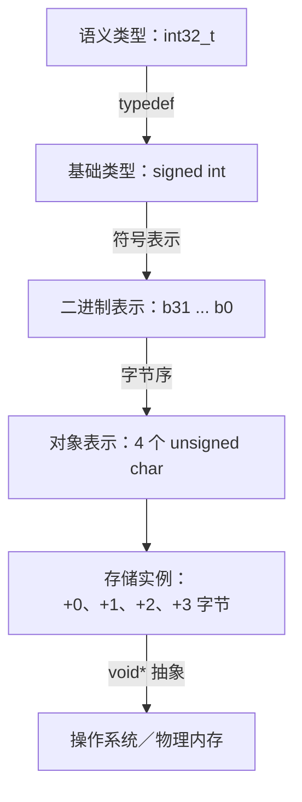

# 第 12 章：C 内存模型

本章介绍：

- 理解对象表示；
- 使用无类型指针与强制转换；
- 通过有效类型和对齐限制对象访问。

[[toc]]

指针为程序执行所处的环境和状态提供了一种抽象，即 **C 内存模型**。对（几乎）所有对象都可以使用一元运算符 `&`，[^register-address] 取得其地址，再借助该地址检查并改变执行状态。

这种通过指针访问对象的方式仍然是一种抽象，因为 C 并不区分对象的“真实”位置。对象可能位于计算机的 RAM 中、磁盘文件中，甚至对应月球上某个温度传感器的输入输出端口；这些你都不必关心。无论对象位于何处，C 都应当正确处理。

事实上，在现代操作系统上，通过指针得到的只是所谓的**虚拟内存**。它基本上是一套虚构的机制，把进程地址空间映射到机器的物理内存地址。发明这套机制，是为了让程序执行具有以下性质：

- **可移植：** 不必关心具体机器上的物理内存地址。
- **安全：** 读取或写入不属于当前进程的虚拟内存，既不会影响操作系统，也不会影响其他进程。

C 唯一必须关心的，是指针所指对象的类型。每种指针类型都由另一类型——它的**基础类型**——派生而来，而且由此派生出的每种类型都是互不相同的新类型。

::: tip 要点 12 #1
基础类型不同的指针类型彼此不同。
:::

内存模型除了提供物理内存的虚拟视图，还简化了我们观察对象的方式：它假定每个对象都是一组字节，这组字节称为**对象表示**（第 12.1 节）。[^object-binary] 联合体是检查对象表示的便利工具（第 12.2 节）。直接访问对象表示（第 12.3 节），可以对程序做一些精细调整；但另一方面，这也为有意或无意地篡改抽象机器的状态打开了大门。相应的工具包括无类型指针（第 12.4 节）和强制转换（第 12.5 节）。有效类型（第 12.6 节）与对齐（第 12.7 节）则规定了这类操作在形式上的界限和平台上的约束。

[^register-address]: 只有用关键字 `register` 声明的对象没有地址；见第 13.2.2 节。
[^object-binary]: 对象表示与第 5.1.3 节介绍的二进制表示有关，但二者并不是同一事物。

## 12.1 统一内存模型

虽然一般而言所有对象都有类型，内存模型还要再做一层简化：所有对象都是**字节的集合**。此前结合数组介绍的 `sizeof` 运算符，以字节数来度量对象的大小。按照定义，恰好有三种互不相同的类型只占一个字节：字符类型 `char`、`unsigned char` 和 `signed char`。

::: tip 要点 12.1 #1
按照定义，`sizeof(char)` 等于 `1`。
:::

下图以一种平台为例，展示 `int32_t` 值与内存之间的不同抽象层。该平台把 `int32_t` 映射为 32 位 `signed int`，并采用小端对象表示。



在较低的层次上，所有对象的大小都可以用字符类型的个数来计算；不仅如此，对象还可以当作字符类型数组来检查和操作。具体做法稍后再看，现在先记住以下结论。

::: tip 要点 12.1 #2
任何对象 `A` 都可以视为 `unsigned char[sizeof A]`。
:::

::: tip 要点 12.1 #3
指向字符类型的指针具有特殊地位。
:::

遗憾的是，用来构成其他所有对象类型的类型，源自我们处理字符串中的字符时见过的 `char`。这纯属历史偶然，不必过度解读；尤其要把两种不同用途明确区分开。

::: tip 要点 12.1 #4
字符和字符串数据使用 `char` 类型。
:::

::: tip 要点 12.1 #5
所有对象类型都以 `unsigned char` 类型作为基本单元。
:::

`signed char` 的重要性远低于另外两种类型。

如前所述，`sizeof` 运算符按照对象占用多少个 `unsigned char` 计算其大小。

::: tip 要点 12.1 #6
`sizeof` 运算符可以用于对象和对象类型。
:::

根据此前的讨论，我们还可以区分 `sizeof` 的两种语法形式：带圆括号与不带圆括号。用于对象时，两种形式都可以；用于类型时，则必须使用圆括号。

::: tip 要点 12.1 #7
类型 `T` 的所有对象都具有大小 `sizeof(T)`。
:::

## 12.2 联合体

现在来看一种检查对象各个字节的方法。首选工具是 `union`。它的声明与 `struct` 相似，语义却不同：

```c
typedef union unsigned_inspect unsigned_inspect;

union unsigned_inspect {
    unsigned val;
    unsigned char bytes[sizeof(unsigned)];
};

unsigned_inspect twofold = {.val = 0xAABBCCDD};
```

联合体不是把不同类型的对象汇集成一个更大的对象，而是在同一个对象上叠加多种不同的类型解释。因此，它非常适合检查另一类型对象的各个字节。

先来推算各个字节的预期值。说得宽泛一点，可以把无符号数中与各个字节对应的部分称为**表示数字**。这些字节被视为 `unsigned char`，取值范围是 `0` 到 `UCHAR_MAX`（含），所以整个数可以看作以 `UCHAR_MAX + 1` 为基数写出的数。

在作者的机器上，一个 `unsigned` 类型值可以用 `sizeof(unsigned) == 4` 个这样的表示数字表达。示例从最高位到最低位依次选用了 `0xAA`、`0xBB`、`0xCC` 和 `0xDD`。用 `CHAR_BIT` 表示字符类型的位数，完整的 `unsigned` 值可以用下面的表达式计算：

```c
((0xAA << (CHAR_BIT * 3))
 | (0xBB << (CHAR_BIT * 2))
 | (0xCC << CHAR_BIT)
 | 0xDD)
```

前面定义的联合体让我们可以从两个角度观察同一个 `twofold` 对象：`twofold.val` 把它呈现为 `unsigned`，`twofold.bytes` 则把它呈现为 `unsigned char` 数组。由于 `twofold.bytes` 的长度恰好等于 `twofold.val` 的大小，它正好覆盖后者的每个字节，于是我们可以借助全部表示数字，检查 `unsigned` 值的对象表示：

```c
printf("value is 0x%.08X\n", twofold.val);
for (size_t i = 0; i < sizeof twofold.bytes; ++i) {
    printf("byte[%zu]: 0x%.02hhX\n", i, twofold.bytes[i]);
}
```

作者的计算机得到如下结果：[^try-endianness]

```ansi
~/build/modernC% code/endianness
value is 0xAABBCCDD
byte[0]: 0xDD
byte[1]: 0xCC
byte[2]: 0xBB
byte[3]: 0xAA
```

在这台机器上，输出先给出整数最低位的表示数字，然后依次是更高位的，最后才是最高位的表示数字。因此，这台机器在内存中表示这种整数时，会把低位表示数字放在高位表示数字之前。

标准没有统一规定这一点，它属于实现定义行为。

::: tip 要点 12.2 #1
算术类型各个表示数字在内存中的顺序由实现定义。
:::

也就是说，平台提供方完全可以选择先存最高位数字，再逐个存放较低位数字。作者机器采用的这种存储顺序称为**小端序**（little-endian）；先存最高位表示数字的系统则称为**大端序**（big-endian）。[^end-name] 现代处理器中，这两种顺序都很常见，有些处理器甚至能在运行时切换顺序。

从 C23 开始，头文件 `<stdbit.h>` 提供了一组宏，用于描述编译器实现的字节序：

| 平台字节序 | 宏 |
| --- | --- |
| 本机 | `__STDC_ENDIAN_NATIVE__` |
| 小端 | `__STDC_ENDIAN_LITTLE__` |
| 大端 | `__STDC_ENDIAN_BIG__` |
| 其他 | 与上述值不同 |

前面的输出还展示了另一项实现定义行为：示例利用了当前平台的一项特点：一个表示数字恰好能用两个十六进制数字整齐地打印出来。换言之，它假定 `UCHAR_MAX + 1` 等于 `256`，而 `unsigned char` 的值位数 `CHAR_BIT` 等于 `8`。这同样属于实现定义行为。绝大多数平台——尤其是所有 POSIX 系统——确实具有这些性质，但仍有少数平台采用更宽的字符类型。

::: tip 要点 12.2 #2
在大多数体系结构上，`CHAR_BIT` 等于 `8`，`UCHAR_MAX` 等于 `255`。
:::

这个示例检查的是最简单的算术基础类型——无符号整数——的内存表示。其他基础类型的内存表示更复杂：有符号整数类型必须编码符号；浮点类型必须编码符号、尾数和指数；指针类型则可以采用任何适合底层体系结构的内部约定。

::: details 练习 30
设计一个类似的联合体类型，检查 `double*` 等指针类型的各个字节。
:::

::: details 练习 31
使用这样的联合体，检查数组中两个连续元素的地址。
:::

::: details 练习 32
比较不同程序执行中同一个对象的地址。
:::

[^try-endianness]: 请在自己的机器上试运行这段代码。
[^end-name]: 这两个名称取决于先存储的是数的“大端”还是“小端”。

## 12.3 内存与状态

所有对象的值共同构成抽象状态机的状态，也就是一次具体执行的状态。借助 `&` 运算符，C 内存模型为（几乎）所有对象提供了一个近乎唯一的位置；程序的不同部分可以通过指针访问并修改该位置。

这样一来，确定一次执行的抽象状态就困难得多，很多时候甚至根本做不到：

```c
double blub(double const* a, double* b);

int main(void) {
    double c = 35;
    double d = 3.5;
    printf("blub is %g\n", blub(&c, &d));
    printf("after blub the sum is %g\n", c + d);
}
```

这里，我们（以及编译器）只能看到 `blub` 的声明，看不到定义，所以无法判断该函数会对实参所指对象做些什么。特别是，我们不知道对象 `d` 是否被修改，因此 `c + d` 的和可能是任何值。程序确实必须到内存中查看 `d`，才能知道调用 `blub` 之后它的值。

再看一个接收两个指针实参的函数：

```c
double blub(double const* a, double* b) {
    double my_a = *a;
    *b = 2 * my_a;
    return *a; // 可能是 my_a，也可能是 2 * my_a。
}
```

这样的函数可能在两种不同的前提下运行。第一种情况，两个实参是不同的地址，`*a` 不会改变，返回值与 `my_a` 相同。第二种情况，两个实参相同，例如调用 `blub(&c, &c)`，那么对 `*b` 赋值也会改变 `*a`。

通过不同指针访问同一个对象的现象称为**别名**（aliasing），它常常使编译器错失优化机会。如果能确定两个指针总是形成别名，或者绝不形成别名，一次执行可能出现的抽象状态就会大幅减少，优化器往往能充分利用这一点。因此，C 强制规定：只有类型相同的指针之间才可能形成别名。

::: tip 要点 12.3 #1：别名
除字符类型外，只有基础类型相同的指针才能形成别名。
:::

稍微修改前面的示例，就能看到这项规则发挥作用：

```c
size_t blob(size_t const* a, double* b) {
    size_t my_a = *a;
    *b = 2 * my_a;
    return *a; // 必须等于 my_a。
}
```

这里的两个形参类型不同，所以 C 假定它们不会寻址同一个对象。实际上，对某个对象 `e` 调用 `blob(&e, &e)` 本身就是错误的，因为它无法匹配 `blob` 的原型。因此，执行到 `return` 语句时，可以确信对象 `*a` 没有改变，而且所需值已经保存在 `my_a` 中。

有一些办法可以骗过编译器，用指向同一对象的指针调用这种函数；后文会介绍其中几种把戏。不要这样做——这条路只会通向无尽的痛苦与绝望。那样做会使程序行为未定义，所以你必须保证（并证明）不存在别名。

相反，我们应当设法让程序保护好对象，使它们永远不会形成别名。有一个简单的办法可以做到这一点。

::: tip 要点 12.3 #2
避免使用 `&` 运算符。
:::

根据对象的性质，编译器可能会发现该对象的地址从未被取用，因而它根本不可能形成别名。第 13.2 节将介绍对象的哪些性质可能影响这类判断，以及关键字 `register` 如何防止我们无意中取得地址。再往后的第 16.2 节则会说明：即使指针实参具有相同基础类型，关键字 `restrict` 也能指定它们的别名性质。

## 12.4 指向非特定对象的指针

如前所述，对象表示提供了一种视图，把对象 `X` 看成 `unsigned char[sizeof X]` 数组。该数组的起始地址具有 `unsigned char*` 类型，借助它可以访问已经剥离了原始类型信息的内存。

C 发明了一种强大的工具，以更通用的方式处理这类指针：让指针指向一种近乎“非类型”的类型 `void`。

::: tip 要点 12.4 #1
任何对象指针都能与 `void*` 相互转换。
:::

注意，这只适用于对象指针，不适用于函数指针。如果一个 `void*` 指针保存着某个现有对象的地址，可以把它看作指向该对象所在存储实例的指针。

可以拿电话簿来类比这种层次结构：人名对应引用对象的标识符；“手机”“住宅”或“工作”等条目分类对应类型；电话号码本身则近似于地址，通常不是我们真正关心的信息。但电话号码本身也是一种抽象，它屏蔽了以下具体信息：另一部电话具体位于何处（对应对象底层的存储实例），它是固定电话还是移动电话，以及网络究竟怎样把你接通到另一端的人。

::: tip 要点 12.4 #2
对象具有存储、类型和值。
:::

转换成 `void*` 不仅有明确的定义，而且就指针值而言，其行为也有可靠保证。

::: tip 要点 12.4 #3
把对象指针转换成 `void*`，再转换回原来的类型，是恒等操作。
:::

因此，转换为 `void*` 时唯一丢失的是类型信息；值保持不变。

::: tip 要点 12.4 #4：第二项“避免”原则
避免使用 `void*`。
:::

它会彻底抹掉与地址关联的全部类型信息。只要能避免，就不要使用它。反方向的转换则没那么危险，特别是在某个 C 库调用返回 `void*` 的时候。

声明对象时不应使用类型 `void` 本身，因为这样得不到任何可供操作的对象。

## 12.5 显式转换

若想检查对象 `X` 的对象表示，一种便利方式是设法把指向 `X` 的指针转换成 `unsigned char*`：

```c
double X;
unsigned char* Xp = &X; // 错误：不允许隐式转换。
```

好在从 `double*` 到 `unsigned char*` 的这种隐式转换是不允许的；转换必须以某种方式显式写出。

我们已经看到，在许多地方，一种类型的值会隐式转换成另一种类型的值（第 5.4 节）；窄整数类型也会在参与任何运算之前先转换成 `int`。由此可见，窄类型只在非常特殊的情形下才有意义：

- 需要节省内存：要存放一个由很小的值组成、规模确实非常大的数组。这里的“非常大”可能意味着数百万乃至数十亿个元素；在这种情况下，用窄类型存储值可能带来收益。
- 使用 `char` 表示字符和字符串，但不用它们做算术运算。
- 使用 `unsigned char` 检查对象的字节，同样不用它们做算术运算。

指针类型转换更加微妙，因为它可能改变对象的类型解释。数据指针只允许两类隐式转换：与 `void*` 之间的转换，以及为目标类型增加限定符的转换。来看一些示例：

```c
float f = 37.0;          // 转换为 float。
double a = f;            // 转换回 double。
float* pf = &f;          // 类型精确匹配。
float const* pfc = &f;   // 转换：增加限定符。
void* pv = &f;           // 转换：指针转换为 void*。
float* pfv = pv;         // 转换：指针从 void* 转换回来。
float* pd = &a;          // 错误：指针类型不兼容。
double* pdv = pv;        // 使用时出错。
```

前两项涉及 `void*` 的转换（`pv` 和 `pfv`）已经有些棘手：指针转过去又转回来，但我们留意让 `pfv` 的目标类型与 `f` 相同，所以一切正常。

接下来是出错的部分。在 `pd` 的初始化中，编译器能保护我们免遭严重故障：把指针赋给大小和解释都不同的类型，可能而且确实会造成严重破坏。任何符合标准的编译器都必须为这一行给出诊断。你现在应当已经充分理解：代码不应产生编译器警告（要点 1.2 #3），而且在修复这类错误之前绝不能继续往下走。

最后一行更糟：它包含错误，语法却完全正确。这个错误之所以可能逃过检查，是因为第一次转换得到 `pv` 时，指针的全部类型信息已经剥离；因此一般来说，编译器无法知道指针背后究竟是什么类型的对象。

除了此前见过的隐式转换，C 还允许用**强制转换**做显式转换。[^cast-form] 强制转换相当于告诉编译器：你比它更清楚情况，指针背后对象的类型并不是它认为的类型，所以它应当闭嘴。在作者实际见过的绝大多数用法里，编译器是对的，程序员是错的。即便是经验丰富的程序员，也常常滥用强制转换来掩盖类型设计上的糟糕决策。

::: tip 要点 12.5 #1
不要使用强制转换。
:::

强制转换会丢掉宝贵的信息。只要谨慎选择类型，只有在极其特殊的场合才需要它。

其中一种场合是需要在字节层面检查对象的内容。像第 12.2 节那样围绕对象构造一个联合体，未必总是可行，也可能过于复杂；这时就可以使用强制转换：

```c
unsigned val = 0xAABBCCDD;
unsigned char* valp = (unsigned char*)&val;
for (size_t i = 0; i < sizeof val; ++i) {
    printf("byte[%zu]: 0x%.02hhX\n", i, valp[i]);
}
```

沿这个方向——从“对象指针”转换为“字符类型指针”——强制转换大体无害。[^compiler-cast]

[^cast-form]: 把表达式 `X` 强制转换为类型 `T`，形式为 `(T)X`。英文中的 cast 也有“施展法术”之意。
[^compiler-cast]: 不过，在撰写本书时，甚至有一款较新的编译器会错误地处理这段代码，误以为按字节访问的是未初始化的数据。请尽量避免强制转换。

## 12.6 有效类型

指针可能为同一个对象提供不同的视图。为了应对这种情形，C 引入了**有效类型**的概念，严格限制了访问对象的方式。

::: tip 要点 12.6 #1：有效类型
必须通过对象的有效类型，或者通过指向字符类型的指针访问对象。
:::

联合体对象的有效类型是联合体类型本身，而不是任何一个成员的类型，因此联合体成员的规则可以放宽。

::: tip 要点 12.6 #2
只要相应字节表示构成访问类型的有效值，具有有效联合体类型的对象就可以随时访问任何成员。
:::

对目前见过的所有对象而言，确定有效类型都很容易。

::: tip 要点 12.6 #3
具名对象或复合字面量的有效类型，就是其声明中的类型。
:::

后文还会看到另一类稍微复杂的对象。

这项规则没有例外：这类具名对象或复合字面量的类型是无法改变的。

::: tip 要点 12.6 #4
具名对象与复合字面量必须通过声明类型，或者通过指向字符类型的指针访问。
:::

还要注意，这些规则对字符类型而言并不对称：任何对象都可以看作由 `unsigned char` 组成，但 `unsigned char` 数组却不能通过其他类型来使用：

```c
unsigned char A[sizeof(unsigned)] = {9};

/* 有效但无用，大多数强制转换都是如此。 */
unsigned* p = (unsigned*)A;

/* 错误：访问类型既不是有效类型，也不是字符类型。 */
printf("value %u\n", *p);
```

这里的访问 `*p` 是错误的，此后的程序状态未定义。这与前面的联合体形成了鲜明对比：在第 12.2 节中，我们确实可以把一串字节视为 `unsigned char` 数组或 `unsigned`。

规则之所以如此严格，有多方面的原因。C 标准引入有效类型的首要动机，就是处理第 12.3 节介绍的别名。实际上，别名规则（要点 12.3 #1）源自有效类型规则（要点 12.6 #1）。只要没有联合体参与，编译器就知道不能通过 `size_t*` 访问 `double`，因而可以假定二者是不同对象。

## 12.7 对齐

反方向的指针转换——从“字符类型指针”转换为“对象指针”——则一点也不安全。这不仅是因为可能形成别名，还涉及 C 内存模型的另一项性质：**对齐**。

大多数非字符类型的对象不能从任意字节位置开始，通常必须从**字边界**开始。类型的对齐描述该类型对象可以从哪些字节位置开始。

如果强行让数据错误对齐，可能会发生极其糟糕的事情。来看以下代码：

```c
int main(void) {
    enable_alignment_check();

    /* 复数值与字节的叠加视图。 */
    union {
        cdbl val[2];
        unsigned char buf[sizeof(cdbl[2])];
    } too_complex = {
        .val = {0.5 + 0.5 * I, 0.75 + 0.75 * I},
    };

    printf("size/alignment: %zu/%zu\n",
           sizeof(cdbl),
           alignof(cdbl));

    /* 遍历所有偏移量，在未对齐处崩溃。 */
    for (size_t offset = sizeof(cdbl); offset; offset /= 2) {
        printf("offset\t%zu:\t", offset);
        fflush(stdout);
        cdbl* bp = (cdbl*)(&too_complex.buf[offset]); // 对齐！
        printf("%g\t+%gI\t", creal(*bp), cimag(*bp));
        fflush(stdout);
        *bp *= *bp;
        printf("%g\t+%gI", creal(*bp), cimag(*bp));
        fputc('\n', stdout);
    }
}
```

开头声明的联合体与此前所见相似：一个数据对象（这里是 `complex double[2]`）与一个 `unsigned char` 数组叠加。程序的意图显然是每轮循环打印一行输出，行首是 `offset` 的值。这段代码除了略显复杂之外，乍看并没有什么大问题。

但在作者的机器上执行会得到：

```ansi
~/.../modernC/code$ ./crash
size/alignment: 16/8
offset 16: 0.75 +0.75I 0 +1.125I
offset 8:  0.5 +0I    0.25 +0I
offset 4:  Bus error
```

程序因“**总线错误**”（bus error）而崩溃，这是对“数据总线对齐错误”之类情况的简称。真正出问题的是这一行：

```c
cdbl* bp = (cdbl*)(&too_complex.buf[offset]); // 对齐！
```

右侧是一次指针强制转换：把 `unsigned char*` 转换成 `complex double*`。外层的 `for` 循环让这次转换依次作用于距 `too_complex` 起始位置 `offset` 个字节的位置，`offset` 取 `16`、`8`、`4`、`2` 和 `1` 这些 2 的幂。从输出可以看到，`complex double` 按自身大小的一半对齐时似乎还能正常工作，对齐缩小到四分之一时，程序就崩溃了。

不同体系结构对未对齐访问的容忍程度不同，有时必须强制系统在这种情况下报错。示例开头就用下面的函数来强制触发崩溃：

::: info `enable_alignment_check`：为 i386 处理器启用对齐检查
Intel i386 处理器家族对数据未对齐相当宽容。把代码移植到不那么宽容的体系结构时，这可能导致令人困惑的缺陷。

该函数为这类处理器也启用相应检查，以便尽早发现问题。这段代码是作者在 [Ygdrasil 的博客](http://orchistro.tistory.com/206)上找到的。

```c
void enable_alignment_check(void);
```
:::

如果你关心代码的可移植性——既然还在读这本书，你多半是关心的——那么在开发阶段尽早暴露错误会非常有帮助。[^crash-source] 所以，请把崩溃当作一项特性。`crash.h` 中提到的那篇博客文章对这个主题有一番有趣的讨论。

前面的代码中还出现了一个新运算符 `alignof`，它给出特定类型的对齐。实际编写代码时，你很少有机会用到它。C23 以前，该运算符拼写为 `_Alignof`；如果需要照顾旧代码或旧平台，应当包含 `<stdalign.h>` 以完成替换。

另一个关键字 `alignas` 可以强制按指定对齐分配对象；它从 C23 开始采用这一拼写，此前是 `_Alignas`。其实参可以是类型或表达式。如果你知道平台在数据按某种方式对齐时能更高效地完成特定操作，它就很有用。

例如，要强制一个复数对象按自身大小对齐，而不是前面看到的按一半大小对齐，可以写成：

```c
alignas(sizeof(complex double)) complex double z;
```

或者，若已知平台对 `float[4]` 数组提供了高效向量指令：

```c
alignas(sizeof(float[4])) float fvec[4];
```

这些运算符无法绕开有效类型规则（要点 12.6 #1）。即使写成：

```c
alignas(unsigned) unsigned char A[sizeof(unsigned)] = {9};
```

第 12.6 节末尾的示例依然无效。

[^crash-source]: 函数内部所用代码可以在源文件 `crash.h` 中查看。

## 本章小结

- 内存与对象模型包含多层抽象：物理内存、虚拟内存、存储实例、对象表示和二进制表示。
- 每个对象都可以视为 `unsigned char` 数组。
- 联合体可以在同一对象表示上叠加不同对象类型。
- 可以根据特定数据类型的需要采用不同内存对齐。特别是，并非所有 `unsigned char` 数组都能用于表示任意对象类型。
