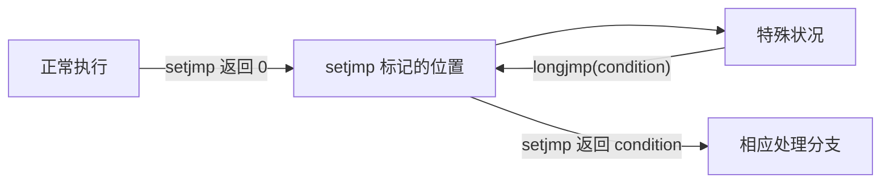

# 第 19 章：控制流的变化

[[toc]]

::: info 本章内容

- 理解 C 语句的正常定序
- 在代码中进行短跳转与长跳转
- 函数控制流
- 处理信号

:::

程序执行的控制流（见图 2.1）描述程序代码中的各条语句如何**定序**，也就是哪条语句在哪条语句之后执行。到目前为止，我们考察的代码大多可以根据语法和控制表达式推导出控制流。这样一来，每个函数都可以描述成基本块的层次组合。**基本块**是一段极大的语句序列：一旦从第一条语句开始执行，就会无条件地一直执行到最后一条；而且只要执行了序列中的任何一条语句，必定是从第一条开始的。

简化起见，假设所有条件语句和循环语句都使用 `{}` 复合语句，那么一个基本块：

- 开始于复合语句的左花括号 `{`，或 `case` 标签、跳转标签；
- 结束于相应复合语句的右花括号 `}`，或者结束于接下来遇到的以下内容：
  - 作为 `case` 标签或跳转标签目标的语句；
  - 条件语句或循环语句的函数体；
  - `return` 语句；
  - `goto` 语句；
  - 对某个特定集合中函数的调用。

按照这个定义，普通的函数调用并不特殊：它们只是暂时挂起基本块的执行，而不会结束基本块。在能够结束基本块的特定函数中，有些我们已经认识，例如以属性 `[[noreturn]]` 标记的 `exit` 和 `abort`。另一个是 `setjmp`；后文会讲到，它可能返回不止一次。

如果代码仅由基本块组成，并用 `if`／`else`[^33] 或循环语句把它们缝合起来，就有双重优势：既便于人阅读，也给编译器带来优化机会。人和编译器都能直接推导出基本块中对象和复合字面量的生存期与访问模式，进而掌握这些基本块如何层层组合成所属的函数。

Nishizeki 等人（1977）很早就为 Pascal 程序中的这种结构化方法奠定了理论基础；Thorup（1995）又把它扩展到 C 和其他命令式语言。他们证明，结构化程序——也就是不含 `goto` 或其他任意跳转构造的程序——其控制流恰好构成树状结构，可以根据程序的语法嵌套推导出来。除非迫不得已，否则应当坚持这种编程模型。

不过，有些特殊状况需要特殊手段。一般来说，程序控制流的变化可能来自：

- **条件语句：** `if`／`else` 和 `switch`／`case`；
- **循环语句：** `do {} while()`、`while()` 和 `for()`；
- **函数调用：** `return` 语句或 `[[noreturn]]` 属性；
- **短跳转：** `goto` 与标签；
- **长跳转：** `setjmp`／`longjmp` 和 `getcontext`／`setcontext`；[^34]
- **中断：** 信号与信号处理函数；
- **线程：** `thrd_create` 和 `thrd_exit`。

这些控制流变化会让执行的抽象状态变得模糊。粗略来说，在上面的列表中越往下，人类读者或机器读者需要跟踪的知识就越复杂。到目前为止，我们只见过前四种构造。它们对应语言特性，由语法（例如关键字）或运算符（例如函数调用的 `()`）确定。后三种由 C 库接口引入：它们可以让程序控制流跨越函数边界跳转（`longjmp`），可以由程序外部事件触发（中断），甚至可以建立并发控制流，也就是另一条执行线程。

对象受到意外控制流影响时，可能出现各种困难：

- 对象可能在生存期外使用；
- 对象可能在未初始化时使用；
- 优化可能错误解释对象值（`volatile`）；
- 对象可能只修改了一部分（`sig_atomic_t`、`atomic_flag`，或者具有无锁性质并采用 `relaxed` 一致性的 `_Atomic`）；
- 对象的更新可能以意外方式定序（所有 `_Atomic`）；
- 必须保证**临界区**内部独占执行（`mtx_t`）。

这些情况会让访问构成程序状态的对象变得复杂，因此 C 提供了一些特性来帮助应对。上面列表的圆括号中已经注明了这些特性，以下各节将详细讨论。

[^33]: `switch`／`case` 语句会让这种看法稍微复杂一些。
[^34]: 后一组函数在 POSIX 系统中定义。

## 19.1 一个详细示例

为了展示上述大多数概念，我们来讨论一段核心示例代码：名为 `basic_blocks` 的递归下降解析器。核心函数 `descend` 见清单 19.1。

这段代码有几个用途。首先，它显然展示了后文将讨论的几项特性：

- 短跳转（`goto`，见 19.3 节）；
- 递归（见 19.4 节）；
- 长跳转（`longjmp`，见 19.5 节）；
- 中断处理（见 19.6 节）。

但同样重要的是，这大概是本书到目前为止最难的一段代码；对有些人来说，它甚至可能是他们见过的最复杂的代码。不过，它只有 36 行，一屏就能装下，这本身就证明了 C 代码可以非常紧凑、高效。理解它也许要花上几个小时，但请不要绝望：你也许还没意识到，只要认真学完了本书前面的内容，你就已经做好了准备。

这个函数实现了一个递归下降解析器：它识别从 `stdin` 读入的文本中的 `{}` 构造，并按 `{}` 的嵌套层次缩进输出文本。用 Backus-Naur 范式（BNF）[^35] 更形式化地说，该函数按下面的递归定义检测文本，并通过调整行结构和缩进，把这样的程序以适当格式打印出来：

```text
program := some-text★ ['{' program '}' some-text★]★
```

[^35]: BNF 是对计算机可读语言的形式化描述。这里，`program` 递归定义为一段文本序列，后面可以跟零个或多个用花括号包围的程序序列。

**清单 19.1　用于代码缩进的递归下降解析器**

```c:line-numbers=57 [basic_blocks.c]
static
char const *descend(char const *act,
                    unsigned dp[restrict static 1], // 不好
                    size_t len, char buffer[static len],
                    jmp_buf jmpTarget) {
    if (dp[0] + 3 > sizeof head) longjmp(jmpTarget, tooDeep);
    ++dp[0];
NEW_LINE:                              // 循环输出
    while (!act || !act[0]) {          // 循环输入
        if (interrupt) longjmp(jmpTarget, interrupted);
        act = skipspace(fgets(buffer, len, stdin));
        if (!act) {                    // 流结束
            if (dp[0] != 1) longjmp(jmpTarget, plusL);
            else goto ASCEND;
        }
    }
    fputs(&head[sizeof head - (dp[0] + 2)], stdout); // 行首

    for (; act && act[0]; ++act) {     // 该行剩余部分
        switch (act[0]) {
            case left:                 // 遇左花括号则下降
                act = end_line(act + 1, jmpTarget);
                act = descend(act, dp, len, buffer, jmpTarget);
                act = end_line(act + 1, jmpTarget);
                goto NEW_LINE;
            case right:                // 遇右花括号则返回
                if (dp[0] == 1) longjmp(jmpTarget, plusR);
                else goto ASCEND;
            default:                   // 打印字符并继续
                putchar(act[0]);
        }
    }
    goto NEW_LINE;
ASCEND:
    --dp[0];
    return act;
}
```

从实际操作来看，该程序处理文本，具体来说，就是以一种特殊方式缩进 C 代码或类似的文本。把清单 3.1 的程序文本输入给它，会得到如下输出：

```text [终端]
> ./code/basic_blocks < code/heron.c
| #include <stdlib.h>
| #include <stdio.h>
| /* lower and upper iteration limits centered around 1.0 */
| static double const eps1m01 = 1.0 - 0x1P-01;
| static double const eps1p01 = 1.0 + 0x1P-01;
| static double const eps1m24 = 1.0 - 0x1P-24;
| static double const eps1p24 = 1.0 + 0x1P-24;
| int main(int argc, char* argv[argc+1])
>| for (int i = 1; i < argc; ++i)
>>| // process args
>>| double const a = strtod(argv[i], 0); // arg -> double
>>| double x = 1.0;
>>| for (;;)
>>>| // by powers of 2
>>>| double prod = a*x;
>>>| if (prod < eps1m01) x *= 2.0;
>>>| else if (eps1p01 < prod) x *= 0.5;
>>>| else break;
>>>|
>>| for (;;)
>>>| // Heron approximation
>>>| double prod = a*x;
>>>| if ((prod < eps1m24) || (eps1p24 < prod))
>>>| x *= (2.0 - prod);
>>>| else break;
>>>|
>>| printf("heron: a=%.5e,\tx=%.5e,\ta*x=%.12f\n",
>>| a, x, a*x);
>>|
>| return EXIT_SUCCESS;
>|
```

也就是说，`basic_blocks` “吃掉”花括号 `{}`，转而用一串 `>` 字符缩进代码：每增加一层 `{}` 嵌套，就多加一个 `>`。

要从宏观上了解函数如何做到这一点，可以先略去所有尚未介绍的函数和对象，只看从第 76 行开始的 `switch` 语句及其外层 `for` 循环：

```c
static
char const *descend(/* ... */) {
    ++dp[0];
NEW_LINE:
    /* ... */
    for (/* ... */) {
        switch (/* ... */) {
            case left:  /* ... */ goto NEW_LINE;
            case right: /* ... */ goto ASCEND;
            default:    /* ... */
        }
    }
    goto NEW_LINE;
ASCEND:
    --dp[0];
    return /* ... */;
}
```

它根据当前字符区分三种情形。最简单的是默认情形：打印普通字符，前进到下一个字符，再开始下一次迭代。

另外两种情形处理 `{` 和 `}` 字符。遇到左花括号时，我们知道文本要再多缩进一级 `>`，于是递归调用同一个函数 `descend`（见第 79 行）。相反，遇到右花括号时，就跳到 `ASCEND`，结束当前这一层递归。递归深度本身由 `dp[0]` 维护：进入时递增（第 63 行），退出时递减（第 91 行）。

如果你是第一次尝试理解这个程序，其余部分都可以当作噪声，它们用来处理行尾、左花括号或右花括号过多等特殊情形。稍后会详细说明这一切如何工作。

## 19.2 定序

在研究程序控制流如何以出人意料的方式改变之前，我们得先弄清楚 C 语句的正常顺序保证了什么、又没有保证什么。4.6 节已经看到，C 表达式的求值未必遵循书写顺序。例如，函数实参可以按任意顺序求值。构成各实参的不同表达式甚至可以交错求值，交错方式可以由编译器自行决定，也可以取决于执行时资源是否可用。我们称函数实参表达式彼此**未定序**。

求值规则之所以如此宽松，有几个原因。其一是便于实现优化编译器。与其他编程语言相比，编译出的代码效率高，一直是 C 的一大优势。

另一个原因是，如果没有令人信服的数学或技术依据，C 不会随意施加限制。从数学上说，`a+b` 中的两个操作数 `a` 和 `b` 可以自由交换。强加求值顺序会破坏这条规则，对 C 程序的推理也会变得更复杂。

在没有线程的情况下，C 主要用**序列点**来形式化这些规则。序列点是程序语法规定的一些位置，执行到这些位置时必须串行化。稍后还会看到另外一些规则，它们为某些表达式的求值强制定序，却不蕴含序列点。

从宏观上看，可以把 C 程序视为依次到达的一系列序列点；两个序列点之间的代码可以按任意顺序执行、交错执行，也可以遵守其他特定的定序约束。最简单的情形是两条语句用分号隔开：序列点之前的语句先序于序列点之后的语句。

不过，即使存在序列点，也未必规定两个表达式之间的某个特定顺序；它只规定两者之间必然存在某种顺序。为了看清这一点，考虑函数 `add`：它会修改第一个指针形参 `x` 所指向的对象。在 `printf` 的实参中使用这个函数，行为是良好定义的：

```c:line-numbers=3 [sequence_point.c]
unsigned add(unsigned *x, unsigned const *y) [[unsequenced]] {
    return *x += *y;
}

int main(void) {
    unsigned a = 3;
    unsigned b = 5;
    printf("a = %u, b = %u\n", add(&a, &b), add(&b, &a));
}
```

回顾 4.6 节：`printf` 的两个实参可以按任意顺序求值；稍后将看到，按照序列点规则，`add` 的函数调用会强制产生序列点。因此，这段代码有两种可能结果：要么先完整执行第一次 `add`，再执行第二次；要么反过来。

第一种可能中：

- `a` 改为 8，并返回该值；
- `b` 改为 13，并返回该值。

执行输出为：

```text [终端]
a = 8, b = 13
```

第二种可能中：

- `b` 改为 8，并返回该值；
- `a` 改为 11，并返回该值。

输出为：

```text [终端]
a = 11, b = 8
```

因此，尽管这个程序的行为有定义，C 标准却没有完全确定其结果。C 标准把这种情况称为两次调用彼此**不确定定序**。这并不只是理论探讨：对这段简单代码，两个常用的开源 C 编译器 GCC 和 Clang 就会作出不同的选择。我要再次强调：这一切全都是有定义的行为。不要指望编译器对这类问题发出警告。

::: tip 要点 19.2 #1
函数中的副作用可能导致不确定的结果。
:::

下面列出 C 语法定义的所有序列点：

- 一条语句结束时，即遇到分号 `;` 或右花括号 `}`；
- 逗号运算符 `,` 前面的表达式结束时；[^36]
- 声明结束时，即遇到分号 `;` 或逗号 `,`；[^37]
- `if`、`switch`、`for`、`while` 的控制表达式结束时，以及条件求值 `?:`、短路求值 `||` 和 `&&` 的控制表达式结束时；
- 函数调用的函数指示符（通常是函数名）和函数实参都完成求值之后、实际调用之前；[^38]
- `return` 语句结束时。

除了序列点带来的限制，还有其他定序限制。前两条多少有些显而易见，但仍应明确写出来。

::: tip 要点 19.2 #2
任何运算符的具体运算，都后序于其所有操作数的求值。
:::

::: tip 要点 19.2 #3
通过赋值、递增或递减运算符更新对象的效果，后序于其操作数的求值。
:::

函数调用还有一条附加规则：函数执行总会在其他任何表达式之前完成。

::: tip 要点 19.2 #4
函数调用相对于调用方的所有求值都有定序关系。
:::

如前所述，这种关系可能是不确定定序，但终归是定序的。另一类不确定定序的表达式来自初始化式。

::: tip 要点 19.2 #5
数组类型或结构体类型的初始化列表表达式彼此不确定定序。
:::

最后，C 库还定义了一些序列点：

- IO 函数中的各个格式说明符完成动作之后；
- 任何 C 库函数返回之前；[^39]
- 调用搜索和排序所用的比较函数之前和之后。

后两条让 C 库函数遵守与普通函数类似的规则。之所以需要这些规则，是因为 C 库本身未必用 C 实现。

[^36]: 请小心：分隔函数实参的逗号不属于这一类。
[^37]: 结束枚举常量声明的逗号同样如此。
[^38]: 这里把函数指示符置于与函数实参相同的层次。
[^39]: 请注意，实现为宏的库函数可能不定义序列点。

## 19.3 短跳转

我们已经见过一种打断 C 程序正常控制流的特性：`goto`。希望你还记得 15.6 节的内容：它由两种构造实现，标签标记代码中的位置，`goto` 语句则跳转到同一函数内的这些位置。

我们也已经看到，这类跳转对局部对象的生存期和可见性有复杂的影响。特别是，在循环内定义的对象和在一组由 `goto` 重复执行的语句中定义的对象，生存期并不相同。[^40] 考虑下面两段代码，它们都在循环中定义一个局部对象（复合字面量）：

::: code-group
```c [while 循环]
size_t *ip = nullptr;
while (something)
    ip = &(size_t){ fun() };  /* 生存期随 while 结束。 */
/* 良好：资源已经释放。 */
printf("i is %d", *ip);      /* 不好：对象已经死亡。 */
```

```c [goto 重试]
size_t *ip = nullptr;
RETRY:
ip = &(size_t){ fun() };      /* 生存期继续。 */
if (condition) goto RETRY;
/* 不好：资源仍被占用。 */
printf("i is %d", *ip);      /* 良好：对象仍然存活。 */
```
:::

复合字面量的地址赋给了一个指针，因此在循环外仍可以访问该对象，例如在 `printf` 语句中。

两段代码看似语义等价，实则不然。在第一段中，复合字面量对应的对象，其生存期与 `while` 语句内层块的执行绑定在一起。

::: tip 要点 19.3 #1
每次迭代都会定义局部对象的一个新实例。
:::

因此，表达式 `*ip` 对该对象的访问是无效的。如果删去示例中的 `printf`，`while` 循环的优势在于能够复用复合字面量占用的资源。

第二个示例则没有这种限制：复合字面量定义的作用域是整个外围块。因此，在离开该块前，对象始终存活（要点 13.3 #1）。这未必是好事：对象会占用原本可以重新分配的资源。

不需要 `printf` 语句（或类似访问）时，第一段代码更清晰，也有更好的优化机会。因此，大多数情况下应优先采用第一段。

::: tip 要点 19.3 #2
`goto` 只应用于控制流的特殊变化。
:::

这里的“特殊”通常指遇到了需要局部清理的过渡性错误状况，如 15.6 节所见。但它也可以指某种特定的算法条件，如清单 19.1 所示。

这里有两个标签 `NEW_LINE` 和 `ASCEND`，以及两个常量 `left` 和 `right`，它们反映解析的实际状态。需要打印新行时，以 `NEW_LINE` 为跳转目标；遇到 `}` 或流结束时，则跳到 `ASCEND`。常量 `left` 和 `right` 用作 `case` 标签，用来检测左花括号和右花括号。

这里之所以需要 `goto` 和标签，是因为这两种状态分别在函数中两个不同的位置、两个不同的嵌套层次上检测到。此外，标签名反映了各自的用途，从而提供了有关代码结构的额外信息。

[^40]: 见 ISO 9899:2011 6.5.2.5 第 16 段。

## 19.4 函数

函数 `descend` 的复杂之处不只在于曲折的局部跳转结构，它还是一个递归函数。如前所述，C 处理递归函数的方式相当简单。

::: tip 要点 19.4 #1
每次函数调用都会定义局部对象的一个新实例。
:::

因此，同一函数中同时处于活动状态的多次递归调用通常不会相互影响；每次调用都有自己的一份程序状态。


_图 19.1：函数调用的控制流；`return` 跳转到调用之后的下一条指令。_

但在这里，由于使用了指针，这条原则打了折扣：`buffer` 和 `dp` 所指向的数据都会改变。对 `buffer` 而言，这大概无法避免，因为它要容纳读入的数据。但 `dp` 可以（也应当）改为一个简单的 `unsigned` 实参。[练习 41] 当前实现之所以把 `dp` 设为指针，只是为了在出错时仍能跟踪嵌套深度。所以，如果不考虑尚未解释的 `longjmp` 调用，这样使用指针并不好：程序状态更难跟踪，也会错失优化机会。[练习 42]

在这个具体示例中，`dp` 带 `restrict` 限定，没有传给 `longjmp` 调用（马上讨论），并且只在开头递增、结尾递减，所以 `dp[0]` 恰好在函数返回前恢复原值。从外部看，`descend` 好像根本没有改变该值。

如果调用方能看到 `descend` 的函数代码，优秀的优化编译器就能推断出 `dp[0]` 在调用前后没有变化。假如 `longjmp` 没有什么特殊之处，这本是一次很好的优化机会。我们马上会看到，`longjmp` 的存在如何让这项优化失效，并引出一个隐蔽的缺陷。

::: details 练习 41
修改 `descend`，让它接收 `unsigned depth`，而不是指针。
:::

::: details 练习 42
比较初始版本与去掉 `dp` 指针的版本所生成的汇编输出。
:::

## 19.5 长跳转

函数 `descend` 还可能遇到无法修复的特殊状况。我们用一个枚举类型为它们命名。这里，无法写入 `stdout` 时到达 `eofOut`；`interrupted` 则表示正在运行的程序收到了异步信号，这个概念后文再讨论。

::: info `state`：解析算法的特殊状态
| 枚举项        | 含义               |
| ------------- | ------------------ |
| `execution`   | 正常执行           |
| `plusL`       | 左花括号过多       |
| `plusR`       | 右花括号过多       |
| `tooDeep`     | 嵌套太深，无法处理 |
| `eofOut`      | 输出结束           |
| `interrupted` | 被信号中断         |

```c [basic_blocks.c]
enum state {
    execution = 0, //!< 正常执行
    plusL,         //!< 左花括号过多
    plusR,         //!< 右花括号过多
    tooDeep,       //!< 嵌套太深，无法处理
    eofOut,        //!< 输出结束
    interrupted,   //!< 被信号中断
};
```
:::

我们用函数 `longjmp` 处理这些状况，并把相应的调用直接放在代码中识别出该状况的位置：

- `tooDeep` 很容易在函数开头识别；
- 如果不在第一层递归，却遇到了输入流结束，就检测出 `plusL`；只有此前遇到了左花括号（因而进入了递归），却直到输入结束都没找到对应的右花括号时，才会出现这种情况；
- 在第一层递归中遇到右花括号时，发生 `plusR`；
- 写入 `stdout` 时返回文件结束（EOF）状况，就到达 `eofOut`；
- 每次从 `stdin` 读取新行前，检查 `interrupted`。

由于 `stdout` 采用行缓冲，我们只在写出 `'\n'` 字符时检查 `eofOut`。这发生在短函数 `end_line` 内部：

```c:line-numbers=45 [basic_blocks.c]
char const *end_line(char const s[static 1], jmp_buf jmpTarget) {
    if (putchar('\n') == EOF) longjmp(jmpTarget, eofOut);
    return skipspace(s);
}
```

函数 `longjmp` 有一个配套的宏 `setjmp`，用来建立可供 `longjmp` 调用引用的跳转目标。头文件 `<setjmp.h>` 提供以下原型：

```c
[[noreturn]] void longjmp(jmp_buf target, int condition);
int setjmp(jmp_buf target); // 通常是宏，而不是函数
```

函数 `longjmp` 同样具有 `[[noreturn]]` 属性，所以可以确信，一旦检测到某个特殊状况，当前这次 `descend` 调用就绝不会继续执行。

::: tip 要点 19.5 #1
`longjmp` 绝不会返回调用方。
:::

这对优化器是很有价值的信息。`descend` 中有五处调用 `longjmp`，编译器可以借此大幅简化分支分析。例如，在 `!act` 检验之后，就可以假定进入 `for` 循环时 `act` 非空。

普通的语法标签只能在声明它的函数内充当 `goto` 目标。相比之下，`jmp_buf` 是不透明对象，可以在任何地方声明；只要它仍然存活且内容有效，就可以使用。在 `descend` 中，我们只用到一个 `jmp_buf` 类型的跳转目标，并把它声明为局部对象。这个跳转目标在基础函数 `basic_blocks` 中设置，该函数充当 `descend` 的接口（见清单 19.2），主要由一个处理所有不同状况的大型 `switch` 语句组成。



_图 19.2：`setjmp` 与 `longjmp` 的控制流；`longjmp` 跳转到 `setjmp` 标记的位置。_

**清单 19.2　递归下降解析器的用户接口**

```c:line-numbers=97 [basic_blocks.c]
void basic_blocks(void) {
    char buffer[maxline];
    unsigned depth = 0;
    char const *format =
        "All matching %0.0d '%c' '%c' pairs have been closed correctly\n";
    jmp_buf jmpTarget;
    switch (setjmp(jmpTarget)) {
        case 0:
            descend(nullptr, &depth, maxline, buffer, jmpTarget);
            break;
        case plusL:
            format =
                "Warning: %d '%c' have not been closed properly "
                "(expected '%c')\n";
            break;
        case plusR:
            format =
                "Error: closing too many (%d) '%c' parenthesis "
                "with additional '%c'\n";
            break;
        case tooDeep:
            format =
                "Error: nesting (%d) of '%c' '%c' constructs is too deep\n";
            break;
        case eofOut:
            format =
                "Error: EOF for stdout at %d open '%c', expecting "
                "same amount of '%c'\n";
            break;
        case interrupted:
            format =
                "Interrupted at level %d of '%c' '%c' nesting\n";
            break;
        default:
            format =
                "Error: unknown error within (%d) '%c' '%c' constructs\n";
    }
    fflush(stdout);
    fprintf(stderr, format, depth, left, right);
    if (interrupt) {
        SH_PRINT(stderr, interrupt,
                 "is somebody trying to kill us?");
        raise(interrupt);
    }
}
```

通过正常控制流到达这里时，会进入 `switch` 的分支 0。这是 `setjmp` 的基本原则之一。

::: tip 要点 19.5 #2
通过正常控制流到达时，`setjmp` 调用把调用位置标记为跳转目标，并返回 0。
:::

如前所述，调用 `longjmp` 时，`jmpTarget` 必须仍然存活且有效。因此，对局部对象而言，此时不能已经离开其声明所在的作用域，否则对象就已经死亡。要保持有效，调用 `longjmp` 时 `setjmp` 的整个上下文还必须处于活动状态。这里把 `jmpTarget` 声明在与 `setjmp` 调用相同的作用域中，从而避免了复杂情况。

::: tip 要点 19.5 #3
离开 `setjmp` 调用的作用域，会使跳转目标失效。
:::

进入 `case 0` 并调用 `descend` 后，可能会遇到某个特殊状况，于是调用 `longjmp` 终止解析算法。控制随即回到 `jmpTarget` 所标记的调用位置，就像刚刚从 `setjmp` 调用返回一样。唯一可见的差别是，此时的返回值是传给 `longjmp` 的第二个实参 `condition`。例如，如果某次递归调用 `descend` 时一开头就遇到 `tooDeep` 状况，并调用 `longjmp(jmpTarget, tooDeep)`，控制就会跳回 `switch` 的控制表达式，并得到返回值 `tooDeep`，然后从相应的 `case` 标签继续执行。

::: tip 要点 19.5 #4
`longjmp` 调用把控制直接转移到 `setjmp` 设置的位置，效果如同后者返回了实参 `condition`。
:::

不过要注意：规范已经做了防范，你没法耍花招让执行第二次走上正常路径。

::: tip 要点 19.5 #5
传给 `longjmp` 的 `condition` 实参如果是 0，会替换为 1。
:::

`setjmp`／`longjmp` 机制非常强大，可以避免从一整串函数调用中逐层返回。在我们的示例中，假设输入程序允许的最大嵌套深度为 30，那么检测到 `tooDeep` 状况时，会有 30 个 `descend` 递归调用同时处于活动状态。如果采用普通的错误返回策略，就得逐层返回，并在每一层做一些处理。而调用 `longjmp` 可以省掉所有这些返回，直接在 `basic_blocks` 的 `switch` 处继续执行。

由于 `setjmp`／`longjmp` 可以作出一些简化假设，这个机制出奇地高效。视处理器体系结构而定，它通常只需要 10 到 20 条汇编指令。库实现的策略一般相当简单：`setjmp` 把栈指针和指令指针等关键硬件寄存器保存到 `jmp_buf` 对象中；`longjmp` 再从中恢复这些寄存器，并把控制传回保存的指令指针。[^43]

`setjmp` 的一项简化与它的返回值有关。按规范，它返回一个 `int` 值，但这个值不能用在任意表达式中。

::: tip 要点 19.5 #6
`setjmp` 只能用于条件语句控制表达式内的简单比较。
:::

所以，它可以像示例一样直接用于 `switch` 语句，也可以用 `==`、`<` 等进行检验；但不能把 `setjmp` 的返回值用于赋值。这样就保证了 `setjmp` 的值只会与一组已知值比较；从 `longjmp` 返回时，执行环境中的变化可能仅仅体现在某个控制条件判断效果的特殊硬件寄存器上。

如前所述，`setjmp` 调用对执行环境的保存和恢复非常有限，只涉及最少量的必要硬件寄存器。它不会采取任何措施来保留局部优化，甚至不会考虑执行可能第二次到达调用位置。

::: tip 要点 19.5 #7
优化与 `setjmp` 调用的相互作用很糟糕。
:::

运行并测试示例代码时，会发现这种对 `setjmp` 的简单用法有问题。如果输入一个缺少右花括号 `}` 的不完整程序，从而触发 `plusL` 状况，我们期望看到类似下面的诊断：

```text [终端]
Warning: 3 '{' have not been closed properly (expected '}')
```

视编译优化级别而定，无论输入什么程序，你看到的很可能都不是 3，而是 0。这是因为优化器的分析基于一个假设：`switch` 的各个 `case` 互斥。它认为只有当执行经过 `case 0` 并调用 `descend` 时，`depth` 的值才会改变。通过检查 `descend`（见 19.4 节），我们知道 `depth` 的值总会在返回前恢复原值，所以编译器可以假定该值沿这条代码路径不会改变。其余分支也都不改变 `depth`，于是编译器可以假定 `fprintf` 调用中的 `depth` 始终为 0。

因此，如果某个对象在 `setjmp` 的正常代码路径中修改，又在某条特殊路径中引用，优化就无法对它作出正确假设。对此只有一种解决办法。

::: tip 要点 19.5 #8
跨越 `longjmp` 发生修改的对象必须带 `volatile` 限定。
:::

在语法上，限定符 `volatile` 的用法与此前见过的另外两个限定符 `const` 和 `restrict` 类似。如果给 `depth` 的声明加上该限定符：

```c
unsigned volatile depth = 0;
```

并相应修改 `descend` 的原型，那么对该对象的所有访问都会使用实际存储的值，任何试图对其值作出假设的优化都会受到阻止。

::: tip 要点 19.5 #9
每次访问 `volatile` 对象时，都从内存重新加载。
:::

::: tip 要点 19.5 #A
每次修改 `volatile` 对象时，都把它存入内存。
:::

因此，`volatile` 对象不受优化影响；从消极的一面说，它们会妨碍优化。所以，只有确有必要时，才应把对象设为 `volatile`。[练习 44]

最后，请注意 `jmp_buf` 类型的一些细微之处。记住，它是不透明类型：绝不能对其结构或各个字段作出假设。

::: tip 要点 19.5 #B
`jmp_buf` 的 `typedef` 隐藏了一个数组类型。
:::

由于它是不透明类型，我们对数组的基础类型一无所知，姑且称之为 `jmp_buf_base`。

- `jmp_buf` 类型的对象不能作为赋值目标；
- `jmp_buf` 函数形参会改写为指向 `jmp_buf_base` 的指针；
- 这种函数始终引用原始对象，而不是副本。

从某种意义上说，这模拟了一种按引用传递机制；C++ 等其他编程语言为这种机制提供了显式语法。一般来说，使用这个技巧并不好：`jmp_buf` 对象的语义取决于它是局部声明的对象，还是函数形参。例如，在 `basic_blocks` 中，该对象不可赋值；而在 `descend` 中，对应的函数形参由于改写成了指针，所以可以修改。此外，也很难对它使用现代 C 中更具体的形参声明，例如：

```c
jmp_buf_base jmpTarget[restrict const static 1]
```

这样的声明意在明确要求：函数内部不应改变该指针；指针不得为空；可以认为函数独占对它的访问。[练习 45] 如今我们不会再这样设计类型，你也不应在定义自己的类型时照搬这个技巧。

::: details 练习 44
你编写的 `descend` 版本按值传递 `depth`，遇到 `plusL` 状况时可能无法正确传回深度。请确保把该值复制到一个对象中，供 `basic_blocks` 中的 `fprintf` 调用使用。
:::

::: details 练习 45
使用 C23 的 `typeof` 特性为 `jmp_buf_base` 定义 `typedef`。
:::

[^43]: 若要熟悉相关词汇，可以阅读或重读 13.5 节。

## 19.6 信号处理函数

如前所述，`setjmp`／`longjmp` 可以处理我们在代码执行期间自行检测到的特殊状况。**信号处理函数**则用于处理以另一种方式产生的特殊状况，也就是由程序外部事件触发的状况。从技术上说，这类外部事件分为两种：硬件中断，又称陷阱或同步信号；软件中断，又称异步信号。

第一种发生在处理设备遇到无法应对的严重故障时，例如发现除以零、寻址不存在的内存组，或者在操作较宽整数类型的指令中使用了未对齐的地址。这种事件与程序执行同步，直接由故障指令引起，所以总能知道中断是在哪条具体指令处触发的。

第二种发生在操作系统或运行时系统决定程序应当终止时，例如超过了某个截止期限、用户发出了终止请求，或者我们所知的世界即将毁灭。这种事件是**异步**的，因为它可能发生在一条多阶段指令的中途，使执行环境停留在中间状态。

大多数现代处理器都有处理硬件中断的内置特性：**中断向量表**。该表以平台已知的各种硬件故障为索引，其条目是指向过程的指针，也就是指向**中断处理函数**的指针；发生相应故障时，就执行这些过程。因此，处理器一旦检测到故障，执行就会自动离开用户代码，转去执行中断处理函数。这种机制不可移植，因为不同平台上故障的名称和位置各不相同；用起来也很繁琐，因为哪怕只编写一个简单的应用程序，也得为所有中断提供处理函数。

C 的信号处理函数提供了一种抽象，让我们能以可移植的方式处理硬件和软件两类中断。它的工作方式与前面描述的硬件中断类似，但具有以下特点：

- （部分）故障的名称经过标准化；
- 所有故障都有默认处理函数（大多由实现定义）；
- （大多数）处理函数可以特化。

列表中的每一项都用括号加了保留，因为仔细观察就会发现，C 的信号处理接口相当简陋；每个平台都有自己的扩展和特殊规则。

::: tip 要点 19.6 #1
C 的信号处理接口非常有限，只应用于最简单的情形。
:::


_图 19.3：中断后的控制流；从信号处理函数返回，会跳到中断发生的位置。_

图 19.3 展示了处理一个信号时的控制流。正常控制流在应用程序无法预见的位置中断，信号处理函数开始执行并完成一些任务；之后，控制回到中断的那个位置，并以中断时完全相同的状态恢复执行。

接口定义在头文件 `<signal.h>` 中。C 标准区分六个不同的值，称为**信号编号**。下面给出标准中的确切定义。其中三个值通常由硬件中断引起：[^46]

| 信号      | 定义                                       |
| --------- | ------------------------------------------ |
| `SIGFPE`  | 错误的算术运算，例如除以零，或运算结果溢出 |
| `SIGILL`  | 检测到无效的函数映像，例如无效指令         |
| `SIGSEGV` | 对存储的无效访问                           |

另外三个通常由软件或用户触发：

| 信号      | 定义                                    |
| --------- | --------------------------------------- |
| `SIGABRT` | 异常终止，例如由 `abort` 函数发起的终止 |
| `SIGINT`  | 收到交互式注意信号                      |
| `SIGTERM` | 发送给程序的终止请求                    |

具体平台还会有其他信号编号；标准为此保留了所有以 `SIG` 开头的标识符。按 C 标准，这些编号的用法未定义，但这本身并不是坏事。这里的“未定义”就是字面意思：如果使用这样的编号，它的含义就必须由 C 标准之外的其他权威来源来定义，例如平台提供者。因此，代码的可移植性会降低。

系统为每个可能的信号编号保存一种**处置方式**，它决定捕获到信号时执行什么动作。处理信号有两种标准处置方式，同样用符号常量表示：`SIG_DFL` 为该信号恢复平台的默认处理函数，`SIG_IGN` 表示忽略该信号。除此之外，程序员还可以编写自己的信号处理函数。解析器的处理函数看起来很简单：

::: info `signal_handler`：最小信号处理函数
更新信号计数后，对大多数信号只需把信号值存入 `interrupt` 并返回。

```c [basic_blocks.c]
static void signal_handler(int sig) {
    sh_count(sig);
    switch (sig) {
        case SIGTERM: quick_exit(EXIT_FAILURE);
        case SIGABRT: _Exit(EXIT_FAILURE);
#ifdef SIGCONT
        // 继续正常操作
        case SIGCONT: return;
#endif
        default:
            /* 把处理方式重置为默认值。 */
            signal(sig, SIG_DFL);
            interrupt = sig;
            return;
    }
}
```
:::

可以看到，这样的信号处理函数以信号编号 `sig` 为实参，并根据该编号分别处理。这里专门处理了信号编号 `SIGTERM` 和 `SIGABRT`。其他所有信号的处理方式都是：把该编号的处理函数重置为默认值，把编号存入全局对象 `interrupt`，然后返回中断发生的位置。

信号处理函数的类型必须与以下类型相容：[^47]

::: info `sh_handler`：信号处理函数原型
```c [sighandler.h]
typedef void sh_handler(int);
```
:::

也就是说，它接收信号编号作为实参，不返回任何值。因此，这个接口相当受限，无法传递足够的信息，尤其无法告知信号发生的位置和具体情形。

信号处理函数通过调用 `signal` 来建立，`signal_handler` 中就有这样的调用，在那里它用于把信号的处置方式重置为默认值。`signal` 是 `<signal.h>` 提供的两个函数接口之一：

```c
sh_handler *signal(int, sh_handler *);
int raise(int);
```

`signal` 的返回值是该信号此前生效的处理函数；出错时则返回特殊值 `SIG_ERR`。在信号处理函数内部，只应使用 `signal` 改变本次调用所接收的那个信号编号的处置方式。

解析器的 `main` 函数在循环中调用该函数，为尽可能多的信号编号建立处理函数：

```c:line-numbers=184 [basic_blocks.c]
// 建立信号处理函数
for (unsigned i = 1; i < sh_known; ++i)
    sh_enable(i, signal_handler);
```

这里的函数 `sh_enable` 与 `signal` 接口相同，但会提供更多有关调用是否成功的信息：

::: info `sh_enable`：启用信号处理函数并捕获错误
```c [sighandler.c]
sh_handler *sh_enable(int sig, sh_handler *hnd) {
    sh_handler *ret = signal(sig, hnd);
    if (ret == SIG_ERR) {
        SH_PRINT(stderr, sig, "failed");
        errno = 0;
    } else if (ret == SIG_IGN) {
        SH_PRINT(stderr, sig, "previously ignored");
    } else if (ret && ret != SIG_DFL) {
        SH_PRINT(stderr, sig, "previously set otherwise");
    } else {
        SH_PRINT(stderr, sig, "ok");
    }
    return ret;
}
```
:::

例如，在我的机器上，程序启动时会给出以下信息：

```text [终端]
sighandler.c:96: #1 (0 times), unknown signal number, ok
sighandler.c:96: SIGINT (0 times), interactive attention signal, ok
sighandler.c:96: SIGQUIT (0 times), keyboard quit, ok
sighandler.c:96: SIGILL (0 times), invalid instruction, ok
sighandler.c:96: #5 (0 times), unknown signal number, ok
sighandler.c:96: SIGABRT (0 times), abnormal termination, ok
sighandler.c:96: SIGBUS (0 times), bad address, ok
sighandler.c:96: SIGFPE (0 times), erroneous arithmetic operation, ok
sighandler.c:89: SIGKILL (0 times), kill signal, failed: Invalid argument
sighandler.c:96: #10 (0 times), unknown signal number, ok
sighandler.c:96: SIGSEGV (0 times), invalid access to storage, ok
sighandler.c:96: #12 (0 times), unknown signal number, ok
sighandler.c:96: #13 (0 times), unknown signal number, ok
sighandler.c:96: #14 (0 times), unknown signal number, ok
sighandler.c:96: SIGTERM (0 times), termination request, ok
sighandler.c:96: #16 (0 times), unknown signal number, ok
sighandler.c:96: #17 (0 times), unknown signal number, ok
sighandler.c:96: SIGCONT (0 times), continue if stopped, ok
sighandler.c:89: SIGSTOP (0 times), stop process, failed: Invalid argument
```

第二个函数 `raise` 可以把指定信号递送给当前执行。前面在 `basic_blocks` 末尾已经用过它，把捕获到的信号递送给预先安装的处理函数。

[^46]: 标准称这些为“计算异常”。
[^47]: 不过标准没有定义这样的类型。

信号机制与 `setjmp`／`longjmp` 相似：先记住当前执行状态，把控制流交给信号处理函数，处理函数返回后再恢复原执行环境并继续执行。区别在于，这里没有用 `setjmp` 调用来标记某个特殊执行点。

::: tip 要点 19.6 #2
信号处理函数可以在执行的任何位置介入。
:::

对我们的示例而言，值得关注的信号编号是软件中断 `SIGABRT`、`SIGTERM` 和 `SIGINT`；通常可以用 Ctrl-C 等特殊按键组合把它们发送给应用程序。前两个分别调用 `_Exit` 和 `quick_exit`。因此，程序收到这些信号时，执行会终止：前者不调用任何清理处理函数；后者则遍历以 `at_quick_exit` 注册的清理处理函数列表。

`SIGINT` 会选择信号处理函数的默认分支，最终返回中断发生的位置。

::: tip 要点 19.6 #3
从信号处理函数返回后，执行在中断发生的确切位置恢复。
:::

如果中断发生在函数 `descend` 中，执行起初会像什么也没发生一样继续下去。只有处理完当前输入行、需要读取新行时，才会检查对象 `interrupt`，再调用 `longjmp` 逐步结束执行。实际上，中断前后唯一的差别就是 `interrupt` 的值变了。

我们还专门处理了 C 标准未描述的信号编号 `SIGCONT`（我的操作系统 POSIX 上有这个信号）。为了保持可移植性，对它的使用加了条件防护。这个信号用于让先前停止的程序继续运行，也就是恢复已经挂起的执行。此时唯一需要做的就是返回；按照定义，我们完全不希望程序状态发生任何改变。

与 `setjmp`／`longjmp` 机制相比，还有一项区别：后者通过 `setjmp` 的返回值改变执行路径，而信号处理函数不应改变执行状态。我们必须设计适当的约定，把信息从信号处理函数传给正常程序。与 `longjmp` 的情形一样，信号处理函数可能修改的对象必须带 `volatile` 限定。编译器无法知道中断处理函数会在哪里介入，因此，对于可能因信号处理而改变的对象，编译器所作的任何假设都可能是错的。不过，信号处理函数还面临另一个难题。

::: tip 要点 19.6 #4
任何一条 C 语句都可能对应多条处理器指令。
:::

例如，一个 `double x` 可能存放在两个普通机器字中；把 `x` 写入（赋值给）内存，可能需要两条不同的汇编语句，分别写入两半。

如果只考虑此前讨论的正常程序执行，把一条 C 语句拆成多条机器语句并没有问题，这种细微差别无法直接观察到。[^48] 引入信号后，情况就不同了。如果赋值进行到一半时被信号打断，`x` 就只写入了一半，信号处理函数会看到它的不一致版本：一半是旧值，一半是新值。这种僵尸表示（一半在这儿、一半在那儿）甚至可能根本不是 `double` 的有效值。

::: tip 要点 19.6 #5
信号处理函数需要操作不可中断的类型。
:::

这里，**不可中断操作**指在信号处理函数的上下文中始终表现为不可分割的操作：它要么看起来尚未开始，要么看起来已经完成。这通常并不意味着操作真的没有拆分，只是说我们观察不到这种拆分。信号处理函数介入时，运行时系统可能必须强制保证这项性质。

C 有三类类型提供不可中断操作：

- 类型 `sig_atomic_t`，最小宽度为 8 位的整数类型；
- 类型 `atomic_flag`；
- 其他所有具有无锁性质的原子类型。

第一类在历史上所有的 C 平台上都存在。像示例中的对象 `interrupt` 那样用它存储信号编号没有问题，但除此之外，它提供的保证相当有限：只有内存加载（求值）和存储（赋值）操作已知不可中断，其他操作都不然；而且它的宽度可能十分有限。

::: tip 要点 19.6 #6
`sig_atomic_t` 类型的对象不应用作计数器。
:::

一个简单的 `++` 操作实际上可能拆成三步（加载、递增和存储），而且很容易溢出。溢出可能触发硬件中断；如果此时本来就处于信号处理函数内部，后果会非常糟糕。

后两类直到 C11 才为支持线程而引入（见第 20 章）。只有当平台没有定义特性检验宏 `__STDC_NO_ATOMICS__`，并且包含了头文件 `<stdatomic.h>` 时，它们才存在。函数 `sh_count` 用到了这些特性，稍后会看到示例。

异步信号的处理函数不应以不受控制的方式访问或改变程序状态，所以也不能调用会这样做的其他函数。能在这种上下文中使用的函数称为**异步信号安全**函数。一般来说，仅凭接口规范很难判断一个函数是否具有这项性质；C 标准只对少数函数作出了保证：

- 终止程序的 `[[noreturn]]` 函数 `abort`、`_Exit` 和 `quick_exit`；
- 针对信号处理函数本次所接收的同一信号编号调用 `signal`；
- 操作原子对象的一些函数（马上讨论）。

::: tip 要点 19.6 #7
除非另有明确规定，否则 C 库函数并非异步信号安全。
:::

所以，仅就 C 标准本身而言，信号处理函数不能调用 `exit`，也不能做任何形式的 IO；但它可以借助 `quick_exit` 和 `at_quick_exit` 处理函数执行一些清理代码。

如前所述，C 对信号处理函数的规定非常有限，具体平台往往允许更多操作。因此，以可移植的方式处理信号十分繁琐。通常应当像示例展示的那样，分层次处理特殊状况：

- 能在局部检测并处理的特殊状况，可以用 `goto` 配合少量标签处理；
- 不必或无法在局部处理的特殊状况，应尽可能通过从函数返回特殊值来处理，例如返回空指针而不是指向对象的指针；
- 会改变全局程序状态的特殊状况，如果以特殊方式返回的代价高昂或过程复杂，可以用 `setjmp`／`longjmp` 处理；
- 引发信号的特殊状况可以由信号处理函数捕获，但应在处理函数返回后，回到正常执行流中再处理。

由于 C 标准规定的信号列表本身就很有限，处理各种可能的状况就变得更加复杂。

[^48]: 只能从程序外部观察到，因为这样的程序可能耗时超出预期。

::: info `sh_pairs`：为每个可能信号保存一对信号信息字符串
可用 `sh_known` 查询该数组的大小。另见 `SH_PRINT`，它会使用这些信息。代码还按条件加入了一些常见扩展。

```c [sighandler.c]
sh_pair const sh_pairs[] = {
    /* 执行错误 */
    SH_PAIR(SIGFPE, "erroneous arithmetic operation"),
    SH_PAIR(SIGILL, "invalid instruction"),
    SH_PAIR(SIGSEGV, "invalid access to storage"),
#ifdef SIGBUS
    SH_PAIR(SIGBUS, "bad address"),
#endif
    /* 作业控制 */
    SH_PAIR(SIGABRT, "abnormal termination"),
    SH_PAIR(SIGINT, "interactive attention signal"),
    SH_PAIR(SIGTERM, "termination request"),
#ifdef SIGKILL
    SH_PAIR(SIGKILL, "kill signal"),
#endif
#ifdef SIGQUIT
    SH_PAIR(SIGQUIT, "keyboard quit"),
#endif
#ifdef SIGSTOP
    SH_PAIR(SIGSTOP, "stop process"),
#endif
#ifdef SIGCONT
    SH_PAIR(SIGCONT, "continue if stopped"),
#endif
#ifdef SIGINFO
    SH_PAIR(SIGINFO, "status information request"),
#endif
};
```
:::

为了处理 C 标准规定范围之外的信号编号，我们用 `SH_PAIR` 把信号编号与描述关联起来：

```c:line-numbers=7 [sighandler.c]
#define SH_PAIR(X, D) [X] = { .name = #X, .desc = "" D "", }
```

它初始化一个 `sh_pair` 类型的对象：

::: info `sh_pair`：保存信号信息的一对字符串
```c [sighandler.h]
struct sh_pair {
    char const *name;
    char const *desc;
};
typedef struct sh_pair sh_pair;
```
:::

这些值对随后都保存在数组 `sh_pairs` 中。`#ifdef` 条件指令保证可以使用非标准信号名，`SH_PAIR` 中的指派初始化式则让我们能够按任意顺序给出它们。

然后可以用数组大小算出已知信号编号的数量，即 `sh_known`：

```c:line-numbers=38 [sighandler.c]
size_t const sh_known = sizeof sh_pairs / sizeof sh_pairs[0];
```

如果平台对原子操作的支持足够充分，还可以利用这些信息定义一个原子计数器数组，记录各个信号触发的次数：

```c:line-numbers=33 [sighandler.h]
#if ATOMIC_LONG_LOCK_FREE > 1
/**
 ** @brief 跟踪每种可能信号进入信号处理函数的次数。
 **
 ** 不要直接使用这个数组。
 **
 ** @see sh_count 更新这些信息。
 ** @see SH_PRINT 使用这些信息。
 **/
extern _Atomic(unsigned long) sh_counts[];

/**
 ** @brief 在信号处理函数中使用它，跟踪信号 @a sig
 ** 的调用次数。
 **
 ** @see sh_counted 使用这些信息。
 **/
inline
void sh_count(int sig) {
    if (sig < sh_known) ++sh_counts[sig];
}

inline
unsigned long sh_counted(int sig) {
    return (sig < sh_known) ? sh_counts[sig] : 0;
}

#else
```

用 `_Atomic` 说明的对象可以使用与同一基础类型的其他对象相同的运算符（这里是 `++`）。一般来说，这类对象保证不会与其他线程发生竞态条件（马上讨论）；如果类型具有无锁性质，其操作还是不可中断的。这里用特性检验宏 `ATOMIC_LONG_LOCK_FREE` 检查后一项性质。[^49]

用户接口是 `sh_count` 和 `sh_counted`。如果计数器数组可用，它们就使用该数组；否则，在检查 `ATOMIC_LONG_LOCK_FREE` 的 `#else` 分支中，它们会替换为平凡函数：

```c:line-numbers=61 [sighandler.h]
#else
inline
void sh_count(int sig) {
    // 空
}

inline
unsigned long sh_counted(int sig) {
    return 0;
}
#endif
```

信号处理函数是标准 C 中不够完善的一项特性；各平台通常会提供功能更强的专有扩展。为了保持可移植性，应当只使用最低限度的功能，并把程序的大部分逻辑放在信号处理函数之外处理。

[^49]: 请注意，不只是 `long` 有类似宏；这里只是示例恰好需要 `long`。

## 小结

- 即使没有并行线程或异步信号，C 代码的执行也不总是线性定序。因此，有些求值的结果可能取决于编译器选择的顺序。
- `setjmp` 和 `longjmp` 是跨越一整串嵌套函数调用处理特殊状况的强大工具。它们会与优化相互影响，因此需要用 `volatile` 限定来保护某些对象。
- C 处理同步和异步信号的接口十分简陋。因此，信号处理函数应尽可能少做工作，只在全局标志中记下中断状况的类型，然后切回被中断的上下文，在那里处理中断状况。
- 在信号处理函数与程序其他部分之间传递信息，只能使用 `volatile sig_atomic_t`、`atomic_flag` 或其他无锁原子数据类型。
