# 2. 教程地图与学习路线

1. **第 0 部分：导读与学习指南**
2. **第一部分：语法和标准库**
3. **第二部分：开发与工程基础**
4. **第三部分：数据结构与算法**
5. **第四部分：系统编程**
6. **第五部分：项目案例**
7. **第六部分：嵌入式**

## 1. 连续主线

第一次系统学习 C 时，先完成[第一部分：语法和标准库](/教程/正文/语法和标准库)。这一部分围绕单文件程序建立语言模型：值、对象、类型、表达式、控制流、函数、数组、指针、复合类型、存储、预处理和标准库。这一阶段的所有示例程序和习题，都可以在单个`.c` 文件中完成。

随后进入[第二部分：开发与工程基础](/教程/正文/开发与工程基础)，学习命令行与目录、编译与链接、头文件和接口边界、构建系统、调试、测试、检查工具、Git 和工程组织。工程知识在这里第一次成为主线，而不是穿插在语言规则中。这一阶段，我们要写多个文件构成的较为复杂的项目。

完成前两部分之后可以按目标选择，进入[第三部分：数据结构与算法](/教程/正文/数据结构与算法)、[系统编程](/教程/正文/系统编程)、[项目案例](/教程/正文/项目案例)或[嵌入式](/教程/正文/嵌入式)；每个专题应在开头列出额外前置内容。

## 2. C 语言与相关领域知识地图

```mermaid
flowchart TD
    C["C 语言与相关领域<br/>实线：主题展开；粗箭头：典型翻译流程<br/>虚线：带标签的相关联系<br/>知识关系不代表必修顺序"]

    subgraph STANDARD["语言层：C 标准与抽象机器"]
        STD["C 标准 / C Abstract Machine"]
        STD --- RULE["语言规则与标准库<br/>表达式 / 控制流 / 函数 / 库契约"]
        STD --- CTYPE["C 的类型规则<br/>类型兼容 / 转换 / 约束检查<br/>C23 起支持 auto 类型推导"]
        STD --- CSEM["C 程序的语义<br/>求值 / 副作用 / 可观察行为<br/>as-if 规则"]
        STD --- MEM["对象与存储模型<br/>生存期 / 指针 / 有效类型<br/>对象表示 / 对齐 / 填充"]
        STD --- BEHAVIOR["行为分类与实现空间"]
        BEHAVIOR --- IMPL["实现定义行为<br/>实现选择并记录"]
        BEHAVIOR --- UNSPEC["未指定行为<br/>标准允许多个选择"]
        BEHAVIOR --- UB["未定义行为 UB<br/>标准不作要求"]
        STD --- CMEM["C 并发内存模型（C11 起）<br/>原子操作 / memory order<br/>happens-before / 数据竞争"]
        STD --- ENV["执行环境<br/>宿主 Hosted / 自立 Freestanding<br/>C 程序不必依赖操作系统"]
    end

    subgraph SYSTEMS["实现层：机器与系统"]
        M["机器与系统<br/>Machine / Systems"]
        M --- ABI["应用二进制接口 ABI<br/>调用约定 / 栈与寄存器使用<br/>平台数据布局 / 二进制互操作"]
        M --- ARCH["机器体系结构与硬件实现"]
        ARCH --- ISA["指令集体系结构 ISA<br/>x86-64 / AArch64 / RISC-V"]
        ISA --- IMEM["ISA 内存模型<br/>原子指令 / 内存屏障 / 访存顺序"]
        ARCH --- UARCH["微架构 Microarchitecture<br/>流水线 / 乱序执行 / 分支预测<br/>缓存 / 执行单元 / store buffer"]
        UARCH --- COHERENCE["缓存一致性 Cache coherence<br/>与内存一致性模型分别讨论"]
        ARCH --- HW["硬件实现<br/>数字逻辑 / 电路 / 晶体管"]
        M --- OS["操作系统 Operating Systems<br/>接口与能力依平台而定"]
        OS --- VM["虚拟内存<br/>地址空间 / 页表 / 内存映射"]
        OS --- PROC["进程 / 线程 / 调度<br/>系统调用 syscall"]
        OS --- IO["文件系统 / I/O / 网络"]
        M --- RT["运行时与库实现<br/>启动代码 / 标准库 / 分配器"]
        M --- RESOURCE["C 资源管理实践<br/>所有权约定 / 取得与释放"]
        M --- BARE["自立环境与嵌入式<br/>裸机 / 固件 / RTOS"]
    end

    subgraph TOOLCHAIN["翻译层：编译器与工具链"]
        LINK["工具链 Toolchain<br/>典型原生代码编译；阶段可合并"]
        LINK --- PP["预处理 Preprocessor<br/>包含 / 宏展开 / 条件编译"]
        LINK --- COMP["编译器 Compiler"]
        COMP --- FRONT["前端 Frontend"]
        FRONT --- PARSE["词法与语法分析<br/>Lexer / Parser"]
        FRONT --- TC["语义分析与类型检查<br/>名称解析 / 约束检查"]
        COMP --- OPT["优化器 Optimizer<br/>依据所用 IR 的语义进行变换<br/>保持规定的可观察行为"]
        COMP --- BACK["后端 Backend"]
        BACK --- SEL["指令选择<br/>Instruction Selection"]
        BACK --- REG["寄存器分配<br/>Register Allocation"]
        BACK --- SCHED["指令调度<br/>Instruction Scheduling"]
        LINK --- ASM["汇编器 Assembler<br/>可独立运行或集成到编译器"]
        LINK --- OBJ["可重定位文件<br/>对象文件 / ELF / COFF 等<br/>符号 / 重定位信息"]
        OBJ --- CODE["机器码 Machine Code"]
        LINK --- LNK["链接器 Linker<br/>符号解析 / 重定位 / 静态链接"]
        LNK --- DYN["动态链接（平台相关）<br/>共享库 / 动态符号解析<br/>ELF 平台示例：GOT / PLT<br/>此处 PLT 指过程链接表"]
        LINK --- LOAD["加载与启动（依平台而定）<br/>OS 加载 / 固件烧录与复位启动"]
        LINK --- LTO["链接时优化 LTO<br/>跨翻译单元的 IR 优化"]
        LINK --- CHECK["程序检查与动态分析<br/>ASan / UBSan / Valgrind<br/>插桩与运行时检测 / 动态二进制分析<br/>仅覆盖部分错误与执行路径"]

        PP ==> FRONT
        FRONT ==>|生成| IR["中间表示 IR<br/>具体形式与语义依编译器而定"]
        IR ==> OPT
        OPT ==> BACK
        BACK ==>|输出汇编文本| ASM
        ASM ==> OBJ
        BACK ==>|经集成汇编与代码发射| OBJ
        OBJ ==> LNK
        LNK ==>|生成| IMAGE["程序映像<br/>可执行文件 / 共享库 / 固件映像"]
        IMAGE ==> LOAD
    end

    subgraph THEORY["理论层：相关研究与拓展"]
        P["编程语言理论 PLT<br/>并非全部都是 C 的语言特性"]
        P --- SEM["程序语义 Semantics<br/>程序的含义与行为"]
        SEM --- OP["操作语义 Operational Semantics<br/>以状态与执行步骤描述行为"]
        SEM --- DEN["指称语义 Denotational Semantics<br/>以数学对象描述含义"]
        SEM --- AX["公理语义 Axiomatic Semantics<br/>以逻辑断言描述程序性质"]
        P --- TYPE["类型系统 Type Systems"]
        TYPE --- SAFE["类型安全 Type Safety<br/>常见证明框架：Progress + Preservation<br/>针对具体形式系统，不是 C 的默认保证"]
        TYPE --- INF["类型推导 / 多态理论<br/>Type inference / polymorphism"]
        TYPE --- OWN["所有权与线性类型<br/>Ownership / linear types"]
        TYPE --- EFFECT["效应系统 Effect systems"]
        P --- LOGIC["程序逻辑与验证<br/>Program Logic / Verification"]
        LOGIC --- SPEC["规格 Specification<br/>前置条件 / 后置条件 / 不变式"]
        LOGIC --- PROOF["正确性证明 Correctness Proof<br/>Hoare Logic / 分离逻辑等"]
        LOGIC --- SMT["证明与求解工具<br/>SAT / SMT / 定理证明"]
        P --- REL["程序之间的语义关系"]
        REL --- EQ["程序等价性 Program Equivalence"]
        EQ --- OBS["观测等价 Observational Equivalence<br/>依观察方式与程序上下文定义"]
        REL --- REF["程序细化 Refinement<br/>目标行为不超出源语义允许的范围"]
    end

    C --- STD
    C --- M
    C --- LINK
    C --- P

    %% 跨层联系必须标明关系，不能将语言语义等同于某个平台实现。
    CSEM -. 提供研究对象 .-> SEM
    CTYPE -. 提供研究对象 .-> TYPE
    TYPE -. 研究类型规则与检查 .-> TC
    CSEM -. 约束可观察行为 .-> OPT
    UB -. 限定标准的语义保证范围 .-> OPT
    EQ -. 提供变换正确性条件 .-> OPT
    REF -. 提供变换正确性条件 .-> OPT
    CMEM -. 数据竞争属于 .-> UB
    CMEM -. 由实现映射到 .-> IMEM
    IMEM -. 由微架构实现 .-> UARCH
    MEM -. 实现需落实对象布局 .-> ABI
    MEM -. 生存期与存储规则指导 .-> RESOURCE
    OWN -. 可用于对照资源管理方法 .-> RESOURCE
    ABI -. 基于目标体系结构 .-> ISA
    ABI -. 约束代码生成 .-> BACK
    ABI -. 约定二进制互操作 .-> LNK
    CODE -. 使用目标指令集 .-> ISA
    ISA -. 由微架构实现 .-> UARCH
    UARCH -. 由电路实现 .-> HW
    ENV -. 实现提供执行支持 .-> RT
    ENV -. 自立环境的应用方向 .-> BARE
    RT -. 宿主实现可调用 .-> OS
    DYN -. 依赖平台加载与链接支持 .-> LOAD
    LNK -. 可协调链接时优化 .-> LTO
    LTO -. 调用跨单元优化 .-> OPT
    CHECK -. 部分工具需要编译器插桩 .-> COMP

    %% 参考资料（仅保留在 Mermaid 源码中）：
    %% WG14 N3096（C23 草案）：§3.4、§5.1.2、§6.7.9。
    %% https://www.open-std.org/jtc1/sc22/wg14/www/docs/n3096.pdf
    %% https://clang.llvm.org/docs/Toolchain.html
    %% https://llvm.org/docs/Atomics.html
    %% https://github.com/AliveToolkit/alive2/blob/master/README.md
    %% https://softwarefoundations.cis.upenn.edu/plf-current/Types.html
    %% https://clang.llvm.org/docs/AddressSanitizer.html
    %% https://clang.llvm.org/docs/UndefinedBehaviorSanitizer.html
    %% https://valgrind.org/docs/manual/mc-manual.html
```

