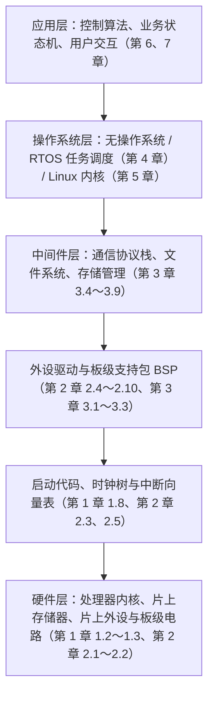
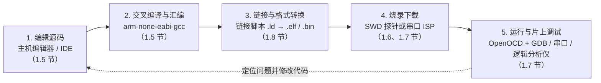
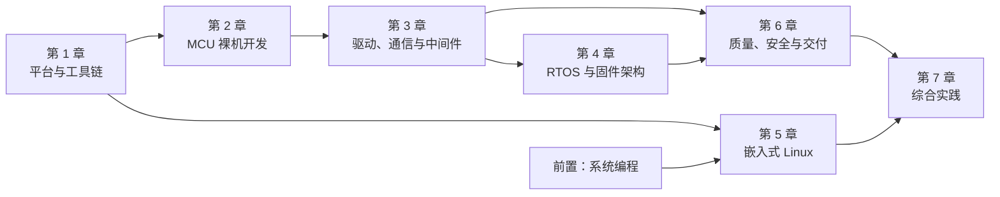

# 1.1 嵌入式系统与软件路线

电饭煲加热内胆时，底部的控制板每隔几十毫秒读取一次热敏电阻的电压，换算出锅内温度，再按煮饭曲线通断发热盘继电器；电动工具里的无刷电机驱动器每秒钟采样两万次相电流，在几十微秒内算出下一拍功率管的导通占空比；家用无线路由器一边转发千兆以太网与 Wi-Fi 数据包，一边响应浏览器发来的网页配置请求。这三台设备的复杂度相差悬殊，但它们内部的程序都用 C 语言编写，直接或通过内核操作硬件外设，共同构成了嵌入式系统 (embedded system)。

打开一块电路板、拿到一颗陌生芯片时，开发者首先要判断这台设备需要裸机程序、实时操作系统还是嵌入式 Linux，并弄清代码怎样从个人电脑编译、链接、烧录到芯片内部运行。本节梳理嵌入式系统的特征、软件分层、三种软件形态的选型依据、交叉开发流程以及本部分的学习路线与实验器材清单。读完本节，读者能够根据产品的资源与实时性需求选择合适的软件路线，并备齐后续章节所需的硬件和工具链。

## 1. 嵌入式系统

### 1.1 从三件日常设备说起

嵌入式系统是嵌入在机电设备或电子产品内部、专为特定功能设计的计算机系统。观察上面提到的三件日常设备，可以看到嵌入式软件与物理世界打交道的典型方式：

| 设备 | 传感器 (sensor) 输入 | 执行器 (actuator) 输出 | 通信与交互接口 | 计算与存储规模 |
| --- | --- | --- | --- | --- |
| 电饭煲控制板 | 热敏电阻（锅底温度、锅盖温度）、按键矩阵 | 继电器（发热盘）、蜂鸣器、数码管 | 无外部网络，仅面板指示 | 8 位或 32 位微控制器，数 KB RAM，数十 KB Flash |
| 无刷电机驱动器 | 分流电阻电流采样、霍尔位置传感器、母线电压采样 | 三相半桥功率管（PWM 驱动） | CAN 总线或 RS-485 接收转速指令 | 32 位微控制器，数十 KB RAM，百 KB 级 Flash |
| 家用无线路由器 | 复位按键、网口连接状态检测 | 状态指示灯、射频前端开关 | 千兆以太网、Wi-Fi、网页管理后台 | 32 位或 64 位片上系统，数百 MB DRAM，数十 MB 闪存 |

这三类设备都不需要像个人电脑那样运行任意第三方桌面软件，硬件和软件从一开始就是围绕特定任务协同设计的。

### 1.2 嵌入式系统的共同特点

尽管应用场景各异，绝大多数嵌入式系统都具有以下五项共同特征：

1. 功能专用。每台设备的程序只服务于确定的业务目标，硬件外设根据产品需求裁剪，不保留多余的接口。
2. 通过传感器与执行器同物理世界交互。程序从模数转换器、数字引脚或通信总线读取温度、电流、位置等物理量，经过控制律或状态机计算后，输出电平、脉冲或通信报文去驱动电机、阀门、加热器与显示屏。
3. 资源受限。微控制器 (Microcontroller Unit, MCU) 片内静态随机存取存储器（SRAM）往往只有几 KB 到几百 KB，只读闪存（Flash）通常在几十 KB 到几 MB 之间，主频从几十 MHz 到几百 MHz 不等；电池供电设备还受到微安级休眠功耗与物料成本的严格约束。
4. 具有明确的时间要求。许多控制任务不仅要求计算结果数值正确，还要求必须在规定时刻之前给出响应。
5. 长期无人值守运行并支持现场升级。工业控制器、智能水表和车载模块常年连续工作，无法靠人工重启恢复故障，发往现场后还需要通过串口、总线或无线网络完成现场固件升级 (In-Application Programming / Over-The-Air, IAP/OTA)。

在时间要求方面，工程上把必须在截止期 (deadline) 前完成的系统称为实时 (real-time) 系统。若错过截止期会导致设备损坏、控制失稳或人身危险（如电机电流环失控、安全气囊延迟展开），称为硬实时 (hard real-time)；若偶尔超时仅引起音视频卡顿或网页响应变慢，则称为软实时 (soft real-time)。

::: concept emb-route-realtime-correctness title="实时系统的正确性"

在实时嵌入式系统中，程序的正确性同时取决于计算结果的逻辑正确性与产生结果的时间。硬实时任务必须在规定的截止期之前完成，超时即意味着系统失效；实时性衡量的是响应时间的确定性，而非单纯的平均吞吐量。

:::

### 1.3 与桌面程序的差异

在个人电脑上编写标准 C 程序时，操作系统负责管理内存、文件系统与终端窗口，程序崩溃后由操作系统回收资源并在屏幕上打印错误信息。而在微控制器上编写嵌入式固件时，运行环境截然不同：

1. 大多数设备没有显示器与键盘，程序无法直接向屏幕输出提示，需要借助串口打印日志，或通过调试探针读取芯片内部寄存器与内存。
2. 裸机与轻量级固件没有虚拟内存保护，野指针或栈溢出会直接覆盖相邻的静态对象甚至外设寄存器。
3. 程序一旦卡死在某个等待循环中，整台物理设备就会失去响应，加热器可能持续通电、电机可能无法停机。为此，微控制器内置了看门狗定时器 (watchdog timer)，要求正常运行的程序定期重置计数器；一旦程序跑飞或死锁导致超时未重置，看门狗就会强制复位芯片，让设备回到安全初始状态。

<Quiz
  type="single"
  :options="[
    { label: '每秒能够渲染 120 帧高清图像的便携式游戏机', value: 'A' },
    { label: '必须在每 50 微秒内完成一次相电流采样与占空比更新的电机控制器', value: 'B' },
    { label: '平均每 5 秒将采集到的室内温湿度上传到云端服务器的传感器节点', value: 'C' },
    { label: '开机后 3 秒内显示主界面的车载音乐播放器', value: 'D' }
  ]"
  answer="B"
>

<template #question>

下列哪一项需求属于典型的硬实时需求？

</template>

正确答案是 **B**。

- 硬实时的判断标准是「必须在严格截止期内完成，超时即导致控制失效或硬件损坏」。20 kHz（周期 50 μs）电流环一旦错过截止期，相电流可能迅速过流并烧毁功率管，因此属于硬实时需求。
- A、C、D 追求的是高吞吐量或较短的平均响应时间，偶尔延迟几十毫秒不会造成系统失效，属于软实时或非实时需求。

</Quiz>

## 2. 嵌入式软件的层次

除了极简单的百行小程序外，工程中的嵌入式软件通常按职责划分为自底向上的多个层次，使上层业务逻辑与底层寄存器细节解耦。下图展示了完整的软件分层结构，以及每一层对应本部分的章节位置：



从下往上看，各层的职责依次为：

1. 硬件层包含微控制器或片上系统芯片、晶振、电源以及外围电路。开发者需要阅读数据手册与原理图（见 [1.2 MCU、MPU、SoC 与执行环境](/教程/正文/嵌入式/1_平台与工具链/1_2_MCU_MPU_SoC与执行环境) 与 [1.3 芯片手册、开发板资料与引脚复用](/教程/正文/嵌入式/1_平台与工具链/1_3_芯片手册_开发板资料与引脚复用)），明确地址空间和引脚连接。
2. 启动与时钟层在芯片上电复位后最先执行，负责初始化栈指针、把初始数据从 Flash 复制到 SRAM、清零未初始化静态对象、配置系统时钟频率并建立中断向量表（见 [1.8 复位、启动与链接](/教程/正文/嵌入式/1_平台与工具链/1_8_复位_启动与链接) 与 [2.3 时钟与复位](/教程/正文/嵌入式/2_MCU裸机开发/2_3_时钟与复位)）。
3. 外设驱动与板级支持包 (Board Support Package, BSP) 封装 GPIO、定时器、UART、SPI、I²C、ADC、DMA 等硬件外设的操作，向上提供统一的读写与配置函数（见第 2 章与 [3.1 驱动接口、CMSIS 与设备头文件](/教程/正文/嵌入式/3_驱动_通信与中间件/3_1_驱动接口_CMSIS与设备头文件)、[3.2 HAL、LL 与 BSP](/教程/正文/嵌入式/3_驱动_通信与中间件/3_2_HAL_LL与BSP)）。
4. 中间件 (middleware) 位于驱动之上、应用之下，实现环形缓冲区、帧解析、Modbus、CAN、USB、TCP/IP 协议栈（如 lwIP）以及闪存文件系统（如 littlefs、FatFs）。
5. 操作系统层根据软件形态的不同，可能完全省略（直接由主循环调用驱动和中间件），也可能是负责多任务调度的实时操作系统，或是提供进程与虚拟内存的 Linux 内核。
6. 应用层实现产品本身的测量、控制、通信与升级逻辑，并结合日志、断言、看门狗与固件校验保障长期可靠运行（见第 6 章与第 7 章）。

## 3. 三种软件形态

按照操作系统层的有无与轻重，嵌入式软件在实际工程中分为三种主流形态：前后台系统（裸机）、实时操作系统（RTOS）和嵌入式 Linux。

### 3.1 前后台系统（裸机）

裸机 (bare-metal) 程序不搭载任何操作系统，直接运行在处理器硬件之上，工程中常称为前后台系统 (foreground-background system)。后台是 `main` 函数里的一个无限循环 `for (;;)`，称为超级循环 (superloop)，依次调用按键扫描、传感器换算、状态机更新与显示刷新等函数；前台则是各个硬件外设触发的中断服务程序 (Interrupt Service Routine, ISR)。

<TimingDiagram
  title="前后台系统（裸机）中中断前台与主循环后台的配合"
  ticks
  :signals="[
    { name: '硬件事件', wave: '0.10........' },
    { name: 'ISR（前台）', wave: '0.10........' },
    { name: 'irq_flag', wave: '0.1....0....' },
    { name: '主循环（后台）', wave: '3...4..5...3', data: ['模块 A', '模块 B', '处理事件', '模块 A'] }
  ]"
  :marks="[{ at: 2, label: '触发中断' }, { at: 7, label: '后台响应' }]"
/>

如上图所示，第 2 格时刻外部硬件事件到达，处理器暂停正在执行的后台「模块 A」，立即进入前台 ISR 保存现场、读取硬件数据并把标志对象 `irq_flag` 置为 1，随即返回后台继续执行「模块 A」和「模块 B」。直到第 7 格主循环轮询到事件处理分支时，才真正完成后续处理并清零 `irq_flag`。

这种结构的优点是占用极小（几 KB Flash 和几百字节 SRAM 即可运行）、没有上下文切换开销、执行路径直观。缺点是后台各模块串行执行：如果「模块 B」里写了耗时的死等延时或复杂计算，后面所有模块的响应时间都会被拖慢。

### 3.2 实时操作系统（RTOS）

当产品需要同时处理多个不同周期的业务（例如一边以 1 kHz 采样控制、一边解析串口命令、一边刷新显示屏并维护网络连接）时，把所有逻辑塞进同一个超级循环会让状态拆分变得极其繁琐。实时操作系统 (Real-Time Operating System, RTOS)（本部分以 FreeRTOS 为主，见 [4.7 FreeRTOS](/教程/正文/嵌入式/4_RTOS与固件架构/4_7_FreeRTOS)）将程序划分为多个独立的任务（线程），每个任务拥有自己的栈空间和优先级。

RTOS 的调度器按优先级抢占调度：只要高优先级任务就绪（例如由定时器或中断通过信号量、队列唤醒），调度器立即保存当前低优先级任务的寄存器上下文，切换到高优先级任务执行。内核本身非常精简，通常只占 6 KB～20 KB Flash 和几 KB SRAM，却能让高频实时任务不受低频耗时任务的阻塞。相应地，开发者必须处理好多任务共享对象时的互斥、死锁与优先级反转问题，并为每个任务合理分配栈空间。

### 3.3 嵌入式 Linux

当设备需要运行完整的 TCP/IP 与 TLS 安全通信、管理大容量文件系统、驱动高分辨率彩色图形界面、支持多进程隔离或复用丰富的 POSIX 开源生态时，微控制器的几十 KB 内存已无法胜任。此时硬件平台升级为带内存管理单元（MMU）的应用处理器 (Microprocessor Unit, MPU) 或片上系统 (System on Chip, SoC)，软件形态随之转向嵌入式 Linux（见 [5.1 嵌入式 Linux 概述](/教程/正文/嵌入式/5_嵌入式Linux/5_1_嵌入式Linux与系统编程边界)）。

在嵌入式 Linux 中，引导加载程序（如 U-Boot）把 Linux 内核与设备树加载到数百 MB 的外部动态内存（DRAM）中，内核挂载根文件系统后启动用户态应用程序。应用程序的开发方式与本教程「系统编程」部分学习的 POSIX 编程高度一致，而硬件外设则由内核空间的驱动程序管理。它的代价是硬件成本、功耗和电路复杂度显著增加，冷启动往往需要数秒，且标准 Linux 内核属于分时调度系统，微秒级硬实时控制通常需要配合专门的协处理器（如片内异构 Cortex-M 核）或实时补丁来完成。

### 3.4 三种形态对照与选型准则

下表从硬件资源、时延特征与工程调试方式六个维度对比三种软件形态：

| 对比维度 | 前后台系统（裸机） | 实时操作系统（RTOS） | 嵌入式 Linux |
| --- | --- | --- | --- |
| 典型芯片 | 8 位/32 位 MCU（如 STM32F103、STM32G0） | 32 位 MCU（如 STM32F1/F4/H7、ESP32） | 带 MMU 的 MPU/SoC（如 i.MX6ULL、RK3568） |
| 内存与存储量级 | 4 KB～64 KB SRAM，16 KB～256 KB Flash | 16 KB～1 MB SRAM，64 KB～2 MB Flash | 64 MB～4 GB DRAM，32 MB～16 GB Flash/eMMC |
| 上电启动时间 | 微秒至几毫秒 | 几毫秒 | 数秒 |
| 实时性表现 | 中断响应达纳秒至微秒级；后台轮询耗时受最慢模块制约 | 中断与高优先级任务抢占响应均为微秒级，确定性高 | 软实时（毫秒级抖动）；微秒级硬实时需协处理器配合 |
| 开发与调试方式 | 交叉编译单映像，SWD/JTAG 调试探针 + 串口 + 逻辑分析仪 | 同裸机，辅以 RTOS 任务状态与运行轨迹跟踪工具 | 内核驱动 + 用户态进程，支持 SSH、GDBServer、日志系统 |
| 典型产品 | 电饭煲、遥控器、简单传感器节点、高速电机驱动内环 | 无人机飞控、多协议工业仪表、联网无线终端、智能门锁 | 智能路由器、车载中控屏、工业边缘网关、网络摄像机 |

::: concept emb-route-selection-rule title="嵌入式软件形态选型准则"

工程选型遵循「够用即止」原则：能用裸机前后台系统清晰解决的单一控制或低功耗采集任务，不引入 RTOS；当存在多个周期悬殊或需阻塞等待的并发任务、且芯片仍为微控制器时，选用 RTOS；只有当业务确实需要复杂网络协议栈、大容量文件系统、高分辨率图形界面或 POSIX 多进程生态时，才选用嵌入式 Linux。

:::

<Quiz
  type="single"
  :options="[
    { label: '前后台系统（裸机）', value: 'A' },
    { label: '实时操作系统（FreeRTOS）', value: 'B' },
    { label: '嵌入式 Linux', value: 'C' },
    { label: '在嵌入式 Linux 用户态进程中用 sleep() 轮询实现全部功能', value: 'D' }
  ]"
  answer="B"
>

<template #question>

某款工业温控仪表使用一颗 256 KB Flash、64 KB SRAM 的 Cortex-M4 微控制器，要求：(1) 每 1 ms 执行一次 PID 温度控制计算；(2) 通过 RS-485 总线响应上位机的 Modbus 查询；(3) 每 100 ms 刷新一块 SPI 接口的单色液晶屏；(4) 通过外接 Wi-Fi 模块向服务器发送报警报文。最合适的软件形态是哪一种？

</template>

正确答案是 **B**。

- 该设备包含 1 ms 高频控制、串口协议应答、屏幕刷新与耗时较长的无线模块交互四项并发工作，若用裸机超级循环，屏幕刷新和无线通信很容易阻塞 1 ms 控制任务或需要极其繁琐的状态机拆分。
- 芯片仅有 64 KB SRAM 且为无 MMU 的 Cortex-M4 微控制器，无法运行嵌入式 Linux，而运行 FreeRTOS 绰绰有余，可通过优先级抢占保证 1 ms 控制任务的实时性。

</Quiz>

::: generate emb-route-selection-walkthrough kind=explanation concepts=emb-route-realtime-correctness,emb-route-selection-rule

面向刚学完标准 C、第一次接触嵌入式选型的读者，以「家用智能体脂秤」和「带人脸识别门禁考勤机」两个具体产品为例，一步步对比它们的输入输出、内存需求、启动速度与实时要求，说明为什么前者用裸机或轻量 RTOS、后者用嵌入式 Linux。

:::

## 4. 开发流程

在桌面程序开发中，编写代码、编译链接与运行调试都在同一台电脑上完成。而在嵌入式开发中，芯片的算力与内存不足以运行编译器，指令集（如 ARM Thumb-2 或 RISC-V）也往往与个人电脑（x86-64）不同。因此嵌入式开发采用宿主机器 (host) 与目标机 (target) 分离的交叉开发模式：



流程中的五个步骤分别对应第 1 章的后续小节：

1. 在宿主机器上编写 C 源文件与头文件，配置构建系统与交叉工具链（见 [1.5 开发环境与交叉编译](/教程/正文/嵌入式/1_平台与工具链/1_5_开发环境与交叉编译)）。
2. 调用交叉编译器（如 `arm-none-eabi-gcc`）进行交叉编译 (cross-compilation)，在个人电脑上生成目标微控制器指令集的目标文件 `.o`（见 [1.5 开发环境与交叉编译](/教程/正文/嵌入式/1_平台与工具链/1_5_开发环境与交叉编译)）。
3. 链接器读取链接脚本 (linker script)，把代码段、只读数据段和初始值精确放置到目标芯片 Flash 与 SRAM 的指定物理地址范围，生成可执行文件 `.elf` 以及纯二进制映像 `.bin` 或 `.hex`（见 [1.8 复位、启动与链接](/教程/正文/嵌入式/1_平台与工具链/1_8_复位_启动与链接)）。
4. 通过串行线调试 (Serial Wire Debug, SWD) 调试探针 (debug probe)，或通过芯片内置引导程序的串口在系统编程 (In-System Programming, ISP) 方式，将固件写入目标机 Flash（见 [1.6 构建、烧录与调试](/教程/正文/嵌入式/1_平台与工具链/1_6_构建_烧录与调试) 与 [1.7 SWD、JTAG 与片上调试](/教程/正文/嵌入式/1_平台与工具链/1_7_SWD_JTAG与片上调试)）。
5. 目标机上电运行固件；宿主机器通过 OpenOCD 与 `arm-none-eabi-gdb` 连接调试探针，在真实芯片上设置硬件断点、单步执行、查看外设寄存器，并配合串口日志与逻辑分析仪观察运行状态（见 [1.7 SWD、JTAG 与片上调试](/教程/正文/嵌入式/1_平台与工具链/1_7_SWD_JTAG与片上调试)）。

## 5. 本部分的学习路线

### 5.1 章依赖关系与三条学习路线

本部分共包含 7 章正文与 1 章术语表，各章之间的先后依赖关系如下图所示：



读者可以根据自己的目标方向，从以下三条学习路线中选择一条推进：

| 学习路线 | 适用目标 | 推荐阅读顺序 |
| --- | --- | --- |
| MCU 固件路线 | 从零掌握微控制器外设驱动、RTOS 多任务固件与工程交付 | 第 1 章 → 第 2 章 → 第 3 章 → 第 4 章 → 第 6 章 → [7.1 裸机外设驱动](/教程/正文/嵌入式/7_综合实践/7_1_裸机外设驱动)、[7.2 RTOS 多任务设备](/教程/正文/嵌入式/7_综合实践/7_2_RTOS多任务设备)、[7.3 联网固件](/教程/正文/嵌入式/7_综合实践/7_3_联网固件) |
| 嵌入式 Linux 路线 | 在已掌握 Linux 系统编程的基础上，学习引导程序、设备树与内核驱动开发 | 第 1 章 1.1～1.3 → 复习「系统编程」部分 → 第 5 章 → [7.4 嵌入式 Linux 驱动与应用](/教程/正文/嵌入式/7_综合实践/7_4_嵌入式Linux驱动与应用) |
| 联网与通信设备路线 | 重点攻克工业总线、有线/无线联网、文件系统与远程固件升级 | 第 1 章 → 第 2 章 → 第 3 章（重点阅读 [3.7 以太网、TCP/IP 与 lwIP](/教程/正文/嵌入式/3_驱动_通信与中间件/3_7_以太网_TCPIP与lwIP)、[3.8 BLE、Wi-Fi 与通信模块](/教程/正文/嵌入式/3_驱动_通信与中间件/3_8_BLE_WiFi与通信模块)、[3.9 Flash、EEPROM、SD 与文件系统](/教程/正文/嵌入式/3_驱动_通信与中间件/3_9_Flash_EEPROM_SD与文件系统)）→ 第 4 章 → [6.4 Bootloader 与固件升级](/教程/正文/嵌入式/6_质量_安全与交付/6_4_Bootloader与固件升级) → [7.3 联网固件](/教程/正文/嵌入式/7_综合实践/7_3_联网固件) |

### 5.2 前置知识索引

嵌入式开发直接建立在 C 语言底层特性与工程构建工具之上。阅读本部分前，若对下表中的概念感到生疏，可随时点击链接回看前文对应章节：

| 所属部分 | 核心知识点 | 嵌入式中的典型用途 | 站内链接 |
| --- | --- | --- | --- |
| 语法和标准库 | 固定宽度整数类型 | 用 `uint8_t`、`uint16_t`、`uint32_t` 精确匹配寄存器与通信帧字节宽度 | [19.1 `<stdint.h>`](/教程/正文/语法和标准库/19_数值_位运算与随机数/19_1_stdint) |
| 语法和标准库 | 算术与位运算 | 用移位、`&`、`|`、`~`、`^` 清零和设置寄存器中的特定位段 | [3.2 算术与位运算](/教程/正文/语法和标准库/3_表达式与类型转换/3_2_算术与位运算) |
| 语法和标准库 | 指针 | 将外设物理基地址强制转换为指针，直接读写内存映射寄存器 | [8. 指针](/教程/正文/语法和标准库/8_指针) |
| 语法和标准库 | 结构与联合 | 用结构体成员偏移映射一组连续的外设寄存器，定义通信帧头部 | [10. 枚举、结构与联合](/教程/正文/语法和标准库/10_枚举_结构与联合) |
| 语法和标准库 | `const` 与 `volatile` | 用 `const` 将查找表放入 Flash；用 `volatile` 阻止编译器优化掉硬件寄存器读写与中断共享对象访问 | [16.3 `const` 与 `volatile`](/教程/正文/语法和标准库/16_对象与内存模型/16_3_const与volatile) |
| 语法和标准库 | 预处理与宏定义 | 定义寄存器位掩码、编写支持多芯片型号的条件编译代码 | [17. 预处理与翻译](/教程/正文/语法和标准库/17_预处理与翻译) |
| 语法和标准库 | 原子操作 | 在无锁单生产者单消费者环形缓冲区中安全更新读写下标 | [23.2 原子操作](/教程/正文/语法和标准库/23_原子操作与并发/23_2_原子操作) |
| 开发与工程基础 | 编译与链接过程 | 理解预处理、编译、汇编、链接四个阶段及段（`.text`、`.data`、`.bss`）的含义 | [3. 从源文件到可执行文件](/教程/正文/开发与工程基础/3_从源文件到可执行文件) |
| 开发与工程基础 | 分别编译与头文件设计 | 组织驱动层、中间件与应用层的多文件目录结构与模块头文件 | [5. 分别编译与统一链接](/教程/正文/开发与工程基础/5_分别编译与统一链接)、[6. 头文件与模块接口](/教程/正文/开发与工程基础/6_头文件与接口边界) |
| 开发与工程基础 | Make 与 CMake | 编写交叉编译构建脚本，自动生成 `.elf`、`.bin`、`.hex` 与映射文件 | [8. 构建图与 Make](/教程/正文/开发与工程基础/8_构建图与Make)、[9. CMake 与 XMake](/教程/正文/开发与工程基础/9_CMake与XMake) |
| 开发与工程基础 | GDB 调试器 | 通过断点、单步、栈回溯与内存查看定位硬件故障 | [12. 调试器](/教程/正文/开发与工程基础/12_调试器) |

## 6. 实验硬件与软件

### 6.1 实验硬件清单

本部分第 1～4 章与第 6～7 章的微控制器实验围绕同一套低成本硬件展开。读者可以先备齐「必备基础套件」开始第 1、2 章的学习，后续章节用到的扩展模块按需添置即可：

| 类别 | 器材名称 | 规格与作用 | 首次使用章节 |
| --- | --- | --- | --- |
| 必备基础套件 | STM32F103C8T6 最小系统板 | 俗称 Blue Pill，Cortex-M3 内核，72 MHz 主频，64 KB Flash，20 KB SRAM，板载 8 MHz 晶振与 PC13 LED | 1.6 节起 |
| 必备基础套件 | ST-LINK/V2 调试探针 | 支持 SWD 接口（SWDIO、SWCLK、GND、3.3 V），用于固件烧录与片上单步调试 | 1.7 节起 |
| 必备基础套件 | CH340 USB 转串口模块 | 支持 3.3 V 电平，用于串口 ISP 下载及第 2 章起的 `printf` 控制台日志输出 | 1.6 节、2.7 节起 |
| 必备基础套件 | 面包板、杜邦线与基础元件 | 400 孔面包板、公对母/公对公杜邦线、轻触按键、发光二极管、限流电阻、10 kΩ 电位器 | 2.4 节起 |
| 按章扩展模块 | AT24C02 EEPROM 模块 | I²C 接口（7 位地址 `0x50`），2 Kb 容量，用于练习 I²C 总线与参数存储 | 2.8 节、3.9 节 |
| 按章扩展模块 | W25Q64 NOR Flash 模块 | SPI 接口，64 Mb（8 MB）容量，用于练习 SPI 总线与 littlefs 文件系统 | 2.8 节、3.9 节 |
| 按章扩展模块 | MAX3485 RS-485 收发器模块 | 将 UART 电平转换为 RS-485 差分信号，带方向控制脚，用于 Modbus RTU 实验 | 3.5 节 |
| 按章扩展模块 | TJA1050 或 SN65HVD230 模块 | CAN 总线物理层收发器，配合芯片内置 bxCAN 控制器完成帧收发 | 3.5 节 |
| 按章扩展模块 | ENC28J60 以太网模块 | SPI 接口独立以太网控制器，用于移植 lwIP 协议栈 | 3.7 节 |
| 按章扩展模块 | ESP32-C3 开发板 | 烧录官方 ESP-AT 固件，通过 UART 连接主控 MCU 实现 Wi-Fi 与 BLE 通信 | 3.8 节 |
| 按章扩展模块 | MicroSD 卡模块（SPI 模式） | 配合 SPI 总线读写 SD 卡并挂载 FatFs 文件系统 | 3.9 节 |
| 可选测量工具 | USB 逻辑分析仪（24 MHz 8 通道） | 配合开源软件 PulseView 抓取 UART、SPI、I²C、PWM 真实波形，排查时序故障 | 2.6 节、6.3 节 |
| 可选测量工具 | 数字万用表 | 测量供电电压、引脚电平与连通性，排查接线错误 | 1.6 节起 |

::: tip 低价开发板上的兼容芯片

市面上的低价 Blue Pill 开发板可能焊有 GD32、CKS32、APM32 等兼容芯片而非 ST 原厂芯片，当 OpenOCD 报器件 ID 不匹配时，先查看芯片表面丝印确认型号。

:::

### 6.2 开发软件清单

宿主机器（Windows、Linux 或 macOS）需准备以下软件工具，具体安装与配置步骤见 [1.5 开发环境与交叉编译](/教程/正文/嵌入式/1_平台与工具链/1_5_开发环境与交叉编译)：

| 工具名称 | 用途说明 |
| --- | --- |
| Arm GNU Toolchain (`arm-none-eabi-gcc`) | 包含交叉编译器 `arm-none-eabi-gcc`、调试器 `arm-none-eabi-gdb` 以及尺寸与符号查看工具 `size`、`objdump`、`nm`、`readelf` |
| OpenOCD | 开源片上调试服务端，驱动 ST-LINK 探针并向 GDB 提供远程调试端口 |
| CMake 与 Ninja / Make | 跨平台构建工具，配合本部分提供的工具链文件一键构建固件映像 |
| 串口终端工具 | 用于查看串口日志与发送调试命令（Windows 可用 PuTTY 或串口助手，Linux/macOS 可用 `minicom`、`picocom`） |
| STM32CubeMX（可选） | ST 官方图形化配置与代码生成工具，用于生成 HAL 库对照工程 |

## 7. 本部分的约定

为了保证各章实验前后连贯、读者无需频繁拆改面包板接线，本部分统一遵守以下四项约定：

1. 参考硬件统一采用搭载原厂 STM32F103C8T6（ARM Cortex-M3 内核）的最小系统板，外设寄存器地址、位定义与时序特性均以 ST 官方《STM32F10xxx 参考手册》（RM0008）与数据手册（DS5319）为准。
2. 代码讲解采用「寄存器写法为主、硬件抽象层 (Hardware Abstraction Layer, HAL) 为辅」的路线。初学者直接用官方 HAL 库函数虽然能快速点亮外设，但遇到时钟未使能、标志位未清除或时序卡死时往往无从下手；先通过 CMSIS 设备头文件的寄存器结构体看清外设内部每一位的动作机制，再对照 HAL 函数的封装方式，既能彻底掌握底层原理，又能在大型工程中高效复用厂商库。
3. 本部分所有配套完整源码与构建脚本均存放在仓库的 `code/嵌入式/` 目录下，按章节分目录组织（例如 `code/嵌入式/2_MCU裸机开发/2_4_GPIO/`），公共启动文件、链接脚本与 CMake 工具链文件位于 `code/嵌入式/common/`。
4. 整套实验板的引脚分配经过统一规划，确保板载 LED、按键、串口、SPI Flash、I²C EEPROM、RS-485 与无线模块可以同时保留在面包板上而不发生引脚冲突，完整引脚分配表与冲突排查方法见 [1.3 芯片手册、开发板资料与引脚复用](/教程/正文/嵌入式/1_平台与工具链/1_3_芯片手册_开发板资料与引脚复用)。

## 8. 习题

### 8.1 巩固

<Exercise id="60111" :d="1" :w="2" multi>

观察身边的电子设备并结合本节介绍的软件分层模型，完成以下分析：

(1) _[1.1]_ 列出身边三件不同的嵌入式产品（不要与正文表格中的电饭煲、无刷电机驱动器、家用无线路由器重复），分别写出每件产品的传感器输入、执行器输出、外部通信接口，以及你推测它采用的软件形态（裸机前后台系统、RTOS 或嵌入式 Linux），并说明判断依据。

(2) _[2.2]_ 为一把「支持指纹识别、密码按键、蓝牙手机开锁、门锁电机驱动与低电量语音提示」的家用智能门锁画出软件层次图（参照第 2 节的 6 层结构），并在每一层旁边标出对应本部分的章号或小节号。

</Exercise>

<Exercise id="60112" :d="2" :w="2">

下面给出三个实际工程项目的需求概述。请分别为它们选择最合适的软件形态（前后台裸机、RTOS 或嵌入式 Linux），并从内存量级、启动与休眠功耗、实时截止期或生态需求四个角度说明理由：

1. 仓库温湿度无线标签：由一颗 CR2032 纽扣电池供电，要求续航 2 年以上；平时处于深度休眠状态，每 60 秒唤醒一次读取 I²C 温湿度传感器并通过 2.4 GHz 射频芯片发送一帧 16 字节广播包，随即继续休眠。
2. 工厂协议转换与触摸屏网关：配备 7 英寸 1024×600 彩色电容触摸屏，需要同时采集 4 路 RS-485 与 2 路以太网设备的工业数据，存入本地 SQLite 数据库，并通过 HTTPS 与 MQTT 加密上传至云平台，支持远程下载完整固件包升级。
3. 伺服电机电流环控制器：需要在 20 kHz 开关频率下运行，每 50 μs 由定时器触发 ADC 采样相电流，在 25 μs 内完成坐标变换与比例积分计算并更新 PWM 寄存器，同时通过 CAN 总线接收上位机的目标转矩指令。

</Exercise>

### 8.2 编程

<Exercise id="60113" :d="2" :w="2">

在实时嵌入式系统中，每个周期性任务都有规定的周期 `period_us`（即硬实时截止期）和预估的最坏执行时间 `wcet_us`（Worst-Case Execution Time）。编写一个主机端标准 C 程序 `deadline_check.c`，用下面的结构体数组描述电机控制器中的三个周期性任务，检查每个任务的实测最大耗时 `measured_max_us` 是否超过其周期（超时则判定为违反硬实时截止期），并计算整组任务的处理器时间总利用率（各任务 `wcet_us / period_us` 之和，以千分比输出）：

```c
struct periodic_task {
    const char *name;
    uint32_t period_us;
    uint32_t wcet_us;
    uint32_t measured_max_us;
};
```

测试数据依次为：`{"current_loop", 50, 18, 21}`、`{"speed_loop", 1000, 120, 115}`、`{"telemetry", 10000, 1500, 11200}`。使用 `gcc -std=c17 -Wall -Wextra deadline_check.c -o deadline_check` 编译运行，期望输出如下：

```out
current_loop   period=    50 us  measured=    21 us  [OK]
speed_loop     period=  1000 us  measured=   115 us  [OK]
telemetry      period= 10000 us  measured= 11200 us  [MISSED]
Total WCET utilization: 630.0 / 1000.0
```

</Exercise>

<Exercise id="60114" :d="3" :w="2">

前后台系统（裸机）的后台是一个按顺序依次执行各模块的超级循环。当某个后台模块耗时增长时，主循环响应中断标志的延迟也会随之增大。

基于初始代码 `code/嵌入式/1_平台与工具链/1_1_嵌入式系统与软件路线/exercises/superloop_starter.c`，补全 `run_simulation(int temp_cost_ms, int irq_trigger_ms)` 函数：模拟从 `t = 0` 开始的超级循环，每轮依次执行 `key_scan`（固定耗时 1 ms）、`temp_calc`（耗时 `temp_cost_ms`）和 `led_update`（固定耗时 1 ms）。外部按键中断在 `t = irq_trigger_ms` 时刻触发并将 `irq_flag` 置为 1，而后台只有在执行 `key_scan` 模块时才会检查 `irq_flag` 并完成事件处理（处理完成时刻为该次 `key_scan` 结束的毫秒数）。

使用 `gcc -std=c17 -Wall -Wextra` 编译运行，对比 `temp_cost_ms` 为 4 ms 与 8 ms 时按键事件在 `t = 2 ms` 触发后的后台响应延迟，期望输出如下：

```out
temp_cost=4 ms, irq_at=2 ms -> handled_at=7 ms, latency=5 ms
temp_cost=8 ms, irq_at=2 ms -> handled_at=11 ms, latency=9 ms
```

</Exercise>

<Exercise id="60115" :d="3" :w="3">

微控制器资源受限，链接后的固件映像必须同时满足 Flash 与 SRAM 的容量上限。在嵌入式固件中，只读代码段（`.text`）和已初始化静态对象的初值副本（`.data`）存放在 Flash 中；运行时，`.data` 段、未初始化静态对象段（`.bss`）以及函数调用栈（Stack）共同占用 SRAM。

基于初始代码 `code/嵌入式/1_平台与工具链/1_1_嵌入式系统与软件路线/exercises/mem_budget_starter.c`，针对本部分参考硬件 STM32F103C8T6（Flash 上限 64 KiB = 65536 字节，SRAM 上限 20 KiB = 20480 字节），统计软件各层模块与预留栈空间的 Flash 和 SRAM 总占用量、占芯片总容量的百分比，并判断是否超出硬件上限（未超出打印 `FIT`，超出打印 `OVERFLOW`）。编译运行后期望输出如下：

```out
Flash: 44224 / 65536 bytes (67.5%) [FIT]
SRAM : 15360 / 20480 bytes (75.0%) [FIT]
```

</Exercise>

### 8.3 综合与挑战

<Exercise id="60116" :d="4" :w="3">

结合第 3 节的软件形态选型准则，编写一个命令行选型检查工具 `route_advisor.c`。程序从标准输入按行读取多组设备需求，每行包含 4 个以空格分隔的整数：`ram_kib`（可用内存上限，单位 KiB）、`max_boot_ms`（允许的最大启动时间，单位 ms）、`min_deadline_us`（最严苛的任务截止期，单位 μs）、`need_rich_os`（是否需要完整 POSIX 多进程与图形界面生态，1 表示需要，0 表示不需要）。

按以下规则依次判定并输出每组需求的选型结论：

1. 若 `need_rich_os == 1`，则必须选用嵌入式 Linux，但若此时 `ram_kib < 32768`（不足 32 MiB）或 `max_boot_ms < 1000`（要求 1 秒内冷启动）或 `min_deadline_us < 200`（存在 200 μs 以内的硬实时任务且无协处理器），输出 `CONFLICT: Linux requires >=32768 KiB RAM, >=1000 ms boot, and Coprocessor for <200 us deadline`，否则输出 `ROUTE: Embedded Linux`。
2. 若 `need_rich_os == 0`：当 `ram_kib < 4` 时输出 `CONFLICT: Insufficient RAM`；当 `ram_kib < 16` 时（内存不足以宽裕运行多任务 RTOS）输出 `ROUTE: Bare-metal (Superloop + ISR)`；当 `ram_kib >= 16` 时输出 `ROUTE: RTOS or Bare-metal`。

自行构造包含上述 4 种输出分支的测试输入并验证程序输出。

</Exercise>

## 9. 参考资料

1. Elecia White, *Making Embedded Systems*, 2nd ed., O'Reilly Media, 2024.
2. STMicroelectronics, [STM32F103C8 Mainstream Performance Line MCU Product Page & Datasheet (DS5319)](https://www.st.com/en/microcontrollers-microprocessors/stm32f103c8.html).
3. FreeRTOS Documentation, [About FreeRTOS Kernel](https://www.freertos.org/).
4. The Linux Kernel Documentation, [The Linux Kernel User's and Administrator's Guide](https://docs.kernel.org/).
5. Arm Developer, [Arm GNU Toolchain Downloads](https://developer.arm.com/downloads/-/arm-gnu-toolchain-downloads).
6. OpenOCD Project, [Open On-Chip Debugger Official Website](https://openocd.org/).
