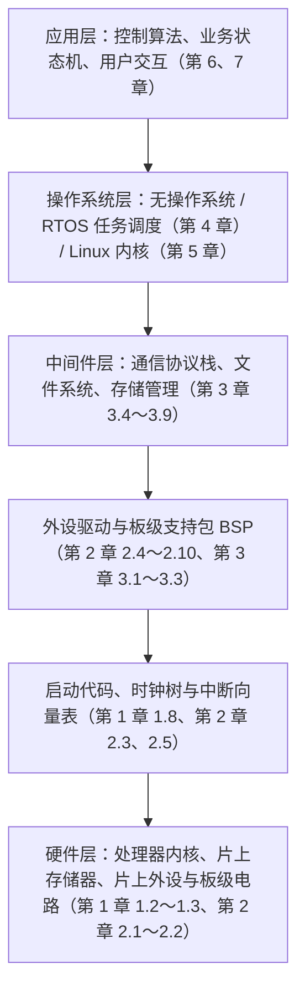
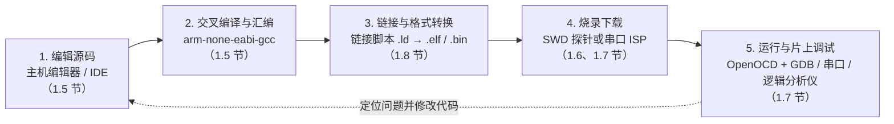
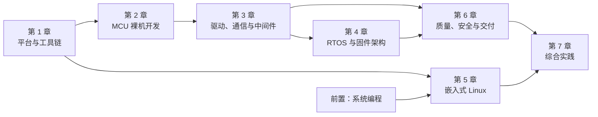

# 1.1 嵌入式系统与软件路线

电饭煲在加热内胆时，底部的控制板每隔几十毫秒读取一次热敏电阻的模拟分压，经由数模转换换算出锅内当前的温升速率，再依照既定的煮饭温度曲线，通过继电器精准通断发热盘的强电供电；电动工具里的无刷电机控制器每秒钟执行两万次相电流采样，必须在几十微秒的控制窗口内完成坐标变换，算出下一拍功率管的导通占空比；而摆在客厅角落的家用无线路由器，则在一边高速转发千兆以太网与 Wi-Fi 数据包的同时，从容响应来自浏览器管理界面的配置请求。这三台设备的形态、算力与外设规模各不相同，但它们内部运转的程序都以 C 语言为主体构建，直接操作硬件控制寄存器，或借助内核抽象管理外部物理世界，共同构成了现代工业与生活中无处不在的嵌入式系统 (embedded system)。

习惯了在个人电脑上编写应用程序的开发者，初次面对一块裸露的电路板与一颗陌生的芯片时，往往需要经历一次思维范式的转换。在桌面操作系统中，代码运行在由虚拟内存、动态链接器与进程调度器构筑的保护伞下，内存耗尽会抛出异常，逻辑崩溃也可以由操作系统回收资源并在终端清晰打印调用栈。然而在微控制器构成的物理世界里，算力与存储以千字节（KB）为单位精打细算，既没有虚拟内存的隔离屏障，通常也没有屏幕可供即时输出信息。面对有限的硬件预算，整套软件体系究竟该选用简单直接的裸机超级循环、支持确定性调度的实时操作系统（RTOS），还是功能完备的嵌入式 Linux？写在宿主机上的 C 语言源码，又是如何一步步跨越指令集架构的差异，被链接器精确安放进微控制器的物理地址空间，并通过调试探针烧录与单步跟踪的？

厘清这些疑问，是开启底层系统探索的第一步。理解嵌入式系统面向特定任务而生的设计哲学，建立起从硅片寄存器到应用状态机的层次认知，并在裸机、RTOS 与 Linux 三种软件路线之间建立起基于工程约束的选型直觉，后续面对繁杂的芯片手册、外设驱动与多任务协同开发时，便能始终拥有一张清晰的全局地图。

## 1. 嵌入式系统

### 1.1 从三件日常设备说起

嵌入式系统通常被定义为嵌入在物理机电设备或电子产品内部、专为特定控制或处理功能深度定制的专用计算机系统。如果回顾前文提及的三件日常设备，便能直观感受到嵌入式软件与物理世界打交道的独特节奏与工作形态：

| 设备 | 传感器 (sensor) 输入 | 执行器 (actuator) 输出 | 通信与交互接口 | 计算与存储规模 |
| --- | --- | --- | --- | --- |
| 电饭煲控制板 | 热敏电阻（锅底温度、锅盖温度）、按键矩阵 | 继电器（发热盘）、蜂鸣器、数码管 | 无外部网络，仅面板指示 | 8 位或 32 位微控制器，数 KB RAM，数十 KB Flash |
| 无刷电机驱动器 | 分流电阻电流采样、霍尔位置传感器、母线电压采样 | 三相半桥功率管（PWM 驱动） | CAN 总线或 RS-485 接收转速指令 | 32 位微控制器，数十 KB RAM，百 KB 级 Flash |
| 家用无线路由器 | 复位按键、网口连接状态检测 | 状态指示灯、射频前端开关 | 千兆以太网、Wi-Fi、网页管理后台 | 32 位或 64 位片上系统，数百 MB DRAM，数十 MB 闪存 |

这三类设备的设计初衷均非充当通用计算平台。它们不需要像个人电脑那样随时加载并运行用户下载的各类第三方桌面软件，其板上硬件外设与内部固件在设计之初就围绕确定的工程任务紧密耦合，协同演进。

### 1.2 嵌入式系统的共同特点

尽管各自的工业场景与技术指标千差万别，但当我们透过外壳审视其内部架构时，绝大多数嵌入式系统都表现出高度一致的内在特征：

1. **功能专一与针对性裁剪**。每台设备出厂后的软件生命周期，几乎都在重复执行既定的控制逻辑与状态流转。正因目标单一，硬件工程师会在布板时坚决裁撤无关的芯片引脚与外围接口，软件也极力剥离不必要的驱动开销，力求在恰到好处的物料成本下稳定交付。
2. **直面物理世界的输入与输出**。软件不再只是在内存中处理字符串或计算报表，而是借助片上模数转换器、定时器捕获通道或工业总线，时刻感知周围环境中的温度、相电流、转速与电平变化。经过内部控制算法或离散状态机的推演后，代码通过向外设输出特定占空比的脉冲电平、通信报文或驱动信号，直接控制电机转动、电磁阀开合以及功率器件的发热。
3. **计算与存储资源的严苛受限**。在微控制器 (Microcontroller Unit, MCU) 领域，开发者通常无法拥有桌面平台动辄数十吉字节（GB）的物理内存。片内的静态随机存取存储器（SRAM）往往只有几 KB 到几百 KB，用于存放程序的只读闪存（Flash）通常也在几十 KB 到数 MB 之间徘徊，处理器的时钟频率多在几十 MHz 至几百 MHz。在许多依托纽扣电池供电的野外传感器节点上，代码不仅要压缩存储尺寸，还必须严格进入微安级的深度睡眠模式，以换取数年之久的免维护续航。
4. **确定性的时间约束**。在通用计算机上，解压缩一个文件多耗费几毫秒、网页加载偶尔停顿半秒，通常无伤大雅；但在工业运动控制、车载底盘或电源控制场景中，算出的占空比数值即使数学上再正确，如果因为任务排队而晚到了几十微秒，相电流就可能迅速过冲而烧毁逆变桥臂。这种对截止时间（deadline）的刚性要求，构成了嵌入式系统不可妥协的设计底线。
5. **长期无人值守与现场维护能力**。深埋地下的智能水表、安装在高压输电铁塔上的监测终端，或是封闭在汽车底盘内部的控制器，一旦投入运行往往需要连续工作数年甚至十数年之久。它们无法依赖人工拔插电源来重启排障，必须具备自主应对外部干扰与电网抖动的稳健容错机制；而在产品迭代时，还需借助串口、总线或无线远程方式完成可靠的固件在线升级 (In-Application Programming / Over-The-Air, IAP/OTA)。

针对上述时间约束，工程界将必须在严格截止期 (deadline) 之前完成指定响应的系统统称为实时 (real-time) 系统。若错过截止时刻将直接导致机械失稳、设备电气损坏乃至危害人身安全（例如汽车安全气囊展开判定延迟、高频逆变器电流采样超时），该场景即被界定为硬实时 (hard real-time)；若偶尔发生的处理延迟仅表现为屏幕波形卡顿、音频播放间歇性掉帧或配置网页打开略微变慢，并不危及系统核心功能与硬件安全，则属于软实时 (soft real-time)。

::: concept emb-route-realtime-correctness title="实时系统的正确性"

在实时嵌入式系统中，程序的正确性同时取决于计算结果的逻辑正确性与产生结果的时间。硬实时任务必须在规定的截止期之前完成，超时即系统失效；实时性衡量响应时间的确定性，平均吞吐量高并不代表实时性好。

:::

### 1.3 与桌面程序的差异

在熟悉的桌面环境编写 C 程序时，宿主操作系统的虚拟内存机制为每个进程构筑了独立的平坦地址空间，标准 C 运行时库默默打理着堆内存分配，崩溃时操作系统能够从容收回全部句柄并在终端清晰打印出堆栈转储。然而在面向微控制器的固件世界中，程序所面对的运行边界有着本质不同：

1. **人机界面的剥离与调试手段的迁移**。大部分嵌入式电路板上根本没有连结显示器与键盘的接口。当程序逻辑出现异常时，无法依赖向控制台直接输出调试提示，开发者往往需要通过引出板载调试串口查看字符日志，或者依赖物理探针挂载到芯片的调试引脚上，直接读取片内核寄存器与内存数据。
2. **无内存隔离带来的直接物理暴露**。在典型的微控制器或轻量级固件中，没有虚拟内存管理单元（MMU）提供地址映射与保护机制。整个处理器的物理地址空间是完全扁平的：片上 Flash、SRAM、各外设的控制寄存器甚至厂商预留的保留区域，全都暴露在同一套总线地址上。这意味着哪怕是一次轻微的指针越界访问或局部数组引起的栈溢出，破坏的很可能不是孤立的局部数据，而是紧邻的全局静态对象，甚至是正在输出 PWM 控制脉冲的定时器寄存器，瞬间引发灾难性的系统失常。
3. **不可阻断的运行预期与硬件看门狗守卫**。在 PC 上，某个应用程序陷入死循环只表现为一个假死的窗口，用户可以在任务管理器中直接将其强制终止；但在微控制器上，一旦主控程序因为死等外设就绪标志而彻底卡死，连接在外围的电加热板可能无法及时断开，旋转的机械臂也可能失去减速指令。为了避免这种失控状态，芯片内部通常集成了独立的硬件看门狗定时器 (watchdog timer)。它要求固件在正常运转周期内定期执行“喂狗”操作重置内部递减计数器；一旦固件由于死锁、跑飞或电磁脉冲干扰脱离了既定轨迹而超时未重置计数器，看门狗将在硬件层面强制产生复位信号，令芯片瞬间重启复位，回到安全的初始上电状态。

<Quiz
  type="single"
  :options="[
    { label: '每秒能够渲染 120 帧高清图像的便携式游戏机', value: 'A' },
    { label: '必须在每 50 微秒内完成一次相电流采样与占空比更新的电机控制器', value: 'B' },
    { label: '平均每 5 秒将采集到的室内温湿度上传到云端服务器的传感器节点', value: 'C' },
    { label: '开机后 3 秒内显示主界面的车载音乐播放器', value: 'D' }
  ]"
  answer="B"
>

<template #question>

下列哪一项需求属于典型的硬实时需求？

</template>

正确答案是 **B**。

- 硬实时的判断标准是「必须在严格截止期内完成，超时即导致控制失效或硬件损坏」。20 kHz（周期 50 μs）电流环一旦错过截止期，相电流可能迅速过流并烧毁功率管，因此属于硬实时需求。
- A、C、D 追求的是高吞吐量或较短的平均响应时间，偶尔延迟几十毫秒不会造成系统失效，属于软实时或非实时需求。

</Quiz>

## 2. 嵌入式软件的层次

面对任何非微型工程的嵌入式项目，若将业务逻辑直接与底层芯片的寄存器读写混杂在一起，一旦硬件改版、外设引脚调整或主控芯片换型，整套代码往往面临推倒重来的窘境。在规范的工程实践中，嵌入式软件自底向上划分为职责明晰的多级体系，使得上层的控制律与业务状态机得以在稳定的抽象接口之上流转。下图展现了这种经典的软硬件分级体系，以及各层在后续各章中的落脚点：



自底层向顶层梳理，每一层都在为上一层构筑更易用、更可靠的运行环境：

1. **硬件层**：涵盖微控制器或片上系统硅片自身、外部晶振、稳压滤波电路及所有板载外围元器件。在敲下第一行代码前，开发者需要翻阅芯片数据手册与硬件原理图（见 [1.2 MCU、MPU、SoC 与执行环境](/教程/正文/嵌入式/1_平台与工具链/1_2_MCU_MPU_SoC与执行环境) 与 [1.3 芯片手册、开发板资料与引脚复用](/教程/正文/嵌入式/1_平台与工具链/1_3_芯片手册_开发板资料与引脚复用)），确认存储器物理地址边界、总线拓扑以及引脚的电气映射。
2. **启动与时钟层**：系统在复位信号解除后执行的最前导汇编与底层 C 代码。它的核心职责是初始化主堆栈指针、将已初始化的数据段从只读 Flash 搬移至运行 SRAM、清零未初始化的静态对象、激活并配置片上锁相环（PLL）以确立系统主频，并建立好异常与中断向量表（见 [1.8 复位、启动与链接](/教程/正文/嵌入式/1_平台与工具链/1_8_复位_启动与链接) 与 [2.3 时钟与复位](/教程/正文/嵌入式/2_MCU裸机开发/2_3_时钟与复位)）。
3. **外设驱动与板级支持包 (Board Support Package, BSP)**：针对 GPIO、通用定时器、通用异步收发器（UART）、串行外设接口（SPI）、集成电路总线（I²C）、模数转换器（ADC）与直接内存访问（DMA）等底层外设，以结构化方式封装寄存器操作，向上提供功能专一的读写与控制函数（见第 2 章以及 [3.1 驱动接口、CMSIS 与设备头文件](/教程/正文/嵌入式/3_驱动_通信与中间件/3_1_驱动接口_CMSIS与设备头文件)、[3.2 HAL、LL 与 BSP](/教程/正文/嵌入式/3_驱动_通信与中间件/3_2_HAL_LL与BSP)）。
4. **中间件层 (Middleware)**：横亘于硬件驱动与高层业务之间，提供脱离具体芯片硬件特性的通用服务基础设施，包括无锁环形缓冲区、帧解析流水线、Modbus 工业协议、CANopen、USB 设备协议栈、轻量级 TCP/IP 协议栈（如 lwIP）以及针对外置 Flash 的抗掉电闪存文件系统（如 littlefs、FatFs）等（见第 3 章 3.4 至 3.9 节）。
5. **操作系统层**：根据项目的时间精度与复杂度要求弹性选用。在极致精简的架构中，该层可以完全省略，直接由主函数大循环调用底层驱动与中间件；在复杂单片机系统中，通常引入实时操作系统进行确定性的多任务切分与资源仲裁；而在网关或人机交互终端中，该层则演变为承载虚拟内存与进程模型的完整 Linux 内核。
6. **应用层**：承载产品真正的业务灵魂，包括物理量闭环调节算法、业务工作状态机、人机交互事件响应与远程升级调度等，同时结合健康心跳、防错断言与故障转储机制保障整机长期连续运行的健壮性（见第 6 章与第 7 章）。

## 3. 三种软件形态

根据操作系统层的引入程度以及任务调度的实现形态，现实工程中的嵌入式软件往往沉淀为三条泾渭分明的技术路径：前后台裸机系统、实时操作系统（RTOS）以及嵌入式 Linux。

### 3.1 前后台系统（裸机）

裸机 (bare-metal) 程序全然不依赖任何操作系统内核，直接以裸金属形式运行在芯片硬件之上。在工业界，这种结构更常被称为前后台系统 (foreground-background system)。

后台主体是 `main` 函数深处永不退出的超级大循环 `for (;;)`，周而复始地依次轮询按键输入、执行温湿度物理量换算、推进业务状态机并刷新数码管；前台则由各个片上外设（如定时器溢出、串口接收完成）产生的硬件中断服务程序 (Interrupt Service Routine, ISR) 组成。

<TimingDiagram
  title="前后台系统（裸机）中中断前台与主循环后台的配合"
  ticks
  :signals="[
    { name: '硬件事件', wave: '0.10........' },
    { name: 'ISR（前台）', wave: '0.10........' },
    { name: 'irq_flag', wave: '0.1....0....' },
    { name: '主循环（后台）', wave: '3...4..5...3', data: ['模块 A', '模块 B', '处理事件', '模块 A'] }
  ]"
  :marks="[{ at: 2, label: '触发中断' }, { at: 7, label: '后台响应' }]"
/>

时序图中展现了两者协同的标准过程：在第 2 格时刻，外部硬件引脚电平突变触发中断，处理器硬件自动压栈暂停后台正执行的「模块 A」，快速跃迁进入前台 ISR。ISR 在极短时间内保存关键寄存器、读取外设缓冲数据并向全局标志对象 `irq_flag` 写入非零状态，随后迅速退出并恢复现场。后台「模块 A」与接续的「模块 B」继续串行推进，直到第 7 格主循环的流程走到轮询该标志对象的分支，后台才真正执行相关的事件业务，并将 `irq_flag` 重新复位清零。

这种体系的魅力在于极致纯粹与透明：往往仅需几个 KB 的 Flash 和数百字节的 SRAM 便能让设备稳健运作。代码执行的时空路径完全平铺在源码之中，没有任何隐藏的任务切换开销，排查问题只需借助基础仿真器或逻辑分析仪便能尽收眼底。

然而其内在短板也随业务拓展暴露得十分迅速：后台的所有子模块被迫共享同一个执行时间轴。一旦某个环节（例如上图中的「模块 B」）由于等待慢速外部传感器总线回复而插入了忙等待延时，或者执行了复杂的浮点矩阵运算，后续所有模块的执行时刻都将被硬性拖后。当多个具有不同时间颗粒度的业务（例如 1 毫秒的控制环与 200 毫秒的屏幕刷新）交织在一起时，开发者往往被迫将耗时任务人工拆解成大量零碎的小步状态机，不仅代码可读性急剧恶化，系统响应抖动也会变得难以捉摸。

### 3.2 实时操作系统（RTOS）

当单台设备需要并发兼顾多种节奏相差悬殊的业务——例如一边维持 1 kHz 的高频电流闭环、一边通过串口按字节解析 Modbus 帧、一边向液晶屏输出平滑界面，还需时不时维护无线连接的心跳时，强行在单一超级循环中用状态机缝合所有分支会让代码结构变得格外臃肿脆弱。此时，引入实时操作系统 (Real-Time Operating System, RTOS)（本部分以业界广泛采用的 FreeRTOS 为主线展开，详见 [4.7 FreeRTOS](/教程/正文/嵌入式/4_RTOS与固件架构/4_7_FreeRTOS)）成为了自然的架构升级。

RTOS 将一维的程序流程拆解为多个并行独立的“任务”（在轻量级内核中也称线程）。每个任务拥有专属的私有栈空间和静态优先级，彼此之间就像在独立占用 CPU 一样编写顺序逻辑。

RTOS 调度器以严格的优先级抢占规则为基石：任何时候只要有更高优先级的任务由睡眠状态就绪（例如由定时器超时触发，或由硬件中断投递的信号量与队列消息唤醒），调度器将在微秒级的确定时间内保存低优先级任务的现场寄存器，瞬间切换至高优先级任务接管 CPU。这种机制通常只需 6 KB 至 20 KB 的 Flash 和几 KB 的 SRAM 基础开销，却能彻底切断低频耗时操作对高频控制任务的无形锁滞。

当然，多任务带来的收益并非没有代价。开发者不再能假定内存中的数据处于单线程的安全庇护下，多任务并发访问共享对象时必须严密设计互斥锁、临界区或无锁队列，警惕死锁与优先级反转的陷阱；同时还必须为每个任务审慎划定栈空间边界，随时防范因局部深度递归或中断嵌套诱发的静默栈溢出。

### 3.3 嵌入式 Linux

当项目需求进一步延伸，开始涉及大容量闪存文件管理、端到端 TLS 加密通信、多媒体流传输编解码、高分辨率触摸屏人机界面，或是希望复用成熟的 POSIX 平台海量开源组件时，微控制器的数十 KB 内存与有限的主频便彻底见底。此时，系统底座必须迁移至配备硬件内存管理单元（MMU）的应用处理器 (MPU) 或高性能片上系统 (SoC)，软件形态也随之过渡到嵌入式 Linux 体系（见 [5.1 嵌入式 Linux 概述](/教程/正文/嵌入式/5_嵌入式Linux/5_1_嵌入式Linux与系统编程边界)）。

在嵌入式 Linux 的生命周期中，芯片上电首先由引导加载程序（如 U-Boot）接管，完成对外部动态随机存储器（DRAM）的初始化与自检，随后将 Linux 内核映像与描述板级外设引脚的设备树（Device Tree）载入内存并移交执行权。内核挂载只读或可读写的根文件系统后，最终拉起用户态的首个进程。

在此模式下，顶层应用的开发方式平滑回到了熟悉的 POSIX 编程模型，拥有独立的进程地址空间与丰富的标准库支撑；与此相对，所有直面物理寄存器与中断线的操作，都被严格收拢在内核空间的设备驱动中。这种架构的代价是沉重的：硬件成本往往翻倍，电路需要设计高频 DDR 走线与多路电源时序管理，整机功耗从微安跃升至百毫瓦甚至瓦级，冷启动耗时也从微控制器的“开机即运行”拉长至数秒之久。更关键的是，通用 Linux 内核基于分时调度哲学设计，毫秒级的调度抖动使得微秒级的硬实时动作通常需要求助于片内集成的异构 Cortex-M 协处理器，或者挂载底层的 PREEMPT_RT 实时内核补丁。

### 3.4 三种形态对照与选型准则

下表从硬件资源、时延特征与工程调试方式六个维度对比三种软件形态：

| 对比维度 | 前后台系统（裸机） | 实时操作系统（RTOS） | 嵌入式 Linux |
| --- | --- | --- | --- |
| 典型芯片 | 8 位/32 位 MCU（如 STM32F103、STM32G0） | 32 位 MCU（如 STM32F1/F4/H7、ESP32） | 带 MMU 的 MPU/SoC（如 i.MX6ULL、RK3568） |
| 内存与存储量级 | 4 KB～64 KB SRAM，16 KB～256 KB Flash | 16 KB～1 MB SRAM，64 KB～2 MB Flash | 64 MB～4 GB DRAM，32 MB～16 GB Flash/eMMC |
| 上电启动时间 | 微秒至几毫秒 | 几毫秒 | 数秒 |
| 实时性表现 | 中断响应达纳秒至微秒级；后台轮询耗时受最慢模块制约 | 中断与高优先级任务抢占响应均为微秒级，确定性高 | 软实时（毫秒级抖动）；微秒级硬实时需协处理器配合 |
| 开发与调试方式 | 交叉编译单映像，SWD/JTAG 调试探针 + 串口 + 逻辑分析仪 | 同裸机，辅以 RTOS 任务状态与运行轨迹跟踪工具 | 内核驱动 + 用户态进程，支持 SSH、GDBServer、日志系统 |
| 典型产品 | 电饭煲、遥控器、简单传感器节点、高速电机驱动内环 | 无人机飞控、多协议工业仪表、联网无线终端、智能门锁 | 智能路由器、车载中控屏、工业边缘网关、网络摄像机 |

::: concept emb-route-selection-rule title="嵌入式软件形态选型准则"

工程选型遵循「够用即止」原则：能用裸机前后台系统清晰解决的单一控制或低功耗采集任务，不引入 RTOS；当存在多个周期悬殊或需阻塞等待的并发任务、且芯片仍为微控制器时，选用 RTOS；只有当业务确实需要复杂网络协议栈、大容量文件系统、高分辨率图形界面或 POSIX 多进程生态时，才选用嵌入式 Linux。

:::

<Quiz
  type="single"
  :options="[
    { label: '前后台系统（裸机）', value: 'A' },
    { label: '实时操作系统（FreeRTOS）', value: 'B' },
    { label: '嵌入式 Linux', value: 'C' },
    { label: '在嵌入式 Linux 用户态进程中用 sleep() 轮询实现全部功能', value: 'D' }
  ]"
  answer="B"
>

<template #question>

某款工业温控仪表使用一颗 256 KB Flash、64 KB SRAM 的 Cortex-M4 微控制器，要求：(1) 每 1 ms 执行一次 PID 温度控制计算；(2) 通过 RS-485 总线响应上位机的 Modbus 查询；(3) 每 100 ms 刷新一块 SPI 接口的单色液晶屏；(4) 通过外接 Wi-Fi 模块向服务器发送报警报文。最合适的软件形态是哪一种？

</template>

正确答案是 **B**。

- 该设备包含 1 ms 高频控制、串口协议应答、屏幕刷新与耗时较长的无线模块交互四项并发工作，若用裸机超级循环，屏幕刷新和无线通信很容易阻塞 1 ms 控制任务或需要极其繁琐的状态机拆分。
- 芯片仅有 64 KB SRAM 且为无 MMU 的 Cortex-M4 微控制器，无法运行嵌入式 Linux，而运行 FreeRTOS 绰绰有余，可通过优先级抢占保证 1 ms 控制任务的实时性。

</Quiz>

::: generate emb-route-selection-walkthrough kind=explanation concepts=emb-route-realtime-correctness,emb-route-selection-rule

面向刚学完标准 C、第一次接触嵌入式选型的读者，以「家用智能体脂秤」和「带人脸识别门禁考勤机」两个具体产品为例，一步步对比它们的输入输出、内存需求、启动速度与实时要求，说明为什么前者用裸机或轻量 RTOS、后者用嵌入式 Linux。

:::

## 4. 开发流程

在通用桌面系统的开发模式中，开发者在个人电脑上敲下代码，调用本地的 GCC 或 Clang 编译，生成的程序直接在当前 CPU 上被载入内存执行，并在同一个屏幕上展现运行结果。这种源码编写、编译构建、执行排错在同一物理宿主上闭环的原生开发体验，在嵌入式领域并不成立。

目标微控制器的内部通常只有几十 KB 的存储空间与几十 MHz 的运算主频，根本无法承载体量庞大的现代编译器与代码解析工具；更本质的差异在于指令集体系结构：作为开发平台的宿主机器 (Host) 通常基于 x86-64 或 AArch64 体系，而目标机 (Target) 板载的微控制器芯片往往运行着 ARMv7-M (Thumb-2) 或 RISC-V 指令集。两者的机器码指令全然不相通。

因此，嵌入式软件开发必须横跨两套物理实体，采用宿主机器与目标机分离的交叉开发范式：



这一跨平台工作流的五个关键环节紧密相扣，构成了贯穿第 1 章后续各小节的技术主脉络：

1. **主机源码编辑与工程配置**：开发者在宿主机上使用现代编辑器或集成开发环境编排 C 源文件与接口头文件，同时编写 CMakeLists.txt 等构建规则，指明目标架构与编译开关（见 [1.5 开发环境与交叉编译](/教程/正文/嵌入式/1_平台与工具链/1_5_开发环境与交叉编译)）。
2. **交叉编译与汇编**：调用运行在 x86-64/AArch64 宿主机上的交叉编译器（如 `arm-none-eabi-gcc`）。它解析 C 语言语法树，但生成的机器码目标文件（`.o`）全部采用目标微控制器的特定指令集（见 [1.5 开发环境与交叉编译](/教程/正文/嵌入式/1_平台与工具链/1_5_开发环境与交叉编译)）。
3. **空间规划链接与格式转换**：目标芯片的物理地址分布因型号而异。链接器必须在链接脚本 (linker script, `.ld`) 的约束下，将函数的机器指令放置于 Flash 起始段，将只读字面量与全局静态对象的初始数据精准划分，生成包含丰富调试符号的 ELF 文件，并提取出纯粹的固件二进制烧录镜像（`.bin` 或 `.hex`）（见 [1.8 复位、启动与链接](/教程/正文/嵌入式/1_平台与工具链/1_8_复位_启动与链接)）。
4. **固件镜像物理烧写**：生成的二进制文件必须经由物理途径灌入硅片内部的 Flash 闪存单元。常见的手段是借助串行线调试探针（如 ST-LINK/J-Link）通过 SWD 接口直接写入，或是通过芯片出厂内置的 Bootloader 由串口以在系统编程 (ISP) 协议传输下载（见 [1.6 构建、烧录与调试](/教程/正文/嵌入式/1_平台与工具链/1_6_构建_烧录与调试) 与 [1.7 SWD、JTAG 与片上调试](/教程/正文/嵌入式/1_平台与工具链/1_7_SWD_JTAG与片上调试)）。
5. **硬件在回路运行与片上联合调试**：微控制器上电脱扣复位，开始忠实执行写入的代码。宿主机端借助 OpenOCD 服务端连接物理探针，向 GDB 提供远程调试会话。开发者可以在真实的芯片运行状态下停机、打硬件断点、逐条单步跟踪汇编指令，并直接窥探片上各个外设物理寄存器的实时数值，结合串口日志与逻辑分析仪信号波形，对软硬件交互异常进行精准捕获（见 [1.7 SWD、JTAG 与片上调试](/教程/正文/嵌入式/1_平台与工具链/1_7_SWD_JTAG与片上调试)）。

## 5. 本部分的学习路线

### 5.1 章依赖关系与三条学习路线

本部分共包含 7 章正文与 1 章术语表，各章之间的先后依赖关系如下图所示：



读者可以根据自己的目标方向，从以下三条学习路线中选择一条推进：

| 学习路线 | 适用目标 | 推荐阅读顺序 |
| --- | --- | --- |
| MCU 固件路线 | 从零掌握微控制器外设驱动、RTOS 多任务固件与工程交付 | 第 1 章 → 第 2 章 → 第 3 章 → 第 4 章 → 第 6 章 → [7.1 裸机外设驱动](/教程/正文/嵌入式/7_综合实践/7_1_裸机外设驱动)、[7.2 RTOS 多任务设备](/教程/正文/嵌入式/7_综合实践/7_2_RTOS多任务设备)、[7.3 联网固件](/教程/正文/嵌入式/7_综合实践/7_3_联网固件) |
| 嵌入式 Linux 路线 | 在已掌握 Linux 系统编程的基础上，学习引导程序、设备树与内核驱动开发 | 第 1 章 1.1～1.3 → 复习「系统编程」部分 → 第 5 章 → [7.4 嵌入式 Linux 驱动与应用](/教程/正文/嵌入式/7_综合实践/7_4_嵌入式Linux驱动与应用) |
| 联网与通信设备路线 | 重点攻克工业总线、有线/无线联网、文件系统与远程固件升级 | 第 1 章 → 第 2 章 → 第 3 章（重点阅读 [3.7 以太网、TCP/IP 与 lwIP](/教程/正文/嵌入式/3_驱动_通信与中间件/3_7_以太网_TCPIP与lwIP)、[3.8 BLE、Wi-Fi 与通信模块](/教程/正文/嵌入式/3_驱动_通信与中间件/3_8_BLE_WiFi与通信模块)、[3.9 Flash、EEPROM、SD 与文件系统](/教程/正文/嵌入式/3_驱动_通信与中间件/3_9_Flash_EEPROM_SD与文件系统)）→ 第 4 章 → [6.4 Bootloader 与固件升级](/教程/正文/嵌入式/6_质量_安全与交付/6_4_Bootloader与固件升级) → [7.3 联网固件](/教程/正文/嵌入式/7_综合实践/7_3_联网固件) |

### 5.2 前置知识索引

嵌入式开发直接建立在 C 语言底层特性与工程构建工具之上。阅读本部分前，若对下表中的概念感到生疏，可随时点击链接回看前文对应章节：

| 所属部分 | 核心知识点 | 嵌入式中的典型用途 | 站内链接 |
| --- | --- | --- | --- |
| 语法和标准库 | 固定宽度整数类型 | 用 `uint8_t`、`uint16_t`、`uint32_t` 精确匹配寄存器与通信帧字节宽度 | [19.1 `<stdint.h>`](/教程/正文/语法和标准库/19_数值_位运算与随机数/19_1_stdint) |
| 语法和标准库 | 算术与位运算 | 用移位、`&`、`|`、`~`、`^` 清零和设置寄存器中的特定位段 | [3.2 算术与位运算](/教程/正文/语法和标准库/3_表达式与类型转换/3_2_算术与位运算) |
| 语法和标准库 | 指针 | 将外设物理基地址强制转换为指针，直接读写内存映射寄存器 | [8. 指针](/教程/正文/语法和标准库/8_指针) |
| 语法和标准库 | 结构与联合 | 用结构体成员偏移映射一组连续的外设寄存器，定义通信帧头部 | [10. 枚举、结构与联合](/教程/正文/语法和标准库/10_枚举_结构与联合) |
| 语法和标准库 | `const` 与 `volatile` | 用 `const` 将查找表放入 Flash；用 `volatile` 阻止编译器优化掉硬件寄存器读写与中断共享对象访问 | [16.3 `const` 与 `volatile`](/教程/正文/语法和标准库/16_对象与内存模型/16_3_const与volatile) |
| 语法和标准库 | 预处理与宏定义 | 定义寄存器位掩码、编写支持多芯片型号的条件编译代码 | [17. 预处理与翻译](/教程/正文/语法和标准库/17_预处理与翻译) |
| 语法和标准库 | 原子操作 | 在无锁单生产者单消费者环形缓冲区中安全更新读写下标 | [23.2 原子操作](/教程/正文/语法和标准库/23_原子操作与并发/23_2_原子操作) |
| 开发与工程基础 | 编译与链接过程 | 理解预处理、编译、汇编、链接四个阶段及段（`.text`、`.data`、`.bss`）的含义 | [3. 从源文件到可执行文件](/教程/正文/开发与工程基础/3_从源文件到可执行文件) |
| 开发与工程基础 | 分别编译与头文件设计 | 组织驱动层、中间件与应用层的多文件目录结构与模块头文件 | [5. 分别编译与统一链接](/教程/正文/开发与工程基础/5_分别编译与统一链接)、[6. 头文件与模块接口](/教程/正文/开发与工程基础/6_头文件与接口边界) |
| 开发与工程基础 | Make 与 CMake | 编写交叉编译构建脚本，自动生成 `.elf`、`.bin`、`.hex` 与映射文件 | [8. 构建图与 Make](/教程/正文/开发与工程基础/8_构建图与Make)、[9. CMake 与 XMake](/教程/正文/开发与工程基础/9_CMake与XMake) |
| 开发与工程基础 | GDB 调试器 | 通过断点、单步、栈回溯与内存查看定位硬件故障 | [12. 调试器](/教程/正文/开发与工程基础/12_调试器) |

## 6. 实验硬件与软件

### 6.1 实验硬件清单

本部分第 1～4 章与第 6～7 章的微控制器实验围绕同一套低成本硬件展开。读者可以先备齐「必备基础套件」开始第 1、2 章的学习，后续章节用到的扩展模块按需添置即可：

| 类别 | 器材名称 | 规格与作用 | 首次使用章节 |
| --- | --- | --- | --- |
| 必备基础套件 | STM32F103C8T6 最小系统板 | 俗称 Blue Pill，Cortex-M3 内核，72 MHz 主频，64 KB Flash，20 KB SRAM，板载 8 MHz 晶振与 PC13 LED | 1.6 节起 |
| 必备基础套件 | ST-LINK/V2 调试探针 | 支持 SWD 接口（SWDIO、SWCLK、GND、3.3 V），用于固件烧录与片上单步调试 | 1.7 节起 |
| 必备基础套件 | CH340 USB 转串口模块 | 支持 3.3 V 电平，用于串口 ISP 下载及第 2 章起的 `printf` 控制台日志输出 | 1.6 节、2.7 节起 |
| 必备基础套件 | 面包板、杜邦线与基础元件 | 400 孔面包板、公对母/公对公杜邦线、轻触按键、发光二极管、限流电阻、10 kΩ 电位器 | 2.4 节起 |
| 按章扩展模块 | AT24C02 EEPROM 模块 | I²C 接口（7 位地址 `0x50`），2 Kb 容量，用于练习 I²C 总线与参数存储 | 2.8 节、3.9 节 |
| 按章扩展模块 | W25Q64 NOR Flash 模块 | SPI 接口，64 Mb（8 MB）容量，用于练习 SPI 总线与 littlefs 文件系统 | 2.8 节、3.9 节 |
| 按章扩展模块 | MAX3485 RS-485 收发器模块 | 将 UART 电平转换为 RS-485 差分信号，带方向控制脚，用于 Modbus RTU 实验 | 3.5 节 |
| 按章扩展模块 | TJA1050 或 SN65HVD230 模块 | CAN 总线物理层收发器，配合芯片内置 bxCAN 控制器完成帧收发 | 3.5 节 |
| 按章扩展模块 | ENC28J60 以太网模块 | SPI 接口独立以太网控制器，用于移植 lwIP 协议栈 | 3.7 节 |
| 按章扩展模块 | ESP32-C3 开发板 | 烧录官方 ESP-AT 固件，通过 UART 连接主控 MCU 实现 Wi-Fi 与 BLE 通信 | 3.8 节 |
| 按章扩展模块 | MicroSD 卡模块（SPI 模式） | 配合 SPI 总线读写 SD 卡并挂载 FatFs 文件系统 | 3.9 节 |
| 可选测量工具 | USB 逻辑分析仪（24 MHz 8 通道） | 配合开源软件 PulseView 抓取 UART、SPI、I²C、PWM 真实波形，排查时序故障 | 2.6 节、6.3 节 |
| 可选测量工具 | 数字万用表 | 测量供电电压、引脚电平与连通性，排查接线错误 | 1.6 节起 |

::: tip 低价开发板上的兼容芯片

市面上的低价 Blue Pill 开发板可能焊有 GD32、CKS32、APM32 等兼容芯片，当 OpenOCD 报器件 ID 不匹配时，先查看芯片表面丝印确认型号。

:::

### 6.2 开发软件清单

宿主机器（Windows、Linux 或 macOS）需准备以下软件工具，具体安装与配置步骤见 [1.5 开发环境与交叉编译](/教程/正文/嵌入式/1_平台与工具链/1_5_开发环境与交叉编译)：

| 工具名称 | 用途说明 |
| --- | --- |
| Arm GNU Toolchain (`arm-none-eabi-gcc`) | 包含交叉编译器 `arm-none-eabi-gcc`、调试器 `arm-none-eabi-gdb` 以及尺寸与符号查看工具 `size`、`objdump`、`nm`、`readelf` |
| OpenOCD | 开源片上调试服务端，驱动 ST-LINK 探针并向 GDB 提供远程调试端口 |
| CMake 与 Ninja / Make | 跨平台构建工具，配合本部分提供的工具链文件一键构建固件映像 |
| 串口终端工具 | 用于查看串口日志与发送调试命令（Windows 可用 PuTTY 或串口助手，Linux/macOS 可用 `minicom`、`picocom`） |
| STM32CubeMX（可选） | ST 官方图形化配置与代码生成工具，用于生成 HAL 库对照工程 |

## 7. 本部分的约定

为了保证各章实验前后连贯、读者无需频繁拆改面包板接线，本部分统一遵守以下四项约定：

1. 参考硬件统一采用搭载原厂 STM32F103C8T6（ARM Cortex-M3 内核）的最小系统板，外设寄存器地址、位定义与时序特性均以 ST 官方《STM32F10xxx 参考手册》（RM0008）与数据手册（DS5319）为准。
2. 代码讲解采用「寄存器写法为主、硬件抽象层 (Hardware Abstraction Layer, HAL) 为辅」的路线。初学者直接用官方 HAL 库函数虽然能快速点亮外设，但遇到时钟未使能、标志位未清除或时序卡死时往往无从下手；先通过 CMSIS 设备头文件的寄存器结构体看清外设内部每一位的动作机制，再对照 HAL 函数的封装方式，既能彻底掌握底层原理，又能在大型工程中高效复用厂商库。
3. 本部分所有配套完整源码与构建脚本均存放在仓库的 `code/嵌入式/` 目录下，按章节分目录组织（例如 `code/嵌入式/2_MCU裸机开发/2_4_GPIO/`），公共启动文件、链接脚本与 CMake 工具链文件位于 `code/嵌入式/common/`。
4. 整套实验板的引脚分配经过统一规划，确保板载 LED、按键、串口、SPI Flash、I²C EEPROM、RS-485 与无线模块可以同时保留在面包板上而不发生引脚冲突，完整引脚分配表与冲突排查方法见 [1.3 芯片手册、开发板资料与引脚复用](/教程/正文/嵌入式/1_平台与工具链/1_3_芯片手册_开发板资料与引脚复用)。

## 8. 习题

### 8.1 巩固

<Exercise id="60101" :d="1" :w="2" multi>

观察身边的电子设备并结合本节介绍的软件分层模型，完成以下分析：

(1) _[1.1]_ 列出身边三件不同的嵌入式产品（不要与正文表格中的电饭煲、无刷电机驱动器、家用无线路由器重复），分别写出每件产品的传感器输入、执行器输出、外部通信接口，以及你推测它采用的软件形态（裸机前后台系统、RTOS 或嵌入式 Linux），并说明判断依据。

(2) _[2.2]_ 为一把「支持指纹识别、密码按键、蓝牙手机开锁、门锁电机驱动与低电量语音提示」的家用智能门锁画出软件层次图（参照第 2 节的 6 层结构），并在每一层旁边标出对应本部分的章号或小节号。

</Exercise>

<Exercise id="60102" :d="2" :w="2">

下面给出三个实际工程项目的需求概述。请分别为它们选择最合适的软件形态（前后台裸机、RTOS 或嵌入式 Linux），并从内存量级、启动与休眠功耗、实时截止期或生态需求四个角度说明理由：

1. 仓库温湿度无线标签：由一颗 CR2032 纽扣电池供电，要求续航 2 年以上；平时处于深度休眠状态，每 60 秒唤醒一次读取 I²C 温湿度传感器并通过 2.4 GHz 射频芯片发送一帧 16 字节广播包，随即继续休眠。
2. 工厂协议转换与触摸屏网关：配备 7 英寸 1024×600 彩色电容触摸屏，需要同时采集 4 路 RS-485 与 2 路以太网设备的工业数据，存入本地 SQLite 数据库，并通过 HTTPS 与 MQTT 加密上传至云平台，支持远程下载完整固件包升级。
3. 伺服电机电流环控制器：需要在 20 kHz 开关频率下运行，每 50 μs 由定时器触发 ADC 采样相电流，在 25 μs 内完成坐标变换与比例积分计算并更新 PWM 寄存器，同时通过 CAN 总线接收上位机的目标转矩指令。

</Exercise>

### 8.2 编程

<Exercise id="60103" :d="2" :w="2">

在实时嵌入式系统中，每个周期性任务都有规定的周期 `period_us`（即硬实时截止期）和预估的最坏执行时间 `wcet_us`（Worst-Case Execution Time）。编写一个主机端标准 C 程序 `deadline_check.c`，用下面的结构体数组描述电机控制器中的三个周期性任务，检查每个任务的实测最大耗时 `measured_max_us` 是否超过其周期（超时则判定为违反硬实时截止期），并计算整组任务的处理器时间总利用率（各任务 `wcet_us / period_us` 之和，以千分比输出）：

```c
struct periodic_task {
    const char *name;
    uint32_t period_us;
    uint32_t wcet_us;
    uint32_t measured_max_us;
};
```

测试数据依次为：`{"current_loop", 50, 18, 21}`、`{"speed_loop", 1000, 120, 115}`、`{"telemetry", 10000, 1500, 11200}`。使用 `gcc -std=c17 -Wall -Wextra deadline_check.c -o deadline_check` 编译运行，期望输出如下：

```out
current_loop   period=    50 us  measured=    21 us  [OK]
speed_loop     period=  1000 us  measured=   115 us  [OK]
telemetry      period= 10000 us  measured= 11200 us  [MISSED]
Total WCET utilization: 630.0 / 1000.0
```

</Exercise>

<Exercise id="60104" :d="3" :w="2">

前后台系统（裸机）的后台是一个按顺序依次执行各模块的超级循环。当某个后台模块耗时增长时，主循环响应中断标志的延迟也会随之增大。

基于初始代码 `code/嵌入式/1_平台与工具链/1_1_嵌入式系统与软件路线/exercises/superloop_starter.c`，补全 `run_simulation(int temp_cost_ms, int irq_trigger_ms)` 函数：模拟从 `t = 0` 开始的超级循环，每轮依次执行 `key_scan`（固定耗时 1 ms）、`temp_calc`（耗时 `temp_cost_ms`）和 `led_update`（固定耗时 1 ms）。外部按键中断在 `t = irq_trigger_ms` 时刻触发并将 `irq_flag` 置为 1，而后台只有在执行 `key_scan` 模块时才会检查 `irq_flag` 并完成事件处理（处理完成时刻为该次 `key_scan` 结束的毫秒数）。

使用 `gcc -std=c17 -Wall -Wextra` 编译运行，对比 `temp_cost_ms` 为 4 ms 与 8 ms 时按键事件在 `t = 2 ms` 触发后的后台响应延迟，期望输出如下：

```out
temp_cost=4 ms, irq_at=2 ms -> handled_at=7 ms, latency=5 ms
temp_cost=8 ms, irq_at=2 ms -> handled_at=11 ms, latency=9 ms
```

</Exercise>

<Exercise id="60105" :d="3" :w="3">

微控制器资源受限，链接后的固件映像必须同时满足 Flash 与 SRAM 的容量上限。在嵌入式固件中，只读代码段（`.text`）和已初始化静态对象的初值副本（`.data`）存放在 Flash 中；运行时，`.data` 段、未初始化静态对象段（`.bss`）以及函数调用栈（Stack）共同占用 SRAM。

基于初始代码 `code/嵌入式/1_平台与工具链/1_1_嵌入式系统与软件路线/exercises/mem_budget_starter.c`，针对本部分参考硬件 STM32F103C8T6（Flash 上限 64 KiB = 65536 字节，SRAM 上限 20 KiB = 20480 字节），统计软件各层模块与预留栈空间的 Flash 和 SRAM 总占用量、占芯片总容量的百分比，并判断是否超出硬件上限（未超出打印 `FIT`，超出打印 `OVERFLOW`）。编译运行后期望输出如下：

```out
Flash: 44224 / 65536 bytes (67.5%) [FIT]
SRAM : 15360 / 20480 bytes (75.0%) [FIT]
```

</Exercise>

### 8.3 综合与挑战

<Exercise id="60106" :d="4" :w="3">

结合第 3 节的软件形态选型准则，编写一个命令行选型检查工具 `route_advisor.c`。程序从标准输入按行读取多组设备需求，每行包含 4 个以空格分隔的整数：`ram_kib`（可用内存上限，单位 KiB）、`max_boot_ms`（允许的最大启动时间，单位 ms）、`min_deadline_us`（最严苛的任务截止期，单位 μs）、`need_rich_os`（是否需要完整 POSIX 多进程与图形界面生态，1 表示需要，0 表示不需要）。

按以下规则依次判定并输出每组需求的选型结论：

1. 若 `need_rich_os == 1`，则必须选用嵌入式 Linux，但若此时 `ram_kib < 32768`（不足 32 MiB）或 `max_boot_ms < 1000`（要求 1 秒内冷启动）或 `min_deadline_us < 200`（存在 200 μs 以内的硬实时任务且无协处理器），输出 `CONFLICT: Linux requires >=32768 KiB RAM, >=1000 ms boot, and Coprocessor for <200 us deadline`，否则输出 `ROUTE: Embedded Linux`。
2. 若 `need_rich_os == 0`：当 `ram_kib < 4` 时输出 `CONFLICT: Insufficient RAM`；当 `ram_kib < 16` 时（内存不足以宽裕运行多任务 RTOS）输出 `ROUTE: Bare-metal (Superloop + ISR)`；当 `ram_kib >= 16` 时输出 `ROUTE: RTOS or Bare-metal`。

自行构造包含上述 4 种输出分支的测试输入并验证程序输出。

</Exercise>

## 9. 参考资料

1. Elecia White, *Making Embedded Systems*, 2nd ed., O'Reilly Media, 2024.
2. STMicroelectronics, [STM32F103C8 Mainstream Performance Line MCU Product Page & Datasheet (DS5319)](https://www.st.com/en/microcontrollers-microprocessors/stm32f103c8.html).
3. FreeRTOS Documentation, [About FreeRTOS Kernel](https://www.freertos.org/).
4. The Linux Kernel Documentation, [The Linux Kernel User's and Administrator's Guide](https://docs.kernel.org/).
5. Arm Developer, [Arm GNU Toolchain Downloads](https://developer.arm.com/downloads/-/arm-gnu-toolchain-downloads).
6. OpenOCD Project, [Open On-Chip Debugger Official Website](https://openocd.org/).
