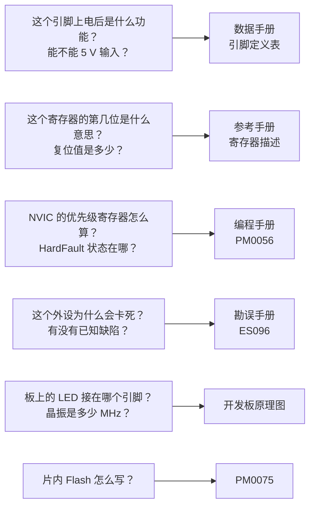

# 1.3 芯片手册、开发板资料与引脚复用

写固件时最常遇到的三个问题都能在官方资料里找到答案：某个外设的寄存器在哪、某个引脚上电后是什么电平、某个功能为什么一使能就死机。第一类问题在参考手册的寄存器描述里，第二类在数据手册的引脚定义表里，第三类常常在勘误手册里。这三份文档加起来两千多页，没有人从头读到尾，但每个人都得学会在五分钟内翻到正确的那一页、看正确的那一列。

本节以 STM32F103C8T6 为例，先给出这套资料的清单与用途，再逐栏拆解引脚定义表和寄存器描述，然后用勘误的读法收尾。最后把引脚复用与重映射讲清楚，给出本部分实验板上那份能同时插满外设的引脚分配表。整节以查资料为主，只有一个计算寄存器地址与字段掩码的小程序。

## 1. 资料集

STM32F103C8T6 的官方资料有固定编号，下载时按编号找，不要按标题搜：

| 编号 | 名称 | 回答什么问题 |
| --- | --- | --- |
| DS5319 | 数据手册 (datasheet) | 引脚定义、封装、电气参数、存储器容量、订购型号 |
| RM0008 | 参考手册 (reference manual) | 各外设的功能描述与全部寄存器位定义 |
| PM0056 | 编程手册 (programming manual) | Cortex-M3 内核、NVIC、SysTick、SCB、故障状态寄存器 |
| PM0075 | Flash 编程手册 | 片内 Flash 的解锁、擦除、编程时序 |
| ES096 | 勘误手册 (errata sheet) | 芯片已知的设计缺陷、触发条件与规避方法 |
| AN2586 | 应用笔记 (application note) | F10xxx 硬件设计入门：供电、复位、时钟、调试接口 |
| AN2606 | 应用笔记 | 系统存储器中的自举程序：从哪些接口能烧录 |
| — | 开发板原理图 | 板上的晶振频率、LED 接法、跳线与接口连接 |
| — | 外接器件手册 | AT24C02、W25Q64、ENC28J60 等模块的寄存器与命令 |

数据手册编号与芯片型号绑定：DS5319 只覆盖 STM32F103x8 与 xB 两个容量档，换一颗 F103RC 就要去找高密度系列对应的那份数据手册。参考手册按系列编写，RM0008 覆盖整个 F10xxx 家族，所以里面会出现 C8T6 上没有的外设（USB OTG、以太网、FSMC、DAC、CAN2），读到这些章节时先确认自己的芯片有没有。每份文档的页脚都有版本号，比如 RM0008 Rev 21、DS5319 Rev 20；同一个编号的不同版本内容会有出入，讨论问题时把版本号一起写出来。

查资料的顺序可以用一张图固定下来：



::: tip 下载时认准编号与版本

ST 官网的文档页会同时列出多个版本，搜索引擎给出的旧链接常常指向已经过期的修订版。判断标准是页脚：RM0008 当前为 Rev 21，DS5319 为 Rev 20。文档更新记录（Revision history）在最后一页，能查到某一版改了什么。

:::

## 2. 读数据手册

### 2.1 特性列表与框图

打开 DS5319，前几页是特性列表（Features）和框图。特性列表给出的是选型用的量级信息：72 MHz 主频、64 或 128 KiB Flash、20 KiB SRAM、2 个 12 位 ADC（本封装上可用的外部通道共 10 个）、3 个 USART、2 个 SPI、2 个 I²C、1 个 CAN、1 个 USB 全速设备接口；LQFP48 封装上有 37 个可用的 I/O。框图则把内核、总线、存储器和外设画在一起，能看出哪些外设挂在 APB1（最高 36 MHz）、哪些挂在 APB2（最高 72 MHz）。这两部分在选型阶段看，写代码时用得最多的是后面的引脚定义表和电气参数表。

### 2.2 引脚定义表

数据手册第 4 章的表 5 是本芯片最重要的一张表。以 LQFP48 封装为例，每一行是一个引脚，列的含义如下：

| 列 | 含义 | 读法 |
| --- | --- | --- |
| Pins | 各封装对应的引脚序号 | 本教程只看 LQFP48 那一列 |
| Pin name | 复位状态下的引脚名称 | 带 `-` 后缀的是复用名，如 `PC13-TAMPER-RTC` |
| Type | 引脚类型 | I 为输入，O 为输出，S 为电源 |
| I/O Level | 电气结构 | FT 表示 5 V 容忍；空表示只能接 3.3 V 电平 |
| Main function (after reset) | 复位后的功能 | 上电默认就是这个功能 |
| Default | 默认复用功能 | 外设使能并配置为复用后接管引脚 |
| Remap | 重映射后的复用功能 | 需要先写 AFIO_MAPR |

先看 PA9 这一行。它在 LQFP48 上是第 30 脚（DS5319 Rev 20 表 5 的 LQFP48 列），类型为 I/O，标着 FT，复位后的主功能是 PA9，默认复用功能是 `USART1_TX` 与 `TIM1_CH2`，重映射栏为空。这行信息的完整意思是：PA9 上电后是普通 GPIO；把 USART1 的发送器使能、再把 PA9 配成复用推挽输出，它就变成串口发送脚；也可以让 TIM1 的通道 2 从这个脚输出 PWM。FT 表示这个脚能承受 5 V 输入，接 5 V 器件时不会损坏，但输出仍然是 3.3 V 电平。

再看 PA11 与 PA12。两行都是 FT，默认复用栏里写着 `USART1_CTS / CANRX / USBDM / TIM1_CH4`（PA11）和 `USART1_RTS / CANTX / USBDP`（PA12）。一颗引脚上挂着四五个外设，这在 F103 上很常见；同一时刻只能使能其中一个，靠的是各自的外设时钟使能位，数据手册表 5 的脚注 4 把这条写得很明确：几个外设共用同一个引脚时，为避免冲突，一次只能通过 RCC 的时钟使能位打开一个。这条规则在 USB 与 CAN 上尤其要紧：USB 的 D−/D+ 和 CAN 的默认收发脚是同一对引脚，所以本教程把 CAN 重映射到 PB8/PB9，第 7 节会讲。

PB3 这一行的主功能不是 PB3，而是 `JTDO`。这个脚复位后属于调试接口，要当普通 GPIO 用，必须先通过 AFIO_MAPR 的 SWJ_CFG 位把它释放出来。PA13、PA14、PA15、PB4 同理，分别对应 JTMS/SWDIO、JTCK/SWCLK、JTDI、JNTRST。表里把这一族引脚的 Type 都标成 I/O、I/O Level 标成 FT，只有主功能一栏把它们暴露出来：这一栏写的不是 `PAx` 而是 JTAG 信号名。

PC13 这一行更特殊，主功能写作 `PC13-TAMPER-RTC`，I/O Level 一栏为空——它不是 FT 引脚，只能接 3.3 V 电平。这一行的脚注 5 是引脚表里最容易被忽略、又最容易烧坏板子的一条：

> PC13, PC14 and PC15 are supplied through the power switch. Since the switch only sinks a limited amount of current (3 mA), the use of GPIOs PC13 to PC15 in output mode is limited: the speed should not exceed 2 MHz with a maximum load of 30 pF and these IOs must not be used as a current source (e.g. to drive a LED).

三个引脚经内部电源开关供电，开关能承受的电流只有 3 mA，所以它们作输出时速度不得超过 2 MHz、负载不超过 30 pF，而且不能当电流源向外供电。Blue Pill 上的板载 LED 采用吸收电流的接法：LED 的阳极经限流电阻接 3.3 V，阴极接 PC13，引脚输出低电平时点亮。这样电流是从外部流入引脚，不违反「不能作电流源」的限制，但 3 mA 的上限仍然意味着限流电阻不能太小，否则亮度没上去，引脚先超出规格。

::: warning PC13 不是普通 GPIO

PC13–PC15 经内部电源开关供电，输出电流上限 3 mA，速度上限 2 MHz，不能对外提供电流。驱动 LED 时必须采用灌电流接法（外部电源经限流电阻接 LED 再到引脚），不能把 LED 接在引脚与地之间。

:::

### 2.3 电气参数

数据手册第 5 章是电气特性，分成两组，读法完全不同。

绝对最大额定值 (absolute maximum ratings) 是不能越过的限值，越过就可能永久损坏芯片。表 6 给出的 `VDD − VSS` 范围是 −0.3 V 到 4.0 V，这是供电电压的物理上限，不是工作范围；表 7 给出单个 I/O 的灌电流与拉电流各 25 mA，VDD/VDDA 与 VSS 各自的总电流上限 150 mA。这些数字只用于判断「会不会烧」，不能用来设计电路。

工作条件 (operating conditions) 才是设计依据。表 9 给出 `VDD` 的工作范围 2.0–3.6 V，`fHCLK` 最高 72 MHz，`fPCLK1` 最高 36 MHz，`fPCLK2` 最高 72 MHz。所有参数都按最小值、典型值、最大值三栏给出；设计时按最坏情况取，也就是需要保证的功能看 Max 或 Min 那一栏，Typ 只在估算功耗、估算误差时使用。

三个例子能说明这种读法：

1. 供电。3.3 V 稳压器输出落在 2.0–3.6 V 之间都算正常，但 USB 供电时电脑给的 5 V 经板载稳压器降到 3.3 V，如果稳压器选型不当、负载又重，输出可能跌到 3.0 V 以下，这时 ADC 的参考电压跟着下降，读数会整体偏低。
2. ADC 时钟。表 47 规定 `fADC` 最大 14 MHz。PCLK2 为 72 MHz 时，ADC 预分频只能取 ÷6（12 MHz），取 ÷4 得到 18 MHz 就超出了规格，转换结果不可信，数据手册不会告诉你「会怎样」，只保证在范围内的工作。
3. HSI 精度。表 24 给出内部 8 MHz RC 振荡器的精度：25 °C 时 ±1.1%，0–70 °C 范围内约 −1.3%～+1.8%，全温度范围 −2%～+2.5%。用它做串口时钟时，115200 bps 下 2% 的偏差已经在接收容限的边缘；要做可靠的串口通信就换外部晶振。[2.3 时钟与复位](/教程/正文/嵌入式/2_MCU裸机开发/2_3_时钟与复位) 会用到这些数字。

芯片型号的命名规则（STM32F103C8T6 里每个字母代表什么）在 [2.1 MCU、地址空间与外设](/教程/正文/嵌入式/2_MCU裸机开发/2_1_MCU_地址空间与外设) 里已经用图给出，这里不重复。

<Quiz
  type="single"
  :options="[
    { label: 'PA9 可以输出 5 V 高电平', value: 'A' },
    { label: 'PA9 可以承受 5 V 输入，输出仍是 3.3 V 电平', value: 'B' },
    { label: 'PA9 只能作为模拟输入', value: 'C' },
    { label: 'PA9 复位后就是 USART1_TX，不需要配置', value: 'D' }
  ]"
  answer="B"
>

<template #question>

数据手册引脚表中 PA9 的 I/O Level 一栏标着 FT。这个标记的含义是什么？

</template>

正确答案是 **B**。FT 是 five-volt tolerant 的缩写，指输入可以承受 5 V，输出级仍由 VDD 供电，所以高电平是 3.3 V。复位后 PA9 是普通 GPIO，要用作串口发送还得开 USART1 时钟并把引脚配成复用推挽输出。

</Quiz>

## 3. 读参考手册

### 3.1 章节结构

RM0008 每个外设一章，章内结构固定：先功能描述（框图、工作模式、时序），再寄存器描述，最后一张寄存器映射表。写驱动时先读功能描述里的框图，弄清数据从哪来到哪去；再翻到寄存器描述，逐位确认要写什么。

寄存器描述的版式也固定。以 GPIO 端口配置高寄存器为例，标题下面三行分别是：

- `Address offset: 0x04`，相对外设基地址的偏移；
- `Reset value: 0x4444 4444`，复位后的值；
- 一张位图，高位在左，每位下方标出访问类型。

接着是逐位的说明，每一位占一段，写明名称、访问类型、取值含义。

### 3.2 访问类型

位图下方的 `rw`、`r`、`w` 这些缩写，RM0008 第 2.2 节给了完整定义：

| 缩写 | 名称 | 读 | 写 |
| --- | --- | --- | --- |
| rw | read/write | 读出当前值 | 写入新值 |
| r | read-only | 读出当前值 | 无效 |
| w | write-only | 读回不确定（常读为复位值） | 写入新值 |
| rc_w1 | read/clear by writing 1 | 读出当前值 | 写 1 清零该位，写 0 无影响 |
| rc_w0 | read/clear by writing 0 | 读出当前值 | 写 0 清零该位，写 1 无影响 |
| rc_r | read/clear by read | 读出即清零 | 无效 |
| rs | read/set | 读出当前值 | 写 1 置位，写 0 无影响 |
| rt_w | read-only write trigger | 读出当前值 | 写 0 或 1 触发事件，位值不变 |
| t | toggle | 读出当前值 | 写 1 翻转，写 0 无影响 |

`rc_w1` 是驱动代码里最容易写错的一类。以 USART 的状态寄存器为例，发送完成标志 TC 是 rc_w1：要清它，得直接写 `USART1->SR = ~USART_SR_TC`（把 1 写到 TC 位上，其余位写 0），而不能写 `USART1->SR |= ~USART_SR_TC`。后者的读-改-写会先把当前所有置位的标志读出来，再原样写回去，等于把同一时刻新置位的其他标志一并清掉。第 2 章的寄存器代码会反复用到这条规则，2.6 节清定时器的更新标志时还会再遇到一次。

<Quiz
  type="single"
  :options="[
    { label: '读出该位会得到外设当前状态，写 1 会把它置位', value: 'A' },
    { label: '读出该位会得到外设当前状态，写 1 会把它清零，写 0 无影响', value: 'B' },
    { label: '该位只能读，不能写', value: 'C' },
    { label: '读出该位会自动清零，与写入无关', value: 'D' }
  ]"
  answer="B"
>

<template #question>

某状态标志标注为 `rc_w1`，它的行为是什么？

</template>

正确答案是 **B**。`rc_w1` 是 read/clear by writing 1：读照常返回当前状态，写 1 清零，写 0 不起作用。选项 A 是 `rs`，选项 D 是 `rc_r`。要清零这样的标志，直接赋值而不是 `|=`。

</Quiz>

### 3.3 从基地址到绝对地址

外设寄存器没有独立的名字，只有一个绝对地址。绝对地址由两部分相加得到：外设基地址来自 RM0008 第 3 章的存储器映射表，寄存器偏移来自该外设章节的寄存器描述。

存储器映射表里，GPIOC 标为 `0x4001 1000 - 0x4001 13FF`，也就是基地址 0x4001_1000。GPIOx_CRH 的偏移是 0x04，于是 PC13 的配置位落在绝对地址 0x4001_1004 上。CRH 管理引脚 8–15，每个引脚占 4 位，PC13 是第 13 个引脚，字段在 `(13 − 8) × 4 = 20` 位开始的 4 位里，即第 23:20 位：

<BitField
  title="GPIOx_CRH 中 PC13 的字段（第 23:20 位，复位值 0x4444 4444）"
  :lsb="20"
  :fields="[
    { name: 'CNF13[1:0]', bits: 2, access: 'rw', desc: '复位值 01：浮空输入' },
    { name: 'MODE13[1:0]', bits: 2, access: 'rw', value: '10', desc: '复位值 00；写 10 为输出，最大 2 MHz' }
  ]"
/>

复位值 0x4444_4444 拆开来看，每个引脚对应的 4 位都是 `0100`：CNF = 01（浮空输入）、MODE = 00（输入模式）。16 个引脚全是浮空输入，这是 GPIO 复位后的默认状态。

::: concept emb-manual-address-and-access title="寄存器地址与访问类型"

外设寄存器的绝对地址等于外设基地址（RM0008 第 3 章存储器映射表）加上寄存器偏移（该外设章节的寄存器描述）。读写该寄存器时位的行为由访问类型决定：同一段代码，访问类型是 rw 时读-改-写安全，是 rc_w1 时读-改-写会误清其他位。

:::

字段掩码与移位量可以用一段程序算出并核对。仓库里的 `code/嵌入式/1_平台与工具链/1_3_芯片手册_开发板资料与引脚复用/reg_calc.c` 接收端口、引脚、CNF 与 MODE 四个参数，输出基地址、偏移、绝对地址、位域范围、清零掩码与置位掩码，并把「先清后置」后的寄存器值算出来：

::: terminal title="PowerShell - 计算寄存器地址与掩码"

```text
$ gcc -std=c17 -Wall -Wextra reg_calc.c -o reg_calc
$ ./reg_calc
引脚 PC13（通用推挽输出, 最大速度 2 MHz）
  寄存器    : GPIOC_CRH (基地址 0x40011000 + 偏移 0x04 = 0x40011004)
  位域范围  : [23:20] (CNF13=0, MODE13=2, 组合值 0x2)
  清零掩码  : 0xFF0FFFFF  ~(0xFu << 20)
  置位掩码  : 0x00200000   (0x2u << 20)
  修改后值  : 0x44244444  (复位值 0x44444444)

引脚 PA9（复用推挽输出, 最大速度 50 MHz）
  寄存器    : GPIOA_CRH (基地址 0x40010800 + 偏移 0x04 = 0x40010804)
  位域范围  : [7:4] (CNF9=2, MODE9=3, 组合值 0xB)
  清零掩码  : 0xFFFFFF0F  ~(0xFu << 4)
  置位掩码  : 0x000000B0   (0xBu << 4)
  修改后值  : 0x444444B4  (复位值 0x44444444)

rc_w1 状态寄存器初值        : 0x03 (位 1 与位 0 均置位)
执行 SR |= (1u << 0) 后     : 0x00 (位 1 被连带清零!)
执行 SR  = (1u << 0) 后     : 0x02 (仅清零位 0，位 1 保留)
```

:::

第二组数字来自 RM0008 表 20：复用推挽输出、最大速度 50 MHz 对应 CNF = 10、MODE = 11，合起来是 0xB。这个值在 [2.7 UART](/教程/正文/嵌入式/2_MCU裸机开发/2_7_UART) 里会把 PA9 变成 USART1 的发送脚。程序最后三行演示的正是 `rc_w1` 的错误用法：两位同时置位时，用 `|=` 清位 0 会把位 1 一起清掉，直接赋值才只影响目标位。

## 4. 编程手册与勘误

### 4.1 编程手册管什么

有三个名字很像的文档：数据手册、参考手册、编程手册。数据手册管芯片外部看到的东西（引脚、电气参数、封装），参考手册管 ST 自己设计的外设（GPIO、USART、ADC、定时器），编程手册管 Arm 内核自带的部分。

RM0008 里当然也有中断向量表和 NVIC 的章节，但那是从「外设怎样连到内核」的角度写的。真正讲 Cortex-M3 内核行为的是 PM0056：处理器模式与特权级、异常进入与退出的压栈顺序、NVIC 的寄存器布局与优先级分组、SysTick 的四个寄存器、SCB 里的故障状态寄存器（CFSR、HFSR、BFAR、MMFAR）、指令集与内存屏障指令。写中断服务程序和故障处理函数时，PM0056 比 RM0008 更直接。

判断某个问题该查哪本，看它属于内核还是外设：

| 现象 | 查哪里 |
| --- | --- |
| 中断进不去，或优先级不生效 | PM0056 的 NVIC 章节；RM0008 的向量表确认中断号 |
| 中断处理函数里读出奇怪的栈内容 | PM0056 的异常压栈与 EXC_RETURN |
| 程序跑飞，想知道是除零还是非法地址 | PM0056 的 CFSR、HFSR、BFAR |
| 外设寄存器写不进去 | RM0008 的时钟使能位、寄存器访问类型 |
| 片内 Flash 擦不掉 | PM0075 的解锁序列与状态位 |

### 4.2 勘误怎么读

勘误手册 (errata sheet) 收录的是「芯片已经流片，改不了」的设计缺陷。每一条的格式都一样：先给现象，再给触发条件，最后给规避方法 (workaround)。读的时候按这个结构对照自己的用法，命中条件才需要考虑规避，没命中就不必管。

ES096 中与 I²C 模拟噪声滤波器相关的条目描述的是这样一类现象：模拟噪声滤波器是 I²C 外设的固定部件，用来滤掉总线上的窄毛刺；当毛刺的宽度落在滤波器的时间窗口内、又恰好出现在一次传输结束前后时，外设可能把毛刺当成有效的总线活动，此后总线实际已经空闲，`I2C_SR2` 的 BUSY 位却一直保持置位，软件按正常流程置 START 位也发不出传输。RM0008 在 `I2C_CR1` 的 SWRST 位下面专门注明了这种情形：

> As an example, if the BUSY bit is set and remains locked due to a glitch on the bus, the SWRST bit can be used to exit from this state.

规避方法就是置 SWRST 把 I²C 外设整个复位一次，再重新初始化。这类问题的共同点是：现象看起来像「外设坏了」，实际是外设按设计对总线上的异常做出了反应，而手册只在寄存器注释里提了一句。

::: tip 用外设之前先扫一遍勘误

在产品中使用某个外设之前，先把 ES096 里该外设的条目读一遍，把命中的条目写进代码注释。勘误条目不多，一个外设通常只有几条，十几分钟能读完；等现场设备因为一条已知缺陷复位，排查成本是它的几百倍。

:::

## 5. 开发板资料

原理图 (schematic) 是连接芯片与电路的桥梁。数据手册告诉你 PA9 能做什么，原理图告诉你板上的 PA9 实际接到了什么。Blue Pill 的原理图在网上有多个版本，下面几项是各版本共同的，读图时逐个找网络标号确认：

| 电路 | 连接 | 对编程的影响 |
| --- | --- | --- |
| 主晶振 | 8 MHz 晶振接 OSC_IN/OSC_OUT（第 5、6 脚），两端各一只 20 pF 电容 | HSE 为 8 MHz，2.3 节的 72 MHz 配置按它算 |
| RTC 晶振 | 32.768 kHz 晶振接 PC14/PC15 | 这两个脚的 GPIO 功能需先停掉 LSE |
| 板载 LED | 3.3 V → 限流电阻 → LED → PC13 | 低电平点亮，电流从外部灌入引脚 |
| 复位按键 | NRST 经按键接地，内部弱上拉 | 按下复位，NRST 也是调试器的复位线 |
| BOOT 跳线 | BOOT0 可选 0 或 1，BOOT1 接 PB2 | 启动方式见 [1.6 构建、烧录与调试](/教程/正文/嵌入式/1_平台与工具链/1_6_构建_烧录与调试) 的 BOOT 表 |
| USB 接口 | PA11 接 D−，PA12 接 D+，D+ 经 1.5 kΩ 上拉到 3.3 V | 上拉电阻固定，用于让主机识别全速设备 |
| 稳压器 | 5 V 输入降到 3.3 V，供 VDD 与 VDDA | 外部供电时不要同时接 ST-LINK 的 3.3 V |
| 调试排针 | 3.3 V、SWDIO（PA13）、SWCLK（PA14）、GND | ST-LINK 的四根线接这里 |

读原理图最实用的动作是顺着网络标号走一遍。以 PC13 为例：在原理图上找到标着 `PC13` 的网络，看它连到哪只电阻、电阻另一端连到 3.3 V 还是地、LED 的阳极在哪一侧。走完这一遍，「低电平点亮」就不再是一句需要记住的口诀，而是图上画着的事实。

::: tip 低价板可能不是原厂芯片

市面上不少 Blue Pill 焊的是 GD32、CKS32、APM32 等兼容芯片。它们在多数场合能跑同一份固件，但部分寄存器默认值、Flash 等待周期与调试 ID 不同。OpenOCD 报器件 ID 不匹配、或程序在时钟初始化后跑飞时，先看芯片表面的丝印。

:::

## 6. 引脚复用与重映射

### 6.1 F1 的复用模型

一个引脚在同一时刻只能做一件事，但一颗芯片的引脚数远少于外设需要的信号数，于是每个引脚上叠了好几个外设的输入输出，这就是复用功能 (alternate function, AF)。F103 的复用模型很直接：

1. 打开外设的时钟（RCC 的 APB1ENR 或 APB2ENR 中对应的使能位）。
2. 把引脚配置成复用模式。输出方向配成复用推挽或复用开漏（CNF = 10 或 11，MODE ≠ 00），输入方向配成浮空输入或上拉/下拉输入。
3. 外设一旦使能，就接管这个引脚，CPU 读写 ODR/IDR 不再影响它。

这里没有 F4 系列那种「每个引脚一个 AFR 寄存器、从十几个 AF 里选一个」的机制。F1 上某个引脚能接哪些外设是芯片设计时定死的，数据手册的 Default 列写了默认的那一组，Remap 列写了能换到别处的那些。想让一个外设换一组引脚，改的不是引脚，而是 AFIO_MAPR 里该外设对应的那几位。

以 USART1 为例：默认引脚 PA9（TX）、PA10（RX）；把 `AFIO_MAPR` 的 `USART1_REMAP` 置 1，收发就换到 PB6、PB7。SPI1 默认 PA4–PA7，置 `SPI1_REMAP` 后换到 PA15、PB3、PB4、PB5。I2C1 默认 PB6/PB7，置 `I2C1_REMAP` 后换到 PB8/PB9。CAN 的 `CAN_REMAP` 是两位，取 `10` 时收发换到 PB8、PB9。

::: concept emb-manual-remap-per-peripheral title="F1 的重映射以外设为单位"

STM32F1 的重映射通过 AFIO_MAPR 按外设成组进行：置某一位（或某两位）就把该外设的全部相关信号一起换到另一组引脚，不能只换其中一根。使用 AFIO_MAPR、AFIO_EXTICR 之前必须先打开 AFIO 时钟（RCC_APB2ENR 的 AFIOEN），否则写入无效。

:::

### 6.2 AFIO 与 SWJ_CFG

AFIO（alternate function I/O）是 F1 上一个独立的外设，管三件事：重映射、外部中断的端口选择、以及调试引脚的释放。它的寄存器在 0x4001_0000 起，`AFIO_MAPR` 的偏移是 0x04。RM0008 在 AFIO 寄存器一节的注释里写明：要读写 `AFIO_EVCR`、`AFIO_MAPR`、`AFIO_EXTICR`，必须先使能 AFIO 时钟。这一句经常被漏掉，症状是重映射代码写了、编译通过、运行时毫无效果。

`AFIO_MAPR` 的高三位 `SWJ_CFG[2:0]` 控制调试接口占用哪些引脚。这三位只写不读，读回值不确定，复位状态对应 000：

| SWJ_CFG | 含义 | PA13/PA14 | PA15 | PB3 | PB4 |
| --- | --- | --- | --- | --- | --- |
| 000 | 完整 SWJ（JTAG + SWD），复位状态 | 调试 | 调试 | 调试 | 调试 |
| 001 | 完整 SWJ，但不要 NJTRST | 调试 | 调试 | 调试 | 可用 |
| 010 | 关 JTAG，保留 SWD | 调试 | 可用 | 可用 | 可用 |
| 100 | JTAG 与 SWD 都关 | 可用 | 可用 | 可用 | 可用 |

数值 011、101、110、111 没有定义，写入不产生任何效果。要用 PB3、PB4、PA15 作普通 GPIO，写 010 即可：SWD 保留在 PA13/PA14 上，调试器照常工作，另外三个脚释放为普通 I/O。写 100 会把 SWD 一起关掉。

::: warning 不要把 SWJ_CFG 写成 100

写 100 会同时关闭 JTAG 和 SWD，芯片重新上电后调试器再也连不上，常规的下载和调试全部失效。恢复办法见 [1.7 SWD、JTAG 与片上调试](/教程/正文/嵌入式/1_平台与工具链/1_7_SWD_JTAG与片上调试)：接上 NRST 做「复位下连接」，或把 BOOT0 拉高从系统存储器启动后擦除。

:::

### 6.3 重映射的代价

重映射把一组信号整体搬到另一组引脚上，代价要从 AFIO_MAPR 的位定义里看：

1. 备用引脚可能已经被别的重映射占用。CAN_REMAP = 10 的 PB8/PB9 同时是 I2C1_REMAP = 1 的 SCL/SDA。两个重映射指向同一组脚时，只能选一个。
2. 备用引脚可能与默认引脚组冲突。USART1_REMAP = 1 把 TX/RX 换到 PB6/PB7，而 PB6/PB7 正是 I2C1 的默认引脚，两者不能同时使用。
3. 备用引脚可能属于调试接口。SPI1_REMAP = 1 用到的 PA15、PB3、PB4 默认是 JTAG 信号，必须先改 `SWJ_CFG` 把它们释放出来。这一步一旦把 `SWJ_CFG` 写成 100，就连不上调试器了。

本教程因此让 SPI1、SPI2、I2C1 都留在默认引脚上，只把 CAN 重映射出去——它没有别的选择，默认引脚被 USB 占着。

## 7. 本部分实验的引脚分配

本教程第 2、3 章的所有实验共用一块面包板，各个模块同时插着，不在章节之间反复拔线。这要求引脚分配一次排定，后面各节直接照用。分配结果如下：

| 功能 | 引脚 | 外设与配置 | 说明 |
| --- | --- | --- | --- |
| 板载 LED | PC13 | GPIO 推挽输出，2 MHz | 低电平点亮，见数据手册脚注 5 |
| 按键 | PA0 | GPIO 上拉/下拉输入，下拉 | 一端接 3.3 V，按下为高；兼作 WKUP |
| 电位器 | PA1 | ADC12_IN1 模拟输入 | ADC 通道 1，见 2.9 节 |
| 外接 LED（PWM） | PB0 | TIM3_CH3 复用推挽 | 默认复用，无需重映射 |
| MCO 时钟输出 | PA8 | MCO 复用推挽 | 输出 HSE 或 PLL/2，见 2.3 节 |
| 控制台串口 | PA9 TX、PA10 RX | USART1 复用 | 接 CH340，默认引脚 |
| SPI1：W25Q64 | PA5 SCK、PA6 MISO、PA7 MOSI | SPI1 复用 | PA4 作 W25Q64 的片选（GPIO 输出） |
| SD 卡片选 | PB1 | GPIO 推挽输出 | 与 W25Q64 共用 SPI1，片选分开 |
| I2C1：AT24C02 | PB6 SCL、PB7 SDA | I2C1 复用开漏 | 7 位地址 0x50 |
| USART2 + RS-485 | PA2 TX、PA3 RX | USART2 复用 | PB5 作 MAX3485 的 DE/RE |
| CAN | PB8 RX、PB9 TX | CAN 重映射（CAN_REMAP = 10） | 避开 USB 占用的 PA11/PA12 |
| USB 全速设备 | PA11 D−、PA12 D+ | USB 外设 | 与 CAN 不同时工作，见下 |
| SPI2：ENC28J60 | PB13 SCK、PB14 MISO、PB15 MOSI | SPI2 复用 | PB12 作片选 |
| USART3：ESP32-C3 | PB10 TX、PB11 RX | USART3 复用 | 接 ESP-AT 模块 |
| SWD 调试 | PA13 SWDIO、PA14 SWCLK | 调试接口 | 不作他用，SWJ_CFG 保持默认 |

下面几条取舍值得单独说明。

**USART1 用默认引脚。** CH340 接 PA9/PA10 是 [1.6](/教程/正文/嵌入式/1_平台与工具链/1_6_构建_烧录与调试) 已经定下的接线，重映射到 PB6/PB7 会和 I2C1 抢线，没有必要。

**CAN 走重映射。** CAN 的默认收发脚是 PA11（CAN_RX）与 PA12（CAN_TX），而这两个脚同时是 USB 的 D−/D+。USB 实验（3.6 节）和 CAN 实验（3.5 节）都要各自动手，所以 CAN 必须让位，用 `CAN_REMAP = 10` 换到 PB8/PB9。重映射之后 PB8 作 CAN_RX 要配成上拉输入，PB9 作 CAN_TX 要配成复用推挽输出。

**USB 与 CAN 不能同时工作。** 这不只是引脚冲突。RM0008 第 23 章写道：

> In low, medium, high and XL-density devices, the USB and CAN share a dedicated 512-byte SRAM memory for data transmission and reception, and so they cannot be used concurrently (the shared RAM is accessed through CAN and USB exclusively). The USB and CAN can be used in the same application but not at the same time.

两个外设共用一块 512 字节的专用 SRAM 存放收发数据，同一时刻只能由其中一个占用。所以本教程中 USB 与 CAN 分属两节、不同时上电；真要做同时支持两者的产品，得换一颗不共享这块 RAM 的芯片。

**PB3、PB4、PA15 没有动用。** 这三个脚默认是 JTAG 的 JTDO、JNTRST、JTDI，要用就得改 `SWJ_CFG`。本教程的所有功能在剩下的引脚里排得开，因此 `SWJ_CFG` 保持复位值 000，调试接口完整保留。2.4 节讲 GPIO 时会演示写 010 释放这三个脚，但那只是演示，实验板不依赖它。

**SPI1、SPI2 与 I2C1 都用默认引脚。** 重映射只会带来额外的约束（与调试口冲突、与其他重映射抢引脚），默认引脚能满足布线要求时没有理由改。

::: tip 用 STM32CubeMX 的 Pinout 视图排查冲突

把芯片型号选成 STM32F103C8Tx，在 Pinout 视图里逐个点出要用的功能，发生冲突的引脚会标成橙色并给出提示。它读的是同一份数据手册的引脚表，可以当作交叉检查。生不生成代码无所谓，只用它的检查功能。

:::

## 8. 习题

### 8.1 巩固

<Exercise id="61109" :d="1" :w="2">

翻 DS5319 表 5，填出下面这张表。每行给出引脚名与它的默认复用功能，要求补上「该脚做复用时在 GPIOx_CRL 还是 GPIOx_CRH、字段从第几位开始」两列，并说明配置成复用推挽输出时 CNF 与 MODE 各取什么值（查 RM0008 表 20）。

| 引脚 | 默认复用 | 寄存器 | 起始位 | CNF | MODE |
| --- | --- | --- | --- | --- | --- |
| PA5 | SPI1_SCK | | | | |
| PA9 | USART1_TX | | | | |
| PB6 | I2C1_SCL | | | | |
| PB13 | SPI2_SCK | | | | |
| PA11 | USBDM | | | | |

CNF 与 MODE 按 RM0008 表 20 取「复用推挽输出、最大速度 50 MHz」那一行的值；PA11 那一行的 CNF、MODE 不按这张表填，在表里写「不适用」并在完成后说明原因。

最后回答：PA11 的默认复用栏里同时列着 `USART1_CTS`、`CANRX`、`USBDM`、`TIM1_CH4` 四个功能，凭什么判定同一时刻只有一个能生效？依据是表 5 的哪一条脚注？

</Exercise>

<Exercise id="61110" :d="2" :w="2">

仓库里的 `code/嵌入式/1_平台与工具链/1_3_芯片手册_开发板资料与引脚复用/reg_calc.c` 只算了 PC13 与 PA9。把它改成从命令行读参数：

```text
reg_calc PB6 3 3       # 端口、引脚、CNF、MODE
reg_calc PA0 2 0
reg_calc PB13 0 2
```

要求：

1. 端口接受 `A`～`C` 三个字母（大小写都收），引脚 0～15，CNF 与 MODE 各 0～3。参数个数不对或取值越界时打印用法并以退出码 2 结束。
2. 输出格式沿用原程序，并额外打印一行「该字段在 CRL 还是 CRH，为什么」。
3. 用上面的三条命令验证。PB6 期望得到（引脚描述那一行按 CNF、MODE 自行生成，措辞不限，其余各行须一致）：

```text
引脚 PB6（复用开漏输出, 最大速度 50 MHz）
  寄存器    : GPIOB_CRL (基地址 0x40010C00 + 偏移 0x00 = 0x40010C00)
  位域范围  : [27:24] (CNF6=3, MODE6=3, 组合值 0xF)
  清零掩码  : 0xF0FFFFFF  ~(0xFu << 24)
  置位掩码  : 0x0F000000   (0xFu << 24)
  修改后值  : 0x4F444444  (复位值 0x44444444)
```

PB13 的字段在 `[23:20]`，组合值 `0x2`，修改后 `0x44244444`；PA0 的字段在 `[3:0]`，组合值 `0x8`，修改后 `0x44444448`。

4. 再回答：PB13 与 PC13 得到的位域范围与掩码完全一样，但写的不是同一个地址。用两行输出说明区别在哪里。

</Exercise>

<Exercise id="61111" :d="2" :w="2">

本节用 `rc_w1` 解释过 `USART1->SR = ~USART_SR_TC` 为什么不能写成 `|=`。写一个模拟程序 `src_clear.c`，用一个 `uint32_t` 对象模拟 USART 状态寄存器，按 `rc_w1` 的语义实现写入（写 1 清零、写 0 不变），初值取 `TC | RXNE | IDLE = 0x70`：

1. 依次执行三种写法，打印每一步之后寄存器的值：
   - `SR = USART_SR_TC`
   - `SR |= USART_SR_TC`
   - `SR = ~USART_SR_TC`
2. 期望输出（十六进制）：

```out
A SR = USART_SR_TC        -> 0x30
B SR |= USART_SR_TC       -> 0x00
C SR = ~USART_SR_TC       -> 0x40
```

3. 解释 B 为什么把 `RXNE` 与 `IDLE` 一起清了，而 C 又为什么多留下 `TC` 没清。
4. 把同一段代码推广到 `rc_w0`、`rs`、`t` 三种访问类型上，各给一行模拟函数，并说明哪一种的「写 0 无影响」与 `rc_w1` 正好相反。

</Exercise>

<Exercise id="61112" :d="3" :w="3">

写一个 `spec_check.c`，把 DS5319 的几组限值编成表，对给定的工作点逐项判定。工作点结构如下：

```c
struct operating_point {
    const char *name;
    unsigned vdd_mv;       /* 表 9：2000..3600 */
    unsigned hclk_mhz;     /* 表 9：<= 72 */
    unsigned pclk1_mhz;    /* 表 9：<= 36 */
    unsigned pclk2_mhz;    /* 表 9：<= 72 */
    unsigned adc_prescaler;/* 2、4、6、8 之一 */
    unsigned pc13_ua;      /* 表 5 脚注 5：<= 3000 */
};
```

1. `fADC` 不直接给出，按 `pclk2_mhz / adc_prescaler` 算，超过 14 MHz 判违规（表 47）。
2. 每个违规项打印一行原因，最后打印判定结论。
3. 用三组数据验证（`nominal` 为 `3300/72/36/72/6/2000`，`adc too fast` 只把预分频改成 4，`overclocked` 为 `3700/80/40/80/2/5000`）：

```out
nominal      OK
adc too fast VIOLATION
overclocked  VIOLATION
```

其中 `adc too fast` 的违规行是 `fADC 18 MHz > 14 MHz (PCLK2 72 / 4)`；`overclocked` 应当报出 6 条违规原因（VDD、fHCLK、fPCLK1、fPCLK2、fADC、PC13）。注意 `pclk2_mhz = 80` 时 `80 / 2 = 40`，这一项同时违反 `fPCLK2 <= 72` 与 `fADC <= 14`，两条原因要分别打印。

4. 回答：为什么 `pclk1_mhz = 72` 一定是错的，即使有人把 HCLK 设成 144 MHz？这条限制写在表 9 的哪一栏，和 APB1 的哪个分频范围对应？

</Exercise>

### 8.2 编程

<Exercise id="61113" :d="3" :w="3">

仓库里 `code/嵌入式/1_平台与工具链/1_3_芯片手册_开发板资料与引脚复用/exercises/pinmux_check_starter.c` 已经实现了「按 AFIO_MAPR 解析各外设实际占用的引脚」，`check_pin_conflicts` 是空的。补全它，并扩展成一个小工具：

1. 实现 `check_pin_conflicts`，按注释里的格式打印 `CONFLICT: <外设A> and <外设B> on P<端口><引脚号>`，返回冲突总数。原始的两个用例期望输出：

```text
--- Case 1: AFIO_MAPR = 0x00000004 (USART1_REMAP=1) ---
CONFLICT: I2C1 and USART1 on PB6
CONFLICT: I2C1 and USART1 on PB7
Conflicts: 2
--- Case 2: AFIO_MAPR = 0x00004000 (CAN_REMAP=10) ---
Conflicts: 0
```

2. 增加第三个用例：`AFIO_MAPR = 0x00004002`（`I2C1_REMAP = 1` 与 `CAN_REMAP = 10` 同时置位），期望报出 `I2C1 and CAN1` 在 PB8、PB9 两处冲突。这一组重映射在本节 6.3 里作为「备用引脚可能已被别的重映射占用」的例子出现。

3. 把解析器扩展两位：增加 `USART2_REMAP`（AFIO_MAPR 位 3，`0` 为 PA2/PA3，`1` 为 PD5/PD6）与 `USART3_REMAP`（位 5:4，`00` 为 PB10/PB11，`01` 为 PC10/PC11，`11` 为 PD8/PD9）。LQFP48 上引出的 I/O 是 PA0～PA15、PB0～PB15、PC13～PC15 与 PD0、PD1，其余引脚在 48 个脚里没有位置。解析结果落在未引出的引脚上时打印 `P<端口><引脚号> is not bonded out on LQFP48` 并计一次冲突。用这个规则检查 `USART3_REMAP = 01`（PC10/PC11）与 `= 11`（PD8/PD9），说明为什么 LQFP48 上 USART3 只有默认的 PB10/PB11 一组可用。

4. 验收：给出一张表，列出你在第 3 步里试过的每个 `AFIO_MAPR` 值、冲突数与具体冲突引脚，至少覆盖 4 个值。

</Exercise>

<Exercise id="61114" :d="4" :w="3">

写一个 `remap_search.c`，穷举 AFIO_MAPR 中 SPI1、I2C1、USART1、CAN 四组重映射位的组合，找出在本教程引脚规划下可行的全部取值。

约束（全部来自本节第 6、7 节）：

- SPI1：`SPI1_REMAP = 0` 用 PA4～PA7，`1` 用 PA15、PB3、PB4、PB5；
- I2C1：`I2C1_REMAP = 0` 用 PB6/PB7，`1` 用 PB8/PB9；
- USART1：`USART1_REMAP = 0` 用 PA9/PA10，`1` 用 PB6/PB7；
- CAN：`CAN_REMAP = 00` 用 PA11/PA12，`10` 用 PB8/PB9；
- 调试接口保持复位值 `SWJ_CFG = 000`，即 PA13、PA14、PA15、PB3、PB4 不可占用；
- USB 使用 PA11/PA12，因此 CAN 不能落在这一组上；
- 同一引脚不得被两个外设同时占用。

1. 程序遍历 `2 × 2 × 2 × 2 = 16` 种组合，打印每一种可行解，最后打印可行解个数。
2. 期望结果：`SWJ_CFG = 000` 时只有一种可行解，`SPI1_REMAP=0 I2C1_REMAP=0 USART1_REMAP=0 CAN_REMAP=10`。
3. 把调试接口一栏改成 `SWJ_CFG = 010`（释放 PA15、PB3、PB4，但 PA13/PA14 仍归 SWD），重跑，期望可行解变成两种，新增的那一种是 `SPI1_REMAP=1`。把两种解都打印出来。接着把 `SWJ_CFG` 试成 `100`：可行解仍然是两种，与 `010` 相同。说明为什么在本实验的约束下「多释放 PA13/PA14」换不来任何新解，以及即便如此，正文为什么仍然把这一档标成不能写——比较一下「解数不变」与「写错之后连调试器都接不上」这两件事的代价。
4. 用这个结果解释本节的结论「SPI1 要不要重映射，取决于你愿不愿意动 JTAG 引脚」。

</Exercise>

<Exercise id="61115" :d="4" :w="4">

写一个交互式的 I²C BUSY 锁死模拟器 `i2c_busy.c`，把勘误 ES096 里那条 I²C 模拟噪声滤波器的现象做出来。

1. 用一个结构体模拟 I²C 外设的三个要素：`CR1`（位 15 为 `SWRST`，位 8 为 `START`）、`SR2`（位 1 为 `BUSY`）、以及一个「总线实际是否空闲」的标志。
2. 实现两个函数：

```c
static int i2c_start(i2c_t *i2c, int max_wait);   /* 轮询 BUSY，空闲则置 START，返回 1；超时返回 0 */
static void i2c_swrst(i2c_t *i2c);                /* 置 SWRST=1，清 SR2，再写回 0 */
```

3. 构造一种故障状态：`SR2.BUSY = 1`，但总线实际空闲。此时 `i2c_start` 应当超时。调用 `i2c_swrst` 之后，同一组参数下 `i2c_start` 应当成功。期望输出：

```out
first start: timeout busy=1 txn=0
after swrst: busy=0
retry start: ok txn=1
```

4. 在 `i2c_swrst` 里补上 `CR1` 的写回，用 `printf` 前后打印 `CR1`，说明为什么 SWRST 必须写 0 才能退出复位。
5. 把超时参数从 3 改成 0，观察输出变化，说明为什么 `max_wait` 为 0 时即使总线空闲也发不出 START（对照本节 6.2 里 `SWJ_CFG` 只写不读的讨论：硬件不会替你补一次尝试）。

</Exercise>

### 8.3 综合与挑战

<Exercise id="61116" :d="5" :w="4">

把本节第 7 节的引脚分配表变成一份可执行的检查器 `board_check.c`。

1. 把整张表编码成数组，每项含功能名、端口、引脚号、外设、以及「是否需要重映射」（对 CAN 记 `CAN_REMAP = 10`）。
2. 程序做四类检查，每类打印违规条目并累计：

   - 引脚重复（同一 (端口, 引脚) 被两个功能占用）；
   - 落在 SWJ 保留引脚上：PA15、PB3、PB4 不许被任何功能占用；PA13、PA14 只允许出现在 `SWD` 那一行（因为本表要求 `SWJ_CFG = 000`，调试口要完整保留）；
   - USB 与 CAN 同时出现在表里被标记为「同时启用」（本节引 RM0008 第 23 章的原文，两者共用 512 字节 SRAM，但引脚本身不冲突，所以前两类检查抓不到）；
   - 外设落在的重映射引脚与它的 `MAPR` 位不一致（例如表里写 CAN 在 PB8/PB9，但 `CAN_REMAP` 那项填的是 `00`）。
3. 用本节的真实分配跑一遍，期望 0 违规。再故意改三处造出违规，每处单独跑一次：

   - 把 CAN 一行改回 PA11/PA12（`MAPR` 一栏同步改成 `00`），应当报出与 USB 的引脚重复；
   - 把 SPI1 片选从 PA4 改成 PB3，应当报出落在 SWJ 保留引脚上；
   - 只把 USART1 的引脚改成 PB6/PB7、`MAPR` 一栏仍留 `default`，应当同时报出与 I2C1 的引脚重复和重映射不一致两条。

   每份报告都要能指出是哪一行（功能名加引脚号）。
4. 回答：为什么「USB 与 CAN 不能同时工作」这条检查放在引脚层面做不出来，必须单独作为一条规则？两条规则各自来自手册的哪一处（引脚表 vs 第 23 章正文）？

</Exercise>

<Exercise id="61117" :d="6" :w="5" scope="*">

本节的实验板把 CAN 重映射到 PB8/PB9、USB 留在 PA11/PA12，并在 7 节说明二者不能同时工作。设计并实现一个「外设资源占用报告」工具 `peripheral_budget.c`，回答在这样一块板上还能不能再加第三路串口。

1. 输入从标准输入读若干行，每行描述一个外设需求：

```text
USART3 PB10 PB11 default
USART2 PA2 PA3 default
CAN PB8 PB9 remap10
USB PA11 PA12 default
SPI2 PB13 PB14 PB15 default
```

字段为外设名、涉及的引脚、重映射选项。引脚写成 `P<端口><号>` 的形式。

2. 程序输出一张并按顺序列出：

   - 每个外设占用的引脚；
   - 与已经出现的更高优先级外设冲突的引脚（优先级按输入顺序，先到先得）；
   - 全表用到的 `AFIO_MAPR` 位与最终值（`SPI1_REMAP` 位 0、`I2C1_REMAP` 位 1、`USART1_REMAP` 位 2、`USART2_REMAP` 位 3、`USART3_REMAP` 位 5:4、`CAN_REMAP` 位 14:13）；
   - 仍然空闲的引脚清单（只列 LQFP48 上引出的 37 个 I/O，排除 VDD、VSS、VBAT、NRST、BOOT0 与 PD0/PD1 两个振荡器脚）。

3. 用上面五行输入验证，期望 `AFIO_MAPR = 0x00004000`（CAN 的 `10` 落在位 14:13），USART2 与 USART3 都写 `default`，它们既不占重映射位、也不与已占用引脚冲突。如果把 `CAN` 那行的 `remap10` 去掉，`AFIO_MAPR` 应变成 `0x00000000`，程序应当报出 PA11/PA12 与 USB 冲突。再补一行 `USART3 PB10 PB11 remap11`，说明为什么这会让 `AFIO_MAPR` 变成 `0x00004030`，同时 USART3 的引脚要改成 PD8/PD9。

4. 在结论里说明：本节的引脚规划其实还留了哪几组完整的「外设加片选」组合，可以在不拆现有面包板的前提下加上去。

</Exercise>

## 9. 参考资料

1. STMicroelectronics，[*DS5319 Datasheet: STM32F103x8, STM32F103xB*, Rev 20](https://www.st.com/resource/en/datasheet/stm32f103c8.pdf)：表 5 引脚定义、表 6 与表 7 绝对最大额定值、表 9 工作条件、表 24 HSI 特性、表 47 ADC 特性。
2. STMicroelectronics，[*RM0008 Reference manual: STM32F10xxx*, Rev 21](https://www.st.com/resource/en/reference_manual/rm0008-stm32f101xx-stm32f102xx-stm32f103xx-stm32f105xx-and-stm32f107xx-advanced-armbased-32bit-mcus-stmicroelectronics.pdf)：第 2.2 节访问类型、第 3 章存储器映射、第 9 章 GPIO 与 AFIO、第 23 章 USB（USB 与 CAN 共用 SRAM）、第 26 章 I²C（SWRST 与 BUSY）。
3. STMicroelectronics，[*PM0056 Programming manual: STM32F10xxx/20xxx/21xxx/L1xxxx Cortex-M3*, Rev 7](https://www.st.com/resource/en/programming_manual/pm0056-stm32f10xxx20xxx21xxxl1xxxx-cortexm3-programming-manual-stmicroelectronics.pdf)：内核、NVIC、SysTick、SCB 与故障状态寄存器。
4. STMicroelectronics，[*ES096 Errata sheet: STM32F101x8/B, STM32F102x8/B and STM32F103x8/B device limitations*](https://www.st.com/resource/en/errata_sheet/es096-stm32f101x8b-stm32f102x8b-and-stm32f103x8b-mediumdensity-device-limitations-stmicroelectronics.pdf)：I²C 模拟噪声滤波器与 BUSY 锁死条目。
5. STMicroelectronics，[*AN2586 Getting started with STM32F10xxx hardware development*](https://www.st.com/resource/en/application_note/an2586-getting-started-with-stm32f10xxx-hardware-development-stmicroelectronics.pdf)：供电、复位、时钟与调试接口的硬件设计要点。
6. STM32-base 项目，[Blue Pill 板卡资料](https://stm32-base.org/boards/STM32F103C8T6-Blue-Pill.html)：原理图、引脚排布与跳线说明。
