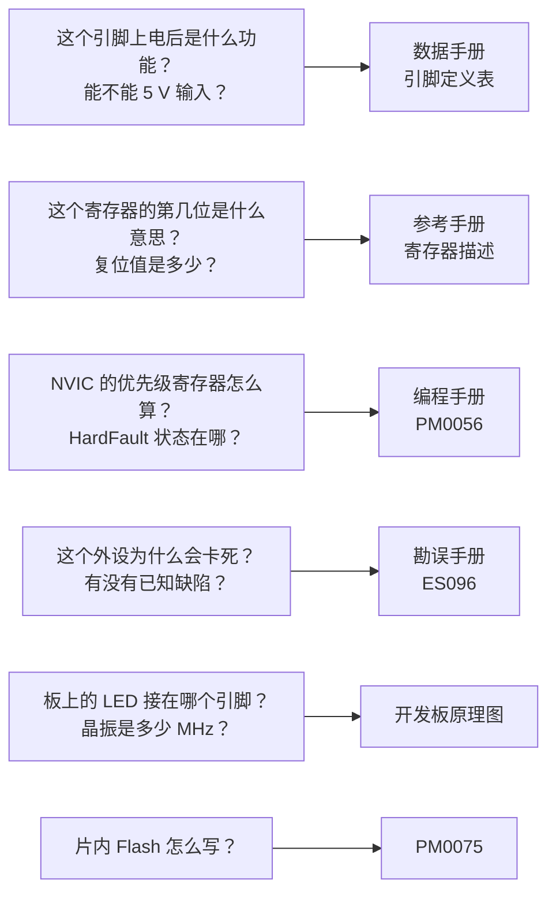

# 1.3 芯片手册、开发板资料与引脚复用

在微控制器固件开发的日常中，开发者面临的大多数棘手困惑，其实早已在芯片原厂发布的官方技术文献中给出了清晰的界定：某个外设控制寄存器的基准物理地址落在何处、某个通用引脚在上电瞬间究竟呈现高阻浮空还是弱上拉、某项外设功能为什么刚刚置位使能位芯片就意外锁死。对于这些疑问，第一类问题的根源记录在芯片参考手册的寄存器位定义中，第二类线索沉淀在数据手册的引脚配置表与电气特性章节里，而第三类看似不可理喻的软硬件挂死，往往能在原厂勘误手册的已知缺陷条款中找到印证。面对动辄两千余页、由半导体厂商精密编纂的英文工程文档，试图从头到尾逐字背诵既不现实也不必要；真正决定嵌入式工程师工程素养的，是在遇到异常或规划电路时，能否在数分钟内迅速检索到正确的文档分册、精准定位到具体的章节与数据列。

对于初学者而言，芯片官方资料往往像一座由生僻缩写与密集表格构筑的迷宫。理解数据手册（Datasheet）、参考手册（Reference Manual）、编程手册（Programming Manual）与勘误手册（Errata Sheet）之间的职责边界，掌握从宏观总线拓扑顺流而下推演外设绝对物理地址的法则，并深入理解引脚复用（Alternate Function）与重映射（Remap）背后的硬件多路开关机制，是摆脱“对着网络例程盲目试错”、建立稳健底层开发直觉的必修功课。

## 1. 资料集

半导体厂商在发布一款芯片时，通常会输出一套严密的文档矩阵。以本教程的核心实验芯片 STM32F103C8T6 为例，官方资料均拥有唯一的标准化文档编号，在检索与归档时应始终以文档编号为准，避免被第三方平台模糊的翻译标题所误导：

| 编号 | 名称 | 回答什么问题 |
| --- | --- | --- |
| DS5319 | 数据手册 (datasheet) | 引脚电气定义、物理封装尺寸、极限电气参数、片上存储容量、订购型号后缀含义 |
| RM0008 | 参考手册 (reference manual) | 芯片各片上外设的功能架构、工作模式时序图与全部控制/状态寄存器逐位定义 |
| PM0056 | 编程手册 (programming manual) | Cortex-M3 处理器内核体系结构、NVIC 中断仲裁、SysTick 滴答定时器、SCB 故障状态寄存器 |
| PM0075 | Flash 编程手册 | 片内嵌入式只读闪存的加锁/解锁协议、整页擦除时序、字/半字写入操作规则 |
| ES096 | 勘误手册 (errata sheet) | 芯片已流片硬件中确认的硅片设计缺陷、特定时序下的触发边界与软件规避方案 (workaround) |
| AN2586 | 应用笔记 (application note) | STM32F10xxx 硬件最小系统设计指南：滤波去耦电容、上电复位、外部晶振匹配、调试排针规范 |
| AN2606 | 应用笔记 | 芯片出厂内置 Bootloader 自举程序说明：各型号支持的烧录接口与协议握手流程 |
| — | 开发板原理图 | 印刷电路板上晶振的具体标称频率、LED 与按键的有源电平极性、各类外设跳线引脚走线 |
| — | 外接器件手册 | 面包板外挂芯片（如 AT24C02、W25Q64、ENC28J60 等）的 SPI/I²C 命令字与寄存器手册 |

在实际工程中，数据手册通常与具体的硬件型号严格绑定：例如 DS5319 仅覆盖 STM32F103x8（中密度 64 KiB）与 STM32F103xB（中密度 128 KiB）两个容量档次，若后续项目更换为引脚更多、Flash 达到 256 KiB 的 STM32F103RC，就必须改查对应高密度系列的数据手册。而参考手册 RM0008 则是按整个芯片家族通用的逻辑编撰的，涵盖了从入门级到互联型全部 F10xxx 芯片的外设集；因此在查阅 RM0008 时，会看到诸如 USB OTG、以太网 MAC、FSMC 灵活静态存储控制器、双 DAC 以及第二路 CAN 等高级外设，遇到这些章节时必须先对照数据手册核对当前芯片物理硅片上是否真正搭载了该硬件。

在翻阅这些文档时，排查问题的经典思维动线可以用下图直观概括：



::: tip 下载时认准编号与版本

ST 官方技术门户通常会保留文档的历次修订版本，第三方技术论坛中的旧链接也往往指向早已废弃的早期草稿。校验文档新鲜度的最稳妥办法是查看每一页页脚处的版本号：截至目前，RM0008 的官方基准为 Rev 21，DS5319 为 Rev 20。在团队协作探讨芯片底层行为时，连同文档编号与版本号（例如 RM0008 Rev 21）一同注明，是严谨工程沟通的标准习惯。

:::

## 2. 读数据手册

### 2.1 特性列表与框图

当下载并打开 DS5319 数据手册时，首先映入眼帘的是前几页的特性列表（Features）与系统架构框图。特性列表是系统架构师在立项选型时快速评估硬件体量的仪表盘：72 MHz 最大系统主频、64 或 128 KiB 的片内 Flash、20 KiB 的静态 SRAM、2 个独立的 12 位模数转换器（在 LQFP48 封装下引出 10 个外部模拟通道）、3 个通用异步收发串口（USART）、2 个 SPI 串行接口、2 个 I²C 总线接口、1 个 CAN 2.0B 活跃控制器以及 1 个 USB 2.0 全速从机接口；在 LQFP48 封装上，总共向外引出 37 个可供软件自由调度的 GPIO 引脚。

紧随其后的系统框图，则以总线矩阵为中枢，清晰刻画了处理器内核、片上高速总线、内存控制器与外设之间的拓扑层级。从框图中可以一目了然地识别出两组核心外设总线：挂载在高级外设总线 APB2 上的外设（包括 GPIOA～GPIOG、ADC1/2、USART1、TIM1 高级定时器等）最高能够以与 CPU 同频的 72 MHz 全速运转；而挂载在 APB1 总线上的外设（包括 USART2/3、SPI2、I2C1/2、TIM2～TIM4 通用定时器、CAN 与 USB 等）的时钟上限则被硬件严格限制在 36 MHz。宏观框图确立了时钟树划分的总体轮廓，而在编写具体固件时，查阅频率最高、细节最为严苛的，当属第 4 章的引脚定义表以及第 5 章的电气参数表。

### 2.2 引脚定义表

数据手册第 4 章收录的“表 5：STM32F103xx 引脚定义”是连接代码与物理管脚的绝对纽带。以本实验采用的 LQFP48 封装为例，表格中的每一行都对应一个物理芯片上的具体管脚，各列的数据项构成了极其完备的电气与功能约束：

| 列 | 含义 | 读法 |
| --- | --- | --- |
| Pins | 各封装对应的引脚序号 | 本教程只看 LQFP48 对应的引脚编号列 |
| Pin name | 芯片复位瞬间该引脚的硬件标称 | 带有横杠 `-` 后缀的表明存在硬件复合功能，例如 `PC13-TAMPER-RTC` |
| Type | 引脚物理电气属性 | I 代表纯输入，O 代表纯输出，I/O 代表双向可配置引脚，S 代表电源/地供电管脚 |
| I/O Level | 引脚输入耐压与保护结构 | FT 标识代表该引脚具备 5 V 耐压容忍特性；若此列为空白，则表明该引脚只能接入 3.3 V 电平 |
| Main function (after reset) | 芯片上电复位完成后的初始职能 | 芯片复位后硬件默认锁定的基础功能，通常为通用 GPIO 或专用系统调试管脚 |
| Default | 外设使能时的默认复用功能 | 当对应片上外设开启且引脚被配为复用输出时，硬件自动接管的默认信号线路 |
| Remap | 经过重映射配置后的备用复用功能 | 需在软件中主动配置辅助功能 I/O 重映射寄存器（AFIO_MAPR）后方能激活的线路 |

我们可以通过几个具有代表性的引脚实例，深入体会这张表格的阅读方法：

首先审视作为调试串口发送端常用的 **PA9** 引脚。在 LQFP48 封装列中，该引脚对应第 30 号物理引脚，电气类型标为 I/O，I/O Level 一列明确印有 **FT** 标志。复位后的主功能是标准的普通数字端口 PA9，默认复用功能栏写着 `USART1_TX` 与 `TIM1_CH2`，重映射栏则为空。这组定义意味着：芯片上电脱扣复位后，PA9 呈现为普通的通用 GPIO（浮空输入模式）；只有当固件在寄存器中打开了 USART1 的外设时钟、并将 PA9 的工作模式配置为复用推挽输出（Alternate Function Push-Pull）时，串口模块内部的移位寄存器才会真正接管该引脚的电平驱动。标记为 **FT (Five-volt tolerant)** 明确告知硬件工程师：该引脚内部的 ESD 钳位电路经过特殊设计，当其处于输入模式时，能够安全承受 5 V TTL/CMOS 逻辑电平的输入而不会发生芯片过压击穿；但需要清醒的是，其内部推挽输出级的电源依然来自 3.3 V 的 VDD，因而作为输出时，吐出的高电平依然只能达到 3.3 V 左右。

再来看 **PA11** 与 **PA12** 这对典型的复合引脚。两者的 I/O Level 均为 FT，但默认复用栏中各自塞入了长串外设名单：PA11 挂接了 `USART1_CTS / CANRX / USBDM / TIM1_CH4`，而 PA12 则挂接了 `USART1_RTS / CANTX / USBDP`。一个物理引脚上同时汇聚了四五个外设的信号入口，这在引脚资源捉襟见肘的微控制器中司空见惯。数据手册在表 5 的脚注 4 中对此做出了不可违背的刚性裁决：**当多个外设在设计上共用同一组引脚时，为避免内部硬件总线驱动冲突，在任意运行时刻，软件只能通过 RCC 外设时钟门控开启其中的一个外设**。这一铁律在 USB 与 CAN 之间尤为致命：USB 全速控制器的差分数据线 D−/D+ 与片上 CAN 控制器的默认收发引脚完全重合在 PA11 和 PA12 上。为了打破这一死锁，工程上必须借助下文详述的重映射机制，将 CAN 外设的收发引脚彻底挪移至其他空闲端口。

查阅 **PB3** 引脚时，其主功能一栏并未写成 PB3，而是标为 `JTDO`。同理，PA13、PA14、PA15、PB4 在复位后的主功能分别标注为 `JTMS/SWDIO`、`JTCK/SWCLK`、`JTDI`、`JNTRST`。这表明该家族引脚在硬件复位释放后，默认由片内 JTAG/SWD 调试硬件接口全权霸占。如果项目外设紧张，执意希望将它们作为通用 I/O 引脚连接继电器或按键，代码必须先通过专门的 AFIO 寄存器解除调试端口绑定并释放引脚，否则往普通 GPIO 寄存器写入的任何配置都将被底层硬件直接无视。

最为特殊且暗藏工程陷阱的引脚是 **PC13**。在引脚定义表中，它的主功能被标注为 `PC13-TAMPER-RTC`，I/O Level 一栏为空（意味着其绝对**不能**耐受 5 V 高压，一旦接入 5 V 信号引脚将立刻烧毁）。更为关键的是表末不起眼的脚注 5，这条警告直接左右了开发板的设计形态：

> PC13, PC14 and PC15 are supplied through the power switch. Since the switch only sinks a limited amount of current (3 mA), the use of GPIOs PC13 to PC15 in output mode is limited: the speed should not exceed 2 MHz with a maximum load of 30 pF and these IOs must not be used as a current source (e.g. to drive a LED).

这段原文明确揭示了芯片内部的电气现实：PC13、PC14、PC15 三个引脚的内部供电回路并非直接连接高强度的数字电源主轨，而是经由一个为低功耗备份域（RTC 唤醒与侵入检测）设计的微型内部电源电子开关。该开关能够承受的电流极限仅仅只有 **3 mA**。正因如此，当它们作为数字输出时，翻转速率被限制在 2 MHz 以下，外接负载电容不得大于 30 pF，而且**绝对禁止充当拉电流源（Current Source）直接向外供电**。

这也是为什么在著名的 Blue Pill 核心板上，板载 LED 的驱动电路被设计成**灌电流（Current Sink）接法**：板载 3.3 V 电源经由限流电阻连接发光二极管的阳极，二极管的阴极则接入微控制器的 PC13 引脚。当程序控制 PC13 输出低电平时，发光回路导通，电流自外部电源顺流注入引脚并流向芯片地线。这种吸收外部电流的方式完全避开了“引脚不能对外供电”的雷区；同时，串联的限流电阻阻值必须严格控制在 1 kΩ 以上，以确保即便在全亮状态下，灌入引脚的峰值电流也绝对不超过 3 mA 的警戒线。

::: warning PC13 的输出电流限制

PC13–PC15 经内部电源开关供电，输出电流上限 3 mA，速度上限 2 MHz，不能对外提供电流。驱动 LED 时必须采用灌电流接法（外部电源经限流电阻接 LED 再到引脚），不能把 LED 接在引脚与地之间。

:::

### 2.3 电气参数

翻开数据手册第 5 章，密密麻麻的电气参数被严谨地划分为两大阵营。理解这两部分参数的本质区别，是避免在硬件设计和固件配置中“踩雷”的基石：

- **绝对最大额定值 (Absolute Maximum Ratings)**：这是硅片物理制造所能容忍的不可逾越的应力红线。例如表 6 中给出的主供电电压差 `VDD − VSS` 范围是 −0.3 V 至 +4.0 V，表 7 规定单个普通 I/O 引脚的最大灌/拉电流为 25 mA，所有电源脚的总和电流上限为 150 mA。这些极限数值绝对不能作为系统正常运行的设计依据：任何瞬间越过这些红线的脉冲电平，都可能在硅片内部引发寄生晶闸管自锁（Latch-up）或栅极绝缘层永久击穿。
- **推荐工作条件 (Operating Conditions)**：这才是指导硬件原理图与底层驱动编写的真正圣经。例如表 9 给出系统在正常运转时，供电电压 `VDD` 必须稳定保持在 2.0 V 至 3.6 V 之间；内核时钟 `fHCLK` 最大为 72 MHz，APB1 外设时钟 `fPCLK1` 不得超过 36 MHz。

在查阅参数表格时，必须养成牢看“最坏情况（Worst-case）”的思维方式。对于需要硬件指标予以刚性保证的场合，务必以 Min（最小值）或 Max（最大值）那一列为准绳；而 Typ（典型值）一栏往往仅代表室温 25 °C 与标称供电下的统计均值，只能用于宏观评估功耗与平均估算。

以下三处典型工程场景深刻体现了这种严谨的查表法则：

1. **电源纹波与 ADC 精度关联**：许多开发者通过板载 LDO 将 USB 提供的 5 V 电源降压为 3.3 V 供给 MCU。然而，当电脑 USB 端口负载过重导致输入跌落、或者后级外设瞬态抽取大电流时，LDO 输出很可能跌破 3.0 V。虽然这依然在芯片 2.0–3.6 V 的工作允许范围内，但由于片上模数转换器 ADC 默认以 VDD/VDDA 作为量程基准电压，基准电压的微小跌落将直接导致采样的数字读数系统性整体偏大。
2. **外设时钟硬性超频死区**：在表 47 的 ADC 特性中，原厂明确划出红线：ADC 的工作时钟 `fADC` 最高不得超过 **14 MHz**。当系统以 72 MHz 全速运行时，APB2 外设时钟为 72 MHz，此时 RCC 内部提供的 ADC 时钟预分频系数只能选择 6 分频（得到 12 MHz）或 8 分频（得到 9 MHz）；若有开发者自作聪明选择 4 分频强行将 ADC 超频到 18 MHz，手册不会承诺“是否能勉强运行”，其内部采样保持电容与逐次逼近寄存器将因建立时间不足而导致转换数值彻底失真。
3. **片内 RC 振荡器温漂与波特率容限**：数据手册表 24 详尽列出了片内 8 MHz 高速 RC 振荡器（HSI）在不同温度下的频漂范围：常温 25 °C 下出厂校准精度为 ±1.1%，但在 0 °C 至 70 °C 的工业工作区间内，频漂将放大至 −1.3% 至 +1.8%，在极限全温范围下更会达到 ±2.5%。在编写串口通信固件时，异步串口每帧传输依赖双方独立的时钟采样，当通信波特率高达 115200 bps 时，超过 2% 的累计时钟偏差将使帧末尾停止位的采样点滑移至边界引发帧校验错误。这也解释了为何在可靠的工业现场通信中，必须在开发板上外接温漂极低的石英晶体振荡器（HSE）。

## 3. 读参考手册

### 3.1 章节结构

如果说数据手册是微控制器的电气外貌速览，那么厚逾千页的参考手册 RM0008 则是芯片内部各片上外设的深度解剖全书。RM0008 的编排结构高度模块化与程式化：除了前几章通用的存储器映射、电源、复位与时钟树外，后续针对每一个具体外设（如 GPIO、USART、SPI、CAN）均开辟专章独立阐述。

在研读具体外设章节时，最科学的推进节奏分为三步：
1. **通读功能架构与时钟框图**：每个外设专章的第一节必是该外设的功能框图。框图清晰呈现了外设与内部总线的接口桥接、控制寄存器如何向内部时序逻辑发射使能电平、外部物理引脚信号如何穿过输入滤波器抵达数据寄存器。理清数据的流动路径，才能在脑海中建立起清晰的硬件物理模型。
2. **精读工作模式与时序规约**：章节中间部分详细列举了诸如主从模式、全双工/半双工、中断触发机制以及与 DMA 的配合逻辑。
3. **查阅寄存器逐位定义与映射表**：章节末尾是编写驱动最不可或缺的寄存器详细手册。

以经典的 GPIO 端口配置高寄存器（GPIOx_CRH）为例，在标题下方固定列有三项关键元数据：
- `Address offset: 0x04`：明确该寄存器相对于该 GPIO 端口物理基地址的字节偏移量；
- `Reset value: 0x4444 4444`：芯片复位释放瞬间，硬件逻辑自动赋予该寄存器的初始物理位状态；
- **32 位位图**：从高位 Bit 31 到低位 Bit 0 逐一展开，直观勾勒出每个位域对应的字段名称，并在其下方醒目标注该字段的**访问类型**。

### 3.2 访问类型

位图下方标注的访问类型缩写，是驱动开发中绝不可视若无睹的硬件法则。RM0008 第 2.2 节给出了权威的标准定义：

| 缩写 | 名称 | 读操作表现 | 写操作表现 |
| --- | --- | --- | --- |
| rw | read/write | 读出当前硬件寄存器内的实际物理状态 | 向对应位写入新数值以修改硬件配置 |
| r | read-only | 读出外设当前状态（如接收数据或运行标志） | 软件写入无效，硬件直接忽略 |
| w | write-only | 读出数值不确定（通常读回复位值或全零） | 将数据写入底层硬件触发对应动作 |
| rc_w1 | read/clear by writing 1 | 读出当前硬件标志位的值 | **写 1 会清零该硬件标志位；写 0 则毫无影响** |
| rc_w0 | read/clear by writing 0 | 读出当前硬件标志位的值 | **写 0 会清零该硬件标志位；写 1 则毫无影响** |
| rc_r | read/clear by read | 读出当前标志状态的同时，**由读动作自动触发该位的硬件清零** | 软件写入无效 |
| rs | read/set | 读出当前硬件状态 | 写 1 将该位置位；写 0 无影响 |
| rt_w | read-only write trigger | 读出当前状态 | 写入任意数值都会触发内部硬件事件，但寄存器位本身数值不变 |
| t | toggle | 读出当前状态 | 写 1 翻转该位的状态；写 0 无影响 |

在上述所有类型中，**`rc_w1`（写 1 清零）是嵌入式 C 语言开发中最隐蔽、杀伤力最大的“事故高发区”**。

在通用应用开发中，程序员早已习惯了使用位或赋值运算符 `|=` 对特定标志位进行置位或修改。然而，在面对硬件的 `rc_w1` 状态标志（例如串口发送完成标志 TC、定时器溢出更新中断标志 UIF）时，这一习惯将诱发致命的连锁破坏。

以 USART 的状态寄存器（USART_SR）为例：假如此刻由于串口连续收发，接收缓冲区非空标志位 RXNE（位 5）与发送完成标志位 TC（位 6）同时被硬件置位为 1。此时，开发者希望在发送函数中清零 TC 标志位。如果写出形如 `USART1->SR |= USART_SR_TC;` 的代码，编译器在汇编层面上将展开为经典的“读-改-写”三步时序：
1. 首先执行 `ldr` 指令将 `USART1->SR` 的当前物理数值读入 CPU 寄存器（读出的数值中，Bit 5 和 Bit 6 均为 1）；
2. 随后在 CPU 寄存器内部执行按位或运算，将 Bit 6 强制置 1（Bit 5 依然保持为 1）；
3. 最后执行 `str` 指令将计算结果完整写回 `USART1->SR`。

灾难在此刻爆发：当包含了 Bit 5 为 1 的数据被重新写回状态寄存器时，由于硬件对 Bit 5 同样遵循 `rc_w1` 规则，**写回的 1 会被硬件解释为“清除 RXNE 标志”**！原本等待接收处理函数读取的重要数据到达标志，就这样在发送完成处理中被神不知鬼不觉地强行抹除，导致后续的接收流程彻底丢失数据。

因此，面对 `rc_w1` 类型的状态寄存器，必须严格杜绝任何形式的 `|=` 复合赋值。正确的做法是使用单笔直接赋值语句：
```c
/* 正确清零 TC 标志：仅向目标位写入 1，其余所有无关位严格写入 0 */
USART1->SR = USART_SR_TC;
```
这一黄金法则在后续第 2 章编写所有定时器中断与通信外设底层驱动时，将成为保障数据流正确流转的根本底线。

<Quiz
  type="single"
  :options="[
    { label: '读出该位会得到外设当前状态，写 1 会把它置位', value: 'A' },
    { label: '读出该位会得到外设当前状态，写 1 会把它清零，写 0 无影响', value: 'B' },
    { label: '该位只能读，不能写', value: 'C' },
    { label: '读出该位会自动清零，与写入无关', value: 'D' }
  ]"
  answer="B"
>

<template #question>

某状态标志标注为 `rc_w1`，它的行为是什么？

</template>

正确答案是 **B**。`rc_w1` 是 read/clear by writing 1：读照常返回当前状态，写 1 清零，写 0 不起作用。选项 A 是 `rs`，选项 D 是 `rc_r`。要清零这样的标志，直接赋值，不要用 `|=`。

</Quiz>

### 3.3 从基地址到绝对地址

在底层的微控制器硬件视角中，并不存在所谓高级对象名称或符号句柄的概念；所有外设的存在，归根结底都具象为 32 位内存地址总线上的一个个绝对物理地址。计算某一个控制字段的绝对内存映射，遵循严密的数学推演法则：

$$\text{寄存器绝对地址} = \text{外设基地址} + \text{寄存器偏移量}$$

在 RM0008 第 3 章的“系统存储器映射表”中，外设被清晰划分在从 `0x4000 0000` 开始的高级外设总线区域。查阅该表可知，通用端口 GPIOC 的基地址被确定为 `0x4001 1000`。翻到 GPIO 外设专章，端口配置高寄存器（GPIOx_CRH）标明其相对基地址的偏移量为 `0x04`。两者相加，便精确锚定了配置 PC8 至 PC15 的物理寄存器绝对地址为 `0x4001 1004`。

在 32 位的 CRH 寄存器中，每个物理引脚的工作模式由连续的 4 位编码掌管。由于 CRH 管理的是高 8 个引脚（Pin 8 至 Pin 15），对于第 13 号引脚 PC13 而言，其控制字段在该寄存器内部的起始位偏移量为：

$$\text{起始偏移位} = (13 - 8) \times 4 = 20$$

这意味着，控制 PC13 工作形态的位域精准锁定在第 23 位至第 20 位（共 4 位宽）：

<BitField
  title="GPIOx_CRH 中 PC13 的字段（第 23:20 位，复位值 0x4444 4444）"
  :lsb="20"
  :fields="[
    { name: 'CNF13[1:0]', bits: 2, access: 'rw', desc: '复位值 01：浮空输入' },
    { name: 'MODE13[1:0]', bits: 2, access: 'rw', value: '10', desc: '复位值 00；写 10 为输出，最大 2 MHz' }
  ]"
/>

对照位域图审视其出厂复位值 `0x4444 4444`：将这个 32 位十六进制数展开，每个半字节恰好都是二进制 `0100`。其中高 2 位的 CNF 为 `01`（浮空输入），低 2 位的 MODE 为 `00`（通用输入模式）。这意味着在系统刚上电时，为了防止外部电路与内部发生意外冲突，所有的通用 GPIO 引脚均被硬件默认置于高阻抗的浮空输入状态。

::: concept emb-manual-address-and-access title="寄存器地址与访问类型"

外设寄存器的绝对地址等于外设基地址（RM0008 第 3 章存储器映射表）加上寄存器偏移（该外设章节的寄存器描述）。读写该寄存器时位的行为由访问类型决定：同一段代码，访问类型是 rw 时读-改-写安全，是 rc_w1 时读-改-写会误清其他位。

:::

为了在代码编写阶段准确、直观地核验这些地址与掩码计算，我们在配套仓库中提供了辅助验证程序 `code/嵌入式/1_平台与工具链/1_3_芯片手册_开发板资料与引脚复用/reg_calc.c`。该程序能够解析指定的端口编号、引脚序号以及目标配置位，在主机控制台上输出精确的基地址、绝对地址、位域范围、置位/清零掩码，并模拟执行经典的“先清零再置位”位运算流程：

::: terminal title="PowerShell - 计算寄存器地址与掩码"

```text
$ gcc -std=c17 -Wall -Wextra reg_calc.c -o reg_calc
$ ./reg_calc
引脚 PC13（通用推挽输出, 最大速度 2 MHz）
  寄存器    : GPIOC_CRH (基地址 0x40011000 + 偏移 0x04 = 0x40011004)
  位域范围  : [23:20] (CNF13=0, MODE13=2, 组合值 0x2)
  清零掩码  : 0xFF0FFFFF  ~(0xFu << 20)
  置位掩码  : 0x00200000   (0x2u << 20)
  修改后值  : 0x44244444  (复位值 0x44444444)

引脚 PA9（复用推挽输出, 最大速度 50 MHz）
  寄存器    : GPIOA_CRH (基地址 0x40010800 + 偏移 0x04 = 0x40010804)
  位域范围  : [7:4] (CNF9=2, MODE9=3, 组合值 0xB)
  清零掩码  : 0xFFFFFF0F  ~(0xFu << 4)
  置位掩码  : 0x000000B0   (0xBu << 4)
  修改后值  : 0x444444B4  (复位值 0x44444444)

rc_w1 状态寄存器初值        : 0x03 (位 1 与位 0 均置位)
执行 SR |= (1u << 0) 后     : 0x00 (位 1 被连带清零!)
执行 SR  = (1u << 0) 后     : 0x02 (仅清零位 0，位 1 保留)
```

:::

仔细观察终端运行结果中的第二组参数：针对引脚 PA9，将其配置为复用推挽输出且最大速度设为 50 MHz 时，查阅 RM0008 表 20 可知应将 CNF 置为 `10`、MODE 置为 `11`，两者拼合为一个 4 位的十六进制值 `0xB`。该数值在后文 [2.7 UART](/教程/正文/嵌入式/2_MCU裸机开发/2_7_UART) 中，正是将 PA9 转变为 USART1 发送物理管脚的核心配置字。同时，程序最后三行直观印证了前文关于 `rc_w1` 的论述：使用 `|=` 试图单独清零 Bit 0 时，原本置位的 Bit 1 被错误地一同清零；而只有使用直接赋值 `=`，才能干净利落地保留其他无关标志位。

## 4. 编程手册与勘误

### 4.1 编程手册管什么

在 ST 官方文档体系中，有三本极易产生混淆的文献：数据手册（Datasheet）、参考手册（Reference Manual）与编程手册（Programming Manual）。初学者经常困惑于“为何翻遍参考手册，却找不到中断嵌套向量控制器的寄存器位定义”。

理解这种分工的关键，在于理清芯片内部的 IP 知识产权归属：
- **数据手册**：面向芯片外部物理视界，记录引脚封装、供电电气特性与管脚多路复用；
- **参考手册**：面向 ST 团队自主研发并挂载在片上总线的所有外设控制器（如 GPIO、USART、SPI、ADC、高级定时器）；
- **编程手册**：直接面向 Arm 授权的处理器内核原生体系结构。

RM0008 中虽然也辟出章节描述中断向量表与中断触发线，但那纯粹是从“板载外设如何连线至内核中断输入”的物理集成角度展开的。真正掌控 Cortex-M3 处理核心运转命脉的指南是 **PM0056**：它权威规定了处理器线程模式与处理模式的切换时序、发生硬件异常时由硬件自动压入主堆栈的寄存器顺序与魔数 `EXC_RETURN` 的解析规范、嵌套向量中断控制器 (NVIC) 的优先级分组与屏蔽掩码算法、系统滴答定时器 (SysTick) 的底层递减计数机制，以及系统控制块 (SCB) 内部至关重要的硬件故障状态寄存器（包括可配置故障状态寄存器 CFSR、硬故障状态寄存器 HFSR、总线故障地址寄存器 BFAR）。在固件开发中，一旦系统触发 HardFault 陷入死锁，或者需要精细调优多级中断抢占时效时，PM0056 才是最精准的技术指针。

遇到软硬件异常时，可遵循下表判定查阅归属：

| 异常现象或工程需求 | 权威查阅出处 |
| --- | --- |
| 外部硬件中断无法响应，或多个中断优先级嵌套未按预期抢占 | 查阅 PM0056 的 NVIC 机制章节；并对照 RM0008 向量表核验外部中断号 |
| 异常处理函数中解析栈帧，试图读出异常触发瞬间的 PC 与 LR | 查阅 PM0056 的异常入栈帧结构规范与 EXC_RETURN 编码准则 |
| 程序偶发跑飞进入死循环，需排查是指针越界、除以零还是未对齐访问 | 查阅 PM0056 的 SCB 故障状态寄存器（CFSR、HFSR、BFAR、MMFAR） |
| 某外设寄存器已在 C 语言中赋值，但单步调试读取依然为全零 | 查阅 RM0008 对应外设章确认其 RCC 时钟门控是否开启，并核对访问类型 |
| 运行时尝试就地擦写片内 Flash 存储应用参数，操作却静默失败 | 查阅 PM0075 核对解锁密钥输入序列、等待周期与状态标志位清除协议 |

### 4.2 勘误怎么读

芯片勘误手册 (Errata Sheet) 记录的是芯片在完成半导体流片制造后，在物理硅片上已经凝固、无法通过硬件回炉修复的设计瑕疵。与一般的理论教材不同，勘误手册的行文逻辑极其冷峻而程式化，每一个条目均包含三部分核心信息：**缺陷现象 (Description)**、**发生触发的苛刻边界条件 (Conditions)**、以及厂商给出的**工程临时规避措施 (Workaround)**。

在阅读勘误时，开发者应当保持理性客观的工程心态：不要一看到芯片存在缺陷就产生抵触情绪，而是应当仔细对照自己的代码逻辑与外设工作模式，检查自身是否命中了触发该缺陷的特定边界时序；若当前场景完全不会触碰触发条件，便完全无需背负心理负担或引入无谓的防御性冗余。

在 ES096 勘误手册中，针对 STM32F103 的 I²C 硬件模拟噪声滤波器的缺陷记录极具代表性：片上 I²C 模块原生配备了用于滤除工业现场信号毛刺的模拟滤波器；然而当总线上因外界电磁扰动而产生的物理窄脉冲宽度恰好落在滤波窗口临界区、且恰好出现在某次通信停止位结束前后时，硬件状态机会产生误判，将毛刺误读为总线活跃信号。这导致即使外部物理总线早已处于完全静止状态，芯片内部状态寄存器 `I2C_SR2` 的忙标志位 `BUSY` 却会被永久锁死在 1，使得后续软件按照标准时序请求生成 START 起始位时被硬件全部拒绝，外设彻底陷入假死瘫痪。

针对此种困境，RM0008 参考手册在 `I2C_CR1` 寄存器的软件复位控制位 `SWRST` 下专门埋下了伏笔：

> As an example, if the BUSY bit is set and remains locked due to a glitch on the bus, the SWRST bit can be used to exit from this state.

规避方案在此刻水落石出：当固件检测到总线忙标志异常挂起时，唯一的拯救手段是通过软件置位 `SWRST`，在硬件逻辑层面对 I²C 外设核心施加一次强制的硬件逻辑复位，将其强行拖回上电复位基态，随后重新执行外设初始化流程。这种现象在表面上常常被误诊为“外部传感器芯片损坏”，而其真相不过是物理硅片微架构在极限毛刺扰动下的设计漏洞。

::: tip 用外设之前先扫一遍勘误

在任何关键工业或车载项目正式启用某项外设前，养成将 ES096 中该外设对应的全部条目通读一遍的工程习惯至关重要。每项外设的缺陷清单往往只有寥寥数条，只需花费十余分钟即可做到心中有数；将命中的条目与对应的规避宏代码工整地标注在驱动源码注释中，比起数月后整机发往现场、因偶发未知故障导致设备停机复位的排障成本，投入产出比不可同日而语。

:::

## 5. 开发板资料

如果说官方芯片手册描绘的是硅片在理想状态下的全知世界，那么硬件工程师绘制的电路原理图 (Schematic)，则是连接微控制器物理引脚与外部电子元器件的唯一现实契约。芯片数据手册只能告诉你 PA9 具备成为串口发送端的能力，而只有手中的原理图才能告诉你板上的 PA9 到底穿过了哪道跳线、连接到了哪一颗 USB 转串口转换芯片上。

对于风靡业界的 Blue Pill 最小系统板，市面上虽有不同的代工厂商排版，但在核心拓扑与网络标号的命名规范上保持着高度一致：

| 核心电路网络 | 物理连接与拓扑路径 | 对底层固件编写的具体影响与约束 |
| --- | --- | --- |
| 主外部高速晶振 (HSE) | 标称 8.000 MHz 石英晶振跨接于 OSC_IN 与 OSC_OUT（Pin 5、Pin 6），两端各对地并联 20 pF 负载匹配电容 | 确定了系统主 PLL 锁相环倍频的硬件基准，我们在 2.3 节配置 72 MHz 主频时必须基于 8 MHz 计算倍频因子 |
| 备份域低速晶振 (LSE) | 32.768 kHz 音叉晶振跨接于 PC14-OSC32_IN 与 PC15-OSC32_OUT | 若希望将 PC14/PC15 用作通用数字 GPIO，固件在启动时必须先彻底关闭 LSE 振荡电路并释放备份域控制权 |
| 板载系统指示 LED | 板载 3.3 V 主供电轨 → 串联限流电阻 → 发光二极管阳极 → 阴极接引脚 PC13 | 经典的灌电流低电平点亮电路，固件写入逻辑 0 时 LED 点亮，写入逻辑 1 时熄灭 |
| 硬件复位按键 | 芯片硬件复位引脚 NRST 经轻触按键直接对地短路，板上配备弱上拉电阻与滤波电容 | 按下按键迫使芯片硬件复位，NRST 信号线同时并行引出至调试排针，供调试探针执行“硬件复位下连接” |
| BOOT 自举模式选择跳线 | BOOT0 引脚引出双排插针（可选跳线接 GND 或 3.3 V），BOOT1 经电路固定连接至 PB2 | 决定芯片上电时从片内用户 Flash 启动还是跳入系统存储器执行内置串口 Bootloader |
| 板载 USB 接口 | 微控制器的 PA11 连接 USB 差分信号 D−，PA12 连接 D+，且 D+ 信号线上挂载了拉向 3.3 V 的 1.5 kΩ 识别电阻 | 硬件固定上拉告知主机当前为全速 USB 设备，由于引脚复用，开启 USB 时将与默认 CAN 引脚发生冲突 |
| 板载 LDO 稳压器 | 将外部 USB 口输入的 5 V 直流降压稳幅为系统 3.3 V，并联去耦电容后供给 VDD 与模拟电源 VDDA | 在开发板已通过 USB 口独立供电时，**严禁**再通过 ST-LINK 探针的 3.3 V 引脚向开发板反向供电 |
| SWD 串行调试排针 | 板端排针直接引出 3.3 V、SWDIO（PA13）、SWCLK（PA14）与 GND 四个基准端点 | 调试器探针与开发板硬件沟通的核心通道，固件生命周期中应尽全力保留这对引脚的调试职能 |

研读电路原理图最有效的动作，是养成在 EDA 软件中顺着网络标号（Net Label）进行全程追索的直觉习惯。以 PC13 为例：在原理图图纸上检索 `PC13` 网络，观察其如何贯穿芯片管脚、穿越限流电阻，最终汇入 LED 阴极。当这条物理流向在脑海中完成闭环时，“低电平有效”就不再是一句干瘪死板的代码口诀，而是印刻在物理电路铜箔上的真实客观存在。

::: tip 低价开发板上的兼容替代芯片

在消费级市场上流通的众多低成本 Blue Pill 板卡中，不少商家焊接的是国产兼容芯片（如兆易创新的 GD32F103、中科芯的 CKS32F103 或极海的 APM32F103 等）。尽管这些芯片在绝大多数基本指令集与外设寄存器布局上力求实现 Pin-to-Pin 兼容，但在部分高级特性的内部时序、Flash 写入等待周期以及调试内核识别码 (TAP ID / Device ID) 上与 ST 原厂存在微小差异。当 OpenOCD 报错提示设备 ID 无法识别，或者在配置完主时钟后代码异常跑飞时，首先应拿起放大镜核对芯片表面的激光丝印，确认硬件的真实血统。

:::

## 6. 引脚复用与重映射

### 6.1 F1 的复用模型

在现代超大规模集成电路设计中，芯片内核的运算逻辑可以容纳数千万个晶体管，然而芯片能够向外引出的物理金属引脚数量，却受到封装尺寸、机械应力与制造成本的刚性制约。当芯片内部的外设信号线总数远远超出引脚总数时，多项外设共用同一批管脚就成了必然的技术选择，这一机制在微控制器体系中被称为**复用功能 (Alternate Function, AF)**。

STM32F1 系列的引脚复用架构具有鲜明的时代印记，其控制模型极其简明直接：
1. **激活目标外设的时钟源**：通过向复位和时钟控制模块（RCC）的 `APB1ENR` 或 `APB2ENR` 写入使能位，为目标硬件注入运转时钟；
2. **规范化配置引脚的工作模式**：若引脚承接外设的输出信号，需将其配置为**复用推挽输出**或**复用开漏输出**（CNF 对应为 `10` 或 `11`，MODE 需非零以选定翻转速度）；若引脚承接外设的输入信号，则通常配置为浮空输入、上拉输入或模拟输入；
3. **硬件所有权自然交接**：只要目标外设被使能激活，其内部逻辑将自动接管该引脚的电气通断，此时 CPU 即便继续向通用端口数据输出寄存器（GPIOx_ODR）写入数据，也无法撼动该引脚上的电平状态。

需要注意的是，在较早的 STM32F1 架构中，并不具备后来高性能 STM32F4/F7/H7 系列那样灵活的“每个引脚配备专属的复用选择寄存器（GPIOx_AFR），可从 AF0～AF15 共 16 个复用功能中自由指派”的独立多路交叉开关矩阵。在 F1 上，某颗引脚到底能够承接哪一项外设，在芯片硅片设计阶段就已被硬件总线网表焊死。数据手册引脚表的 Default 列指明了唯一的默认路线；如果这套默认线路与板上走线发生冲突，开发者唯一的突围手段，就是查阅该表的 Remap 列，通过向芯片辅助功能 I/O 重映射寄存器（`AFIO_MAPR`）写入控制位，将外设信号整体改派至预设的备用管脚上。

以最常见的几个外设为例：
- 通用串口 **USART1** 默认收发引脚为 PA9 (TX) 与 PA10 (RX)；若置位 `AFIO_MAPR` 中的 `USART1_REMAP` 控制位，收发信号线将被整体挪移至 PB6 与 PB7；
- 高速串行接口 **SPI1** 默认占用 PA4～PA7；若置位 `SPI1_REMAP`，则被整体重定向至 PA15、PB3、PB4 与 PB5；
- **I2C1** 总线默认连接 PB6 (SCL) 与 PB7 (SDA)；若置位 `I2C1_REMAP`，则被迁移至 PB8 与 PB9；
- **CAN** 控制器的重映射位 `CAN_REMAP` 则是一个 2 位的字段，当写入二进制 `10` 时，原本绑死在 USB 引脚 PA11/PA12 上的收发信号线，将被平移至 PB8 与 PB9。

::: concept emb-manual-remap-per-peripheral title="F1 的重映射以外设为单位"

STM32F1 的重映射通过 AFIO_MAPR 按外设成组进行：置某一位（或某两位）就把该外设的全部相关信号一起换到另一组引脚，不能只换其中一根。使用 AFIO_MAPR、AFIO_EXTICR 之前必须先打开 AFIO 时钟（RCC_APB2ENR 的 AFIOEN），否则写入无效。

:::

### 6.2 AFIO 与 SWJ_CFG

辅助功能 I/O 模块 (AFIO) 在 STM32F1 芯片内部被设计为一个挂载在 APB2 高速总线上的独立外设实体，其物理基地址为 `0x4001 0000`。在整个系统生命周期中，AFIO 主要承担着三项枢纽性职能：外设引脚的全局重映射调度、外部引脚中断（EXTI）到内核中断线的端口仲裁路由，以及最重要的——**内核系统调试引脚（JTAG/SWD）的释放与重新指派**。

RM0008 手册在 AFIO 章节的起始注释中做出了极其严肃的强调：**固件在尝试读写 `AFIO_EVCR`、`AFIO_MAPR` 或 `AFIO_EXTICR` 寄存器之前，必须首先向 `RCC_APB2ENR` 写入 `RCC_APB2ENR_AFIOEN` 位，激活 AFIO 模块的总线工作时钟**。在嵌入式新手编写的代码中，因遗忘使能 AFIO 时钟而导致的故障屡见不鲜：重映射代码逻辑看似严丝合缝，编译链接零警告，然而烧入芯片后重映射引脚毫无波形——其本质是未得时钟供给的 AFIO 寄存器完全处于断电静止状态，一切总线写操作都被硬件直接当作空操作忽略。

在重映射寄存器 `AFIO_MAPR` 中，最关键且风险最高的字段是占据高位的 `SWJ_CFG[2:0]`（Bits 26:24）。这三个控制位专门用于配置片上调试接口（JTAG 与 SWD）所占用的管脚资源。该字段在硬件上被设计为**只写不读**（软件读回的数值未定义），系统上电复位后的默认硬件状态为二进制 `000`：

| SWJ_CFG 取值 | 硬件工作形态与引脚状态 | PA13 / PA14 | PA15 | PB3 | PB4 |
| --- | --- | --- | --- | --- | --- |
| `000` | 完整 SWJ 架构（JTAG + SWD 并存），出厂复位默认状态 | 占用为调试线 (SWDIO/SWCLK) | 占用为 JTAG (JTDI) | 占用为 JTAG (JTDO) | 占用为 JTAG (JNTRST) |
| `001` | 保持完整 SWJ，但释放 JTAG 复位脚 NJTRST | 占用为调试线 | 占用为 JTAG | 占用为 JTAG | **释放为通用 GPIO** |
| `010` | **彻底关闭 JTAG 调试，但完整保留 SWD 双线调试** | 占用为调试线 | **释放为通用 GPIO** | **释放为通用 GPIO** | **释放为通用 GPIO** |
| `100` | **彻底关闭 JTAG 与 SWD 所有调试接口** | **释放为通用 GPIO** | **释放为通用 GPIO** | **释放为通用 GPIO** | **释放为通用 GPIO** |

其余未列出的二进制组合（如 011、101、110、111）在硬件规范中均未被赋予意义，写入不会引发任何动作。

在大多数小型微控制器项目中，标准 5 线 JTAG 接口由于占用管脚过多而在小封装下显得格外奢侈，工程师通常倾向于使用仅需两根信号线（SWDIO 与 SWCLK）的串行线调试（SWD）模式。此时，如果希望将原先被 JTAG 锁定的 PB3、PB4 以及 PA15 重新挪用为驱动按键或指示灯的通用 GPIO，最标准的做法是**向 `SWJ_CFG` 写入 `010`**：这样既完整保留了 PA13/PA14 上的 SWD 调试能力，让开发环境中的断点单步与程序烧录畅通无阻，又优雅地回收了另外三根高价值引脚。

然而，如果开发者不慎或者误读了掩码，**将 `SWJ_CFG` 写入了 `100`，芯片将陷入极其危险的“假死闭锁”状态**。

::: warning 不要把 SWJ_CFG 写成 100

向 `SWJ_CFG` 写入 `100` 会迫使硬件立即切断 SWD 与 JTAG 的全部调试逻辑，并将 PA13 和 PA14 瞬间贬为普通 GPIO。这意味着只要包含这行代码的固件一旦在芯片上启动，宿主机上的 ST-LINK 或 J-Link 探针将瞬间与芯片失联，后续常规的在线烧录与 GDB 会话全部报错崩溃（俗称“变砖”）。唯一的解救手段，是在探针发起连接的微秒瞬间死死按住板载硬件复位键（即“复位下连接 Under-Reset”模式），或者通过跳线拔动 BOOT0 拉高，迫使芯片从内置 ROM 引导后执行全片物理擦除（详见 [1.7 SWD、JTAG 与片上调试](/教程/正文/嵌入式/1_平台与工具链/1_7_SWD_JTAG与片上调试)）。

:::

### 6.3 重映射的代价与系统性冲突

引脚重映射并非免费的午餐。在工程布线中，当开发者试图通过重映射解决某一处管脚紧张时，往往会在另一处外设上触发连锁反应：

1. **备用重映射引脚之间的二次踩踏**：当配置 `CAN_REMAP = 10` 将 CAN 控制器改派至 PB8/PB9 时，查阅引脚表会发现，PB8 与 PB9 恰好也是 `I2C1_REMAP = 1` 时的重映射目标管脚。这意味着系统绝对无法在同一个产品中同时支持“重映射后的 CAN”与“重映射后的 I2C1”，鱼与熊掌不可兼得。
2. **重映射目标与另一个外设的默认引脚直接撞车**：若为了让板级布线顺畅而将 USART1 重映射至 PB6/PB7，那么原本驻留在 PB6/PB7 上的默认 I2C1 总线将直接遭到毁灭性破坏，使得开发板无法再通过硬件 I2C 挂载 EEPROM 或传感器。
3. **备用引脚与系统调试基础设施产生抢占**：若开启 `SPI1_REMAP = 1`，SPI1 总线的 SCK、MISO、MOSI 将被强行分配至 PB3、PB4、PB5。如前所述，PB3 与 PB4 在复位后隶属于 JTAG 调试端口，要让 SPI1 正常通信，必须前置修改 `SWJ_CFG` 释放调试脚；在此过程中任何细微的位操作失误，都可能将芯片推向调试接口闭锁的悬崖。

正因如此，成熟的底层硬件架构设计必须通盘推演引脚拓扑，力求在不引入连锁冲突的前提下，让关键外设各安其位。

## 7. 本部分实验的引脚分配

为了彻底避免读者在跟随后续各章节动手实验时，因外设冲突而被迫在面包板上反复拔插跳线、重布电路，本教程对整套实验所涉及的 15 项功能管脚进行了一次性的全局统筹规划。

整套引脚分配表经过严格的数学校验与电气防冲验证，能够确保板载 LED、外部按键、电位器模拟采集、PWM 输出、USART1 调试控制台、USART2 工业 RS-485 总线、USART3 外部 Wi-Fi/蓝牙模组通信、SPI1 高速 Flash、SPI2 独立以太网控制器以及 I2C 存储器在同一块实验板上**全数共存并同时稳定运行**：

| 功能模块 | 对应物理引脚 | 对应片上外设与模式配置 | 工程考量与电气设计细节说明 |
| --- | --- | --- | --- |
| 板载核心运行指示灯 | PC13 | 通用数字推挽输出，输出速度限制 2 MHz | 遵循数据手册脚注 5，采用外部 3.3 V 灌电流低电平点亮电路 |
| 用户交互按键输入 | PA0 | 通用数字输入，配置内部弱下拉 | 按键一端接 3.3 V，按下输入高电平；同时保留作为系统待机唤醒源 WKUP |
| 模拟电压采样电位器 | PA1 | 模数转换器模拟输入通道 ADC12_IN1 | 采样面包板上分压电位器的抽头电压，直面模拟信号输入（见 2.9 节） |
| 外接呼吸指示灯（PWM） | PB0 | 定时器 TIM3 通道 3，配置为复用推挽输出 | 占用 TIM3 默认复用输出引脚，无需任何重映射介入 |
| 芯片主时钟观测点 (MCO) | PA8 | 微控制器时钟输出引脚 MCO，配置为复用推挽 | 用于通过示波器直接探测片内锁相环倍频后的 36/72 MHz 高频时钟（见 2.3 节） |
| 调试控制台打印串口 | PA9 (TX)、PA10 (RX) | 异步串口 USART1，配置为复用模式 | 坚决使用默认引脚，连接 CH340 模块向宿主机终端提供 `printf` 控制台 |
| 高速 SPI Flash：W25Q64 | PA5 (SCK)、PA6 (MISO)、PA7 (MOSI) | 高速串行外设接口 SPI1，配置为复用模式 | 主控高速 SPI 总线，PA4 引脚被配置为通用 GPIO 输出充当专用片选 CS |
| 外部 MicroSD 卡槽接口 | PB1 | 通用 GPIO 数字推挽输出，充当独立片选 | 与 W25Q64 共享 SPI1 高速数据总线，通过拉低 PB1 实现 SD 卡片选独立仲裁 |
| 参数存储 EEPROM：AT24C02 | PB6 (SCL)、PB7 (SDA) | 集成电路总线 I2C1，配置为复用开漏模式 | 7 位地址 `0x50`，坚决使用默认引脚，依靠外部 4.7 kΩ 上拉电阻维持总线空闲高电平 |
| 工业现场通信：RS-485 | PA2 (TX)、PA3 (RX) | 异步串口 USART2，配置为复用模式 | 外接 MAX3485 差分芯片，PB5 配置为通用 GPIO 掌控 RS-485 半双工收发方向 DE/RE |
| 工业现场总线：CAN 2.0B | PB8 (RX)、PB9 (TX) | 控制局域网 CAN，配置重映射 `CAN_REMAP = 10` | 通过重映射强行将 CAN 收发线移离 PA11/PA12，避开与 USB 的引脚踩踏 |
| 通用串行总线：USB 全速设备 | PA11 (D−)、PA12 (D+) | 芯片原生内置全速 USB 从机控制器物理接口 | 采用默认硬件接口走线，注意其与 CAN 之间的内部内存互斥（详见后文说明） |
| 独立以太网控制器：ENC28J60 | PB13 (SCK)、PB14 (MISO)、PB15 (MOSI) | 第二串行外设接口 SPI2，配置为复用模式 | 独立 SPI2 总线专用驱动以太网，PB12 引脚配置为独立片选 CS |
| 物联网通信模组：ESP32-C3 | PB10 (TX)、PB11 (RX) | 第三异步串口 USART3，配置为复用模式 | 连接板载 ESP32-C3 模组的 AT 指令串口，实现 Wi-Fi 与蓝牙联网穿透 |
| SWD 片上调试基座 | PA13 (SWDIO)、PA14 (SWCLK) | Cortex-M3 内核内置 SWD 物理调试接口 | 绝对禁止被任何代码复用，保持 `SWJ_CFG` 默认，守护硬件仿真器生命线 |

在这套全局分配方案的背后，有四项极其关键的工程架构权衡值得深入品读：

**第一，坚决将控制台串口 USART1 与 I2C1 总线保留在默认引脚上。** 将 PA9/PA10 接至 USB 转串口模块，是整个嵌入式系统建立调试日志输出的第一步。若为了布线美观盲目重映射 USART1 至 PB6/PB7，不仅会立刻掐断 I2C1 总线的生路，还会让硬件调试陷入进退维谷的境地。

**第二，CAN 控制器必须坚决施行重映射。** 在 STM32F103 的原生引脚表中，CAN 控制器的默认引脚是 PA11 与 PA12。而正如前文所述，PA11 与 PA12 同时是片上 USB 模块唯一的数据差分信号线。在本教程的技术体系中，USB 协议栈（第 3 章 3.6 节）与工业 CAN 总线通信（第 3 章 3.5 节）均为核心实验内容。为了使硬件面包板接线一次性成型，我们通过在代码中配置 `CAN_REMAP = 10`，将 CAN 的接收端与发送端优雅地迁移至 PB8 与 PB9，从而在引脚物理层面上实现了两者共存。

**第三，认清 USB 与 CAN 之间的内部硅片互斥现实。** 许多初学者误以为：只要通过引脚重映射将 CAN 挪到了 PB8/PB9，板子上就能一边与电脑进行 USB 通信，一边在总线上收发 CAN 报文。然而现实往往比想象更骨感。翻开 RM0008 参考手册第 23 章，一段严肃的硬件警告清晰昭示了微控制器内部的资源瓶颈：

> In low, medium, high and XL-density devices, the USB and CAN share a dedicated 512-byte SRAM memory for data transmission and reception, and so they cannot be used concurrently (the shared RAM is accessed through CAN and USB exclusively). The USB and CAN can be used in the same application but not at the same time.

这段原文指出了芯片内部极其隐蔽的硬件制约：在 STM32F103 这类中密度芯片中，USB 外设的数据包缓冲区与 CAN 过滤器的报文收发邮箱，在物理上**完全共用同一块仅有 512 字节的片内专用静态 SRAM 存储单元**。由于内部总线仲裁开关无法实现时分复用，芯片在微架构层面就彻底锁死了两者的并发运行可能。因此，尽管本教程的面包板走线允许两者物理并存，但在软件实验层面，USB 实验与 CAN 实验必须分属不同的固件工程独立运行；在真正的工业产品架构中，若业务指标强行要求 USB 与 CAN 必须同时并发通信，硬件选型时就必须果断放弃中密度的 F103，转而选用诸如互联型 STM32F105/F107、或者升级至具备独立物理 FIFO 的 STM32F4/G4 等现代芯片。

**第四，PB3、PB4、PA15 保持敬而远之。** 这三根引脚虽然看似闲置，但其默认身份是 JTAG 调试接口的关键信号线。由于整套实验板的外设在剩余的引脚中已被妥善安放完毕，我们在工程中坚决不碰 `SWJ_CFG` 寄存器，使其始终安全保持在复位默认值 `000`。这种克制的设计为底层的 SWD 调试探针留下了绝对安全的避风港，彻底隔绝了因误写寄存器导致芯片变砖的潜在风险。

::: tip 用 STM32CubeMX 的 Pinout 视图排查冲突

在面对更加复杂的定制项目时，利用 ST 官方提供的图形化辅助工具 STM32CubeMX 可以大幅缩减人工查表核算的精力。在工具中选定目标芯片型号后，进入 Pinout 视图，依次勾选项目所需的外设功能，软件底层内置的引脚拓扑规则库会自动执行交叉冲突校验：一旦发生引脚踩踏，冲突节点将立即标示为醒目的黄色或橙色警告，并智能列出所有可行的重映射备选方案。即使后续项目完全基于纯寄存器开发而不采用 ST 的 HAL 库，将 CubeMX 纯粹当作一张“动态防冲突引脚规划演算纸”，依然是极具工程价值的最佳实践。

:::

## 8. 习题

### 8.1 巩固

<Exercise id="60115" :d="1" :w="1">

翻 DS5319 表 5，填出下面这张表。每行给出引脚名与它的默认复用功能，要求补上「该脚做复用时在 GPIOx_CRL 还是 GPIOx_CRH、字段从第几位开始」两列，并说明配置成复用推挽输出时 CNF 与 MODE 各取什么值（查 RM0008 表 20）。

| 引脚 | 默认复用 | 寄存器 | 起始位 | CNF | MODE |
| --- | --- | --- | --- | --- | --- |
| PA5 | SPI1_SCK | | | | |
| PA9 | USART1_TX | | | | |
| PB6 | I2C1_SCL | | | | |
| PB13 | SPI2_SCK | | | | |
| PA11 | USBDM | | | | |

CNF 与 MODE 按 RM0008 表 20 取「复用推挽输出、最大速度 50 MHz」那一行的值；PA11 那一行的 CNF、MODE 不按这张表填，在表里写「不适用」并在完成后说明原因。

最后回答：PA11 的默认复用栏里同时列着 `USART1_CTS`、`CANRX`、`USBDM`、`TIM1_CH4` 四个功能，凭什么判定同一时刻只有一个能生效？依据是表 5 的哪一条脚注？

</Exercise>

<Exercise id="60116" :d="2" :w="2">

仓库里的 `code/嵌入式/1_平台与工具链/1_3_芯片手册_开发板资料与引脚复用/reg_calc.c` 只算了 PC13 与 PA9。把它改成从命令行读参数：

```text
reg_calc PB6 3 3       # 端口、引脚、CNF、MODE
reg_calc PA0 2 0
reg_calc PB13 0 2
```

要求：

1. 端口接受 `A`～`C` 三个字母（大小写都收），引脚 0～15，CNF 与 MODE 各 0～3。参数个数不对或取值越界时打印用法并以退出码 2 结束。
2. 输出格式沿用原程序，并额外打印一行「该字段在 CRL 还是 CRH，为什么」。
3. 用上面的三条命令验证。PB6 期望得到（引脚描述那一行按 CNF、MODE 自行生成，措辞不限，其余各行须一致）：

```text
引脚 PB6（复用开漏输出, 最大速度 50 MHz）
  寄存器    : GPIOB_CRL (基地址 0x40010C00 + 偏移 0x00 = 0x40010C00)
  位域范围  : [27:24] (CNF6=3, MODE6=3, 组合值 0xF)
  清零掩码  : 0xF0FFFFFF  ~(0xFu << 24)
  置位掩码  : 0x0F000000   (0xFu << 24)
  修改后值  : 0x4F444444  (复位值 0x44444444)
```

PB13 的字段在 `[23:20]`，组合值 `0x2`，修改后 `0x44244444`；PA0 的字段在 `[3:0]`，组合值 `0x8`，修改后 `0x44444448`。

4. 再回答：PB13 与 PC13 得到的位域范围与掩码完全一样，但写的不是同一个地址。用两行输出说明区别在哪里。

</Exercise>

<Exercise id="60117" :d="2" :w="2">

本节用 `rc_w1` 解释过 `USART1->SR = ~USART_SR_TC` 为什么不能写成 `|=`。写一个模拟程序 `src_clear.c`，用一个 `uint32_t` 对象模拟 USART 状态寄存器，按 `rc_w1` 的语义实现写入（写 1 清零、写 0 不变），初值取 `TC | RXNE | IDLE = 0x70`：

1. 依次执行三种写法，打印每一步之后寄存器的值：
   - `SR = USART_SR_TC`
   - `SR |= USART_SR_TC`
   - `SR = ~USART_SR_TC`
2. 期望输出（十六进制）：

```out
A SR = USART_SR_TC        -> 0x30
B SR |= USART_SR_TC       -> 0x00
C SR = ~USART_SR_TC       -> 0x40
```

3. 解释 B 为什么把 `RXNE` 与 `IDLE` 一起清了，而 C 又为什么多留下 `TC` 没清。
4. 把同一段代码推广到 `rc_w0`、`rs`、`t` 三种访问类型上，各给一行模拟函数，并说明哪一种的「写 0 无影响」与 `rc_w1` 正好相反。

</Exercise>

<Exercise id="60118" :d="3" :w="3">

写一个 `spec_check.c`，把 DS5319 的几组限值编成表，对给定的工作点逐项判定。工作点结构如下：

```c
struct operating_point {
    const char *name;
    unsigned vdd_mv;       /* 表 9：2000..3600 */
    unsigned hclk_mhz;     /* 表 9：<= 72 */
    unsigned pclk1_mhz;    /* 表 9：<= 36 */
    unsigned pclk2_mhz;    /* 表 9：<= 72 */
    unsigned adc_prescaler;/* 2、4、6、8 之一 */
    unsigned pc13_ua;      /* 表 5 脚注 5：<= 3000 */
};
```

1. `fADC` 不直接给出，按 `pclk2_mhz / adc_prescaler` 算，超过 14 MHz 判违规（表 47）。
2. 每个违规项打印一行原因，最后打印判定结论。
3. 用三组数据验证（`nominal` 为 `3300/72/36/72/6/2000`，`adc too fast` 只把预分频改成 4，`overclocked` 为 `3700/80/40/80/2/5000`）：

```out
nominal      OK
adc too fast VIOLATION
overclocked  VIOLATION
```

其中 `adc too fast` 的违规行是 `fADC 18 MHz > 14 MHz (PCLK2 72 / 4)`；`overclocked` 应当报出 6 条违规原因（VDD、fHCLK、fPCLK1、fPCLK2、fADC、PC13）。注意 `pclk2_mhz = 80` 时 `80 / 2 = 40`，这一项同时违反 `fPCLK2 <= 72` 与 `fADC <= 14`，两条原因要分别打印。

4. 回答：为什么 `pclk1_mhz = 72` 一定是错的，即使有人把 HCLK 设成 144 MHz？这条限制写在表 9 的哪一栏，和 APB1 的哪个分频范围对应？

</Exercise>

### 8.2 编程

<Exercise id="60119" :d="3" :w="3">

仓库里 `code/嵌入式/1_平台与工具链/1_3_芯片手册_开发板资料与引脚复用/exercises/pinmux_check_starter.c` 已经实现了「按 AFIO_MAPR 解析各外设实际占用的引脚」，`check_pin_conflicts` 是空的。补全它，并扩展成一个小工具：

1. 实现 `check_pin_conflicts`，按注释里的格式打印 `CONFLICT: <外设A> and <外设B> on P<端口><引脚号>`，返回冲突总数。原始的两个用例期望输出：

```text
--- Case 1: AFIO_MAPR = 0x00000004 (USART1_REMAP=1) ---
CONFLICT: I2C1 and USART1 on PB6
CONFLICT: I2C1 and USART1 on PB7
Conflicts: 2
--- Case 2: AFIO_MAPR = 0x00004000 (CAN_REMAP=10) ---
Conflicts: 0
```

2. 增加第三个用例：`AFIO_MAPR = 0x00004002`（`I2C1_REMAP = 1` 与 `CAN_REMAP = 10` 同时置位），期望报出 `I2C1 and CAN1` 在 PB8、PB9 两处冲突。这一组重映射在本节 6.3 里作为「备用引脚可能已被别的重映射占用」的例子出现。

3. 把解析器扩展两位：增加 `USART2_REMAP`（AFIO_MAPR 位 3，`0` 为 PA2/PA3，`1` 为 PD5/PD6）与 `USART3_REMAP`（位 5:4，`00` 为 PB10/PB11，`01` 为 PC10/PC11，`11` 为 PD8/PD9）。LQFP48 上引出的 I/O 是 PA0～PA15、PB0～PB15、PC13～PC15 与 PD0、PD1，其余引脚在 48 个脚里没有位置。解析结果落在未引出的引脚上时打印 `P<端口><引脚号> is not bonded out on LQFP48` 并计一次冲突。用这个规则检查 `USART3_REMAP = 01`（PC10/PC11）与 `= 11`（PD8/PD9），说明为什么 LQFP48 上 USART3 只有默认的 PB10/PB11 一组可用。

4. 验收：给出一张表，列出你在第 3 步里试过的每个 `AFIO_MAPR` 值、冲突数与具体冲突引脚，至少覆盖 4 个值。

</Exercise>

<Exercise id="60120" :d="4" :w="3">

写一个 `remap_search.c`，穷举 AFIO_MAPR 中 SPI1、I2C1、USART1、CAN 四组重映射位的组合，找出在本教程引脚规划下可行的全部取值。

约束（全部来自本节第 6、7 节）：

- SPI1：`SPI1_REMAP = 0` 用 PA4～PA7，`1` 用 PA15、PB3、PB4、PB5；
- I2C1：`I2C1_REMAP = 0` 用 PB6/PB7，`1` 用 PB8/PB9；
- USART1：`USART1_REMAP = 0` 用 PA9/PA10，`1` 用 PB6/PB7；
- CAN：`CAN_REMAP = 00` 用 PA11/PA12，`10` 用 PB8/PB9；
- 调试接口保持复位值 `SWJ_CFG = 000`，即 PA13、PA14、PA15、PB3、PB4 不可占用；
- USB 使用 PA11/PA12，因此 CAN 不能落在这一组上；
- 同一引脚不得被两个外设同时占用。

1. 程序遍历 `2 × 2 × 2 × 2 = 16` 种组合，打印每一种可行解，最后打印可行解个数。
2. 期望结果：`SWJ_CFG = 000` 时只有一种可行解，`SPI1_REMAP=0 I2C1_REMAP=0 USART1_REMAP=0 CAN_REMAP=10`。
3. 把调试接口一栏改成 `SWJ_CFG = 010`（释放 PA15、PB3、PB4，但 PA13/PA14 仍归 SWD），重跑，期望可行解变成两种，新增的那一种是 `SPI1_REMAP=1`。把两种解都打印出来。接着把 `SWJ_CFG` 试成 `100`：可行解仍然是两种，与 `010` 相同。说明为什么在本实验的约束下「多释放 PA13/PA14」换不来任何新解，以及即便如此，正文为什么仍然把这一档标成不能写——比较一下「解数不变」与「写错之后连调试器都接不上」这两件事的代价。
4. 用这个结果解释本节的结论「SPI1 要不要重映射，取决于你愿不愿意动 JTAG 引脚」。

</Exercise>

<Exercise id="60121" :d="4" :w="4">

写一个交互式的 I²C BUSY 锁死模拟器 `i2c_busy.c`，把勘误 ES096 里那条 I²C 模拟噪声滤波器的现象做出来。

1. 用一个结构体模拟 I²C 外设的三个要素：`CR1`（位 15 为 `SWRST`，位 8 为 `START`）、`SR2`（位 1 为 `BUSY`）、以及一个「总线实际是否空闲」的标志。
2. 实现两个函数：

```c
static int i2c_start(i2c_t *i2c, int max_wait);   /* 轮询 BUSY，空闲则置 START，返回 1；超时返回 0 */
static void i2c_swrst(i2c_t *i2c);                /* 置 SWRST=1，清 SR2，再写回 0 */
```

3. 构造一种故障状态：`SR2.BUSY = 1`，但总线实际空闲。此时 `i2c_start` 应当超时。调用 `i2c_swrst` 之后，同一组参数下 `i2c_start` 应当成功。期望输出：

```out
first start: timeout busy=1 txn=0
after swrst: busy=0
retry start: ok txn=1
```

4. 在 `i2c_swrst` 里补上 `CR1` 的写回，用 `printf` 前后打印 `CR1`，说明为什么 SWRST 必须写 0 才能退出复位。
5. 把超时参数从 3 改成 0，观察输出变化，说明为什么 `max_wait` 为 0 时即使总线空闲也发不出 START（对照本节 6.2 里 `SWJ_CFG` 只写不读的讨论：硬件不会替你补一次尝试）。

</Exercise>

### 8.3 综合与挑战

<Exercise id="60122" :d="5" :w="4">

把本节第 7 节的引脚分配表变成一份可执行的检查器 `board_check.c`。

1. 把整张表编码成数组，每项含功能名、端口、引脚号、外设、以及「是否需要重映射」（对 CAN 记 `CAN_REMAP = 10`）。
2. 程序做四类检查，每类打印违规条目并累计：

   - 引脚重复（同一 (端口, 引脚) 被两个功能占用）；
   - 落在 SWJ 保留引脚上：PA15、PB3、PB4 不许被任何功能占用；PA13、PA14 只允许出现在 `SWD` 那一行（因为本表要求 `SWJ_CFG = 000`，调试口要完整保留）；
   - USB 与 CAN 同时出现在表里被标记为「同时启用」（本节引 RM0008 第 23 章的原文，两者共用 512 字节 SRAM，但引脚本身不冲突，所以前两类检查抓不到）；
   - 外设落在的重映射引脚与它的 `MAPR` 位不一致（例如表里写 CAN 在 PB8/PB9，但 `CAN_REMAP` 那项填的是 `00`）。
3. 用本节的真实分配跑一遍，期望 0 违规。再故意改三处造出违规，每处单独跑一次：

   - 把 CAN 一行改回 PA11/PA12（`MAPR` 一栏同步改成 `00`），应当报出与 USB 的引脚重复；
   - 把 SPI1 片选从 PA4 改成 PB3，应当报出落在 SWJ 保留引脚上；
   - 只把 USART1 的引脚改成 PB6/PB7、`MAPR` 一栏仍留 `default`，应当同时报出与 I2C1 的引脚重复和重映射不一致两条。

   每份报告都要能指出是哪一行（功能名加引脚号）。
4. 回答：为什么「USB 与 CAN 不能同时工作」这条检查放在引脚层面做不出来，必须单独作为一条规则？两条规则各自来自手册的哪一处（引脚表 vs 第 23 章正文）？

</Exercise>

<Exercise id="60123" :d="6" :w="5" scope="*">

本节的实验板把 CAN 重映射到 PB8/PB9、USB 留在 PA11/PA12，并在 7 节说明二者不能同时工作。设计并实现一个「外设资源占用报告」工具 `peripheral_budget.c`，回答在这样一块板上还能不能再加第三路串口。

1. 输入从标准输入读若干行，每行描述一个外设需求：

```text
USART3 PB10 PB11 default
USART2 PA2 PA3 default
CAN PB8 PB9 remap10
USB PA11 PA12 default
SPI2 PB13 PB14 PB15 default
```

字段为外设名、涉及的引脚、重映射选项。引脚写成 `P<端口><号>` 的形式。

2. 程序输出一张并按顺序列出：

   - 每个外设占用的引脚；
   - 与已经出现的更高优先级外设冲突的引脚（优先级按输入顺序，先到先得）；
   - 全表用到的 `AFIO_MAPR` 位与最终值（`SPI1_REMAP` 位 0、`I2C1_REMAP` 位 1、`USART1_REMAP` 位 2、`USART2_REMAP` 位 3、`USART3_REMAP` 位 5:4、`CAN_REMAP` 位 14:13）；
   - 仍然空闲的引脚清单（只列 LQFP48 上引出的 37 个 I/O，排除 VDD、VSS、VBAT、NRST、BOOT0 与 PD0/PD1 两个振荡器脚）。

3. 用上面五行输入验证，期望 `AFIO_MAPR = 0x00004000`（CAN 的 `10` 落在位 14:13），USART2 与 USART3 都写 `default`，它们既不占重映射位、也不与已占用引脚冲突。如果把 `CAN` 那行的 `remap10` 去掉，`AFIO_MAPR` 应变成 `0x00000000`，程序应当报出 PA11/PA12 与 USB 冲突。再补一行 `USART3 PB10 PB11 remap11`，说明为什么这会让 `AFIO_MAPR` 变成 `0x00004030`，同时 USART3 的引脚要改成 PD8/PD9。

4. 在结论里说明：本节的引脚规划其实还留了哪几组完整的「外设加片选」组合，可以在不拆现有面包板的前提下加上去。

</Exercise>

## 9. 参考资料

1. STMicroelectronics，[*DS5319 Datasheet: STM32F103x8, STM32F103xB*, Rev 20](https://www.st.com/resource/en/datasheet/stm32f103c8.pdf)：表 5 引脚定义、表 6 与表 7 绝对最大额定值、表 9 工作条件、表 24 HSI 特性、表 47 ADC 特性。
2. STMicroelectronics，[*RM0008 Reference manual: STM32F10xxx*, Rev 21](https://www.st.com/resource/en/reference_manual/rm0008-stm32f101xx-stm32f102xx-stm32f103xx-stm32f105xx-and-stm32f107xx-advanced-armbased-32bit-mcus-stmicroelectronics.pdf)：第 2.2 节访问类型、第 3 章存储器映射、第 9 章 GPIO 与 AFIO、第 23 章 USB（USB 与 CAN 共用 SRAM）、第 26 章 I²C（SWRST 与 BUSY）。
3. STMicroelectronics，[*PM0056 Programming manual: STM32F10xxx/20xxx/21xxx/L1xxxx Cortex-M3*, Rev 7](https://www.st.com/resource/en/programming_manual/pm0056-stm32f10xxx20xxx21xxxl1xxxx-cortexm3-programming-manual-stmicroelectronics.pdf)：内核、NVIC、SysTick、SCB 与故障状态寄存器。
4. STMicroelectronics，[*ES096 Errata sheet: STM32F101x8/B, STM32F102x8/B and STM32F103x8/B device limitations*](https://www.st.com/resource/en/errata_sheet/es096-stm32f101x8b-stm32f102x8b-and-stm32f103x8b-mediumdensity-device-limitations-stmicroelectronics.pdf)：I²C 模拟噪声滤波器与 BUSY 锁死条目。
5. STMicroelectronics，[*AN2586 Getting started with STM32F10xxx hardware development*](https://www.st.com/resource/en/application_note/an2586-getting-started-with-stm32f10xxx-hardware-development-stmicroelectronics.pdf)：供电、复位、时钟与调试接口的硬件设计要点。
6. STM32-base 项目，[Blue Pill 板卡资料](https://stm32-base.org/boards/STM32F103C8T6-Blue-Pill.html)：原理图、引脚排布与跳线说明。
