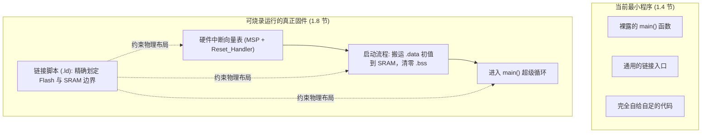

# 1.4 嵌入式 C 与最小程序

在前两节中，我们建立了微控制器硬件资源的宏观坐标，并在 [1.2 MCU、MPU、SoC 与执行环境](/教程/正文/嵌入式/1_平台与工具链/1_2_MCU_MPU_SoC与执行环境) 中了解了 C 语言的宿主环境与独立环境。在桌面操作系统中，开发者习惯了在 `main` 函数中随意调用 `printf` 输出调试日志、借助 `malloc` 索取内存，并在程序结束时写下 `return 0;`。然而，当代码转移到没有操作系统托底的裸金属平台时，这些习以为常的前提条件瞬间不复存在。

如果我们将一个仅有几行代码的极简 C 程序交给针对微控制器的交叉编译器，链接阶段往往会直接崩溃并报出一连串未定义符号。这是工具链在层层剥离通用运行时库时，直观暴露出的软硬件执行边界。在正式搭建完整工程与烧录调试之前，我们需要从纯粹的语言与链接语义出发，厘清嵌入式 C 的核心语法特征、对象模型与内存约束，看清一个脱离了操作系统的“最小程序”究竟是如何立足的。

## 1. 宿主环境的隐形契约与四行代码

### 1.1 从一个极简程序说起

在任何一本通用 C 语言教材的开篇，我们都会见到类似下面的极简程序：

```c
int main(void) {
    return 0;
}
```

在个人电脑上，使用本地 GCC 编译并执行这段代码，整个过程在数毫秒内平稳完成：

::: terminal title="PowerShell - 本地主机编译与运行"

```text
$ gcc min.c -o min.exe
$ ./min.exe
$ echo $LASTEXITCODE
0
```

:::

对于宿主环境而言，这短短四行代码背后其实隐藏着一整套复杂的隐式契约：

1. **启动与入口**：操作系统先拉起可执行文件的加载器，完成虚拟地址映射与运行时环境设置后，跳入 C 运行时库的启动例程（通常是 `crt0`，即 C Runtime 0，入口符号为 `_start` 或 `_mainCRTStartup`），随后才调用 `main`。
2. **环境搭建与参数传递**：启动例程负责初始化堆栈指针、设置标准 I/O 文件描述符、解析命令行参数（`argc` 与 `argv`）以及环境配置，随后才调用开发者的 `main` 函数。
3. **安全回收与退出**：当 `main` 函数执行 `return 0;` 时，返回值被启动例程接收并传递给操作系统的 `exit` 系统调用，由操作系统回收进程占用的全部虚拟内存页与句柄资源。

### 1.2 交叉编译时的符号雪崩

然而，当我们尝试将完全相同的源码交给针对微控制器的交叉工具链（以 Cortex-M3 架构为例）进行构建时，链接器却会直接拒绝生成目标文件：

::: terminal title="PowerShell - 交叉编译极简程序"

```text
$ arm-none-eabi-gcc -mcpu=cortex-m3 -mthumb -O2 -Wall -Wextra min.c -o min.elf
.../arm-none-eabi/bin/ld: .../libc_nano.a(libc_a-closer.o): in function `_close_r':
closer.c:(.text._close_r+0xc): undefined reference to `_close'
.../arm-none-eabi/bin/ld: .../libc_nano.a(libc_a-lseekr.o): in function `_lseek_r':
lseekr.c:(.text._lseek_r+0x10): undefined reference to `_lseek'
.../arm-none-eabi/bin/ld: .../libc_nano.a(libc_a-readr.o): in function `_read_r':
readr.c:(.text._read_r+0x10): undefined reference to `_read'
.../arm-none-eabi/bin/ld: .../libc_nano.a(libc_a-writer.o): in function `_write_r':
writer.c:(.text._write_r+0x10): undefined reference to `_write'
.../arm-none-eabi/bin/ld: .../libc_nano.a(libc_a-sbrkr.o): in function `_sbrk_r':
sbrkr.c:(.text._sbrk_r+0xc): undefined reference to `_sbrk'
.../arm-none-eabi/bin/ld: .../libc_nano.a(libc_a-exit.o): in function `exit':
exit.c:(.text.exit+0x16): undefined reference to `_exit'
collect2.exe: error: ld returned 1 exit status
```

:::

我们明明只写了一个返回 0 的空函数，既没有调用 `printf`，也没有调用 `malloc`，为什么链接器会索取 `_write`、`_sbrk`、`_close` 和 `_exit`？

原因在于：默认情况下，`arm-none-eabi-gcc` 依然默认按标准宿主语义组装二进制产物。链接器不仅自动引入了标准 C 库（`libc.a`），更主动拉入了工具链自带的默认启动文件（`crt0.o`）。`crt0` 中的启动代码强行调用了 `exit()` 来承接 `main` 的返回值；而标准 C 库中的 `exit` 会刷新并关闭所有标准 I/O 流，进而顺着依赖链拉入了对底层文件操作桩函数（`_write`、`_close`、`_read` 等）以及用于动态内存堆管理的 `_sbrk`。

在没有操作系统的裸机上，根本没有人提供这套底层系统调用。如果不做显式剥离，哪怕一行业务逻辑都没写，整个构建也会被通用的宿主假设所击垮。

::: concept emb-min-hosted-assumptions title="标准运行时库对宿主环境的隐式依赖"

桌面 C 程序之所以能顺利运行，是因为标准 C 库和操作系统内核之间存在一套底层接口约定（系统调用）。微控制器交叉编译器在默认配置下依然会链接通用运行时启动文件（`crt0`），后者试图建立进程退出与 I/O 机制，从而引发一系列对底层桩函数（如 `_write`、`_sbrk`、`_exit`）的未定义引用。

:::

<Quiz
  type="single"
  :options="[
    { label: 'Cortex-M3 处理器不支持执行 return 指令', value: 'A' },
    { label: '默认链接的启动代码（crt0）与标准 C 库试图建立进程与 I/O 环境，引入了未实现的系统调用桩', value: 'B' },
    { label: '源码中缺少 #include <stdio.h> 声明', value: 'C' },
    { label: '编译器无法为没有死循环的 main 函数生成 Thumb 机器码', value: 'D' }
  ]"
  answer="B"
>

<template #question>

在未传递任何特殊剥离参数时，使用 `arm-none-eabi-gcc` 交叉编译仅包含 `int main(void) { return 0; }` 的源码，链接阶段报错的主要原因是什么？

</template>

正确答案是 **B**。默认链接的 `crt0` 启动例程在调用 `main` 后会调用 `exit`，而标准 C 库的退出与 I/O 链条需要底层的系统调用支撑（如 `_exit`、`_write`、`_sbrk`）。在缺少操作系统托底的裸机上，这些符号无人实现，因而报错。

</Quiz>

## 2. 剥离运行时：-nostartfiles 与 -nostdlib

要摆脱宿主环境的无形束缚，我们需要让工具链理解：当前目标是一个没有操作系统的裸机环境。GCC 提供了精细的控制选项来逐层剥离默认的运行时支持。

### 2.1 剔除启动桩：-nostartfiles

第一步是告诉链接器：**不要链接标准系统启动文件**。这通过向编译器传递 `-nostartfiles` 开关实现：

::: terminal title="PowerShell - 使用 -nostartfiles 链接"

```text
$ arm-none-eabi-gcc -mcpu=cortex-m3 -mthumb -O2 -Wall -Wextra -nostartfiles min.c -o min.elf
.../arm-none-eabi/bin/ld: warning: cannot find entry symbol _start; defaulting to 00008000
```

:::

对比两次构建可以清晰地发现：

- 原先报出的 `_close`、`_lseek`、`_read`、`_write`、`_sbrk`、`_exit` 等全部未定义符号错误瞬间消失！因为这批符号原本就是由 `crt0.o` 内部的启动流程与退出逻辑所牵引出来的，剔除 `crt0` 之后，标准 C 库就不会被动展开这套复杂的 I/O 依赖链。
- 链接器产生了一条警告：`cannot find entry symbol _start; defaulting to 00008000`。这是因为链接器默认以 `_start` 符号作为程序的代码入口点，而在剔除了默认启动文件后，我们自己并未定义 `_start`，链接器只得回退到预设的物理地址。

### 2.2 完全自足：-nostdlib 与 -ffreestanding

虽然 `-nostartfiles` 解决了启动桩的问题，但此时标准 C 库（`libc.a`）依然隐式参与了链接。如果我们要构建一个完全不受外部库干扰、尺寸极致精简的纯净固件，就需要使用更为坚决的组合开关：

1. **`-ffreestanding`**：通知编译器当前处于独立环境（freestanding）。编译器会抑制针对标准库函数的内置假设（built-in semantics），并允许 `main` 不遵循宿主环境的特定签名规范。
2. **`-nostdlib`**：指示链接器**不使用任何标准系统库和启动文件**。不仅不链接 `crt0`，连 `libc`、`libm`、以及编译器运行时辅助库全数排除。
3. **`-Wl,-e,main`**：通过链接器参数显式声明，将二进制 ELF 文件的入口地址符号指定为我们的 `main` 函数，从而消除找不到 `_start` 符号的警告。

结合这三项参数，我们便能完成一次完全自足的构建：

::: terminal title="PowerShell - 完全自足编译"

```text
$ arm-none-eabi-gcc -std=c17 -mcpu=cortex-m3 -mthumb -O2 -Wall -Wextra \
    -ffreestanding -nostdlib -Wl,-e,main min.c -o min.elf
$ arm-none-eabi-nm -u min.elf
$ arm-none-eabi-size min.elf
   text    data     bss     dec     hex filename
      8       0       0       8       8 min.elf
```

:::

此时执行 `arm-none-eabi-nm -u min.elf`（查询目标文件中的未解析外部符号），终端输出完全为空；而程序的 `.text` 代码段尺寸仅有 8 字节（对应两条精简的机器指令）。我们成功将程序从庞大的宿主运行库中彻底剥离了出来。

::: concept emb-min-toolchain-flags title="-nostartfiles 与 -nostdlib 的分工"

- `-nostartfiles`：仅排除系统默认启动文件（`crt0`），仍会自动链接标准 C 库等默认库；
- `-nostdlib`：同时排除系统默认启动文件与标准库（libc、libm 等），完全由用户代码自给自足；
- `-ffreestanding`：作用于编译器前端，声明代码运行在独立环境，不依赖标准库假设。

:::

<Quiz
  type="single"
  :options="[
    { label: '-nostartfiles 既不链接启动文件也不链接标准 C 库', value: 'A' },
    { label: '-nostdlib 仅排除标准库，但依然会自动拉入系统默认启动代码（crt0）', value: 'B' },
    { label: '-nostartfiles 仅排除启动文件（crt0），标准 C 库仍参与链接；而 -nostdlib 则将启动文件与标准库全数排除', value: 'C' },
    { label: '只要添加了 -nostdlib，编译器就绝不会隐式生成对任何外部符号（如 memcpy）的调用', value: 'D' }
  ]"
  answer="C"
>

<template #question>

关于 GCC 工具链选项 `-nostartfiles` 与 `-nostdlib` 的区别，下列说法正确的是？

</template>

正确答案是 **C**。`-nostartfiles` 仅禁止链接通用启动桩，libc 依然会被带入；`-nostdlib` 则彻底切断启动文件与全部标准库的链接。

</Quiz>

### 2.3 编译器的隐式底层依赖

需要特别警惕的是，即便在启用了 `-ffreestanding -nostdlib` 的纯净环境下，编译器在特定场景下仍然会**隐式生成对外部运行时函数的调用**。

最典型的例子是内存块操作函数。当编译器在优化过程中检测到大体积结构体对象之间的直接赋值、连续内存区域的清零或按字节拷贝循环时，即使源码中没有包含 `<string.h>`，优化器也会自动在生成的汇编指令中发射对 `memcpy`、`memset`、`memmove` 或 `memcmp` 的调用。此外，在没有硬件除法器的架构（例如 Cortex-M0）上，编写 32 位或 64 位整数除法时，编译器会隐式发射软除法辅助函数符号（例如 `__aeabi_uidiv`、`__aeabi_ldivmod`）。

因此，在完全脱离标准库的独立环境工程中，通常需要开发者在基础支持库中显式实现或引入这几个不可或缺的底层辅助函数。

## 3. 独立环境下的 C 语言与对象模型

在确立了独立环境的编译与链接边界后，我们需要审视嵌入式开发中 C 语言在语法与底层语义上的核心要求。

### 3.1 内存空间与对象的生命周期

在微控制器世界中，处理器的物理内存是扁平且完全暴露的，没有虚拟内存的保护伞。ISO C 标准中定义的**对象 (object)**——即执行环境中拥有特定生命周期、占据确定物理存储区域的实体——直接映射在芯片的物理地址上：

1. **静态存储期对象**：定义在函数体外或使用 `static` 修饰的对象。具有明确初始值的对象被存放在只读 Flash 中的数据初始化映像区，在系统启动阶段搬移至 SRAM 的 `.data` 段；未显式初始化的静态对象则映射在 SRAM 的 `.bss` 段，在系统启动时被全盘清零。
2. **自动存储期对象**：定义在函数体内部且未声明为 `static` 的局部对象。这类对象在程序执行进入对应作用域时动态分配在芯片物理栈（Stack）上，退出作用域时自动释放。在只有几十 KiB 甚至几 KiB SRAM 的微控制器上，在栈上分配大体积结构体或数组对象极易导致栈溢出，破坏紧邻的静态存储期对象或硬件寄存器。

### 3.2 固定宽度整数类型与断言契约

在通用的桌面 x86-64 平台上，`long` 类型通常占据 8 个字节；但在 32 位的 ARM Cortex-M 平台上，`long` 的宽度为 4 个字节。如果在定义结构体或外设映射时随意使用 `int`、`long` 或 `short` 等原生类型，极易在不同平台间移植或进行单元测试时引发隐蔽的内存错位。

因此，在嵌入式 C 开发中，**必须严格使用 `<stdint.h>` 与 `<stddef.h>` 中提供的确定宽度类型**：

| 类型标识符 | 确切位宽与语义 | 典型应用场景 |
| --- | --- | --- |
| `uint8_t` / `int8_t` | 严格 8 位有符号/无符号整数 | 硬件外设字节寄存器、通信数据帧字节缓冲区 |
| `uint16_t` / `int16_t` | 严格 16 位有符号/无符号整数 | 定时器计数器对象、ADC 12 位采样值存储 |
| `uint32_t` / `int32_t` | 严格 32 位有符号/无符号整数 | 32 位外设控制寄存器、内存基准物理地址 |
| `size_t` | 无符号整数，表示对象尺寸与数组索引 | 内存操作函数的长度参数、缓冲区容量度量 |

为了确保代码在编译时就能捕获任何潜在的类型对齐与尺寸偏差，现代 C 语言标准（C11 起）提供了静态断言关键字 `_Static_assert`。我们可以在编译期针对关键对象的布局建立确定性的契约检查：

```c
#include <stdint.h>
#include <stddef.h>
#include <limits.h>

/* 定义紧凑的硬件配置数据结构体 */
struct DeviceConfig {
    uint16_t sample_rate_hz;
    uint8_t  channel_mask;
    uint8_t  filter_mode;
    uint32_t timeout_ticks;
};

/* 在编译期静态校验目标平台的数据模型与对齐规则 */
_Static_assert(CHAR_BIT == 8, "Char width must be 8 bits");
_Static_assert(sizeof(uint32_t) == 4, "uint32_t must be exactly 4 bytes");
_Static_assert(sizeof(void *) == 4, "Pointers must be 4 bytes on Cortex-M3");
_Static_assert(sizeof(struct DeviceConfig) == 8, "DeviceConfig size unexpected");
_Static_assert(offsetof(struct DeviceConfig, timeout_ticks) == 4, "Offset mismatch");
```

一旦将这份代码拿到 64 位的宿主机进行交叉对比编译，断言 `sizeof(void *) == 4` 会在编译期直接报错，有效防止未经检查的指针混用进入生产固件。

### 3.3 volatile 限定符与硬件访问的副作用

在桌面软件开发中，编译器通常拥有极强的死代码消除与寄存器缓存能力。如果一个对象在一段循环中未在当前代码块内被修改，优化器会直接将该对象的值缓存在 CPU 寄存器中，甚至将整个看似无意义的空循环连根拔除。

然而在嵌入式微控制器中，许多对象所对应的物理地址是**内存映射的硬件外设寄存器**（如串口状态寄存器、引脚输入电平）；或者该对象是在硬件中断服务程序中被异步修改的状态标志。此时，对该对象的每一次读写操作，都在物理硬件上代表着真实的电气信号跳变或状态清零，具有观察可见的**副作用 (side effect)**。

为了阻止编译器进行错误的优化，C 语言提供了 `volatile` 类型限定符。`volatile` 明确告知编译器：**该对象的值可能在当前执行流之外随时发生改变，针对该对象的每一次访问都必须严格生成物理内存读写指令，严禁将其缓存在寄存器中，严禁调换其读写顺序，更严禁将其作为死代码消除。**

```c
/* 错误做法：没有 volatile，循环等待外设就绪标志 */
/* 编译器在 -O2 下会将其优化为单次读取并陷入死循环 */
uint32_t *status_reg = (uint32_t *)0x40013800;
while ((*status_reg & 0x01) == 0) {
    /* 等待就绪 */
}

/* 正确做法：使用 volatile 指针限定对象具有硬件副作用 */
volatile uint32_t *hw_status_reg = (volatile uint32_t *)0x40013800;
while ((*hw_status_reg & 0x01) == 0) {
    /* 每次循环均从实际物理寄存器地址重新加载最新数值 */
}
```

::: concept emb-min-object-semantics title="嵌入式 C 中的对象模型与 volatile 限定"

1. **确定性类型**：使用 `<stdint.h>` 明确指定对象的精确位宽，并通过 `_Static_assert` 在编译期锁定结构体尺寸与对齐；
2. **硬件副作用与 volatile**：对于硬件寄存器或在中断上下文共享的对象，必须通过 `volatile` 修饰，强制编译器对每一次读写生成真实的物理总线访问，禁止寄存器缓存与指令消除。

:::

### 3.4 永不退出的超级循环（Super-Loop）

在宿主环境中，`main` 函数的执行是有限且短暂的，执行结束后将控制权交还给操作系统。但在微控制器中，处理器的时钟永远在震荡，程序计数器（PC）永远在步进。

如果嵌入式固件中的 `main` 函数执行了 `return` 或者运行到了函数体末尾，处理器将试图从链接寄存器（LR）中弹出一个毫无意义的返回地址，程序计数器将瞬间跌落进未初始化的 Flash 坏区或非法内存地址，直接触发处理器的硬件硬故障（HardFault）导致系统死锁。

因此，微控制器固件的控制流必须由一个**永不退出的主循环**（在工程中常被称为前台超级循环 Super-Loop）牢牢接管：

```c
int main(void) {
    /* 1. 硬件外设与对象初始化 */
    hw_init();

    /* 2. 进入永不退出的主循环 */
    for (;;) {
        process_tasks();
    }

    /* 理论上永远无法到达此处 */
    return 0;
}
```

## 4. 自给自足：无标准库下的格式化实现

在剥离了标准 C 库后，我们不再拥有便捷的 `printf`。在微控制器开发初期，若盲目引入完整的 `printf`，可能瞬间消耗数千字节宝贵的 Flash 存储与大量栈空间。掌握用纯 C 语言编写极简、自足的数值格式化能力，是深入理解独立环境的重要实践。

### 4.1 十六进制就地格式化

十六进制格式化逻辑非常纯粹：一个 32 位无符号整数恰好对应 8 个十六进制字符（每 4 位一组）。我们可以直接通过位移与掩码运算，将其从高位到低位逐位转换为 ASCII 字符：

```c
#include <stddef.h>
#include <stdint.h>

/**
 * 将 32 位无符号整数转换为 8 位大写十六进制字符串（不含结尾 '\0'）
 * @param out   输出字符缓冲区，至少需提供 8 字节空间
 * @param value 待转换的 32 位整数数值
 * @param upper 是否使用大写字母（非 0 为大写，0 为小写）
 * @return 写入的字符数（固定为 8）
 */
size_t put_u32_hex(char *out, uint32_t value, int upper) {
    static const char digits_upper[] = "0123456789ABCDEF";
    static const char digits_lower[] = "0123456789abcdef";
    const char *digits = upper ? digits_upper : digits_lower;

    for (int i = 7; i >= 0; --i) {
        out[i] = digits[value & 0x0F];
        value >>= 4;
    }
    return 8;
}
```

### 4.2 十进制无符号整数格式化

十进制格式化则需要计算除以 10 的余数。由于余数是从低位向高位产生的，通常先将字符存入局部临时缓冲区，随后逆序写入输出缓冲区：

```c
/**
 * 将 32 位无符号整数转换为最短宽度的十进制字符串（不含结尾 '\0'）
 * @param out   输出字符缓冲区
 * @param value 待转换的 32 位整数数值
 * @return 写入的字符数
 */
size_t put_u32_dec(char *out, uint32_t value) {
    if (value == 0) {
        out[0] = '0';
        return 1;
    }

    /* 32 位无符号整数最大值为 4294967295，十进制最多占用 10 个字符 */
    char tmp[10];
    size_t len = 0;

    while (value > 0) {
        tmp[len++] = (char)('0' + (value % 10));
        value /= 10;
    }

    /* 逆序拷贝至目标输出缓冲区 */
    for (size_t i = 0; i < len; ++i) {
        out[i] = tmp[len - 1 - i];
    }

    return len;
}
```

::: warning 缓冲区边界的严谨计算

在上述 `put_u32_dec` 实现中，局部临时数组 `char tmp[10]` 的大小经过了精确计算：`uint32_t` 的理论上限 $2^{32} - 1 = 4294967295$，正好为 10 位。如果盲目将其声明为 `char tmp[8]`，当传入大于等于 $10^8$ 的数值时，多出的字符将直接击穿数组边界破坏栈上的相邻对象，而编译器在编译阶段通常无法识别这一逻辑层面的溢出风险。

:::

## 5. 走向物理硅片：离真正的可执行固件还缺什么

通过使用 `-ffreestanding -nostdlib -Wl,-e,main` 参数，我们已经能够成功链接出一个不依赖外部库、尺寸仅有几十字节的自足 ELF 目标镜像。然而，如果我们直接将这个 ELF 文件烧录进 STM32F103 的片内 Flash 中，芯片依然**无法正常运转**。

为什么这个由纯 C 语言构建的“最小程序”还不是一个可运行的固件？对照微控制器的真实物理执行过程，它仍然缺失了以下三个关键要素：

1. **缺失硬件中断向量表（Vector Table）**：
   在 ARM Cortex-M 架构中，芯片上电复位或产生异常时，处理器硬件具有固定的硬件查找逻辑：它固定从内部物理地址的起始处（复位重映射后的 `0x08000000`）依次读取前两个 32 位字——第 0 个字被硬件直接加载进主栈指针（MSP），第 1 个字则作为复位向量（Reset_Handler）的指令入口地址。当前编译出的 ELF 文件里只有一个裸露的 `main` 函数，硬件上电后根本找不到合法的栈顶地址与复位入口，系统将瞬间崩溃。
2. **缺失链接脚本（Linker Script）的物理内存规划**：
   当前的构建依托链接器通用的默认规则，生成的代码段和数据段并未映射到 STM32F103C8T6 具体的硬件存储器物理地址上（Flash 起始于 `0x08000000`，容量 64 KiB；SRAM 起始于 `0x20000000`，容量 20 KiB）。没有专门的链接脚本约束，代码段可能会被随意安放，导致烧录器无法正确定位目标扇区。
3. **缺失数据段搬移与未初始化段清零（Startup Code）**：
   C 语言规范承诺：具有初值的静态存储期对象在进入 `main` 时已拥有初始值，未显式初始化的静态对象在进入 `main` 时必须全被清零。在物理微控制器上，Flash 在掉电后可以保存数据，而 SRAM 在掉电后数据全失。因此，存储在 Flash 里的初值映像必须在硬件上电后、`main` 执行前，由一段专门的启动代码逐字节搬运至 SRAM；同时将 `.bss` 段占用的 SRAM 区域手动写零。



这些缺失的底层拼图，正是连接纯粹语言语法与真实硅片物理运转的桥梁。我们将在 [1.5 开发环境与交叉编译](/教程/正文/嵌入式/1_平台与工具链/1_5_开发环境与交叉编译) 和 [1.6 构建、烧录与调试](/教程/正文/嵌入式/1_平台与工具链/1_6_构建_烧录与调试) 中准备好现代化的工具链套件，随后在 [1.8 复位、启动与链接](/教程/正文/嵌入式/1_平台与工具链/1_8_复位_启动与链接) 中逐一亲手实现启动代码与链接脚本，使固件真正跑在 STM32 硬件板卡上。

## 6. 习题

本篇以纯粹的工程实验与底层链接探索为主。在微控制器世界里，C 语言不仅关乎语法结构，更关乎生成的二进制机器码如何在没有操作系统托底的独立环境中实现自我立足。下列四道精心设计的阶梯练习，通过在宿主机上调用 `arm-none-eabi-gcc` 工具链，带领开发者层层剥离通用运行时库的外壳，逐步看清一个极简固件从源码到机器码的诞生机制、底层符号依赖与物理链接边界。前三道题仅依赖 [1.2 MCU、MPU、SoC 与执行环境](/教程/正文/嵌入式/1_平台与工具链/1_2_MCU_MPU_SoC与执行环境) 与 [1.8 复位、启动与链接](/教程/正文/嵌入式/1_平台与工具链/1_8_复位_启动与链接) 的知识储备，无需外部开发板即可直接在个人电脑上动手验证。

<Exercise id="60124" :d="1" :w="1">

把「最小程序」从宿主环境里剥出来，先看清它需要什么。

(1) 写一个只有四行的 C 程序：

```c
int main(void) {
    return 0;
}
```

先用 `arm-none-eabi-gcc -mcpu=cortex-m3 -mthumb -O2 -Wall -Wextra min.c -o min.elf` 链接。把链接器报出的全部 `undefined reference` 去重后列出来。

(2) 加上 `-nostartfiles` 再链接一次，记录结果。比较两次的报错，说明 `crt0`（`_mainCRTStartup`）自己引出了哪些桩。

(3) 用 `arm-none-eabi-nm -u` 检查 (2) 的产物：未定义符号只剩一个 `_start`，链接器同时打印 `warning: cannot find entry symbol _start; defaulting to 00008000`。用 `arm-none-eabi-readelf -h` 读入口地址，再用 `arm-none-eabi-nm` 把这个地址对到具体函数上。说明 `_start` 本来是给谁用的、为什么即使它缺失，这个 `.elf` 依然能被 `readelf` 与 `size` 正常解析。

</Exercise>

<Exercise id="60125" :d="2" :w="3">

用 `-nostdlib` 写一个完全自足的固件骨架。

1. 写 `bare_main.c`，包含 `<stddef.h>` 与 `<stdint.h>`，定义：

   - 一个 16 位与一个 32 位成员的结构体，用 `offsetof` 与 `sizeof` 各算一遍；
   - 一个 `_Static_assert` 断言 `sizeof(long) == 4`、`sizeof(void *) == 4`、`CHAR_BIT == 8`（需要 `<limits.h>`）；
   - 一个 `for (;;)` 里累加的 `volatile uint32_t` 对象。

2. 用下面的命令链接：

```bash
arm-none-eabi-gcc -std=c17 -mcpu=cortex-m3 -mthumb -O2 -Wall -Wextra \
    -ffreestanding -nostdlib -Wl,-e,main bare_main.c -o bare.elf
```

3. 验收：`arm-none-eabi-nm -u bare.elf` 无输出；`arm-none-eabi-readelf -h bare.elf | grep Entry` 给出的地址以 1 结尾；`arm-none-eabi-size bare.elf` 的 `text` 不超过 64 字节。

4. 把同一份源文件拿到主机上编译（`gcc -std=c17 -Wall -Wextra -c bare_main.c`），记录 `_Static_assert` 的报错。解释为什么同一个 `sizeof(void *) == 4` 在 Cortex-M3 上成立、在 64 位主机上不成立，以及这件事对「把嵌入式代码拿到主机上跑单元测试」意味着什么。

</Exercise>

<Exercise id="60126" :d="3" :w="3">

写一个不依赖 `printf` 的十六进制与十进制格式化器，证明独立环境里可以完全没有 C 标准库。

1. 实现两个函数，只允许使用 `<stddef.h>` 与 `<stdint.h>`：

```c
size_t put_u32_hex(char *out, uint32_t value, int upper);  /* 固定 8 位，不写结尾 '\0' */
size_t put_u32_dec(char *out, uint32_t value);             /* 最短宽度，不写结尾 '\0' */
```

2. 在主机上写一个测试 `main`（可以用 `printf`）穷举 `0`、`1`、`9`、`10`、`99`、`100`、`2147483648`、`4294967295` 八个值，与 `snprintf` 的结果逐字节比较，期望输出：

```out
         0 dec=0 OK hex=00000000 OK
         1 dec=1 OK hex=00000001 OK
         9 dec=9 OK hex=00000009 OK
        10 dec=10 OK hex=0000000A OK
        99 dec=99 OK hex=00000063 OK
       100 dec=100 OK hex=00000064 OK
2147483648 dec=2147483648 OK hex=80000000 OK
4294967295 dec=4294967295 OK hex=FFFFFFFF OK
```

3. 把测试 `main` 换成 `for (;;)`，用 `arm-none-eabi-gcc -std=c17 -mcpu=cortex-m3 -mthumb -O2 -Wall -Wextra -ffreestanding -nostdlib -Wl,-e,main fmt.c -o fmt.elf` 链接，确认 `arm-none-eabi-nm -u` 无输出。

4. 说明：为什么 `put_u32_dec` 里的临时数组取 `char tmp[10]`，而不是 `char tmp[11]` 或 `char tmp[8]`？把宽度算错会出什么问题，而编译器在这个位置不会替你拦下来？

</Exercise>

<Exercise id="60127" :d="5" :w="4" scope="*">

把前几题的骨架拼成一个「最小程序生成器」，并说明它为什么还不是能烧进 F103 的固件。

1. 写一个主机端程序 `mkmin.c`，从命令行读入一个输出路径、一个含 `%x` 的格式串与若干数值，生成一份完整的 C 源文件，内容包含：

   - 一个空的 `main`，以 `for (;;)` 结束；
   - 一段 `volatile` 对象定义，用来占住 `.data` 与 `.bss`；
   - 把格式串里的每个 `%x` 依次换成 `0x` 加八位大写十六进制，写进 `const char g_banner[]`；
   - 在 `main` 里用 `strlen(g_banner)` 取长度并写进一个 `volatile` 对象，让生成的程序既依赖 C 标准库函数，也依赖自己的格式化代码。

   例如 `mkmin gen.c "magic=%x sp=%x" 0x103C8000 0x20005000` 生成的源文件里应当有一行：

```c
const char g_banner[] = "magic=0x103C8000 sp=0x20005000";
```

   替换函数沿用上一题的 `put_u32_hex`，`%x` 的个数与数值个数不一致时退出码为 2。

2. 生成的源文件用下面两条命令构建，两条都必须通过：

```bash
arm-none-eabi-gcc -std=c17 -mcpu=cortex-m3 -mthumb -O2 -Wall -Wextra \
    -ffreestanding -nostdlib -Wl,-e,main gen.c -o gen.elf
arm-none-eabi-gcc -std=c17 -mcpu=cortex-m3 -mthumb -O2 -Wall -Wextra \
    -ffreestanding -nostartfiles -Wl,-e,main gen.c -o gen_libc.elf --specs=nano.specs
```

3. 用 `arm-none-eabi-nm`, `arm-none-eabi-size`, `arm-none-eabi-readelf -l` 比较两个产物，填一张表：`text`、`data`、`bss`、入口地址、符号总数、未定义符号集合、有没有 `.isr_vector`、有没有 `_mainCRTStartup`、第一个 `LOAD` 段的虚拟地址。

   第一条命令因为源码里用了 `strlen` 而报 `undefined reference to strlen`，先把这个现象连同 (4) 一起解释，再把源码里的 `strlen` 换成自写的长度循环，使第一条命令通过。

   做完对比会发现两个产物在 `size` 与符号表上完全一样：`-nostartfiles` 只是「不主动链接 `crt0`」，而这个程序没有任何东西引用 `crt0` 提供的符号，链接器于是把它整个丢掉了。为了把差别做出来，给生成的文件再补一句 `printf`。第一条命令这时会报 `undefined reference to printf`（`-nostdlib` 连 C 库都不链接）；第二条命令能链上库，但会补报 `_write`、`_sbrk` 等七个桩（外加 `_kill`、`_getpid`，取决于用哪份 libc）。把 `syscalls.c`（正文 5.4）与它一起链接进第二条命令，记录两个构建在 `text` 与符号数量上的差距，说明 `-nostdlib` 与 `-nostartfiles` 各自省掉了哪一层。

4. 结论部分回答三个问题：

   - 两个产物都没有向量表，上电后芯片从地址 0 取到的第一个字会被当成什么？后果是什么？
   - [1.8](/教程/正文/嵌入式/1_平台与工具链/1_8_复位_启动与链接) 的 `minimal` 比这两个产物多了哪两样东西，才使它成为能烧进 Flash 的固件？
   - 如果只有一块板子、没有调试器，怎么用 `arm-none-eabi-objcopy -O binary` 与 `od` 验证上一条结论？

</Exercise>
