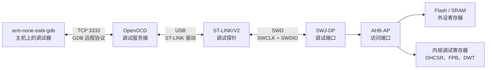

# 1.7 SWD、JTAG 与片上调试

在微控制器的开发过程中，每一位工程师都会频繁遭遇这样的静默绝境：新编写的代码顺利通过了编译，通过串口 ISP 成功灌入了物理 Flash，然而复位之后板载指示灯毫无动静，连接电脑的串口助手也收不到哪怕半个字节的字符输出。此时，由于系统完全处于无声假死状态，如果仅仅重复执行烧录擦除，除了徒增挫败感外毫无裨益——传统的固件烧录通道是一条单向的传送带，它只能将机器码灌入存储器，至于程序脱扣复位后究竟卡死在时钟树配置的死循环中，还是因为指针异常触发了未定义指令 HardFault，外部开发者从宏观物理层面全然无从窥视。

要想打破这一黑盒僵局，唯一的科学手段是借助物理调试探针，在芯片硅片内部的总线层面上强行切入控制流。通过向芯片内置的专用硬件调试模块发送微秒级指令，调试工具能够随心所欲地冻结 CPU 的指令流水线、读取核内通用寄存器的实时快照、探测物理内存与外设控制器的瞬态数值，并在关键数据被非法篡改的瞬间实施拦截。本节围绕工业界成熟的 ST-LINK/V2 调试探针以及 OpenOCD、GDB 开源调试生态，全方位拆解片上调试的底层信号流转、硬件比较器资源分配、内存越界捕获机制与灾难救援方案。

## 1. 为什么需要片上调试

在桌面软件开发中，当程序遭遇严重错误时，操作系统会弹出崩溃提示框、吐出包含完整调用栈的 Core Dump 文件，或者将异常日志清晰地打印在标准错误终端上。然而在微控制器构成的裸金属环境中，当硬件出现故障时，物理世界留给开发者的通常只有一句冰冷的事实：**设备彻底失去了反应**。

面对这台失去生命体征的硬件实体，工程上可用的现场排障手段被清晰地划分为三个层级：

1. **串口字符日志 (`printf`)**：这是最符合人类直觉的调试习惯。然而它建立在极脆弱的前提之上：系统时钟树必须已正确起振并完成锁相环倍频、串口引脚复用已妥善就绪、波特率发生器配置无误，且底层 `_write` 重定向函数运行平稳。一旦系统逻辑在初始化时钟的最初几行汇编就陷入了总线死锁，串口将彻底归于沉寂，无法吐露任何先验线索。
2. **逻辑分析仪与示波器**：通过探钩挂载到物理引脚上，开发者能够以纳秒级的精度捕捉引脚电平的时序跳变与通信协议帧。然而逻辑分析仪的视角是纯外在的：它能忠实告诉你引脚上“没有波形输出”，却无法向你解释“CPU 内部究竟执行了哪一条跳转指令才导致外设未能输出波形”。
3. **片上硬件调试探针 (Debug Probe)**：这是唯一能够横跨软硬件边界、真正打通微观视界的终极利器。借助物理探针，开发者不仅能够在任意时刻强行挂起内核、逐条单步跟踪汇编机器码，还能在不修改源码的前提下在物理内存中架设监视哨所，一旦某个核心控制对象被未知代码意外踩踏篡改，硬件能在执行写操作的同一时钟周期内瞬间将现场定格。

在成熟的工程方法论中，串口日志与片上硬件调试并不是非此即彼的对立关系：串口日志适合在长时间跨度的连续运行中捕捉偶发性业务异常与离散通信时序；而片上调试器则是在特定故障现场定格时空、细细审视处理器微架构瞬态细节的唯一途径。

需要特别指出的是，片上调试能够成立，依赖一个极其关键的物理底层前提：**微控制器内部的调试控制端口在复位后必须处于激活状态，且运行代码没有擅自关闭调试接口引脚或将 CPU 送入断电级低功耗休眠模式**。当固件代码不慎写错寄存器把调试大门从内部反锁时，整颗芯片将陷入俗称的“锁死变砖”状态，我们在本节第 8 节将针对这一极端险境给出专业的工程救援方案。

## 2. JTAG 与 SWD

### 2.1 两套信号协议

要实现由外向内的侵入式调试，芯片设计界演化出了两条标准物理总线通道：

**JTAG (Joint Test Action Group)** 最早诞生于 20 世纪 80 年代，其最初的设计使命并非用于单片机代码调试，而是为了在印刷电路板（PCB）生产线上，通过芯片引脚内部的边界扫描（Boundary Scan）移位寄存器网络，自动化排查焊盘短路与虚焊引脚。由于该规范原生具备访问芯片内部总线的能力，后来被广泛扩展为通用的微处理器调试接口。标准 JTAG 通常需要占用 4 根（若包含硬件复位则为 5 根）专用物理信号线：

| 信号名称 | 信号流向 | 硬件工程职能说明 |
| --- | --- | --- |
| **TCK** (Test Clock) | 调试探针 → 芯片输入 | 调试同步时钟源，由外部仿真器负责提供驱动方波 |
| **TMS** (Test Mode Select) | 调试探针 → 芯片输入 | 测试模式选择线，在每个 TCK 时钟跳变沿控制芯片内部 TAP 状态机的跳转 |
| **TDI** (Test Data In) | 调试探针 → 芯片输入 | 串行测试数据输入线，指令与写入数据以此按位串行移入 |
| **TDO** (Test Data Out) | 芯片输出 → 调试探针 | 串行测试数据输出线，寄存器状态与读取数据以此按位串行移出 |
| **nTRST** (Test Reset) | 调试探针 → 芯片输入 | 可选的异步调试复位控制线，用于独立复位芯片内部的调试逻辑 |

**SWD (Serial Wire Debug)** 则是 Arm 公司专门针对资源与引脚极其宝贵的嵌入式微控制器量身定制的精简型双线调试协议。SWD 坚决摒弃了 JTAG 繁琐的输入输出分离设计，在物理层面上仅需区区两根信号线即可达成全双工的调试交互：

| 信号名称 | 信号流向 | 硬件工程职能说明 |
| --- | --- | --- |
| **SWCLK** (Serial Wire Clock) | 调试探针 → 芯片输入 | 串行时钟同步信号线，由外部调试探针负责提供时钟源 |
| **SWDIO** (Serial Wire Data I/O) | 双向数据复用交互 | 串行双向数据总线，读写指令包与传输数据在半双工时序下共用此单根线路 |

此外，SWD 架构还可选配一根名为 **SWO (Serial Wire Output)** 的单向追踪输出引脚。SWO 独立于双向的 SWDIO 之外，专职用于从微控制器内部的硬件追踪单元高速、单向地向外吐出运行数据与日志流（见本节第 7 节）。SWO 并非建立调试会话的必选管脚，不接此线完全不影响常规的断点、单步与内存读写。

### 2.2 STM32F103 上的引脚复用拓扑

为了兼顾向下兼容与灵活性，STM32F103 芯片内部集成了名为 **SWJ-DP (Serial Wire / JTAG Debug Port)** 的混合调试端口硬件。该模块在物理电路上共用同一组引脚，能够根据上电后总线上的特定握手序列，智能切换为 JTAG 模式或 SWD 模式：

| 物理引脚标称 | 在 JTAG 模式下的职能 | 在 SWD 模式下的职能 | 芯片出厂复位后的初始硬件状态 |
| --- | --- | --- | --- |
| **PA13** | JTMS (测试模式选择) | **SWDIO** (双向数据线) | 硬件强制锁定为调试专用功能 |
| **PA14** | JTCK (测试时钟) | **SWCLK** (调试同步时钟) | 硬件强制锁定为调试专用功能 |
| **PA15** | JTDI (串行数据输入) | *(该模式下闲置未用)* | 硬件强制锁定为调试专用功能 |
| **PB3** | JTDO (串行数据输出) | **TRACESWO** (硬件跟踪单向输出) | 硬件强制锁定为调试专用功能 |
| **PB4** | NJTRST (调试异步复位) | *(该模式下闲置未用)* | 硬件强制锁定为调试专用功能 |

审视这张表格便能发现：在上电复位瞬间，这 5 根引脚全部被片上调试硬件霸占，普通的 GPIO 输入输出配置对它们全数无效。若希望将 PA15、PB3、PB4 回收为通用数字 I/O，必须在前文 [1.3 芯片手册、开发板资料与引脚复用](/教程/正文/嵌入式/1_平台与工具链/1_3_芯片手册_开发板资料与引脚复用) 中介绍的 `AFIO_MAPR` 寄存器中，精准改写 `SWJ_CFG` 字段。

在现代微控制器工程实践中，**SWD 已经成为压倒性的主流选择**。其背后的工程取舍极其现实：微控制器往往采用 48 脚甚至 32 脚的紧凑型封装，动辄占用 5 根引脚的 JTAG 会让外设布线捉襟见肘，而 SWD 仅需占用 PA13 与 PA14 两根线，便能换取与 JTAG 完全等价的单步、断点、寄存器窥探能力；JTAG 真正的核心价值在于多芯片串接的边界扫描与超复杂芯片阵列测试，在独立的单片机固件研发中，SWD 的简洁与稳健展现出了无可比拟的工程优势。

### 2.3 物理接线与共地原则

在连接 ST-LINK/V2 调试探针与目标核心板（如 Blue Pill）时，标准的物理拓扑由四根杜邦线组成：

| ST-LINK 20 芯排针定义 | 开发板端对应管脚 | 核心接线作用与电气规范说明 |
| --- | --- | --- |
| **Pin 1 (VAPP / 3.3V)** | 3.3 V 主供电轨 | 调试器电平基准输入；亦可作为应急供电输出（对外输出电流受限） |
| **Pin 4 / 6 / 8 (GND)** | **GND** | **物理系统共地线，绝不可省略**，确立数字高低电平的零电位基准 |
| **Pin 7 (TMS / SWDIO)** | **PA13 (SWDIO)** | 双向串行数据通道 |
| **Pin 9 (TCK / SWCLK)** | **PA14 (SWCLK)** | 调试方波同步时钟通道 |
| *Pin 15 (nRESET)* | *NRST (硬件复位)* | *可选连接*；仅在执行硬件复位下连接（Connect Under Reset）时必需 |

在动手接线中，初学者极易犯的一个致命疏忽是**遗漏连接 GND 共地线**。许多人误以为只要连了 SWDIO、SWCLK 与 3.3 V 信号就能通信。在某些由同一台电脑 USB 接口为开发板和探针供电的场合，两端恰好通过 PC 主板的地线回路勉强连通，调试器有时能偶然握手成功；然而这种寄生回路的阻抗与噪声极大，一旦稍稍挪动杜邦线的位置或提高时钟速率，通信便会瞬间崩溃。

::: tip 先接 GND 再接信号线

在带电热插拔杜邦线时，务必牢记工程操作守则：**接入时优先连接 GND 地线，再接信号线；拆卸时先断开信号线，最后拔掉 GND**。如果开发板已接通电源，而首先单独插入 SWDIO 数据线，由于两端设备尚未确立统一的地电位，瞬间累积的静电感应或浮地电位差很容易穿透芯片管脚内部脆弱的 ESD 钳位二极管，造成硅片引脚甚至整颗 MCU 的永久击穿。

:::

## 3. 从 GDB 到内核

当我们在宿主机 GDB 交互界面中输入 `continue` 或 `step` 时，从键盘击键到目标物理芯片流水线恢复执行，中间其实经历了一场严密的跨层级通信接力：



链路中各个节点的职责边界清晰且高度解耦：
1. **GDB 调试器前端**：运行在宿主机终端，理解 C 语言语法、局部作用域与 ELF 符号表。它知道某一行 C 源码对应哪一段机器指令地址，单步执行时该在哪个目标地址打下断点；
2. **OpenOCD 调试服务端**：扮演协议翻译官的角色。它监听本机的 TCP 3333 端口，将来自 GDB 的抽象控制原语（如“设置内存断点”、“读取寄存器”）转化为对特定探针芯片的 USB 指令集；
3. **ST-LINK/V2 硬件探针**：充当物理协议转换桥梁。探针板载单片机接收来自 USB 的数据包，将其即时转换为符合 SWD 电气规范的 `SWCLK` 时钟方波与 `SWDIO` 双向电平信号；
4. **芯片内部 SWJ-DP 与访问端口 (AP)**：微控制器接收到引脚上的物理信号后，片内的串行线调试端口（SW-DP）负责解包。解包后的请求进入**总线访问端口 (AHB-AP)**，在此处兵分两路：
   - **直通系统总线矩阵**：直接以总线主设备的身份寻址片内 Flash、SRAM 以及挂载在 APB/AHB 上的所有外设寄存器；
   - **通往内核调试寄存器**：直接操控内核调试停机控制及状态寄存器 (DHCSR)、闪存补丁与断点单元 (FPB) 以及数据观察点与跟踪单元 (DWT)。

这种架构划分带来了两种截然不同的调试能力：
- **后台透明总线访问**：调试器经由 AHB-AP 读取某段物理 SRAM 或 Flash 内存时，全然**不需要挂起 CPU 内核**。此时 CPU 依然在高速执行既有代码，调试器直接在总线矩阵空闲周期抽取数据，读取到的是该物理地址在该微秒瞬间的真实数值；
- **侵入式暂停与流水线控制**：当需要设置断点或单步执行时，调试器必须向内核调试寄存器发起写操作：向 `DHCSR` 写入控制字强行置位 `C_DEBUGEN` 与 `C_HALT`，迫使 CPU 内核在当前正在执行的指令完成后立即冻结流水线；执行单步操作则是置位 `C_STEP` 后放行流水线前进一步，CPU 仅解码执行单条机器指令便被硬件再次拉入停机状态。

在 Cortex-M3 中，断点与数据观察点全数依赖硬件比较器支撑。由于 Flash 属于只读非易失介质，无法像在 RAM 中调试那样动态修改机器码为软件陷入陷阱指令（`BKPT`），芯片内核集成了两组专用的硬件监控单元：
- **FPB (Flash Patch and Breakpoint)**：包含 6 个代码指令比较器，专门监控取指地址，一旦 CPU 试图从指定物理地址读取指令便立即触发硬件断点挂起；
- **DWT (Data Watchpoint and Trace)**：提供 4 个硬件数据观察点比较器，可精细配置为监控某个 SRAM 地址的读操作、写操作或数值匹配，在内存被改写的微秒瞬间直接迫使内核暂停。

值得高度警惕的是，由于调试器通过 AHB-AP 直面芯片总线，**经由调试器窥探某些特定外设寄存器时，可能会静默触发与正常代码执行完全等价的硬件副作用**。

最经典的教训莫过于查验通用异步收发器（USART）：当串口接收到新数据时，硬件将接收缓冲区非空标志 RXNE 置位；许多开发者在程序断点停下时，顺手在 GDB 中敲下 `x/1wx 0x40013804` 查看串口数据寄存器（USART_DR）。然而在芯片硬件逻辑中，**对 USART_DR 执行的任意总线读操作，都会被硬件判定为“数据已被读取”，从而自动将 RXNE 状态标志清零**！这导致当随后恢复运行、处理中断服务程序时，中断处理函数读到的 RXNE 已经为 0，原本合法到达的通信字节就这样在调试器窥探下被凭空丢弃。在工程现场，这类“一挂上仿真器通信就偶发丢包，拔掉调试探针系统反而运转正常”的诡异故障，其根源往往正是调试器读取寄存器诱发的硬件副作用。

::: concept emb-debug-hardware-comparators title="断点与观察点由硬件比较器实现"

Cortex-M3 的 FPB 有 6 个指令比较器用于代码断点，DWT 有 4 个比较器用于数据观察点。两者都是固定的硬件资源，数量不随 Flash 大小或调试器而变，超出时只能删掉已有的断点或改用条件断点。

:::

::: concept emb-debug-bus-access title="调试器经总线直接访问存储器和外设"

调试器通过 AHB-AP 直接读写目标芯片的地址空间，不经过 CPU 执行指令。读 SRAM 或 Flash 不会改变程序状态；读外设寄存器则可能触发硬件副作用，例如读 USART_DR 会清掉 RXNE 标志、读某些状态寄存器会清中断挂起位。在 GDB 里查看外设时，读到的是访问之后的值。

:::

## 4. 用 OpenOCD 和 GDB 调试一个程序

### 4.1 示例工程剖析

为了纯粹且严谨地展现片上调试机制，我们在配套仓库中提供了 `code/嵌入式/1_平台与工具链/1_7_SWD_JTAG与片上调试/debug_demo/` 示例工程。该代码刻意仅使用内核运算与片内 SRAM，完全不初始化任何硬件外设引脚，因此不受具体板级走线的制约，具备极高的跨平台通用性。启动汇编与链接脚本均复用 `code/嵌入式/common/` 目录下的基准模版（其原理详见 [1.8 复位、启动与链接](/教程/正文/嵌入式/1_平台与工具链/1_8_复位_启动与链接)）：

```c
volatile uint32_t g_mode = 1;
int32_t g_samples[4] = {10, 20, 30, 40};
volatile uint32_t g_tick_count = 0;
volatile int32_t g_last_sum = 0;

__attribute__((noinline)) int32_t sum_array(const int32_t *arr, uint32_t len) {
    int32_t total = 0;
    for (uint32_t i = 0; i < len; ++i) {
        total += arr[i];
    }
    return total;
}

__attribute__((noinline)) void record_sample(uint32_t step, int32_t val) {
    uint32_t idx = step % 5u;
    int32_t *p = g_samples + idx;
    *p = val;
}

int main(void) {
    for (;;) {
        ++g_tick_count;
        record_sample(g_tick_count, (int32_t)(g_tick_count * 10u));
        if (g_mode == 1u) {
            g_last_sum = sum_array(g_samples, 4);
        } else {
            g_last_sum = -1;
        }
    }
}
```

仔细审查上述代码中的潜在隐患：数组对象 `g_samples` 的定义长度明明只有 4 个元素（合法下标为 0～3），然而记录函数 `record_sample` 内部却使用了 `step % 5u` 这一算式。当 `step` 为 4 时，算出的 `idx` 将达到 4，指针 `p` 将直接跨越数组边界，指向紧随其后的物理内存单元并强行写入 `val`。

在真实的工业固件中，这类轻微的偏离极其普遍：越界写入的跨度往往只有一两个字节，写入的数值也并未超出常规范围，这导致程序绝不会像在桌面系统那样立刻抛出段错误（Segmentation Fault）而终止。程序表面上依然在欢快循环，然而紧邻其后的核心配置对象却在特定时刻被静默篡改。我们将在本节通过硬件观察点（Watchpoint）将其人赃俱获。

### 4.2 交叉编译与构建

工程目录包含专用的构建脚本与源码：

```text
debug_demo/
├── CMakeLists.txt
└── main.c
```

`CMakeLists.txt` 结构极致精炼，直接引入通用微控制器构建组件：

```cmake
cmake_minimum_required(VERSION 3.20)
project(debug_demo C)

include("${CMAKE_CURRENT_LIST_DIR}/../../../common/firmware.cmake")

stm32f103_firmware(debug_demo main.c)
```

在终端中调用 CMake 并指定预设的交叉编译工具链配置：

::: terminal title="bash - 构建 debug_demo"

```text
$ cd code/嵌入式/1_平台与工具链/1_7_SWD_JTAG与片上调试/debug_demo
$ cmake -B build -G Ninja -DCMAKE_TOOLCHAIN_FILE=../../../common/arm-none-eabi.cmake
-- The C compiler identification is GNU 13.3.1
-- Detecting C compiler ABI info - done
-- Check for working C compiler: …/arm-none-eabi-gcc.exe - skipped
-- Configuring done (0.6s)
-- Generating done (0.0s)
$ cmake --build build
[1/3] Building C object emb_common/CMakeFiles/stm32f103_startup.dir/startup_stm32f103.c.obj
[2/3] Building C object CMakeFiles/debug_demo.dir/main.c.obj
[3/3] Linking C executable debug_demo.elf
   text	   data	    bss	    dec	    hex	filename
    500	     20	   1548	   2068	    814	debug_demo.elf
```

:::

构建生成的产物中，`debug_demo.bin` 是纯粹剥离了头信息的二进制物理镜像，而 `debug_demo.elf` 内部则妥善打包了所有的 DWARF 调试符号、全局对象符号表与源文件行号映射。在线交互调试必须使用包含完整元数据的 `.elf` 文件。

`arm-none-eabi-gcc` 不在全局 `PATH` 路径时，可在 CMake 配置阶段显式传入 `-DARM_TOOLCHAIN_DIR=<工具链的 bin 目录>`。

### 4.3 启动 OpenOCD 服务端

OpenOCD 在启动时需指明两份配置文件：一份指定物理调试探针驱动（ST-LINK），另一份指定目标芯片的片上总线拓扑（STM32F1x）：

::: terminal title="bash - 启动 OpenOCD"

```console
$ openocd -f interface/stlink.cfg -f target/stm32f1x.cfg
```

:::

探针连接正常时，终端将滚动输出底层的硬件识别流：

```text
Info : Listening on port 6666 for tcl connections
Info : Listening on port 4444 for telnet connections
Info : clock speed 1000 kHz
Info : STLINK V2 JTAG v37 API v2 SWIM v7 VID 0483 PID 3748
Info : using stlink api v2
Info : Target voltage: 3.241584 V
Info : [stm32f1x.cpu] Cortex-M3 r2p0 processor detected
Info : [stm32f1x.cpu] target has 6 breakpoints, 4 watchpoints
Info : starting gdb server for stm32f1x.cpu on 3333
Info : Listening on port 3333 for gdb connections
```

在这张输出清单中，有几项关键指标直接印证了底层硬件机理：
- `Target voltage: 3.24 V`：探针已成功测得开发板供电轨处于正常工作电压；
- `Cortex-M3 r2p0 detected`：成功跨越 SWD 双线握手并读回了 CPUID 核心标识符；
- **`target has 6 breakpoints, 4 watchpoints`**：明确告知使用者，当前硅片内核内部物理集成了 **6 个硬件断点比较器**与 **4 个硬件数据观察点比较器**；
- `Listening on port 3333`：本地 GDB 远程调试监听端口已就绪。

保持该终端窗口持续运行，另外开启一个独立的终端会话启动 GDB。

### 4.4 GDB 交互会话与固件烧录

启动交叉调试工具并载入带有调试信息的 ELF 文件：

::: terminal title="bash - 连接并下载"

```console
$ arm-none-eabi-gdb debug_demo.elf
(gdb) target extended-remote :3333
(gdb) monitor reset halt
(gdb) load
(gdb) break main
(gdb) continue
```

:::

这五行经典指令展现了嵌入式调试的标准工作范式：
1. `target extended-remote :3333`：建立宿主机 GDB 与本地 OpenOCD 服务端之间的远程调试套接字通道；
2. `monitor reset halt`：`monitor` 前缀指示 GDB 将后续指令直接透传给 OpenOCD。OpenOCD 向芯片发送硬件复位指令，并在第一条指令取指前强制让 CPU 流水线挂起停机；
3. `load`：GDB 读取 ELF 镜像中的可加载段，通过 OpenOCD 驱动探针将代码与只读数据精确烧写入芯片物理 Flash，并将全局对象的初始镜像搬入相应区域；
4. `break main`：指示内核的 FPB 硬件单元在 `main` 函数起始物理地址架设硬件断点；
5. `continue`：释放内核停机锁，CPU 以标称时钟全速运转，直到遭遇断点自动挂起。

在硬件复位停机状态下，若通过 `info registers sp pc` 审视初始寄存器，可以看到主栈指针 `sp` 准确落于 `0x20005000`（RAM 顶端），而程序计数器 `pc` 停在 `Reset_Handler` 的复位入口地址。

当代码命中止步于 `main` 函数首行时，单步追踪与状态观察的常用指令如下：

::: terminal title="bash - 单步与查看"

```console
(gdb) next
(gdb) step
(gdb) finish
(gdb) info registers r0 r1 r2 r3
(gdb) print g_tick_count
(gdb) print/x g_mode
(gdb) x/4wx &g_samples
(gdb) bt
(gdb) monitor reset run
```

:::

- `next`：逐行推进 C 源码，若当前行包含子函数调用则直接越过执行；
- `step`：单步深入子函数内部；
- `finish`：连续运行直到当前函数返回并停下；
- `print`：按对象在源码中的类型格式化输出内存数值（`print/x` 则以十六进制呈现）；
- `x/4wx`：以 4 字节为单位直接读取连续 4 个内存字；
- `bt` (Backtrace)：打印当前深度的函数调用栈帧；
- `monitor reset run`：让微控制器执行全局复位并全速脱机运行。

`next` 越过一行（遇到函数调用不进去），`step` 进入函数，`finish` 执行到当前函数返回。`print` 按对象类型输出，`print/x` 用十六进制，`x/4wx` 按 4 字节十六进制看内存。`bt` 打印调用栈，在中断服务程序里也能用——Cortex-M3 的异常压栈让 GDB 能顺着栈回溯到被打断的代码。最后一条 `monitor reset run` 让芯片复位并全速运行，等于按了一次复位键。

### 4.5 不经过 GDB 直接烧录

只想把程序烧进去时，不必开 GDB。OpenOCD 支持一次性执行完就退出：

::: terminal title="bash - 一条命令完成下载与校验"

```console
$ openocd -f interface/stlink.cfg -f target/stm32f1x.cfg \
    -c "program debug_demo.elf verify reset exit"
```

:::

`program` 依次完成擦除、写入、读回校验，`reset` 复位芯片，`exit` 关闭 OpenOCD。这条命令适合放进构建脚本或持续集成，失败时返回非零退出码。

### 4.6 telnet 命令行

不用 GDB 也能看一点东西。OpenOCD 的 4444 端口提供一个精简的命令行：

::: terminal title="bash - telnet 4444"

```console
$ telnet localhost 4444
> halt
> mdw 0x20000000 4
> reg
> resume
```

:::

`halt` 暂停内核，`mdw` 按字读内存（上面读的是 `g_samples` 开头 4 个字），`reg` 列出通用寄存器，`resume` 继续执行。输出格式随 OpenOCD 版本变化，但内容就是这几样。排查「GDB 连不上但探针认得出芯片」时，先开 telnet 试 `halt`，能停下就说明连接是通的，问题在 GDB 一侧。

### 4.7 其他工具

ST 官方提供 STM32CubeProgrammer，命令行版本叫 `STM32_Programmer_CLI`，功能与 `openocd -c "program ..."` 重叠，支持 ST-LINK、UART、USB DFU 几种连接方式，也能读写选项字节。它的图形界面适合不习惯命令行的场合，脚本里也能调用。

pyOCD 是另一套开源实现，用 Python 写，支持 DAPLink 与 ST-LINK；probe-rs 用 Rust 写，主打与 `cargo` 集成。三者做的事一样：把 GDB 或自己的协议翻译成 SWD 时序。本教程只用 OpenOCD，因为它在 Windows、Linux、macOS 上表现一致，配置文件也最透明。

::: generate emb-debug-gdb-session kind=explanation concepts=emb-debug-bus-access

面向第一次用 GDB 调固件的读者，把上面那一节会话里的每条命令按顺序走一遍：`target extended-remote` 建立了什么连接、`monitor` 前缀为什么要转发给 OpenOCD、`reset halt` 与 `load` 的先后顺序为什么不能反、`break` 设下的断点落在 FPB 的哪个比较器里、`continue` 之后 CPU 是怎样从暂停状态恢复的。用「谁在做事」区分 GDB、OpenOCD、ST-LINK 与内核各自的职责，不要总结成命令清单。

:::

## 5. 断点与观察点

### 5.1 数量限制

主机上调试程序时，断点可以设几十个，因为调试器把目标指令的第一个字节改成一条陷阱指令。目标换成单片机的 Flash 就不行了：Flash 不能按字节改写，改一个字节要先擦掉一整页。于是 Cortex-M3 提供了 FPB 单元，用比较器在取指阶段比对地址，命中就向内核发断点请求。

比较器是硬件，数量固定。RM0008 第 31.12 节写得很清楚：FPB 有 2 个字面量比较器和 6 个指令比较器，后者的用途是「匹配从代码区取指，然后重映射到系统区或产生断点指令」。DWT 有 4 个比较器，可配置成硬件观察点、ETM 触发、PC 采样器或数据地址采样器（第 31.13 节）。OpenOCD 启动时打印的 `6 breakpoints, 4 watchpoints` 就是从这里来的。

GDB 并不知道这些限制，除非有人告诉它：

::: terminal title="bash - 设好上限"

```console
(gdb) set remote hardware-breakpoint-limit 6
(gdb) set remote hardware-watchpoint-limit 4
```

:::

连上 OpenOCD 之后，这两个值通常会被自动协商，但写进 `.gdbinit` 更省事。超过上限时 GDB 会报类似 `Cannot insert hardware breakpoint 7` 的错误，意思很直接：硬件没有第 7 个比较器，删掉一个或改用条件断点。

条件断点（`break main.c:34 if g_tick_count > 1000`）不额外占用比较器：它仍然只占一个比较器，每次命中后由 GDB 读对象判断条件，不满足就自动继续。命中频繁时这会明显拖慢程序，因为每命中一次都要停下来、通信、判断、再放行。

<Quiz
  type="single"
  :options="[
    { label: 'watch 会修改 g_mode 的值来检测写入', value: 'A' },
    { label: 'DWT 比较器匹配地址，命中后让内核暂停', value: 'B' },
    { label: 'GDB 会周期性轮询 g_mode，发现变化就中断', value: 'C' },
    { label: '只有串口打印才能发现这类改写', value: 'D' }
  ]"
  answer="B"
>

<template #question>

`watch g_mode` 为什么能在 `g_mode` 被写入时立刻停住？

</template>

正确答案是 **B**。观察点由 DWT 的比较器实现：CPU 每执行一条访存指令，比较器就把地址与设定的值比对，命中即请求内核暂停，整个过程不占用指令周期以外的执行时间，也不需要 GDB 轮询。A 与 C 都会改变被观察对象或依赖通信周期，前者破坏程序，后者漏掉短暂的写入。

</Quiz>

::: tip 把常用设置写进 .gdbinit

在工程目录下放一个 `.gdbinit`，写入 `set remote hardware-breakpoint-limit 6`、`set remote hardware-watchpoint-limit 4`、`set pagination off` 和常用的 `target extended-remote :3333`，GDB 启动时自动执行。GDB 默认只在信任的目录里读这个文件，不在信任列表里时会提示，按提示在 `~/.gdbinit` 里加 `add-auto-load-safe-path` 即可。

:::

### 5.2 用观察点抓越界写

回到 `debug_demo`。`main` 的循环里，`record_sample` 每 5 次把 `idx` 算成 4，越过 `g_samples` 的末尾。`nm` 给出的地址说明了后果：

::: terminal title="bash - 全局对象在 RAM 里的位置"

```text
$ arm-none-eabi-nm -n debug_demo.elf | grep -E "g_samples|g_mode|g_last_sum|g_tick_count"
20000000 D g_samples
20000010 D g_mode
20000014 B g_last_sum
20000018 B g_tick_count
```

:::

`g_samples` 占 16 字节，从 0x2000_0000 到 0x2000_000F；紧跟着 0x2000_0010 就是 `g_mode`。`idx` 等于 4 时，`&g_samples[4]` 正好是 `g_mode` 的地址，写入的值覆盖了它。`g_mode` 从 1 变成别的数，`main` 里 `if (g_mode == 1u)` 的判断随之走另一条分支，`g_last_sum` 变成 −1。具体的地址随工具链版本和链接顺序可能不同，但同一份构建里两者的相邻关系来自源码中定义的先后顺序，`nm` 的这张表就是最直接的证据。

现象是某个全局对象偶尔莫名其妙地变了值。看代码看不出问题——读写 `g_samples` 的地方全都在下标范围内，越界发生在取模的那个 `5u` 上。这种时候观察点比断点有效：不需要知道是哪一行，只需要知道「谁写了这个地址」。

::: terminal title="bash - 在 GDB 里设观察点"

```console
(gdb) monitor reset halt
(gdb) load
(gdb) watch g_mode
(gdb) continue
```

:::

`watch` 监视的是值：`g_mode` 被写入且值发生变化时，程序立刻停下。GDB 会先后打印观察点的编号、旧值、新值，以及停下来的位置，形如 `record_sample (step=…, val=…) at main.c:28`，指向 `*p = val;` 这一行。`bt` 显示调用链 `record_sample` ← `main`。开了 `-O2` 之后部分局部对象可能已经被优化掉，`print p` 会提示没有这个符号；这时退回去看反汇编，或者用 `info registers` 看基址寄存器里的值。

这里要看清的是：`record_sample` 的源码里没有一处明显的错误，`idx = step % 5u` 本身也合法，只有把 `idx` 与数组长度放在一起看，才知道 4 越界。观察点不受这种「看上去没问题」的迷惑，它只在内存真的被改写时停下来。

观察点也可以用地址设置，`watch *(int32_t *)0x20000010` 与 `watch g_mode` 等价，在符号不可用时（比如只有 `.bin` 没有 `.elf`）只能这么写。

停下之后，如果想知道这个地址是被哪条指令写的，把 GDB 给出的 PC 交给 `addr2line`：

::: terminal title="bash - 从地址回到源代码行"

```text
$ arm-none-eabi-addr2line -e debug_demo.elf -f 0x0800016c
record_sample
…/code/嵌入式/1_平台与工具链/1_7_SWD_JTAG与片上调试/debug_demo/main.c:28
```

:::

0x0800_016c 是 `record_sample` 里那条 `str.w r1, [r4, r0, lsl #2]` 的地址，正好对应 `*p = val;`。这条对应关系来自编译时加的 `-g`：调试信息把每条指令的地址映射回源文件与行号，`firmware.cmake` 里的统一选项已经带上它。反过来，`info line` 可以查某个函数或某一行落在哪个地址：

::: terminal title="bash - 查函数地址"

```text
$ arm-none-eabi-gdb -batch -ex "info line main" -ex "info line record_sample" debug_demo.elf
Line 31 of "…/debug_demo/main.c" starts at address 0x800017c <main> and ends at 0x800017e <main+2>.
Line 26 of "…/debug_demo/main.c" starts at address 0x8000158 <record_sample> and ends at 0x800015a <record_sample+2>.
```

:::

这两条命令不需要连目标，读的是 `.elf` 里的调试信息，所以在没有硬件时也能用来核对地址。

<Quiz
  type="single"
  :options="[
    { label: '6 个，受 FPB 指令比较器数量限制', value: 'A' },
    { label: '4 个，受 DWT 比较器数量限制', value: 'B' },
    { label: '不限，GDB 会把断点指令写进 Flash', value: 'C' },
    { label: '取决于芯片的 Flash 容量', value: 'D' }
  ]"
  answer="A"
>

<template #question>

在 STM32F103（Cortex-M3）上同时能设几个硬件断点？

</template>

正确答案是 **A**。FPB 提供 6 个指令比较器用于代码断点，DWT 的 4 个比较器用于数据观察点，两者各管一类。选项 C 错在 Flash 不能按字节改写，断点无法用写入陷阱指令的方式实现。

</Quiz>

## 6. 查看外设寄存器

调试器能读整块地址空间，外设寄存器自然也能读。GPIOC 的一组寄存器从 0x4001_1000 开始，按 RM0008 的顺序依次是 CRL、CRH、IDR、ODR、BSRR、BRR、LCKR，前六个都是 32 位（BRR 只有低 16 位有效），LCKR 的偏移在 0x18：

::: terminal title="bash - 直接读 GPIOC 的寄存器组"

```console
(gdb) x/7wx 0x40011000
```

:::

按字读出的 7 个值依次对应 CRL、CRH、IDR、ODR、BSRR、BRR、LCKR，每个寄存器的偏移与复位值都在 RM0008 的 GPIO 寄存器一节里。`debug_demo` 不配置任何外设，也没开 GPIOC 的时钟，CRL 与 CRH 就读出复位状态 `0x4444_4444`——16 个引脚全是浮空输入。换成 [2.4 GPIO](/教程/正文/嵌入式/2_MCU裸机开发/2_4_GPIO) 里把 PC13 配成推挽输出、再拉低的程序，CRH 会变成 `0x4424_4444`：第 23:20 位是 `0010`，MODE13 = 10 表示输出、最大 2 MHz，CNF13 = 00 表示通用推挽；再看 ODR 的 bit 13 是 0，PC13 输出低电平。这两个数放在一起，就是「板载 LED 亮着」在寄存器层面的全部含义。

用数字地址读寄存器需要先查手册，容易记错偏移。第 2 章起代码里会包含 ST 的设备头文件，那时可以直接按名字读：

```console
(gdb) print/x *GPIOC
(gdb) print/x GPIOC->ODR
(gdb) print/x GPIOC->CRH
```

`print/x *GPIOC` 把整个结构体按十六进制打印出来，成员名与手册一致。它依赖 `.elf` 里有 `GPIOC` 这个符号的调试信息，也就是编译时包含了设备头文件并且没有把它优化掉。

IDE 里还有更省事的办法。CMSIS-SVD 是一份 XML 文件，描述某颗芯片所有外设寄存器的地址、位域与访问类型。VS Code 的 Cortex-Debug 插件、CLion 的外设视图都读 SVD，把寄存器按名字列出来，可以直接勾选位、直接改值。ST 的 SVD 文件随 CubeMX 或 `cmsis_device_f1` 一起发布，文件名形如 `STM32F103.svd`。

## 7. 调试输出：半主机与 SWO

### 7.1 半主机

[1.2 MCU、MPU、SoC 与执行环境](/教程/正文/嵌入式/1_平台与工具链/1_2_MCU_MPU_SoC与执行环境) 里那个 `printf` 程序在芯片上没有输出，因为 `_write` 没有把字符送到任何地方。半主机 (semihosting) 提供了一条现成的路：目标程序执行一条特殊的 `BKPT` 指令，调试器截获它，按约定从目标的寄存器或内存里取出参数，代替目标完成打开文件、写字符这些操作。字符最终出现在 OpenOCD 的控制台上，不占用任何引脚。

启用需要三件事：链接时用 `--specs=rdimon.specs` 选带半主机支持的 C 库，程序开头调用 `initialise_monitor_handles()` 建立标准输入输出的句柄，OpenOCD 一侧打开半主机。拿 [1.2 MCU、MPU、SoC 与执行环境](/教程/正文/嵌入式/1_平台与工具链/1_2_MCU_MPU_SoC与执行环境) 里那个 `hello.c` 换一套链接选项，就能看出 rdimon 的代价：

::: terminal title="bash - 同一个 hello.c 的两种链接方式"

```text
$ arm-none-eabi-gcc -mcpu=cortex-m3 -mthumb -O2 hello.c     --specs=nano.specs --specs=nosys.specs -o hello_nosys.elf
$ arm-none-eabi-gcc -mcpu=cortex-m3 -mthumb -O2 hello.c     --specs=rdimon.specs --specs=nano.specs -o hello_semihost.elf
$ arm-none-eabi-size hello_nosys.elf hello_semihost.elf
   text	   data	    bss	    dec	    hex	filename
   5824	    108	    432	   6364	   18dc	hello_nosys.elf
   7704	    400	    604	   8708	   2204	hello_semihost.elf
```

:::

同一份程序，换成 rdimon 之后 `text` 多了 1880 字节，`data` 与 `bss` 也各涨了一截：半主机库把打开文件、读目录、取时间这些操作都实现了，哪怕程序只调用 `printf`，它们的代码也都在库里跟着进来。GDB 一侧的用法是在连接之后打开半主机支持，再让程序跑起来：

```console
(gdb) monitor arm semihosting enable
(gdb) continue
```

目标执行到半主机调用时会停下来等调试器处理，调试器处理完再放行。如果没有连接调试器，同一条 `BKPT` 指令没有接收者，CPU 会把它当成一条无法处理的指令，进入 HardFault。

::: warning 半主机程序离开调试器就跑不了

启用半主机的程序，一旦执行到 `BKPT` 而没有调试器接管，就会进入 HardFault。发布版本必须去掉 `rdimon.specs`，改成经串口或 SWO 输出。

:::

### 7.2 SWO 与 ITM

半主机要求调试器与目标保持会话，字符走调试通道。另一条路是从芯片单独引出一根线，把日志单向送出去，这就是 SWO。F103 上这根线复用 PB3 的 `TRACESWO` 功能。

数据从 ITM (Instrumentation Trace Macrocell) 发出。CMSIS 提供了一行写字符的函数 `ITM_SendChar`，它的实现很朴素：检查 ITM 是否使能、0 号端口是否打开，然后往端口寄存器里写一个字节。程序侧只需要先打开跟踪：

```c
#include "stm32f1xx.h"

static void trace_init(void) {
    CoreDebug->DEMCR |= CoreDebug_DEMCR_TRCENA_Msk;
    ITM->LAR = 0xC5ACCE55u;
    ITM->TCR = ITM_TCR_ITMENA_Msk;
    ITM->TER = 0x1u;
}

static void trace_puts(const char *s) {
    while (*s != '\0') {
        ITM_SendChar((uint32_t)*s);
        ++s;
    }
}
```

`DEMCR` 的 TRCENA 位是跟踪单元的总开关；LAR 是 ITM 的锁访问寄存器，写入解锁键值；TCR 打开 ITM 本身；TER 打开 0 号端口。把 `trace_init`、`trace_puts` 和一个只调用它们的 `main` 配上 `common/` 的启动文件与链接脚本编成固件，`arm-none-eabi-size` 给出的 `text` 是 496 字节，`bss` 1536 字节（其中大部分是栈的预留）。半主机版本光是库就有 7704 字节 `text`，两者不在一个数量级。

主机一侧要配置 TPIU，把 ITM 的数据从 SWO 引脚按异步串行格式送出来。OpenOCD 用 `tpiu config` 指定输出的去向、协议与位时钟，用 `itm ports on` 打开 ITM 的端口。位时钟取内核时钟：复位后是 HSI 的 8 MHz，[2.3 时钟与复位](/教程/正文/嵌入式/2_MCU裸机开发/2_3_时钟与复位) 把 SYSCLK 提到 72 MHz 之后，这里也要跟着改成 72 MHz，否则主机收到的字节全是错位的。这两条命令的参数顺序随 OpenOCD 版本有过调整，写进自己的 `openocd.cfg` 之前照当前版本的官方手册核对一遍。

作者的建议是：常规日志走串口（[2.7 UART](/教程/正文/嵌入式/2_MCU裸机开发/2_7_UART)），SWO 留给串口被占用、或者日志量大到串口带宽不够的场合。SWO 的优点是只占一根线、不打断程序；缺点是配置依赖调试器与 OpenOCD 版本，换一台机器可能要重新调。

::: tip 调试看门狗程序时先停住看门狗

程序里开了独立看门狗时，CPU 停在断点上的时间里看门狗照常计数，超时就复位，调试根本进行不下去。把 DBGMCU_CR（0xE004_2004）的 `DBG_IWDG_STOP` 位置 1，内核暂停时看门狗也暂停。窗口看门狗对应 `DBG_WWDG_STOP`。2.10 节会用到这一条。

:::

## 8. 连不上调试器时

OpenOCD 在启动时就报错，或者能连上但一 `halt` 就失败，常见原因有三个。

**SWD 引脚被改作他用，或 SWJ_CFG 被写成了 100。** [1.3 芯片手册、开发板资料与引脚复用](/教程/正文/嵌入式/1_平台与工具链/1_3_芯片手册_开发板资料与引脚复用) 讲过，写 100 会同时关闭 JTAG 与 SWD。此时芯片照常运行固件，只是调试端口不再响应。

**程序进入了 Stop 或 Standby 模式。** 这两种低功耗模式会停掉调试接口的时钟，调试器发过去的请求没有响应。唤醒之后能恢复，但自动连接的过程往往等不到唤醒。

**芯片处于读保护状态。** 读保护会禁止调试器读取 Flash 内容，连接时报 `target not examined` 一类错误。

针对前两种原因，有两条恢复路径，彼此独立，任选一条即可。

第一条是让 OpenOCD 在复位的状态下连接。接上 NRST 线，然后在配置里加一行：

```text
reset_config srst_only srst_nogate connect_assert_srst
```

它的意思是用硬件复位线（`srst_only`）、复位期间不屏蔽其他复位源（`srst_nogate`）、在连接之前先拉住复位（`connect_assert_srst`）。这样调试器连接时芯片一直处于复位状态，引脚回到默认功能，调试端口必然可用；连上之后再释放复位。

第二条不需要复位线：把 BOOT0 拨到 1，从系统存储器启动。芯片上电后执行 ST 出厂固化的自举程序，Flash 里的固件没有被执行，调试端口自然没有被改过。这时用 OpenOCD 连上去，把 Flash 擦掉或重新烧一份正确的固件，再把 BOOT0 拨回 0。BOOT 引脚的组合见 [1.6 构建、烧录与调试](/教程/正文/嵌入式/1_平台与工具链/1_6_构建_烧录与调试) 的表。

两种方法的共同点是绕开「已经跑起来的固件」。固件把调试口关掉之后，从软件内部没有办法再打开它，只能从复位状态或自举程序介入。读保护属于第三类，需要先解除读保护再连，选项字节的操作见 [6.7 安全启动、映像校验与密钥](/教程/正文/嵌入式/6_质量_安全与交付/6_7_安全启动_映像校验与密钥)。

## 9. 习题

### 9.1 巩固

<Exercise id="60136" :d="1" :w="1">

不接硬件，只用 `.elf` 里的信息回答：

(1) `code/嵌入式/1_平台与工具链/1_7_SWD_JTAG与片上调试/debug_demo/` 里构建出的 `debug_demo.elf`，其 `.bin` 的头 8 个字节是什么？分别对应哪两个符号？

(2) 用 `arm-none-eabi-gdb -batch -ex "info symbol 0x0800016c" debug_demo.elf` 查这个地址落在哪个函数、偏移多少。这个地址在 5.2 节里对应 `main.c` 的哪一行？

(3) 用 `info line main` 与 `info line record_sample` 查出两个函数各自的起始地址。

(4) 用 `x/4wx &g_samples` 打印数组内容，再用 `print *g_samples@4` 打印一次。两条命令的输出形式有何不同？

(5) 本页 4.4 节说 `monitor reset halt` 之后 `pc` 应为 `0x080000f0`，而向量表第 2 个字是 `0x080000f1`。为什么两者差 1？

</Exercise>

<Exercise id="60137" :d="2" :w="2">

本页 2.2 节的引脚表与 1.3 节的 SWJ_CFG 表要合起来看才能回答。

(1) 把 PA13、PA14、PA15、PB3、PB4 五个脚复位后的功能，与 SWJ_CFG 取 `000`、`010`、`100` 时各脚是否被释放，整理成一张 5 行 4 列的表。

(2) 想让 PB3 与 PB4 作普通 GPIO，同时保留 SWD 调试能力，SWJ_CFG 应写什么？写完之后 PA15 能不能用？

(3) 如果 SWJ_CFG 已经写成 `100`，用 ST-LINK 还能不能连上？按本页第 8 节，给出两条恢复路径，并说明各自要求硬件上有什么。

(4) 本页 2.3 节的接线表里，ST-LINK 的第 15 脚接 NRST 是可选的。结合第 8 节的 `reset_config srst_only srst_nogate connect_assert_srst`，说明不接这根线时哪一条恢复路径用不了。

</Exercise>

<Exercise id="60138" :d="2" :w="2">

GDB 的命令分两类：一类只读本地 `.elf`，没有目标也能用；一类必须连上调试器。对下面每条命令，先判断它属于哪一类，再对 `debug_demo.elf` 实际执行一次（不接硬件），把结果填进表里：

| 命令 | 需要目标 | 实际输出 |
| --- | --- | --- |
| `info line main` | | |
| `break main` | | |
| `info registers sp pc` | | |
| `print g_mode` | | |
| `watch g_mode` | | |
| `monitor reset halt` | | |
| `x/4wx &g_samples` | | |
| `bt` | | |
| `load` | | |

(1) 哪几条在没有目标时给出错误信息？把错误原文抄下来。

(2) `break main` 在没有目标时也能成功，说明断点记录在哪里？真正写进 FPB 比较器发生在什么时候？

(3) `watch g_mode` 在没有目标时也报告了 `Hardware watchpoint 1`，这与 (2) 是同一回事吗？

(4) `x/4wx &g_samples` 在没有目标时读出了正确的初值 10、20、30、40。它读的是芯片的 SRAM，还是 `.elf` 里的内容？如果换成 `x/4wx 0x40011000`（GPIOC_CRL），结果会怎样？

</Exercise>

<Exercise id="60139" :d="2" :w="2">

本页 7.1 节说半主机的代价是「库代码全跟着进来」。用 `code/嵌入式/1_平台与工具链/1_2_MCU_MPU_SoC与执行环境/hello.c` 亲手确认一遍：

```text
arm-none-eabi-gcc -mcpu=cortex-m3 -mthumb -O2 hello.c --specs=nano.specs --specs=nosys.specs -o hello_nosys.elf
arm-none-eabi-gcc -mcpu=cortex-m3 -mthumb -O2 hello.c --specs=rdimon.specs --specs=nano.specs -o hello_semihost.elf
arm-none-eabi-size hello_nosys.elf hello_semihost.elf
```

(1) 贴出 `size` 的输出，算出两份的 `text` 差多少字节。

(2) 对两份各运行 `arm-none-eabi-objdump -d hello_semihost.elf | grep -c bkpt`，结果分别是多少？为什么不是 1？把这些 `bkpt` 所在的函数列出来（`objdump -d` 里往上找最近的 `<...>:` 行），说明它们与 7.1 节讲的「目标执行一条特殊的 `BKPT` 指令，调试器截获它」是什么关系。

(3) `hello_semihost.elf` 的 `data` 与 `bss` 也比 `nosys` 版大。这两个段里多出来的是什么？

(4) 把 `rdimon` 版烧进板子但不连调试器，程序执行到第一个 `BKPT` 会怎样？为什么？

(5) 用 `arm-none-eabi-nm hello_semihost.elf | grep -E "initialise|_write$|_read$"` 找出半主机版的 `_write`、`_read` 与 `initialise_monitor_handles`。三者分别是什么符号类型（`T`、`W` 还是 `B`）？`W` 表示什么，为什么它与 `nosys` 版的同名函数抢同一个位置？

</Exercise>

### 9.2 编程

<Exercise id="60140" :d="3" :w="3">

本页 5.1 节说条件断点「仍然只占一个比较器，每次命中后由 GDB 读对象判断条件」。这道题把「每次命中的代价」用能在主机上测的方式表达出来。

1. 把 `debug_demo/main.c` 复制一份到 `code/嵌入式/1_平台与工具链/1_7_SWD_JTAG与片上调试/exercises/`，不改逻辑。
2. 在 `main` 的循环里加一个函数 `uint32_t loop_once(void)`，把一次循环的三条语句包进去，返回 `g_tick_count`。
3. 用 DWT 的 `CYCCNT` 测量「连续调用 `loop_once` 一万次」的周期数，除以一万得到一次循环的基价。写出测量函数 `measure_cycles(uint32_t n)`，读 `DWT->CYCCNT` 前后各一次，注意计数器回绕时用无符号减法。
4. 估算条件断点的代价：每命中一次要停内核、经 SWD 把对象值传到主机、判断、再放行。设一次往返约 100 μs，1000 次就是多少秒？把这个数与本页 4.1 节示例里 `g_tick_count` 的增长速度放在一起，说明为什么条件断点只能偶尔命中，命中频繁时程序会慢到看不出实时行为。
5. 写一份 `.gdbinit`，内容为 `set remote hardware-breakpoint-limit 6`、`set remote hardware-watchpoint-limit 4`、`set pagination off`、`target extended-remote :3333`。用 `arm-none-eabi-gdb -batch -ex "show remote hardware-breakpoint-limit" -x .gdbinit debug_demo.elf` 验证前两条被读到。
6. 有硬件时，先在 `loop_once`、`sum_array`、`record_sample` 三处设满 6 个断点，再在 `main` 里加第 7 个，记录报错原文。没有硬件时说明限制由哪一侧检查（提示：`set remote hardware-breakpoint-limit` 设的值在 GDB 插入断点时被比对），并给出这条限制的硬件来源。

验收：第 3 问给出一次循环的周期数；第 4 问给出 1000 次命中的秒数，并说明它与循环周期相差几个数量级；第 6 问报错形如 `Cannot insert hardware breakpoint 7`。

</Exercise>

<Exercise id="60141" :d="3" :w="3">

本页 6 节讲了如何用 `x/7wx 0x40011000` 直接读 GPIOC，也讲了用 `print/x GPIOC->ODR` 按名字读。写一个工具把两种方式对上。

1. 写 `regdump.c`，在主机上运行，按 RM0008 的偏移打印 GPIOC 七个寄存器的名字与偏移：

```text
$ ./regdump
CRL   0x00  reset 0x44444444
CRH   0x04  reset 0x44444444
IDR   0x08  reset 0x00000000
ODR   0x0C  reset 0x00000000
BSRR  0x10  reset 0x00000000
BRR   0x14  reset 0x00000000
LCKR  0x18  reset 0x00000000
```

2. 6 节给的 GPIOC 基地址是 `0x40011000`。让程序接受一个参数 `--base 0x40011000`，按基地址加偏移算出每个寄存器的绝对地址并打印成 `CRL 0x40011000` 这样的形式。
3. 把 `PC13` 配成推挽输出、输出低电平之后，6 节说 `CRH` 会变成 `0x4424_4444`。写一个函数 `explain_crh(uint32_t crh)`，对第 13 号引脚的 MODE13 与 CNF13 四个位做解码，打印 `MODE13=10 (output, 2 MHz)`、`CNF13=00 (push-pull)`。用 `0x44244444` 与 `0x44444444` 两组输入各测一次。
4. 用 `arm-none-eabi-gdb -batch -ex "x/7wx 0x40011000"` 与 `-ex "print/x *GPIOC"` 分别验证第 1、2 问的地址与偏移是否与 RM0008 一致。没有设备头文件时后者会失败，说明原因（提示：见 6 节最后一段）。

验收：`regdump --base 0x40011000` 输出的七个绝对地址与 6 节 `x/7wx` 一条命令读的七个字一一对应；`explain_crh` 对 `0x44244444` 打印出的第 13 号引脚是输出、推挽。

</Exercise>

<Exercise id="60142" :d="3" :w="2">

本页 3 节的 `emb-debug-bus-access` 讲的是读外设寄存器的副作用。写一个主机程序把这类副作用建模出来。

1. 定义一个结构体描述「一个寄存器 + 读时的副作用」：

```c
struct reg {
    const char *name;
    uint32_t offset;
    uint32_t value;
    uint32_t (*on_read)(struct reg *r);
    void (*on_write)(struct reg *r, uint32_t v);
};
```

2. 用五个寄存器搭一个假的 USART：`SR`（含 RXNE 与 TXE）、`DR`、`BRR`、`CR1`、`CR2`。`DR` 的读操作把 `SR` 的 RXNE 清掉，并把读到的字节返回；`DR` 的写操作把 `SR` 的 TXE 置 0 并在两次写之后置回。
3. 写三个函数：`debug_read(regs, name)` 模拟调试器读，`program_isr_read(regs)` 模拟中断服务程序读，`program_send(regs, byte)` 模拟发送。
4. 写一个测试：程序正在等 `RXNE`，调试器先读了一次 `DR`，然后中断到来。打印中断服务程序读到的 `SR` 与 `DR`，说明它为什么再也不会处理那个字节。
5. 回答：这条副作用对「读 `x/7wx 0x40011000` 读 GPIOC」成立吗？对「读 `0x40013804` 读 USART1_DR」呢？两者的区别是什么？

验收：测试程序打印出「调试器读走 RXNE 之后，ISR 看到的 SR 里 RXNE 为 0」，并在第 5 问里指出区别在于寄存器本身有没有读清标志的语义。

</Exercise>

### 9.3 综合与挑战

<Exercise id="60143" :d="4" :w="3">

本页 7.2 节的 `trace_init`、`trace_puts` 只用到 ITM 的 0 号端口。把它做成一个能在真实目标上用的最小日志模块，而且调试器不在时不能把程序卡死。

1. 写 `itm_log.h` 与 `itm_log.c`，对外只暴露三个函数：

```c
void itm_log_init(uint32_t core_hz);
void itm_log_puts(const char *s);
void itm_log_printf(const char *fmt, ...);
```

2. `itm_log_puts` 每写一个字节前先读一次 ITM 的 0 号端口寄存器：FIFO 有空间时读回 0，可以写入；读回非 0 说明上一次写的还没被取走，此时重试有限次后放弃这一字节，保证没有调试器时函数仍能返回。`itm_log_init` 把 `core_hz` 记下来备用。
3. 在 `main` 里初始化后每 100 ms 打印一行计数，用 1.8 节的 `common/` 启动文件与链接脚本构建。
4. 用 `arm-none-eabi-size` 记录 `text` 大小，与本页 7.2 节那个 496 字节的版本对照（自己的数字会随编译选项与循环写法出入几十字节）。多出来的部分是谁带来的？把 `itm_log_printf` 换成 `itm_log_puts` 再测一次，差值说明 `vsnprintf` 占多少。
5. 写一份 `openocd.cfg`，把 `tpiu config internal :2345 uart off 8000000` 与 `itm ports on` 写进去，并在这个文件里用中文注释说明每条命令的作用。说明波特率参数为什么在 `main` 里改时钟之后要跟着改。

验收：`itm_log_printf` 版本构建成功，`size` 的 `text` 明显超过 496 字节；`openocd.cfg` 能被 `openocd -f` 读入而不报语法错误（没有探针时只验证到启动配置解析阶段）。

</Exercise>

<Exercise id="60144" :d="5" :w="4">

本页 5.2 节用 `watch g_mode` 抓到了 `record_sample` 的越界写。把这件事做成一次完整的缺陷定位演练，不依赖观察点也能得到同样的结论。

1. 复制 `debug_demo` 到 `exercises/watch_lab/`，保留越界缺陷。构建两份：`-O2 -g3` 与 `-O2 -g0`。
2. 对两份分别用 `addr2line` 把 `record_sample` 里那条 `str.w` 的地址映射回源码行。`-g0` 那份能得到行号吗？
3. 用 `arm-none-eabi-nm -n -S` 打印 `g_samples`、`g_mode`、`g_last_sum`、`g_tick_count` 四个符号的地址与大小，验证 `&g_samples[4]` 恰好等于 `g_mode` 的地址。给出计算过程。
4. 只改 `record_sample` 一处（不加快越界检查代码），让缺陷消失但不改动数组大小与函数签名。用 `nm` 与 `objdump -d` 证明改完之后 `*p` 的地址范围被限制在数组内。给出两种改法并比较代价。
5. 写一个主机程序 `replay.c`，把 `g_samples` 与 `g_mode` 放在同一个结构体里、按同样的顺序排列，用同样的 `% 5` 逻辑跑 20 次，打印每次写入的地址偏移与 `g_mode` 的变化。说明为什么这种方式在主机上能复现，而在芯片上必须靠观察点。

验收：第 3 问的等式成立；第 4 问给出两种改法（改取模、加边界钳位），并说明它们各自的运行时开销；`replay` 的输出里能看到下标 4 的那一次把 `g_mode` 改掉。

</Exercise>

<Exercise id="60145" :d="6" :w="4" scope="*">

本页讲了 `openocd -c "program ... verify reset exit"` 与 GDB 两条路径。把烧录这件事做成一个可以在 CI 里跑的检查工具。

1. 写 `flash_check.sh`（或 `.ps1`），接受一个 `.elf` 路径，做四件事：`arm-none-eabi-size` 记录占用；用 `readelf -h` 确认 `Machine: ARM`；用 `objdump -h` 确认 `.isr_vector` 的 VMA 是 `0x08000000` 且大小非零；用 `nm` 确认 `Reset_Handler` 在 Flash 区。
2. 再加一条：`readelf -S` 里 `.data` 的 VMA 在 `0x2000_xxxx`、LMA 在 `0x0800_xxxx`，两者不相等。
3. 对 `debug_demo.elf`、1.8 节去掉 `KEEP` 的产物、把 RAM 写成 `64K` 的产物各跑一次，把输出贴出来，指出每项检查抓住了哪种错误、哪一种错误四项都抓不住。
4. 把脚本接进 CMake：在 `stm32f103_firmware` 生成的 `.elf` 之后加一个 `POST_BUILD` 步骤调用它。写出 `add_custom_command` 的完整片段，并说明为什么不能用 `add_custom_target` 加 `ALL` 来做这件事（提示：目标之间的依赖顺序）。
5. 有硬件时，把第 1 步通过的文件用 `openocd -c "program ... verify reset exit"` 烧进去，记录退出码；故意传一个 `.bin` 而非 `.elf`，记录 OpenOCD 的报错。

验收：三份产物各给出四行检查结论；第 4 问的片段能加进 `firmware.cmake` 并让构建在检查失败时中止。

</Exercise>

## 10. 参考资料

1. OpenOCD，[*GDB and OpenOCD*](https://openocd.org/doc/html/GDB-and-OpenOCD.html)：`target extended-remote`、`monitor` 命令与 GDB 远程协议。
2. OpenOCD，[*Flash Programming*](https://openocd.org/doc/html/Flash-Programming.html)：`program ... verify reset exit` 的用法。
3. OpenOCD，[*Reset Configuration*](https://openocd.org/doc/html/Reset-Configuration.html)：`reset_config` 的各个标志，`connect_assert_srst` 的含义。
4. OpenOCD，[*Architecture and Core Commands*](https://openocd.org/doc/html/Architecture-and-Core-Commands.html)：`arm semihosting`、`tpiu config`、`itm ports` 与 Cortex-M 的断点、观察点命令。
5. GDB，[*Debugging with GDB*](https://sourceware.org/gdb/current/onlinedocs/gdb.html/)：`watch`、`info line`、`x` 命令与远程调试设置。
6. Arm，[*ADIv5: Arm Debug Interface Architecture Specification*](https://developer.arm.com/documentation/ihi0031/latest)：DP、AP 与 AHB-AP 的结构。
7. STMicroelectronics，[*PM0056 Programming manual*, Rev 7](https://www.st.com/resource/en/programming_manual/pm0056-stm32f10xxx20xxx21xxxl1xxxx-cortexm3-programming-manual-stmicroelectronics.pdf)：内核调试寄存器与异常模型。
8. STMicroelectronics，[*RM0008 Reference manual*, Rev 21](https://www.st.com/resource/en/reference_manual/rm0008-stm32f101xx-stm32f102xx-stm32f103xx-stm32f105xx-and-stm32f107xx-advanced-armbased-32bit-mcus-stmicroelectronics.pdf)：第 31 章调试支持（SWJ-DP、FPB、DWT、ITM、DBGMCU），第 27 章 USART（读 DR 清 RXNE）。
9. Arm，[*CMSIS-SVD*](https://arm-software.github.io/CMSIS_5/SVD/html/index.html)：调试器外设视图使用的寄存器描述文件格式。
10. STMicroelectronics，[*UM2237 STM32CubeProgrammer user manual*](https://www.st.com/resource/en/user_manual/um2237-stm32cubeprogrammer-software-description-stmicroelectronics.pdf)：命令行下载与选项字节操作。
