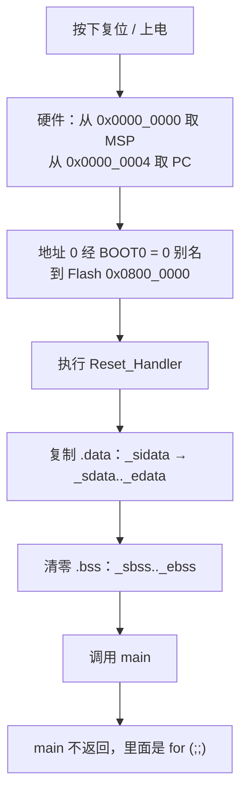

# 1.8 复位、启动与链接

接上 ST-LINK，按下复位键，板载 LED 亮了不到一毫秒就停住，串口没有任何输出，调试器一连接就报告 CPU 停在 `Default_Handler` 的无限循环里。程序里明明写了 `main`，可全局数组的初值看着不对，函数也没执行到该执行的位置。这类问题几乎都不出在 C 源文件里，而在 `main` 之前的那一段：谁来设置栈指针，谁来把全局对象的初值从 Flash 搬到 RAM，链接器把各段放在了哪个地址。这段代码通常由 CubeMX 生成一坨汇编，很少有人真正读完过。

本节把这段补齐。读完以后，读者能用纯 C 写出 STM32F103C8 的向量表与复位处理函数，能自己写一份链接脚本，会用 `size`、`nm`、`objdump`、`map` 文件核对 Flash 与 RAM 的占用，也就能读懂 CubeMX 生成的那套启动文件和链接脚本。示例只碰内核和存储器，不碰任何外设，上板与否都不影响理解。

## 1. 复位之后发生了什么

Cortex-M3 复位时，硬件只做极少几件事，剩下全交给软件。PM0056 第 2 章把这几件事写得很清楚：内核把地址 0 处的 32 位字装入主栈指针 (Main Stack Pointer, MSP)，把地址 4 处的值装入程序计数器 (Program Counter, PC)，然后从那里开始取指。同时向量表偏移寄存器 (Vector Table Offset Register, VTOR) 复位为 0，所有外设中断都还没有使能（NVIC 的中断使能寄存器复位值是 0），处理器处于线程模式、特权级，用的是主栈。

地址 0 上并没有 Flash。STM32F103 的 Flash 从 0x0800_0000 开始，是 [1.6 构建、烧录与调试](/教程/正文/嵌入式/1_平台与工具链/1_6_构建_烧录与调试) 里那张 BOOT 表在起作用：BOOT0 = 0 时，芯片把主 Flash 映射到 0x0000_0000，于是地址 0 和地址 0x0800_0000 看到的是同一份内容。RM0008 的原文是 "the main Flash memory is aliased in the boot memory space (0x0000 0000), but still accessible from its original memory space (0x800 0000)"。链接脚本把代码放在 0x0800_0000，实际运行时通过别名从 0x0000_0000 取到，两处都能访问。

::: concept emb-start-msp-from-vector title="复位时栈指针由硬件装入"

Cortex-M3 复位后从向量表偏移 0 处取出初始 MSP，从偏移 4 处取出复位处理函数的地址。栈指针在进入任何 C 代码之前就已经有效，所以复位处理函数可以直接用 C 写，不需要一段先建栈的汇编。偏移 4 处的值最低位必须为 1，表示目标是 Thumb 指令。

:::

最低位为 1 这件事在 [1.2 MCU、MPU、SoC 与执行环境](/教程/正文/嵌入式/1_平台与工具链/1_2_MCU_MPU_SoC与执行环境) 里提过 Cortex-M 只支持 Thumb。PM0056 说 "The least-significant bit of each vector must be 1, indicating that the exception handler is Thumb code"。第 5 节用 `od` 看 `.bin` 头 8 字节时，会看到复位向量是一个奇数，正好比 `nm` 给出的 `Reset_Handler` 地址大 1。

从复位到 `main` 的全部过程可以画成一条直线：



图里每一格都对应一段可以自己写出来的代码。第 1～3 格由硬件与 BOOT 引脚决定（第 3 格的别名地址还取决于链接脚本把代码放在 0x0800_0000），第 4～6 格是启动代码，第 7、8 格是应用。

## 2. 向量表

向量表是一张函数指针数组，固定在 Flash 最前面。STM32F103 中容量（C8、CB 同属中容量）用 RM0008 表 63：前 16 项是初始 MSP 加 15 个内核系统异常的位置，后面跟 43 个外设中断，合计 59 项，占 236 字节。这 236 字节正是第 5 节 `objdump -h` 里 `.isr_vector` 的长度。

| 偏移 | 内容 | 说明 |
| --- | --- | --- |
| 0x000 | 初始 MSP | 链接脚本的 `_estack` |
| 0x004 | Reset | `Reset_Handler` |
| 0x008～0x03C | NMI、HardFault、MemManage、BusFault、UsageFault、SVC、DebugMon、PendSV、SysTick | 其中 0x01C、0x020、0x024、0x028、0x034 为保留项，写 0 |
| 0x040～0x0EB | 43 个外设中断 | WWDG 为 IRQ 0，USBWakeUp 为 IRQ 42，最后一项结束于 0x0EB |

用 C 写这张表靠两个属性。`section(".isr_vector")` 把数组放进专门的段，让链接脚本能把它安排在 Flash 起始处；`used` 告诉编译器即使代码里没有任何地方引用这个数组，也要生成它，否则优化会把整张表删掉。每个处理函数都声明成 `Default_Handler` 的弱别名，程序里定义同名函数就自动替换，这条机制在 [2.5 中断与 NVIC](/教程/正文/嵌入式/2_MCU裸机开发/2_5_中断与NVIC) 里会用到。

完整文件在 `code/嵌入式/common/startup_stm32f103.c`，开头部分是这样的：

```c
#define DEFAULT_HANDLER __attribute__((weak, alias("Default_Handler")))

/* Cortex-M3 系统异常 */
void NMI_Handler(void) DEFAULT_HANDLER;
void HardFault_Handler(void) DEFAULT_HANDLER;
void MemManage_Handler(void) DEFAULT_HANDLER;
void BusFault_Handler(void) DEFAULT_HANDLER;
void UsageFault_Handler(void) DEFAULT_HANDLER;
void SVC_Handler(void) DEFAULT_HANDLER;
void DebugMon_Handler(void) DEFAULT_HANDLER;
void PendSV_Handler(void) DEFAULT_HANDLER;
void SysTick_Handler(void) DEFAULT_HANDLER;

typedef void (*vector_entry)(void);

__attribute__((section(".isr_vector"), used))
const vector_entry g_vector_table[] = {
    (vector_entry)_estack,      /* 0x000 初始 MSP */
    Reset_Handler,              /* 0x004 复位 */
    NMI_Handler,                /* 0x008 */
    HardFault_Handler,          /* 0x00C */
    /* …中间略… */
    USBWakeUp_IRQHandler,       /* 0x0E8 IRQ 42 */
};
```

数组故意不写长度，让编译器自己数。后面跟一句静态断言（C11 的 `_Static_assert`），表项数与 `16 + 43` 不一致就编译失败：

```c
_Static_assert(sizeof g_vector_table == VECTOR_COUNT * sizeof(vector_entry),
               "vector table must have 16 + 43 entries");
```

把其中一行注释掉，编译立刻停住：

::: terminal title="bash - 漏掉一个中断项"

```text
startup_stm32f103.c:156:1: error: static assertion failed: "vector table must have 16 + 43 entries"
  156 | _Static_assert(sizeof g_vector_table == VECTOR_COUNT * sizeof(vector_entry),
      | ^~~~~~~~~~~~~~
```

:::

这种检查值得写。向量表少一项，后面所有中断入口全部错位，而链接器不会有任何意见。

::: concept emb-start-vector-table-placement title="向量表的位置与保留"

向量表必须位于 Flash 起始处 0x0800_0000，由链接脚本的 `.isr_vector` 输出段安排；同时它既没有代码引用、又要出现在最终的 `.bin` 里，所以源码一侧必须写 `used` 属性、链接脚本一侧必须写 `KEEP`。缺哪一边，链接都能成功，芯片上电却取不到正确的初始 MSP 与复位向量。

:::

<Quiz
  type="single"
  :options="[
    { label: '16 项，与 Cortex-M3 的系统异常一一对应', value: 'A' },
    { label: '59 项：16 个系统异常位置加 43 个外设中断', value: 'B' },
    { label: '43 项，只包含外设中断', value: 'C' },
    { label: '由链接脚本决定，没有固定数目', value: 'D' }
  ]"
  answer="B"
>

<template #question>

STM32F103C8 放在 Flash 起始处的向量表有多少项？

</template>

正确答案是 **B**。前 16 项是初始 MSP 加 15 个系统异常位置（RM0008 表 63 里的偏移 0x000 到 0x03C），后面是 43 个外设中断，总共 236 字节。少写一项，这之后的所有入口都会错位。

</Quiz>

## 3. 复位处理函数

复位处理函数只做三件事：把 `.data` 的初值从 Flash 复制到 RAM，把 `.bss` 清零，调用 `main`。

```c
void Reset_Handler(void) {
    /* 把 .data 的初值从 Flash 复制到 RAM */
    uint32_t *src = _sidata;
    uint32_t *dst = _sdata;
    while (dst < _edata) {
        *dst++ = *src++;
    }

    /* 把 .bss 清零 */
    for (dst = _sbss; dst < _ebss; ++dst) {
        *dst = 0;
    }

    main();

    /* main 不应返回；万一返回，停在这里 */
    for (;;) {
    }
}
```

`_sidata`、`_sdata`、`_edata`、`_sbss`、`_ebss`、`_estack` 都是链接脚本定义的符号，只表示地址，不占存储。C 代码里把它们声明成 `extern uint32_t _sdata[]` 再当指针用，这是链接脚本符号最常见的用法。

这段代码自己不能依赖任何已初始化的静态存储期对象。复制还没开始，`.data` 里躺着的是 Flash 中的初值副本；清零还没开始，`.bss` 里是上电后的随机内容。它只能使用自动对象（局部对象在栈上，而栈指针已经由硬件设好）和链接脚本给的这些地址。C 标准要求静态存储期对象在程序启动前完成初始化，具体做法各实现不同，在裸机上就落在这一段里。语法和标准库部分的 [15 声明、名称与生存期](/教程/正文/语法和标准库/15_声明_名称与生存期) 讲了这条规则的语言侧。

如果工程里用到 C++ 的全局对象构造函数，或者给 C 函数加了 `__attribute__((constructor))`，编译器会把它们的地址放进 `.init_array` 段，需要在这三件事之外再遍历一次这个段。ST 的启动文件直接调用 newlib 的 `__libc_init_array` 完成这件事，而这个函数还要求链接脚本提供 `.preinit_array`、`.init_array`、`.fini_array` 三个段和一份 `_init`，缺一个就链接失败。本教程的固件是纯 C，不用构造函数，所以这两处都省掉了。真要用构造函数，链接脚本里补上这三个段、启动代码里按 `__init_array_start` 到 `__init_array_end` 遍历一遍即可，不必引入 `__libc_init_array`。

::: generate emb-start-reset-walkthrough kind=explanation

面向第一次读启动代码的读者，逐行走读这段 Reset_Handler：先说清 `_sidata` 与 `_sdata` 为什么指向不同存储器、循环的终止条件凭什么成立；再说清零为什么写在复制之后；最后说明 `main()` 那一行返回后为什么必须有死循环。只用本页已经给出的符号和地址，不引入新概念。

:::

## 4. 链接脚本

链接脚本 (linker script) 回答两个问题：芯片上有哪些存储器、每一段放在哪里。STM32F103C8 的答案很固定：Flash 从 0x0800_0000 起 64 KiB，SRAM 从 0x2000_0000 起 20 KiB。

### 4.1 MEMORY 与 ENTRY

```text
ENTRY(Reset_Handler)

MEMORY
{
    FLASH (rx)  : ORIGIN = 0x08000000, LENGTH = 64K
    RAM   (rwx) : ORIGIN = 0x20000000, LENGTH = 20K
}

_estack = ORIGIN(RAM) + LENGTH(RAM);
```

`ORIGIN` 和 `LENGTH` 两个函数取出区域的首地址和长度。`_estack` 等于 0x2000_0000 + 0x5000 = 0x2000_5000，即 RAM 末尾之后的第一个字节。栈从高地址向低地址生长，所以初始 MSP 取末尾而不是开头。

区域后面的 `(rx)`、`(rwx)` 只是给**没有在 `SECTIONS` 里显式指定的**输入段选区域用的：链接器遇到这种输入段时，会建一个同名的输出段，再按属性把它们放进匹配的区域。像 `.data` 这样写了 `> RAM AT> FLASH` 的段，属性一概不参与判断。想验证这一点，把 `.data` 的 `> RAM AT> FLASH` 改成 `> FLASH AT> FLASH`，链接照样成功，只是运行时程序会去写只读的 Flash，写操作不生效。所以区域属性起不到检查作用，段该放哪里，全靠脚本自己写对。

`(rx)` 也不会让存储器真的变成只读。GNU ld 手册 3.5 节的意思是，这些字母只描述"这段存储器适合放什么"，不改变硬件属性。

### 4.2 段的安排

```text
SECTIONS
{
    .isr_vector :
    {
        . = ALIGN(4);
        KEEP(*(.isr_vector))
        . = ALIGN(4);
    } > FLASH

    .text :
    {
        . = ALIGN(4);
        *(.text)
        *(.text*)
        /* …glue_7、eh_frame、init、fini 等… */
        . = ALIGN(4);
        _etext = .;
    } > FLASH

    .rodata :
    {
        . = ALIGN(4);
        *(.rodata)
        *(.rodata*)
        . = ALIGN(4);
    } > FLASH

    _sidata = LOADADDR(.data);

    .data :
    {
        . = ALIGN(4);
        _sdata = .;
        *(.data)
        *(.data*)
        *(.RamFunc)
        *(.RamFunc*)
        . = ALIGN(4);
        _edata = .;
    } > RAM AT> FLASH

    .bss :
    {
        . = ALIGN(4);
        _sbss = .;
        *(.bss)
        *(.bss*)
        *(COMMON)
        . = ALIGN(4);
        _ebss = .;
    } > RAM
    /* ….noinit 与栈堆检查段见下… */
}
```

`.` 是位置计数器，`ALIGN(4)` 把它向上取到 4 的倍数。`*(.text)` 收所有目标文件里名为 `.text` 的输入段，`*(.text*)` 再收 `.text.step_once` 这类带后缀的段（配合 `-ffunction-sections` 产生）。`> FLASH` 指定运行地址所在区域，`AT> FLASH` 单独指定加载地址。

::: concept emb-start-data-lma-vma title=".data 的初值在 Flash，运行时在 RAM"

`.data` 段的运行地址 (Virtual Memory Address, VMA) 在 RAM，加载地址 (Load Memory Address, LMA) 在 Flash。两者的差就是启动代码要复制的那一份初值：`_sidata = LOADADDR(.data)` 给出 LMA，`_sdata` 与 `_edata` 给出 VMA 范围。所以 `.data` 既占 RAM，也在 Flash 里占同样大小。

:::

`.noinit` 段给后续章节留位置：

```text
    .noinit (NOLOAD) :
    {
        . = ALIGN(4);
        _snoinit = .;
        *(.noinit)
        *(.noinit*)
        . = ALIGN(4);
        _enoinit = .;
    } > RAM
```

`NOLOAD` 表示这一段不加载进映像文件，`objcopy -O binary` 生成的 `.bin` 里没有它。启动代码不碰这一段，所以软件复位、看门狗复位之后里面的内容还是复位之前的值。放进去的对象必须自己带上有效性判断，否则第一次上电读到的是随机内容。 [2.10 看门狗、低功耗与故障处理](/教程/正文/嵌入式/2_MCU裸机开发/2_10_看门狗_低功耗与故障处理) 用它保存故障记录。

最后一段不装任何数据，只做容量检查：

```text
    ._user_heap_stack :
    {
        . = ALIGN(8);
        PROVIDE(end = .);
        PROVIDE(_end = .);
        . = . + _Min_Heap_Size;
        . = . + _Min_Stack_Size;
        . = ALIGN(8);
    } > RAM
```

`PROVIDE` 只在符号尚未定义时才定义，所以程序里自己定义了 `end` 也不会冲突。newlib 的 `_sbrk` 用 `end` 当堆的起点，[1.2](/教程/正文/嵌入式/1_平台与工具链/1_2_MCU_MPU_SoC与执行环境) 里链接 `malloc` 时报的未定义引用就靠它解决。这一段把堆和栈的预留空间写进 RAM 的占用，RAM 放不下时链接直接报错，而不是等到运行时栈悄悄压穿别的数据。

### 4.3 占用怎么算

`arm-none-eabi-size` 的三列按段属性归类：`text` 是可执行与只读段之和（`.isr_vector`、`.text`、`.rodata`），`data` 是 `.data`，`bss` 是所有 `NOBITS` 的可写段之和。`minimal` 用 `size -A` 拆开看，三列分别是 236 + 208 + 16 = 460、16、20 + 0 + 1540 = 1560：

```text
.isr_vector          236   134217728
.text                208   134217964
.rodata               16   134218172
.data                 16   536870912
.bss                  20   536870928
.noinit                0   536870948
._user_heap_stack   1540   536870948
```

所以 Flash 占用是 `text + data`，也就是 `.data` 的初值副本也要在 Flash 里留一份；RAM 占用是 `data + bss`，其中 `bss` 已经把 `._user_heap_stack` 预留的 `_Min_Heap_Size + _Min_Stack_Size` 算进去了。这一点容易看错：`.bss` 本身只有 20 字节，`bss` 列却是 1560，差额全在那段预留上。

<Quiz
  type="single"
  :options="[
    { label: 'Flash 用 text，RAM 用 data + bss', value: 'A' },
    { label: 'Flash 用 text + data，RAM 用 bss', value: 'B' },
    { label: 'Flash 用 text + data，RAM 用 data + bss', value: 'C' },
    { label: 'Flash 用 text + rodata，RAM 用 data + bss + text', value: 'D' }
  ]"
  answer="C"
>

<template #question>

用 `arm-none-eabi-size` 的输出估算一颗芯片需要多少 Flash 和多少 RAM，正确的是哪一种？

</template>

正确答案是 **C**。`.data` 有两份：初值副本留在 Flash，运行时占用 RAM，所以两边都要算。`.rodata` 已经包含在 `text` 列里，`size` 的 `text` 列是 `.isr_vector + .text + .rodata` 之和。

</Quiz>

## 5. 构建与检查

示例在 `code/嵌入式/1_平台与工具链/1_8_复位_启动与链接/minimal/`。`main.c` 只定义三类静态存储期对象：`const` 表 `g_scale_table`（进 `.rodata`）、有初值的 `g_weights`（进 `.data`）、无初值的 `g_accum` 与 `g_tick_count`（进 `.bss`），再加一个 `for (;;)` 里调用的 `step_once`。不碰任何外设，所以任何一块 F103 板子都能跑。

### 5.1 编译与链接

分三步走，每一步都能单独检查：

::: terminal title="bash - 编译与链接 minimal"

```text
$ arm-none-eabi-gcc -std=c11 -mcpu=cortex-m3 -mthumb -O2 -g -Wall -Wextra \
    -ffunction-sections -fdata-sections -DSTM32F103xB -c main.c -o main.o
$ arm-none-eabi-gcc -std=c11 -mcpu=cortex-m3 -mthumb -O2 -g -Wall -Wextra \
    -ffunction-sections -fdata-sections -c ../common/startup_stm32f103.c -o startup.o
$ arm-none-eabi-gcc -mcpu=cortex-m3 -mthumb -nostartfiles \
    --specs=nano.specs --specs=nosys.specs -Wl,--gc-sections \
    -T ../common/stm32f103c8.ld -Wl,-Map=minimal.map main.o startup.o -o minimal.elf
$ arm-none-eabi-size minimal.elf
   text	   data	    bss	    dec	    hex	filename
    460	     16	   1560	   2036	    7f4	minimal.elf
```

:::

`-nostartfiles` 告诉 GCC 不要链接它自带的那份 `crt0`，入口由我们的 `Reset_Handler` 和链接脚本的 `ENTRY` 决定。不加这个选项也能链接成功（`ENTRY(Reset_Handler)` 会覆盖默认入口），代价是多链入 `crt0` 的 `_init`、`_fini`，并打印一串 `_close is not implemented and will always fail` 之类的警告，`text` 从 460 字节涨到 484 字节。这些代码在裸机上没有用处，全都省掉。

真正不能省的是 `-T`。不给链接脚本时，链接器用它的默认脚本，里面没有 `.isr_vector` 的安置规则，映像从 0x0000_8000 开始排，向量表要么不存在要么位置错误。只加 `-nostartfiles` 而不加 `-T`，链接器连入口都找不到：

::: terminal title="bash - 漏掉链接脚本"

```text
$ arm-none-eabi-gcc -mcpu=cortex-m3 -mthumb -nostartfiles \
    --specs=nano.specs --specs=nosys.specs -Wl,--gc-sections \
    main.o startup.o -o no_script.elf
ld.exe: warning: cannot find entry symbol _start; defaulting to 00008000
$ arm-none-eabi-size no_script.elf
   text	   data	    bss	    dec	    hex	filename
      0	      0	      0	      0	      0	no_script.elf
```

:::

映像里只剩 `.ARM.attributes` 之类的空壳，`objdump -h` 里看不到 `.isr_vector`、`.text`、`.data` 中的任何一个。链接器只给出警告，退出码是 0。

`--gc-sections` 配合 `-ffunction-sections -fdata-sections`，把没有被引用到的函数和数据删掉。`minimal` 的 map 文件里，"Discarded input sections" 一栏列出了 `.text.step_once`：`-O2` 把它内联进了 `main`，独立的函数体再没有地方引用，于是被回收。像 `g_weights` 这样被真正读写的对象不会进这一栏。

`-Map=minimal.map` 生成映射文件 (map file)，记下每个输入段最终落在哪个输出段的哪个地址。这份文件是排查"某个对象到底被塞到哪去了"最直接的工具。

`--specs=nano.specs` 选体积更小的 newlib-nano；`--specs=nosys.specs` 给 `_write`、`_sbrk`、`_close` 这些系统调用提供空实现。本节这个不调用 `printf` 的程序去掉 `nosys.specs` 也能链接，但一旦用到 `printf`，`_close`、`_lseek`、`_read`、`_write` 全都会变成未定义引用，那时要么加这个选项，要么自己写一份系统调用实现，[1.2](/教程/正文/嵌入式/1_平台与工具链/1_2_MCU_MPU_SoC与执行环境) 里演示过一次。`Reset_Handler` 里那两个循环被 GCC 换成了对 `memcpy` 和 `memset` 的调用，这两个函数来自 newlib-nano，后面 `nm` 的输出里能直接看到。

`-DSTM32F103xB` 在本节没有用处（不包含设备头文件），保留它是因为后续各节的固件都要用同一条编译命令，`common/` 里的 CMake 目标也是这么配的。

### 5.2 size、objdump 与 nm

::: terminal title="bash - 检查布局"

```text
$ arm-none-eabi-objdump -h minimal.elf
minimal.elf:     file format elf32-littlearm

Sections:
Idx Name          Size      VMA       LMA       File off  Algn
  0 .isr_vector   000000ec  08000000  08000000  00001000  2**2
                  CONTENTS, ALLOC, LOAD, READONLY, DATA
  1 .text         000000d0  080000ec  080000ec  000010ec  2**2
                  CONTENTS, ALLOC, LOAD, READONLY, CODE
  2 .rodata       00000010  080001bc  080001bc  000011bc  2**2
                  CONTENTS, ALLOC, LOAD, READONLY, DATA
  3 .data         00000010  20000000  080001cc  00002000  2**2
                  CONTENTS, ALLOC, LOAD, DATA
  4 .bss          00000014  20000010  080001dc  00002010  2**2
                  ALLOC
  5 .noinit       00000000  20000024  080001f0  00000000  2**0
                  ALLOC
  6 ._user_heap_stack 00000604  20000024  080001dc  00002024  2**0
                  ALLOC
```

:::

三件事一眼能看出来。`.isr_vector` 长度 0xEC = 236，正是 59 项 × 4 字节，地址从 0x0800_0000 开始。`.data` 的 VMA 是 0x2000_0000，LMA 是 0x0800_01CC，两者不同，这就是"初值在 Flash、运行在 RAM"。`.bss` 的 LMA 那一列只是衔接用的地址，`ALLOC` 而没有 `CONTENTS`，说明它不占文件空间，运行时由启动代码清零。

`nm -n` 按地址排序列出符号，把关键几行挑出来：

::: terminal title="bash - nm -n 节选"

```text
$ arm-none-eabi-nm -n minimal.elf
08000000 R g_vector_table
080000ec T main
08000140 T Default_Handler
08000144 T Reset_Handler
080001bc T _etext
080001bc R g_scale_table
080001cc A _sidata
20000000 D _sdata
20000000 D g_weights
20000010 D _edata
20000010 B _sbss
20000010 B g_accum
20000020 B g_tick_count
20000024 B _ebss
20000024 B _enoinit
20000024 B _snoinit
20005000 R _estack
```

:::

符号类型的大写字母是有含义的：`T` 在代码段，`R` 在只读段，`D` 在可写数据段，`B` 在 `.bss`，`A` 是链接器赋的绝对地址。链接脚本符号全被标成 `B`、`D`、`R`、`A` 是因为它们没有源文件里的类型信息，按它们落在哪个段来猜。

`_estack` 是 0x2000_5000。`g_weights` 与 `_sdata` 同地址，说明它确实是 `.data` 的第一个对象。`g_accum` 与 `_sbss` 同地址，`_ebss` 是 0x2000_0024，`.bss` 共 0x14 = 20 字节，对应 `g_accum` 的 16 字节加 `g_tick_count` 的 4 字节。所有中断处理函数都还是 `W`（弱符号），地址全是 0x0800_0140，即 `Default_Handler`。程序里没有定义任何一个处理函数。

`_etext` 与 `g_scale_table` 同地址，说明 `.rodata` 紧接在 `.text` 后面。

### 5.3 map 文件

`nm` 只给符号地址，`map` 给的是链接过程本身。`.data` 那一条把 VMA 和 LMA 并排写在一起：

::: terminal title="bash - minimal.map 节选"

```text
.data           0x20000000       0x10 load address 0x080001cc
                0x20000000                        . = ALIGN (0x4)
                0x20000000                        _sdata = .
 *(.data)
 *(.data*)
 .data.g_weights
                0x20000000       0x10 main.o
                0x20000000                g_weights
 *(.RamFunc)
 *(.RamFunc*)
                0x20000010                        . = ALIGN (0x4)
                0x20000010                        _edata = .
```

:::

`.data.g_weights` 是 `-fdata-sections` 给每个对象单独起的输入段名。`load address 0x080001cc` 就是 `_sidata` 的值，与 `nm` 的输出对得上。

开头的 "Discarded input sections" 一栏会列出被 `--gc-sections` 删掉的输入段。`minimal` 里被删的是 `startup.o` 的空 `.text`、`.data`、`.bss`，还有 `main.o` 里那份已经被内联的 `step_once`。

### 5.4 看二进制文件的头 8 字节

芯片不会读 ELF，烧进去的是 `objcopy` 转出来的纯二进制。看它的开头，就是硬件复位时读的那两个字：

::: terminal title="bash - objcopy 与 od"

```text
$ arm-none-eabi-objcopy -O binary minimal.elf minimal.bin
$ od -A x -t x4 -N 8 minimal.bin
000000 20005000 08000145
000008
```

:::

`od` 按小端解释，第一个字 0x2000_5000 就是 `_estack`，第二个字 0x0800_0145 是 `Reset_Handler` 的地址 0x0800_0144 加 1。加的那个 1 是最低位，PM0056 规定向量表项的最低位为 1 表示 Thumb 代码。`readelf -h minimal.elf` 里的入口地址也带着这一位：

::: terminal title="bash - readelf -h"

```text
$ arm-none-eabi-readelf -h minimal.elf | grep -E "Entry|Machine"
  Machine:                           ARM
  Entry point address:               0x8000145
```

:::

ELF 的入口地址是给调试器和加载器看的；真正上电时芯片只认 `.bin` 头 8 字节。两者一致说明链接脚本的 `ENTRY(Reset_Handler)` 和向量表第二项指向同一个函数。

### 5.5 用 CMake 构建

`common/` 下有两个 CMake 文件。`arm-none-eabi.cmake` 是工具链文件，指定 `arm-none-eabi-gcc` 并按交叉编译处理；`firmware.cmake` 提供 `stm32f103_firmware(<目标> <源文件>...)`，把统一编译选项、启动文件、链接脚本、map 与 `.bin`/`.hex` 的生成都打包好。工程的 `CMakeLists.txt` 只有三行：

```cmake
cmake_minimum_required(VERSION 3.20)
project(minimal C)

include("${CMAKE_CURRENT_LIST_DIR}/../../../common/firmware.cmake")

stm32f103_firmware(minimal main.c)
```

::: terminal title="bash - CMake 构建"

```text
$ cmake -B build -G Ninja -DCMAKE_TOOLCHAIN_FILE=../../../common/arm-none-eabi.cmake
-- The C compiler identification is GNU 13.3.1
-- Detecting C compiler ABI info - done
-- Check for working C compiler: …/arm-none-eabi-gcc.exe - skipped
-- Detecting C compile features
-- Detecting C compile features - done
-- Configuring done (0.6s)
-- Generating done (0.0s)
-- Build files have been written to: …/minimal/build
$ cmake --build build
[1/3] Building C object emb_common/CMakeFiles/stm32f103_startup.dir/startup_stm32f103.c.obj
[2/3] Building C object CMakeFiles/minimal.dir/main.c.obj
[3/3] Linking C executable minimal.elf
   text	   data	    bss	    dec	    hex	filename
    460	     16	   1560	   2036	    7f4	minimal.elf
```

:::

`firmware.cmake` 把 `common/` 下的文件复制到构建目录的 `emb_common/` 里再编译，所以命令里看不到源码树的路径。构建产物在同一目录：`minimal.elf`、`minimal.bin`、`minimal.hex`、`minimal.map`。`arm-none-eabi-gcc` 不在 `PATH` 里时，configure 时加 `-DARM_TOOLCHAIN_DIR=<工具链的 bin 目录>`。

## 6. 写错了会怎样

### 6.1 去掉 KEEP

`.isr_vector` 没有任何代码引用它，只有 `ENTRY(Reset_Handler)` 间接依赖它里面的第二个元素。把 `KEEP` 去掉，`--gc-sections` 就把它当成无用的输入段删掉：

::: compare left-title="链接脚本里没有 KEEP" right-title="用 KEEP 包住向量表"

```text
    .isr_vector :
    {
        . = ALIGN(4);
        *(.isr_vector)
        . = ALIGN(4);
    } > FLASH
```

---

```text
    .isr_vector :
    {
        . = ALIGN(4);
        KEEP(*(.isr_vector))
        . = ALIGN(4);
    } > FLASH
```

:::

左边这版链接**成功**，没有任何警告。`objdump -h` 里 `.isr_vector` 长度变成 0，`.text` 从 0x0800_0000 开始，`size` 的 `text` 列从 460 字节降到 220 字节：

::: terminal title="bash - 没有 KEEP 时的链接结果"

```text
$ arm-none-eabi-gcc -mcpu=cortex-m3 -mthumb -nostartfiles \
    --specs=nano.specs --specs=nosys.specs -Wl,--gc-sections \
    -T nokeep.ld -Wl,-Map=nokeep.map main.o startup.o -o nokeep.elf
$ arm-none-eabi-size nokeep.elf
   text	   data	    bss	    dec	    hex	filename
    220	     16	   1560	   1796	    704	nokeep.elf
$ arm-none-eabi-objdump -h nokeep.elf | sed -n '3,9p'
Sections:
Idx Name          Size      VMA       LMA       File off  Algn
  0 .isr_vector   00000000  08000000  08000000  00002010  2**0
                  CONTENTS
  1 .text         000000cc  08000000  08000000  00001000  2**2
                  CONTENTS, ALLOC, LOAD, READONLY, CODE
```

:::

烧进芯片后，硬件从地址 0 取到的不是 `_estack`，而是 `main` 开头几条指令的编码。`od` 看 `.bin` 头 8 字节是这样的：

::: terminal title="bash - 没有向量表时的 .bin 开头"

```text
$ arm-none-eabi-objcopy -O binary nokeep.elf nokeep.bin
$ od -A x -t x4 -N 8 nokeep.bin
000000 0c00f04f 4663b5f0
000008
```

:::

第一个字 0x0C00_F04F 由两条半字 0xF04F、0x0C00 组成，正是 `main` 的第一条指令 `mov.w ip, #0`；第二个字 0x4663_B5F0 是紧随其后的 `push {r4, r5, r6, r7, lr}` 与 `mov r3, ip` 的编码。芯片把第一个字装进 MSP，把第二个字装进 PC。0x4663_B5F0 落在 F103 外设地址块（0x4000_0000 起）的未分配区间，RM0008 表 3 把它列为 Reserved，第一次取指就失败；MSP 指向的 0x0C00_0000 一带同样没有存储器。

保留向量表还有两条不依赖 `KEEP` 的路子，适合不想让链接脚本担这个责任的时候：

- 在链接命令里加 `-Wl,--undefined=g_vector_table` 或 `-Wl,--require-defined=g_vector_table`，把符号标成必须存在，`--gc-sections` 就不会删它所在的输入段。两者的区别是 `--require-defined` 在符号不存在时直接报错，`--undefined` 只是允许它未定义。写错名字时，`--require-defined` 会给出 `ld.exe: required symbol 'g_vector_tabl' not defined`，`--undefined` 则悄悄什么都不做。
- 在代码里制造一次对 `g_vector_table` 的引用，比如在某个函数里读一下它的地址。这样最脆弱：优化器可能把"没用"的读取删掉，引用一消失，段又会被回收。

`--gc-sections` 在固件里值得开着，函数和数据都能被裁掉，代价就是这类"必须有但没人引用"的东西要显式保住。本教程的 `stm32f103c8.ld` 选择在链接脚本里写 `KEEP`，这是最直接的一处；再加 `--undefined` 也可以，只是同一件事写两遍，改脚本时容易只改一处。

<Quiz
  type="multi"
  :options="[
    { label: '链接脚本里用 KEEP 包住 *(.isr_vector)', value: 'A' },
    { label: '链接时加 -Wl,--undefined=g_vector_table', value: 'B' },
    { label: '在 main 里写一句 g_vector_table[0];', value: 'C' },
    { label: '把 -ffunction-sections 换成 -fdata-sections', value: 'D' }
  ]"
  :answer="['A', 'B']"
>

<template #question>

开了 `--gc-sections` 之后，哪些做法能可靠地保住向量表？

</template>

正确答案是 **A、B**。`KEEP` 和 `--undefined` 都是在链接阶段明确告诉链接器这个段不能删；C 那种写法优化器有权把整句删掉，D 与控制段回收无关，两个选项是配套使用的。

</Quiz>

### 6.2 RAM 长度写成 64K

F103C8 是 20 KiB SRAM，把 `LENGTH` 写成 64K 链接照样成功：

::: terminal title="bash - RAM 写成 64K"

```text
$ sed 's/LENGTH = 20K/LENGTH = 64K/' stm32f103c8.ld > ram64k.ld
$ arm-none-eabi-gcc -mcpu=cortex-m3 -mthumb -nostartfiles \
    --specs=nano.specs --specs=nosys.specs -Wl,--gc-sections \
    -T ram64k.ld main.o startup.o -o ram64k.elf
$ arm-none-eabi-size ram64k.elf
   text	   data	    bss	    dec	    hex	filename
    460	     16	   1560	   2036	    7f4	ram64k.elf
$ arm-none-eabi-nm ram64k.elf | grep _estack
20010000 R _estack
```

:::

`_estack` 变成 0x2001_0000，比真实的 0x2000_5000 高出去 44 KiB。链接器只按脚本里写的长度检查容量，它不知道芯片上到底焊了多少 SRAM。向量表第 0 项现在是一个不存在的地址，复位时 MSP 就被装成这个值；`main` 一进函数就要压栈，访问落到 0x2000_5000 以上的保留区，进入 HardFault。

`size` 的输出一切正常，`bss` 才 1560 字节，看起来离 20 KiB 远得很。容量检查只能发现"脚本里写的 RAM 用完了"，发现不了"脚本里写的 RAM 本身是编的"。改动 `MEMORY` 的长度必须对着数据手册的存储器映射来，不能凭印象。

`._user_heap_stack` 那段在这里也不是白写的：往 `main.c` 里加一个 20 KiB 的 `volatile` 数组并真的写它，链接会直接拒绝：

::: terminal title="bash - RAM 真的不够时"

```text
$ arm-none-eabi-gcc -mcpu=cortex-m3 -mthumb -nostartfiles \
    --specs=nano.specs --specs=nosys.specs -Wl,--gc-sections \
    -T stm32f103c8.ld fill.o startup.o -o fill.elf
ld.exe: fill.elf section `._user_heap_stack' will not fit in region `RAM'
ld.exe: region `RAM' overflowed by 1536 bytes
collect2.exe: error: ld returned 1 exit status
```

:::

数组本身是 0x5000 字节，把 20 KiB 的 RAM 占满，`_Min_Heap_Size` 与 `_Min_Stack_Size` 要求的 0x600 字节再无处可放，于是超出 1536 字节。改成 19 KiB 时超出 512 字节，18 KiB 时刚好放得下。这条消息比"程序跑飞了"好查得多。

### 6.3 忘了清零 .bss

`Reset_Handler` 里不写清零循环，链接一样成功，`nm` 也一样。区别只在上电后的 RAM 内容：F103 的 SRAM 上电是随机的，`g_accum`、`g_tick_count` 读到的是垃圾值。第一次运行时可能一切正常（恰好为 0），放一晚上冷启动一次就出了怪数。这类缺陷用调试器很难复现，只能靠代码审查确认 `_sbss` 到 `_ebss` 那一段确实被走过。

::: warning `used` 与 `KEEP` 缺一不可

`used` 属性只保证编译器生成这个数组，不管链接阶段；`KEEP` 只保证链接器不删这个段，不管编译器有没有生成。两个都写，向量表才稳定地出现在 `.bin` 开头。同一份代码如果改成 `static const` 再删掉 `used`，编译器看不到任何引用，整个数组不会被生成，链接脚本里的 `KEEP` 也就没有东西可保，`objdump -h` 里 `.isr_vector` 的长度变成 0。

:::

## 7. 用调试器观察启动过程

上面的检查都在主机上完成。要在芯片上确认，用 [1.7 SWD、JTAG 与片上调试](/教程/正文/嵌入式/1_平台与工具链/1_7_SWD_JTAG与片上调试) 里的 OpenOCD + GDB 组合，先 `monitor reset halt` 让芯片停在复位后第一条指令之前。

::: terminal title="bash - 观察复位现场"

```console
$ openocd -f interface/stlink.cfg -f target/stm32f1x.cfg
$ arm-none-eabi-gdb minimal.elf
(gdb) target extended-remote :3333
(gdb) monitor reset halt
(gdb) info registers sp pc
(gdb) x/2wx 0x08000000
```

:::

按下复位、在 `reset halt` 之后，`sp` 应当是 0x2000_5000，`pc` 应当是 0x0800_0144（`Reset_Handler` 的地址，读 PC 时不带最低位），`x/2wx 0x08000000` 应当读出 0x2000_5000 与 0x0800_0145。这三条与第 5 节的 `nm`、`od` 输出必须完全一致，不一致说明烧进去的不是刚构建的那份。这几条需要真实硬件，具体数值以自己板子上的读数为准。

接下来在 `Reset_Handler` 和 `main` 各设一个断点，比较复制前后 `g_weights` 的值：

::: terminal title="bash - 比较复制前后"

```console
(gdb) break Reset_Handler
(gdb) break main
(gdb) continue
(gdb) print/x g_weights
(gdb) continue
(gdb) print g_weights
```

:::

第一次停下时 `.data` 还没复制完，`g_weights` 里是上电后的随机内容。第二次停在 `main` 的入口，四个元素应当分别是 1、2、3、4，也就是 `main.c` 里写的初值。如果第一次读到的碰巧全是 0，那是运气，不能据此判断复制不复制都一样。

GDB 通过调试访问端口 (Debug Access Port, DAP) 直接读存储器，不经过 CPU 执行指令，所以停下来看内存不会改变程序状态。唯一的例外是读外设寄存器这一类有副作用的访问，[1.7](/教程/正文/嵌入式/1_平台与工具链/1_7_SWD_JTAG与片上调试) 里提过。

## 8. 对照 CubeMX 生成的工程

用 STM32CubeMX 生成 F103C8 的工程，启动文件是 `startup_stm32f103xb.s`，链接脚本是 `STM32F103C8Tx_FLASH.ld`。两者与本节的写法逐项能对上，差别集中在几处。

启动文件是汇编，做的事完全一样：从 `_sidata` 复制到 `_sdata`、清 `_sbss` 到 `_ebss`、调 `main`。多出来的是两条：在复制之前调用 `SystemInit`，在调用 `main` 之前调用 `__libc_init_array`。

`SystemInit` 在 `system_stm32f1xx.c` 里，本版本的实现只在定义了 `USER_VECT_TAB_ADDRESS` 时改写 VTOR，不改时钟，复位后仍是 HSI 8 MHz，[2.3 时钟与复位](/教程/正文/嵌入式/2_MCU裸机开发/2_3_时钟与复位) 会接管这件事。启动代码把它省掉不影响本节示例，因为本节一个外设都不碰。

`__libc_init_array` 遍历 `.preinit_array` 与 `.init_array`，调用 C++ 全局构造函数和标了 `constructor` 的 C 函数。它对链接脚本有额外要求：三个数组段都要有，还要有一个名为 `_init` 的符号。本节的链接脚本没有这些，启动代码也不调用它，所以加了 `constructor` 属性的函数不会在 `main` 之前执行。纯 C 固件不需要它。

链接脚本这边逐项对照：

| 本节 `stm32f103c8.ld` | CubeMX `STM32F103C8Tx_FLASH.ld` | 说明 |
| --- | --- | --- |
| `MEMORY` 里 FLASH 64K、RAM 20K | 相同 | 地址与长度一致 |
| `_estack = ORIGIN(RAM) + LENGTH(RAM)` | 相同 | 都在 RAM 末尾 |
| `_Min_Heap_Size = 0x200`、`_Min_Stack_Size = 0x400` | 相同 | CubeMX 默认值 |
| `.isr_vector` 用 `KEEP` | 相同 | 都注释成 "Startup code" |
| `.data` 用 `>RAM AT> FLASH` 与 `LOADADDR` | 相同 | 符号名 `_sidata`、`_sdata`、`_edata` 一致 |
| 没有 `.preinit_array`、`.init_array`、`.fini_array` | 三个都有，`PROVIDE_HIDDEN` 定义首尾符号 | 供 `__libc_init_array` 使用 |
| `.ARM.extab`、`.ARM.exidx` | `.ARM.extab` 与名为 `.ARM` 的输出段 | 内容相同，输出段名不同，都放栈回溯表 |
| `.noinit`（`NOLOAD`） | 没有 | 本教程为 2.10 预留 |
| `._user_heap_stack` | 相同 | 都有 `PROVIDE(end = .)` |
| 没有 `/DISCARD/` | 删掉 `libc.a`、`libm.a`、`libgcc.a` | 见下 |

最后一行值得单独说。CubeMX 的脚本里有：

```text
  /DISCARD/ :
  {
    libc.a ( * )
    libm.a ( * )
    libgcc.a ( * )
  }
```

用 `--specs=nano.specs` 时链入的是 `libc_nano.a`，不是 `libc.a`，所以这三条在 GCC 工具链下没有作用。本节的脚本干脆不写。它也不影响 `_sbrk`、`_write` 这些符号的可见性：拿本节的 `startup.o` 配 CubeMX 的脚本链接 `minimal`，`size` 输出同样是 460/16/1560，`_estack` 同样是 0x2000_5000，与用本节脚本的结果完全一致；换成默认的 `libc.a` 再比一次，两份脚本的 `size` 也都是 820/16/1560，`/DISCARD/` 没有删掉任何东西。

用 CubeMX 的启动文件配本节的脚本、或者反过来，都是错的：CubeMX 的启动文件要 `SystemInit` 和 `__libc_init_array`，本节的脚本没有 `.init_array`，`__libc_init_array` 会去 `_init` 这个不存在的符号上链接失败。一套启动文件配一套链接脚本，不能混搭。

## 9. 给后续章节预留的布局

链接脚本与启动文件是后面各节都要改到的地方，这里把三处预留一次讲完。

`.noinit` 段已经在第 4 节给出。用法是在定义对象时指定段名：

```c
__attribute__((section(".noinit"))) volatile uint32_t g_boot_count;
```

给 `minimal` 的 `main.c` 加上这个对象、在 `main` 里 `++g_boot_count`，重新编译链接，`nm` 的输出里 `.noinit` 紧跟在 `_ebss` 之后：

::: terminal title="bash - .noinit 的位置"

```text
$ arm-none-eabi-nm -n noinit.elf | grep -E "_sbss|_ebss|_snoinit|g_boot_count|_enoinit|_estack"
20000010 B _sbss
20000024 B _ebss
20000024 B _snoinit
20000024 B g_boot_count
20000028 B _enoinit
20005000 R _estack
```

:::

`_enoinit` 是 0x2000_0028，`g_boot_count` 占 4 字节，正好落在中间。启动代码不清这一段，所以软件复位（`NVIC_SystemReset()`，写 SCB 的 AIRCR）之后，RAM 不被重新上电，里面的值保留；看门狗复位、NRST 引脚复位也一样，这些都属于 RM0008 说的系统复位，不清 SRAM。断电上电属于电源复位，SRAM 内容全丢，此时读到的值没有意义，所以放进 `.noinit` 的对象要自己带一个校验字，[2.10](/教程/正文/嵌入式/2_MCU裸机开发/2_10_看门狗_低功耗与故障处理) 会写完整版本。

链接脚本的 `.data` 里已经收了 `*(.RamFunc)`：

```text
    .data :
    {
        . = ALIGN(4);
        _sdata = .;
        *(.data)
        *(.data*)
        *(.RamFunc)
        *(.RamFunc*)
        . = ALIGN(4);
        _edata = .;
    } > RAM AT> FLASH
```

标了 `__attribute__((section(".RamFunc")))` 的函数会随 `.data` 一起被 `Reset_Handler` 复制到 RAM，之后按 RAM 地址执行。这件事有前提：F103 擦写 Flash 页的时候，CPU 从同一页取指会停顿，所以擦写 Flash 的代码本身必须放在 RAM 里。

这种写法的代价在段属性上。`readelf -S` 看到 `.data` 的标记是 `WAX`，即可写、可分配、可执行，函数的指令就这么混在可写数据里：

```text
  [ 4] .data             PROGBITS        20000000 002000 00002c 00 WAX  0   0  4
```

工程上更干净的做法是在链接脚本里单开一个段，让它的 VMA 在 RAM、LMA 在 Flash，并给它自己的首尾符号：

```text
    _sramfunc_load = LOADADDR(.ramfunc);

    .ramfunc :
    {
        . = ALIGN(4);
        _sramfunc = .;
        *(.ramfunc)
        *(.ramfunc*)
        . = ALIGN(4);
        _eramfunc = .;
    } > RAM AT> FLASH
```

再在 `Reset_Handler` 里补一段复制，用 `_sramfunc_load`、`_sramfunc`、`_eramfunc` 三个符号。这样 `.data` 恢复成纯数据段（`WA`），函数单独一段（`AX`），`nm` 里函数的运行地址落在 0x2000_0000 一带：

```text
  [ 4] .data             PROGBITS        20000000 002004 000000 00  WA  0   0  1
  [ 5] .ramfunc          PROGBITS        20000000 002000 000004 00  AX  0   0  4
```

两种写法都会让链接器给出一条 `has a LOAD segment with RWX permissions` 的警告，因为 `.ramfunc`（或 `.data`）与 `.bss` 被合进了同一个可加载段。区别只在代码到底落在哪个段里：混进 `.data` 时整个数据段都可执行，单独开段时只有那一个小段可执行。如果不想看见这条警告，加 `-Wl,--no-warn-rwx-segments`。

最后一处是 Flash 末页。`0x0800_FC00` 起 1 KiB 是第 63 页，F103 的页大小 1 KiB，恰好可以整页擦写来存配置。[3.9 Flash、EEPROM、SD 与文件系统](/教程/正文/嵌入式/3_驱动_通信与中间件/3_9_Flash_EEPROM_SD与文件系统) 用一份变体脚本把 `FLASH` 缩到 63K，另开一个 `CONFIG (r)` 区域：

```text
MEMORY
{
    FLASH  (rx)  : ORIGIN = 0x08000000, LENGTH = 63K
    CONFIG (r)   : ORIGIN = 0x0800FC00, LENGTH = 1K
    RAM    (rwx) : ORIGIN = 0x20000000, LENGTH = 20K
}
```

用这份脚本链接同一个 `minimal`，`.config_page` 就落在 0x0800_FC00，长度 0x400，代码部分不受影响：

::: terminal title="bash - 用变体脚本链接"

```text
$ arm-none-eabi-gcc -mcpu=cortex-m3 -mthumb -nostartfiles \
    --specs=nano.specs --specs=nosys.specs -Wl,--gc-sections \
    -T stm32f103c8_config.ld main.o startup.o -o cfg.elf
$ arm-none-eabi-objdump -h cfg.elf | sed -n '3,10p'
Sections:
Idx Name          Size      VMA       LMA       File off  Algn
  0 .isr_vector   000000ec  08000000  08000000  00001000  2**2
                  CONTENTS, ALLOC, LOAD, READONLY, DATA
  1 .text         000000d0  080000ec  080000ec  000010ec  2**2
                  CONTENTS, ALLOC, LOAD, READONLY, CODE
  2 .rodata       00000010  080001bc  080001bc  000011bc  2**2
                  CONTENTS, ALLOC, LOAD, READONLY, DATA
  3 .config_page  00000400  0800fc00  0800fc00  00002c00  2**0
                  ALLOC
```

:::

`size` 这一版是 460/16/2584，`bss` 从 1560 涨到 2584，多的 1024 字节就是 `.config_page`，它标了 `ALLOC` 但没有 `CONTENTS`，不占 `.bin` 的大小。`config_page` 的名字与 3.9 的脚本一致。

## 10. 习题

### 10.1 巩固

<Exercise id="60181" :d="1" :w="2">

用第 5 节的命令构建 `minimal.elf`，然后：

(1) 从 `minimal.bin` 的头 8 字节读出初始 SP 与复位向量，写出这两个十六进制值。

(2) 用 `arm-none-eabi-nm` 查出 `Reset_Handler` 的地址，解释复位向量为什么正好比它大 1，而不是相等。

(3) 用 `arm-none-eabi-readelf -h minimal.elf` 查入口地址，说明它与 (1) 读到的复位向量是否一致，不一致时哪个才是芯片上电后真正用的。

(4) 有硬件时，按 1.7 的方法连上调试器，`monitor reset halt` 之后读 `sp`、`pc` 与 `x/2wx 0x08000000`，核对与 (1) 的结论是否一致。

</Exercise>

<Exercise id="60182" :d="2" :w="2">

`code/嵌入式/1_平台与工具链/1_8_复位_启动与链接/minimal/main.c` 里加入一个计数器：

```c
__attribute__((section(".noinit"))) volatile uint32_t g_boot_count;
```

在 `main` 开头执行 `++g_boot_count;`，然后：

(1) 用 `arm-none-eabi-nm -n` 确认 `g_boot_count` 落在 `_ebss` 与 `_enoinit` 之间，把这几行输出贴出来。

(2) 用 `arm-none-eabi-objdump -h` 说明 `.noinit` 是否占 `.bin` 的空间，给出依据。

(3) 解释为什么按复位键或调用 `NVIC_SystemReset()` 之后这个值还在，而拔掉电源再插上就没了。分别对应 RM0008 里的哪一类复位。

</Exercise>

<Exercise id="60183" :d="2" :w="2">

把 `stm32f103c8.ld` 里 RAM 的 `LENGTH` 从 `20K` 改成 `64K`，重新链接。

(1) 说明为什么链接器不报错，用 `arm-none-eabi-size` 的输出说明它检查的是什么。

(2) 用 `arm-none-eabi-nm` 读出新的 `_estack` 值，算出它比真实的 RAM 末尾高了多少字节。

(3) 推演上电后的过程：MSP 被装成什么值，第一次压栈访问哪个地址，CPU 会进入哪个异常。说明这个缺陷为什么在链接阶段发现不了。

</Exercise>

<Exercise id="60184" :d="2" :w="2">

把链接脚本里 `.isr_vector` 外面的 `KEEP(...)` 去掉，重新链接。

(1) 贴出 `objdump -h` 与 `size` 的输出，说明 `.isr_vector` 变成了什么。

(2) 用 `objcopy` 与 `od` 看 `.bin` 头 8 字节，指出芯片上电后会把这个值当成什么，后果是什么。

(3) 写出两种不用 `KEEP` 也能保住向量表的办法，各给一条完整命令，并说明哪种在符号名写错时会报错。

</Exercise>

### 10.2 编程

<Exercise id="60185" :d="3" :w="3">

把一个函数放到 RAM 里执行。要求：

(1) 在链接脚本里单开 `.ramfunc` 段，VMA 在 RAM、LMA 在 Flash，定义 `_sramfunc_load`、`_sramfunc`、`_eramfunc` 三个符号，并在 `Reset_Handler` 里把它复制到 RAM。

(2) 写一个 `__attribute__((section(".ramfunc"), noinline)) uint32_t fast_add(uint32_t a, uint32_t b)`，在 `main` 里调用。

(3) 用 `arm-none-eabi-nm` 确认 `fast_add` 的地址落在 0x2000_xxxx，用 `objdump -h` 确认 `.ramfunc` 的 VMA 与 LMA 不同。

(4) 链接脚本里已有的 `.data` 段收了 `*(.RamFunc)`，新开的段叫 `.ramfunc`，两个名字只差大小写。说明把函数标成 `.RamFunc` 时它会进哪个段，这种情况下 `nm` 给出的运行地址还是不是 0x2000_xxxx。

</Exercise>

<Exercise id="60186" :d="3" :w="3">

写一个脚本 `check_layout.sh`（或 `.ps1`），对任意一个 ELF 文件做四项检查，全部通过时退出码为 0，任一失败时打印原因并以非零退出：

1. `.isr_vector` 的 VMA 等于 0x0800_0000，长度为 0xEC。
2. `.data` 的 VMA 与 LMA 不相等。
3. `.bin` 的头 4 字节等于 ELF 里 `_estack` 符号的值。
4. `_ebss` 不大于 `_estack`。

在 `minimal.elf` 与第 6 节那两份故意写错（去掉 `KEEP`、RAM 写 64K）的产物上各跑一次，把输出贴出来，说明哪一项抓住了哪种错误，以及哪一种错误这四项都抓不住，为什么。

</Exercise>

### 10.3 综合与挑战

<Exercise id="60187" :d="4" :w="4">

把 `minimal` 改造成能在复位后统计"这是第几次启动"的固件，并在 `.bin` 层面验证：

(1) 在 `.noinit` 段放一个启动记录（`magic` 取 0x5A5A_5A5A，`count` 每次启动加一），类型与对象这样写：

```c
struct boot_record {
    uint32_t magic;
    uint32_t count;
};

__attribute__((section(".noinit"))) volatile struct boot_record g_record;
```

(2) 第一次上电时 SRAM 是随机的，`magic` 可能碰巧匹配。给出一个在不依赖 `.noinit` 初值的前提下判断有效性的办法，并说明为什么单靠 `magic` 不够。（提示：记录里再放一个对 `magic` 与 `count` 一起算出的校验值，或者把 `count` 与一个固定的经验值比较。）

(3) 用 `objdump -h` 说明 `.noinit` 不占 `.bin`，用 `nm` 给出这个记录的地址，写出上板验证的步骤（用 1.7 的调试器读这个地址，按两次复位键，比较两次 `count`）。

</Exercise>

<Exercise id="60188" :d="4" :w="4">

本节的启动代码没有调用 `__libc_init_array`，所以 `__attribute__((constructor))` 不生效。

(1) 写一个带 `constructor` 属性的函数，把某个全局标志置位，在 `main` 里读它。先用本节现状构建，用调试器或符号证明这个函数没有被调用。

(2) 在链接脚本里补上 `.init_array` 段（VMA 在 Flash），在 `Reset_Handler` 里按 `__init_array_start` 到 `__init_array_end` 遍历，重新构建，确认函数被调用。

(3) 说明为什么不能用 newlib 的 `__libc_init_array` 直接替代你写的那段循环，给出实际的链接错误。

(4) 对照 CubeMX 生成的 `startup_stm32f103xb.s` 与 `STM32F103C8Tx_FLASH.ld`，指出 CubeMX 用哪几处安排满足 `__libc_init_array` 的要求，与你在 (2) 里的做法有什么区别。

</Exercise>

<Exercise id="60189" :d="5" :w="4" scope="*">

设计一份给"带 Bootloader 的 F103C8"用的链接脚本。Bootloader 占 0x0800_0000 起 12 KiB，应用程序从 0x0800_3000 开始，占 48 KiB，末尾留 1 KiB（0x0800_F000 起）做升级缓存。

(1) 写出 `MEMORY` 与 `ENTRY`，说明 `_estack` 应放在哪里。

(2) 应用程序启动时向量表不在地址 0（芯片带来的是 Bootloader 的向量表）。写出用 VTOR 把向量表重定位到 0x0800_3000 的代码，说明写入前为什么要先按表大小对齐。

(3) 用 `objdump -h` 与 `nm` 验证应用程序的 `.isr_vector` 落在 0x0800_3000，并构造一个故意把应用链接到 0x0800_0000 的版本，说明链接成功但两个程序的向量表互相覆盖会怎样。

(4) 说明这份脚本与 [6.4 Bootloader 与固件升级](/教程/正文/嵌入式/6_质量_安全与交付/6_4_Bootloader与固件升级) 将要讲的分区方案的关系，指出本节脚本已经具备哪些条件、还缺什么。

</Exercise>

## 11. 参考资料

1. François Baldassari, [*From Zero to main(): Bare metal C*](https://interrupt.memfault.com/blog/zero-to-main-1), Memfault Interrupt，2019。
2. François Baldassari, [*From Zero to main(): Demystifying Firmware Linker Scripts*](https://interrupt.memfault.com/blog/how-to-write-linker-scripts-for-firmware), Memfault Interrupt，2019。
3. STMicroelectronics, [*RM0008 Reference manual: STM32F101xx, STM32F102xx, STM32F103xx, STM32F105xx and STM32F107xx advanced Arm-based 32-bit MCUs*, Rev 21](https://www.st.com/resource/en/reference_manual/rm0008-stm32f101xx-stm32f102xx-stm32f103xx-stm32f105xx-and-stm32f107xx-advanced-armbased-32bit-mcus-stmicroelectronics.pdf)：第 3.4 节 Boot configuration、第 7.1 节 Reset、第 9 章 Interrupts and events（表 63 向量表）。
4. STMicroelectronics, [*PM0056 Programming manual: STM32F10xxx/20xxx/21xxx/L1xxxx Cortex-M3 programming manual*, Rev 7](https://www.st.com/resource/en/programming_manual/pm0056-stm32f10xxx20xxx21xxxl1xxxx-cortexm3-programming-manual-stmicroelectronics.pdf)：第 2.3.4 节 Vector table、第 4.4.4 节 Vector table offset register。
5. GNU Binutils, [*LD: The GNU linker*](https://sourceware.org/binutils/docs/ld/)：3.5 节 MEMORY、3.6.4.4 节 KEEP 与垃圾回收、3.1.3 节 输出段的 LMA。
6. Arm, [*CMSIS-Core (Cortex-M): Startup File startup_\<Device\>.c*](https://arm-software.github.io/CMSIS_6/latest/Core/startup_c_pg.html)：复位处理函数的职责与 `SystemInit` 的调用约定。
7. cpq, [*Bare-metal programming guide*](https://github.com/cpq/bare-metal-programming-guide)：Cortex-M 裸机程序的构建与链接布局。
8. STMicroelectronics, [*cmsis_device_f1*](https://github.com/STMicroelectronics/cmsis_device_f1)：`startup_stm32f103xb.s` 与 `system_stm32f1xx.c` 的原文，本页第 8 节逐项对照所用。
9. Arm, [*Armv7-M Architecture Reference Manual*](https://developer.arm.com/documentation/ddi0403/latest)：复位行为与异常进入、向量表的最低位含义。
