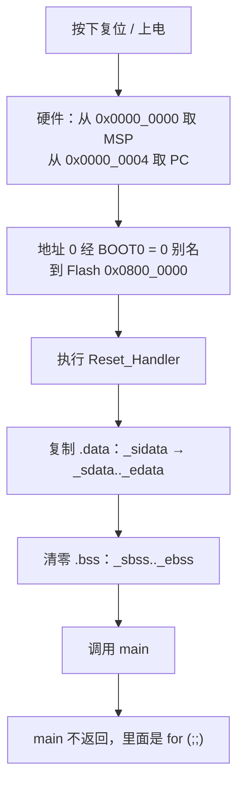

# 1.8 复位、启动与链接

在嵌入式底层开发中，板载 LED 在上电或复位瞬间微弱闪烁随即熄灭、串口毫无波形输出、调试器一挂载便显示 CPU 停滞在 `Default_Handler` 的死循环中，是极为常见的硬件初启故障。审视代码时，上层 `main` 函数往往逻辑完备，然而关键全局对象的初值却呈现错乱，执行流甚至未能抵达首行断点。这类现象绝大多数发生在高级语言的运行边界之外——也就是硬件复位信号释放到进入 `main` 函数之间的底层真空地带：堆栈指针究竟在哪个硬件周期完成初始化、全局对象的初始值如何在芯片内部从非易失的 Flash 搬运至易失的 SRAM、未初始化的内存区域由谁完成清零，以及静态链接器究竟依循何种拓扑规则划分物理地址空间。在许多工程实践中，这套前置机制往往被封装在自动化工具生成的汇编模版中，若将其视作理所当然的黑盒，一旦遭遇自定义存储拓扑、微控制器从系统 Bootloader 跃迁至用户代码、或内存越界等边界场景，排查工作便会失去依托。

深入理解这一阶段，核心在于理清微控制器的硬件时序与 C 语言执行环境的接力过程。借助 STM32F103C8 这颗经典的微控制器，开发者完全能够脱离庞杂的汇编文件，以标准纯 C 语言编写中断向量表与复位处理流程，并亲手编写控制内存布局的 GNU 链接脚本。透过 `size`、`nm`、`objdump` 等二进制分析工具以及链接映射（Map）文件，不仅能精确核验 Flash 与 SRAM 的每一字节开销，更能从容看清自动化脚手架生成的启动工程底层机理。

## 1. 复位之后发生了什么

Cortex-M3 架构在上电与复位序列的设计上展现了高度的精简性，将复杂的初始模式配置降至最低，迅速将控制权让渡给软件。依据 Cortex-M3 编程手册 PM0056 的规范，复位信号一旦释放，硬件流水线会自主执行两次顺序固定的总线读取操作：首先从物理地址 `0x0000_0000` 处读出一个 32 位双字，并将其直接装入主栈指针（Main Stack Pointer, MSP）；随后紧接着从物理地址 `0x0000_0004` 处读取第二个 32 位双字，将其注入程序计数器（Program Counter, PC），CPU 随即从该地址所指示的内存单元开始执行第一条机器指令。与此同时，内部的向量表偏移寄存器（Vector Table Offset Register, VTOR）硬件复位为 0，嵌套向量中断控制器（NVIC）的所有外部中断使能位全部清零，处理器运行于特权级线程模式，且从生命周期的第一刻起便天然具备了由硬件初始化的主栈支持。

在芯片的物理存储布局中，地址 `0x0000_0000` 处实际上并不存在物理 Flash 单元。STM32F103 的片上内置 Flash 其物理地址恒定起始于 `0x0800_0000`。之所以微控制器能在零地址正常完成复位向量装载，依赖的是 [1.6 构建、烧录与调试](/教程/正文/嵌入式/1_平台与工具链/1_6_构建_烧录与调试) 中所解析的引脚引导选择机制：当硬件检测到 BOOT0 = 0 时，内部总线仲裁网络会自动将主 Flash 区域映射（Aliased）至 `0x0000_0000` 所在的启动基地址。芯片参考手册 RM0008 明确指出，主 Flash 在启动空间以别名形式呈现的同时，其原生地址 `0x0800_0000` 依然保持完全可寻址状态。因此，即便链接脚本将固件代码统一安排在 `0x0800_0000`，芯片复位总线仍能透过别名镜像从 `0x0000_0000` 处准确读入这两项关键初值。

::: concept emb-start-msp-from-vector title="复位时栈指针由硬件装入"

Cortex-M3 复位后从向量表偏移 0 处取出初始 MSP，从偏移 4 处取出复位处理函数的地址。栈指针在进入任何 C 代码之前就已经有效，所以复位处理函数可以直接用 C 写，不需要一段先建栈的汇编。偏移 4 处的值最低位必须为 1，表示目标是 Thumb 指令。

:::

关于偏移 4 处的地址最低位必须为 1 的规则，根源在于我们在 [1.2 MCU、MPU、SoC 与执行环境](/教程/正文/嵌入式/1_平台与工具链/1_2_MCU_MPU_SoC与执行环境) 中讨论过的架构特性：Cortex-M 架构彻底摒弃了传统的 32 位 ARM 指令集，纯粹在 Thumb/Thumb-2 指令集状态下执行代码。PM0056 手册明文强调，向量表中的每一个异常处理函数地址，其最低有效位（LSB）均必须置 1，用以告知内核处理器在分支跳转时必须维持 Thumb 执行状态。在后续使用工具分析固件二进制映像的头 8 个字节时，便会发现复位向量数值恒为一个奇数，恰好比符号表记录的 `Reset_Handler` 实际物理地址大 1。

从上电复位引脚释放直至进入用户应用层 `main` 函数，完整的底层迁移链路可以清晰解构如下：



图中的每一个演进步骤都严格对应可自编写的底层逻辑。前三个阶段受控于微控制器内部硬件逻辑与外部 BOOT 电平状态，中间三步构成了极简运行时的启动核心，而最后两个节点则正式步入用户级业务逻辑。

## 2. 向量表

从结构形式来看，中断向量表本质上是一个按固定顺序在连续内存中排布的函数指针数组，在物理空间上必须坚守在 Flash 的最开端。以中容量 STM32F103 系列（C8T6 与 CBT6 均属此类）为例，参考手册 RM0008 的表 63 对其进行了严密界定：前 16 项由初始 MSP 堆栈顶地址加上 15 个属于 Cortex-M3 内核的系统级异常向量构成；紧随其后的是 43 个属于片上外设的中断向量通道。整张表合计由 59 个 32 位字组成，严格占据 236 字节的连续存储空间。这 236 字节的物理长度，正好与后续在目标文件头解析中看到的 `.isr_vector` 输出节区尺寸完全吻合。

| 偏移 | 内容 | 说明 |
| --- | --- | --- |
| 0x000 | 初始 MSP | 链接脚本的 `_estack` |
| 0x004 | Reset | `Reset_Handler` |
| 0x008～0x03C | NMI、HardFault、MemManage、BusFault、UsageFault、SVC、DebugMon、PendSV、SysTick | 其中 0x01C、0x020、0x024、0x028、0x034 为保留项，写 0 |
| 0x040～0x0EB | 43 个外设中断 | WWDG 为 IRQ 0，USBWakeUp 为 IRQ 42，最后一项结束于 0x0EB |

要在纯 C 语言环境下精确构建这样一张内存表单，需要仰仗两条专有的编译器属性。其一是 `section(".isr_vector")`，它指示编译器将该全局指针数组剥离出默认的代码段或数据段，单独收拢入专属的输入节区，以便后续链接脚本能够无缝地将其固定在 Flash 的起始偏移；其二则是 `used` 属性，它对优化流水线明确发出标记：即便当前源文件中没有任何显式引用或调用过该数组的语句，也决不允许在代码剪裁优化（Dead Code Elimination）阶段将其剔除。此外，所有的中断服务函数在缺省状态下均被声明为 `Default_Handler` 的弱别名（weak alias），用户一旦在业务代码中编写了同名的中断服务函数，链接器就会自动完成强符号对弱符号的覆盖替换，这一解耦机制将在 [2.5 中断与 NVIC](/教程/正文/嵌入式/2_MCU裸机开发/2_5_中断与NVIC) 展现更深的应用价值。

完整的文件定义收录于 `code/嵌入式/common/startup_stm32f103.c` 中，其核心主体结构呈现如下：

```c
#define DEFAULT_HANDLER __attribute__((weak, alias("Default_Handler")))

/* Cortex-M3 系统异常 */
void NMI_Handler(void) DEFAULT_HANDLER;
void HardFault_Handler(void) DEFAULT_HANDLER;
void MemManage_Handler(void) DEFAULT_HANDLER;
void BusFault_Handler(void) DEFAULT_HANDLER;
void UsageFault_Handler(void) DEFAULT_HANDLER;
void SVC_Handler(void) DEFAULT_HANDLER;
void DebugMon_Handler(void) DEFAULT_HANDLER;
void PendSV_Handler(void) DEFAULT_HANDLER;
void SysTick_Handler(void) DEFAULT_HANDLER;

typedef void (*vector_entry)(void);

__attribute__((section(".isr_vector"), used))
const vector_entry g_vector_table[] = {
    (vector_entry)_estack,      /* 0x000 初始 MSP */
    Reset_Handler,              /* 0x004 复位 */
    NMI_Handler,                /* 0x008 */
    HardFault_Handler,          /* 0x00C */
    /* …中间略… */
    USBWakeUp_IRQHandler,       /* 0x0E8 IRQ 42 */
};
```

在编写数组定义时故意不显式标注固定长度，交由编译器依据初始化列表条目自行推导。随后紧跟一条 C11 标准的静态断言（`_Static_assert`），一旦数组条目总数与理论上的 `16 + 43` 不相符，便会在编译期直接中断构建：

```c
_Static_assert(sizeof g_vector_table == VECTOR_COUNT * sizeof(vector_entry),
               "vector table must have 16 + 43 entries");
```

若在编辑过程中不慎注释或遗漏了某个中断向量项，编译器会在语法检查阶段立即中止：

::: terminal title="bash - 漏掉一个中断项"

```text
startup_stm32f103.c:156:1: error: static assertion failed: "vector table must have 16 + 43 entries"
  156 | _Static_assert(sizeof g_vector_table == VECTOR_COUNT * sizeof(vector_entry),
      | ^~~~~~~~~~~~~~
```

:::

这类编译期防错保障具有极高的工程收益。若向量表中缺失了哪怕一项，其后的所有硬件外设中断在响应时都会向前错位 4 字节，导致 CPU 在中断触发时跃迁进入错误的异常服务入口，而传统的链接过程对此完全不会发出任何警告。

::: concept emb-start-vector-table-placement title="向量表的位置与保留"

向量表必须位于 Flash 起始处 0x0800_0000，由链接脚本的 `.isr_vector` 输出段安排；同时它既没有代码引用、又要出现在最终的 `.bin` 里，所以源码一侧必须写 `used` 属性、链接脚本一侧必须写 `KEEP`。缺哪一边，链接都能成功，芯片上电却取不到正确的初始 MSP 与复位向量。

:::

<Quiz
  type="single"
  :options="[
    { label: '16 项，与 Cortex-M3 的系统异常一一对应', value: 'A' },
    { label: '59 项：16 个系统异常位置加 43 个外设中断', value: 'B' },
    { label: '43 项，只包含外设中断', value: 'C' },
    { label: '由链接脚本决定，没有固定数目', value: 'D' }
  ]"
  answer="B"
>

<template #question>

STM32F103C8 放在 Flash 起始处的向量表有多少项？

</template>

正确答案是 **B**。前 16 项是初始 MSP 加 15 个系统异常位置（RM0008 表 63 里的偏移 0x000 到 0x03C），后面是 43 个外设中断，总共 236 字节。少写一项，这之后的所有入口都会错位。

</Quiz>

## 3. 复位处理函数

复位处理函数所承担的底层职能高度明确：将 `.data` 段的初始化数值从 Flash 镜像无损迁移到 RAM 运行空间、将未初始化的 `.bss` 内存段通体清零，随后平稳调用 `main`。

```c
void Reset_Handler(void) {
    /* 把 .data 的初值从 Flash 复制到 RAM */
    uint32_t *src = _sidata;
    uint32_t *dst = _sdata;
    while (dst < _edata) {
        *dst++ = *src++;
    }

    /* 把 .bss 清零 */
    for (dst = _sbss; dst < _ebss; ++dst) {
        *dst = 0;
    }

    main();

    /* main 不应返回；万一返回，停在这里 */
    for (;;) {
    }
}
```

代码中出现的 `_sidata`、`_sdata`、`_edata`、`_sbss`、`_ebss` 以及 `_estack`，均为链接脚本所定义的全局符号。这些符号在语义上仅仅代表特定的内存物理地址边界，其自身并不在目标文件中占用任何数据存储空间。在 C 语言中，通常将其声明为 `extern uint32_t _sdata[]` 的不完整数组类型，进而将其隐式衰减为指针来引用对应的地址区间，这是低层软件操作链接脚本边界标记的典型范式。

特别需要注意的是，`Reset_Handler` 在执行过程中必须具备“零运行期环境依赖”的严苛特性。在执行数据迁移之前，位于 RAM 区域的 `.data` 段尚处于未定状态，其物理单元留存的是 Flash 中预设初值的镜像副本；而清零尚未执行时，SRAM 物理单元处于上电后的随机电平状态，`.bss` 区域内部充斥着未知的噪声数据。因此，该函数自身绝对不能读取任何具有静态存储期的全局或局部静态对象，它仅能使用运行在主栈上的自动存储期对象（局部对象依附于此时已由硬件初始化的 MSP 栈顶）以及链接脚本导出的符号地址。C 语言标准规定，所有具有静态存储期的对象在程序真正开始运行前必须完成初值确立，这一抽象语义在桌面操作系统由动态加载器代劳，而在嵌入式裸机世界中，则完全凝练在这一段循环之中。关于存储期与声明周期的语言规范，读者可在 [15 声明、名称与生存期](/教程/正文/语法和标准库/15_声明_名称与生存期) 找到详尽论述。

在更复杂的 C++ 混合工程或者大量运用 `__attribute__((constructor))` 属性的 C 语言场景下，编译器会将构造函数的函数指针有序打包存入 `.init_array` 节区。此时微控制器必须在数据迁移和清零完成后，依序遍历该节区执行所有的前置初始化例程。标准固件库通常会依赖 newlib 运行时提供的 `__libc_init_array` 来打通此链路，但该函数往往需要链接脚本协同定义 `.preinit_array`、`.init_array`、`.fini_array` 以及底层的 `_init` 桩符号，若有缺失便会导致链接器抛出未解析的符号错误。在纯 C 语言构建的极简微固件中，由于不涉及复杂的全局类构造，省去这部分中间层有助于保持启动逻辑的极度清爽；若后续确实产生静态构造需求，仅需在链接脚本中划定对应边界，并在启动函数中加入一段由 `__init_array_start` 到 `__init_array_end` 的简短指针遍历即可。

::: generate emb-start-reset-walkthrough kind=explanation

面向第一次读启动代码的读者，逐行走读这段 Reset_Handler：先说清 `_sidata` 与 `_sdata` 为什么指向不同存储器、循环的终止条件凭什么成立；再说清零为什么写在复制之后；最后说明 `main()` 那一行返回后为什么必须有死循环。只用本页已经给出的符号和地址，不引入新概念。

:::

## 4. 链接脚本

链接脚本（linker script）在工具链中充当着芯片物理硬件内存拓扑与软件段落编排之间的桥梁，它明确界定了微控制器拥有哪些物理存储器区域，以及编译器输出的各个逻辑节区最终应被安放在何处。对于 STM32F103C8 而言，这一物理约束非常明确：片上 Flash 起始于 `0x0800_0000`，容量为 64 KiB；片上静态 SRAM 起始于 `0x2000_0000`，容量为 20 KiB。

### 4.1 MEMORY 与 ENTRY

```text
ENTRY(Reset_Handler)

MEMORY
{
    FLASH (rx)  : ORIGIN = 0x08000000, LENGTH = 64K
    RAM   (rwx) : ORIGIN = 0x20000000, LENGTH = 20K
}

_estack = ORIGIN(RAM) + LENGTH(RAM);
```

链接脚本中的 `ORIGIN` 与 `LENGTH` 内建函数分别用于获取特定内存块的起始基地址与总跨度。在这里，`_estack` 计算所得的值为 `0x2000_0000 + 0x5000 = 0x2000_5000`，该地址恰好落在物理 SRAM 最后一个有效字节之后的紧邻位置。由于 Cortex-M 架构遵循满递减堆栈（Full-Descending Stack）的硬件规范，栈指针总是自高地址向低地址收缩延伸。当 CPU 执行第一次压栈操作时，硬件会先将堆栈指针递减 4 字节，随后将数据写入该地址，因而首个入栈的双字正好安全落在 `0x2000_4FFC` 到 `0x2000_4FFF` 的合法物理内存区间。

区域声明后的属性修饰符如 `(rx)` 和 `(rwx)`，在 GNU ld 的处理逻辑中仅作为一种回退启发策略：当链接器遇到**未在 `SECTIONS` 块中显式指定放置去向**的孤立输入节时，会按照段属性与这些修饰符进行模式匹配，就近分配到相应的存储区域。然而，对于工程中像 `.data` 这样显式标注了 `> RAM AT> FLASH` 映射路径的核心段落，此类属性声明完全不参与实际决策。若将 `.data` 段的配置故意修改为 `> FLASH AT> FLASH`，链接器依然会顺从地生成可执行文件，而在硬件执行期间，任何试图向该段内写入数据的指令都会因 Flash 介质的物理只读特性而静默失效。这表明区域属性修饰符无法等同于硬件级内存保护机制，所有段落的安全定位完全仰仗链接脚本对内存边界的显式规划。GNU ld 官方手册明确指明，这些字母属性仅描述“该存储区适合容纳何种性质的段”，而不会改变硅片物理层面的任何硬件访问属性。

### 4.2 段的安排

```text
SECTIONS
{
    .isr_vector :
    {
        . = ALIGN(4);
        KEEP(*(.isr_vector))
        . = ALIGN(4);
    } > FLASH

    .text :
    {
        . = ALIGN(4);
        *(.text)
        *(.text*)
        /* …glue_7、eh_frame、init、fini 等… */
        . = ALIGN(4);
        _etext = .;
    } > FLASH

    .rodata :
    {
        . = ALIGN(4);
        *(.rodata)
        *(.rodata*)
        . = ALIGN(4);
    } > FLASH

    _sidata = LOADADDR(.data);

    .data :
    {
        . = ALIGN(4);
        _sdata = .;
        *(.data)
        *(.data*)
        *(.RamFunc)
        *(.RamFunc*)
        . = ALIGN(4);
        _edata = .;
    } > RAM AT> FLASH

    .bss :
    {
        . = ALIGN(4);
        _sbss = .;
        *(.bss)
        *(.bss*)
        *(COMMON)
        . = ALIGN(4);
        _ebss = .;
    } > RAM
    /* ….noinit 与栈堆检查段见下… */
}
```

符号 `.` 在链接脚本语境下代表当前的位置计数器（Location Counter），`ALIGN(4)` 则指示将当前偏移向上对齐至 4 字节的整倍数。通配表达式 `*(.text)` 用于汇集所有输入目标文件中名为 `.text` 的代码段，而 `*(.text*)` 则进一步匹配形如 `.text.step_once` 这类由编译选项 `-ffunction-sections` 生成的带修饰输入小节。在每个段的尾部，`> FLASH` 规定了该段的运行地址所属区域，而 `AT> FLASH` 则专用于单独指定该段的加载存储地址。

::: concept emb-start-data-lma-vma title=".data 的初值在 Flash，运行时在 RAM"

`.data` 段的运行地址 (Virtual Memory Address, VMA) 在 RAM，加载地址 (Load Memory Address, LMA) 在 Flash。两者的差就是启动代码要复制的那一份初值：`_sidata = LOADADDR(.data)` 给出 LMA，`_sdata` 与 `_edata` 给出 VMA 范围。所以 `.data` 既占 RAM，也在 Flash 里占同样大小。

:::

针对特定高级运行场景，链接脚本还定义了具备不加载属性的 `.noinit` 段：

```text
    .noinit (NOLOAD) :
    {
        . = ALIGN(4);
        _snoinit = .;
        *(.noinit)
        *(.noinit*)
        . = ALIGN(4);
        _enoinit = .;
    } > RAM
```

修饰符 `NOLOAD` 明确通知链接器不要将该节区的数据打包进可执行二进制镜像，在执行 `objcopy -O binary` 导出固件时，该段不占据任何物理空间。与此同时，启动例程在复位时同样对这一内存区间不做任何清零或覆写操作。这意味着在发生软复位（如执行 `NVIC_SystemReset()`）或独立看门狗复位时，位于该段内的内存单元能够完整留存复位前的物理数据。安置在此段内的结构体与对象必须内置有效性检测标识（如特征魔数或循环冗余校验码），以防系统冷上电时读取到未决的随机噪点。这一机制在 [2.10 看门狗、低功耗与故障处理](/教程/正文/嵌入式/2_MCU裸机开发/2_10_看门狗_低功耗与故障处理) 中将被用于实现运行期异常记录与黑匣子功能。

在整个段编排的末尾，链接脚本设置了一个特殊的无数据节区，用于实施静态内存边界的防御性检测：

```text
    ._user_heap_stack :
    {
        . = ALIGN(8);
        PROVIDE(end = .);
        PROVIDE(_end = .);
        . = . + _Min_Heap_Size;
        . = . + _Min_Stack_Size;
        . = ALIGN(8);
    } > RAM
```

指令 `PROVIDE` 遵循“按需定义”原则，仅在外部目标文件尚未声明对应符号时才生效，从而避免与用户自定义的内存边界命名发生符号冲突。newlib 底层的动态内存分配桩函数 `_sbrk` 便是以 `end` 符号作为堆空间的起始锚点，在 [1.2 MCU、MPU、SoC 与执行环境](/教程/正文/嵌入式/1_平台与工具链/1_2_MCU_MPU_SoC与执行环境) 中调用 `malloc` 所引发的符号解析依赖正是籍此打通。更深层次的收益在于，这一段落将工程所需的最小堆容量（`_Min_Heap_Size`）与最小栈容量（`_Min_Stack_Size`）硬性计入了 SRAM 的总开销。一旦用户代码中的静态数据膨胀导致物理 RAM 无法容纳预设的堆栈余量，链接阶段便会直接中断并抛出内存溢出错误，避免将堆栈相互践踏的隐患推迟至运行期。

### 4.3 占用怎么算

利用交叉编译工具链中的 `arm-none-eabi-size` 可以迅速获取固件产物的静态内存消耗，其默认输出的三列分别对应不同属性段落的汇总结算：`text` 汇集了所有只读与可执行节区（包含 `.isr_vector`、`.text` 以及只读常量 `.rodata`）；`data` 对应已赋初值的可读写段 `.data`；而 `bss` 则统计所有标记为 `NOBITS` 的未初始化或零初始化内存块。若使用详细格式选项 `size -A` 展开观察，各节区的空间分布呈现出清晰的量化关系（以最小工程为例，三部分分别为 236 + 208 + 16 = 460 字节、16 字节、以及 20 + 0 + 1540 = 1560 字节）：

```text
.isr_vector          236   134217728
.text                208   134217964
.rodata               16   134218172
.data                 16   536870912
.bss                  20   536870928
.noinit                0   536870948
._user_heap_stack   1540   536870948
```

据此可以建立起嵌入式系统内存消耗的精确核算口径：芯片物理 Flash 的实际消耗量等同于 `text + data`，这是因为 `.data` 段虽然在运行期驻留于 RAM，但其预设的初始值副本必须在非易失的 Flash 中永久留存一份；而芯片物理 SRAM 的总占用量则计算为 `data + bss`。值得注意的是，`size` 输出中的 `bss` 列并非仅仅包含 C 语言中的未初始化全局对象（此例中仅为 20 字节），它同时还将 `._user_heap_stack` 预留的堆栈裕量（1540 字节）全额纳入统计，在评估内存余量时需格外注意这一包含关系。

<Quiz
  type="single"
  :options="[
    { label: 'Flash 用 text，RAM 用 data + bss', value: 'A' },
    { label: 'Flash 用 text + data，RAM 用 bss', value: 'B' },
    { label: 'Flash 用 text + data，RAM 用 data + bss', value: 'C' },
    { label: 'Flash 用 text + rodata，RAM 用 data + bss + text', value: 'D' }
  ]"
  answer="C"
>

<template #question>

用 `arm-none-eabi-size` 的输出估算一颗芯片需要多少 Flash 和多少 RAM，正确的是哪一种？

</template>

正确答案是 **C**。`.data` 有两份：初值副本留在 Flash，运行时占用 RAM，所以两边都要算。`.rodata` 已经包含在 `text` 列里，`size` 的 `text` 列是 `.isr_vector + .text + .rodata` 之和。

</Quiz>

## 5. 构建与检查

示例收录于 `code/嵌入式/1_平台与工具链/1_8_复位_启动与链接/minimal/`。其 `main.c` 仅定义了三类具备静态存储期的对象：存入 `.rodata` 的常量查表数组 `g_scale_table`、存入 `.data` 的赋初值权重数组 `g_weights`、以及存入 `.bss` 的未赋初值累加器 `g_accum` 与计数器 `g_tick_count`，并在无限主循环中规律调用单步运算函数 `step_once`。整个工程完全不涉及任何外设寄存器操作，因此在任何 STM32F103 硬件平台上均能一致运行。

### 5.1 编译与链接

构建过程分为独立编译与最终链接两个阶段，便于对各中间产物进行细致检查：

::: terminal title="bash - 编译与链接 minimal"

```text
$ arm-none-eabi-gcc -std=c11 -mcpu=cortex-m3 -mthumb -O2 -g -Wall -Wextra     -ffunction-sections -fdata-sections -DSTM32F103xB -c main.c -o main.o
$ arm-none-eabi-gcc -std=c11 -mcpu=cortex-m3 -mthumb -O2 -g -Wall -Wextra     -ffunction-sections -fdata-sections -c ../common/startup_stm32f103.c -o startup.o
$ arm-none-eabi-gcc -mcpu=cortex-m3 -mthumb -nostartfiles     --specs=nano.specs --specs=nosys.specs -Wl,--gc-sections     -T ../common/stm32f103c8.ld -Wl,-Map=minimal.map main.o startup.o -o minimal.elf
$ arm-none-eabi-size minimal.elf
   text	   data	    bss	    dec	    hex	filename
    460	     16	   1560	   2036	    7f4	minimal.elf
```

:::

选项 `-nostartfiles` 明确指示 GCC 在链接时不引入工具链默认自带的标准 C 运行时启动代码（`crt0`），固件的程序入口完全由我们手写的 `Reset_Handler` 与链接脚本中的 `ENTRY` 声明接管。若省略该选项，链接器虽然能借助 `ENTRY(Reset_Handler)` 覆盖默认入口，但会连带链入大量桌面运行时的桩逻辑（如 `_init`、`_fini`），并抛出一连串关于底层系统调用未实现的警告，同时导致可执行代码体积徒增数十字节。在裸机嵌入式环境下，这些额外代码毫无意义，理应彻底剔除。

指定链接脚本的 `-T` 选项则是构建过程的基石。若未传入特定的链接脚本，GNU 链接器将采用内置的通用默认脚本，其中既不存在专门针对 Cortex-M 中断向量表 `.isr_vector` 的放置规则，更会将内存起始基地址错误地预设在 `0x0000_8000`。此时若同时开启了 `-nostartfiles`，链接器甚至因找不到入口符号而发出告警，最终生成的 ELF 文件中仅剩空洞的调试属性节区，而芯片启动所必需的向量表与代码段完全不知所踪：

::: terminal title="bash - 漏掉链接脚本"

```text
$ arm-none-eabi-gcc -mcpu=cortex-m3 -mthumb -nostartfiles     --specs=nano.specs --specs=nosys.specs -Wl,--gc-sections     main.o startup.o -o no_script.elf
ld.exe: warning: cannot find entry symbol _start; defaulting to 00008000
$ arm-none-eabi-size no_script.elf
   text	   data	    bss	    dec	    hex	filename
      0	      0	      0	      0	      0	no_script.elf
```

:::

映像里只剩 `.ARM.attributes` 之类的空壳，`objdump -h` 里看不到 `.isr_vector`、`.text`、`.data` 中的任何一个。链接器只给出警告，退出码是 0。

选项 `--gc-sections` 与编译阶段的 `-ffunction-sections -fdata-sections` 构成了经典的冗余消除组合：编译器将每一个函数和全局对象均拆分为独立的输入小节，链接器在遍历符号调用图后，会自动将未被任何执行路径引用的死代码与冗余数据彻底剔除。在 `minimal` 生成的 Map 映射文件中，“Discarded input sections” 一栏清晰记录了 `.text.step_once` 的回收——由于在 `-O2` 优化级别下该函数已被完全内联进 `main`，独立的函数体便失去了被引用的必要性，因而被链接器无损裁撤；而诸如 `g_weights` 这类在循环中被持续读写的全局对象，则被完整保留在数据段中。

选项 `-Map=minimal.map` 指示链接器输出详尽的内存映射文件，详尽记录每个输入文件中的每个小节最终被整合至哪个输出段以及其被赋予的绝对物理地址，是排查符号重定位与空间异常的核心武器。

编译规格选项 `--specs=nano.specs` 用于启用高度裁切优化的 newlib-nano 运行时库；`--specs=nosys.specs` 则为 `_write`、`_sbrk`、`_close` 等 POSIX 系统调用提供缺省的空白存根实现。本例由于未引入格式化输出函数 `printf`，即便不加 `nosys.specs` 亦能通过链接；然而一旦代码中涉及到复杂的 I/O 库函数，这些底层系统桩函数便成为必选依赖，相关机理在 [1.2 MCU、MPU、SoC 与执行环境](/教程/正文/嵌入式/1_平台与工具链/1_2_MCU_MPU_SoC与执行环境) 中已有充分展示。同时值得观察的是，`Reset_Handler` 中所编写的数据搬运与内存清零循环，在 GCC 优化器识别后会被自动折叠为对 `memcpy` 与 `memset` 的库调用，这两项精简函数正是由 newlib-nano 所供给。

预定义宏 `-DSTM32F103xB` 在本极简示例中并未产生直接影响，将其常态化保留是为了与后续驱动章节的公共构建接口保持严密一致。

### 5.2 size、objdump 与 nm

::: terminal title="bash - 检查布局"

```text
$ arm-none-eabi-objdump -h minimal.elf
minimal.elf:     file format elf32-littlearm

Sections:
Idx Name          Size      VMA       LMA       File off  Algn
  0 .isr_vector   000000ec  08000000  08000000  00001000  2**2
                  CONTENTS, ALLOC, LOAD, READONLY, DATA
  1 .text         000000d0  080000ec  080000ec  000010ec  2**2
                  CONTENTS, ALLOC, LOAD, READONLY, CODE
  2 .rodata       00000010  080001bc  080001bc  000011bc  2**2
                  CONTENTS, ALLOC, LOAD, READONLY, DATA
  3 .data         00000010  20000000  080001cc  00002000  2**2
                  CONTENTS, ALLOC, LOAD, DATA
  4 .bss          00000014  20000010  080001dc  00002010  2**2
                  ALLOC
  5 .noinit       00000000  20000024  080001f0  00000000  2**0
                  ALLOC
  6 ._user_heap_stack 00000604  20000024  080001dc  00002024  2**0
                  ALLOC
```

:::

透过 `objdump -h` 的段表信息，三项物理事实一目了然：其一，`.isr_vector` 的长度严格为十六进制的 `0x0000_00EC`（十进制 236 字节），对应 59 项向量条目，且基地址严丝合缝地锚定在 `0x0800_0000`；其二，`.data` 段的运行地址（VMA）被配置在 `0x2000_0000`（RAM 基地址），而其加载地址（LMA）则明确指向 `0x0800_01CC`（Flash 中的代码段尾部），精准兑现了“初值烧录于 Flash、运行期迁入 RAM”的机制；其三，`.bss` 段仅标有 `ALLOC` 而缺失了 `CONTENTS` 标志，印证了其不占编译镜像体积、纯在运行期被清零擦除的本质。

使用 `nm -n` 按地址升序查看符号分布：

::: terminal title="bash - nm -n 节选"

```text
$ arm-none-eabi-nm -n minimal.elf
08000000 R g_vector_table
080000ec T main
08000140 T Default_Handler
08000144 T Reset_Handler
080001bc T _etext
080001bc R g_scale_table
080001cc A _sidata
20000000 D _sdata
20000000 D g_weights
20000010 D _edata
20000010 B _sbss
20000010 B g_accum
20000020 B g_tick_count
20000024 B _ebss
20000024 B _enoinit
20000024 B _snoinit
20005000 R _estack
```

:::

符号表中各标识字母严格反映了符号的内存属性：`T` 代表代码段中的可执行符号，`R` 代表只读存储区，`D` 代表已初始化的可读写数据，`B` 代表未初始化的 BSS 空间，而 `A` 则代表链接器赋予的绝对地址符号。由于链接脚本导出的符号在源文件中不附带类型声明，它们被归类为所在段的默认属性。

从地址序列可以看出：`_estack` 的值为 `0x2000_5000`；`g_weights` 与 `_sdata` 的地址完全重合，确认为 `.data` 段的首个数据实体；`g_accum` 则与 `_sbss` 起始地址对齐，结合 `_ebss` 的 `0x2000_0024` 可知，整个 `.bss` 占用 20 字节，精确覆盖了 16 字节的 `g_accum` 数组与 4 字节的 `g_tick_count` 标量；此时各中断服务函数均处于 `W`（弱符号）状态，统一归流至 `0x0800_0140` 处的 `Default_Handler` 默认桩函数。只读常量数组 `g_scale_table` 与 `_etext` 地址紧邻，表明只读数据节紧凑地衔接在可执行代码之后。

### 5.3 map 文件

`nm` 能够提供符号的终态地址，而 Map 映射文件则完整重现了链接过程的演化推演。以 `.data` 段的记录为例：

::: terminal title="bash - minimal.map 节选"

```text
.data           0x20000000       0x10 load address 0x080001cc
                0x20000000                        . = ALIGN (0x4)
                0x20000000                        _sdata = .
 *(.data)
 *(.data*)
 .data.g_weights
                0x20000000       0x10 main.o
                0x20000000                g_weights
 *(.RamFunc)
 *(.RamFunc*)
                0x20000010                        . = ALIGN (0x4)
                0x20000010                        _edata = .
```

:::

其中 `.data.g_weights` 清楚反映了 `-fdata-sections` 赋予每个对象的专属输入节区名，而 `load address 0x080001cc` 则揭示了 `_sidata` 的物理来源，与反编译输出严密吻合。文件前端的 "Discarded input sections" 亦忠实记录了被优化器内联而遭剥离的 `step_once` 等冗余小节。

### 5.4 看二进制文件的头 8 字节

物理微控制器并不具备解析 ELF 格式复杂节区头部的能力，真正通过烧录器注入 Flash 晶圆的是由 `objcopy` 转译生成的纯二进制映像（`.bin`）。审视固件映像的开端，即能直观洞察硬件复位时读取的双字：

::: terminal title="bash - objcopy 与 od"

```text
$ arm-none-eabi-objcopy -O binary minimal.elf minimal.bin
$ od -A x -t x4 -N 8 minimal.bin
000000 20005000 08000145
000008
```

:::

在 ARM 架构的小端存储（Little-Endian）规则下，前 4 个字节解析出的数值 `0x2000_5000` 正是栈顶符号 `_estack`；接下来的 4 个字节解析所得的 `0x0800_0145`，则对应 `Reset_Handler` 的物理地址 `0x0800_0144` 加上进位 1。这一最低位的 1，正是 PM0056 手册中强制要求的 Thumb 执行状态标志。利用 `readelf -h` 检查 ELF 文件的程序入口点（Entry point address），亦能看到该数值完全相等：

::: terminal title="bash - readelf -h"

```text
$ arm-none-eabi-readelf -h minimal.elf | grep -E "Entry|Machine"
  Machine:                           ARM
  Entry point address:               0x8000145
```

:::

ELF 的入口元数据供上位机调试器建立断点识别，而硅片上的微控制器则纯粹依循二进制的前 8 字节发起总线动作。两者的数值吻合，充分印证了链接脚本中 `ENTRY(Reset_Handler)` 与向量表第二项配置的一致性。

### 5.5 用 CMake 构建

公共工程结构中包含两份 CMake 辅助配置文件：`arm-none-eabi.cmake` 作为工具链配置文件，指定底层交叉编译器并配置系统级交叉编译属性；`firmware.cmake` 则封装了 `stm32f103_firmware` 宏，将统一编译选项、启动源码编排、链接脚本关联以及导出 `.bin`/`.hex` 固件等繁琐流程集中封装。应用工程的根构建清单极其精炼：

```cmake
cmake_minimum_required(VERSION 3.20)
project(minimal C)

include("${CMAKE_CURRENT_LIST_DIR}/../../../common/firmware.cmake")

stm32f103_firmware(minimal main.c)
```

::: terminal title="bash - CMake 构建"

```text
$ cmake -B build -G Ninja -DCMAKE_TOOLCHAIN_FILE=../../../common/arm-none-eabi.cmake
-- The C compiler identification is GNU 13.3.1
-- Detecting C compiler ABI info - done
-- Check for working C compiler: …/arm-none-eabi-gcc.exe - skipped
-- Detecting C compile features
-- Detecting C compile features - done
-- Configuring done (0.6s)
-- Generating done (0.0s)
-- Build files have been written to: …/minimal/build
$ cmake --build build
[1/3] Building C object emb_common/CMakeFiles/stm32f103_startup.dir/startup_stm32f103.c.obj
[2/3] Building C object CMakeFiles/minimal.dir/main.c.obj
[3/3] Linking C executable minimal.elf
   text	   data	    bss	    dec	    hex	filename
    460	     16	   1560	   2036	    7f4	minimal.elf
```

:::

构建系统会自动完成启动桩源码的编译与最终固件的组装，生成全套的目标镜像与映射报告。若交叉工具链未置于系统全局路径中，只需在配置阶段通过 `-DARM_TOOLCHAIN_DIR` 显式指明其可执行程序目录即可。

## 6. 写错了会怎样

### 6.1 去掉 KEEP

在中容量微控制器的链接控制中，`.isr_vector` 节区所承载的向量表在 C 语言源代码中从未被任何主流程显式调用，仅有链接脚本中的 `ENTRY(Reset_Handler)` 间接指向了其内部的复位向量。在开启了 `--gc-sections` 垃圾回收机制的构建体系中，若链接脚本中遗漏了 `KEEP` 指令的守护，链接器便会将整个向量表作为无用数据直接裁撤：

::: compare left-title="链接脚本里没有 KEEP" right-title="用 KEEP 包住向量表"

```text
    .isr_vector :
    {
        . = ALIGN(4);
        *(.isr_vector)
        . = ALIGN(4);
    } > FLASH
```

---

```text
    .isr_vector :
    {
        . = ALIGN(4);
        KEEP(*(.isr_vector))
        . = ALIGN(4);
    } > FLASH
```

:::

此时执行链接，工具链不会触发任何报错或告警，输出文件顺利生成。然而通过 `objdump -h` 审视，`.isr_vector` 的尺寸直接归零，`.text` 代码段被径直推到了物理地址 `0x0800_0000`，固件总的代码尺寸骤降两百余字节：

::: terminal title="bash - 没有 KEEP 时的链接结果"

```text
$ arm-none-eabi-gcc -mcpu=cortex-m3 -mthumb -nostartfiles     --specs=nano.specs --specs=nosys.specs -Wl,--gc-sections     -T nokeep.ld -Wl,-Map=nokeep.map main.o startup.o -o nokeep.elf
$ arm-none-eabi-size nokeep.elf
   text	   data	    bss	    dec	    hex	filename
    220	     16	   1560	   1796	    704	nokeep.elf
$ arm-none-eabi-objdump -h nokeep.elf | sed -n '3,9p'
Sections:
Idx Name          Size      VMA       LMA       File off  Algn
  0 .isr_vector   00000000  08000000  08000000  00002010  2**0
                  CONTENTS
  1 .text         000000cc  08000000  08000000  00001000  2**2
                  CONTENTS, ALLOC, LOAD, READONLY, CODE
```

:::

将该二进制烧录至芯片后，硬件复位发起总线寻址时，读取到的不再是向量表，而是 `main` 函数开头的机器指令：

::: terminal title="bash - 没有向量表时的 .bin 开头"

```text
$ arm-none-eabi-objcopy -O binary nokeep.elf nokeep.bin
$ od -A x -t x4 -N 8 nokeep.bin
000000 0c00f04f 4663b5f0
000008
```

:::

首个 32 位字 `0x0C00_F04F` 实际上由 `0xF04F` 与 `0x0C00` 两条 Thumb-2 宽指令拼接而成，对应汇编指令 `mov.w ip, #0`；次字 `0x4663_B5F0` 则是紧跟其后的压栈指令与寄存器传送指令的机器编码。微控制器硬件机械地将首字当作 MSP 装入堆栈指针，将次字作为首条指令地址送入 PC。然而 `0x4663_B5F0` 落在 STM32F103 的片内外设地址空间（`0x4000_0000` 起始）中未分配的 Reserved 保留区，CPU 尝试向该地址发起第一次代码预取时总线网络立即报错；与此同时，MSP 指向的 `0x0C00_0000` 同样属于无任何物理 SRAM 响应的未定义区域，系统瞬间陷入不可恢复的 HardFault 故障。

在不借助链接脚本 `KEEP` 指令的前提下，亦有两种备选方案能够保全向量表：

- 在链接指令中显式追加 `-Wl,--undefined=g_vector_table` 或 `-Wl,--require-defined=g_vector_table` 选项，将向量表符号强制标记为活跃引用，从而阻止 `--gc-sections` 的回收动作。二者的细微差别在于，`--require-defined` 在工程缺失该符号时会严厉报错，而 `--undefined` 则会在符号缺失时静默跳过。
- 在用户应用层代码中人为制造一次对 `g_vector_table` 的显式访问（例如在初始化函数中读取其首地址）。但该方案在工程上极不可靠：高级优化器完全有权判定该读取无副作用而将其在前端优化中彻底抹除，导致段落再次被悄然剔除。

在工业实践中，优先在链接脚本中通过 `KEEP` 进行显式保护是最为清晰、稳固的策略。

<Quiz
  type="multi"
  :options="[
    { label: '链接脚本里用 KEEP 包住 *(.isr_vector)', value: 'A' },
    { label: '链接时加 -Wl,--undefined=g_vector_table', value: 'B' },
    { label: '在 main 里写一句 g_vector_table[0];', value: 'C' },
    { label: '把 -ffunction-sections 换成 -fdata-sections', value: 'D' }
  ]"
  :answer="['A', 'B']"
>

<template #question>

开了 `--gc-sections` 之后，哪些做法能可靠地保住向量表？

</template>

正确答案是 **A、B**。`KEEP` 和 `--undefined` 都是在链接阶段明确告诉链接器这个段不能删；C 那种写法优化器有权把整句删掉，D 与控制段回收无关，两个选项是配套使用的。

</Quiz>

### 6.2 RAM 长度写成 64K

STM32F103C8 内部仅具备 20 KiB 的片上物理 SRAM，若在链接脚本中轻率地将 `RAM` 区域的 `LENGTH` 篡改为 64K，链接阶段依然能够平稳通过：

::: terminal title="bash - RAM 写成 64K"

```text
$ sed 's/LENGTH = 20K/LENGTH = 64K/' stm32f103c8.ld > ram64k.ld
$ arm-none-eabi-gcc -mcpu=cortex-m3 -mthumb -nostartfiles     --specs=nano.specs --specs=nosys.specs -Wl,--gc-sections     -T ram64k.ld main.o startup.o -o ram64k.elf
$ arm-none-eabi-size ram64k.elf
   text	   data	    bss	    dec	    hex	filename
    460	     16	   1560	   2036	    7f4	ram64k.elf
$ arm-none-eabi-nm ram64k.elf | grep _estack
20010000 R _estack
```

:::

由于静态链接器纯粹依循脚本中的数值推算边界，`_estack` 符号被错误计算为 `0x2001_0000`，足足超出真实 SRAM 物理边界 44 KiB。链接器无法知晓芯片硅片上的实际物理存储器尺寸。向量表首项因此写入了一个虚幻的地址，微控制器复位后，MSP 立即被加载为该非法数值；一旦 `main` 函数执行首次压栈操作，访问立即击穿至非法保留区，微控制器立即触发 HardFault 异常。

在审视 `size` 报告时，各项数据看似完全健康，开发者极难仅凭静态数字发现此类逻辑破绽。这凸显了在编写 `MEMORY` 配置时必须严密对照芯片硬件数据手册的存储器映射表，决不能臆断数值。

在此情境下，链接脚本中设置的 `._user_heap_stack` 防御段展现了其严谨的工程价值：若在源文件中声明并读写一个接近 20 KiB 的大型数组，真实的内存耗尽便会由该段准确拦截：

::: terminal title="bash - RAM 真的不够时"

```text
$ arm-none-eabi-gcc -mcpu=cortex-m3 -mthumb -nostartfiles     --specs=nano.specs --specs=nosys.specs -Wl,--gc-sections     -T stm32f103c8.ld fill.o startup.o -o fill.elf
ld.exe: fill.elf section `._user_heap_stack' will not fit in region `RAM'
ld.exe: region `RAM' overflowed by 1536 bytes
collect2.exe: error: ld returned 1 exit status
```

:::

当数组实体占满物理空间后，预留给堆栈的最小空间便无处安放，链接器在此刻坚决抛出内存溢出错误，避免将内存践踏灾难移交至运行期。

### 6.3 忘了清零 .bss

若在复位例程中省略对 `.bss` 段的清零循环，链接和反编译同样不会表现出任何破绽。这种缺陷的破坏性在于其表现出的随机隐蔽性：半导体 SRAM 物理存储单元在断电后重新上电时，各存储位的初始电压呈现由晶体管物理公差决定的伪随机状态。若系统未执行清零，未赋予初值的全局对象（如 `g_accum`）在首次读取时可能碰巧为零，而在环境温度变化或冷启动后则读出诡异乱码。排查此类缺陷极难通过单步断点复现，必须依仗对启动流程从 `_sbss` 至 `_ebss` 清零逻辑的严密代码审查。

::: warning `used` 与 `KEEP` 缺一不可

`used` 属性只保证编译器生成这个数组，不管链接阶段；`KEEP` 只保证链接器不删这个段，不管编译器有没有生成。两个都写，向量表才稳定地出现在 `.bin` 开头。同一份代码如果改成 `static const` 再删掉 `used`，编译器看不到任何引用，整个数组不会被生成，链接脚本里的 `KEEP` 也就没有东西可保，`objdump -h` 里 `.isr_vector` 的长度变成 0。

:::

## 7. 用调试器观察启动过程

上述推演大多基于静态工具链分析。要从硅片层面确认启动细节，可依托 [1.7 SWD、JTAG 与片上调试](/教程/正文/嵌入式/1_平台与工具链/1_7_SWD_JTAG与片上调试) 中的 OpenOCD 与 GDB 组合。通过发送 `monitor reset halt` 命令，令微控制器在复位释放的第一瞬间立即冻结内核执行：

::: terminal title="bash - 观察复位现场"

```console
$ openocd -f interface/stlink.cfg -f target/stm32f1x.cfg
$ arm-none-eabi-gdb minimal.elf
(gdb) target extended-remote :3333
(gdb) monitor reset halt
(gdb) info registers sp pc
(gdb) x/2wx 0x08000000
```

:::

按复位键并在 `reset halt` 生效后，`sp` 寄存器应呈现为 `0x2000_5000`，`pc` 则为 `0x0800_0144`（读取 PC 时不带最低 Thumb 标志位），同时指令 `x/2wx 0x08000000` 读出的首两项字正是 `0x2000_5000` 与 `0x0800_0145`。这些数值与前面利用 `nm` 及 `od` 观察到的静态数据完全吻合。

接下来在 `Reset_Handler` 入口与应用层 `main` 函数各设一个硬件断点，对比全局数据在搬运前后的物理状态：

::: terminal title="bash - 比较复制前后"

```console
(gdb) break Reset_Handler
(gdb) break main
(gdb) continue
(gdb) print/x g_weights
(gdb) continue
(gdb) print g_weights
```

:::

第一次停驻在启动函数头部时，`.data` 迁移尚未执行，`g_weights` 所在的 SRAM 单元显示为随机噪声值；当第二次停驻在 `main` 函数入口时，其四个数组元素已精准呈现为 1、2、3、4。借助 GDB 经由调试访问端口（DAP）直接寻址总线的非侵入式特性，观察内存数据不会对正在运行的指令流水线带来副作用。

## 8. 对照 CubeMX 生成的工程

对照 CubeMX 为同款芯片生成的工程，其汇编启动脚本 `startup_stm32f103xb.s` 与官方链接脚本 `STM32F103C8Tx_FLASH.ld` 在核心原理上与本文手写的纯 C 方案高度相通，差异主要集中在两处外围机制：

其一是在数据迁移前调用了 `SystemInit`，但在缺省状态下该函数在 F1 平台上仅作基本的时钟状态确认，不改写默认的 HSI 8 MHz 主频，具体的时钟树配置推迟至外设初始化阶段；其二是在进入 `main` 之前调用了 `__libc_init_array`，用以支持 C++ 全局构造函数与带有构造属性的 C 语言函数。

链接脚本维度的逐项比对总结如下：

| 本节 `stm32f103c8.ld` | CubeMX `STM32F103C8Tx_FLASH.ld` | 说明 |
| --- | --- | --- |
| `MEMORY` 里 FLASH 64K、RAM 20K | 相同 | 地址与长度一致 |
| `_estack = ORIGIN(RAM) + LENGTH(RAM)` | 相同 | 都在 RAM 末尾 |
| `_Min_Heap_Size = 0x200`、`_Min_Stack_Size = 0x400` | 相同 | CubeMX 默认值 |
| `.isr_vector` 用 `KEEP` | 相同 | 都注释成 "Startup code" |
| `.data` 用 `>RAM AT> FLASH` 与 `LOADADDR` | 相同 | 符号名 `_sidata`、`_sdata`、`_edata` 一致 |
| 没有 `.preinit_array`、`.init_array`、`.fini_array` | 三个都有，`PROVIDE_HIDDEN` 定义首尾符号 | 供 `__libc_init_array` 使用 |
| `.ARM.extab`、`.ARM.exidx` | `.ARM.extab` 与名为 `.ARM` 的输出段 | 内容相同，输出段名不同，都放栈回溯表 |
| `.noinit`（`NOLOAD`） | 没有 | 本教程为 2.10 预留 |
| `._user_heap_stack` | 相同 | 都有 `PROVIDE(end = .)` |
| 没有 `/DISCARD/` | 删掉 `libc.a`、`libm.a`、`libgcc.a` | 见下 |

表中末尾展示的 CubeMX 脚本片段如下：

```text
  /DISCARD/ :
  {
    libc.a ( * )
    libm.a ( * )
    libgcc.a ( * )
  }
```

在使用 `--specs=nano.specs` 时，工具链默认引入的是 `libc_nano.a`，因此脚本中针对 `libc.a` 的废弃声明并不会实际生效。本节手写的链接脚本选择直接省略该段，避免产生无效干扰。应当强调的是，启动文件与链接脚本必须成对协同工作，切不可随意混搭：CubeMX 的汇编启动代码依赖 `SystemInit` 与 `__libc_init_array`，若搭配精简链接脚本，会因缺失相关段符号而导致构建失败。

## 9. 给后续章节预留的布局

链接脚本与启动文件是贯穿整个嵌入式架构设计的总纲，本节预先嵌入了三处拓展性布局：

首先是具备非初始化特性的 `.noinit` 段。在声明特定对象时指定节区名称：

```c
__attribute__((section(".noinit"))) volatile uint32_t g_boot_count;
```

在 `minimal` 示例中引入该对象并在 `main` 中递增其数值，利用 `nm` 观察符号分布：

::: terminal title="bash - .noinit 的位置"

```text
$ arm-none-eabi-nm -n noinit.elf | grep -E "_sbss|_ebss|_snoinit|g_boot_count|_enoinit|_estack"
20000010 B _sbss
20000024 B _ebss
20000024 B _snoinit
20000024 B g_boot_count
20000028 B _enoinit
20005000 R _estack
```

:::

符号 `g_boot_count` 精准嵌在 `_snoinit` 与 `_enoinit` 之间。由于启动例程完全不触碰该区间，在执行软件系统复位（通过 `NVIC_SystemReset()`）或受到独立看门狗复位时，片上 SRAM 并未断电，其中的数值能够无损延续；而在彻底断电重启（电源复位）时，RAM 内容丢失，此时必须结合数据结构内置的校验位判定有效性，该机制将在 [2.10 看门狗、低功耗与故障处理](/教程/正文/嵌入式/2_MCU裸机开发/2_10_看门狗_低功耗与故障处理) 展开完整实战。

第二处拓展是为在 RAM 中执行代码预留的通道。在链接脚本的 `.data` 中已纳入了 `*(.RamFunc)`：

```text
    .data :
    {
        . = ALIGN(4);
        _sdata = .;
        *(.data)
        *(.data*)
        *(.RamFunc)
        *(.RamFunc*)
        . = ALIGN(4);
        _edata = .;
    } > RAM AT> FLASH
```

修饰为 `__attribute__((section(".RamFunc")))` 的核心函数将随数据段一并被复制到 RAM 中运行。这一设计的物理必要性在于：STM32F103 在执行内部 Flash 扇区擦除或烧写操作时，由于内部 Flash 控制器锁定，微控制器无法同时从同一 Flash 存储阵列预取指令，因此擦写操作的代码自身必须常驻于 SRAM 中执行。

若通过 `readelf -S` 审视该方案，会发现 `.data` 的段标志呈现为 `WAX`（可写、可分配、可执行）：

```text
  [ 4] .data             PROGBITS        20000000 002000 00002c 00 WAX  0   0  4
```

在工程架构上更为纯粹的做法是在链接脚本中单独开辟 `.ramfunc` 专属节区，建立独立的加载与运行边界符号：

```text
    _sramfunc_load = LOADADDR(.ramfunc);

    .ramfunc :
    {
        . = ALIGN(4);
        _sramfunc = .;
        *(.ramfunc)
        *(.ramfunc*)
        . = ALIGN(4);
        _eramfunc = .;
    } > RAM AT> FLASH
```

在复位处理函数中配合 `_sramfunc_load` 等符号完成独立搬运，使数据段与代码段在内存属性上彻底解耦隔离。

最后一处是针对 Flash 末页配置扇区的预留。`0x0800_FC00` 处起始的 1 KiB 空间是 STM32F103C8 第 63 个物理扇区，非常契合整页擦除保存系统配置参数的需求。[3.9 Flash、EEPROM、SD 与文件系统](/教程/正文/嵌入式/3_驱动_通信与中间件/3_9_Flash_EEPROM_SD与文件系统) 便是借助变体脚本将常规代码空间收拢为 63K，并在末尾划分出 `CONFIG (r)` 区域：

```text
MEMORY
{
    FLASH  (rx)  : ORIGIN = 0x08000000, LENGTH = 63K
    CONFIG (r)   : ORIGIN = 0x0800FC00, LENGTH = 1K
    RAM    (rwx) : ORIGIN = 0x20000000, LENGTH = 20K
}
```

::: terminal title="bash - 用变体脚本链接"

```text
$ arm-none-eabi-gcc -mcpu=cortex-m3 -mthumb -nostartfiles     --specs=nano.specs --specs=nosys.specs -Wl,--gc-sections     -T stm32f103c8_config.ld main.o startup.o -o cfg.elf
$ arm-none-eabi-objdump -h cfg.elf | sed -n '3,10p'
Sections:
Idx Name          Size      VMA       LMA       File off  Algn
  0 .isr_vector   000000ec  08000000  08000000  00001000  2**2
                  CONTENTS, ALLOC, LOAD, READONLY, DATA
  1 .text         000000d0  080000ec  080000ec  000010ec  2**2
                  CONTENTS, ALLOC, LOAD, READONLY, CODE
  2 .rodata       00000010  080001bc  080001bc  000011bc  2**2
                  CONTENTS, ALLOC, LOAD, READONLY, DATA
  3 .config_page  00000400  0800fc00  0800fc00  00002c00  2**0
                  ALLOC
```

:::

此时生成的固件结构中，代码段与专属配置段泾渭分明，为后续驱动与非易失性数据存储提供了标准的物理承载。

## 10. 习题

### 10.1 巩固

<Exercise id="60181" :d="1" :w="2">

用第 5 节的命令构建 `minimal.elf`，然后：

(1) 从 `minimal.bin` 的头 8 字节读出初始 SP 与复位向量，写出这两个十六进制值。

(2) 用 `arm-none-eabi-nm` 查出 `Reset_Handler` 的地址，解释复位向量为什么正好比它大 1，而不是相等。

(3) 用 `arm-none-eabi-readelf -h minimal.elf` 查入口地址，说明它与 (1) 读到的复位向量是否一致，不一致时哪个才是芯片上电后真正用的。

(4) 有硬件时，按 1.7 的方法连上调试器，`monitor reset halt` 之后读 `sp`、`pc` 与 `x/2wx 0x08000000`，核对与 (1) 的结论是否一致。

</Exercise>

<Exercise id="60182" :d="2" :w="2">

`code/嵌入式/1_平台与工具链/1_8_复位_启动与链接/minimal/main.c` 里加入一个计数器：

```c
__attribute__((section(".noinit"))) volatile uint32_t g_boot_count;
```

在 `main` 开头执行 `++g_boot_count;`，然后：

(1) 用 `arm-none-eabi-nm -n` 确认 `g_boot_count` 落在 `_ebss` 与 `_enoinit` 之间，把这几行输出贴出来。

(2) 用 `arm-none-eabi-objdump -h` 说明 `.noinit` 是否占 `.bin` 的空间，给出依据。

(3) 解释为什么按复位键或调用 `NVIC_SystemReset()` 之后这个值还在，而拔掉电源再插上就没了。分别对应 RM0008 里的哪一类复位。

</Exercise>

<Exercise id="60183" :d="2" :w="2">

把 `stm32f103c8.ld` 里 RAM 的 `LENGTH` 从 `20K` 改成 `64K`，重新链接。

(1) 说明为什么链接器不报错，用 `arm-none-eabi-size` 的输出说明它检查的是什么。

(2) 用 `arm-none-eabi-nm` 读出新的 `_estack` 值，算出它比真实的 RAM 末尾高了多少字节。

(3) 推演上电后的过程：MSP 被装成什么值，第一次压栈访问哪个地址，CPU 会进入哪个异常。说明这个缺陷为什么在链接阶段发现不了。

</Exercise>

<Exercise id="60184" :d="2" :w="2">

把链接脚本里 `.isr_vector` 外面的 `KEEP(...)` 去掉，重新链接。

(1) 贴出 `objdump -h` 与 `size` 的输出，说明 `.isr_vector` 变成了什么。

(2) 用 `objcopy` 与 `od` 看 `.bin` 头 8 字节，指出芯片上电后会把这个值当成什么，后果是什么。

(3) 写出两种不用 `KEEP` 也能保住向量表的办法，各给一条完整命令，并说明哪种在符号名写错时会报错。

</Exercise>

### 10.2 编程

<Exercise id="60185" :d="3" :w="3">

把一个函数放到 RAM 里执行。要求：

(1) 在链接脚本里单开 `.ramfunc` 段，VMA 在 RAM、LMA 在 Flash，定义 `_sramfunc_load`、`_sramfunc`、`_eramfunc` 三个符号，并在 `Reset_Handler` 里把它复制到 RAM。

(2) 写一个 `__attribute__((section(".ramfunc"), noinline)) uint32_t fast_add(uint32_t a, uint32_t b)`，在 `main` 里调用。

(3) 用 `arm-none-eabi-nm` 确认 `fast_add` 的地址落在 0x2000_xxxx，用 `objdump -h` 确认 `.ramfunc` 的 VMA 与 LMA 不同。

(4) 链接脚本里已有的 `.data` 段收了 `*(.RamFunc)`，新开的段叫 `.ramfunc`，两个名字只差大小写。说明把函数标成 `.RamFunc` 时它会进哪个段，这种情况下 `nm` 给出的运行地址还是不是 0x2000_xxxx。

</Exercise>

<Exercise id="60186" :d="3" :w="3">

写一个脚本 `check_layout.sh`（或 `.ps1`），对任意一个 ELF 文件做四项检查，全部通过时退出码为 0，任一失败时打印原因并以非零退出：

1. `.isr_vector` 的 VMA 等于 0x0800_0000，长度为 0xEC。
2. `.data` 的 VMA 与 LMA 不相等。
3. `.bin` 的头 4 字节等于 ELF 里 `_estack` 符号的值。
4. `_ebss` 不大于 `_estack`。

在 `minimal.elf` 与第 6 节那两份故意写错（去掉 `KEEP`、RAM 写 64K）的产物上各跑一次，把输出贴出来，说明哪一项抓住了哪种错误，以及哪一种错误这四项都抓不住，为什么。

</Exercise>

### 10.3 综合与挑战

<Exercise id="60187" :d="4" :w="4">

把 `minimal` 改造成能在复位后统计"这是第几次启动"的固件，并在 `.bin` 层面验证：

(1) 在 `.noinit` 段放一个启动记录（`magic` 取 0x5A5A_5A5A，`count` 每次启动加一），类型与对象这样写：

```c
struct boot_record {
    uint32_t magic;
    uint32_t count;
};

__attribute__((section(".noinit"))) volatile struct boot_record g_record;
```

(2) 第一次上电时 SRAM 是随机的，`magic` 可能碰巧匹配。给出一个在不依赖 `.noinit` 初值的前提下判断有效性的办法，并说明为什么单靠 `magic` 不够。（提示：记录里再放一个对 `magic` 与 `count` 一起算出的校验值，或者把 `count` 与一个固定的经验值比较。）

(3) 用 `objdump -h` 说明 `.noinit` 不占 `.bin`，用 `nm` 给出这个记录的地址，写出上板验证的步骤（用 1.7 的调试器读这个地址，按两次复位键，比较两次 `count`）。

</Exercise>

<Exercise id="60188" :d="4" :w="4">

本节的启动代码没有调用 `__libc_init_array`，所以 `__attribute__((constructor))` 不生效。

(1) 写一个带 `constructor` 属性的函数，把某个全局标志置位，在 `main` 里读它。先用本节现状构建，用调试器或符号证明这个函数没有被调用。

(2) 在链接脚本里补上 `.init_array` 段（VMA 在 Flash），在 `Reset_Handler` 里按 `__init_array_start` 到 `__init_array_end` 遍历，重新构建，确认函数被调用。

(3) 说明为什么不能用 newlib 的 `__libc_init_array` 直接替代你写的那段循环，给出实际的链接错误。

(4) 对照 CubeMX 生成的 `startup_stm32f103xb.s` 与 `STM32F103C8Tx_FLASH.ld`，指出 CubeMX 用哪几处安排满足 `__libc_init_array` 的要求，与你在 (2) 里的做法有什么区别。

</Exercise>

<Exercise id="60189" :d="5" :w="4" scope="*">

设计一份给"带 Bootloader 的 F103C8"用的链接脚本。Bootloader 占 0x0800_0000 起 12 KiB，应用程序从 0x0800_3000 开始，占 48 KiB，末尾留 1 KiB（0x0800_F000 起）做升级缓存。

(1) 写出 `MEMORY` 与 `ENTRY`，说明 `_estack` 应放在哪里。

(2) 应用程序启动时向量表不在地址 0（芯片带来的是 Bootloader 的向量表）。写出用 VTOR 把向量表重定位到 0x0800_3000 的代码，说明写入前为什么要先按表大小对齐。

(3) 用 `objdump -h` 与 `nm` 验证应用程序的 `.isr_vector` 落在 0x0800_3000，并构造一个故意把应用链接到 0x0800_0000 的版本，说明链接成功但两个程序的向量表互相覆盖会怎样。

(4) 说明这份脚本与 [6.4 Bootloader 与固件升级](/教程/正文/嵌入式/6_质量_安全与交付/6_4_Bootloader与固件升级) 将要讲的分区方案的关系，指出本节脚本已经具备哪些条件、还缺什么。

</Exercise>

## 11. 参考资料

1. François Baldassari, [*From Zero to main(): Bare metal C*](https://interrupt.memfault.com/blog/zero-to-main-1), Memfault Interrupt，2019。
2. François Baldassari, [*From Zero to main(): Demystifying Firmware Linker Scripts*](https://interrupt.memfault.com/blog/how-to-write-linker-scripts-for-firmware), Memfault Interrupt，2019。
3. STMicroelectronics, [*RM0008 Reference manual: STM32F101xx, STM32F102xx, STM32F103xx, STM32F105xx and STM32F107xx advanced Arm-based 32-bit MCUs*, Rev 21](https://www.st.com/resource/en/reference_manual/rm0008-stm32f101xx-stm32f102xx-stm32f103xx-stm32f105xx-and-stm32f107xx-advanced-armbased-32bit-mcus-stmicroelectronics.pdf)：第 3.4 节 Boot configuration、第 7.1 节 Reset、第 9 章 Interrupts and events（表 63 向量表）。
4. STMicroelectronics, [*PM0056 Programming manual: STM32F10xxx/20xxx/21xxx/L1xxxx Cortex-M3 programming manual*, Rev 7](https://www.st.com/resource/en/programming_manual/pm0056-stm32f10xxx20xxx21xxxl1xxxx-cortexm3-programming-manual-stmicroelectronics.pdf)：第 2.3.4 节 Vector table、第 4.4.4 节 Vector table offset register。
5. GNU Binutils, [*LD: The GNU linker*](https://sourceware.org/binutils/docs/ld/)：3.5 节 MEMORY、3.6.4.4 节 KEEP 与垃圾回收、3.1.3 节 输出段的 LMA。
6. Arm, [*CMSIS-Core (Cortex-M): Startup File startup_<Device>.c*](https://arm-software.github.io/CMSIS_6/latest/Core/startup_c_pg.html)：复位处理函数的职责与 `SystemInit` 的调用约定。
7. cpq, [*Bare-metal programming guide*](https://github.com/cpq/bare-metal-programming-guide)：Cortex-M 裸机程序的构建与链接布局。
8. STMicroelectronics, [*cmsis_device_f1*](https://github.com/STMicroelectronics/cmsis_device_f1)：`startup_stm32f103xb.s` 与 `system_stm32f1xx.c` 的原文，本页第 8 节逐项对照所用。
9. Arm, [*Armv7-M Architecture Reference Manual*](https://developer.arm.com/documentation/ddi0403/latest)：复位行为与异常进入、向量表的最低位含义。
