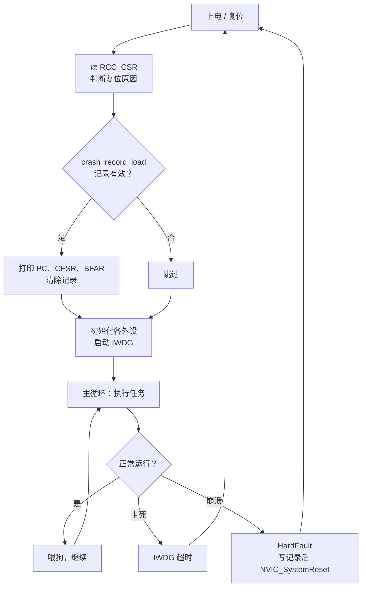

# 2.10 看门狗、低功耗与故障处理

一台装在现场的采集器，三个月后回访时发现它已经死机很久，串口没有任何输出，只有重新上电才能恢复。另一台用电池供电的同类设备，标称能跑一年，实际两个月就没电了。还有一台偶尔重启，日志里什么都没有，只能看到重启后从 `main` 第一行开始执行。这三种现象分别对应固件里三个不太起眼、但现场设备必须处理的部分：程序卡死怎么办，耗电怎么降下来，崩溃时怎么留下证据。

这一节解决这三件事。看门狗在程序跑飞时强制复位；低功耗模式让 CPU 和外设在空闲时停下来；故障处理函数在崩溃的瞬间把现场存下来，下次启动时打印出来。

## 1. 现场设备要面对的三件事

实验室里的程序由人盯着调试器运行，卡住了就暂停、看栈、改代码。现场设备没有这个条件，它要自己应付三种情况。

程序卡死，指主循环因为某个原因停住不再前进：等待一个永远不会置位的标志、某个 `while` 循环的条件写错、外设进入异常状态导致轮询永远等不到响应。这时候中断可能还在正常响应，CPU 并没有"死"，但设备应有的功能已经全部停了。看门狗对付的就是这种情况：它数着自己的时间，程序必须定期告诉它"我还活着"，一旦忘了说，它就复位芯片。

程序崩溃，指 CPU 执行了不该执行的指令或访问了不存在的地址，触发了硬件异常。Cortex-M3 把这些情况归到几个故障异常里，默认全部落到 HardFault。如果不写处理函数，异常入口是一个空的死循环，芯片就停在那里，什么信息都不留。写一个处理函数，至少能把出错时的 PC、状态寄存器保存下来。

电池续航是另一件独立的事。芯片满速运行时耗电几十毫安，而大部分采集设备每秒只工作几毫秒。让 CPU 在空闲时进入低功耗模式，电流能降到微安级，同样的电池能多用几十倍时间。

这三件事在代码里彼此关联：低功耗模式可能让看门狗继续计数（唤醒后要补喂），故障处理函数最后要靠复位把控制权交回系统，而复位原因又要靠 2.3 的 `reset_cause_get()` 才能分清是谁干的。

## 2. 独立看门狗

独立看门狗（Independent Watchdog, IWDG）是一个单独的递减计数器，时钟来自片内的 LSI，约 40 kHz，范围 30～60 kHz。它和主时钟无关，即使 PLL 停摆、系统时钟配置错了，只要 LSI 还在振荡，它就照常计数。这一点是"独立"两个字的含义，也是它比后面要讲的窗口看门狗更常用的原因。

IWDG 的寄存器很少。PR 与 RLR 受写保护，写之前要先向键寄存器 KR 写 0x5555 解锁；喂狗和启动也都是向 KR 写一个固定的键值：

| 寄存器 | 偏移 | 作用 |
| --- | --- | --- |
| KR | 0x00 | 写 0x5555 解锁 PR/RLR；写 0xAAAA 重装计数器（喂狗）；写 0xCCCC 启动 |
| PR | 0x04 | 预分频，取值 0～6，分频系数为 4 × 2^PR |
| RLR | 0x08 | 重装载值，12 位，0～4095 |
| SR | 0x0C | 状态，PVU 与 RVU 表示 PR/RLR 正在更新 |

超时时间的公式是：

```text
T = 4 × 2^PR × (RLR + 1) / f_LSI
```

把 PR 从 0 到 6 的结果算一遍：

::: terminal title="bash - IWDG 超时表"

```text
$ gcc -std=c17 -Wall -Wextra wdt_cfsr_calc.c -o wdt_cfsr_calc
$ ./wdt_cfsr_calc
=== IWDG timeout table (f_LSI = 40 kHz) ===
PR  Div   Min(RLR=0)   Max(RLR=4095)  RLR for 1.0 s
0   4       0.10 ms       409.6 ms        -
1   8       0.20 ms       819.2 ms        -
2   16      0.40 ms      1638.4 ms     2499
3   32      0.80 ms      3276.8 ms     1249
4   64      1.60 ms      6553.6 ms      624
5   128     3.20 ms     13107.2 ms      312
6   256     6.40 ms     26214.4 ms      155
```

:::

最短约 0.1 ms，最长约 26 s。大多数应用落在 0.5～2 s 这一段。表里最后一列给出 1 s 超时在每一档下的 RLR 值，PR = 4、RLR = 624 就是最常用的一组：64 × 625 / 40000 = 1.000 s。

配置函数按固定顺序写：

```c
static void iwdg_init_1s(void) {
    /* 调试暂停 CPU 时同步冻结 IWDG 计数器 */
    DBGMCU->CR |= DBGMCU_CR_DBG_IWDG_STOP;

    IWDG->KR = 0x5555u; /* 解锁 PR 与 RLR 写保护 */
    IWDG->PR = 4u;      /* 64 分频 */
    IWDG->RLR = 624u;   /* 重装载值 624 */
    IWDG->KR = 0xAAAAu; /* 立即把 RLR 装入计数器 */
    IWDG->KR = 0xCCCCu; /* 启动独立看门狗 */
}
```

先解锁再写 PR 和 RLR，否则写入被忽略。写完 RLR 后喂一次狗，让计数器立即载入新值。最后写 0xCCCC 启动。这里有一条不能反悔的规则：启动之后不能停止。只要不复位芯片，IWDG 就一直计数，没有任何寄存器能关掉它。这是它作为最后一道防线的价值所在，也意味着一旦开了狗，程序的每一步都要在超时之内完成。

喂狗就是再写一次 0xAAAA：

```c
static inline void iwdg_feed(void) {
    IWDG->KR = 0xAAAAu;
}
```

::: concept emb-wdt-feed-placement title="喂狗放在主循环所有任务都执行过之后"

喂狗的位置决定了看门狗能检测到什么。正确的位置是主循环的末尾、所有周期性任务都执行完之后：任何一个任务卡住，这一轮就执行不到末尾，狗超时复位。把喂狗放在定时器中断里则完全相反：中断照常响应，狗照常被喂，主循环即使早已卡死，看门狗也不会动作。

:::

这条规则值得单独强调，因为把喂狗放进 SysTick 处理函数是新手最常见的做法，而且它看起来也很合理：定时喂狗，周期固定。实际上它只检测了一件事，就是中断还能不能进。主循环里任何一处死循环都检测不到。

<Quiz
  type="single"
  :options="[
    { label: '把喂狗挪到中断里就能检测到', value: 'A' },
    { label: '主循环卡死期间 LED 停止翻转，1 s 后芯片复位，串口打印 IWDG', value: 'B' },
    { label: '芯片停在死循环里不动，直到按复位键', value: 'C' },
    { label: '看门狗超时但不会复位，只置一个标志', value: 'D' }
  ]"
  answer="B"
>

<template #question>

`iwdg_demo` 按住 PA0 超过 1 s 会发生什么？

</template>

正确答案是 **B**。主循环在 `while` 里死等，执行不到喂狗那一行，IWDG 计数到 0 就复位芯片。复位后从 `main` 重新开始，`reset_cause_get()` 读到 IWDGRSTF，打印出 `IWDG`。

</Quiz>

::: compare left-title="在定时器中断里喂狗" right-title="在主循环末尾喂狗"

```c
void SysTick_Handler(void) {
    ++g_ms;
    IWDG->KR = 0xAAAAu; /* 中断还活着，主循环卡死也不复位 */
}

int main(void) {
    for (;;) {
        task_a();
        task_b(); /* 这里卡住，狗永远被喂 */
    }
}
```

---

```c
void SysTick_Handler(void) {
    ++g_ms;
}

int main(void) {
    for (;;) {
        task_a();
        task_b();
        task_c();
        IWDG->KR = 0xAAAAu; /* 所有任务都跑完才喂 */
    }
}
```

:::

LSI 的误差很大，30～60 kHz 意味着同一个配置的实际超时可能在标称值的一半到两倍之间。按 40 kHz 算出的 1 s，最坏情况下只有约 0.67 s（LSI 跑到 60 kHz），最好情况下约 1.33 s。所以配置超时要按最快的 LSI 留余量，喂狗周期取标称超时的三分之一到一半。数据手册给出了 LSI 随温度和电压变化的曲线，出货前也可以实测一颗的 LSI 频率来校准。

看门狗复位之后，程序重新从上电状态跑起来，怎么知道这次是看门狗干的？用 2.3 的 `reset_cause_get()`：

```c
reset_cause_t cause = reset_cause_get();
uart_puts("boot: reset cause = ");
uart_puts(reset_cause_name(cause));
uart_puts("\n");
```

复位原因的读取和清除都封装在 `clock.c` 里，本节直接调用。打印出来如果是 `IWDG`，说明上一次是看门狗超时。

::: tip 调试时冻结看门狗

单步调试时，程序停在断点上的时间远超看门狗超时，芯片会在调试器眼皮底下反复复位。置位 DBGMCU_CR 的 `DBG_IWDG_STOP` 位，内核暂停时 IWDG 的计数器也暂停，调试器继续运行后它才接着数。示例的 `iwdg_init_1s` 第一行就是它。上板测真实功耗或观察复位行为时要去掉这一行。

:::

`iwdg_demo` 把上面的配置和前几节的模块拼在一起：主循环每 250 ms 翻转一次 LED 并喂狗，按住 PA0 时进入死等，模拟一个卡住的任务：

```c
int main(void) {
    clock_init_72mhz();
    tick_init();
    console_init(72000000u, 115200u);
    gpio_init_led_button();

    reset_cause_t cause = reset_cause_get();
    uart_puts("boot: reset cause = ");
    uart_puts(reset_cause_name(cause));
    uart_puts("\n");

    iwdg_init_1s();

    uint32_t last_feed = tick_now();
    int led_on = 0;

    for (;;) {
        /* 模拟主循环各项任务；按住 PA0 按键时死等，模拟任务卡死 */
        while ((GPIOA->IDR & 1u) != 0) {
        }

        if (tick_elapsed(last_feed, 250u)) {
            last_feed = tick_now();
            led_on = !led_on;
            GPIOC->BSRR = led_on ? GPIO_BSRR_BR13 : GPIO_BSRR_BS13;
            iwdg_feed();
            uart_puts("heartbeat: watchdog fed\n");
        }
    }
}
```

按住按键超过 1 s，芯片复位，串口重新输出 `boot: reset cause = IWDG`。松开按键后一切恢复。整个程序编译后的大小：

::: terminal title="bash - 构建 iwdg_demo"

```text
$ arm-none-eabi-gcc -std=c11 -mcpu=cortex-m3 -mthumb -O2 -g -Wall -Wextra \
    -ffunction-sections -fdata-sections -DSTM32F103xB -I. \
    -nostartfiles --specs=nano.specs --specs=nosys.specs -Wl,--gc-sections \
    -T stm32f103c8.ld iwdg_demo/main.c fault.c clock.c console.c tick.c \
    startup_stm32f103.c -o iwdg_demo.elf
$ arm-none-eabi-size iwdg_demo.elf
   text	   data	    bss	    dec	    hex	filename
   1724	      4	   1572	   3300	    ce4	iwdg_demo.elf
```

:::

## 3. 窗口看门狗

窗口看门狗（Window Watchdog, WWDG）是另一种思路。它用 PCLK1 计时，同样是递减计数器，但多了一个"窗口"：喂狗必须在规定的上下限之间，太晚不行，太早也不行。

计数器是 7 位，从 T 递减，减到 0x3F 时复位；在计数还没降到窗口值 W 以下就刷新，也复位。只有计数落在 0x40 到 W 之间时刷新才被接受：

| 寄存器 | 偏移 | 作用 |
| --- | --- | --- |
| CR | 0x00 | 位 6:0 是 T；位 7 是 WDGA，写 1 启动 |
| CFR | 0x04 | 位 6:0 是 W；位 8:7 是 WDGTB 分频；位 9 是 EWI，提前唤醒中断使能 |
| SR | 0x08 | 位 0 是 EWIF，提前唤醒中断标志 |

超时按计数步长算：

```text
T_step = 4096 × 2^WDGTB / PCLK1
```

计数器从 T 减到 0x40 所需的时间就是最长等待时间，窗口值 W 决定最早允许刷新的时刻：

::: terminal title="bash - WWDG 窗口"

```text
$ ./wdt_cfsr_calc
=== WWDG window example (PCLK1 = 36 MHz, WDGTB = 3, T = 0x7F, W = 0x5F) ===
step = 0.910 ms, refresh window = (29.13 ms, 58.25 ms)
```

:::

在这组参数下，只有在进入 0x5F 之后、跌到 0x3F 之前（约 29.1 ms 到 58.3 ms 之内）刷新才合法。刷新早了，说明某段代码跑得比预期快，也被判为异常；刷新晚了或忘了刷新，同样复位。

WWDG 能检测的问题 IWDG 检测不到：程序跳过了某段耗时逻辑，或者中断把本该执行的任务挤掉了。这两种情况都不会让主循环停住，但都会让设备的时序出错。

作者的建议是：绝大多数项目用 IWDG 就够。WWDG 的价值在时序严格、需要检测"执行过快"的场合，配置和调试都比 IWDG 麻烦，还要处理 EWI 提前唤醒中断。本教程后续的固件统一用 IWDG；窗口看门狗知道有这个东西、知道它和 IWDG 的区别即可。

## 4. 低功耗模式

F103 有三个低功耗模式，关掉的东西依次增多：

| 模式 | 停掉的部分 | 唤醒源 | 唤醒后的状态 | 典型电流（3.3 V） |
| --- | --- | --- | --- | --- |
| Sleep | 只停 CPU，外设照常运行 | 任意中断 | 接着执行 `__WFI()` 下一条 | 与运行接近 |
| Stop | 1.8 V 域的所有时钟停止，SRAM 与寄存器保持 | EXTI 线 | 时钟切回 HSI，需重新配置 | 14 µA（低功耗调压器）/ 24 µA |
| Standby | 1.8 V 域断电，SRAM 与寄存器丢失 | WKUP 引脚上升沿、RTC 闹钟、NRST、IWDG | 等同于复位启动 | 约 2 µA |

表中的电流值来自 DS5319 表 16，是芯片本身的消耗。开发板上还有电源指示灯、稳压器和 USB 转串口芯片，整板测出来的数字会比这个大一个数量级以上。

Sleep 模式最直接，执行 `__WFI()` 就进去了，任何中断都能唤醒：

```c
__WFI();
```

它只停 CPU 的时钟，内核不再取指，但外设照常工作，中断唤醒后从 `__WFI()` 的下一句继续执行。适合主循环有明确的空闲时刻、又要保持外设运行的场合。

Stop 模式的进入步骤多一些：

```c
static void enter_stop_mode(void) {
    /* 1. 等待串口最后一帧完全移出移位寄存器 */
    uart_flush();

    /* 2. 开启电源接口时钟，选择 Stop 模式 + 低功耗调压器 */
    RCC->APB1ENR |= RCC_APB1ENR_PWREN;
    PWR->CR = (PWR->CR & ~PWR_CR_PDDS) | PWR_CR_LPDS;

    /* 3. 内核置位 SLEEPDEEP，关闭 SysTick 防止节拍中断提前唤醒 */
    SCB->SCR |= SCB_SCR_SLEEPDEEP_Msk;
    SysTick->CTRL &= ~SysTick_CTRL_TICKINT_Msk;

    __DSB();
    __WFI();
    __ISB();

    /* 4. 唤醒后系统时钟退回 HSI 8 MHz，恢复 72 MHz 与 SysTick 中断 */
    SCB->SCR &= ~SCB_SCR_SLEEPDEEP_Msk;
    clock_init_72mhz();
    SysTick->CTRL |= SysTick_CTRL_TICKINT_Msk;
}
```

几个要点。PWR 的寄存器在 APB1 上，默认时钟关闭，必须先开 PWREN，否则第 2 步的写入被丢弃，芯片会按复位值进入 Stop 但用主调压器，电流比预期大。`PDDS = 0` 选 Stop，`LPDS = 1` 选低功耗调压器。`SCB->SCR` 的 SLEEPDEEP 是内核层面"深睡眠"的开关，配合 PWR 的选择，`__WFI()` 才会进入 Stop 而不是 Sleep。

SysTick 的中断必须关掉。SysTick 的时钟在 Stop 期间停了，但只要有挂起的中断，`__WFI()` 就会立刻返回，根本进不去。`__DSB()` 保证前面的写操作完成后再执行 `__WFI()`，`__ISB()` 让流水线清掉，因为唤醒后时钟变了。

::: concept emb-pwr-stop-back-to-hsi title="从 Stop 唤醒后系统时钟是 HSI 8 MHz"

进入 Stop 模式时，PLL 和 HSE 都被关闭。唤醒后，RCC_CFGR 的 SW 位被硬件清成 00，系统时钟回到 HSI 8 MHz。所有依赖时钟频率的配置（Flash 等待周期、SysTick 重装值、串口 BRR、定时器分频）都要按 72 MHz 重新设置。不恢复时钟直接继续跑，串口输出会变成乱码，因为 BRR 还按 72 MHz 算，实际时钟只有 8 MHz。

<Quiz
  type="single"
  :options="[
    { label: '接着执行 `__WFI()` 的下一句，时钟不变', value: 'A' },
    { label: '从 Reset_Handler 重新启动，SRAM 内容丢失', value: 'B' },
    { label: '从 `__WFI()` 的下一句继续，系统时钟回到 HSI 8 MHz', value: 'C' },
    { label: '原地等待，直到重新配置时钟', value: 'D' }
  ]"
  answer="C"
>

<template #question>

从 Stop 模式被 EXTI 唤醒后，CPU 从哪里继续执行，时钟是什么状态？

</template>

正确答案是 **C**。Stop 保持 SRAM 和寄存器，唤醒后回到 `__WFI()` 之后继续，但 PLL 与 HSE 已停，系统时钟退回 HSI 8 MHz。所以 `enter_stop_mode` 在 `__WFI()` 后面立刻调用 `clock_init_72mhz()`。B 描述的是 Standby。

</Quiz>

:::

示例程序用 EXTI 唤醒：PA0 接按键，上升沿触发：

```c
static void pa0_exti_init(void) {
    RCC->APB2ENR |= RCC_APB2ENR_IOPAEN | RCC_APB2ENR_IOPCEN | RCC_APB2ENR_AFIOEN;

    /* PC13：2 MHz 推挽输出 */
    GPIOC->CRH = (GPIOC->CRH & ~(0xFu << 20)) | (0x2u << 20);

    /* PA0：下拉输入 */
    GPIOA->CRL = (GPIOA->CRL & ~0xFu) | 0x8u;
    GPIOA->BRR = 1u << 0;

    /* EXTI0 映射到 PA0，上升沿触发 */
    AFIO->EXTICR[0] &= ~AFIO_EXTICR1_EXTI0;
    EXTI->RTSR |= EXTI_RTSR_TR0;
    EXTI->FTSR &= ~EXTI_FTSR_TR0;
    EXTI->PR = EXTI_PR_PR0;
    EXTI->IMR |= EXTI_IMR_MR0;

    NVIC_SetPriority(EXTI0_IRQn, 2u);
    NVIC_EnableIRQ(EXTI0_IRQn);
}
```

EXTI 的细节在 [2.5 中断与 NVIC](/教程/正文/嵌入式/2_MCU裸机开发/2_5_中断与NVIC) 里，这里只用到"配置好一条唤醒源"这个结果。`stop_wakeup` 的主循环每 2 s 进入一次 Stop，按键唤醒后恢复时钟，串口打印 `wakeup: clock restored to 72 MHz`。

进 Stop 之前要等串口发完最后一个字节，也就是 `uart_flush()` 里的 TC 位。TXE 只表示数据寄存器空了，最后一个字节的停止位可能还在移位寄存器里，这时关时钟会把那个字节截断，终端上看到半截乱码。

Standby 更进一步，整个 1.8 V 域断电，SRAM 的内容全部丢失，唤醒的后果等同于复位：程序从 `Reset_Handler` 重新开始，所有静态存储期对象回到初值。进 Standby 的代码如下：

```c
static void enter_standby_mode(void) {
    uart_flush();

    /* 使能 PA0（WKUP 引脚）上升沿唤醒，清除之前的唤醒标志 WUF */
    PWR->CSR |= PWR_CSR_EWUP;
    PWR->CR |= PWR_CR_CWUF | PWR_CR_PDDS;

    SCB->SCR |= SCB_SCR_SLEEPDEEP_Msk;
    __DSB();
    __WFI();
}
```

`PDDS = 1` 选 Standby，`CWUF` 清除之前的唤醒标志。`EWUP = 1` 把 PA0 使能成 WKUP 引脚。这里用的仍然是 `__WFI()`，但进入的是 Standby，因为 `PDDS = 1` 时深睡眠的目标是待机而不是停止。

唤醒之后芯片重新启动，程序怎么知道自己是被唤醒的还是刚上电？靠 PWR_CSR 的 SBF（Standby Flag）：

```c
if ((PWR->CSR & PWR_CSR_SBF) != 0) {
    /* 写 CSBF 与 CWUF 清除待机标志和唤醒标志 */
    PWR->CR |= PWR_CR_CSBF | PWR_CR_CWUF;
    uart_puts("boot: woke up from Standby mode (SBF = 1)\n");
} else {
    uart_puts("boot: cold reset or normal reset (SBF = 0)\n");
}
```

SBF 在 Standby 唤醒后置位，写 CSBF 清零。这一点和 RCC_CSR 的复位标志是两套独立的信息：SBF 说明"上次是从待机醒来的"，RCC_CSR 说明"这次启动经历了哪些复位源"，两个都要读才能分清。

需要跨越 Standby 保存的状态，只能写在备份寄存器或 Flash 里；前者不在这本教程的范围内，后者见 [3.9 Flash、EEPROM、SD 与文件系统](/教程/正文/嵌入式/3_驱动_通信与中间件/3_9_Flash_EEPROM_SD与文件系统)。

测量实际电流的方法是把万用表串在 3.3 V 供电线上，或者用带电流测量的 USB 表。开发板上的 LED 和稳压器会让读数偏大，想知道芯片本身消耗多少，得断开板上其他负载。完整的方法在 [6.5 实时性、性能与功耗测量](/教程/正文/嵌入式/6_质量_安全与交付/6_5_实时性_性能与功耗测量) 里讲。

::: tip 调试低功耗时保持连接

芯片进入 Stop 或 Standby 后调试连接会断开，调试器报 "target not found" 或需要重新连接。置位 DBGMCU_CR 的 `DBG_SLEEP`、`DBG_STOP`、`DBG_STANDBY`，调试器可以在低功耗模式下保持连接：

```c
DBGMCU->CR |= DBGMCU_CR_DBG_STOP;
```

这样做的代价是芯片不再真正进入低功耗，测电流时要把它注释掉。

:::

## 5. 故障异常

Cortex-M3 有四个故障异常：HardFault、MemManage、BusFault、UsageFault。后三个默认没有使能，发生它们对应的错误时，异常会被"升级"成一个普通的 HardFault，HFSR 的 FORCED 位置位，表示"这次 HardFault 是由别的故障升级来的"。使用时需要在 SCB->SHCSR 里把它们各自的使能位打开：

| 异常 | 触发条件 | SHCSR 使能位 |
| --- | --- | --- |
| MemManage | 存储器保护违规（F103 没有 MPU，实际不会发生） | MEMFAULTENA |
| BusFault | 取指或数据访问的总线错误 | BUSFAULTENA |
| UsageFault | 未定义指令、非法状态、除零（需开启） | USGFAULTENA |

F103 没有 MPU，MemManage 实际上不会发生。BusFault 和 UsageFault 在调试时有用，打开后 CFSR 里会给出更具体的错误原因。

CFSR 是一个 32 位的寄存器，分成三段：位 7:0 是 MemManage 状态（MMFSR），位 15:8 是 BusFault 状态（BFSR），位 31:16 是 UsageFault 状态（UFSR）。常用的位如下：

| 位 | 名称 | 含义 |
| --- | --- | --- |
| 0 | IACCVIOL | 取指时的存储器保护违规 |
| 1 | DACCVIOL | 数据访问的存储器保护违规 |
| 7 | MMARVALID | MMFAR 中的地址有效 |
| 8 | IBUSERR | 取指时的总线错误 |
| 9 | PRECISERR | 精确的数据总线错误，压栈的 PC 指向出错指令 |
| 10 | IMPRECISERR | 不精确的数据总线错误，压栈的 PC 不指向出错指令 |
| 12 | STKERR | 异常入栈时发生总线错误 |
| 15 | BFARVALID | BFAR 中的地址有效 |
| 16 | UNDEFINSTR | 未定义指令 |
| 17 | INVSTATE | 非法的执行状态（函数指针最低位为 0） |
| 18 | INVPC | 非法的 PC 值 |
| 19 | NOCP | 没有协处理器 |
| 24 | UNALIGNED | 非对齐访问 |
| 25 | DIVBYZERO | 除零 |

HFSR 里常用的两位是 VECTTBL（位 1，取向量表时出错）和 FORCED（位 30，由其他故障升级）。BFAR 和 MMFAR 存放出错的地址，只有对应的 VALID 位置位时才有意义。

除零默认不触发 UsageFault，C 语言里整数除以零的结果未定义，编译器生成的 `sdiv` 指令不会报异常。要捕获它，先把 CCR 的 DIV_0_TRP 位置 1：

```c
void fault_enable_traps(void) {
    /* 捕获除零错误；若需捕获非对齐访问，可同时置位 SCB_CCR_UNALIGN_TRP_Msk */
    SCB->CCR |= SCB_CCR_DIV_0_TRP_Msk;
}
```

::: concept emb-fault-forced title="未使能的故障异常升级为 HardFault"

MemManage、BusFault、UsageFault 在 SHCSR 中默认关闭。关闭时发生对应的错误，异常升级为 HardFault，HFSR 的 FORCED 位置 1。想知道具体是哪种错误，要么在 SHCSR 里使能这三个异常，让它们各自进入自己的处理函数，要么在 HardFault 处理函数里读 CFSR。即使升级了，CFSR 里对应的状态位仍然会被置位。

:::

一个细节和调试有关。PRECISERR 表示压栈的 PC 精确指向出错的那条指令，IMPRECISERR 表示不精确，PC 可能已经往后跑了几条。写缓冲器（write buffer）会延迟写操作的错误报告，把精确错误变成不精确。调试时可以把 ACTLR 的 DISDEFWBUF 置位，关掉写缓冲，让总线错误变成精确的，代价是性能略降。产品固件不关，调试版本打开。

<Quiz
  type="single"
  :options="[
    { label: 'CFSR 的 DIVBYZERO 位，但不复位', value: 'A' },
    { label: 'HardFault，HFSR 的 FORCED 置 1，CFSR 的 DIVBYZERO 置 1', value: 'B' },
    { label: '什么都不发生，结果是未定义的某个值', value: 'C' },
    { label: 'HardFault，但 CFSR 全为 0，看不出原因', value: 'D' }
  ]"
  answer="B"
>

<template #question>

`fault_enable_traps()` 已经置位 DIV_0_TRP，但没有在 SHCSR 里使能 UsageFault。此时 `100 / 0` 会怎样？

</template>

正确答案是 **B**。置位 DIV_0_TRP 后除零产生 UsageFault，但这个异常在 SHCSR 里默认关闭，于是升级为 HardFault，HFSR 的 FORCED 位记录这次升级，CFSR 的 DIVBYZERO 位照样置位。连 DIV_0_TRP 都不置时，`sdiv` 不报异常，得到的是未定义的结果，那就是 C 了。

</Quiz>

## 6. 写一个故障处理函数

HardFault 处理函数要做的第一件事是把异常发生时的现场取出来。Cortex-M3 进入异常时硬件自动压栈 8 个字：R0、R1、R2、R3、R12、LR、PC、xPSR。使用哪个栈由进入异常前的状态决定：线程模式用 MSP 或 PSP，处理模式固定用 MSP。LR 里装的是 EXC_RETURN，它的位 2 表示返回后使用哪个栈：0 用 MSP，1 用 PSP。

处理函数先是一小段汇编，判断用的是哪个栈，把栈指针作为参数传给 C 函数：

```c
__attribute__((naked)) void HardFault_Handler(void) {
    __asm volatile(
        "tst lr, #4      \n"
        "ite eq          \n"
        "mrseq r0, msp   \n"
        "mrsne r0, psp   \n"
        "b hardfault_c   \n"
    );
}
```

`naked` 属性告诉编译器不要生成函数序言和收尾，否则压栈会改变栈指针，`mrs` 取到的就不是异常发生时的值了。`tst lr, #4` 测位 2，`ite eq` 是 if-then-else 条件执行：相等（用 MSP）时取 MSP，不等时取 PSP。最后跳到 C 函数，此时 R0 就是栈指针。

编译后的结果是五条有效指令，末尾那个 `nop` 是对齐填充：

::: terminal title="bash - HardFault_Handler 的机器码"

```text
$ arm-none-eabi-objdump -d fault_demo.elf | sed -n '/<HardFault_Handler>:/,/^$/p'
080002d0 <HardFault_Handler>:
 80002d0:	f01e 0f04 	tst.w	lr, #4
 80002d4:	bf0c      	ite	eq
 80002d6:	f3ef 8008 	mrseq	r0, MSP
 80002da:	f3ef 8009 	mrsne	r0, PSP
 80002de:	f7ff bf6f 	b.w	80001c0 <hardfault_c>
 80002e2:	bf00      	nop
```

:::

C 函数从栈指针处读出那 8 个寄存器。栈上的顺序由硬件固定：偏移 0 是 R0，偏移 4 是 R1，依次到偏移 28 的 xPSR：

```c
typedef struct {
    uint32_t r0;
    uint32_t r1;
    uint32_t r2;
    uint32_t r3;
    uint32_t r12;
    uint32_t lr;
    uint32_t pc;
    uint32_t xpsr;
} fault_frame_t;
```

这个结构体的字段顺序必须和硬件压栈的顺序完全一致，否则读出来全是错位的值。偏移是 0、4、8、12、16、20、24、28，结构体按 4 字节对齐，编译器不会插入填充。

处理函数本身负责把现场和状态寄存器打印出来：

```c
void hardfault_c(const fault_frame_t *frame) {
    uint32_t cfsr = SCB->CFSR;
    uint32_t hfsr = SCB->HFSR;
    uint32_t bfar = SCB->BFAR;

    g_crash_record.magic = CRASH_MAGIC;
    g_crash_record.pc = frame->pc;
    g_crash_record.lr = frame->lr;
    g_crash_record.cfsr = cfsr;
    g_crash_record.hfsr = hfsr;
    g_crash_record.bfar = bfar;
    g_crash_record.checksum = crash_checksum(&g_crash_record);

    uart_puts("\n=== HardFault ===\n");
    uart_print_reg("PC   = ", frame->pc);
    uart_print_reg("CFSR = ", cfsr);
    uart_print_reg("HFSR = ", hfsr);
    if ((cfsr & SCB_CFSR_BFARVALID_Msk) != 0) {
        uart_print_reg("BFAR = ", bfar);
    }
    uart_flush();

    if ((CoreDebug->DHCSR & CoreDebug_DHCSR_C_DEBUGEN_Msk) != 0) {
        __BKPT(0);
    }
    NVIC_SystemReset();
}
```

打印只能用轮询方式，不能用中断：故障可能发生在中断里，此时 NVIC 的状态未必正常，中断方式的串口发送可能永远等不到。`uart_putc` 本身是轮询的，这里直接用它。

打印完分两种情况。调试器连着的时候（`CoreDebug->DHCSR` 的 C_DEBUGEN 位为 1），执行 `__BKPT(0)` 主动断点，调试器停下后可以直接 `bt` 看调用栈。没有调试器时执行 `NVIC_SystemReset()`，让芯片重启，把控制权交回系统。既不重启也不断点，芯片就停在这里，设备彻底失联。

现场信息里最有价值的是 PC：它指向出错的那条指令。用 `addr2line` 把地址翻译成源文件和行号：

```c
__attribute__((noinline)) int trigger_div_zero(int numerator, int divisor) {
    int q = numerator / divisor;
    g_sink = (uint32_t)q;
    return q;
}
```

编译后找到这条除法指令的地址：

::: terminal title="bash - objdump 找到三条出错指令"

```text
$ arm-none-eabi-objdump -d fault_demo.elf | sed -n '/<trigger_div_zero>:/,/^$/p'
080000f0 <trigger_div_zero>:
 80000f0:	fb90 f0f1 	sdiv	r0, r0, r1
 80000f4:	4b01      	ldr	r3, [pc, #4]	@ (80000fc <trigger_div_zero+0xc>)
 80000f6:	6018      	str	r0, [r3, #0]
 80000f8:	4770      	bx	lr
```

:::

`0x080000f0` 是除法指令的地址。把它交给 `addr2line`。`addr2line` 打印的是编译时记进调试信息的路径，示例用 `-ffile-prefix-map` 把绝对路径换成了相对构建目录的路径，不写这个选项时会打印完整的绝对路径：

::: terminal title="bash - addr2line 定位到源代码行"

```text
$ arm-none-eabi-addr2line -e fault_demo.elf -f -C 0x080000f0 0x08000106 0x08000110
trigger_div_zero
./fault_demo/main.c:15
trigger_invstate
./fault_demo/main.c:24
trigger_busfault
./fault_demo/main.c:30
```

:::

三个地址分别对应三条故意出错指令，三个故障的触发方式与状态位如下：

| 故障 | 触发方式 | 说明 |
| --- | --- | --- |
| 除零 | `trigger_div_zero(100, 0)` | 开启 DIV_0_TRP 后产生 UsageFault，CFSR 的 DIVBYZERO 置位；UsageFault 未使能时升级为 HardFault |
| 非法状态 | 调用最低位为 0 的函数指针 | 产生 INVSTATE，跳到 `bx` 时目标地址的最低位是 0 |
| 总线错误 | 读地址 0xCCCCCCCC | 未映射的地址，产生 PRECISERR，BFAR 记录出错地址 |

第二个故障的写法值得看一眼。Cortex-M 只支持 Thumb 指令，函数指针的最低位必须为 1，`bx` 跳转时硬件检查这一位，为 0 就报 INVSTATE：

```c
__attribute__((noinline)) void trigger_invstate(void) {
    uintptr_t addr = (uintptr_t)dummy_target & ~(uintptr_t)1u;
    void (*bad_fn)(void) = (void (*)(void))addr;
    bad_fn();
}
```

反汇编里能看到 `bic.w r3, r3, #1` 把最低位清掉，然后 `bx r3`。`bx` 位于 0x0800_0106，用它做 addr2line 查到的是 `main.c:24`，也就是 `bad_fn();` 那一行。

第三个故障读的是 0xCCCCCCCC，这个地址落在未映射的区域，总线返回错误，CFSR 的 PRECISERR 和 BFARVALID 都置位，BFAR 里记录的就是 0xCCCCCCCC。预期在串口上看到的是 `CFSR = 0x00008200` 和 `BFAR = 0xCCCCCCCC`，打印的 PC 等于 `trigger_busfault` 里那条 `ldr.w` 的地址 0x0800_0110。本节只能在主机上验证这组状态位的含义，芯片上的实际打印要接上串口才能看到。

把 0x00008200 交给解码程序：

::: terminal title="bash - 解码 CFSR"

```text
$ ./wdt_cfsr_calc
CFSR = 0x00008200, HFSR = 0x40000000 -> [HFSR:FORCED] [BFSR:BFARVALID] [BFSR:PRECISERR]
```

:::

CFSR 的值 0x00008200 拆开看：位 15（BFARVALID）、位 9（PRECISERR）。HFSR 的 0x40000000 是 FORCED，说明这个错误本来是 BusFault，因为 BUSFAULTENA 没开，升级成了 HardFault。

::: generate emb-fault-print-walkthrough kind=explanation concepts=emb-fault-forced

面向第一次读故障现场的读者，说明异常入栈的 8 个寄存器各是什么、为什么 PC 指向出错指令而 LR 指向调用点、本页三个故障分别会让 CFSR 的哪些位置位、HFSR 的 FORCED 位为什么会出现。最后用第 6 节给出的三个地址，演示从 addr2line 的输出版本反推源代码行。

:::

## 7. 把三者组合起来

三个部分单独用都不完整。看门狗能复位卡死的程序，但复位之后什么线索都没有；故障处理函数能打印现场，但打印完芯片还在原地，需要有人重启它；低功耗模式省电，但睡着的时候看门狗还在数数。

把它们拼起来的做法是：故障处理函数把现场写进一块复位后不会被清零的内存，然后主动复位；下次启动时读出来打印。这块内存就是 1.8 节链接脚本里预留的 `.noinit` 段。

```c
__attribute__((section(".noinit"))) static crash_record_t g_crash_record;
```

`.noinit` 段在链接脚本里用 `NOLOAD` 声明，不加载进映像，启动代码也不清零。软件复位和看门狗复位后，里面的内容还是复位前的值。但第一次上电时，SRAM 里是随机内容，所以记录必须自带有效性判断：

```c
typedef struct {
    uint32_t magic;
    uint32_t pc;
    uint32_t lr;
    uint32_t cfsr;
    uint32_t hfsr;
    uint32_t bfar;
    uint32_t checksum;
} crash_record_t;

#define CRASH_MAGIC 0x4641554Cu /* "FAUL" */
```

`magic` 取一个固定的值，写入时填上，读取时比对。单靠 magic 不够：随机内容碰巧等于这个值的概率虽然低，但不是零，而且擦写或部分写入也可能留下半截记录。所以再加一个校验值，覆盖记录里的所有字段：

```c
static uint32_t crash_checksum(const crash_record_t *rec) {
    return rec->magic ^ rec->pc ^ rec->lr ^ rec->cfsr ^ rec->hfsr ^ rec->bfar ^
           0xA5A55A5Au;
}
```

异或校验简单，能发现单个字段被破坏或记录没写完的情况。要防篡改用 CRC-32，[3.9 Flash、EEPROM、SD 与文件系统](/教程/正文/嵌入式/3_驱动_通信与中间件/3_9_Flash_EEPROM_SD与文件系统) 的配置记录用的是 CRC-32。

读取和清除：

```c
int crash_record_load(crash_record_t *out) {
    if (g_crash_record.magic != CRASH_MAGIC) {
        return 0;
    }
    if (g_crash_record.checksum != crash_checksum(&g_crash_record)) {
        return 0;
    }
    *out = g_crash_record;
    return 1;
}

void crash_record_clear(void) {
    g_crash_record.magic = 0;
    g_crash_record.checksum = 0;
}
```

启动时先读记录，打印完立刻清掉，避免下次正常启动时重复打印同一条记录。整个组合程序在 `crash_record/main.c`，下面是启动部分（打印的其他字段与 `fault.c` 里的版本相同，这里从略）：

```c
int main(void) {
    clock_init_72mhz();
    tick_init();
    console_init(72000000u, 115200u);
    fault_enable_traps();

    reset_cause_t cause = reset_cause_get();
    uart_puts("boot: reset cause = ");
    uart_puts(reset_cause_name(cause));
    uart_puts("\n");

    crash_record_t rec;
    if (crash_record_load(&rec)) {
        uart_puts("last crash record in .noinit:\n  PC   = ");
        uart_puthex32(rec.pc);
        uart_puts("\n  CFSR = ");
        uart_puthex32(rec.cfsr);
        uart_puts("\n");
        /* 完整的实现还打印 LR、HFSR、BFAR，格式与 fault.c 里的相同 */
        crash_record_clear();
    }

    iwdg_init_1s();

    uint32_t last_feed = tick_now();
    for (;;) {
        if (tick_elapsed(last_feed, 250u)) {
            last_feed = tick_now();
            IWDG->KR = 0xAAAAu;
        }
    }
}
```

`.noinit` 段在 ELF 里的样子可以验证：

::: terminal title="bash - .noinit 的布局"

```text
$ arm-none-eabi-objdump -h crash_record.elf | sed -n '/.noinit/,+2p'
  5 .noinit       0000001c  20000008  080007a0  00002008  2**2
                  ALLOC
$ arm-none-eabi-nm -n crash_record.elf | grep -E "snoinit|enoinit|g_crash_record"
20000008 B _snoinit
20000008 b g_crash_record
20000024 B _enoinit
```

:::

`.noinit` 的长度 0x1C = 28 字节，正好是 `crash_record_t` 的 7 个字段。它只有 `ALLOC` 没有 `CONTENTS`，说明不占 Flash 空间，也不占 `.bin` 文件。`g_crash_record` 的地址 0x20000008 与 `_snoinit` 相同，落在段的开头。

`crash_record` 的可执行代码与只读数据的大小：

::: terminal title="bash - 组合程序的 size"

```text
$ arm-none-eabi-size crash_record.elf
   text	   data	    bss	    dec	    hex	filename
   1948	      4	   1572	   3524	    dc4	crash_record.elf
```

:::

`bss` 列的 1572 拆开是 `.bss` 的 4 字节、`.noinit` 的 28 字节和 `._user_heap_stack` 预留的 1540 字节。`.noinit` 的段属性是 `NOBITS`，`size` 把它算进 bss 列，这和它不占 Flash 的性质并不矛盾：RAM 里确实占着位置，只是不占文件。

三者组合之后的运行流程是这样的：



看门狗兜住卡死，故障处理兜住崩溃，两者都通过复位回到起点，而起点处的记录和复位原因负责把现场留下来。更完整的日志系统、断言和核心转储在 [6.2 日志、断言与故障诊断](/教程/正文/嵌入式/6_质量_安全与交付/6_2_日志_断言与故障诊断) 里，那边的记录会写进外部 Flash，能存多条。

## 8. HAL 对照

HAL 把这几块的寄存器操作包成了函数：

| 功能 | 寄存器写法 | HAL 写法 |
| --- | --- | --- |
| 看门狗初始化 | `IWDG->KR = 0x5555; IWDG->PR = 4; IWDG->RLR = 624;` | `HAL_IWDG_Init(&hiwdg)`，结构体填 `Prescaler`、`Reload` |
| 喂狗 | `IWDG->KR = 0xAAAA` | `HAL_IWDG_Refresh(&hiwdg)` |
| 进入 Sleep | `__WFI()` | `HAL_PWR_EnterSLEEPMode(PWR_MAINREGULATOR_ON, PWR_SLEEPENTRY_WFI)` |
| 进入 Stop | `PWR->CR` 设 PDDS/LPDS，`__WFI()` | `HAL_PWR_EnterSTOPMode(PWR_LOWPOWERREGULATOR_ON, PWR_STOPENTRY_WFI)` |
| 进入 Standby | `PWR->CR` 设 PDDS，`__WFI()` | `HAL_PWR_EnterSTANDBYMode()` |
| 使能 WKUP 引脚 | `PWR->CSR \|= PWR_CSR_EWUP` | `HAL_PWR_EnableWakeUpPin(PWR_WAKEUP_PIN1)` |
| 读待机标志 | `PWR->CSR & PWR_CSR_SBF` | `__HAL_PWR_GET_FLAG(PWR_FLAG_SB)` |

HAL 的 `HAL_PWR_EnterSTOPMode` 同样不会帮你恢复时钟。唤醒后调用 `SystemClock_Config()` 重新配置，和寄存器写法里调用 `clock_init_72mhz()` 是一回事。故障处理函数 HAL 不提供，`HAL_NVIC_SystemReset` 只是 `NVIC_SystemReset` 的包装。

## 9. 习题

### 9.1 巩固

<Exercise id="62201" :d="1" :w="2">

`code/嵌入式/2_MCU裸机开发/2_10_看门狗_低功耗与故障处理/host/wdt_cfsr_calc.c` 里的 `print_iwdg_table()` 只按典型值 40 kHz 计算超时，也没有覆盖 RLR 的全部取值。

(1) 给表格的每一档加上最坏（LSI 60 kHz）与最好（LSI 30 kHz）两列，重新编译运行，写出 PR = 4 一行的三个值。

(2) 按下面三条规则为目标超时选参数：分频系数取满足 RLR ≤ 4095 的最小档；标称超时最接近目标；RLR 由 $T \times f_{\mathrm{LSI}} / \text{分频系数} - 1$ 算出。填出 100 ms、500 ms、3 s、10 s 四组 PR 与 RLR。

(3) 用最坏情况（60 kHz）重算这四组的超时，指出哪一组在 LSI 偏快时只剩 2.0 s，恰好等于一个每轮 2 s 的任务，没有任何余量。

</Exercise>

<Exercise id="62202" :d="2" :w="2">

WWDG 的参数换算。PCLK1 = 36 MHz，计数器从 T 递减到 0x3F 时复位，只有计数器落在 0x40 到 W 之间时刷新才被接受。

(1) 用 $T_{\mathrm{step}} = 4096 \times 2^{\mathrm{WDGTB}} / \mathrm{PCLK1}$ 算出 WDGTB 取 0、1、2、3 时的计数步长，填一张四行的表。

(2) T = 0x7F、W = 0x58 时，算出窗口的两个边界：最早允许刷新的时刻，以及计数器降到 0x3F、触发复位的时刻。说明计数器正好等于 0x40 的那一格为什么仍算合法刷新，而再往后一格就复位。

(3) 把 `wdt_cfsr_calc.c` 的 `print_wwdg_example()` 改成一个带判断的函数，输入一次刷新的时刻（毫秒），按 `t / T_step` 取整算出计数器值，输出 `early`、`ok` 或 `late`。在 20、35、40、50、58、60 ms 六个时刻上运行，期望输出如下：

```out
t=20 ms counter=0x6A early
t=35 ms counter=0x59 early
t=40 ms counter=0x54 ok
t=50 ms counter=0x49 ok
t=58 ms counter=0x40 ok
t=60 ms counter=0x3E late
```

(4) 把 W 改成 0x70，最早允许时刻提前到多少毫秒？最晚允许时刻变不变？说明窗口看门狗用 W 限制的是「刷新过早」还是「刷新过晚」。

</Exercise>

<Exercise id="62203" :d="3" :w="3">

下面这段进入 Stop 模式的代码有至少四处缺陷，照着写会让设备要么根本进不去 Stop，要么唤醒后串口输出乱码，要么在进入前丢掉最后几个字节：

```c
static void enter_stop_bad(void) {
    PWR->CR = (PWR->CR & ~PWR_CR_PDDS) | PWR_CR_LPDS;
    SCB->SCR |= SCB_SCR_SLEEPDEEP_Msk;
    __WFI();
    SysTick->CTRL |= SysTick_CTRL_TICKINT_Msk;
}
```

(1) 逐条指出缺陷、对应的现象和出现原因。

(2) 按第 4 节的顺序重写这个函数，补上 `__DSB()`、`__ISB()` 与唤醒后的时钟恢复。

(3) 用 HAL 写同一个过程，说明 `HAL_PWR_EnterSTOPMode()` 替你做了哪几步、哪一步仍然要自己调用。

(4) 如果把 `PWR->CR` 的写入放到 `RCC->APB1ENR` 打开 PWREN 之前，Stop 模式还能进去吗？电流会有什么差别？

</Exercise>

### 9.2 编程

<Exercise id="62204" :d="3" :w="3">

一个电池供电的采集节点每 1 s 工作一次，工作段持续 10 ms，电流 30 mA；其余时间可以进 Sleep、Stop 或 Standby。电池容量按 1000 mAh 计，Sleep 电流按 30 mA、Stop 按 14 µA、Standby 按 2 µA 估算。从 Standby 唤醒等同于复位，每次要多花 15 ms 重新启动，这 15 ms 也按 30 mA 计。

写一个 `power_budget.c`，用函数 `double avg_current_ma(int mode, double period_ms, double active_ms)` 算出三种方案的平均电流与理论续航，输出：

```out
A Sleep   : 30000.0 uA, 1.4 days
B Stop    : 313.9 uA, 132.8 days
C Standby : 752.0 uA, 55.4 days
Stop, 365 days: period = 2994 ms
```

最后一行要求反解：采用 Stop 模式时，工作周期最长取多少毫秒才能让 1000 mAh 电池撑满 365 天？给出解方程的过程。

(1) 为什么这组参数下 Standby 反而比 Stop 费电？

(2) 如果实测 Sleep 电流是 8 mA 而不是 30 mA，A 方案的续航变成多少天？

</Exercise>

<Exercise id="62205" :d="3" :w="3">

写一个主机端程序 `fault_decode.c`，实现 `void decode_cfsr(uint32_t cfsr, uint32_t hfsr)`，按 CFSR 的三段分别检查状态位并打印标签，顺序固定为 UFSR、BFSR、MMFSR，HFSR 的 FORCED 与 VECTTBL 放在最前面。至少覆盖 DIVBYZERO、UNALIGNED、INVSTATE、UNDEFINSTR、BFARVALID、PRECISERR、IMPRECISERR、IACCVIOL、DACCVIOL。

用下面四组输入验证，输出必须逐字一致：

```out
CFSR = 0x02000000, HFSR = 0x40000000 -> [HFSR:FORCED] [UFSR:DIVBYZERO]
CFSR = 0x00020000, HFSR = 0x40000000 -> [HFSR:FORCED] [UFSR:INVSTATE]
CFSR = 0x00008200, HFSR = 0x40000000 -> [HFSR:FORCED] [BFSR:BFARVALID] [BFSR:PRECISERR]
CFSR = 0x00000400, HFSR = 0x40000000 -> [HFSR:FORCED] [BFSR:IMPRECISERR]
```

(1) 四组里只有一组同时置了 BFARVALID，写出这一组对应的 BFAR 值，并说明为什么另外三组读 BFAR 没有意义。

(2) 第 6 节的三个故障分别产生哪一组 CFSR？把故障、触发指令和 CFSR 值列成表。

(3) 如果打开 BUSFAULTENA 使能 BusFault，同一组 CFSR 会进入哪个处理函数？HFSR 的 FORCED 位还会不会置位？

</Exercise>

### 9.3 综合与挑战

<Exercise id="62206" :d="4" :w="3">

第 6 节的 `HardFault_Handler` 用了 `__attribute__((naked))`。这段属性去掉之后程序仍能编译，但读出来的现场全是错位的。

(1) 写两个版本的处理函数，一个带 `naked`、一个不带，用 `arm-none-eabi-gcc -mcpu=cortex-m3 -mthumb -O2 -c` 编译，再用 `arm-none-eabi-objdump -d` 反汇编，把两个函数的指令贴出来。

(2) 根据反汇编解释：不带 `naked` 时编译器生成了哪几条序言指令，栈指针因此偏移了多少字节，`fault_frame_t` 的 `pc` 字段实际读到的是压栈帧里的哪一个寄存器。

(3) 用 `_Static_assert` 与 `offsetof` 写出 8 个字段的偏移检查，编译一次确认 `fault_frame_t` 没有填充。

(4) 处理函数末尾用的是 `b hardfault_c` 而不是 `bl`。结合 LR 在异常入口装的是 EXC_RETURN 这一点，说明改成 `bl` 会破坏什么。

</Exercise>

<Exercise id="62207" :d="4" :w="4">

`code/嵌入式/2_MCU裸机开发/2_10_看门狗_低功耗与故障处理/exercises/noinit_record_starter.c` 留了四个 TODO：异或校验、保存记录、读取校验、清除记录。补全它们，用 `gcc -std=c17 -Wall -Wextra` 编译运行，输出必须为：

```out
cold boot valid = 0
reboot 1: PC=0x08000110 LR=0x08000159 CFSR=0x00008200 BFAR=0xCCCCCCCC
reboot 2 valid = 0
```

然后完成三件事：

(1) `g_sim_noinit` 是 `static` 的，先加一个只给测试用的函数 `void crash_record_corrupt_pc(void)`，把其中的 `pc` 加 1。在第一次成功读取之后、清除之前调用它，再调用一次 `crash_record_load()`，确认它拒绝这条记录，说明是哪个字段发现了破坏。

(2) 把 `crash_record_clear()` 改成只清 `magic`、不清 `checksum`，输出会不会变化？说明判断顺序为什么能保证结果不变。

(3) 上板版本里，这个记录放在 `.noinit` 段；主机版本用一个普通静态对象模拟。说明两者在「第一次上电内容随机」这一点上为什么可以用同一套有效性判断。

</Exercise>

<Exercise id="62208" :d="5" :w="4">

为下面这个主循环设计 IWDG 参数并写成工具 `iwdg_budget.c`。任务表：

```c
struct task { const char *name; uint32_t wcet_ms; };
static const struct task g_tasks[] = {
    {"sensor_read", 18u},
    {"radio_tx", 42u},
    {"display", 9u},
};
```

循环还有 2 ms 的固定开销。要求喂狗周期不超过最坏情况超时的三分之一，即最坏超时至少是单轮最坏耗时的 3 倍；LSI 按 60 kHz 取最坏值。

输出格式固定为：

```out
loop = 71 ms, worst-case budget = 213 ms
PR = 0 (div 4), RLR = 3199, nominal = 320.0 ms
LSI 60 kHz: 213.3 ms, LSI 30 kHz: 426.7 ms
margin at 60 kHz = 3.00
```

(1) 把 `radio_tx` 的 42 ms 改成 200 ms，重新运行，写出新的四行输出。提示：此时 PR 会变，RLR 仍在 12 位范围内。

(2) 说明为什么不能把标称超时直接取成 213 ms：LSI 偏快时实际超时会缩成多少，会不会在任务跑完前复位？

(3) 工具里计算 `ceil` 时用的是 `(need * 40 + div - 1) / div`，其中 40 是 40 kHz 下每毫秒的计数。说明这个式子在 div 不整除时为什么仍然给出不小于需求的最小重装值。

</Exercise>

<Exercise id="62209" :d="5" :w="4">

把第 7 节的崩溃记录扩展成同时记录复位原因和启动次数。要求记录仍然是 4 字节字段的结构体，校验覆盖全部字段：

```c
typedef struct {
    uint32_t magic;
    uint32_t boot_count;
    uint32_t reset_cause;
    uint32_t pc;
    uint32_t lr;
    uint32_t cfsr;
    uint32_t hfsr;
    uint32_t bfar;
    uint32_t checksum;
} crash_record_t;
```

(1) 写出新的 `crash_checksum()`，保持异或算法并带上固定常数 0xA5A55A5A。

(2) 修改 `crash_record_save()` 与 `crash_record_load()`，并写出启动时的调用顺序：先读记录、打印、清记录，再把 `boot_count` 加一并写回。说明为什么必须先校验再递增，不能反过来。

(3) 在 `crash_record/main.c` 上实现后重新链接，用 `arm-none-eabi-objdump -h` 与 `arm-none-eabi-nm` 验证 `.noinit` 的长度变成 0x24、`g_crash_record` 仍落在 `_snoinit`。贴出这两条命令的输出。

(4) 说明这个结构体为什么不能放进 `.bss` 或 `.data`：启动代码对这两个段分别做什么，对 `.noinit` 又做什么。

</Exercise>

<Exercise id="62210" :d="6" :w="5" scope="*">

设计一个电池供电的数据记录器的低功耗与故障处理框架，不要求完整实现，但要给出可检查的设计与关键代码骨架。

需求：每 1 s 采集一次，采集与发送共 12 ms、电流 28 mA；其余时间进 Stop；PA0 按键可随时唤醒并立即发送一帧；程序卡死要能自恢复；崩溃要留下现场，重启后打印；LED 每秒闪一次表示存活。

(1) 画出主循环与中断的状态流程（上电、读复位原因与崩溃记录、采集、发送、进 Stop、唤醒），标明每一步由哪段代码负责。

(2) 写出 `main` 的骨架，包含 `iwdg_init`、喂狗位置、`enter_stop_mode` 的调用点，以及唤醒后恢复时钟与 SysTick 的代码。

(3) 给 IWDG 选一组参数：按 LSI 60 kHz 最坏情况，超时至少是单轮最坏耗时的 2 倍；算出标称超时和 30 kHz 下的最长超时。

(4) 说明为什么喂狗不能放在 SysTick 中断或 EXTI 中断里，以及如果 IWDG 超时选得比一次 Stop 的停留时间还短，会发生什么。

(5) 比较「每次唤醒后重新初始化全部外设」与「只恢复时钟」两种做法在唤醒延迟和功耗上的差别，给出你的选择。

</Exercise>

## 10. 参考资料

1. STMicroelectronics, [*RM0008 Reference manual: STM32F101xx, STM32F102xx, STM32F103xx, STM32F105xx and STM32F107xx advanced Arm-based 32-bit MCUs*, Rev 21](https://www.st.com/resource/en/reference_manual/rm0008-stm32f101xx-stm32f102xx-stm32f103xx-stm32f105xx-and-stm32f107xx-advanced-armbased-32bit-mcus-stmicroelectronics.pdf)：第 5 章 Power control（PWR）、第 19 章 Independent watchdog（IWDG）、第 20 章 Window watchdog（WWDG）、第 31 章 Debug support（DBGMCU）。
2. STMicroelectronics, [*DS5319 Datasheet: STM32F103x8, STM32F103xB medium-density performance line Arm-based 32-bit MCU*, Rev 20](https://www.st.com/resource/en/datasheet/stm32f103c8.pdf)：表 16 低功耗模式电流、表 25 LSI 特性。
3. STMicroelectronics, [*PM0056 Programming manual: STM32F10xxx/20xxx/21xxx/L1xxxx Cortex-M3 programming manual*, Rev 7](https://www.st.com/resource/en/programming_manual/pm0056-stm32f10xxx20xxx21xxxl1xxxx-cortexm3-programming-manual-stmicroelectronics.pdf)：第 4 章 Cortex-M3 core peripherals，SCB 的 CFSR、HFSR、BFAR、SHCSR。
4. François Baldassari, [*How to debug a HardFault on an Arm Cortex-M MCU*](https://interrupt.memfault.com/blog/cortex-m-hardfault-debug), Memfault Interrupt。
5. Arm, [*Armv7-M Architecture Reference Manual*](https://developer.arm.com/documentation/ddi0403/latest)：异常进入与退出、压栈顺序、EXC_RETURN 的定义。
6. GNU Binutils, [*addr2line*](https://sourceware.org/binutils/docs/binutils/addr2line.html)：`-e`、`-f`、`-C` 选项。
7. STMicroelectronics, [*STM32F1 HAL driver*](https://github.com/STMicroelectronics/stm32f1xx-hal-driver)：`stm32f1xx_hal_iwdg.c`、`stm32f1xx_hal_pwr.c`。
