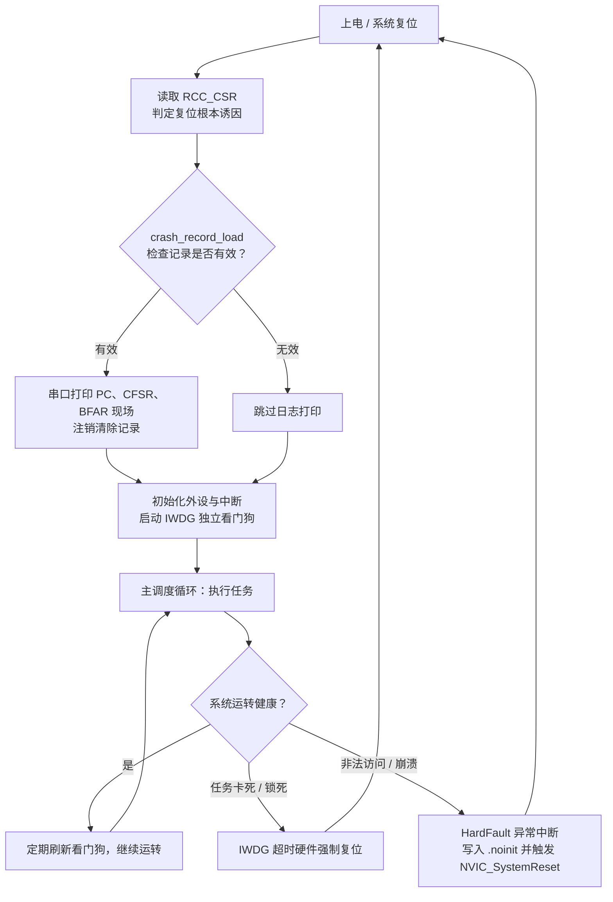

# 2.10 看门狗、低功耗与故障处理

在实验室开发环境中，微控制器始终处于工程师与调试探针的密切监控之下：一旦程序发生死循环或逻辑阻塞，按下调试器暂停键便能审查调用栈与寄存器；一旦发生崩溃，开发环境能立即捕获异常点。然而，当嵌入式设备离开实验台，安装部署到无人值守的工业现场、野外监测站或电池供电的便携终端中时，硬件必须具备完全自给自足的鲁棒性与自我恢复能力。

现场工程运维中最常遭遇三类致命痛点：
- **程序因死锁或电磁干扰长期卡死**：串口输出彻底停摆，现场只能依靠人工断电冷重启恢复；
- **电池供电设备达不到设计续航**：系统在任务间隙未进入深睡眠，片上时钟与总线持续消耗毫安级电流，导致标称可运行一年的电池在数周内耗尽；
- **设备突发异常重启却毫无痕迹**：系统在偶发总线故障或非法指针解引用后崩溃复位，日志未留下任何故障现场，使得缺陷无从定位排查。

微控制器底层的硬件看门狗机制、多级电源管理架构以及 Cortex-M 内核的异常故障处理机制，正是保障设备在恶劣物理环境下长期无人值守稳定运行的三道关键防线。

## 1. 现场设备要面对的三大生存挑战

脱离了仿真器探针的人工干预，现场固件必须建立起自适应、可自愈的物理闭环：

**死循环与死锁自恢复**：所谓卡死，往往源于主循环中对某个硬件状态标志的死等轮询未设超时边界，或外部传感器在受强电磁脉冲干扰后总线被持续拉低，导致状态机彻底停滞。在此状态下，尽管外设中断可能仍能周期性响应，但系统的主体控制逻辑已彻底瘫痪。看门狗定时器通过硬件倒计时与周期性“喂狗”契约，构成了检测并击碎此类隐蔽卡死的最终手段。

**偶发崩溃的现场证据保留（Post-mortem Debugging）**：当 CPU 取指到未映射的内存地址、执行了未定义的操作码、或因堆栈溢出引发非法内存访问时，Cortex-M 内核会触发硬件故障（HardFault）异常。若仅在异常入口编写一个死循环，设备将陷入永久挂起且不留任何线索；若能在硬件故障发生的微秒瞬间提取压栈的程序计数器（PC）、链接寄存器（LR）与故障状态寄存器，并保存在复位不擦除的特殊内存区中，便能在系统重启后快速追溯故障根源。

**微安级的静态功耗控制**：微控制器在 72 MHz 全速运行时，内部开关翻转电流通常在几十毫安级别；而在绝大多数物联网与传感终端中，真实的任务处理时间在每秒内往往不足数毫秒。合理调度内核的睡眠（Sleep）、停机（Stop）与待机（Standby）模式，将闲置期的静态漏电流压缩至微安级别，是决定电池供电设备生死的关键指标。

这三大机制在系统底层紧密互锁：低功耗深睡眠时必须合理配置看门狗的时钟源以防休眠期误复位；故障捕获完成后需要主动复位将控制权归还系统；而系统重启后又必须借助复位状态寄存器识别先前的崩溃类型。

## 2. 独立看门狗

独立看门狗（Independent Watchdog, IWDG）是一个单独的递减计数器，时钟来自片内的 LSI，约 40 kHz，范围 30～60 kHz。它和主时钟无关，即使 PLL 停摆、系统时钟配置错了，只要 LSI 还在振荡，它就照常计数。这一点是"独立"两个字的含义，也是它比后面要讲的窗口看门狗更常用的原因。

IWDG 的寄存器很少。PR 与 RLR 受写保护，写之前要先向键寄存器 KR 写 0x5555 解锁；喂狗和启动也都是向 KR 写一个固定的键值：

| 寄存器 | 偏移 | 作用 |
| --- | --- | --- |
| KR | 0x00 | 写 0x5555 解锁 PR/RLR；写 0xAAAA 重装计数器（喂狗）；写 0xCCCC 启动 |
| PR | 0x04 | 预分频，取值 0～6，分频系数为 4 × 2^PR |
| RLR | 0x08 | 重装载值，12 位，0～4095 |
| SR | 0x0C | 状态，PVU 与 RVU 表示 PR/RLR 正在更新 |

超时时间的公式是：

```text
T = 4 × 2^PR × (RLR + 1) / f_LSI
```

把 PR 从 0 到 6 的结果算一遍：

::: terminal title="bash - IWDG 超时表"

```text
$ gcc -std=c17 -Wall -Wextra wdt_cfsr_calc.c -o wdt_cfsr_calc
$ ./wdt_cfsr_calc
=== IWDG timeout table (f_LSI = 40 kHz) ===
PR  Div   Min(RLR=0)   Max(RLR=4095)  RLR for 1.0 s
0   4       0.10 ms       409.6 ms        -
1   8       0.20 ms       819.2 ms        -
2   16      0.40 ms      1638.4 ms     2499
3   32      0.80 ms      3276.8 ms     1249
4   64      1.60 ms      6553.6 ms      624
5   128     3.20 ms     13107.2 ms      312
6   256     6.40 ms     26214.4 ms      155
```

:::

最短约 0.1 ms，最长约 26 s。大多数应用落在 0.5～2 s 这一段。表里最后一列给出 1 s 超时在每一档下的 RLR 值，PR = 4、RLR = 624 就是最常用的一组：64 × 625 / 40000 = 1.000 s。

配置函数按固定顺序写：

```c
static void iwdg_init_1s(void) {
    /* 调试暂停 CPU 时同步冻结 IWDG 计数器 */
    DBGMCU->CR |= DBGMCU_CR_DBG_IWDG_STOP;

    IWDG->KR = 0x5555u; /* 解锁 PR 与 RLR 写保护 */
    IWDG->PR = 4u;      /* 64 分频 */
    IWDG->RLR = 624u;   /* 重装载值 624 */
    IWDG->KR = 0xAAAAu; /* 立即把 RLR 装入计数器 */
    IWDG->KR = 0xCCCCu; /* 启动独立看门狗 */
}
```

先解锁再写 PR 和 RLR，否则写入被忽略。写完 RLR 后喂一次狗，让计数器立即载入新值。最后写 0xCCCC 启动。这里有一条不能反悔的规则：启动之后不能停止。只要不复位芯片，IWDG 就一直计数，没有任何寄存器能关掉它。这是它作为最后一道防线的价值所在，也意味着一旦开了狗，程序的每一步都要在超时之内完成。

喂狗就是再写一次 0xAAAA：

```c
static inline void iwdg_feed(void) {
    IWDG->KR = 0xAAAAu;
}
```

::: concept emb-wdt-feed-placement title="喂狗放在主循环所有任务都执行过之后"

喂狗的位置决定了看门狗能检测到什么。正确的位置是主循环的末尾、所有周期性任务都执行完之后：任何一个任务卡住，这一轮就执行不到末尾，狗超时复位。把喂狗放在定时器中断里则完全相反：中断照常响应，狗照常被喂，主循环即使早已卡死，看门狗也不会动作。

:::

这条规则值得单独强调，因为把喂狗放进 SysTick 处理函数是新手最常见的做法，而且它看起来也很合理：定时喂狗，周期固定。实际上它只检测了一件事，就是中断还能不能进。主循环里任何一处死循环都检测不到。

<Quiz
  type="single"
  :options="[
    { label: '把喂狗挪到中断里就能检测到', value: 'A' },
    { label: '主循环卡死期间 LED 停止翻转，1 s 后芯片复位，串口打印 IWDG', value: 'B' },
    { label: '芯片停在死循环里不动，直到按复位键', value: 'C' },
    { label: '看门狗超时但不会复位，只置一个标志', value: 'D' }
  ]"
  answer="B"
>

<template #question>

`iwdg_demo` 按住 PA0 超过 1 s 会发生什么？

</template>

正确答案是 **B**。主循环在 `while` 里死等，执行不到喂狗那一行，IWDG 计数到 0 就复位芯片。复位后从 `main` 重新开始，`reset_cause_get()` 读到 IWDGRSTF，打印出 `IWDG`。

</Quiz>

::: compare left-title="在定时器中断里喂狗" right-title="在主循环末尾喂狗"

```c
void SysTick_Handler(void) {
    ++g_ms;
    IWDG->KR = 0xAAAAu; /* 中断还活着，主循环卡死也不复位 */
}

int main(void) {
    for (;;) {
        task_a();
        task_b(); /* 这里卡住，狗永远被喂 */
    }
}
```

---

```c
void SysTick_Handler(void) {
    ++g_ms;
}

int main(void) {
    for (;;) {
        task_a();
        task_b();
        task_c();
        IWDG->KR = 0xAAAAu; /* 所有任务都跑完才喂 */
    }
}
```

:::

LSI 的误差很大，30～60 kHz 意味着同一个配置的实际超时可能在标称值的一半到两倍之间。按 40 kHz 算出的 1 s，最坏情况下只有约 0.67 s（LSI 跑到 60 kHz），最好情况下约 1.33 s。所以配置超时要按最快的 LSI 留余量，喂狗周期取标称超时的三分之一到一半。数据手册给出了 LSI 随温度和电压变化的曲线，出货前也可以实测一颗的 LSI 频率来校准。

看门狗复位之后，程序重新从上电状态跑起来，怎么知道这次是看门狗干的？用 2.3 的 `reset_cause_get()`：

```c
reset_cause_t cause = reset_cause_get();
uart_puts("boot: reset cause = ");
uart_puts(reset_cause_name(cause));
uart_puts("\n");
```

复位原因的读取和清除都封装在 `clock.c` 里，本节直接调用。打印出来如果是 `IWDG`，说明上一次是看门狗超时。

::: tip 调试时冻结看门狗

单步调试时，程序停在断点上的时间远超看门狗超时，芯片会在调试器眼皮底下反复复位。置位 DBGMCU_CR 的 `DBG_IWDG_STOP` 位，内核暂停时 IWDG 的计数器也暂停，调试器继续运行后它才接着数。示例的 `iwdg_init_1s` 第一行就是它。上板测真实功耗或观察复位行为时要去掉这一行。

:::

`iwdg_demo` 把上面的配置和前几节的模块拼在一起：主循环每 250 ms 翻转一次 LED 并喂狗，按住 PA0 时进入死等，模拟一个卡住的任务：

```c
int main(void) {
    clock_init_72mhz();
    tick_init();
    console_init(72000000u, 115200u);
    gpio_init_led_button();

    reset_cause_t cause = reset_cause_get();
    uart_puts("boot: reset cause = ");
    uart_puts(reset_cause_name(cause));
    uart_puts("\n");

    iwdg_init_1s();

    uint32_t last_feed = tick_now();
    int led_on = 0;

    for (;;) {
        /* 模拟主循环各项任务；按住 PA0 按键时死等，模拟任务卡死 */
        while ((GPIOA->IDR & 1u) != 0) {
        }

        if (tick_elapsed(last_feed, 250u)) {
            last_feed = tick_now();
            led_on = !led_on;
            GPIOC->BSRR = led_on ? GPIO_BSRR_BR13 : GPIO_BSRR_BS13;
            iwdg_feed();
            uart_puts("heartbeat: watchdog fed\n");
        }
    }
}
```

按住按键超过 1 s，芯片复位，串口重新输出 `boot: reset cause = IWDG`。松开按键后一切恢复。整个程序编译后的大小：

::: terminal title="bash - 构建 iwdg_demo"

```text
$ arm-none-eabi-gcc -std=c11 -mcpu=cortex-m3 -mthumb -O2 -g -Wall -Wextra \
    -ffunction-sections -fdata-sections -DSTM32F103xB -I. \
    -nostartfiles --specs=nano.specs --specs=nosys.specs -Wl,--gc-sections \
    -T stm32f103c8.ld iwdg_demo/main.c fault.c clock.c console.c tick.c \
    startup_stm32f103.c -o iwdg_demo.elf
$ arm-none-eabi-size iwdg_demo.elf
   text	   data	    bss	    dec	    hex	filename
   1724	      4	   1572	   3300	    ce4	iwdg_demo.elf
```

:::

## 3. 窗口看门狗

窗口看门狗（Window Watchdog, WWDG）是另一种思路。它用 PCLK1 计时，同样是递减计数器，但多了一个"窗口"：喂狗必须在规定的上下限之间，太晚不行，太早也不行。

计数器是 7 位，从 T 递减，减到 0x3F 时复位；在计数还没降到窗口值 W 以下就刷新，也复位。只有计数落在 0x40 到 W 之间时刷新才被接受：

| 寄存器 | 偏移 | 作用 |
| --- | --- | --- |
| CR | 0x00 | 位 6:0 是 T；位 7 是 WDGA，写 1 启动 |
| CFR | 0x04 | 位 6:0 是 W；位 8:7 是 WDGTB 分频；位 9 是 EWI，提前唤醒中断使能 |
| SR | 0x08 | 位 0 是 EWIF，提前唤醒中断标志 |

超时按计数步长算：

```text
T_step = 4096 × 2^WDGTB / PCLK1
```

计数器从 T 减到 0x40 所需的时间就是最长等待时间，窗口值 W 决定最早允许刷新的时刻：

::: terminal title="bash - WWDG 窗口"

```text
$ ./wdt_cfsr_calc
=== WWDG window example (PCLK1 = 36 MHz, WDGTB = 3, T = 0x7F, W = 0x5F) ===
step = 0.910 ms, refresh window = (29.13 ms, 58.25 ms)
```

:::

在这组参数下，只有在进入 0x5F 之后、跌到 0x3F 之前（约 29.1 ms 到 58.3 ms 之内）刷新才合法。刷新早了，说明某段代码跑得比预期快，也被判为异常；刷新晚了或忘了刷新，同样复位。

WWDG 能够捕获许多常规独立看门狗完全无法察觉的时序隐患：例如程序因指针错乱意外跳过了某段关键的延时滤波算法，或者高频异常中断剥夺了主任务时间片导致逻辑执行反常加速。在这类场景下，主循环虽然并未彻底卡死，但系统控制步调已被彻底扰乱。

在产业界的常规工程项目中，独立看门狗（IWDG）凭借其与主时钟完全解耦的硬件独立性，已能充分覆盖任务死循环、总线死锁与意外挂起等绝大多数故障；窗口看门狗（WWDG）则主要定位于医疗设备、车载电子或工业控制等对功能安全（Functional Safety）与时序严格性有着严苛认证要求的场景。在实际开发中，根据系统的安全完整性等级与物理时序约束选择适配的看门狗即可。

## 4. 低功耗模式

在电池供电或能量受限的嵌入式现场，让处理器持续以 72 MHz 全速运转往往是不必要的浪费。STM32F103 提供了三种梯次深入的低功耗模式。随着关断的内部电路逐步增多，芯片的静态电流成数量级下降，但伴随而来的唤醒恢复代价与硬件上下文损失也相应增加：

| 模式 | 关断的硬件单元 | 典型唤醒源 | 唤醒后的执行状态 | 芯片典型电流（3.3 V） |
| --- | --- | --- | --- | --- |
| Sleep | 仅暂停 CPU 时钟取指，外设时钟与总线照常运行 | 任意中断（NVIC 响应） | 从 `__WFI()` 的下一条指令无缝继续 | 毫安级（与全速运行处于同量级） |
| Stop | 1.8 V 供电域所有时钟停振，SRAM 与外设寄存器保持 | 任意 EXTI 外部中断 / 事件线 | 时钟源强制退回内部 HSI 8 MHz，需手工重配 PLL | 约 14 µA（低功耗调压器）/ 24 µA |
| Standby | 1.8 V 供电域彻底断电，SRAM 与绝大部分寄存器掉电丢失 | WKUP 引脚上升沿、RTC 闹钟、NRST 引脚、IWDG | 等同于冷复位，从 `Reset_Handler` 重新启动 | 约 2 µA |

数据手册 DS5319 表 16 记录的电流值反映的是硅片内核在实验室纯净环境下的基准漏电。当我们将固件烧录在市售的最小系统板或评估板上实测时，板载的电源指示 LED（动辄耗电 2~5 mA）、LDO 线性稳压芯片自身的静态静态偏置电流（如常见 AMS1117 静电流可达数毫安），以及未断电的 USB-TTL 串口芯片倒灌电流，都会让仪表读数远远偏离数据手册。若要精确评估低功耗效果，必须选用低静态电流调压器（如微安级 LDO）并断开板载调试桥与发光二极管。

Sleep 模式的进入最平缓直接。当主循环已处理完全部就绪事件，只需执行内核指令 `__WFI()`（Wait For Interrupt）即可令内核流水线挂起：

```c
__WFI();
```

由于外设时钟和 DMA 依然在后台正常流转，SysTick 节拍或串口接收等任何一个使能的中断触发，内核就会瞬时苏醒并执行相应 ISR，中断返回后直接继续执行 `__WFI()` 之后的指令。这种模式非常契合调度周期内有零散微秒或毫秒级闲置、且随时需要响应外设通信的场景。

Stop 模式则进一步停掉了高频内部振荡器与 PLL，内部 1.8 V 调压器也可切换至低功耗模式，仅维持 SRAM 和寄存器中锁存的电气状态。进入该模式需要严密的时序协调：

```c
static void enter_stop_mode(void) {
    /* 1. 等待串口最后一帧完全移出移位寄存器 */
    uart_flush();

    /* 2. 开启电源接口时钟，选择 Stop 模式 + 低功耗调压器 */
    RCC->APB1ENR |= RCC_APB1ENR_PWREN;
    PWR->CR = (PWR->CR & ~PWR_CR_PDDS) | PWR_CR_LPDS;

    /* 3. 内核置位 SLEEPDEEP，关闭 SysTick 防止节拍中断提前唤醒 */
    SCB->SCR |= SCB_SCR_SLEEPDEEP_Msk;
    SysTick->CTRL &= ~SysTick_CTRL_TICKINT_Msk;

    __DSB();
    __WFI();
    __ISB();

    /* 4. 唤醒后系统时钟退回 HSI 8 MHz，恢复 72 MHz 与 SysTick 中断 */
    SCB->SCR &= ~SCB_SCR_SLEEPDEEP_Msk;
    clock_init_72mhz();
    SysTick->CTRL |= SysTick_CTRL_TICKINT_Msk;
}
```

这里包含若干容易忽视的工程细节。PWR 外设挂载在 APB1 总线上，上电初始其时钟使能位 `PWREN` 为 0。若未先使能 APB1 时钟就试图配置 `PWR->CR`，写入操作将被总线直接丢弃；随后进入的 Stop 将沿用复位默认的主调压器模式，功耗明显偏高。在寄存器语义中，`PDDS = 0` 指定深睡眠目标为 Stop 模式，而 `LPDS = 1` 开启内部超低功耗调压器。在 Cortex-M 内核层面，还必须通过 `SCB->SCR` 的 `SLEEPDEEP` 位告知内核将 `__WFI()` 解释为深度睡眠，硬件调压电路才会启动这一转换。

此外，必须显式关闭 SysTick 中断。SysTick 虽会在进入 Stop 后停振，但如果在执行 `__WFI()` 的前一瞬间恰逢 1 ms 节拍到期并挂起标志，CPU 将完全无法真正进入睡眠，而是瞬间被挂起中断拉回。在调用 `__WFI()` 之前，用 `__DSB()`（数据同步隔离）确保所有内存与外设寄存器的写事务已物理落地，醒来后紧跟 `__ISB()`（指令同步隔离）冲刷取指流水线，确保内核在新的总线时钟环境下重新取指执行。

::: concept emb-pwr-stop-back-to-hsi title="从 Stop 唤醒后系统时钟退回 HSI 8 MHz"

进入 Stop 模式时，硬件会自动关闭 PLL、HSE 与 HSI 振荡器以杜绝动态功耗。当被外部 EXTI 事件唤醒的一刹那，硬件优先启动启动速度最快的片内 8 MHz RC 振荡器（HSI），并将 `RCC_CFGR` 中的系统时钟切换标志重置为 00（HSI 作为系统时钟）。此时 HSE 和 PLL 依然处于休眠关闭状态。

所有与时钟频率强相关的外设配置（包括 Flash 读取等待周期、SysTick 重装载数值、USART 波特率分频比、各通用定时器的预分频器）此时如果依然保持 72 MHz 的参数运转，将全线出现时钟错乱。最直观的现象是串口输出变成严重错位的乱码——因为硬件实际跑在 8 MHz，波特率发生器却按照 72 MHz 在分频。因此，唤醒后的第一要务，就是在 `__WFI()` 之后立刻调用 `clock_init_72mhz()` 重新锁定外部高频晶振。

<Quiz
  type="single"
  :options="[
    { label: '接着执行 `__WFI()` 的下一句，时钟不变', value: 'A' },
    { label: '从 Reset_Handler 重新启动，SRAM 内容丢失', value: 'B' },
    { label: '从 `__WFI()` 的下一句继续，系统时钟回到 HSI 8 MHz', value: 'C' },
    { label: '原地等待，直到重新配置时钟', value: 'D' }
  ]"
  answer="C"
>

<template #question>

从 Stop 模式被 EXTI 唤醒后，CPU 从哪里继续执行，时钟处于什么状态？

</template>

正确答案是 **C**。Stop 模式下 1.8 V 域并未断电，芯片的 SRAM 和全部外设寄存器内容均完整保持，因此唤醒后依然紧接着 `__WFI()` 之后继续执行。但此时 PLL 和外部晶振尚未就绪，硬件将时钟切到了内部 HSI 8 MHz。因此例程中紧随其后必须调用 `clock_init_72mhz()` 重新拉高主频。选项 B 描述的是 Standby 待机模式的硬件特征。

</Quiz>

:::

示例程序通过 EXTI 外部中断线唤醒：PA0 连接按键，配置为上升沿检测：

```c
static void pa0_exti_init(void) {
    RCC->APB2ENR |= RCC_APB2ENR_IOPAEN | RCC_APB2ENR_IOPCEN | RCC_APB2ENR_AFIOEN;

    /* PC13：2 MHz 推挽输出 */
    GPIOC->CRH = (GPIOC->CRH & ~(0xFu << 20)) | (0x2u << 20);

    /* PA0：下拉输入 */
    GPIOA->CRL = (GPIOA->CRL & ~0xFu) | 0x8u;
    GPIOA->BRR = 1u << 0;

    /* EXTI0 映射到 PA0，上升沿触发 */
    AFIO->EXTICR[0] &= ~AFIO_EXTICR1_EXTI0;
    EXTI->RTSR |= EXTI_RTSR_TR0;
    EXTI->FTSR &= ~EXTI_FTSR_TR0;
    EXTI->PR = EXTI_PR_PR0;
    EXTI->IMR |= EXTI_IMR_MR0;

    NVIC_SetPriority(EXTI0_IRQn, 2u);
    NVIC_EnableIRQ(EXTI0_IRQn);
}
```

有关 EXTI 中断映射的寄存器机理已在 [2.5 中断与 NVIC](/教程/正文/嵌入式/2_MCU裸机开发/2_5_中断与NVIC) 中详述，此处的核心目标是构建一个能将内核从深睡眠拉起的事件源。在配套例程 `stop_wakeup` 中，主循环每隔 2 秒进入一次 Stop 模式；用户按下按键触发 EXTI0 后，系统立刻苏醒并执行 `clock_init_72mhz()` 恢复主频，终端随后收到清晰正确的调试打印：`wakeup: clock restored to 72 MHz`。

特别注意：在进入 Stop 之前，务必调用 `uart_flush()` 检查 USART 的 TC（发送完成）标志。常规的数据寄存器空标志（TXE）仅代表 TDR 中的字节已转移到移位寄存器，末尾字节的高低电平还在引脚上按位输出；若此时匆忙关断时钟，最后一个字节的停止位将被硬件中途腰斩，导致串口助手收到半截乱码。

Standby 模式则是更极致的省电手段：内部 1.8 V 供电域彻底断电，CPU 内核、外设以及 SRAM 内部的数据全数丢失，整颗芯片仅有备份寄存器和待机电路继续存活，静态电流被压缩至约 2 µA 的极限水平。当唤醒条件成立时，硬件表现等同于冷复位：芯片直接从向量表指向的 `Reset_Handler` 重新开始执行，所有静态存储期对象都会重新经历 `.data` 与 `.bss` 的内存初始化：

```c
static void enter_standby_mode(void) {
    uart_flush();

    /* 使能 PA0（WKUP 引脚）上升沿唤醒，清除之前的唤醒标志 WUF */
    PWR->CSR |= PWR_CSR_EWUP;
    PWR->CR |= PWR_CR_CWUF | PWR_CR_PDDS;

    SCB->SCR |= SCB_SCR_SLEEPDEEP_Msk;
    __DSB();
    __WFI();
}
```

配置中，`PDDS = 1` 明确将深度睡眠模式定向为 Standby 待机，`CWUF` 用于清除之前可能残留的唤醒标志，而 `EWUP = 1` 则使能微控制器专用的 WKUP（PA0）引脚高电平唤醒通道。

既然从 Standby 唤醒的表现与按下硬件复位按键完全一致，系统启动后该如何区分这是正常上电还是待机唤醒？关键就在于读取 `PWR_CSR` 寄存器中的 SBF（Standby Flag）标志位：

```c
if ((PWR->CSR & PWR_CSR_SBF) != 0) {
    /* 写 CSBF 与 CWUF 清除待机标志和唤醒标志 */
    PWR->CR |= PWR_CR_CSBF | PWR_CR_CWUF;
    uart_puts("boot: woke up from Standby mode (SBF = 1)\n");
} else {
    uart_puts("boot: cold reset or normal reset (SBF = 0)\n");
}
```

SBF 位由硬件在 Standby 唤醒时自动置 1，在软件向 `PWR_CR` 写入 `CSBF` 之前会一直保持。这一信息与 `RCC_CSR` 记录的系统复位源相互独立：SBF 指明了“前一个周期的运行形态”，而 `RCC_CSR` 则反映“本次启动遵循了哪条复位路径”。两者结合才能完整复现系统的休眠生命周期。

任何必须跨越 Standby 模式持久保留的运行时状态，都不能存放在常规 SRAM 中，而必须写入电池供电的 BKP 备份寄存器或内部 Flash。后者的擦写机理将在 [3.9 Flash、EEPROM、SD 与文件系统](/教程/正文/嵌入式/3_驱动_通信与中间件/3_9_Flash_EEPROM_SD与文件系统) 中深入剖析。

在硬件工作台上测量低功耗电流时，建议将微安级直流电流表串联在 MCU 的 3.3 V 核心供电跳线之间，或者借助具备动态量程的专用功耗分析仪。板载其他元器件的静态漏电往往会严重掩盖芯片真实的节能表现，具体的测试夹具设计与工况分解可参考 [6.5 实时性、性能与功耗测量](/教程/正文/嵌入式/6_质量_安全与交付/6_5_实时性_性能与功耗测量)。

::: tip 调试低功耗代码时避免调试器失联

微控制器一旦进入 Stop 或 Standby 模式，核心时钟与调试总线供电被停用，SWD 调试接口将立刻中断连接，GDB 或 IDE 往往直接报错并退出会话。若希望在单步调试低功耗代码时保持在线，可配置调试 MCU 控制寄存器 `DBGMCU_CR`，置位对应的挂起保持位：

```c
DBGMCU->CR |= DBGMCU_CR_DBG_STOP;
```

该寄存器指示调试模块在内核休眠时继续为 FCLK 和 HCLK 供电，使得调试器可以平稳观察唤醒过程。需要牢记的是：保持调试时钟意味着内部功耗大幅增加，在进行实际电流验收测量前，必须将这一调试配置彻底移除。

:::

## 5. 故障异常体系

在 ARM Cortex-M3 内核中，除常规外设中断外，还内置了一套严密的硬件故障异常监控机制，涵盖 HardFault、MemManage、BusFault 以及 UsageFault 四种核心故障。在芯片复位后的默认状态下，后三种针对特定错误类型的分项异常处于禁用状态。一旦系统执行中发生总线错误、访问违规或未定义指令，内核将直接把错误“升级”（Escalate）为最高优先级的 HardFault。此时硬件会将 HFSR 寄存器的 `FORCED` 位置 1，表示本次 HardFault 并非直接引发，而是由其他下层故障因未开启对应中断而被动升级而来。若要让各类错误进入独立的处理函数以便精细化排查，必须在系统控制块 `SCB->SHCSR` 寄存器中显式将它们使能：

| 异常类型 | 硬件触发条件 | SHCSR 对应使能位 |
| --- | --- | --- |
| MemManage | 存储器保护单元（MPU）访问违规（STM32F103 无 MPU 单元，通常不发生） | MEMFAULTENA |
| BusFault | 取指或数据访问过程中 AHB/APB 物理总线返回错误响应 | BUSFAULTENA |
| UsageFault | 遭遇未定义指令、非法 Thumb 状态切换、未对齐访问或除零（需硬件使能） | USGFAULTENA |

STM32F103 硬件并未集成 MPU，因此 MemManage 异常极少独立出现。而在日常开发调试中，使能 BusFault 与 UsageFault 具有极其重要的诊断价值：一旦开启，系统控制块中的可配置故障状态寄存器（CFSR）便会记录极为详尽的错误特征。

CFSR 是一个 32 位的组合状态寄存器，按字节划分为三个逻辑段落：低 8 位为 MemManage 状态（MMFSR），中间 8 位为 BusFault 状态（BFSR），高 16 位则为 UsageFault 状态（UFSR）。工程中最为关键的状态标志位如下：

| 位偏移 | 标志名称 | 所属子段 | 物理成因与底层含义 |
| --- | --- | --- | --- |
| 0 | IACCVIOL | MMFSR | 指令取指阶段发生存储器保护访问违规 |
| 1 | DACCVIOL | MMFSR | 数据读写阶段发生存储器保护访问违规 |
| 7 | MMARVALID | MMFSR | 指示 MMFAR 寄存器中保存的违规地址有效 |
| 8 | IBUSERR | BFSR | 指令总线取指时收到总线错误应答 |
| 9 | PRECISERR | BFSR | 精确数据总线错误：硬件异常压栈保存的 PC 严格指向引发错误的单条指令 |
| 10 | IMPRECISERR | BFSR | 不精确数据总线错误：因写缓冲异步延迟，压栈的 PC 已推进数条指令，无法直指原点 |
| 12 | STKERR | BFSR | 异常响应入栈操作本身遭遇总线物理错误（通常因栈指针溢出至非法地址） |
| 15 | BFARVALID | BFSR | 指示 BFAR 寄存器中记录的故障物理总线地址有效 |
| 16 | UNDEFINSTR | UFSR | 处理器尝试译码并执行一条未定义的机器码指令 |
| 17 | INVSTATE | UFSR | 尝试进入非法的处理器执行状态（例如函数指针最低位被清零导致非法进入 ARM 态） |
| 18 | INVPC | UFSR | 异常返回时加载了非法的 EXC_RETURN 或 PC 完整性校验失败 |
| 19 | NOCP | UFSR | 尝试执行协处理器指令，而当前硬件并未搭载该协处理器 |
| 24 | UNALIGNED | UFSR | 产生了未对齐的内存读写访问（需在 CCR 中开启捕捉） |
| 25 | DIVBYZERO | UFSR | 整数除法指令遭遇除数为零（需在 CCR 中开启捕捉） |

除 CFSR 外，硬故障状态寄存器 HFSR 中有两位最具诊断意义：位 1 的 `VECTTBL`（指示在向量表中抓取异常向量地址时发生总线故障）和位 30 的 `FORCED`（指示由下层故障升级而来）。当且仅当 CFSR 中的 `BFARVALID` 或 `MMARVALID` 置位时，总线故障地址寄存器 BFAR 与内存管理故障地址寄存器 MMFAR 中记录的 32 位数值才具有物理参考意义。

需要特别说明的是：在 ARMv7-M 架构规范中，整数除以零默认不会触发 UsageFault。由于 C 语言规范将除以零定为未定义行为（Undefined Behavior），ARM 的硬件除法器指令 `sdiv` / `udiv` 遇到除数为零时默认静默输出 0，而不会向流水线投递任何中断。若希望在除零的第一时间挂起故障现场，必须显式在配置与控制寄存器（CCR）中开启除零捕获陷阱：

```c
void fault_enable_traps(void) {
    /* 捕获除零错误；若需捕获非对齐访问，可同时置位 SCB_CCR_UNALIGN_TRP_Msk */
    SCB->CCR |= SCB_CCR_DIV_0_TRP_Msk;
}
```

::: concept emb-fault-forced title="未使能的分项故障将强制升级为 HardFault"

若在 `SCB->SHCSR` 中未单独使能 MemManage、BusFault 或 UsageFault，一旦底层硬件检测到这些错误，微控制器不会视而不见，而是通过硬件仲裁机制将其统统“升级”为 HardFault。在此过程中，HFSR 的 `FORCED` 位会被硬件锁存为 1，告知开发者当前 HardFault 只是一个通用的外在表现壳，真正的错误根源潜藏在原本应该触发的那项故障中。

即使故障被升级到了 HardFault，CFSR 中原本对应的那一组状态标志位（例如 `DIVBYZERO` 或 `PRECISERR`）依然会被忠实地置位。因此，即便工程没有为各个分项错误配置单独的中断服务例程，只要在统一的 HardFault_Handler 中读取 CFSR，依然能够完整还原发生错误的真正诱因。

:::

在实际排查总线故障时，还有一个与硬件微架构紧密相关的现象：`PRECISERR`（精确错误）与 `IMPRECISERR`（不精确错误）的差异。当 CPU 向总线写入数据时，为了避免流水线因等待慢速外设响应而停顿，内核与总线矩阵之间配置了异步写缓冲器（Write Buffer）。写入操作在离开 CPU 流水线后即被视为完成，后续指令继续向下执行；如果片上总线随后在实际落地到物理外设时返回错误应答，此时内核的 PC 指针往往已经推进到了后续的几条指令之后，导致异常压栈记录的 PC 无法精确定位在发生错误的那条写指令上。

在排查这类难以复现的不精确总线错误时，可以通过将辅助控制寄存器 `ACTLR` 的 `DISDEFWBUF` 位置 1 来暂时关闭写缓冲器：

```c
SCB->ACTLR |= SCB_ACTLR_DISDEFWBUF_Msk;
```

关闭写缓冲会略微降低内存密集型写入的执行效率，但它强制每次写操作都必须等待物理总线应答确认后流水线才允许前行，从而把原本飘忽不定的 `IMPRECISERR` 转化为百分之百精确定位的 `PRECISERR`。待故障根源查明并修复后，再在发布版本中重新开启写缓冲以换取最佳性能。

<Quiz
  type="single"
  :options="[
    { label: 'CFSR 的 DIVBYZERO 位，但不复位', value: 'A' },
    { label: 'HardFault，HFSR 的 FORCED 置 1，CFSR 的 DIVBYZERO 置 1', value: 'B' },
    { label: '什么都不发生，结果是未定义的某个值', value: 'C' },
    { label: 'HardFault，但 CFSR 全为 0，看不出原因', value: 'D' }
  ]"
  answer="B"
>

<template #question>

若系统已通过 `fault_enable_traps()` 置位了 CCR 的 DIV_0_TRP，但在 `SHCSR` 中并未使能 UsageFault，此时代码中执行 `100 / 0` 会产生什么硬件响应？

</template>

正确答案是 **B**。使能 DIV_0_TRP 告知硬件除法器在遇到除以 0 时必须生成 UsageFault 异常；然而由于系统的 SHCSR 中并未开启 USGFAULTENA，内核硬件自动将该异常升级为 HardFault，并在 HFSR 寄存器中置位 `FORCED` 标志以记录此次升级，同时 CFSR 的 `DIVBYZERO` 位依然如实置 1。若一开始根本未置位 DIV_0_TRP，硬件除法器将静默返回未定义值，系统继续向下执行，即对应选项 C。

</Quiz>

## 6. 构建高可靠故障诊断处理函数

当致命故障来袭时，默认由启动文件提供的 `HardFault_Handler` 通常只是一个陷入无限死循环的死胡同（`b .`），它让整个设备看似失去响应，却无法提供任何可供事后追溯的调试线索。一个工业级的故障处理例程，第一步应当以最干净的方式提取硬件崩溃发生瞬间的原始现场。

根据 Cortex-M3 架构标准，在内核进入任何异常处理函数的瞬间，硬件逻辑会自动在当前活动栈（Current SP）上顺序压入 8 个核心寄存器，构成所谓的“基础异常栈帧”：R0、R1、R2、R3、R12、LR（链接寄存器）、PC（返回地址）以及 xPSR（程序状态寄存器）。系统在此之前究竟使用的是主栈指针（MSP）还是进程栈指针（PSP），取决于进入异常前的特权级别与控制寄存器配置。在异常入口处，硬件会将一个称为 `EXC_RETURN` 的特殊魔术字存入通用链接寄存器 LR 中，其位 2（bit 2）明确指示了异常前夕使用的是哪个栈指针：位 2 为 0 表示此前使用的是 MSP，位 2 为 1 表示使用的是 PSP。

因此，故障服务例程的第一段代码必须是一小段纯汇编，用于解析 LR 的位 2，提取正确的栈顶地址并将其作为入参传递给 C 语言诊断函数：

```c
__attribute__((naked)) void HardFault_Handler(void) {
    __asm volatile(
        "tst lr, #4      \n"
        "ite eq          \n"
        "mrseq r0, msp   \n"
        "mrsne r0, psp   \n"
        "b hardfault_c   \n"
    );
}
```

函数头部的 `__attribute__((naked))` 属性至关重要。它指示 GCC 编译器完全不要为该函数生成任何标准的函数序言（Prologue）代码（例如常见的 `push {r4, lr}`）。若允许编译器生成序言，额外的压栈操作将立刻篡改进入异常时原始的 SP 偏移量，导致后续通过 `mrs` 指令读出的栈指针发生偏移，从而抓取到完全错位的现场。

在汇编段内，`tst lr, #4` 测算 LR 的 bit 2，接着利用 Cortex-M 的 IT 块（`ite eq`）进行无分支条件执行：若标志为 0 则通过 `mrseq r0, msp` 抓取主栈指针，否则通过 `mrsne r0, psp` 抓取进程栈指针。最终通过直接跳转指令 `b hardfault_c` 跳入 C 语言处理函数。按照 AAPCS（ARM 体系过程调用标准），寄存器 R0 中存放的值恰好作为 C 函数的第一个形参传入。

查看经交叉编译器优化后的真实机器指令，整段处理逻辑干净利落：

::: terminal title="bash - HardFault_Handler 的反汇编结构"

```text
$ arm-none-eabi-objdump -d fault_demo.elf | sed -n '/<HardFault_Handler>:/,/^$/p'
080002d0 <HardFault_Handler>:
 80002d0:	f01e 0f04 	tst.w	lr, #4
 80002d4:	bf0c      	ite	eq
 80002d6:	f3ef 8008 	mrseq	r0, MSP
 80002da:	f3ef 8009 	mrsne	r0, PSP
 80002de:	f7ff bf6f 	b.w	80001c0 <hardfault_c>
 80002e2:	bf00      	nop
```

:::

进入 C 语言上下文后，首个任务便是从 R0 指向的内存起始地址解析出硬件自动压入的 8 个字。其物理内存拓扑由 ARM 硬件规范刚性固化：偏移 0 对应 R0，偏移 4 对应 R1，依次递增直到偏移 24 处的 PC 和偏移 28 处的 xPSR：

```c
typedef struct {
    uint32_t r0;
    uint32_t r1;
    uint32_t r2;
    uint32_t r3;
    uint32_t r12;
    uint32_t lr;
    uint32_t pc;
    uint32_t xpsr;
} fault_frame_t;
```

该结构体中的每一个字段成员、类型长度与排列顺序，必须与 Cortex-M 异常硬件压栈顺序严丝合缝地绝对一致。由于各字段均为 32 位无符号整数，自然对齐满足 4 字节边界，编译器不会在结构体内部插入任何隐式填充字节。

C 诊断函数的核心职责是完整采集寄存器快照，将其记录在持久化存储区，并通过可靠通道输出至调试终端：

```c
void hardfault_c(const fault_frame_t *frame) {
    uint32_t cfsr = SCB->CFSR;
    uint32_t hfsr = SCB->HFSR;
    uint32_t bfar = SCB->BFAR;

    g_crash_record.magic = CRASH_MAGIC;
    g_crash_record.pc = frame->pc;
    g_crash_record.lr = frame->lr;
    g_crash_record.cfsr = cfsr;
    g_crash_record.hfsr = hfsr;
    g_crash_record.bfar = bfar;
    g_crash_record.checksum = crash_checksum(&g_crash_record);

    uart_puts("\n=== HardFault ===\n");
    uart_print_reg("PC   = ", frame->pc);
    uart_print_reg("CFSR = ", cfsr);
    uart_print_reg("HFSR = ", hfsr);
    if ((cfsr & SCB_CFSR_BFARVALID_Msk) != 0) {
        uart_print_reg("BFAR = ", bfar);
    }
    uart_flush();

    if ((CoreDebug->DHCSR & CoreDebug_DHCSR_C_DEBUGEN_Msk) != 0) {
        __BKPT(0);
    }
    NVIC_SystemReset();
}
```

在故障处理函数内部，字符串与寄存器的打印输出必须完全基于底层的阻塞轮询（Polling）方式，绝对不可依赖任何串口中断服务或 DMA 传输。因为当 HardFault 触发时，系统可能正处于高优先级的某一 ISR 中，或者 NVIC 内部的中断屏蔽状态已被破坏，任何基于中断驱动的发送队列都会因无法响应中断而永远阻塞挂起。

信息输出完毕后，函数根据运行环境提供分流策略：若硬件调试接口当前处于连接会话中（通过检测 `CoreDebug->DHCSR` 的 `C_DEBUGEN` 位），代码主动触发 `__BKPT(0)` 软件断点，令 GDB 或调试器即刻冻结在崩溃点，方便工程师即时调取局部数据与调用回溯栈；而若设备处于无人工干预的脱机运行环境，处理函数在写完崩溃记录后立即调用 `NVIC_SystemReset()` 触发系统复位，促使设备在完成自诊断后重新上线，避免系统永久假死。

在捕获到的现场数据中，价值最高的当属异常栈帧中的 `PC`：它指向引发此次硬件异常的那条机器指令。借助工具链中的 `addr2line` 工具，即可将十六进制地址瞬时映射回对应的 C 语言源文件行号。

例如，设计一个故意的除零测试函数：

```c
__attribute__((noinline)) int trigger_div_zero(int numerator, int divisor) {
    int q = numerator / divisor;
    g_sink = (uint32_t)q;
    return q;
}
```

通过反汇编查看该函数生成的机器指令流：

::: terminal title="bash - 反汇编定位除法故障指令"

```text
$ arm-none-eabi-objdump -d fault_demo.elf | sed -n '/<trigger_div_zero>:/,/^$/p'
080000f0 <trigger_div_zero>:
 80000f0:	fb90 f0f1 	sdiv	r0, r0, r1
 80000f4:	4b01      	ldr	r3, [pc, #4]	@ (80000fc <trigger_div_zero+0xc>)
 80000f6:	6018      	str	r0, [r3, #0]
 80000f8:	4770      	bx	lr
```

:::

反汇编清晰显示，地址 `0x080000f0` 处正是那条硬件除法指令 `sdiv r0, r0, r1`。使用 `addr2line` 工具对测试中的三个典型崩溃地址进行解析定位：

::: terminal title="bash - 利用 addr2line 精确定位故障源文件行"

```text
$ arm-none-eabi-addr2line -e fault_demo.elf -f -C 0x080000f0 0x08000106 0x08000110
trigger_div_zero
./fault_demo/main.c:15
trigger_invstate
./fault_demo/main.c:24
trigger_busfault
./fault_demo/main.c:30
```

:::

这三个地址完整覆盖了嵌入式开发中最容易遭遇的三大类灾难性底层故障：

| 故障类别 | 触发机理与典型代码片段 | 寄存器级特征与硬件行为 |
| --- | --- | --- |
| 除数为零 | 调用 `trigger_div_zero(100, 0)` | 需在 CCR 置位 DIV_0_TRP 后捕获；产生 UsageFault 并置位 CFSR 的 DIVBYZERO；未使能 USGFAULTENA 时升级为 HardFault |
| 非法执行状态 | 调用最低位（LSB）被清零的函数指针 | 触发 INVSTATE 异常；由于 Cortex-M 不支持 ARM 指令集，`bx` 目标最低位为 0 会直接触发非法状态崩溃 |
| 非法总线寻址 | 尝试读取未映射地址 `0xCCCCCCCC` | 产生精确数据总线错误 `PRECISERR`；BFARVALID 置位且 BFAR 忠实记录故障物理地址 `0xCCCCCCCC` |

关于第二项“非法执行状态”的诱因值得深入剖析。Cortex-M 架构仅支持 Thumb/Thumb-2 指令集，不支持传统的 32 位 ARM 态。在硬件跳转指令（如 `bx` 或 `blx`）规范中，目标地址的最低有效位（bit 0）用于标识目标执行状态：该位必须始终为 1 以代表保持在 Thumb 状态。通常情况下，C 语言编译器在取函数指针时会自动将函数地址加 1 设置好该位；然而，若开发者在底层驱动中错误地对函数指针执行了按字对齐的掩码操作，便会破坏该位：

```c
__attribute__((noinline)) void trigger_invstate(void) {
    uintptr_t addr = (uintptr_t)dummy_target & ~(uintptr_t)1u;
    void (*bad_fn)(void) = (void (*)(void))addr;
    bad_fn();
}
```

反汇编中能观察到编译器生成了 `bic.w r3, r3, #1` 指令清零了最低位，随后的 `bx r3` 就会被处理器译码硬件直接拦截并上报 `INVSTATE`。

对于第三项故障，程序尝试访问未在微控制器内存映射表中分配的空洞地址 `0xCCCCCCCC`，片内总线矩阵因无法获得任何物理从设备的应答确认而向内核返回总线错误。在串口终端中，我们能够清晰看到系统汇报的 `CFSR = 0x00008200` 以及 `BFAR = 0xCCCCCCCC`，压栈的 PC 精确落在了 `trigger_busfault` 中那条 `ldr.w` 指令上。

借助配套的上位机解码工具，可快速解析该数值的物理含义：

::: terminal title="bash - 上位机自动解码 CFSR 寄存器"

```text
$ ./wdt_cfsr_calc
CFSR = 0x00008200, HFSR = 0x40000000 -> [HFSR:FORCED] [BFSR:BFARVALID] [BFSR:PRECISERR]
```

:::

分析结果显示：CFSR 的数值 `0x00008200` 包含位 15（BFARVALID）与位 9（PRECISERR），而 HFSR 的 `0x40000000` 则标明了 `FORCED`。这完整印证了底层推理：该错误本质上是一个精确总线访问错误，因系统未单独开启 BusFault 处理函数，从而被内核无缝升级为了由 HardFault 接管。

::: generate emb-fault-print-walkthrough kind=explanation concepts=emb-fault-forced

面向第一次读故障现场的读者，说明异常入栈的 8 个寄存器各是什么、为什么 PC 指向出错指令而 LR 指向调用点、本页三个故障分别会让 CFSR 的哪些位置位、HFSR 的 FORCED 位为什么会出现。最后用第 6 节给出的三个地址，演示从 addr2line 的输出版本反推源代码行。

:::

## 7. 构筑软硬件协同的高可靠闭环

单独审视看门狗、故障诊断与低功耗管理，每一项技术都具备鲜明的工程特长，但在实际项目中若孤立运用，往往会产生严重的可靠性短板：
- **单纯依赖看门狗**：虽然能确保陷入死循环或调度失步的代码自愈复位，但复位之后现场全失。工程师只能在上位机看到设备反复无常地重启，却无法捕获任何关于崩溃发生点、函数调用链或总线异常的蛛丝马迹；
- **单纯依赖故障处理例程**：虽然能在串口终端吐出一组详尽的寄存器现场，但在脱机无人值守场景下，若代码直接死循环停留在异常中，设备便彻底处于假死脱网状态；即便在处理函数末尾主动复位，若没有开辟持久化的记录载体，重启后现场依然烟消云散；
- **低功耗与看门狗的天然约束**：当系统进入深度睡眠以节省能量时，IWDG 依靠独立的 LSI 振荡器依旧在悄无声息地倒数。若睡眠时间规划不当且未合理配置看门狗超时，微控制器将在休眠途中被看门狗强行踢醒并复位，导致低功耗策略功亏一篑。

将三者有机协同的核心思路是：当致命故障触发 HardFault 时，异常服务例程首先将崩溃瞬间的栈帧与状态寄存器写入一块跨越复位仍能保持数据的特殊 SRAM 区域；随后调用 `NVIC_SystemReset()` 触发系统软复位；芯片重新启动后，在主程序最前端优先检视该区域并提取现场日志，输出完毕后再将记录安全注销。这块跨越复位而不失真的内存，正是我们在 [1.8 复位、启动与链接](/教程/正文/嵌入式/1_平台与工具链/1_8_复位_启动与链接) 中预留的 `.noinit` 段。

```c
__attribute__((section(".noinit"))) static crash_record_t g_crash_record;
```

从物理机理上看，在执行微控制器软件复位或看门狗热复位时，芯片的 3.3 V 外部供电从未中断，片内 SRAM 单元的硅片电荷状态依然被完好保持。然而在标准的 C 语言启动流程中，启动代码必须遍历 `.bss` 所在内存段并全数覆写为零，同时将存储在 Flash 中的初值逐字节拷贝到 `.data` 段。如果在链接脚本中将特定段声明为 `(NOLOAD)` 属性，链接器不仅不会将其包含进可执行镜像文件，启动代码也绝不会对该地址区间执行任何清零操作。

但必须警惕冷启动的边界条件：当设备初次上电时，SRAM 物理单元内部锁存的是由各晶体管微观物理差异决定的随机未定义电平。因此，`.noinit` 中的持久化结构体必须内建多维有效性自检，杜绝将上电随机噪声误判为合法崩溃记录：

```c
typedef struct {
    uint32_t magic;
    uint32_t pc;
    uint32_t lr;
    uint32_t cfsr;
    uint32_t hfsr;
    uint32_t bfar;
    uint32_t checksum;
} crash_record_t;

#define CRASH_MAGIC 0x4641554Cu /* "FAUL" 对应的 ASCII 组合魔术字 */
```

在此设计中，`magic` 字段被赋予一个高度特异性的常量特征值（例如 ASCII 字符 `'F'`, `'A'`, `'U'`, `'L'` 组成的 `0x4641554C`）。在异常发生写入时填入该值，重启后优先核对。然而在数十万次的连续开关机实验中，随机噪声碰巧匹配该 32 位常量的概率并非为绝对零；更严重的是，若处理器在写入结构体的中途遭遇供电掉电，内存中可能只保留了半截残损数据。因此，必须引入覆盖结构体全部字段的数据校验和：

```c
static uint32_t crash_checksum(const crash_record_t *rec) {
    return rec->magic ^ rec->pc ^ rec->lr ^ rec->cfsr ^ rec->hfsr ^ rec->bfar ^
           0xA5A55A5Au;
}
```

引入固定的交替位掩码 `0xA5A55A5A` 进行异或校验，计算开销极低且执行时间确定，能够精准识别任何单比特反转或未写完的残缺结构。若在严苛工业现场需要更高级别的防偶然误判能力，可改用 CRC-32 算法，具体实现可参考 [3.9 Flash、EEPROM、SD 与文件系统](/教程/正文/嵌入式/3_驱动_通信与中间件/3_9_Flash_EEPROM_SD与文件系统) 中存储参数的完整校验设计。

对应的记录加载与失效清除逻辑清晰明了：

```c
int crash_record_load(crash_record_t *out) {
    if (g_crash_record.magic != CRASH_MAGIC) {
        return 0;
    }
    if (g_crash_record.checksum != crash_checksum(&g_crash_record)) {
        return 0;
    }
    *out = g_crash_record;
    return 1;
}

void crash_record_clear(void) {
    g_crash_record.magic = 0;
    g_crash_record.checksum = 0;
}
```

系统重启进入 `main()` 函数后，应在第一时间检视是否存在上次未排查的崩溃快照；完成串口汇报后立即调用 `crash_record_clear()` 将魔术字清零，防止下一次冷启动或手动复位时重复打印历史旧记录。整合后的系统引导骨架见 `crash_record/main.c`：

```c
int main(void) {
    clock_init_72mhz();
    tick_init();
    console_init(72000000u, 115200u);
    fault_enable_traps();

    reset_cause_t cause = reset_cause_get();
    uart_puts("boot: reset cause = ");
    uart_puts(reset_cause_name(cause));
    uart_puts("\n");

    crash_record_t rec;
    if (crash_record_load(&rec)) {
        uart_puts("last crash record in .noinit:\n  PC   = ");
        uart_puthex32(rec.pc);
        uart_puts("\n  CFSR = ");
        uart_puthex32(rec.cfsr);
        uart_puts("\n");
        /* 完整的工程实现还可打印 LR、HFSR、BFAR，格式与 fault.c 一致 */
        crash_record_clear();
    }

    iwdg_init_1s();

    uint32_t last_feed = tick_now();
    for (;;) {
        if (tick_elapsed(last_feed, 250u)) {
            last_feed = tick_now();
            IWDG->KR = 0xAAAAu;
        }
    }
}
```

通过交叉工具链可以验证 `.noinit` 段在编译产物中的实际物理空间分配：

::: terminal title="bash - 检查 ELF 中 .noinit 段的物理布局"

```text
$ arm-none-eabi-objdump -h crash_record.elf | sed -n '/.noinit/,+2p'
  5 .noinit       0000001c  20000008  080007a0  00002008  2**2
                  ALLOC
$ arm-none-eabi-nm -n crash_record.elf | grep -E "snoinit|enoinit|g_crash_record"
20000008 B _snoinit
20000008 b g_crash_record
20000024 B _enoinit
```

:::

反汇编数据清楚显示：`.noinit` 段的长度为十六进制 `0x1C`（即 28 字节），精准对应 `crash_record_t` 的 7 个 32 位整数字段之和。该段仅具备 `ALLOC` 标志而无 `CONTENTS` 标志，证明其完全不占用 Flash 存储空间，亦不会膨胀最终烧录的 `.bin` 固件体积。全局记录对象 `g_crash_record` 的绝对内存地址为 `0x20000008`，严密贴合段起始符号 `_snoinit`。

查看最终构建产物的内存分布体量：

::: terminal title="bash - 产物映像体积检查"

```text
$ arm-none-eabi-size crash_record.elf
   text	   data	    bss	    dec	    hex	filename
   1948	      4	   1572	   3524	    dc4	crash_record.elf
```

:::

在 `size` 命令的输出中，`bss` 列汇报的 1572 字节由三部分构成：真实未初始化静态数据的 `.bss`（4 字节）、`.noinit` 段保留空间（28 字节）以及堆栈保留区域 `._user_heap_stack`（1540 字节）。因为 `.noinit` 具备 `NOBITS` 属性，GNU 工具链会统一将其汇总进 BSS 内存占用统计中，这与它“不耗费非易失 Flash 存储空间、仅在运行时占有 SRAM 地址区间”的特性完全契合。

将上述机制融会贯通后，嵌入式系统在面临运行异常时的完整自愈与诊断流转拓扑如下：



在该体系中，独立看门狗作为最后的物理兜底线守护主调度循环的活性，而故障异常服务例程则负责拦截致命的总线与指令级崩溃；无论通过何种路径引发复位，系统启动之初的有效性校验均能确保事故现场被完整打捞并送达工程师终端。更为完备的多条历史记录归档、运行时断言系统与崩溃核心转储设计，将在 [6.2 日志、断言与故障诊断](/教程/正文/嵌入式/6_质量_安全与交付/6_2_日志_断言与故障诊断) 中进一步延展到外部 Flash 介质中。

## 8. HAL 库设计对照

在采用 STM32Cube HAL 库进行项目交付时，ST 官方驱动对上述底层寄存器操作进行了高层次函数封装，其对应的映射关系如下：

| 系统功能 | 底层寄存器级写法 | STM32Cube HAL 对应 API |
| --- | --- | --- |
| IWDG 初始化 | `IWDG->KR = 0x5555; IWDG->PR = 4; IWDG->RLR = 624;` | `HAL_IWDG_Init(&hiwdg)`，通过配置结构体指定 `Prescaler` 与 `Reload` |
| IWDG 刷新喂狗 | `IWDG->KR = 0xAAAA` | `HAL_IWDG_Refresh(&hiwdg)` |
| 进入 Sleep 模式 | `__WFI()` | `HAL_PWR_EnterSLEEPMode(PWR_MAINREGULATOR_ON, PWR_SLEEPENTRY_WFI)` |
| 进入 Stop 模式 | `PWR->CR` 配置 PDDS/LPDS 后调用 `__WFI()` | `HAL_PWR_EnterSTOPMode(PWR_LOWPOWERREGULATOR_ON, PWR_STOPENTRY_WFI)` |
| 进入 Standby 模式 | `PWR->CR` 置位 PDDS 后调用 `__WFI()` | `HAL_PWR_EnterSTANDBYMode()` |
| 使能 WKUP 引脚 | `PWR->CSR \|= PWR_CSR_EWUP` | `HAL_PWR_EnableWakeUpPin(PWR_WAKEUP_PIN1)` |
| 查询待机唤醒标志 | `PWR->CSR & PWR_CSR_SBF` | `__HAL_PWR_GET_FLAG(PWR_FLAG_SB)` |

在理解 HAL 抽象层时需保持清醒认识：`HAL_PWR_EnterSTOPMode` 内部仅仅执行了模式切换并触发 `__WFI()`，在从 Stop 模式被中断唤醒后，它**绝不会**自动为系统恢复时钟树。用户依然必须在唤醒退出后紧接着手动调用 `SystemClock_Config()` 重新配置 PLL，这与直接操作寄存器时调用 `clock_init_72mhz()` 在物理逻辑上完全一致。此外，Cortex-M 的故障诊断与栈帧回溯属于内核架构层面行为，HAL 库并未提供现成的开箱即用实现，其提供的 `HAL_NVIC_SystemReset` 亦只是对 CMSIS 内核原生函数 `NVIC_SystemReset()` 的一层简单薄封装。

## 9. 习题

### 9.1 巩固

<Exercise id="60201" :d="1" :w="1">

`code/嵌入式/2_MCU裸机开发/2_10_看门狗_低功耗与故障处理/host/wdt_cfsr_calc.c` 里的 `print_iwdg_table()` 只按典型值 40 kHz 计算超时，也没有覆盖 RLR 的全部取值。

(1) 给表格的每一档加上最坏（LSI 60 kHz）与最好（LSI 30 kHz）两列，重新编译运行，写出 PR = 4 一行的三个值。

(2) 按下面三条规则为目标超时选参数：分频系数取满足 RLR ≤ 4095 的最小档；标称超时最接近目标；RLR 由 $T \times f_{\mathrm{LSI}} / \text{分频系数} - 1$ 算出。填出 100 ms、500 ms、3 s、10 s 四组 PR 与 RLR。

(3) 用最坏情况（60 kHz）重算这四组的超时，指出哪一组在 LSI 偏快时只剩 2.0 s，恰好等于一个每轮 2 s 的任务，没有任何余量。

</Exercise>

<Exercise id="60202" :d="2" :w="2">

WWDG 的参数换算。PCLK1 = 36 MHz，计数器从 T 递减到 0x3F 时复位，只有计数器落在 0x40 到 W 之间时刷新才被接受。

(1) 用 $T_{\mathrm{step}} = 4096 \times 2^{\mathrm{WDGTB}} / \mathrm{PCLK1}$ 算出 WDGTB 取 0、1、2、3 时的计数步长，填一张四行的表。

(2) T = 0x7F、W = 0x58 时，算出窗口的两个边界：最早允许刷新的时刻，以及计数器降到 0x3F、触发复位的时刻。说明计数器正好等于 0x40 的那一格为什么仍算合法刷新，而再往后一格就复位。

(3) 把 `wdt_cfsr_calc.c` 的 `print_wwdg_example()` 改成一个带判断的函数，输入一次刷新的时刻（毫秒），按 `t / T_step` 取整算出计数器值，输出 `early`、`ok` 或 `late`。在 20、35、40、50、58、60 ms 六个时刻上运行，期望输出如下：

```out
t=20 ms counter=0x6A early
t=35 ms counter=0x59 early
t=40 ms counter=0x54 ok
t=50 ms counter=0x49 ok
t=58 ms counter=0x40 ok
t=60 ms counter=0x3E late
```

(4) 把 W 改成 0x70，最早允许时刻提前到多少毫秒？最晚允许时刻变不变？说明窗口看门狗用 W 限制的是「刷新过早」还是「刷新过晚」。

</Exercise>

<Exercise id="60203" :d="3" :w="3">

下面这段进入 Stop 模式的代码有至少四处缺陷，照着写会让设备要么根本进不去 Stop，要么唤醒后串口输出乱码，要么在进入前丢掉最后几个字节：

```c
static void enter_stop_bad(void) {
    PWR->CR = (PWR->CR & ~PWR_CR_PDDS) | PWR_CR_LPDS;
    SCB->SCR |= SCB_SCR_SLEEPDEEP_Msk;
    __WFI();
    SysTick->CTRL |= SysTick_CTRL_TICKINT_Msk;
}
```

(1) 逐条指出缺陷、对应的现象和出现原因。

(2) 按第 4 节的顺序重写这个函数，补上 `__DSB()`、`__ISB()` 与唤醒后的时钟恢复。

(3) 用 HAL 写同一个过程，说明 `HAL_PWR_EnterSTOPMode()` 替你做了哪几步、哪一步仍然要自己调用。

(4) 如果把 `PWR->CR` 的写入放到 `RCC->APB1ENR` 打开 PWREN 之前，Stop 模式还能进去吗？电流会有什么差别？

</Exercise>

### 9.2 编程

<Exercise id="60204" :d="3" :w="3">

一个电池供电的采集节点每 1 s 工作一次，工作段持续 10 ms，电流 30 mA；其余时间可以进 Sleep、Stop 或 Standby。电池容量按 1000 mAh 计，Sleep 电流按 30 mA、Stop 按 14 µA、Standby 按 2 µA 估算。从 Standby 唤醒等同于复位，每次要多花 15 ms 重新启动，这 15 ms 也按 30 mA 计。

写一个 `power_budget.c`，用函数 `double avg_current_ma(int mode, double period_ms, double active_ms)` 算出三种方案的平均电流与理论续航，输出：

```out
A Sleep   : 30000.0 uA, 1.4 days
B Stop    : 313.9 uA, 132.8 days
C Standby : 752.0 uA, 55.4 days
Stop, 365 days: period = 2994 ms
```

最后一行要求反解：采用 Stop 模式时，工作周期最长取多少毫秒才能让 1000 mAh 电池撑满 365 天？给出解方程的过程。

(1) 为什么这组参数下 Standby 反而比 Stop 费电？

(2) 如果实测 Sleep 电流是 8 mA 而不是 30 mA，A 方案的续航变成多少天？

</Exercise>

<Exercise id="60205" :d="3" :w="3">

写一个主机端程序 `fault_decode.c`，实现 `void decode_cfsr(uint32_t cfsr, uint32_t hfsr)`，按 CFSR 的三段分别检查状态位并打印标签，顺序固定为 UFSR、BFSR、MMFSR，HFSR 的 FORCED 与 VECTTBL 放在最前面。至少覆盖 DIVBYZERO、UNALIGNED、INVSTATE、UNDEFINSTR、BFARVALID、PRECISERR、IMPRECISERR、IACCVIOL、DACCVIOL。

用下面四组输入验证，输出必须逐字一致：

```out
CFSR = 0x02000000, HFSR = 0x40000000 -> [HFSR:FORCED] [UFSR:DIVBYZERO]
CFSR = 0x00020000, HFSR = 0x40000000 -> [HFSR:FORCED] [UFSR:INVSTATE]
CFSR = 0x00008200, HFSR = 0x40000000 -> [HFSR:FORCED] [BFSR:BFARVALID] [BFSR:PRECISERR]
CFSR = 0x00000400, HFSR = 0x40000000 -> [HFSR:FORCED] [BFSR:IMPRECISERR]
```

(1) 四组里只有一组同时置了 BFARVALID，写出这一组对应的 BFAR 值，并说明为什么另外三组读 BFAR 没有意义。

(2) 第 6 节的三个故障分别产生哪一组 CFSR？把故障、触发指令和 CFSR 值列成表。

(3) 如果打开 BUSFAULTENA 使能 BusFault，同一组 CFSR 会进入哪个处理函数？HFSR 的 FORCED 位还会不会置位？

</Exercise>

### 9.3 综合与挑战

<Exercise id="60206" :d="4" :w="3">

第 6 节的 `HardFault_Handler` 用了 `__attribute__((naked))`。这段属性去掉之后程序仍能编译，但读出来的现场全是错位的。

(1) 写两个版本的处理函数，一个带 `naked`、一个不带，用 `arm-none-eabi-gcc -mcpu=cortex-m3 -mthumb -O2 -c` 编译，再用 `arm-none-eabi-objdump -d` 反汇编，把两个函数的指令贴出来。

(2) 根据反汇编解释：不带 `naked` 时编译器生成了哪几条序言指令，栈指针因此偏移了多少字节，`fault_frame_t` 的 `pc` 字段实际读到的是压栈帧里的哪一个寄存器。

(3) 用 `_Static_assert` 与 `offsetof` 写出 8 个字段的偏移检查，编译一次确认 `fault_frame_t` 没有填充。

(4) 处理函数末尾用的是 `b hardfault_c` 而不是 `bl`。结合 LR 在异常入口装的是 EXC_RETURN 这一点，说明改成 `bl` 会破坏什么。

</Exercise>

<Exercise id="60207" :d="4" :w="4">

`code/嵌入式/2_MCU裸机开发/2_10_看门狗_低功耗与故障处理/exercises/noinit_record_starter.c` 留了四个 TODO：异或校验、保存记录、读取校验、清除记录。补全它们，用 `gcc -std=c17 -Wall -Wextra` 编译运行，输出必须为：

```out
cold boot valid = 0
reboot 1: PC=0x08000110 LR=0x08000159 CFSR=0x00008200 BFAR=0xCCCCCCCC
reboot 2 valid = 0
```

然后完成三件事：

(1) `g_sim_noinit` 是 `static` 的，先加一个只给测试用的函数 `void crash_record_corrupt_pc(void)`，把其中的 `pc` 加 1。在第一次成功读取之后、清除之前调用它，再调用一次 `crash_record_load()`，确认它拒绝这条记录，说明是哪个字段发现了破坏。

(2) 把 `crash_record_clear()` 改成只清 `magic`、不清 `checksum`，输出会不会变化？说明判断顺序为什么能保证结果不变。

(3) 上板版本里，这个记录放在 `.noinit` 段；主机版本用一个普通静态对象模拟。说明两者在「第一次上电内容随机」这一点上为什么可以用同一套有效性判断。

</Exercise>

<Exercise id="60208" :d="5" :w="4">

为下面这个主循环设计 IWDG 参数并写成工具 `iwdg_budget.c`。任务表：

```c
struct task { const char *name; uint32_t wcet_ms; };
static const struct task g_tasks[] = {
    {"sensor_read", 18u},
    {"radio_tx", 42u},
    {"display", 9u},
};
```

循环还有 2 ms 的固定开销。要求喂狗周期不超过最坏情况超时的三分之一，即最坏超时至少是单轮最坏耗时的 3 倍；LSI 按 60 kHz 取最坏值。

输出格式固定为：

```out
loop = 71 ms, worst-case budget = 213 ms
PR = 0 (div 4), RLR = 3199, nominal = 320.0 ms
LSI 60 kHz: 213.3 ms, LSI 30 kHz: 426.7 ms
margin at 60 kHz = 3.00
```

(1) 把 `radio_tx` 的 42 ms 改成 200 ms，重新运行，写出新的四行输出。提示：此时 PR 会变，RLR 仍在 12 位范围内。

(2) 说明为什么不能把标称超时直接取成 213 ms：LSI 偏快时实际超时会缩成多少，会不会在任务跑完前复位？

(3) 工具里计算 `ceil` 时用的是 `(need * 40 + div - 1) / div`，其中 40 是 40 kHz 下每毫秒的计数。说明这个式子在 div 不整除时为什么仍然给出不小于需求的最小重装值。

</Exercise>

<Exercise id="60209" :d="5" :w="4">

把第 7 节的崩溃记录扩展成同时记录复位原因和启动次数。要求记录仍然是 4 字节字段的结构体，校验覆盖全部字段：

```c
typedef struct {
    uint32_t magic;
    uint32_t boot_count;
    uint32_t reset_cause;
    uint32_t pc;
    uint32_t lr;
    uint32_t cfsr;
    uint32_t hfsr;
    uint32_t bfar;
    uint32_t checksum;
} crash_record_t;
```

(1) 写出新的 `crash_checksum()`，保持异或算法并带上固定常数 0xA5A55A5A。

(2) 修改 `crash_record_save()` 与 `crash_record_load()`，并写出启动时的调用顺序：先读记录、打印、清记录，再把 `boot_count` 加一并写回。说明为什么必须先校验再递增，不能反过来。

(3) 在 `crash_record/main.c` 上实现后重新链接，用 `arm-none-eabi-objdump -h` 与 `arm-none-eabi-nm` 验证 `.noinit` 的长度变成 0x24、`g_crash_record` 仍落在 `_snoinit`。贴出这两条命令的输出。

(4) 说明这个结构体为什么不能放进 `.bss` 或 `.data`：启动代码对这两个段分别做什么，对 `.noinit` 又做什么。

</Exercise>

<Exercise id="60210" :d="6" :w="5" scope="*">

设计一个电池供电的数据记录器的低功耗与故障处理框架，不要求完整实现，但要给出可检查的设计与关键代码骨架。

需求：每 1 s 采集一次，采集与发送共 12 ms、电流 28 mA；其余时间进 Stop；PA0 按键可随时唤醒并立即发送一帧；程序卡死要能自恢复；崩溃要留下现场，重启后打印；LED 每秒闪一次表示存活。

(1) 画出主循环与中断的状态流程（上电、读复位原因与崩溃记录、采集、发送、进 Stop、唤醒），标明每一步由哪段代码负责。

(2) 写出 `main` 的骨架，包含 `iwdg_init`、喂狗位置、`enter_stop_mode` 的调用点，以及唤醒后恢复时钟与 SysTick 的代码。

(3) 给 IWDG 选一组参数：按 LSI 60 kHz 最坏情况，超时至少是单轮最坏耗时的 2 倍；算出标称超时和 30 kHz 下的最长超时。

(4) 说明为什么喂狗不能放在 SysTick 中断或 EXTI 中断里，以及如果 IWDG 超时选得比一次 Stop 的停留时间还短，会发生什么。

(5) 比较「每次唤醒后重新初始化全部外设」与「只恢复时钟」两种做法在唤醒延迟和功耗上的差别，给出你的选择。

</Exercise>

## 10. 参考资料

1. STMicroelectronics, [*RM0008 Reference manual: STM32F101xx, STM32F102xx, STM32F103xx, STM32F105xx and STM32F107xx advanced Arm-based 32-bit MCUs*, Rev 21](https://www.st.com/resource/en/reference_manual/rm0008-stm32f101xx-stm32f102xx-stm32f103xx-stm32f105xx-and-stm32f107xx-advanced-armbased-32bit-mcus-stmicroelectronics.pdf)：第 5 章 Power control（PWR）、第 19 章 Independent watchdog（IWDG）、第 20 章 Window watchdog（WWDG）、第 31 章 Debug support（DBGMCU）。
2. STMicroelectronics, [*DS5319 Datasheet: STM32F103x8, STM32F103xB medium-density performance line Arm-based 32-bit MCU*, Rev 20](https://www.st.com/resource/en/datasheet/stm32f103c8.pdf)：表 16 低功耗模式电流、表 25 LSI 特性。
3. STMicroelectronics, [*PM0056 Programming manual: STM32F10xxx/20xxx/21xxx/L1xxxx Cortex-M3 programming manual*, Rev 7](https://www.st.com/resource/en/programming_manual/pm0056-stm32f10xxx20xxx21xxxl1xxxx-cortexm3-programming-manual-stmicroelectronics.pdf)：第 4 章 Cortex-M3 core peripherals，SCB 的 CFSR、HFSR、BFAR、SHCSR。
4. François Baldassari, [*How to debug a HardFault on an Arm Cortex-M MCU*](https://interrupt.memfault.com/blog/cortex-m-hardfault-debug), Memfault Interrupt。
5. Arm, [*Armv7-M Architecture Reference Manual*](https://developer.arm.com/documentation/ddi0403/latest)：异常进入与退出、压栈顺序、EXC_RETURN 的定义。
6. GNU Binutils, [*addr2line*](https://sourceware.org/binutils/docs/binutils/addr2line.html)：`-e`、`-f`、`-C` 选项。
7. STMicroelectronics, [*STM32F1 HAL driver*](https://github.com/STMicroelectronics/stm32f1xx-hal-driver)：`stm32f1xx_hal_iwdg.c`、`stm32f1xx_hal_pwr.c`。
