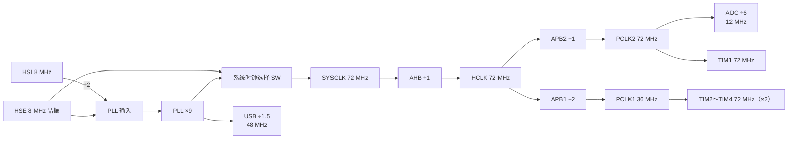

# 2.3 时钟与复位

新焊好的 Blue Pill 烧进点灯程序，灯不闪；串口终端按 115200 打开，收到的全是乱码；USB 线插上，电脑没有任何反应。这些现象容易被当成硬件故障，其实程序还跑在 8 MHz 的内部 RC 振荡器上，而波特率、定时器周期和 USB 时钟全是按 72 MHz 算的。芯片没有坏，只是没人告诉它该跑多快。

这一节从时钟树讲起，用寄存器把 SYSCLK 配到 72 MHz，算清各条总线与外设实际拿到的频率，再讲复位：怎样知道上一次为什么复位，怎样主动复位，怎样单独复位一个外设。

## 1. 时钟决定什么

STM32F103 复位后，RCC_CFGR 的 SW 与 SWS 都是 `00`，系统时钟取自 HSI，频率 8 MHz。这个频率能取指、能跑循环，但所有与时间有关的外设都按它算：

- USART 的分频值 BRR 按 PCLK2 或 PCLK1 的频率算出来，频率差 9 倍，实际波特率就跟着差 9 倍，终端收到的全是乱码。
- 定时器的计数频率来自 PCLK，预分频值不变时，周期也差 9 倍。
- ADC 的转换时间以 ADCCLK 计，采样窗口跟着变。
- USB 要求 48 MHz，8 MHz 凑不出这个频率。

外设的时钟默认还是关着的。RM0008 给每个外设分配了一个使能位，复位值为 0，写外设寄存器本身不报错，但外设不工作。这样设计是为了省电：用不到的串口、SPI、定时器不必耗电。

从这一节起，程序统一包含 `stm32f1xx.h`。这个头文件根据编译时定义的 `STM32F103xB` 选中 `stm32f103xb.h`，里面把每个外设的寄存器组描述成结构体，并给出形如 `#define RCC ((RCC_TypeDef *)RCC_BASE)` 的指针。`RCC->CR` 就是访问 RCC 寄存器组偏移 0 处的寄存器，和 [2.2 内存映射 I/O、寄存器与 volatile](/教程/正文/嵌入式/2_MCU裸机开发/2_2_内存映射IO_寄存器与volatile) 里用整数地址加强制转换的写法是一回事，只是地址、偏移和位名由头文件负责。[3.1 驱动接口、CMSIS 与设备头文件](/教程/正文/嵌入式/3_驱动_通信与中间件/3_1_驱动接口_CMSIS与设备头文件) 会把这些定义拆开讲。

```c
#include "stm32f1xx.h"

void led_clock_on(void) {
    /* APB2ENR 的 IOPCEN 位置 1，打开 GPIOC 的时钟 */
    RCC->APB2ENR |= RCC_APB2ENR_IOPCEN;
}
```

`|=` 在这里是读改写，但 APB2ENR 只有 CPU 会写，不存在多个写者，所以这样写没有问题。

## 2. 时钟源与时钟树

F103 有四个时钟源，还有一个把其中某一个倍频到高频率的 PLL：

| 时钟源 | 频率 | 来源 | 主要用途 |
| --- | --- | --- | --- |
| HSI | 8 MHz | 片内 RC 振荡器 | 复位后的系统时钟、PLL 输入 |
| HSE | 4～16 MHz | 外部晶振，板上为 8 MHz | PLL 输入、系统时钟、USB |
| LSI | 约 40 kHz（30～60 kHz） | 片内 RC 振荡器 | 独立看门狗、RTC |
| LSE | 32.768 kHz | 外部晶振 | RTC |
| PLL | 输入 × 2～16 | HSI/2、HSE 或 HSE/2 | 系统时钟、USB |

HSI 出厂时校准过，25 °C 下误差约 ±1%，0～85 °C 范围内扩大到 −1.1%～+1.8%，再往低温走还会更差。串口通信在这个误差下能正常收发，USB 不行。HSE 用晶振，精度由晶振决定，板上那颗是 8 MHz。

配到 72 MHz 时，信号走过的路径是这样的：



每一级都有上限，超了要么不工作，要么工作不稳定：

| 时钟 | 上限 | 本节配置 | 说明 |
| --- | --- | --- | --- |
| SYSCLK | 72 MHz | 72 MHz | 系统时钟 |
| HCLK | 72 MHz | 72 MHz | AHB 总线、内核、SRAM、DMA |
| PCLK1 | 36 MHz | 36 MHz | APB1，低速外设 |
| PCLK2 | 72 MHz | 72 MHz | APB2，高速外设 |
| ADCCLK | 14 MHz | 12 MHz | ADC1、ADC2 |
| USBCLK | 48 MHz | 48 MHz | 必须正好 48 MHz |

::: concept emb-clock-timer-double title="APB 分频不为 1 时定时器时钟乘 2"

RM0008 规定：APB 预分频为 1 时，定时器时钟等于该 APB 域的频率；预分频不为 1 时，定时器时钟是该 APB 域频率的 2 倍。所以 PCLK1 = 36 MHz 时，TIM2～TIM4 拿到的是 72 MHz，而不是 36 MHz。

:::

这条规则容易在算定时器周期时用错。看到 PCLK1 是 36 MHz，就以为 TIM3 也跑 36 MHz，算出来的定时周期会差一倍。APB2 上的 TIM1 因为分频为 1，时钟直接等于 PCLK2，没有这个乘 2。

::: concept emb-clock-usb-48mhz title="USB 时钟必须由 HSE 驱动的 PLL 提供"

USB 设备要求 48 MHz 时钟，且误差在 ±0.25% 以内。这个频率只能由 PLL 产生：PLL 输入取 HSE（8 MHz），倍频到 72 MHz，再经 USB 预分频 ÷1.5 得到 48 MHz。HSI 的精度不够，用 HSI 倍频出来的 48 MHz 不能用于 USB。

:::

<Quiz
  type="single"
  :options="[
    { label: '36 MHz，等于 PCLK1', value: 'A' },
    { label: '72 MHz，APB1 分频不为 1 时定时器时钟乘 2', value: 'B' },
    { label: '18 MHz，是 PCLK1 的一半', value: 'C' },
    { label: '8 MHz，跟随 HSI', value: 'D' }
  ]"
  answer="B"
>

<template #question>

系统时钟为 72 MHz、APB1 预分频为 2 时，TIM3 的计数时钟是多少？

</template>

正确答案是 **B**。PCLK1 = 72 / 2 = 36 MHz，APB1 分频不为 1，定时器时钟再乘 2，得到 72 MHz。RM0008 的原文是 "when the APB prescaler is 1, the timer clock frequencies are set to the same frequency as that of the APB domain. Otherwise they are set to twice (×2) the frequency of the APB domain."

</Quiz>

## 3. 外设时钟使能

三个使能寄存器分管三片区域，常用位如下：

| 寄存器 | 位 | 名称 | 外设 |
| --- | --- | --- | --- |
| RCC_AHBENR | 0 | DMA1EN | DMA1 |
| RCC_AHBENR | 2 | SRAMEN | SRAM |
| RCC_AHBENR | 4 | FLITFEN | Flash 接口 |
| RCC_APB2ENR | 0 | AFIOEN | AFIO（重映射、EXTI 端口选择） |
| RCC_APB2ENR | 2～5 | IOPAEN～IOPDEN | GPIOA～GPIOD |
| RCC_APB2ENR | 9 | ADC1EN | ADC1 |
| RCC_APB2ENR | 11 | TIM1EN | TIM1 |
| RCC_APB2ENR | 12 | SPI1EN | SPI1 |
| RCC_APB2ENR | 14 | USART1EN | USART1 |
| RCC_APB1ENR | 0～2 | TIM2EN～TIM4EN | TIM2～TIM4 |
| RCC_APB1ENR | 11 | WWDGEN | 窗口看门狗 |
| RCC_APB1ENR | 14 | SPI2EN | SPI2 |
| RCC_APB1ENR | 17、18 | USART2EN、USART3EN | USART2、USART3 |
| RCC_APB1ENR | 21、22 | I2C1EN、I2C2EN | I2C1、I2C2 |
| RCC_APB1ENR | 23 | USBEN | USB |
| RCC_APB1ENR | 25 | CANEN | CAN |
| RCC_APB1ENR | 28 | PWREN | 电源控制（低功耗用） |

每写一个外设的驱动，第一行都是打开它的时钟。漏掉这一行不会编译出错，也不会触发异常，只是后面所有配置都石沉大海：

::: compare left-title="没开时钟就配置" right-title="先开时钟再配置"

```c
/* GPIOC 的时钟还是关的 */
GPIOC->CRH = (GPIOC->CRH & ~(0xFu << 20)) | (0x2u << 20);
GPIOC->BSRR = GPIO_BSRR_BR13;
```

---

```c
RCC->APB2ENR |= RCC_APB2ENR_IOPCEN;
GPIOC->CRH = (GPIOC->CRH & ~(0xFu << 20)) | (0x2u << 20);
GPIOC->BSRR = GPIO_BSRR_BR13;
```

:::

访问一个时钟关闭的外设寄存器不会被总线判为错误：写操作被丢弃，读操作返回 0。调试时单步看寄存器，会以为写成功了，实际上外设没有收到。PWR 的寄存器也一样，没有开 PWREN 就配置低功耗，写入同样无效。

## 4. 用寄存器配置 72 MHz

配置顺序可以拆成六步：

1. 打开 HSE，等待 HSERDY 置位。
2. 设置 Flash 等待周期和预取缓冲。
3. 设置 AHB、APB1、APB2、ADC 的分频，以及 PLL 的输入、倍频和 USB 分频。
4. 打开 PLL，等待 PLLRDY 置位。
5. 把 SW 切到 PLL，等待 SWS 变成 `10`。
6. 更新记录系统频率的对象 `SystemCoreClock`。

完整函数在 `code/嵌入式/2_MCU裸机开发/2_3_时钟与复位/clock.c`：

```c
#include "clock.h"
#include "stm32f1xx.h"

uint32_t SystemCoreClock = 8000000u;

void clock_init_72mhz(void) {
    /* 1. 开启外部 8 MHz 晶振（HSE），等待振荡稳定 */
    RCC->CR |= RCC_CR_HSEON;
    while ((RCC->CR & RCC_CR_HSERDY) == 0) {
    }

    /* 2. 提高 SYSCLK 前先开启 Flash 预取缓冲并设为 2 个等待周期（48~72 MHz） */
    FLASH->ACR = (FLASH->ACR & ~FLASH_ACR_LATENCY) |
                 FLASH_ACR_LATENCY_2 | FLASH_ACR_PRFTBE;

    /* 3. 配置总线分频与 PLL */
    uint32_t cfgr_mask = RCC_CFGR_HPRE | RCC_CFGR_PPRE1 | RCC_CFGR_PPRE2 |
                         RCC_CFGR_ADCPRE | RCC_CFGR_PLLSRC |
                         RCC_CFGR_PLLXTPRE | RCC_CFGR_PLLMULL |
                         RCC_CFGR_USBPRE;
    uint32_t cfgr_val = RCC_CFGR_HPRE_DIV1 | RCC_CFGR_PPRE2_DIV1 |
                        RCC_CFGR_PPRE1_DIV2 | RCC_CFGR_ADCPRE_DIV6 |
                        RCC_CFGR_PLLSRC | RCC_CFGR_PLLMULL9;
    RCC->CFGR = (RCC->CFGR & ~cfgr_mask) | cfgr_val;

    /* 4. 开启 PLL，等待锁定 */
    RCC->CR |= RCC_CR_PLLON;
    while ((RCC->CR & RCC_CR_PLLRDY) == 0) {
    }

    /* 5. 将系统时钟切换到 PLL，等待硬件确认切换完成 */
    RCC->CFGR = (RCC->CFGR & ~RCC_CFGR_SW) | RCC_CFGR_SW_PLL;
    while ((RCC->CFGR & RCC_CFGR_SWS) != RCC_CFGR_SWS_PLL) {
    }

    /* 6. 更新全局系统时钟频率对象 */
    SystemCoreClock = 72000000u;
}
```

第 3 步写进去的值对应：HPRE = `0000`（HCLK = SYSCLK）、PPRE2 = `000`（PCLK2 = HCLK）、PPRE1 = `100`（PCLK1 = HCLK / 2）、ADCPRE = `10`（ADCCLK = PCLK2 / 6）、PLLSRC = 1（PLL 输入取 HSE）、PLLXTPRE = 0（HSE 不分频）、PLLMUL = `0111`（×9）、USBPRE = 0（PLL / 1.5）。完整的位表见本节后面。

`SystemCoreClock` 不是硬件寄存器，是 CMSIS 约定给软件用的一个对象，`SysTick_Config`、`HAL_Init` 和串口初始化都会读它。时钟改了而它没改，后面按它算出来的节拍、波特率全错。工程里如果时钟频率在运行时变化，调用 `SystemCoreClockUpdate()`，让 CMSIS 从寄存器反推；本节的频率固定，直接赋值。

<Quiz
  type="single"
  :options="[
    { label: 'HSE 8 MHz、PLL ×9、APB1 ÷2、APB2 ÷1', value: 'A' },
    { label: 'HSI/2、PLL ×9、APB1 ÷2、APB2 ÷1', value: 'B' },
    { label: 'HSE 8 MHz、PLL ×16、APB1 ÷2、APB2 ÷2', value: 'C' },
    { label: 'HSE 8 MHz、PLL ×9、APB1 ÷1、APB2 ÷2', value: 'D' }
  ]"
  answer="A"
>

<template #question>

要让 SYSCLK = 72 MHz、PCLK1 = 36 MHz、PCLK2 = 72 MHz，且 USB 可用，PLL 与分频应该怎么配？

</template>

正确答案是 **A**。USB 要求 48 MHz 且只能由 HSE 驱动的 PLL 提供，HSE 8 MHz 乘 9 得 72 MHz，再 ÷1.5 就是 48 MHz。PCLK1 上限 36 MHz，所以 APB1 必须 ÷2；PCLK2 可以到 72 MHz，÷1 即可。B 的 PLL 输入是 HSI/2（4 MHz ×9 = 36 MHz），根本到不了 72 MHz；D 的分频关系全反了，PCLK1 成了 72 MHz、PCLK2 成了 36 MHz。

</Quiz>

::: concept emb-clock-flash-latency title="提高 SYSCLK 之前先增加 Flash 等待周期"

Flash 的读取速度跟不上 72 MHz 的内核。HCLK 不超过 24 MHz 时用 0 个等待周期，24～48 MHz 用 1 个，48～72 MHz 用 2 个。提高频率时先改 FLASH_ACR 的 LATENCY，再切换时钟；降低频率时先切换时钟，再减少等待周期。顺序反了，内核会在 Flash 还没准备好的情况下取指。

:::

::: compare left-title="先切时钟再设等待周期" right-title="先设等待周期再切时钟"

```c
RCC->CFGR = (RCC->CFGR & ~RCC_CFGR_SW) | RCC_CFGR_SW_PLL;
while ((RCC->CFGR & RCC_CFGR_SWS) != RCC_CFGR_SWS_PLL) {
}
FLASH->ACR = (FLASH->ACR & ~FLASH_ACR_LATENCY) | FLASH_ACR_LATENCY_2;
```

---

```c
FLASH->ACR = (FLASH->ACR & ~FLASH_ACR_LATENCY) |
             FLASH_ACR_LATENCY_2 | FLASH_ACR_PRFTBE;
RCC->CFGR = (RCC->CFGR & ~RCC_CFGR_SW) | RCC_CFGR_SW_PLL;
while ((RCC->CFGR & RCC_CFGR_SWS) != RCC_CFGR_SWS_PLL) {
}
```

:::

左栏在切换完成后的那几条指令里，Flash 仍然按 8 MHz 的时序应答，取指可能读到错误的内容，程序随即跑飞，表现是随机的 HardFault 或直接停住。这类错误在调试器里很难复现，因为调试器访问 Flash 的时机和 CPU 不同。

示例的构建结果：

::: terminal title="bash - 构建 clock_demo"

```text
$ arm-none-eabi-gcc -std=c11 -mcpu=cortex-m3 -mthumb -O2 -g -Wall -Wextra \
    -ffunction-sections -fdata-sections -DSTM32F103xB -I. \
    -nostartfiles --specs=nano.specs --specs=nosys.specs -Wl,--gc-sections \
    -T stm32f103c8.ld clock.c main.c startup_stm32f103.c -o clock_demo.elf
$ arm-none-eabi-size clock_demo.elf
   text	   data	    bss	    dec	    hex	filename
    652	      4	   1540	   2196	    894	clock_demo.elf
```

:::

`-I.` 指向的目录里放着 `stm32f1xx.h`、`stm32f103xb.h`、`core_cm3.h` 等头文件。它们来自 CMSIS_5 5.9.0 的 `CMSIS/Core/Include` 与 cmsis_device_f1 v4.3.5 的 `Include`，仓库不提交第三方源码，构建前按这两个版本取一份即可。

`main.c` 启动后先记录复位原因，再配置时钟，然后把 PLL 二分频从 PA8 送出去，最后点亮 PC13 表示切换完成。板上能看到的现象是 PA8 上出现 36 MHz 方波、LED 常亮；没有示波器时，看 LED 亮不亮也能判断程序有没有走过时钟初始化。

::: details RCC_CFGR 位表（RM0008 第 7.3.2 节）

| 位 | 名称 | 含义 |
| --- | --- | --- |
| 1:0 | SW | 系统时钟选择：00 HSI、01 HSE、10 PLL、11 保留 |
| 3:2 | SWS | 当前系统时钟（只读），编码同 SW |
| 7:4 | HPRE | AHB 分频：0000～0111 ÷1，1000 ÷2，1001 ÷4，1010 ÷8，1011 ÷16，1100 ÷64，1101 ÷128，1110 ÷256，1111 ÷512 |
| 10:8 | PPRE1 | APB1 分频：0xx ÷1，100 ÷2，101 ÷4，110 ÷8，111 ÷16 |
| 13:11 | PPRE2 | APB2 分频，编码同 PPRE1 |
| 15:14 | ADCPRE | ADC 分频：00 ÷2，01 ÷4，10 ÷6，11 ÷8 |
| 16 | PLLSRC | PLL 输入：0 HSI/2，1 HSE |
| 17 | PLLXTPRE | HSE 分频：0 ÷1，1 ÷2 |
| 21:18 | PLLMUL | 倍频：0000 ×2 … 0111 ×9 … 1110、1111 ×16 |
| 22 | USBPRE | USB 分频：0 PLL/1.5，1 PLL |
| 26:24 | MCO | 时钟输出：100 SYSCLK，101 HSI，110 HSE，111 PLL/2 |

:::

配好之后，各路时钟是不是预期的值，可以先用一个主机程序算一遍。`clock_calc.c` 把 CFGR 的值拆成各个字段，按同样的规则推出频率，并检查 USB 是否正好 48 MHz：

::: terminal title="bash - clock_calc"

```text
$ gcc -std=c17 -Wall -Wextra clock_calc.c -o clock_calc
$ ./clock_calc
Preset                           SYSCLK   HCLK  PCLK1  TIM2-4  PCLK2 ADCCLK   USBCLK   WS
---------------------------------------------------------------------------------------
Reset default (HSI 8 MHz)           8 M    8 M    8 M     8 M    8 M    4 M      off    0
HSE 8 MHz -> PLL x9 (72 MHz)       72 M   72 M   36 M    72 M   72 M   12 M     48.0    2
HSE 8 MHz -> PLL x6 (48 MHz)       48 M   48 M   24 M    48 M   48 M   12 M     48.0    1
HSI/2 4 MHz -> PLL x16 (64 MHz)    64 M   64 M   32 M    64 M   64 M   10 M    42.6*    2
```

:::

最后一行是只用 HSI 能得到的最高频率。USB 那一列带星号，因为 64 MHz 的 PLL 输出除以 1.5 是 42.67 MHz，不是 48 MHz；即使换一种分频凑出 48 MHz，时钟源是 HSI，精度也不满足 USB 的要求。这个程序也顺手验证了 48 MHz 和 64 MHz 两种配置下的 Flash 等待周期：48 MHz 只需要 1 个，64 MHz 需要 2 个。

## 5. 验证时钟

时钟配好没有，最直接的办法是把它送出来测。PA8 可以输出 MCO（Microcontroller Clock Output，微控制器时钟输出），在 RCC_CFGR 的 MCO 位选源。选 PLL 二分频得到 36 MHz：

```c
void mco_enable_pll_div2(void) {
    /* 开启 GPIOA 时钟，把 PA8（CRH[3:0]）配置为 50 MHz 复用推挽输出（0xB） */
    RCC->APB2ENR |= RCC_APB2ENR_IOPAEN;
    GPIOA->CRH = (GPIOA->CRH & ~0xFu) | 0xBu;

    /* 选择 PLLCLK / 2（72 MHz / 2 = 36 MHz）从 PA8（MCO）输出 */
    RCC->CFGR = (RCC->CFGR & ~RCC_CFGR_MCO) | RCC_CFGR_MCO_PLLCLK_DIV2;
}
```

不直接输出 72 MHz，是因为 F103 的 I/O 最高翻转频率按 50 MHz 档标注，72 MHz 超出这一档，波形会明显变形。示波器或逻辑分析仪接 PA8 与 GND，量到的应是 36 MHz 方波，误差由晶振决定。

MCO 选的是 PLL 的输出，不经过 SW 那一级选择，所以量到 36 MHz 只证明 PLL 锁定在 72 MHz，不证明系统时钟切过去了。系统时钟真的切到 PLL 没有，看 RCC_CFGR 的 SWS 位：它等于 `10` 才算切换完成。没有示波器时，调试器连上后直接看 `SystemCoreClock` 的值，或者读 SWS 位。再往后，2.6 的 SysTick 闪灯周期、2.7 的串口能不能在 115200 下正常收发，都是对时钟的交叉验证：串口乱码而程序逻辑没问题，先怀疑时钟和 BRR。

## 6. 复位

复位分两类。系统复位把内核和绝大多数外设恢复初值，备份域寄存器不受影响；电源复位发生在上电或掉电时，除备份域外全部复位。看门狗复位、软件复位、NRST 引脚复位都属于系统复位。RCC_CSR 里的复位标志记录的是这些来源里哪些发生过，与复位本身无关。

上次是哪种复位，读 RCC_CSR 就知道：

| 位 | 名称 | 含义 |
| --- | --- | --- |
| 26 | PINRSTF | NRST 引脚复位 |
| 27 | PORRSTF | 上电/掉电复位 |
| 28 | SFTRSTF | 软件复位 |
| 29 | IWDGRSTF | 独立看门狗复位 |
| 30 | WWDGRSTF | 窗口看门狗复位 |
| 31 | LPWRRSTF | 低功耗管理复位 |
| 24 | RMVF | 清除复位标志，写 1 生效 |

这些标志是"或"的关系：只要发生过，就一直置着，直到写 RMVF 清除。另一个细节是内部复位源也会把 NRST 拉低，从而把 PINRSTF 一并置位。所以判断时要先看具体的源，最后才看 PINRSTF，否则永远只能读到"引脚复位"。

`clock.c` 里的 `reset_cause_get()` 就是按这个顺序写的：

```c
reset_cause_t reset_cause_get(void) {
    uint32_t csr = RCC->CSR;
    reset_cause_t cause = RESET_CAUSE_UNKNOWN;

    if ((csr & RCC_CSR_LPWRRSTF) != 0) {
        cause = RESET_CAUSE_LOW_POWER;
    } else if ((csr & RCC_CSR_WWDGRSTF) != 0) {
        cause = RESET_CAUSE_WWDG;
    } else if ((csr & RCC_CSR_IWDGRSTF) != 0) {
        cause = RESET_CAUSE_IWDG;
    } else if ((csr & RCC_CSR_SFTRSTF) != 0) {
        cause = RESET_CAUSE_SOFTWARE;
    } else if ((csr & RCC_CSR_PORRSTF) != 0) {
        cause = RESET_CAUSE_POR;
    } else if ((csr & RCC_CSR_PINRSTF) != 0) {
        cause = RESET_CAUSE_PIN;
    }

    /* 向 RMVF 写 1 清除所有复位标志，以免影响下一次复位后的判别 */
    RCC->CSR |= RCC_CSR_RMVF;
    return cause;
}
```

返回的枚举在 [2.10 看门狗、低功耗与故障处理](/教程/正文/嵌入式/2_MCU裸机开发/2_10_看门狗_低功耗与故障处理) 里用来区分看门狗复位，[6.2 日志、断言与故障诊断](/教程/正文/嵌入式/6_质量_安全与交付/6_2_日志_断言与故障诊断) 里会把它写进日志。读完之后必须清标志，否则下一次启动读到的还是上一次的记录，判断就失去意义。

软件复位用 CMSIS 的 `NVIC_SystemReset()`，它往 SCB->AIRCR 写 `SYSRESETREQ` 和访问密钥，内核在几个周期后复位。函数不会正常返回。故障处理函数记录完现场后就调用它，让设备自己重启。

外设复位是另一回事：RCC_APB1RSTR 和 RCC_APB2RSTR 的每一位对应一个外设，置 1 再清 0，该外设的所有寄存器回到复位值，但不影响 CPU 和其他外设。I2C 总线被从机拉死、重新初始化也恢复不了时，常见做法就是先复位 I2C1：

```c
RCC->APB1RSTR |= RCC_APB1RSTR_I2C1RST;
RCC->APB1RSTR &= ~RCC_APB1RSTR_I2C1RST;
```

::: tip 调试时先看复位原因

设备莫名其妙重启，第一件事是读 `reset_cause_get()`。看到 `IWDG` 就去查喂狗，看到 `POR` 就去查供电，看到 `PIN` 再去看 NRST 上的电平和电容。复位标志只有一次机会，读完就被清掉，所以要在启动的最前面打印或保存。

:::

<Quiz
  type="single"
  :options="[
    { label: '只有 PINRSTF', value: 'A' },
    { label: 'PINRSTF 与 SFTRSTF', value: 'B' },
    { label: '只有 PORRSTF', value: 'C' },
    { label: '所有标志都会置位', value: 'D' }
  ]"
  answer="A"
>

<template #question>

程序每次启动都调用 `reset_cause_get()` 并把标志清掉了。现在按一下板上的复位键，本次启动读 RCC_CSR 时哪些标志会置位？

</template>

正确答案是 **A**。复位键拉低 NRST，属于引脚复位，只有 PINRSTF 置位。标志在下次写 RMVF 之前一直保持，所以程序要在启动时读一次并清除，否则下一次会同时读到旧记录。

</Quiz>

## 7. HAL 对照

CubeMX 生成的 `SystemClock_Config()` 做的是同一件事，只是拆成了两个结构体：

```c
RCC_OscInitTypeDef osc = {0};
RCC_ClkInitTypeDef clk = {0};

osc.OscillatorType = RCC_OSCILLATORTYPE_HSE;
osc.HSEState = RCC_HSE_ON;
osc.PLL.PLLState = RCC_PLL_ON;
osc.PLL.PLLSource = RCC_PLLSOURCE_HSE;
osc.PLL.PLLMUL = RCC_PLL_MUL9;
HAL_RCC_OscConfig(&osc);

clk.ClockType = RCC_CLOCKTYPE_HCLK | RCC_CLOCKTYPE_SYSCLK |
                RCC_CLOCKTYPE_PCLK1 | RCC_CLOCKTYPE_PCLK2;
clk.SYSCLKSource = RCC_SYSCLKSOURCE_PLLCLK;
clk.AHBCLKDivider = RCC_SYSCLK_DIV1;
clk.APB1CLKDivider = RCC_HCLK_DIV2;
clk.APB2CLKDivider = RCC_HCLK_DIV1;
HAL_RCC_ClockConfig(&clk, FLASH_LATENCY_2);
```

`HAL_RCC_OscConfig` 负责开 HSE、配 PLL，`HAL_RCC_ClockConfig` 负责分频、设 Flash 等待周期、切时钟。最后一个参数 `FLASH_LATENCY_2` 就是第 4 步里的 LATENCY = 2，HAL 把它和切换顺序绑在了一起，这也是用 HAL 不容易犯顺序错误的原因。

其余几项的一一对应：

| 寄存器写法 | HAL 写法 |
| --- | --- |
| `RCC->APB2ENR \|= RCC_APB2ENR_IOPCEN` | `__HAL_RCC_GPIOC_CLK_ENABLE()` |
| `RCC->CSR & RCC_CSR_IWDGRSTF` | `__HAL_RCC_GET_FLAG(RCC_FLAG_IWDGRST)` |
| `RCC->CSR \|= RCC_CSR_RMVF` | `__HAL_RCC_CLEAR_RESET_FLAGS()` |
| `RCC->APB1RSTR \|= RCC_APB1RSTR_I2C1RST` | `__HAL_RCC_I2C1_FORCE_RESET()`、`__HAL_RCC_I2C1_RELEASE_RESET()` |
| `RCC->CFGR` 的 MCO 位 | `HAL_RCC_MCOConfig(RCC_MCO1, RCC_MCO1SOURCE_PLLCLK_DIV2, RCC_MCODIV_1)` |

HAL 的宏最终也是读写同一批寄存器，看懂寄存器之后，HAL 的参数只是换了个名字。

## 8. 习题

### 8.1 巩固

<Exercise id="62219" :d="1" :w="1">

下面这行代码编译通过，GPIOC 的时钟却始终没打开：

```c
RCC->APB1ENR |= RCC_APB2ENR_IOPAEN;
```

(1) 说明这行实际写进了哪个寄存器、置起了哪一位，打开了哪个外设的时钟，为什么编译器和链接器都不会报警。

(2) 从第 3 节的表里查出 GPIOC、TIM4、USART1、ADC1、DMA1、I2C1 的使能位，整理成四列的表：外设、寄存器、位、CMSIS 宏名。

(3) 改正上面那行，并写出同时打开 GPIOC、TIM4、USART1 的三条语句。

(4) 假设 `RCC->APB2ENR` 里 USART1EN 一直没置位，串口初始化代码照常执行、不报错，`printf` 却一个字也发不出来。说明这类「配置写进去但外设没收到」的现象与第 3 节讲的写无效是同一回事，调试时看哪个寄存器能最快确认。

</Exercise>

<Exercise id="62220" :d="2" :w="1">

把 `RCC->CFGR` 的各位读出来，回答下面这个配置下各路时钟的频率：

```c
RCC->CFGR = 0x001D840Au;
```

(1) 按第 4 节的位表逐字段拆开这个值，每个字段写成「位段 = 二进制 = 含义」，字段包括 SW、HPRE、PPRE1、PPRE2、ADCPRE、PLLSRC、PLLXTPRE、PLLMUL、USBPRE。

(2) 按拆出来的字段算出 SYSCLK、HCLK、PCLK1、TIM2～TIM4、PCLK2、ADCCLK、USBCLK。

(3) 用 `code/嵌入式/2_MCU裸机开发/2_3_时钟与复位/clock_calc.c` 核对：

::: terminal title="bash - clock_calc"

```text
$ gcc -std=c17 -Wall -Wextra clock_calc.c -o clock_calc
$ ./clock_calc
```

:::

指出 `clock_calc` 输出的哪一行正好对应这个值。对照时注意：`clock_calc` 的预设是用 `SWS` 字段的值拼出来的，与这个值在最低两位上不同。说明 SW 与 SWS 各是什么、为什么频率仍然对得上。

</Exercise>

<Exercise id="62221" :d="2" :w="2">

`clock_calc.c` 的 `presets` 数组里加一组 `RCC->CFGR = 0x0038840Au`，重新编译运行。

(1) 写出这一组的输出行，说明 `USBCLK` 列末尾的星号是按什么规则打上的。

(2) 这一组的 SYSCLK 是多少，按第 4 节的 Flash 等待周期表需要几个等待周期。如果 `acr` 只给 `0x31`（1 个等待周期），现场会看到什么。

(3) 这一组能不能用来跑 USB？从频率与时钟源精度两个角度分别说明。

</Exercise>

<Exercise id="62222" :d="2" :w="1">

`reset_cause_get()` 按固定顺序判断复位来源，读完之后用 `RCC->CSR |= RCC_CSR_RMVF` 清标志。

(1) 为什么判断时把 PINRSTF 放在最后？如果先判断 PINRSTF，一次独立看门狗复位会被报成什么？

(2) 下面这段代码抄自某工程，指出它的问题：

```c
reset_cause_t cause = reset_cause_get();
if (reset_cause_get() == RESET_CAUSE_IWDG) {
    log_write("watchdog reset");
}
```

(3) 写一个 `reset_flags_dump()`，把 `RCC->CSR` 的第 26～31 位逐个按 `PINRSTF=1 PORRSTF=0 ...` 的格式打印出来，不清标志，供调试时在 `reset_cause_get()` 之前调用。

</Exercise>

### 8.2 编程

<Exercise id="62223" :d="3" :w="2">

基于初始代码 `code/嵌入式/2_MCU裸机开发/2_3_时钟与复位/exercises/cfgr_decode_starter.c`，补全 `cfgr_inspect()`：

1. 按第 4 节的位表拆出 HPRE、PPRE1、PPRE2、ADCPRE、PLLSRC、PLLXTPRE、PLLMUL，算出 SYSCLK、HCLK、PCLK1、TIM2～TIM4、PCLK2、ADCCLK，填进 `clock_report_t`。
2. `limits_ok` 要求 SYSCLK ≤ 72 MHz、HCLK ≤ 72 MHz、PCLK1 ≤ 36 MHz、PCLK2 ≤ 72 MHz、ADCCLK ≤ 14 MHz 同时成立。
3. `flash_ws_ok` 按 `FLASH_ACR` 的 LATENCY[2:0] 判断：SYSCLK ≤ 24 MHz 需要 0 个等待周期，≤ 48 MHz 需要 1 个，≤ 72 MHz 需要 2 个。

用 `gcc -std=c17 -Wall -Wextra cfgr_decode_starter.c -o cfgr_decode` 编译运行，期望输出：

```out
72 MHz valid     SYSCLK=72000000 PCLK1=36000000 TIM2=72000000 ADC=12000000 limits=1 ws=1
APB1 overclock   SYSCLK=72000000 PCLK1=72000000 TIM2=72000000 ADC=12000000 limits=0 ws=1
WS too small     SYSCLK=72000000 PCLK1=36000000 TIM2=72000000 ADC=12000000 limits=1 ws=0
```

注意 `ws` 这一列打印的是布尔结论（1 表示满足），不是等待周期数。`acr = 0x32` 的低 3 位是 2，先想清楚这个字段在 `FLASH_ACR` 里的位置再动手。

</Exercise>

<Exercise id="62224" :d="3" :w="2">

`clock_init_72mhz()` 里的三个 `while` 循环等不到条件时会永远转下去，芯片看起来像死机。

(1) 把 `clock_init_72mhz()` 改成返回 `int`：HSERDY、PLLRDY、SWS 三处等待各加一个循环上限，任一超时返回 -1，全部成功返回 0。上限用简单的计数器，不要引入 SysTick。

(2) 写一个主机程序 `timeout_model.c` 验证这段逻辑：把三处等待建模成三个 `for` 循环，循环上限与「第几轮条件成立」都从命令行读入，输出每一步在第几轮等到，或者在超时后打印 `HSE timeout`、`PLL timeout`、`SW timeout` 并返回非零。

(3) 说明为什么超时分支里不能调用任何依赖 `SystemCoreClock` 的函数（比如 `printf` 重定向到串口）。

</Exercise>

<Exercise id="62225" :d="3" :w="2">

给 `clock.c` 增加 `clock_init_hse_48mhz()`，把系统时钟配成 48 MHz：

- HSE 8 MHz 不分频，PLL ×6；
- HCLK = 48 MHz，PCLK1 = 24 MHz，PCLK2 = 48 MHz；
- ADCCLK = 12 MHz，USB 时钟取 PLL 直接输出（`USBPRE = 1`）；
- 同样更新 `SystemCoreClock`。

要求：

(1) 写出写进 `CFGR` 的值（十六进制）与每一段字段的取值，再写出切换完成后从调试器读回的值，说明两者差在哪一段。

(2) 把这组配置加进 `clock_calc.c` 的 `presets`（`SWS` 字段按实际值填），贴出输出行，核对 USB 正好 48 MHz、ADCCLK 正好 12 MHz、Flash 等待周期是 1 个。

(3) 说明这组配置下 TIM2～TIM4 的计数时钟是多少，为什么不是 24 MHz。

(4) 用第 7 节的 HAL 写法写出同一个配置：两个结构体各字段填什么，`HAL_RCC_ClockConfig` 的最后一个参数传什么。说明 HAL 是怎样把等待周期和切换顺序绑在一起的。

</Exercise>

<Exercise id="62226" :d="4" :w="3">

写一个主机程序 `mco_plan.c`，命令行参数为 `--sysclk <Hz>` 与 `--want <Hz>`，输出让 MCO 最接近 `--want` 的源与分频。

MCO 的四个源见第 4 节的位表：`100` SYSCLK、`101` HSI、`110` HSE、`111` PLL/2。HSI、HSE 都按 8 MHz 算。

(1) 对四个源各算出输出频率、绝对误差与相对误差，按相对误差从小到大打印。

(2) `--sysclk 72000000 --want 36000000` 时四个源各是什么频率，哪一个误差最小？既然 SYSCLK 已经是 72 MHz，为什么第 5 节还要绕道 PLL/2 输出 36 MHz，而不把 SYSCLK 直接送出去。

(3) 再加一条规则：输出超过 50 MHz 时在该行末尾打印 `[over IO rating]`。用 `--want 72000000` 运行一次，说明最优源是哪一个、为什么它带上了这条标记。

验收：`gcc -std=c17 -Wall -Wextra mco_plan.c -o mco_plan`，`./mco_plan --sysclk 72000000 --want 36000000` 与 `./mco_plan --sysclk 72000000 --want 72000000` 两次运行都不崩溃、输出四行。

</Exercise>

### 8.3 综合与挑战

<Exercise id="62227" :d="5" :w="4" scope="*">

写一个主机程序 `clock_audit.c`，对任意一组 `CFGR` 与 `FLASH_ACR` 做审查，代替人工查表。

1. 从标准输入按行读 `cfgr acr`（十六进制），读到文件结束。
2. 每组输出 SYSCLK、HCLK、PCLK1、TIM2～TIM4、PCLK2、ADCCLK、USBCLK，再跟一行结论。
3. 结论按 RM0008 的约束给出，至少检查这几条：SYSCLK ≤ 72 MHz、HCLK ≤ 72 MHz、PCLK1 ≤ 36 MHz、PCLK2 ≤ 72 MHz、ADCCLK ≤ 14 MHz、USB 为 48 MHz 且时钟源为 HSE、Flash 等待周期足够。SYSCLK 取自 PLL 时还要检查 PLL 输入 1～25 MHz、PLL 输出 16～72 MHz；系统时钟不从 PLL 取时 PLL 根本不开，这两条不适用。有违反就打印 `FAIL: <原因>`，全部满足打印 `OK`。同一组同时违反多条时全部列出。
4. USB 只在系统时钟取自 PLL 时检查；`SW` 与 `SWS` 不一致（写了切换但硬件还停在 HSI）也要报出来。用下面八组输入验收：

```text
00000000 00000030
001D840A 00000032
0051840A 00000031
0038840A 00000032
001D800A 00000032
007D840A 00000032
001D8402 00000032
001D840A 00000030
```

第一组是复位默认，第二组是正文的 72 MHz，第三组是一个合法的 48 MHz 配置，第四组只用 HSI 倍频（频率合法，但 USB 不能用）；后四组各含一处错误。

5. 写出每组的结论，并对应到现场故障（USB 不识别、APB1 超频、PLL 超频、切换没完成、随机 HardFault）。说明哪一条只有拿示波器量 PA8 或读 `SWS` 才能确认。

</Exercise>

## 9. 参考资料

1. STMicroelectronics, [*RM0008 Reference manual: STM32F101xx, STM32F102xx, STM32F103xx, STM32F105xx and STM32F107xx advanced Arm-based 32-bit MCUs*, Rev 21](https://www.st.com/resource/en/reference_manual/rm0008-stm32f101xx-stm32f102xx-stm32f103xx-stm32f105xx-and-stm32f107xx-advanced-armbased-32bit-mcus-stmicroelectronics.pdf)：第 7 章 Reset and clock control（RCC）、第 3 章 Flash 访问控制（LATENCY 表）。
2. STMicroelectronics, [*DS5319 Datasheet: STM32F103x8, STM32F103xB medium-density performance line Arm-based 32-bit MCU*, Rev 20](https://www.st.com/resource/en/datasheet/stm32f103c8.pdf)：HSI、HSE、LSI 的频率与精度，USB 时钟要求。
3. STMicroelectronics, [*cmsis_device_f1*](https://github.com/STMicroelectronics/cmsis_device_f1)：`system_stm32f1xx.c` 中的 `SystemCoreClockUpdate` 与设备头文件。
4. Arm, [*CMSIS-Core (Cortex-M)*](https://arm-software.github.io/CMSIS_5/Core/html/)：`SystemCoreClock`、`SystemInit` 与 `NVIC_SystemReset`。
5. cpq, [*Bare-metal programming guide*](https://github.com/cpq/bare-metal-programming-guide)：Setting up clocks 一节，HSE + PLL 的配置顺序。
6. STMicroelectronics, [*STM32F1 HAL driver*](https://github.com/STMicroelectronics/stm32f1xx-hal-driver)：`stm32f1xx_hal_rcc.c` 中 `HAL_RCC_ClockConfig` 的实现。
