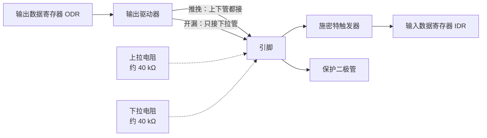

# 2.4 GPIO

通用输入输出端口（General-Purpose Input/Output, GPIO）是微控制器与外界物理环境交互最基础、最直接的物理电气通道。无论是控制 LED 的明暗、驱动继电器与电机、采样机械按键与传感器输入，还是充当 UART、I2C、SPI 等通信外设的物理引脚，底层的电气控制都建立在对 GPIO 端口配置的基础之上。

在前面的示例中，操作板载 PC13 引脚仅仅用了数行寄存器代码。然而在硬件底层，PC13 的控制字段为何精确对应在 CRH 寄存器的第 20 位？为什么设置电平时应当首选 `BSRR` 而非直接写入 `ODR`？采样机械按键时内部的上下拉电阻起到了什么作用？这些问题的根源深植于 GPIO 引脚内部的半导体物理结构。理解这些硬件机理，便能自如推导微控制器上任意引脚在不同工作模式下的精确行为。

## 1. 引脚的内部结构

在芯片内部，每一个外部物理引脚在逻辑上对应端口寄存器的一个独立比特位，其外围包含完整的输入采样通路与输出驱动级：



**输入通路**：外部信号进入引脚后，首先经过钳位保护二极管，防止过压击穿；随后信号被送入施密特触发器（Schmitt Trigger）进行整形，滤除输入端的高频微小杂波，最后锁存至输入数据寄存器（IDR）。施密特触发器具备电压滞回特性，当机械按键缓慢闭合或输入电压缓变时，能有效避免信号在逻辑电平判决阈值附近发生反复毛刺跳变。IDR 寄存器为只读属性，软件读取该寄存器即可获取引脚当前的实际逻辑电平。

**输出通路**：输出数据寄存器（ODR）中锁存的数值决定了输出引脚的期望逻辑，随后经由功率驱动级向引脚输出。输出驱动器具有两种截然不同的物理拓扑：
- **推挽输出（Push-Pull）**：驱动电路采用对称布置的 P-MOS（上拉管）与 N-MOS（下拉管）对管架构。当输出逻辑 1 时，上管导通、下管截止，引脚直接连接至 3.3V 电源，具备较强的主动拉电流能力；当输出逻辑 0 时，下管导通、上管截止，引脚直接连向地，具备对称的主动灌电流能力。推挽输出在两种状态下均呈现较低的输出阻抗，能够提供陡峭的电平翻转沿，适合高速数字信号传输与常规负载驱动。
- **开漏输出（Open-Drain）**：驱动电路中仅保留负责下拉接地的 N-MOS 管，上拉 P-MOS 管在电气上断开。当输出逻辑 0 时，下管导通将引脚拉低到地；当输出逻辑 1 时，下管截止，引脚处于完全悬空的开路高阻态，必须依靠外部上拉电阻将电平拉高至所需电压。

推挽与开漏在系统级硬件互联中承担着不同的分工。推挽适合单向点对点驱动（如驱动外部指示灯、数码管或作为点对点 SPI 总线的时钟线）；开漏则广泛用于多主从挂载的总线拓扑（如 I2C 总线）。在开漏配置下，多台设备的输出端可直接并联挂接在同一根物理信号线上，借助外部公共上拉电阻实现“线与”（Wired-AND）逻辑：只要总线上任何一个节点拉低，整条总线即呈现低电平；唯有所有节点均释放总线（输出 1）时，总线才被上拉电阻恢复为高电平。若将两个推挽输出引脚直接短接并联，一旦一个输出高电平、另一个输出低电平，电源与地之间将形成毫欧级的低阻通路，极大的短路电流会瞬间烧毁芯片内部的 MOS 驱动对管。

芯片内部集成了阻值约为 30～50 kΩ 的可配置弱上拉与弱下拉电阻。在引脚处于输入或开路状态且外部没有偏置电路时，使能内部弱电阻能够为悬空引脚提供确定的默认电平，避免高阻态输入受空间电磁耦合干扰而在 0 和 1 之间随机翻转。

::: generate emb-gpio-pushpull-analogy kind=explanation concepts=emb-gpio-crl-layout

面向第一次接触 GPIO 电气特性的读者，用两个开关说明推挽与开漏的区别：推挽像把引脚通过一个双掷开关分别接到电源或地，开漏像只接地、不接电源的单掷开关，高电平要靠外部上拉。再说明为什么 I²C 必须用开漏，以及两个推挽输出短接时会发生什么。

:::

## 2. GPIO 寄存器

F103 每个端口有 7 个寄存器：

| 寄存器 | 偏移 | 作用 |
| --- | --- | --- |
| CRL | 0x00 | 配置引脚 0～7 |
| CRH | 0x04 | 配置引脚 8～15 |
| IDR | 0x08 | 读输入电平 |
| ODR | 0x0C | 写输出电平，也用于选择上拉或下拉 |
| BSRR | 0x10 | 原子置位/复位 |
| BRR | 0x14 | 原子复位（只写） |
| LCKR | 0x18 | 锁定配置 |

配置寄存器是老式设计：每个引脚占 4 位，低 2 位是 MODE，高 2 位是 CNF。CRL 管 0～7，CRH 管 8～15。引脚 n 的字段起始位是 `(n % 8) * 4`。

::: concept emb-gpio-crl-layout title="GPIOx_CRL 与 CRH 的位分配"

引脚 y（0～7）的 MODEy 占 CRL 的第 4y+1～4y 位，CNFy 占第 4y+3～4y+2 位；引脚 8～15 在 CRH 里按同样规则编号。MODE 为 `00` 时是输入，其余取值是输出；CNF 的含义随 MODE 而变。

:::

MODE 与 CNF 的组合整理成速查表：

| 模式 | MODE | CNF | 4 位值 | 说明 |
| --- | --- | --- | --- | --- |
| 模拟输入 | 00 | 00 | 0x0 | ADC 用，数字通路断开 |
| 浮空输入 | 00 | 01 | 0x4 | 外部电路决定电平 |
| 上下拉输入 | 00 | 10 | 0x8 | 由 ODR 对应位选上拉或下拉 |
| 推挽输出 10 MHz | 01 | 00 | 0x1 | |
| 推挽输出 2 MHz | 10 | 00 | 0x2 | |
| 推挽输出 50 MHz | 11 | 00 | 0x3 | |
| 开漏输出 10 MHz | 01 | 01 | 0x5 | |
| 开漏输出 2 MHz | 10 | 01 | 0x6 | |
| 开漏输出 50 MHz | 11 | 01 | 0x7 | |
| 复用推挽 10 MHz | 01 | 10 | 0x9 | 外设接管输出 |
| 复用推挽 2 MHz | 10 | 10 | 0xA | |
| 复用推挽 50 MHz | 11 | 10 | 0xB | |
| 复用开漏 10 MHz | 01 | 11 | 0xD | |
| 复用开漏 2 MHz | 10 | 11 | 0xE | |
| 复用开漏 50 MHz | 11 | 11 | 0xF | |

复位值是 0x44444444：每个引脚都是 `0100`，即浮空输入。上电后所有引脚默认为高阻，不会因为配置成输出而意外驱动外部电路。

::: concept emb-gpio-pudr-by-odr title="上下拉由 ODR 的对应位选择"

引脚配置为上下拉输入（MODE = 00、CNF = 10）时，内部接上拉还是下拉由 ODR 的对应位决定：写 1 接上拉，写 0 接下拉。同一时刻只能接一个，不存在"上下拉同时打开"。这是 F1 特有的做法，后来的系列把它拆成了 PUPDR 的两个独立位。

:::

在 STM32F1 体系中，ODR 寄存器承担了双重功能：当引脚配置为输出模式时，它决定实际驱动的输出电平；当引脚配置为输入模式时，它的对应位充当了内部弱上下拉电阻的多路开关。因此在将引脚配置为上下拉输入时，严谨的代码编写顺序应当是先向 ODR 写入目标偏置（置 1 选上拉，置 0 选下拉），随后再配置 CRL/CRH 寄存器。若次序倒置，引脚在刚切入输入模式到 ODR 写入完成的短暂间隙中，将经历一个不确定的浮空或相反偏置状态，可能导致采样毛刺。

<Quiz
  type="single"
  :options="[
    { label: 'CRH 的第 20 位，值为 0x2', value: 'A' },
    { label: 'CRH 的第 23:20 位，值为 0x2', value: 'B' },
    { label: 'CRL 的第 23:20 位，值为 0x2', value: 'C' },
    { label: 'CRH 的第 15:12 位，值为 0x2', value: 'D' }
  ]"
  answer="B"
>

<template #question>

把 PC13 配置成 2 MHz 推挽输出（4 位值 0x2），应该写哪个寄存器的哪几位？

</template>

正确答案是 **B**。引脚 13 属于 8～15，用 CRH；在 CRH 里的位置是 `(13 − 8) × 4 = 20`，即第 23～20 位。CRL 只管 0～7 号引脚，写它不会影响 PC13。

</Quiz>

## 3. 输出：点亮 PC13

在常见的核心板（如 Blue Pill）上，板载 LED 负极串联限流电阻后连接至微控制器的 PC13 引脚，正极则接入 3.3V 系统供电轨。这种低边驱动拓扑决定了其逻辑控制呈现反相关系：当 PC13 输出低电平时，引脚提供灌电流回路，LED 导通点亮；当 PC13 输出高电平时，LED 两端均处于 3.3V 等电位，无导通压降，LED 熄灭。

驱动输出的完整流程由三个步骤构成：使能端口时钟、设定模式与驱动速率、更新输出电平：

```c
#include <stdint.h>
#include "stm32f1xx.h"

static void delay_cycles(uint32_t count) {
    for (volatile uint32_t i = 0; i < count; ++i) {
    }
}

int main(void) {
    /* 1. 开启 GPIOC 的 APB2 外设时钟 */
    RCC->APB2ENR |= RCC_APB2ENR_IOPCEN;

    /* 2. 把 PC13（CRH 位 23:20）配置为通用推挽输出，最大速度 2 MHz（0x2） */
    GPIOC->CRH &= ~(0xFu << 20);
    GPIOC->CRH |= 0x2u << 20;

    for (;;) {
        /* PC13 输出低电平，点亮板载 LED */
        GPIOC->BSRR = GPIO_BSRR_BR13;
        delay_cycles(400000u);

        /* PC13 输出高电平，熄灭板载 LED */
        GPIOC->BSRR = GPIO_BSRR_BS13;
        delay_cycles(400000u);
    }
}
```

第 2 步的两行可以合并，但绝不能只写第二行：

::: compare left-title="整体赋值" right-title="先清后置"

```c
/* 把 PC8～PC15 全部改成了 0x0，即模拟输入 */
GPIOC->CRH = 0x00200000;
```

---

```c
GPIOC->CRH = (GPIOC->CRH & ~(0xFu << 20)) | (0x2u << 20);
```

:::

左栏把整个 CRH 覆盖掉，PC8 到 PC15 的配置一起变成 0x0（模拟输入）。如果其中某个引脚正驱动着外部器件，那一瞬间它就松开了。右栏用掩码只动第 23～20 位，其余位保持原值。两行写法在单线程里效果相同，合并写法省一次读，但先清后置的意图更清楚。

用主机程序算一下两种写法的结果：

::: terminal title="bash - crh_calc"

```text
$ gcc -std=c17 -Wall -Wextra crh_calc.c -o crh_calc
$ ./crh_calc
CRH 复位值          : 0x44444444
清零掩码 ~(0xFu<<20): 0xFF0FFFFF
置位掩码  (0x2u<<20): 0x00200000
先清后置后的 CRH    : 0x44244444 (其余引脚保持 0x4 浮空输入)
整体赋值后的 CRH    : 0x00200000 (其余引脚全部变成 0x0 模拟输入)
```

:::

`0x44244444` 里只有第 23～20 位从 `4` 变成了 `2`，其余 7 个半字节原封不动。`0x00200000` 则把 PC8～PC12、PC14、PC15 一起归零。

写电平用 BSRR。它的低 16 位是置位，高 16 位是复位，写 1 有效，写 0 不起作用：

::: concept emb-gpio-bsrr-atomic title="BSRR 写 1 生效、写 0 无效，一次写入完成"

BSRR 的低 16 位写 1 把对应 ODR 位置 1，高 16 位写 1 把对应 ODR 位清 0，写 0 的位不受影响。同一次写入里低 16 位和高 16 位都有效，可以同时置位一些引脚、复位另一些引脚。整个操作由硬件一次完成，不经过读改写。

:::

这条性质决定了 BSRR 与 `ODR ^=` 的差别。翻看编译结果：

::: terminal title="bash - BSRR 与 ODR 的指令对比"

```text
$ arm-none-eabi-gcc -std=c11 -mcpu=cortex-m3 -mthumb -O2 -Wall -Wextra \
    -ffreestanding -DSTM32F103xB -I. -c atomic_cmp.c -o atomic_cmp.o
$ arm-none-eabi-objdump -d atomic_cmp.o

00000000 <pc13_low_bsrr>:
   0:	f04f 5200 	mov.w	r2, #536870912	@ 0x20000000
   4:	4b01      	ldr	r3, [pc, #4]	@ (c <pc13_low_bsrr+0xc>)
   6:	611a      	str	r2, [r3, #16]
   8:	4770      	bx	lr

00000010 <pc13_toggle_odr>:
  10:	4a02      	ldr	r2, [pc, #8]	@ (1c <pc13_toggle_odr+0xc>)
  12:	68d3      	ldr	r3, [r2, #12]
  14:	f483 5300 	eor.w	r3, r3, #8192	@ 0x2000
  18:	60d3      	str	r3, [r2, #12]
  1a:	4770      	bx	lr
```

:::

向 BSRR 写入仅需一条单周期的 `STR` 存储指令，而修改 ODR 则必须拆分为 `LDR` 读取、`EOR` 异或运算以及 `STR` 写回三条离散的指令序列。三指令序列在异步中断面前是脆弱的：当主循环刚通过 `LDR` 读出 ODR 的当前快照，在尚未执行 `STR` 写回之前，若突发硬件中断并在中断服务程序中修改了同端口的另一引脚电平；当中断返回后，主循环会将旧的内存镜像重新写回，直接抹杀中断服务程序所作的物理更改。

::: compare left-title="读改写，会被中断打断" right-title="一次写入"

```c
/* 三条指令，中断插在中间会丢掉中断里的修改 */
GPIOC->ODR ^= GPIO_ODR_ODR13;
```

---

```c
/* 一条指令，硬件保证原子性 */
GPIOC->BSRR = GPIO_BSRR_BR13;
```

:::

在没有中断打断的极简单任务程序中，两种写法尚无差异；但在工程实践中，由于不同引脚的电平翻转常分布在主事件循环与不同优先级的中断服务程序之间，从最初就统一采用 `BSRR` 进行原子置位与复位，能够从架构根源上杜绝此类因共享端口导致的并发竞争隐患。寄存器 `BRR` 仅提供复位清除功能（写 1 清 0），其功能与 `BSRR` 的高 16 位完全等价，在代码规范上统一使用 `BSRR` 能够保持接口的一致性。

<Quiz
  type="single"
  :options="[
    { label: 'PA0 和 PA1 都输出高电平', value: 'A' },
    { label: 'PA0 输出高电平，PA1 输出低电平', value: 'B' },
    { label: 'PA0 输出低电平，PA1 输出高电平', value: 'C' },
    { label: '两个引脚保持原来的电平，写入无效', value: 'D' }
  ]"
  answer="B"
>

<template #question>

`GPIOA->BSRR = 0x00020001u;` 执行后，PA0 与 PA1 各是什么电平？

</template>

正确答案是 **B**。低 16 位的第 0 位置 1，把 PA0 置高；高 16 位的第 1 位（整个字的第 17 位）置 1，把 PA1 复位。写成 `0x00010001` 就变成同时置位和复位 PA0：两个位都写 1 时 BS 优先，引脚仍是高电平，PA1 反而没动。

</Quiz>

`delay_cycles` 的延时长度取决于优化级别和编译器版本。blinky 没有配置系统时钟，芯片还跑在 8 MHz 的 HSI 上，400000 次迭代在 `-O2` 下大约半秒，具体数值不必记。要精确延时，[2.6 定时器、PWM 与系统节拍](/教程/正文/嵌入式/2_MCU裸机开发/2_6_定时器_PWM与系统节拍) 用 SysTick 取代这种忙等。

编译结果：

::: terminal title="bash - 构建 blinky"

```text
$ arm-none-eabi-gcc -std=c11 -mcpu=cortex-m3 -mthumb -O2 -g -Wall -Wextra \
    -ffunction-sections -fdata-sections -DSTM32F103xB -I. \
    -nostartfiles --specs=nano.specs --specs=nosys.specs -Wl,--gc-sections \
    -T stm32f103c8.ld blinky/main.c startup_stm32f103.c -o blinky.elf
$ arm-none-eabi-size blinky.elf
   text	   data	    bss	    dec	    hex	filename
    460	      0	   1536	   1996	    7cc	blinky.elf
```

:::

代码与只读数据一共 460 字节，其中 236 字节是向量表。板上的现象是 LED 以约 1 Hz 闪烁。

## 4. 输入：读取 PA0 按键

在数字输入场景中，微控制器需要精准检测外部物理按键的开合状态。假设外部轻触按键一端接 3.3V 供电，另一端连接至 PA0 引脚，电路板上未焊接外部下拉电阻。当按键被按下时，3.3V 高电平直接加载至 PA0 引脚；而当按键松开时，引脚与外界处于完全断开的浮空悬空状态。若此时引脚配置为浮空输入，微弱的空间电磁辐射与引脚分布电容便会导致 IDR 寄存器中的采样值在 0 与 1 之间随机跳变。为了确立确定的基准逻辑，必须启用片内集成的弱下拉电阻，在按键松开时将引脚稳定下拉到地电平（逻辑 0）。

在寄存器配置时，应先向 ODR0 写入 0 选定下拉偏置，随后将 PA0 配置为上下拉输入模式：

```c
int main(void) {
    RCC->APB2ENR |= RCC_APB2ENR_IOPAEN | RCC_APB2ENR_IOPCEN;

    /* PC13：2 MHz 推挽输出，初始输出高电平（熄灭） */
    gpio_write(GPIOC, 13u, 1);
    gpio_config(GPIOC, 13u, GPIO_CFG_OUT_PP_2M);

    /* PA0：上下拉输入（0x8），ODR0 = 0 选择内部下拉 */
    gpio_write(GPIOA, 0u, 0);
    gpio_config(GPIOA, 0u, GPIO_CFG_IN_PUPD);

    int prev_state = 0;
    int led_on = 0;

    for (;;) {
        int cur_state = button_read_debounced();
        /* 检测按键从松开（0）到按下（1）的上升沿 */
        if (cur_state == 1 && prev_state == 0) {
            led_on = !led_on;
            gpio_write(GPIOC, 13u, led_on ? 0 : 1);
        }
        prev_state = cur_state;
    }
}
```

读取引脚逻辑状态依靠 `IDR` 寄存器：驱动函数通过将 `GPIOA->IDR` 的值右移指定位并提取最低比特，即可判定按键按下（逻辑 1）或松开（逻辑 0）。

然而在物理世界中，机械轻触按键在金属簧片接触闭合或分离弹开的瞬间，会因弹性碰撞产生持续数毫秒的机械抖动（Contact Bounce）。在此期间，引脚电平会在高低电平之间产生密集而剧烈的毛刺跳变。如果软件每次仅做单次读取就触发动作，单次真实的物理按下便会被误判为多次连续触发。基础的软件消抖策略是引入时间窗口滤波：在初次检测到跳变后延时等待数毫秒，待触点弹跳平息后再进行二次确认：

```c
/* 两次采样间隔约几毫秒（默认 8 MHz HSI），稳定后返回电平（0 或 1） */
static int button_read_debounced(void) {
    int first = gpio_read(GPIOA, 0u);
    delay_cycles(4000u);
    int second = gpio_read(GPIOA, 0u);
    while (first != second) {
        first = second;
        delay_cycles(4000u);
        second = gpio_read(GPIOA, 0u);
    }
    return second;
}
```

上述消抖函数内部采用了死等循环，在按键接触不良或存在持续机械震颤时会显著阻塞主循环的执行节拍。在工业级裸机框架中，更为通行的工程范式是依托周期性系统节拍定时器进行离散采样，只有连续多次采样到相同逻辑状态时才认可按键状态迁移，本章后续在 [2.6 定时器、PWM 与系统节拍](/教程/正文/嵌入式/2_MCU裸机开发/2_6_定时器_PWM与系统节拍) 中将展示基于状态机与轮询扫描的非阻塞消抖实现。

加了按键的程序：

::: terminal title="bash - 构建 button"

```text
$ arm-none-eabi-gcc -std=c11 -mcpu=cortex-m3 -mthumb -O2 -g -Wall -Wextra \
    -ffunction-sections -fdata-sections -DSTM32F103xB -I. \
    -nostartfiles --specs=nano.specs --specs=nosys.specs -Wl,--gc-sections \
    -T stm32f103c8.ld button/main.c gpio/gpio.c startup_stm32f103.c -o button.elf
$ arm-none-eabi-size button.elf
   text	   data	    bss	    dec	    hex	filename
    628	      0	   1536	   2164	    874	button.elf
```

:::

上板的现象是每按一次 LED 换一次状态。

## 5. 复用功能与重映射

片上集成的各种通信外设（如 UART、SPI、I2C）与定时器捕获比较通道，最终都需要经由芯片的物理管脚与板级电路进行电气交互。在 STM32F1 系列中，将物理引脚控制权从通用端口移交给特定硬件外设的方式，是将引脚配置为复用模式（Alternate Function）。F1 的硬件复用设计相对直接：当引脚被配置为复用推挽或复用开漏后，只要对应外设在 RCC 中开启时钟并使能，外设的硬件状态机便会自动接管引脚的输出驱动对管，`ODR` 寄存器不再主导引脚电平；与此同时，引脚的输入采样链路保持畅通，软件通过读取 `IDR` 寄存器依然能够实时监控引脚上的物理信号。

以 USART1 为例，PA9 作为发送引脚 TX，PA10 作为接收引脚 RX：

| 引脚 | 作用 | 配置 | 4 位值 |
| --- | --- | --- | --- |
| PA9 | TX，芯片输出 | 复用推挽 50 MHz | 0xB |
| PA10 | RX，芯片输入 | 浮空输入 | 0x4 |

由于 TX 信号线由片内串口控制器主动输出高低电平，因此需配置为复用推挽（0xB）；而 RX 信号线负责接收外部送来的串行帧，引脚应配置为浮空输入（0x4）或带弱上拉输入，在串口空闲时维持高电平。

当默认分配的物理引脚与板上其他功能冲突，或为了优化高密度多层 PCB 的走线拓扑时，STM32 提供了重映射（Remap）机制。通过配置辅助功能 I/O 控制器（AFIO）的 `AFIO_MAPR` 寄存器，外设硬件信号可被重新定向至备选引脚。例如 USART1 在使能重映射后，TX 将切换至 PB6，RX 切换至 PB7。

::: warning 写 AFIO_MAPR 前先开 AFIO 时钟

AFIO 的控制寄存器挂接在 APB2 总线上，其时钟门控在系统复位后默认处于关闭状态。若未在 `RCC_APB2ENR` 中置位 `AFIOEN`，直接对 `AFIO_MAPR` 或外部中断配置寄存器 `AFIO_EXTICR` 进行写入，写操作将被总线静默丢弃，外设重映射与中断线映射均无法生效。

:::

AFIO 控制器还管理着片上调试端口的引脚分配（SWJ_CFG 字段），直接决定了 PA13、PA14、PA15、PB3、PB4 这五个专用调试管脚的复用分配。芯片复位后该字段默认为 `000`，所有五根引脚均被全功能 JTAG 与 SWD 协议占用。如果硬件系统仅采用两线制 SWD 协议（SWDIO 对应 PA13、SWCLK 对应 PA14）进行固件烧录与在线调试，便可通过向 AFIO 写入控制字关闭 JTAG 调试电路，从而释放 PB3、PB4 和 PA15 作为通用 GPIO：

```c
/* 仅写入 010：关闭 JTAG-DP 功能，完整保留 SW-DP 调试链路 */
AFIO->MAPR = (AFIO->MAPR & ~AFIO_MAPR_SWJ_CFG) |
             AFIO_MAPR_SWJ_CFG_JTAGDISABLE;
```

在工程操作中务必保持谨慎：若错误地写入 `100`，微控制器将同时关闭 JTAG 与 SWD 接口，芯片将被切断外部调试连接通道。若出现此种固件锁死情况，后续只能通过硬件拉低 NRST 引脚并配合特定的复位时序连接（Connect under reset）或修改 BOOT 启动模式才能重新擦写。

## 6. 电气限制与驱动能力

在微控制器外围硬件电路设计中，必须严格恪守芯片电气特性的安全边界。芯片数据手册（如 DS5319）中详细规范了单个 GPIO 引脚能够承受的最大拉电流（Source Current）与灌电流（Sink Current）绝对最大额定值（通常单脚上限为 25 mA），并对整个芯片所有 I/O 引脚的累积总电流设定了严苛上限（通常总和不得超过 150 mA）。此外，位于芯片后备供电域的 PC13、PC14、PC15 引脚由于内部走线电阻与开关对管面积较小，其驱动能力受到格外限制：单脚持续电流不得超过 3 mA，且翻转速率被硬件钳制在 2 MHz 以下。

由于单片机数字引脚的输出功率非常有限，微控制器引脚严禁直接驱动功率型感性或重电容负载（如继电器线圈、直流微电机、电磁阀、大功率蜂鸣器或大电流 LED 阵列）。当线圈断电时，感性负载产生的反电动势高压脉冲若直接注入芯片内部，会瞬间击穿保护二极管并造成不可逆的物理损坏。驱动此类设备必须在引脚外侧级联双极型晶体管（BJT）、场效应管（MOSFET）或专用的达林顿驱动阵列（如 ULN2003），并并联反向续流二极管吸收感应尖峰。

<Quiz
  type="single"
  :options="[
    { label: '浮空输入，不需要上下拉', value: 'A' },
    { label: '上下拉输入，ODR0 写 0 选下拉', value: 'B' },
    { label: '推挽输出，直接输出高电平', value: 'C' },
    { label: '模拟输入，让 ADC 读电平', value: 'D' }
  ]"
  answer="B"
>

<template #question>

按键一端接 3.3 V、另一端接 PA0，按下时接通 3.3 V。PA0 应该配成什么模式？

</template>

正确答案是 **B**。松开时引脚悬空，必须由内部电阻给一个确定电平，按键闭合时接 3.3 V 是低到高的跳变，所以选下拉。若按键改接 GND，就要选上拉，ODR 对应位写 1。

</Quiz>

::: tip 位带别名区

Cortex-M3 有位带（bit-band）机制，可以把某个地址的一个位映射到一个 32 位字的别名地址上，对这个字读写就等于对那一位读写。GPIO 用 BSRR 已经能原子地置位复位，本教程不使用位带，在 F103 上它主要用于需要原子操作、又没有类似寄存器的场合。

:::

## 7. 整理成函数

把前面几次重复的移位和掩码收进三个函数，后面的例子都用它们：

```c
enum {
    GPIO_CFG_IN_ANALOG  = 0x0u, /* 模拟输入 */
    GPIO_CFG_OUT_PP_10M = 0x1u, /* 通用推挽输出，10 MHz */
    GPIO_CFG_OUT_PP_2M  = 0x2u, /* 通用推挽输出，2 MHz */
    GPIO_CFG_OUT_PP_50M = 0x3u, /* 通用推挽输出，50 MHz */
    GPIO_CFG_IN_FLOAT   = 0x4u, /* 浮空输入 */
    GPIO_CFG_OUT_OD_10M = 0x5u, /* 通用开漏输出，10 MHz */
    GPIO_CFG_OUT_OD_2M  = 0x6u, /* 通用开漏输出，2 MHz */
    GPIO_CFG_OUT_OD_50M = 0x7u, /* 通用开漏输出，50 MHz */
    GPIO_CFG_IN_PUPD    = 0x8u, /* 上拉或下拉输入（由 ODR 对应位选择） */
    GPIO_CFG_AF_PP_10M  = 0x9u, /* 复用推挽输出，10 MHz */
    GPIO_CFG_AF_PP_2M   = 0xAu, /* 复用推挽输出，2 MHz */
    GPIO_CFG_AF_PP_50M  = 0xBu, /* 复用推挽输出，50 MHz */
    GPIO_CFG_AF_OD_10M  = 0xDu, /* 复用开漏输出，10 MHz */
    GPIO_CFG_AF_OD_2M   = 0xEu, /* 复用开漏输出，2 MHz */
    GPIO_CFG_AF_OD_50M  = 0xFu  /* 复用开漏输出，50 MHz */
};

void gpio_config(GPIO_TypeDef *port, unsigned pin, uint32_t cfg);
void gpio_write(GPIO_TypeDef *port, unsigned pin, int level);
int gpio_read(const GPIO_TypeDef *port, unsigned pin);
```

实现时要选对寄存器：

```c
void gpio_config(GPIO_TypeDef *port, unsigned pin, uint32_t cfg) {
    volatile uint32_t *cr = (pin < 8u) ? &port->CRL : &port->CRH;
    unsigned shift = (pin & 7u) * 4u;
    uint32_t val = *cr;
    val &= ~(0xFu << shift);
    val |= (cfg & 0xFu) << shift;
    *cr = val;
}

void gpio_write(GPIO_TypeDef *port, unsigned pin, int level) {
    if (level != 0) {
        port->BSRR = 1u << pin;
    } else {
        port->BSRR = 1u << (pin + 16u);
    }
}

int gpio_read(const GPIO_TypeDef *port, unsigned pin) {
    return (int)((port->IDR >> pin) & 1u);
}
```

在实现细节上，表达式 `pin & 7u`（等价于 `pin % 8`）统一计算出引脚在当前 32 位配置寄存器内的 4 位字段偏移；条件表达式 `pin < 8u` 则决定访问低端口 `CRL` 还是高端口 `CRH`。`gpio_write` 函数通过向 BSRR 写 1 完成原子控制：置高电平时写低 16 位的目标位，拉低电平时写高 16 位的 `pin + 16` 偏移位。`gpio_read` 则无需区分高低端口，直接从 `IDR` 寄存器对应位提取逻辑值。

需要指出的是，`gpio_config` 函数内部对配置寄存器的操作属于软件层面的“读-改-写”模式。由于 STM32F1 并未为引脚模式配置提供类似于 BSRR 的硬件原子置位寄存器，若在多任务或中断服务程序中并发重新配置同端口的不同引脚，后执行的写回操作将有可能覆盖先前修改。因此在严谨的系统架构中，通常建立明确的工程规范：所有 GPIO 引脚的功能与速率模式全部收拢在系统启动的初始化阶段单线程完成；系统进入正常事件调度与中断响应循环后，引脚电平控制严格且排他性地经由 `BSRR` 单周期写入。

## 8. HAL 对照

HAL 把同样的字段包进 `GPIO_InitTypeDef`：

```c
GPIO_InitTypeDef init = {0};
init.Pin = GPIO_PIN_13;
init.Mode = GPIO_MODE_OUTPUT_PP;
init.Speed = GPIO_SPEED_FREQ_LOW;
init.Pull = GPIO_NOPULL;
HAL_GPIO_Init(GPIOC, &init);
HAL_GPIO_WritePin(GPIOC, GPIO_PIN_13, GPIO_PIN_RESET);
HAL_GPIO_TogglePin(GPIOC, GPIO_PIN_13);
```

对应关系：

| 寄存器写法 | HAL 写法 |
| --- | --- |
| `GPIO_CFG_OUT_PP_2M` | `Mode = GPIO_MODE_OUTPUT_PP` + `Speed = GPIO_SPEED_FREQ_LOW` |
| `GPIO_CFG_IN_PUPD` + ODR 0 | `Mode = GPIO_MODE_INPUT` + `Pull = GPIO_PULLDOWN` |
| `GPIO_CFG_IN_FLOAT` | `Mode = GPIO_MODE_INPUT` + `Pull = GPIO_NOPULL` |
| `GPIO_CFG_AF_PP_50M` | `Mode = GPIO_MODE_AF_PP` + `Speed = GPIO_SPEED_FREQ_HIGH` |
| `GPIO_CFG_IN_ANALOG` | `Mode = GPIO_MODE_ANALOG` |
| `GPIOC->BSRR = GPIO_BSRR_BR13` | `HAL_GPIO_WritePin(GPIOC, GPIO_PIN_13, GPIO_PIN_RESET)` |
| `GPIOC->BSRR = GPIO_BSRR_BS13` | `HAL_GPIO_WritePin(GPIOC, GPIO_PIN_13, GPIO_PIN_SET)` |
| 读 IDR 取位 | `HAL_GPIO_ReadPin(GPIOC, GPIO_PIN_13)` |
| 写 AFIO_MAPR 的 SWJ_CFG | `__HAL_AFIO_REMAP_SWJ_NOJTAG()` |

值得注意的是，`HAL_GPIO_TogglePin` 函数在库函数源码中是通过读取当前 `ODR`、进行位异或取反后写回实现的，这同样退化为了三指令的读-改-写时序。在存在中断嵌套或高频抢占的运行环境中，若该端口的其他引脚被并发操作，该库函数同样存在引发竞态覆盖的风险。在注重高可靠性的底层驱动设计中，依据当前状态明确调用 `BSRR` 进行原子写入是更为稳妥的实践策略。

## 9. 习题

### 9.1 巩固

<Exercise id="62228" :d="1" :w="1">

启动后有人把两个配置寄存器写成了下面的值：

```c
GPIOB->CRL = 0x1DB72048u;
GPIOB->CRH = 0x4B444444u;
```

(1) 按第 2 节的 4 位编码表，逐个写出 PB0～PB7 的模式（模拟、浮空、上下拉、推挽、开漏、复用，以及速度档）。

(2) 写出 PB8～PB15 里唯一一个不是浮空输入的引脚及其模式。

(3) 说明 `0x4B444444` 里哪些半字节是从复位值继承下来的，哪些被改过。

</Exercise>

<Exercise id="62229" :d="2" :w="1">

`GPIOA->BSRR` 与 `GPIOB->BSRR` 的初值都是 0，PA0～PA7、PB0～PB7 全部输出低电平。依次执行：

```c
GPIOA->BSRR = 0x00000005u;
GPIOB->BSRR = 0x000300F0u;
GPIOA->BSRR = 0x00010001u;
GPIOB->BRR  = 0x00000030u;
```

(1) 写出每一步之后 PA0、PA2 与 PB4～PB7 的电平。

(2) 第三步里 PA0 的置位位和复位位都写了 1，实际结果是什么？依据第 3 节的哪一句。

(3) 第四条写 `BRR` 与写 `BSRR = 0x00300000u` 是否等价？说明理由；再说明为什么 `BRR` 做不到像 `BSRR` 那样一次同时置位和复位。

</Exercise>

<Exercise id="62230" :d="2" :w="2">

按键一端接 GND、另一端接 PB5，要求松开时读到高电平、按下时读到低电平。

(1) 写出把 PB5 配置成上下拉输入、并选择上拉的完整代码，要求用 `BSRR` 与 `CRL`，说明两行的先后顺序为什么不能交换。

(2) 如果把顺序反过来，从上电到配置完成之间 PB5 是什么状态，会读到什么。

(3) 改成按键接 3.3 V 的接法，写出 `BSRR` 那一行要怎么改。

</Exercise>

<Exercise id="62231" :d="2" :w="2">

板载 LED 接在 PC13 上，这颗 LED 的正向压降约 1.9 V，希望灌入约 2 mA。第 6 节说 PC13～PC15 属于备份域，灌电流与拉电流都限制在 3 mA，输出速度限制在 2 MHz。

(1) 算出串联限流电阻的阻值，并从 E12 系列（10、12、15、18、22、27、33、39、47、56、68、82）里选一个最接近的，说明选大一点还是小一点更合适。

(2) 说明为什么 PC13 的 `MODE` 只能取 `10`（2 MHz），写 `11`（50 MHz）虽然在寄存器层面能写进去，却超出了数据手册的范围。

(3) 写一个主机程序 `led_budget.c`：从命令行读入电源电压、LED 正向压降、目标电流与并联 LED 数量，输出所需电阻、选中的 E12 阻值、实际电流，以及全部 LED 同时点亮时的总灌电流；总电流超过 20 mA 时打印 `[check datasheet]`。E12 的档位按 10 的幂重复，680 与 820 也要算进去。用 `./led_budget 3.3 1.9 0.002 8` 运行验收（这一组不该有警告）；再用 `./led_budget 3.3 1.9 0.002 16` 跑一次，确认 `[check datasheet]` 出现。

(4) 说明为什么普通 IO 不能直接驱动继电器或蜂鸣器。

</Exercise>

### 9.2 编程

<Exercise id="62232" :d="3" :w="2">

`code/嵌入式/2_MCU裸机开发/2_4_GPIO/gpio/gpio.c` 里已有 `gpio_config`、`gpio_write`、`gpio_read` 三个函数。给这个模块补两个函数：

```c
void gpio_toggle(GPIO_TypeDef *port, unsigned pin);
void gpio_config_mask(GPIO_TypeDef *port, uint16_t pins, uint32_t cfg);
```

`gpio_toggle` 只写一次 `BSRR`，不读 `ODR` 再写回；`gpio_config_mask` 一次改多个引脚，每个引脚的 4 位都写成同一个 `cfg`。

要求：

(1) 写出实现。`gpio_toggle` 必须从 `ODR` 的当前值算出应该置位还是复位——说明这样一来它为什么仍然不是第 3 节说的「一次写入」。

(2) 在主机上写 `gpio_model_test.c`，用模拟的 `GPIO_TypeDef`（`CRL`、`CRH`、`IDR`、`ODR` 是普通对象，`BSRR` 的写入用函数模拟）验证：

- `gpio_config_mask(GPIOB, 0x0089u, 0x8u)`（PB0、PB3、PB7）之后 `CRL = 0x84448448`；
- 对 `ODR = 0x00F0` 的引脚 7 调用 `gpio_toggle` 后，`ODR` 变成 `0x0070`；
- `gpio_write(port, 20, 1)` 越界时测试里的断言会拦住。

用 `gcc -std=c17 -Wall -Wextra gpio_model_test.c gpio.c -o gpio_model_test` 构建（模拟头文件放同一目录）。

(3) 给出一个只写一次 `BSRR` 就能翻转引脚的方案，或者说明为什么在 F1 上做不到。

</Exercise>

<Exercise id="62233" :d="3" :w="2">

开漏输出可以接在同一根线上做「线与」。用一个主机程序 `wired_and.c` 模拟三个开漏引脚接到同一条总线：

```c
struct od_pin {
    const char *name;
    int driven;   /* 1：输出高（释放），0：输出低（拉低） */
    int has_pullup;
};

int bus_level(const struct od_pin *pins, int n);
```

(1) 实现 `bus_level`：任一引脚拉低则总线为 0；全部释放且至少一个上拉时为 1；全部释放又没有上拉时返回 -1 表示悬空。

(2) 用三组数据运行并打印总线电平：三个都释放且有上拉、有一个拉低、全部释放但没有任何上拉。

(3) 把同样的场景改成推挽输出，说明两个推挽输出接在同一根线上、一个输出高一个输出低时的电流路径，为什么第 1 节说会烧驱动器。

(4) 用一段话说明 I²C 的 SDA 为什么必须是开漏。

(5) 第 5 节说 USART1 的 PA9 配成复用推挽 50 MHz、PA10 配成浮空输入。把 PA9 误配成普通推挽输出（0x3）时串口发送会怎样，把 PA10 误配成复用推挽时接收又会怎样。分别说明寄存器层面发生了什么。

</Exercise>

<Exercise id="62234" :d="3" :w="3">

第 4 节的 `button_read_debounced()` 会阻塞到电平稳定。写一个不阻塞的版本，接口为：

```c
typedef struct {
    unsigned stable;
    unsigned count;
} debounce_t;

/* 每 1 ms 调用一次，返回 1 表示检测到一次「松开 -> 按下」的边沿 */
int debounce_scan(debounce_t *d, int raw);
```

连续三次采样一致才认可新电平，认可后输出一次边沿。

要求：

(1) 写出 `debounce_scan`，说明 `stable`、`count` 各自的作用，以及为什么边沿只在认可的那一次返回 1。

(2) 写主机测试 `debounce_test.c`，用下面的采样序列逐点调用并打印认可时刻：

```text
0 0 0 1 0 1 1 1 0 0 1 1 1 0 0 0
```

期望两次认可：下标 7 按下，下标 15 松开。

(3) 把「三次」改成「五次」，序列不变。这时一个边沿也不会被认可，说明这段序列里最长的稳定电平持续了几个采样。再把序列换成 `0 0 0 0 0 1 0 1 1 1 1 1 0 0 0 0 0`，写出新的认可时刻。

(4) 说明这个写法为什么不阻塞，以及每 1 ms 调用一次的前提由谁保证（定时器在 [2.6 定时器、PWM 与系统节拍](/教程/正文/嵌入式/2_MCU裸机开发/2_6_定时器_PWM与系统节拍) 里讲）。

</Exercise>

<Exercise id="62235" :d="3" :w="3">

第 8 节给出了 HAL 的 `GPIO_InitTypeDef` 写法。完成下面四项：

(1) 把下面两行寄存器代码改写成 HAL 调用，体会 `Speed`、`Pull`、`Mode` 三个字段怎样拼出同一个 4 位值：

```c
GPIOA->CRL = (GPIOA->CRL & ~(0xFu << 0)) | (0x8u << 0);
GPIOA->BSRR = GPIO_BSRR_BR0;
```

(2) 第 7 节的 `gpio_config` 是读改写。假设主循环在启动后修改 PA5 的配置，与此同时 EXTI0 中断里修改 PA6 的配置。推演两者交错时的执行序列，说明哪一次修改会丢失。

(3) 写出两条修法：(a) 调用处关中断；(b) 把同一端口的配置全部挪到初始化阶段完成。从「临界区长度」和「工程可维护性」两方面比较，说明为什么第 7 节推荐 (b)。

(4) 第 8 节说 `HAL_GPIO_TogglePin` 内部也是读 `ODR` 再写回。改写 2.4 的点灯程序，让 LED 由 HAL 的翻转函数驱动，再改成 `BSRR` 版本，比较两者在反汇编里的指令条数（用 `arm-none-eabi-objdump -d`）。

</Exercise>

### 9.3 综合与挑战

<Exercise id="62236" :d="4" :w="3">

写一个主机程序 `pin_plan.c`，检查一组外设的引脚分配是否冲突。输入从标准输入读，每行格式：

```text
<外设名> <端口字母> <引脚号>
```

例如：

```text
USART1 A 9
USART1 A 10
SPI1 A 5
I2C1 B 6
SWD A 13
```

要求：

(1) 检查同一端口同一引脚是否被两个外设占用，冲突时打印两个外设名。

(2) 支持可选的 `REMAP <外设> <0|1>` 行，对 USART1（`AFIO_MAPR` 第 2 位）与 I2C1（第 1 位）生效：重映射后 USART1 用 PB6/PB7、I2C1 用 PB8/PB9。重映射后与实际分配冲突也要报出来。

(3) 检查调试引脚：PA13、PA14 永远被 SWD 占用；PB3、PB4、PA15 在 `SWJ_CFG = 000`（复位值）时也被占用，配置成 `010`（关 JTAG、保留 SWD）后才释放。输入里加一行 `SWJ <0|1>` 选择是否关闭 JTAG。

(4) 用下面三组输入验收，贴出输出：

第一组只有 USART1 与 SPI1；第二组在 `REMAP USART1 1` 之后又分配了 I2C1；第三组把 LED 放到 PB3 但不关 JTAG。

(5) 说明 AFIO 时钟没开时，第 (2)、(3) 两项在芯片上都不生效，而程序本身查不出错误。

</Exercise>

<Exercise id="62237" :d="5" :w="4" scope="*">

给 GPIO 模块加一层「安全配置」：改任何一个引脚之前先确认它没有被 `LCKR` 锁住，改完之后能按需要锁住配置。

要求：

(1) 设计 `int gpio_safe_config(GPIO_TypeDef *port, unsigned pin, uint32_t cfg)`，返回 0 表示成功，返回负值表示该端口已锁定（看 `LCKR` 第 16 位）或参数非法。

(2) 按 RM0008 的锁定序列实现 `gpio_lock_pin()`：第一次写置目标位与第 16 位，第二次写清第 16 位，第三次写置第 16 位，最后读回确认。写出每一步的寄存器值，说明为什么顺序不能变、中间为什么不能插进另一次 `LCKR` 写。

(3) 在主机上用模拟寄存器验证：锁定 PB6 之后再次调用 `gpio_safe_config` 返回失败，锁定前可以正常改。

(4) 从 RM0008 查出并说明锁定是按端口生效还是按引脚生效，解锁需要什么条件。

</Exercise>

## 10. 参考资料

1. STMicroelectronics, [*RM0008 Reference manual: STM32F101xx, STM32F102xx, STM32F103xx, STM32F105xx and STM32F107xx advanced Arm-based 32-bit MCUs*, Rev 21](https://www.st.com/resource/en/reference_manual/rm0008-stm32f101xx-stm32f102xx-stm32f103xx-stm32f105xx-and-stm32f107xx-advanced-armbased-32bit-mcus-stmicroelectronics.pdf)：第 9 章 General-purpose and alternate-function I/Os（GPIO 与 AFIO），表 20、21。
2. STMicroelectronics, [*DS5319 Datasheet: STM32F103x8, STM32F103xB medium-density performance line Arm-based 32-bit MCU*, Rev 20](https://www.st.com/resource/en/datasheet/stm32f103c8.pdf)：表 5 引脚定义与 I/O 结构，第 5.3 节 I/O 电流特性。
3. cpq, [*Bare-metal programming guide*](https://github.com/cpq/bare-metal-programming-guide)：Blinky 一节，寄存器方式的 GPIO 配置。
4. STMicroelectronics, [*cmsis_device_f1*](https://github.com/STMicroelectronics/cmsis_device_f1)：`stm32f103xb.h` 中 `GPIO_TypeDef` 的定义。
5. STMicroelectronics, [*STM32F1 HAL driver*](https://github.com/STMicroelectronics/stm32f1xx-hal-driver)：`stm32f1xx_hal_gpio.c` 与 `stm32f1xx_hal_gpio_ex.h`。
6. Arm, [*Cortex-M3 Technical Reference Manual*](https://developer.arm.com/documentation/ddi0337/latest)：位带别名区的地址映射规则。
