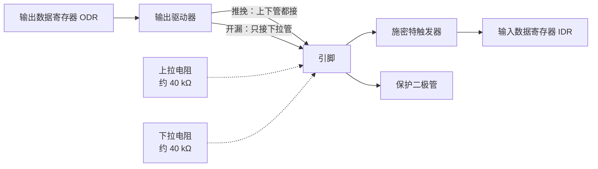

# 2.4 GPIO

上一节点亮 PC13 用的是四行代码。这一节把这几行拆开：为什么是 CRH 而不是 CRL，为什么移位 20 位，为什么写 `BSRR` 而不是 `ODR`，为什么按键要配成"上下拉输入"而不只是"输入"。这些问题的答案在引脚内部电路里，弄清楚了，换成任意一个引脚的配置都能自己推出来。

读完这一节，能把 F103 的任意引脚配成推挽或开漏输出、上拉或下拉或浮空输入、复用输出，能用一次写完成置位与复位，能读出按键，也能判断哪些引脚不能随便用。

## 1. 引脚的内部结构

每个 GPIO 引脚在芯片内部都是一个端口位，周围有输入和输出两套电路：



输入通路上，信号先过施密特触发器整形，再送进 IDR。施密特触发器对缓慢变化的信号有滞回，按键按住时电平不会在阈值附近反复抖动出多次跳变。IDR 的每一位对应一个引脚，只读。

输出通路上，ODR 的位决定输出电平，驱动器把它放大。推挽输出的驱动器有上下两个管子，输出 1 时上管导通接到 3.3 V，输出 0 时下管导通接到地，两种状态都有较低的输出阻抗。开漏输出只有下管，输出 0 时拉低，输出 1 时引脚悬空，要靠外部上拉拉高。

这两种方式的用途不同。推挽能直接驱动 LED、驱动另一块芯片的数字输入；开漏适合挂总线，I²C 的 SDA、SCL 就是开漏加外部上拉，多台设备的开漏输出接在同一根线上，任何一台拉低总线就是低，全部释放才是高，这种"线与"用推挽做不到，两个推挽输出直接短接会烧驱动器。

上下拉电阻约 30～50 kΩ，可以把没有外部连接的引脚固定在一个确定电平上，避免浮空引脚被干扰读成随机值。

::: generate emb-gpio-pushpull-analogy kind=explanation concepts=emb-gpio-crl-layout

面向第一次接触 GPIO 电气特性的读者，用两个开关说明推挽与开漏的区别：推挽像把引脚通过一个双掷开关分别接到电源或地，开漏像只接地、不接电源的单掷开关，高电平要靠外部上拉。再说明为什么 I²C 必须用开漏，以及两个推挽输出短接时会发生什么。

:::

## 2. GPIO 寄存器

F103 每个端口有 7 个寄存器：

| 寄存器 | 偏移 | 作用 |
| --- | --- | --- |
| CRL | 0x00 | 配置引脚 0～7 |
| CRH | 0x04 | 配置引脚 8～15 |
| IDR | 0x08 | 读输入电平 |
| ODR | 0x0C | 写输出电平，也用于选择上拉或下拉 |
| BSRR | 0x10 | 原子置位/复位 |
| BRR | 0x14 | 原子复位（只写） |
| LCKR | 0x18 | 锁定配置 |

配置寄存器是老式设计：每个引脚占 4 位，低 2 位是 MODE，高 2 位是 CNF。CRL 管 0～7，CRH 管 8～15。引脚 n 的字段起始位是 `(n % 8) * 4`。

::: concept emb-gpio-crl-layout title="GPIOx_CRL 与 CRH 的位分配"

引脚 y（0～7）的 MODEy 占 CRL 的第 4y+1～4y 位，CNFy 占第 4y+3～4y+2 位；引脚 8～15 在 CRH 里按同样规则编号。MODE 为 `00` 时是输入，其余取值是输出；CNF 的含义随 MODE 而变。

:::

MODE 与 CNF 的组合整理成速查表：

| 模式 | MODE | CNF | 4 位值 | 说明 |
| --- | --- | --- | --- | --- |
| 模拟输入 | 00 | 00 | 0x0 | ADC 用，数字通路断开 |
| 浮空输入 | 00 | 01 | 0x4 | 外部电路决定电平 |
| 上下拉输入 | 00 | 10 | 0x8 | 由 ODR 对应位选上拉或下拉 |
| 推挽输出 10 MHz | 01 | 00 | 0x1 | |
| 推挽输出 2 MHz | 10 | 00 | 0x2 | |
| 推挽输出 50 MHz | 11 | 00 | 0x3 | |
| 开漏输出 10 MHz | 01 | 01 | 0x5 | |
| 开漏输出 2 MHz | 10 | 01 | 0x6 | |
| 开漏输出 50 MHz | 11 | 01 | 0x7 | |
| 复用推挽 10 MHz | 01 | 10 | 0x9 | 外设接管输出 |
| 复用推挽 2 MHz | 10 | 10 | 0xA | |
| 复用推挽 50 MHz | 11 | 10 | 0xB | |
| 复用开漏 10 MHz | 01 | 11 | 0xD | |
| 复用开漏 2 MHz | 10 | 11 | 0xE | |
| 复用开漏 50 MHz | 11 | 11 | 0xF | |

复位值是 0x44444444：每个引脚都是 `0100`，即浮空输入。上电后所有引脚默认为高阻，不会因为配置成输出而意外驱动外部电路。

::: concept emb-gpio-pudr-by-odr title="上下拉由 ODR 的对应位选择"

引脚配置为上下拉输入（MODE = 00、CNF = 10）时，内部接上拉还是下拉由 ODR 的对应位决定：写 1 接上拉，写 0 接下拉。同一时刻只能接一个，不存在"上下拉同时打开"。这是 F1 特有的做法，后来的系列把它拆成了 PUPDR 的两个独立位。

:::

ODR 在这里兼了两个身份：输出模式下它是输出电平，输入模式下它选择上下拉。所以配置上下拉输入时，要先写 ODR 再改 CRL/CRH，否则先配成输入、后写电平，中间那一瞬间引脚处于错误的上下拉状态。

<Quiz
  type="single"
  :options="[
    { label: 'CRH 的第 20 位，值为 0x2', value: 'A' },
    { label: 'CRH 的第 23:20 位，值为 0x2', value: 'B' },
    { label: 'CRL 的第 23:20 位，值为 0x2', value: 'C' },
    { label: 'CRH 的第 15:12 位，值为 0x2', value: 'D' }
  ]"
  answer="B"
>

<template #question>

把 PC13 配置成 2 MHz 推挽输出（4 位值 0x2），应该写哪个寄存器的哪几位？

</template>

正确答案是 **B**。引脚 13 属于 8～15，用 CRH；在 CRH 里的位置是 `(13 − 8) × 4 = 20`，即第 23～20 位。CRL 只管 0～7 号引脚，写它不会影响 PC13。

</Quiz>

## 3. 输出：点亮 PC13

板载 LED 接在 PC13 与 3.3 V 之间，引脚输出低电平时电流从 3.3 V 经 LED 流入引脚，灯亮；输出高电平时两端都是 3.3 V，灯灭。写程序前先记住这个反相关系。

点灯的三步是开时钟、配模式、写电平：

```c
#include <stdint.h>
#include "stm32f1xx.h"

static void delay_cycles(uint32_t count) {
    for (volatile uint32_t i = 0; i < count; ++i) {
    }
}

int main(void) {
    /* 1. 开启 GPIOC 的 APB2 外设时钟 */
    RCC->APB2ENR |= RCC_APB2ENR_IOPCEN;

    /* 2. 把 PC13（CRH 位 23:20）配置为通用推挽输出，最大速度 2 MHz（0x2） */
    GPIOC->CRH &= ~(0xFu << 20);
    GPIOC->CRH |= 0x2u << 20;

    for (;;) {
        /* PC13 输出低电平，点亮板载 LED */
        GPIOC->BSRR = GPIO_BSRR_BR13;
        delay_cycles(400000u);

        /* PC13 输出高电平，熄灭板载 LED */
        GPIOC->BSRR = GPIO_BSRR_BS13;
        delay_cycles(400000u);
    }
}
```

第 2 步的两行可以合并，但绝不能只写第二行：

::: compare left-title="整体赋值" right-title="先清后置"

```c
/* 把 PC8～PC15 全部改成了 0x0，即模拟输入 */
GPIOC->CRH = 0x00200000;
```

---

```c
GPIOC->CRH = (GPIOC->CRH & ~(0xFu << 20)) | (0x2u << 20);
```

:::

左栏把整个 CRH 覆盖掉，PC8 到 PC15 的配置一起变成 0x0（模拟输入）。如果其中某个引脚正驱动着外部器件，那一瞬间它就松开了。右栏用掩码只动第 23～20 位，其余位保持原值。两行写法在单线程里效果相同，合并写法省一次读，但先清后置的意图更清楚。

用主机程序算一下两种写法的结果：

::: terminal title="bash - crh_calc"

```text
$ gcc -std=c17 -Wall -Wextra crh_calc.c -o crh_calc
$ ./crh_calc
CRH 复位值          : 0x44444444
清零掩码 ~(0xFu<<20): 0xFF0FFFFF
置位掩码  (0x2u<<20): 0x00200000
先清后置后的 CRH    : 0x44244444 (其余引脚保持 0x4 浮空输入)
整体赋值后的 CRH    : 0x00200000 (其余引脚全部变成 0x0 模拟输入)
```

:::

`0x44244444` 里只有第 23～20 位从 `4` 变成了 `2`，其余 7 个半字节原封不动。`0x00200000` 则把 PC8～PC12、PC14、PC15 一起归零。

写电平用 BSRR。它的低 16 位是置位，高 16 位是复位，写 1 有效，写 0 不起作用：

::: concept emb-gpio-bsrr-atomic title="BSRR 写 1 生效、写 0 无效，一次写入完成"

BSRR 的低 16 位写 1 把对应 ODR 位置 1，高 16 位写 1 把对应 ODR 位清 0，写 0 的位不受影响。同一次写入里低 16 位和高 16 位都有效，可以同时置位一些引脚、复位另一些引脚。整个操作由硬件一次完成，不经过读改写。

:::

这条性质决定了 BSRR 与 `ODR ^=` 的差别。翻看编译结果：

::: terminal title="bash - BSRR 与 ODR 的指令对比"

```text
$ arm-none-eabi-gcc -std=c11 -mcpu=cortex-m3 -mthumb -O2 -Wall -Wextra \
    -ffreestanding -DSTM32F103xB -I. -c atomic_cmp.c -o atomic_cmp.o
$ arm-none-eabi-objdump -d atomic_cmp.o

00000000 <pc13_low_bsrr>:
   0:	f04f 5200 	mov.w	r2, #536870912	@ 0x20000000
   4:	4b01      	ldr	r3, [pc, #4]	@ (c <pc13_low_bsrr+0xc>)
   6:	611a      	str	r2, [r3, #16]
   8:	4770      	bx	lr

00000010 <pc13_toggle_odr>:
  10:	4a02      	ldr	r2, [pc, #8]	@ (1c <pc13_toggle_odr+0xc>)
  12:	68d3      	ldr	r3, [r2, #12]
  14:	f483 5300 	eor.w	r3, r3, #8192	@ 0x2000
  18:	60d3      	str	r3, [r2, #12]
  1a:	4770      	bx	lr
```

:::

写 BSRR 是一条 `str`，写 ODR 是 `ldr`、`eor`、`str` 三条。三条指令的序列在中断面前是脆弱的：主循环 `ldr` 读出 ODR 之后、`str` 写回之前，如果中断把另一个引脚翻转了，中断返回后主循环写回的是旧值，那次翻转就丢了。

::: compare left-title="读改写，会被中断打断" right-title="一次写入"

```c
/* 三条指令，中断插在中间会丢掉中断里的修改 */
GPIOC->ODR ^= GPIO_ODR_ODR13;
```

---

```c
/* 一条指令，硬件保证原子性 */
GPIOC->BSRR = GPIO_BSRR_BR13;
```

:::

单线程、没有中断的程序里两者没有区别，但 GPIO 翻转几乎总要在中断和主循环里同时进行，从开始就统一用 BSRR 可以少一类调试起来很痛苦的缺陷。BRR 只有复位功能，写 1 清 0，效果等同于 BSRR 的高 16 位，习惯上置位和复位都走 BSRR，代码更统一。

<Quiz
  type="single"
  :options="[
    { label: 'PA0 和 PA1 都输出高电平', value: 'A' },
    { label: 'PA0 输出高电平，PA1 输出低电平', value: 'B' },
    { label: 'PA0 输出低电平，PA1 输出高电平', value: 'C' },
    { label: '两个引脚保持原来的电平，写入无效', value: 'D' }
  ]"
  answer="B"
>

<template #question>

`GPIOA->BSRR = 0x00020001u;` 执行后，PA0 与 PA1 各是什么电平？

</template>

正确答案是 **B**。低 16 位的第 0 位置 1，把 PA0 置高；高 16 位的第 1 位（整个字的第 17 位）置 1，把 PA1 复位。写成 `0x00010001` 就变成同时置位和复位 PA0：两个位都写 1 时 BS 优先，引脚仍是高电平，PA1 反而没动。

</Quiz>

`delay_cycles` 的延时长度取决于优化级别和编译器版本。blinky 没有配置系统时钟，芯片还跑在 8 MHz 的 HSI 上，400000 次迭代在 `-O2` 下大约半秒，具体数值不必记。要精确延时，[2.6 定时器、PWM 与系统节拍](/教程/正文/嵌入式/2_MCU裸机开发/2_6_定时器_PWM与系统节拍) 用 SysTick 取代这种忙等。

编译结果：

::: terminal title="bash - 构建 blinky"

```text
$ arm-none-eabi-gcc -std=c11 -mcpu=cortex-m3 -mthumb -O2 -g -Wall -Wextra \
    -ffunction-sections -fdata-sections -DSTM32F103xB -I. \
    -nostartfiles --specs=nano.specs --specs=nosys.specs -Wl,--gc-sections \
    -T stm32f103c8.ld blinky/main.c startup_stm32f103.c -o blinky.elf
$ arm-none-eabi-size blinky.elf
   text	   data	    bss	    dec	    hex	filename
    460	      0	   1536	   1996	    7cc	blinky.elf
```

:::

代码与只读数据一共 460 字节，其中 236 字节是向量表。板上的现象是 LED 以约 1 Hz 闪烁。

## 4. 输入：读取 PA0 按键

按键一端接 3.3 V，另一端接 PA0，没有外部电阻。按下时 PA0 被拉到 3.3 V，松开时引脚悬空，必须靠内部下拉把它固定在低电平，否则读数随机。

配置顺序是先把 ODR0 写 0 选定下拉，再把 PA0 配成上下拉输入：

```c
int main(void) {
    RCC->APB2ENR |= RCC_APB2ENR_IOPAEN | RCC_APB2ENR_IOPCEN;

    /* PC13：2 MHz 推挽输出，初始输出高电平（熄灭） */
    gpio_write(GPIOC, 13u, 1);
    gpio_config(GPIOC, 13u, GPIO_CFG_OUT_PP_2M);

    /* PA0：上下拉输入（0x8），ODR0 = 0 选择内部下拉 */
    gpio_write(GPIOA, 0u, 0);
    gpio_config(GPIOA, 0u, GPIO_CFG_IN_PUPD);

    int prev_state = 0;
    int led_on = 0;

    for (;;) {
        int cur_state = button_read_debounced();
        /* 检测按键从松开（0）到按下（1）的上升沿 */
        if (cur_state == 1 && prev_state == 0) {
            led_on = !led_on;
            gpio_write(GPIOC, 13u, led_on ? 0 : 1);
        }
        prev_state = cur_state;
    }
}
```

读取用 IDR：`gpio_read` 把 IDR 右移 `pin` 位再取最低位。按键按下时读到 1，松开读到 0。

机械按键在闭合和断开的瞬间会弹跳几毫秒，期间电平在 0 和 1 之间来回跳。直接每次读 IDR 就翻转 LED，按一次可能翻转好几次。最简单的消抖是隔一段时间连读两次，两次相同才算数：

```c
/* 两次采样间隔约几毫秒（默认 8 MHz HSI），稳定后返回电平（0 或 1） */
static int button_read_debounced(void) {
    int first = gpio_read(GPIOA, 0u);
    delay_cycles(4000u);
    int second = gpio_read(GPIOA, 0u);
    while (first != second) {
        first = second;
        delay_cycles(4000u);
        second = gpio_read(GPIOA, 0u);
    }
    return second;
}
```

这段函数会阻塞到电平稳定为止，按键松开不干脆时会卡住主循环。工程里更常见的做法是定时扫描、连续三次一致才确认，不阻塞，[2.6 定时器、PWM 与系统节拍](/教程/正文/嵌入式/2_MCU裸机开发/2_6_定时器_PWM与系统节拍) 里的超级循环会给出完整版本。

加了按键的程序：

::: terminal title="bash - 构建 button"

```text
$ arm-none-eabi-gcc -std=c11 -mcpu=cortex-m3 -mthumb -O2 -g -Wall -Wextra \
    -ffunction-sections -fdata-sections -DSTM32F103xB -I. \
    -nostartfiles --specs=nano.specs --specs=nosys.specs -Wl,--gc-sections \
    -T stm32f103c8.ld button/main.c gpio/gpio.c startup_stm32f103.c -o button.elf
$ arm-none-eabi-size button.elf
   text	   data	    bss	    dec	    hex	filename
    628	      0	   1536	   2164	    874	button.elf
```

:::

上板的现象是每按一次 LED 换一次状态。

## 5. 复用功能与重映射

串口、SPI、定时器这些外设要占用引脚，占用的方式是把引脚配置成复用功能。F1 的复用不需要额外的选择寄存器（重映射除外）：引脚配成复用推挽或复用开漏，外设一使能就接管输出，ODR 不再驱动引脚；输入通路仍然有效，IDR 读到的还是引脚上的实际电平。

以 USART1 为例，PA9 是 TX，PA10 是 RX：

| 引脚 | 作用 | 配置 | 4 位值 |
| --- | --- | --- | --- |
| PA9 | TX，芯片输出 | 复用推挽 50 MHz | 0xB |
| PA10 | RX，芯片输入 | 浮空输入 | 0x4 |

TX 是输出，配复用推挽；RX 是输入，配浮空输入，也可以配上下拉输入，空闲时把线固定在高电平。2.7 初始化串口时用的就是这两个值。

大部分外设还有重映射：把功能挪到另一组引脚上，比如 USART1 重映射后 TX 到 PB6、RX 到 PB7。重映射写在 AFIO_MAPR 里。

::: warning 写 AFIO_MAPR 前先开 AFIO 时钟

AFIO 的寄存器在 APB2 上，默认时钟关闭。没有 `RCC->APB2ENR |= RCC_APB2ENR_AFIOEN;` 就写 AFIO_MAPR 或 AFIO_EXTICR，写入被丢弃，重映射和 EXTI 端口选择都不会生效，而且读回来是 0，看起来像是写成功了。

:::

另一个由 AFIO 管的功能是 SWJ_CFG，它决定 PA13、PA14、PA15、PB3、PB4 这五个调试引脚怎么用。复位值是 `000`，五个引脚都归 JTAG/SWD。板子用 SWD 调试，只需要 PA13（SWDIO）和 PA14（SWCLK），可以把 JTAG 关掉、释放 PB3、PB4、PA15 作普通 IO：

```c
/* 只写 010：关闭 JTAG-DP，保留 SW-DP */
AFIO->MAPR = (AFIO->MAPR & ~AFIO_MAPR_SWJ_CFG) |
             AFIO_MAPR_SWJ_CFG_JTAGDISABLE;
```

写 `100` 会连 SWD 一起关闭，芯片上就只剩 JTAG 可以连接；如果手头的调试器只支持 SWD，下一次就无法再连上，只能靠复位时抢在程序执行前连接。释放调试引脚是在确认 SWD 能正常工作之后才做的事，顺序别反。

## 6. 电气限制

每个引脚能承受的电流有限。数据手册给出单脚灌电流与拉电流的绝对值上限，以及整个芯片所有 IO 电流之和的上限；这些数字随温度与供电电压变化，做硬件设计时要查 DS5319 的 I/O 特性表。PC13、PC14、PC15 这一组更特殊：它们属于备份域，灌电流与拉电流都限制在 3 mA，输出速度也限制在 2 MHz，所以板载 LED 接在这里，驱动的是一颗小电流 LED。

普通 IO 不能直接驱动电机、继电器、蜂鸣器、LED 灯带。这些负载的电流远超引脚能力，中间要加三极管、MOS 管或专用驱动芯片。

<Quiz
  type="single"
  :options="[
    { label: '浮空输入，不需要上下拉', value: 'A' },
    { label: '上下拉输入，ODR0 写 0 选下拉', value: 'B' },
    { label: '推挽输出，直接输出高电平', value: 'C' },
    { label: '模拟输入，让 ADC 读电平', value: 'D' }
  ]"
  answer="B"
>

<template #question>

按键一端接 3.3 V、另一端接 PA0，按下时接通 3.3 V。PA0 应该配成什么模式？

</template>

正确答案是 **B**。松开时引脚悬空，必须由内部电阻给一个确定电平，按键闭合时接 3.3 V 是低到高的跳变，所以选下拉。若按键改接 GND，就要选上拉，ODR 对应位写 1。

</Quiz>

::: tip 位带别名区

Cortex-M3 有位带（bit-band）机制，可以把某个地址的一个位映射到一个 32 位字的别名地址上，对这个字读写就等于对那一位读写。GPIO 用 BSRR 已经能原子地置位复位，本教程不使用位带，在 F103 上它主要用于需要原子操作、又没有类似寄存器的场合。

:::

## 7. 整理成函数

把前面几次重复的移位和掩码收进三个函数，后面的例子都用它们：

```c
enum {
    GPIO_CFG_IN_ANALOG  = 0x0u, /* 模拟输入 */
    GPIO_CFG_OUT_PP_10M = 0x1u, /* 通用推挽输出，10 MHz */
    GPIO_CFG_OUT_PP_2M  = 0x2u, /* 通用推挽输出，2 MHz */
    GPIO_CFG_OUT_PP_50M = 0x3u, /* 通用推挽输出，50 MHz */
    GPIO_CFG_IN_FLOAT   = 0x4u, /* 浮空输入 */
    GPIO_CFG_OUT_OD_10M = 0x5u, /* 通用开漏输出，10 MHz */
    GPIO_CFG_OUT_OD_2M  = 0x6u, /* 通用开漏输出，2 MHz */
    GPIO_CFG_OUT_OD_50M = 0x7u, /* 通用开漏输出，50 MHz */
    GPIO_CFG_IN_PUPD    = 0x8u, /* 上拉或下拉输入（由 ODR 对应位选择） */
    GPIO_CFG_AF_PP_10M  = 0x9u, /* 复用推挽输出，10 MHz */
    GPIO_CFG_AF_PP_2M   = 0xAu, /* 复用推挽输出，2 MHz */
    GPIO_CFG_AF_PP_50M  = 0xBu, /* 复用推挽输出，50 MHz */
    GPIO_CFG_AF_OD_10M  = 0xDu, /* 复用开漏输出，10 MHz */
    GPIO_CFG_AF_OD_2M   = 0xEu, /* 复用开漏输出，2 MHz */
    GPIO_CFG_AF_OD_50M  = 0xFu  /* 复用开漏输出，50 MHz */
};

void gpio_config(GPIO_TypeDef *port, unsigned pin, uint32_t cfg);
void gpio_write(GPIO_TypeDef *port, unsigned pin, int level);
int gpio_read(const GPIO_TypeDef *port, unsigned pin);
```

实现的关键是选对寄存器：

```c
void gpio_config(GPIO_TypeDef *port, unsigned pin, uint32_t cfg) {
    volatile uint32_t *cr = (pin < 8u) ? &port->CRL : &port->CRH;
    unsigned shift = (pin & 7u) * 4u;
    uint32_t val = *cr;
    val &= ~(0xFu << shift);
    val |= (cfg & 0xFu) << shift;
    *cr = val;
}

void gpio_write(GPIO_TypeDef *port, unsigned pin, int level) {
    if (level != 0) {
        port->BSRR = 1u << pin;
    } else {
        port->BSRR = 1u << (pin + 16u);
    }
}

int gpio_read(const GPIO_TypeDef *port, unsigned pin) {
    return (int)((port->IDR >> pin) & 1u);
}
```

`pin & 7u` 在 CRL 和 CRH 里给出的是同一个 0～7 的序号，`pin < 8` 决定用哪个寄存器。`gpio_write` 把电平换成了 BSRR 的位号：置位写低 16 位的 `pin`，复位写高 16 位的 `pin + 16`。`gpio_read` 不需要区分，IDR 每一位对应一个引脚。

注意 `gpio_config` 里的 `*cr` 是读改写。如果另一个中断在这三行之间改了同一端口的另一个引脚，那次修改会丢失。F1 没有能按位改配置的寄存器，真要并发修改不同引脚，只能在调用处关中断，或者保证同一端口的配置只在初始化阶段完成。后半句是工程里更常见的约束：配置全部放在启动阶段，运行期只走 BSRR。

## 8. HAL 对照

HAL 把同样的字段包进 `GPIO_InitTypeDef`：

```c
GPIO_InitTypeDef init = {0};
init.Pin = GPIO_PIN_13;
init.Mode = GPIO_MODE_OUTPUT_PP;
init.Speed = GPIO_SPEED_FREQ_LOW;
init.Pull = GPIO_NOPULL;
HAL_GPIO_Init(GPIOC, &init);
HAL_GPIO_WritePin(GPIOC, GPIO_PIN_13, GPIO_PIN_RESET);
HAL_GPIO_TogglePin(GPIOC, GPIO_PIN_13);
```

对应关系：

| 寄存器写法 | HAL 写法 |
| --- | --- |
| `GPIO_CFG_OUT_PP_2M` | `Mode = GPIO_MODE_OUTPUT_PP` + `Speed = GPIO_SPEED_FREQ_LOW` |
| `GPIO_CFG_IN_PUPD` + ODR 0 | `Mode = GPIO_MODE_INPUT` + `Pull = GPIO_PULLDOWN` |
| `GPIO_CFG_IN_FLOAT` | `Mode = GPIO_MODE_INPUT` + `Pull = GPIO_NOPULL` |
| `GPIO_CFG_AF_PP_50M` | `Mode = GPIO_MODE_AF_PP` + `Speed = GPIO_SPEED_FREQ_HIGH` |
| `GPIO_CFG_IN_ANALOG` | `Mode = GPIO_MODE_ANALOG` |
| `GPIOC->BSRR = GPIO_BSRR_BR13` | `HAL_GPIO_WritePin(GPIOC, GPIO_PIN_13, GPIO_PIN_RESET)` |
| `GPIOC->BSRR = GPIO_BSRR_BS13` | `HAL_GPIO_WritePin(GPIOC, GPIO_PIN_13, GPIO_PIN_SET)` |
| 读 IDR 取位 | `HAL_GPIO_ReadPin(GPIOC, GPIO_PIN_13)` |
| 写 AFIO_MAPR 的 SWJ_CFG | `__HAL_AFIO_REMAP_SWJ_NOJTAG()` |

`HAL_GPIO_TogglePin` 内部是读 ODR 再取反写回，遇到中断同样有上面说的竞争问题。多任务环境下的翻转用 BSRR 直接写更可靠。

## 9. 习题

### 9.1 巩固

<Exercise id="62228" :d="1" :w="1">

启动后有人把两个配置寄存器写成了下面的值：

```c
GPIOB->CRL = 0x1DB72048u;
GPIOB->CRH = 0x4B444444u;
```

(1) 按第 2 节的 4 位编码表，逐个写出 PB0～PB7 的模式（模拟、浮空、上下拉、推挽、开漏、复用，以及速度档）。

(2) 写出 PB8～PB15 里唯一一个不是浮空输入的引脚及其模式。

(3) 说明 `0x4B444444` 里哪些半字节是从复位值继承下来的，哪些被改过。

</Exercise>

<Exercise id="62229" :d="2" :w="1">

`GPIOA->BSRR` 与 `GPIOB->BSRR` 的初值都是 0，PA0～PA7、PB0～PB7 全部输出低电平。依次执行：

```c
GPIOA->BSRR = 0x00000005u;
GPIOB->BSRR = 0x000300F0u;
GPIOA->BSRR = 0x00010001u;
GPIOB->BRR  = 0x00000030u;
```

(1) 写出每一步之后 PA0、PA2 与 PB4～PB7 的电平。

(2) 第三步里 PA0 的置位位和复位位都写了 1，实际结果是什么？依据第 3 节的哪一句。

(3) 第四条写 `BRR` 与写 `BSRR = 0x00300000u` 是否等价？说明理由；再说明为什么 `BRR` 做不到像 `BSRR` 那样一次同时置位和复位。

</Exercise>

<Exercise id="62230" :d="2" :w="2">

按键一端接 GND、另一端接 PB5，要求松开时读到高电平、按下时读到低电平。

(1) 写出把 PB5 配置成上下拉输入、并选择上拉的完整代码，要求用 `BSRR` 与 `CRL`，说明两行的先后顺序为什么不能交换。

(2) 如果把顺序反过来，从上电到配置完成之间 PB5 是什么状态，会读到什么。

(3) 改成按键接 3.3 V 的接法，写出 `BSRR` 那一行要怎么改。

</Exercise>

<Exercise id="62231" :d="2" :w="2">

板载 LED 接在 PC13 上，这颗 LED 的正向压降约 1.9 V，希望灌入约 2 mA。第 6 节说 PC13～PC15 属于备份域，灌电流与拉电流都限制在 3 mA，输出速度限制在 2 MHz。

(1) 算出串联限流电阻的阻值，并从 E12 系列（10、12、15、18、22、27、33、39、47、56、68、82）里选一个最接近的，说明选大一点还是小一点更合适。

(2) 说明为什么 PC13 的 `MODE` 只能取 `10`（2 MHz），写 `11`（50 MHz）虽然在寄存器层面能写进去，却超出了数据手册的范围。

(3) 写一个主机程序 `led_budget.c`：从命令行读入电源电压、LED 正向压降、目标电流与并联 LED 数量，输出所需电阻、选中的 E12 阻值、实际电流，以及全部 LED 同时点亮时的总灌电流；总电流超过 20 mA 时打印 `[check datasheet]`。E12 的档位按 10 的幂重复，680 与 820 也要算进去。用 `./led_budget 3.3 1.9 0.002 8` 运行验收（这一组不该有警告）；再用 `./led_budget 3.3 1.9 0.002 16` 跑一次，确认 `[check datasheet]` 出现。

(4) 说明为什么普通 IO 不能直接驱动继电器或蜂鸣器。

</Exercise>

### 9.2 编程

<Exercise id="62232" :d="3" :w="2">

`code/嵌入式/2_MCU裸机开发/2_4_GPIO/gpio/gpio.c` 里已有 `gpio_config`、`gpio_write`、`gpio_read` 三个函数。给这个模块补两个函数：

```c
void gpio_toggle(GPIO_TypeDef *port, unsigned pin);
void gpio_config_mask(GPIO_TypeDef *port, uint16_t pins, uint32_t cfg);
```

`gpio_toggle` 只写一次 `BSRR`，不读 `ODR` 再写回；`gpio_config_mask` 一次改多个引脚，每个引脚的 4 位都写成同一个 `cfg`。

要求：

(1) 写出实现。`gpio_toggle` 必须从 `ODR` 的当前值算出应该置位还是复位——说明这样一来它为什么仍然不是第 3 节说的「一次写入」。

(2) 在主机上写 `gpio_model_test.c`，用模拟的 `GPIO_TypeDef`（`CRL`、`CRH`、`IDR`、`ODR` 是普通对象，`BSRR` 的写入用函数模拟）验证：

- `gpio_config_mask(GPIOB, 0x0089u, 0x8u)`（PB0、PB3、PB7）之后 `CRL = 0x84448448`；
- 对 `ODR = 0x00F0` 的引脚 7 调用 `gpio_toggle` 后，`ODR` 变成 `0x0070`；
- `gpio_write(port, 20, 1)` 越界时测试里的断言会拦住。

用 `gcc -std=c17 -Wall -Wextra gpio_model_test.c gpio.c -o gpio_model_test` 构建（模拟头文件放同一目录）。

(3) 给出一个只写一次 `BSRR` 就能翻转引脚的方案，或者说明为什么在 F1 上做不到。

</Exercise>

<Exercise id="62233" :d="3" :w="2">

开漏输出可以接在同一根线上做「线与」。用一个主机程序 `wired_and.c` 模拟三个开漏引脚接到同一条总线：

```c
struct od_pin {
    const char *name;
    int driven;   /* 1：输出高（释放），0：输出低（拉低） */
    int has_pullup;
};

int bus_level(const struct od_pin *pins, int n);
```

(1) 实现 `bus_level`：任一引脚拉低则总线为 0；全部释放且至少一个上拉时为 1；全部释放又没有上拉时返回 -1 表示悬空。

(2) 用三组数据运行并打印总线电平：三个都释放且有上拉、有一个拉低、全部释放但没有任何上拉。

(3) 把同样的场景改成推挽输出，说明两个推挽输出接在同一根线上、一个输出高一个输出低时的电流路径，为什么第 1 节说会烧驱动器。

(4) 用一段话说明 I²C 的 SDA 为什么必须是开漏。

(5) 第 5 节说 USART1 的 PA9 配成复用推挽 50 MHz、PA10 配成浮空输入。把 PA9 误配成普通推挽输出（0x3）时串口发送会怎样，把 PA10 误配成复用推挽时接收又会怎样。分别说明寄存器层面发生了什么。

</Exercise>

<Exercise id="62234" :d="3" :w="3">

第 4 节的 `button_read_debounced()` 会阻塞到电平稳定。写一个不阻塞的版本，接口为：

```c
typedef struct {
    unsigned stable;
    unsigned count;
} debounce_t;

/* 每 1 ms 调用一次，返回 1 表示检测到一次「松开 -> 按下」的边沿 */
int debounce_scan(debounce_t *d, int raw);
```

连续三次采样一致才认可新电平，认可后输出一次边沿。

要求：

(1) 写出 `debounce_scan`，说明 `stable`、`count` 各自的作用，以及为什么边沿只在认可的那一次返回 1。

(2) 写主机测试 `debounce_test.c`，用下面的采样序列逐点调用并打印认可时刻：

```text
0 0 0 1 0 1 1 1 0 0 1 1 1 0 0 0
```

期望两次认可：下标 7 按下，下标 15 松开。

(3) 把「三次」改成「五次」，序列不变。这时一个边沿也不会被认可，说明这段序列里最长的稳定电平持续了几个采样。再把序列换成 `0 0 0 0 0 1 0 1 1 1 1 1 0 0 0 0 0`，写出新的认可时刻。

(4) 说明这个写法为什么不阻塞，以及每 1 ms 调用一次的前提由谁保证（定时器在 [2.6 定时器、PWM 与系统节拍](/教程/正文/嵌入式/2_MCU裸机开发/2_6_定时器_PWM与系统节拍) 里讲）。

</Exercise>

<Exercise id="62235" :d="3" :w="3">

第 8 节给出了 HAL 的 `GPIO_InitTypeDef` 写法。完成下面四项：

(1) 把下面两行寄存器代码改写成 HAL 调用，体会 `Speed`、`Pull`、`Mode` 三个字段怎样拼出同一个 4 位值：

```c
GPIOA->CRL = (GPIOA->CRL & ~(0xFu << 0)) | (0x8u << 0);
GPIOA->BSRR = GPIO_BSRR_BR0;
```

(2) 第 7 节的 `gpio_config` 是读改写。假设主循环在启动后修改 PA5 的配置，与此同时 EXTI0 中断里修改 PA6 的配置。推演两者交错时的执行序列，说明哪一次修改会丢失。

(3) 写出两条修法：(a) 调用处关中断；(b) 把同一端口的配置全部挪到初始化阶段完成。从「临界区长度」和「工程可维护性」两方面比较，说明为什么第 7 节推荐 (b)。

(4) 第 8 节说 `HAL_GPIO_TogglePin` 内部也是读 `ODR` 再写回。改写 2.4 的点灯程序，让 LED 由 HAL 的翻转函数驱动，再改成 `BSRR` 版本，比较两者在反汇编里的指令条数（用 `arm-none-eabi-objdump -d`）。

</Exercise>

### 9.3 综合与挑战

<Exercise id="62236" :d="4" :w="3">

写一个主机程序 `pin_plan.c`，检查一组外设的引脚分配是否冲突。输入从标准输入读，每行格式：

```text
<外设名> <端口字母> <引脚号>
```

例如：

```text
USART1 A 9
USART1 A 10
SPI1 A 5
I2C1 B 6
SWD A 13
```

要求：

(1) 检查同一端口同一引脚是否被两个外设占用，冲突时打印两个外设名。

(2) 支持可选的 `REMAP <外设> <0|1>` 行，对 USART1（`AFIO_MAPR` 第 2 位）与 I2C1（第 1 位）生效：重映射后 USART1 用 PB6/PB7、I2C1 用 PB8/PB9。重映射后与实际分配冲突也要报出来。

(3) 检查调试引脚：PA13、PA14 永远被 SWD 占用；PB3、PB4、PA15 在 `SWJ_CFG = 000`（复位值）时也被占用，配置成 `010`（关 JTAG、保留 SWD）后才释放。输入里加一行 `SWJ <0|1>` 选择是否关闭 JTAG。

(4) 用下面三组输入验收，贴出输出：

第一组只有 USART1 与 SPI1；第二组在 `REMAP USART1 1` 之后又分配了 I2C1；第三组把 LED 放到 PB3 但不关 JTAG。

(5) 说明 AFIO 时钟没开时，第 (2)、(3) 两项在芯片上都不生效，而程序本身查不出错误。

</Exercise>

<Exercise id="62237" :d="5" :w="4" scope="*">

给 GPIO 模块加一层「安全配置」：改任何一个引脚之前先确认它没有被 `LCKR` 锁住，改完之后能按需要锁住配置。

要求：

(1) 设计 `int gpio_safe_config(GPIO_TypeDef *port, unsigned pin, uint32_t cfg)`，返回 0 表示成功，返回负值表示该端口已锁定（看 `LCKR` 第 16 位）或参数非法。

(2) 按 RM0008 的锁定序列实现 `gpio_lock_pin()`：第一次写置目标位与第 16 位，第二次写清第 16 位，第三次写置第 16 位，最后读回确认。写出每一步的寄存器值，说明为什么顺序不能变、中间为什么不能插进另一次 `LCKR` 写。

(3) 在主机上用模拟寄存器验证：锁定 PB6 之后再次调用 `gpio_safe_config` 返回失败，锁定前可以正常改。

(4) 从 RM0008 查出并说明锁定是按端口生效还是按引脚生效，解锁需要什么条件。

</Exercise>

## 10. 参考资料

1. STMicroelectronics, [*RM0008 Reference manual: STM32F101xx, STM32F102xx, STM32F103xx, STM32F105xx and STM32F107xx advanced Arm-based 32-bit MCUs*, Rev 21](https://www.st.com/resource/en/reference_manual/rm0008-stm32f101xx-stm32f102xx-stm32f103xx-stm32f105xx-and-stm32f107xx-advanced-armbased-32bit-mcus-stmicroelectronics.pdf)：第 9 章 General-purpose and alternate-function I/Os（GPIO 与 AFIO），表 20、21。
2. STMicroelectronics, [*DS5319 Datasheet: STM32F103x8, STM32F103xB medium-density performance line Arm-based 32-bit MCU*, Rev 20](https://www.st.com/resource/en/datasheet/stm32f103c8.pdf)：表 5 引脚定义与 I/O 结构，第 5.3 节 I/O 电流特性。
3. cpq, [*Bare-metal programming guide*](https://github.com/cpq/bare-metal-programming-guide)：Blinky 一节，寄存器方式的 GPIO 配置。
4. STMicroelectronics, [*cmsis_device_f1*](https://github.com/STMicroelectronics/cmsis_device_f1)：`stm32f103xb.h` 中 `GPIO_TypeDef` 的定义。
5. STMicroelectronics, [*STM32F1 HAL driver*](https://github.com/STMicroelectronics/stm32f1xx-hal-driver)：`stm32f1xx_hal_gpio.c` 与 `stm32f1xx_hal_gpio_ex.h`。
6. Arm, [*Cortex-M3 Technical Reference Manual*](https://developer.arm.com/documentation/ddi0337/latest)：位带别名区的地址映射规则。
