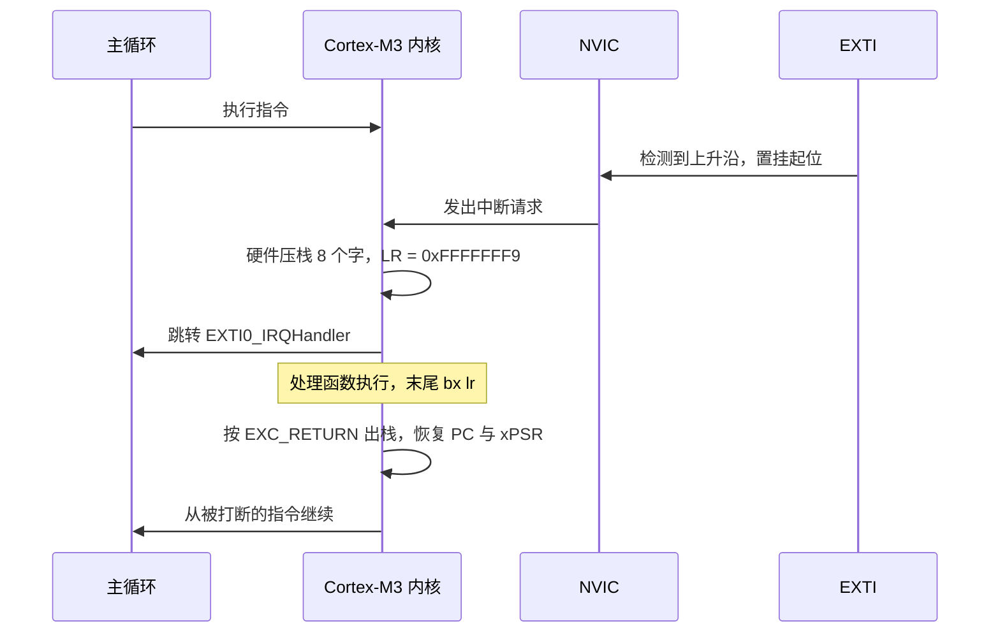
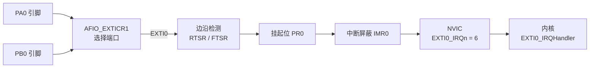

# 2.5 中断与 NVIC

在最基础的轮询架构中，微控制器必须在主循环中不断读取 GPIO 引脚的输入数据寄存器。这种轮询方式通常伴随着阻塞式延时消抖：当检测到电平跳变后，程序调用空循环等待几十毫秒再次采样，直到电平趋向稳定。在此等待期间，CPU 核心完全处于忙等空转状态，无法响应系统的任何其他事务。在实际工程项目中，随着业务逻辑、传感器通信以及显示刷新任务的加入，主循环执行一整圈的时长往往会被拉长到数十乃至数百毫秒。如果外部按键在主循环执行耗时任务时被快速按下并释放，引脚电平在主循环下一次轮询前便已恢复初始状态，这次真实的物理动作就会被系统彻底遗漏。

中断（Interrupt）机制从物理时序上重构了微控制器感知外部事件的方式。片上外设硬件在后台持续监控物理信号线的电平边沿，一旦目标跳变发生，硬件逻辑便会直接向处理器内核发出中断请求。内核接收到请求后，会自动挂起当前正在执行的主循环，通过硬件压栈保存执行上下文，随后跳转至预先登记的专属中断服务程序（ISR）中快速处理，处理完毕后再自动出栈恢复现场，无缝回到被打断的机器指令继续执行。通过这种硬件驱动的异步通知，外部事件的捕获与响应不再受制于主业务循环的执行节拍。

理解 ARM Cortex-M3 内核的异常处理模型、嵌套向量中断控制器（NVIC）的优先级调度机制，以及外部中断控制器（EXTI）的信号路由，是掌握微控制器多任务协同与实时响应的核心。与此同时，中断的引入打破了单线程的顺序执行确定性，主循环与中断服务程序并发访问共享内存对象时所诱发的竞态条件，构成了底层系统设计中必须审慎处理的关键议题。

## 1. 从轮询到中断

在基础的轮询逻辑中，主循环每轮迭代读取一次 `GPIOA->IDR` 的输入状态，一旦捕获到跳变便执行相应控制。为应对触点弹跳，程序往往在电平不一致时反复读，读一次用 `delay_cycles(4000)` 等一会儿再读，直到两次一致才返回。然而在复杂的嵌入式工程中，主循环的单次迭代耗时由链路中最慢的任务所决定，任何一处毫秒级的耗时计算或总线阻塞，都会导致采样窗口出现长达几十毫秒的盲区。若外部按键在 10 毫秒内完成按下并回弹，处于忙碌状态的主循环将彻底错过这一信号。

单纯提高轮询频率无法从根本上消除这种时序盲区。轮询模式将“物理事件的产生”与“中央处理器的查询”强行绑定在同一个执行时间线上，一旦处理器分流执行其他逻辑，查询便告中断。

中断机制解除了这种同步耦合。以芯片内部的外部中断控制器（EXTI）为例，其边沿检测单元独立于 CPU 异步运行；只要引脚出现预设电平跳变，硬件逻辑便在单个时钟周期内将挂起标志位置 1，并通过 NVIC 向内核发起中断请求。处理器在执行完当前机器指令的微操作后立即暂停既定流程，自动保存上下文并跳转至专属中断服务程序。待处理函数执行完毕，系统自动复原现场，无缝接续此前被打断的业务。

这种体系架构构成了经典的“前后台系统”（Foreground-Background System）：主循环作为后台，承担业务逻辑、界面刷新与状态机运转等对时效性要求相对宽松的事务；中断服务程序作为前台，仅负责捕获瞬态硬件事件并转移核心数据。前后台职责划分的清晰度，直接决定了整个固件系统的稳定性与可维护性。

## 2. 异常与中断

Cortex-M3 把所有打断正常执行流程的事件统一叫异常 (exception)，中断是其中的一类。异常分成两级：

- 系统异常，由内核自己产生，包括复位、NMI、各类故障、SVC、PendSV 和 SysTick，共 15 个位置（异常号 1～15，其中 9、13 等几个保留）。
- 外设中断，由片上外设经 NVIC 发出，STM32F103 中容量有 43 个，异常号从 16 开始。

| 异常号 | IRQn | 处理函数 | 说明 |
| --- | --- | --- | --- |
| 1 | — | `Reset_Handler` | 复位，[1.8](/教程/正文/嵌入式/1_平台与工具链/1_8_复位_启动与链接) 讲过 |
| 2 | -14 | `NMI_Handler` | 不可屏蔽中断，时钟安全系统会用到 |
| 3 | -13 | `HardFault_Handler` | 故障处理，2.10 展开 |
| 4 | -12 | `MemManage_Handler` | 存储器保护错误，F103 没有 MPU，不会产生 |
| 5 | -11 | `BusFault_Handler` | 总线错误 |
| 6 | -10 | `UsageFault_Handler` | 用法错误 |
| 11 | -5 | `SVC_Handler` | 系统服务调用 |
| 12 | -4 | `DebugMon_Handler` | 调试监控 |
| 14 | -2 | `PendSV_Handler` | 可挂起的系统调用，RTOS 切换任务用 |
| 15 | -1 | `SysTick_Handler` | 系统节拍定时器，2.6 展开 |
| 16～58 | 0～42 | 各外设的处理函数 | WWDG 是 IRQ 0，USBWakeUp 是 IRQ 42 |

CMSIS 的 `IRQn_Type` 枚举里，系统异常用负数表示，外设中断用 0 起的非负数。两者差 16，因为前 16 个异常位置被内核占掉了：

```
异常号 = IRQn + 16        （IRQn ≥ 0）
向量表下标 = 异常号
```

向量表就是 [1.8](/教程/正文/嵌入式/1_平台与工具链/1_8_复位_启动与链接) 里那张放在 Flash 起始处的函数指针数组，下标 0 是初始栈指针，下标 1 是复位处理函数，之后依次是各异常。外设中断 `EXTI0_IRQn` 等于 6，所以它的处理函数登记在下标 22 处，偏移 22 × 4 = 0x58。`nm` 和 `objdump` 都能直接验证这个对应关系，第 8 节会看到。

<Quiz
  type="single"
  :options="[
    { label: '6', value: 'A' },
    { label: '16', value: 'B' },
    { label: '22', value: 'C' },
    { label: '40', value: 'D' }
  ]"
  answer="C"
>

<template #question>

`EXTI0_IRQn` 等于 6，它的处理函数地址写在向量表的哪个下标处？

</template>

正确答案是 **C**。前 16 个位置被初始栈指针和 15 个系统异常占掉，外设中断从下标 16 开始，所以 `IRQn` 为 6 的中断落在下标 16 + 6 = 22，字节偏移 0x58。

</Quiz>

NVIC 为每个中断记录两个状态位：挂起 (pending) 和活动 (active)。外设发出请求时挂起位置 1；内核开始执行对应的处理函数时活动位置 1，挂起位清 0；处理函数返回时活动位清 0。某个中断正在执行时它又被触发，挂起位再次置 1，等当前这次执行完再进一次。这两个状态都能在调试器里直接看，第 6 节用软件触发时会用到。

## 3. 进入与退出

中断发生时，内核不调用任何软件，硬件自己完成现场保存。Cortex-M3 把 8 个寄存器压进当前栈：R0～R3、R12、LR、PC 和 xPSR，共 32 字节。压进去的 PC 是"被中断的那条指令之后要执行的那条"，xPSR 的低 9 位记录当前异常号，返回时据此判断回到哪里。

同时，LR 被装上一个特殊值，叫 EXC_RETURN。它的高 24 位全是 1，低几位说明返回后用什么模式、用哪个栈：

| EXC_RETURN | 含义 |
| --- | --- |
| 0xFFFFFFF9 | 返回线程模式，使用主栈 MSP |
| 0xFFFFFFFD | 返回线程模式，使用进程栈 PSP |
| 0xFFFFFFF1 | 返回处理模式，使用主栈 MSP |

在常规的裸机程序中，由于系统始终运行在主栈指针 MSP 下，因此在中断服务程序中读取 LR 寄存器通常为 `0xFFFFFFF9`。当处理函数执行至末尾并触发 `BX LR` 指令时，Cortex-M3 内核捕获到该特定的 EXC_RETURN 返回特征值，从而硬件感知到当前处于异常返回流程。内核随即启动硬件出栈序列，自动从栈中弹出此前压入的 8 个字并恢复 R0～R3、R12、LR、PC 以及 xPSR，最终将程序计数器拨回被打断的指令处无缝继续执行。得益于硬件自动完成的寄存器压栈与出栈契约，遵循 AAPCS 调用约定的普通 C 语言函数（`void f(void)`）能够直接无缝挂载为中断服务程序，无需任何手写汇编的包装代码。



::: concept emb-irq-stacking title="异常进入时硬件保存的现场"

Cortex-M3 响应异常时自动把 R0～R3、R12、LR、PC、xPSR 八个字压入当前栈，把 EXC_RETURN 装入 LR，然后跳到向量表对应的处理函数。处理函数按普通 AAPCS 函数编译即可，末尾的 `bx lr` 触发异常返回。这条规则使得中断服务程序可以用纯 C 编写，但压栈用的是当前栈，处理函数里分配的局部对象也在这个栈上。

:::

从硬件时序来看，Cortex-M3 进入异常的中断延迟（Latency）约为 12 个时钟周期，退出异常约为 10 个周期。如果存在多个相同或不同优先级的中断连续排队到达，内核在完成前一个中断处理函数后，无需执行完整的出栈再压栈操作，而是直接通过**尾链（Tail-Chaining）**机制在 6 个周期内切换执行下一个中断服务程序。此外，若更高优先级的中断请求恰好在内核正在对当前中断执行压栈时到达，硬件支持**迟到（Late-Arriving）**优化：内核在压栈完毕后直接优先跳转至高优先级处理函数，从而将紧急中断的响应延迟压缩到极致。

中断嵌套是实时系统的核心能力之一。当微控制器正在执行低优先级中断服务程序时，若更高优先级的中断到来，硬件内核会再次执行压栈并抢占执行高优先级函数；待高优先级函数退出后再逐层返回。需要高度警惕的是，每一层中断嵌套都会在当前栈上至少压入 32 字节的硬件上下文，中断函数内部声明的局部对象与函数调用更会进一步吞噬栈空间。在典型的裸机工程中，链接脚本通常为栈仅分配 1 KB 左右的保守空间，深层中断嵌套若叠加了庞大的局部数组或复杂的库函数调用（如 `printf`），极易触发栈溢出并引发不可控的 HardFault 故障。

## 4. NVIC 与优先级

嵌套向量中断控制器 (Nested Vectored Interrupt Controller, NVIC) 是内核的一部分，地址在 0xE000_E100。它管着所有外设中断的使能、挂起和优先级：

| 偏移 | 名称 | 作用 |
| --- | --- | --- |
| 0x000 | `ISER[8]` | 中断使能，写 1 置位，读回当前使能状态 |
| 0x080 | `ICER[8]` | 中断禁止，写 1 清位 |
| 0x100 | `ISPR[8]` | 置挂起，写 1 让中断进入等待 |
| 0x180 | `ICPR[8]` | 清挂起，写 1 撤销等待 |
| 0x200 | `IABR[8]` | 活动状态，只读，正在执行的中断对应位为 1 |
| 0x300 | `IP[240]` | 每个中断一个字节，F103 只用高 4 位 |
| 0xE00 | `STIR` | 软件触发中断，写入异常号 |

一个寄存器 32 位，管 32 个中断，所以每个都是 8 项的数组。中断号 `n` 落在 `ISER[n / 32]` 的第 `n % 32` 位。CMSIS 把这些位运算包成了函数，代码里直接用它们：

```c
NVIC_EnableIRQ(EXTI0_IRQn);          /* 置 ISER 对应位 */
NVIC_DisableIRQ(EXTI0_IRQn);         /* 置 ICER 对应位 */
NVIC_SetPendingIRQ(EXTI0_IRQn);      /* 置 ISPR，软件触发 */
NVIC_ClearPendingIRQ(EXTI0_IRQn);    /* 置 ICPR */
NVIC_SetPriority(EXTI0_IRQn, 2u);    /* 写 IP，自动左移 4 位 */
```

STM32F103 实现了 4 位优先级，`__NVIC_PRIO_BITS` 为 4，所以有 16 个级别，数字越小优先级越高。`NVIC_SetPriority` 的第二个参数取 0～15，函数内部把它左移 `8 - 4 = 4` 位再写进 `IP`，因为 ARM 规定优先级值对齐到字节的高位，低位留给实现扩展。

4 位还可以再分成两段：抢占优先级 (preemption priority) 和子优先级 (subpriority)。分组由 `SCB->AIRCR` 的 PRIGROUP 字段决定，CMSIS 的 `NVIC_SetPriorityGrouping` 负责写入访问密钥和字段。分组 3 表示 4 位全部用于抢占，没有子优先级；分组 2 表示 3 位抢占、1 位子优先级，以此类推。

工程上建议统一用分组 3，让所有位都是抢占优先级：

```c
NVIC_SetPriorityGrouping(3u);
NVIC_SetPriority(EXTI0_IRQn, 2u);
NVIC_SetPriority(TIM2_IRQn, 1u);
```

两条规则随之确定。抢占优先级不同，高的可以打断低的，这就是嵌套；抢占优先级相同，后来的中断不能打断正在执行的那个，只能等它返回后按异常号小的先执行。子优先级只在同时挂起、都不在执行时用来排队，它不能造成嵌套。分组 3 把子优先级全部去掉，优先级关系只剩"能不能打断"这一种，排查问题时最好推理。

[4.4 中断与任务协作](/教程/正文/嵌入式/4_RTOS与固件架构/4_4_中断与任务协作) 会用到这个设置：FreeRTOS 的移植层要求 4 位全部作为抢占优先级，分组不对时，第一次在中断里调用 `FromISR` 版本的 API 就会触发内核里的断言。`BASEPRI` 的用法在 [4.1 临界区与 RTOS 边界](/教程/正文/嵌入式/4_RTOS与固件架构/4_1_临界区与RTOS边界) 里展开。

中断优先级还和 `PRIMASK`、`BASEPRI` 两个特殊寄存器有关。`PRIMASK` 置 1 屏蔽除 NMI 和 HardFault 外的所有中断，用 `__disable_irq()` 和 `__enable_irq()` 操作；`BASEPRI` 写一个阈值，屏蔽掉优先级数值大于等于它的中断，留给 RTOS 的临界区用，本节不展开。

<Quiz
  type="single"
  :options="[
    { label: 'EXTI0 继续执行，EXTI1 丢失', value: 'A' },
    { label: 'EXTI0 立即被打断，EXTI1 先执行完再回到 EXTI0', value: 'B' },
    { label: '两者都挂起，等主循环空闲时依次执行', value: 'C' },
    { label: '进入 HardFault', value: 'D' }
  ]"
  answer="B"
>

<template #question>

按分组 3 设置，EXTI0 的优先级是 2，EXTI1 的优先级是 1。EXTI0 的处理函数正在执行时 EXTI1 触发，会发生什么？

</template>

正确答案是 **B**。数值小的优先级高，1 比 2 高，EXTI1 可以抢占正在执行的 EXTI0，内核再次压栈后跳进 `EXTI1_IRQHandler`，返回后继续执行 `EXTI0_IRQHandler` 剩下的部分。

</Quiz>

::: generate emb-irq-nesting-timeline kind=explanation concepts=emb-irq-stacking

面向第一次接触中断嵌套的读者，以 EXTI0（优先级 2）执行到一半被 TIM2（优先级 1）打断为例，按时间顺序说明每一次压栈和出栈分别保存了什么、LR 的值怎样变化、为什么两个处理函数都返回后主循环仍能从被打断的指令继续。只用本页给出的 EXC_RETURN 和压栈规则，不引入 RTOS 的上下文切换。

:::

## 5. EXTI

外部中断/事件控制器 (External Interrupt/Event Controller, EXTI) 负责把引脚上的电平变化变成中断请求。F103 有 19 条线：0～15 对应 GPIO，16 接 PVD（电源电压检测），17 接 RTC 闹钟，18 接 USB 唤醒。每条线有一组寄存器：

| 偏移 | 名称 | 作用 |
| --- | --- | --- |
| 0x00 | `IMR` | 中断屏蔽，1 表示该线可以产生中断请求 |
| 0x04 | `EMR` | 事件屏蔽，1 表示该线的边沿同时向其他外设发出事件脉冲 |
| 0x08 | `RTSR` | 上升沿触发选择，1 表示允许 |
| 0x0C | `FTSR` | 下降沿触发选择，1 表示允许 |
| 0x10 | `SWIER` | 软件中断事件，写 1 触发一次 |
| 0x14 | `PR` | 挂起标志，写 1 清除 |

0～15 号线接哪个端口由 AFIO 的 `EXTICR` 决定，每 4 位选一条线，`EXTICR1` 管 0～3 线，`EXTICR2` 管 4～7 线，依次类推。值 0～7 分别对应 PA～PG。同一条线一次只能接一个端口：`EXTI0` 接了 PA0，PB0、PC0 的边沿就不会进这条线。



EXTI 的线号和 NVIC 的中断号是两套编号。EXTI0～EXTI4 各有独立的 IRQ（6～10），EXTI5～EXTI9 共用 `EXTI9_5_IRQn`（23），EXTI10～EXTI15 共用 `EXTI15_10_IRQn`（40）。共用一条中断号的几条线，处理函数里必须逐个检查 `PR` 的对应位，否则会把别的线的标志当成自己的。本教程的板子只用了 PA0，不涉及共用。

::: concept emb-irq-exti-pr title="EXTI 的挂起位写 1 清除"

`EXTI->PR` 的每一位是 rc_w1 类型：写 1 清除该位，写 0 不起作用。处理函数里要清除自己那条线，写 `EXTI->PR = EXTI_PR_PR0`，不要用 `EXTI->PR &= ~EXTI_PR_PR0`。后者先读回所有挂起位再整体写回，读和写之间另一条线置起的挂起位会被这次写回清掉。

:::

`PR` 的类型决定了清除写法，这一点和 GPIO 的 `BSRR` 类似：都是"写 1 有效、写 0 无影响"，都能用一次写入完成，都不需要读改写。区别是 `BSRR` 的 1 表示置位，`PR` 的 1 表示清除。

## 6. 按键中断

把 PA0 接上 EXTI0 并打开中断，初始化分六步，完整程序在 `code/嵌入式/2_MCU裸机开发/2_5_中断与NVIC/exti_button/main.c`：

```c
static void exti0_button_init(void) {
    /* 1. 开启 GPIOA、GPIOC 与 AFIO 的 APB2 时钟 */
    RCC->APB2ENR |= RCC_APB2ENR_IOPAEN | RCC_APB2ENR_IOPCEN | RCC_APB2ENR_AFIOEN;

    /* 2. PC13 配置为 2 MHz 通用推挽输出，初始熄灭 LED */
    GPIOC->CRH &= ~(0xFu << 20);
    GPIOC->CRH |= (0x2u << 20);
    GPIOC->BSRR = GPIO_BSRR_BS13;

    /* 3. PA0 配置为上拉/下拉输入，ODR0 = 0 选择内部下拉 */
    GPIOA->CRL &= ~(0xFu << 0);
    GPIOA->CRL |= (0x8u << 0);
    GPIOA->BSRR = GPIO_BSRR_BR0;

    /* 4. 通过 AFIO_EXTICR1 把 EXTI0 接到 PA0 */
    AFIO->EXTICR[0] &= ~AFIO_EXTICR1_EXTI0;

    /* 5. EXTI0 只在上升沿触发 */
    EXTI->RTSR |= EXTI_RTSR_TR0;
    EXTI->FTSR &= ~EXTI_FTSR_TR0;

    /* 6. 清掉可能残留的挂起位，再开放屏蔽位与 NVIC */
    EXTI->PR = EXTI_PR_PR0;
    EXTI->IMR |= EXTI_IMR_MR0;

    NVIC_SetPriorityGrouping(3u);
    NVIC_SetPriority(EXTI0_IRQn, 2u);
    NVIC_EnableIRQ(EXTI0_IRQn);
}
```

第 4 步清掉 `EXTICR1` 的低 4 位，即 `EXTI0[3:0] = 0000`，选中 PA。第 5 步只开上升沿：按键一端接 3.3 V，松开时内部下拉把引脚拉住，按下时电平从 0 变 1。

处理函数的名字必须是 `EXTI0_IRQHandler`，与启动文件向量表里的弱符号完全一致：

```c
void EXTI0_IRQHandler(void) {
    if ((EXTI->PR & EXTI_PR_PR0) != 0u) {
        /* 先清挂起位，再做事 */
        EXTI->PR = EXTI_PR_PR0;

        if ((GPIOC->ODR & GPIO_ODR_ODR13) != 0u) {
            GPIOC->BSRR = GPIO_BSRR_BR13;
        } else {
            GPIOC->BSRR = GPIO_BSRR_BS13;
        }

        g_press_count = g_press_count + 1u;
        g_button_flag = 1u;
    }
}
```

先清 `PR` 再翻转 LED，是因为清除得越早，处理函数执行期间新来的边沿越能重新置起挂起位，不会漏掉。反过来，如果把清除放在最后，就必须在写 `PR` 之后加一条 `__DSB()`：外设写操作可能还在总线上排队，内核可以在写到达之前就从异常返回，挂起位仍然置着，于是立刻又进一次。Arm 的应用笔记 AN321 专门讲了这条，工程上的做法是能提前清就提前清。

板子上电后，按一次键 LED 翻转一次。不接按键也能验证中断路径：向 `EXTI->SWIER` 写 1 会像检测到边沿一样把 `PR0` 置位，或者在调试器里调一次 `NVIC_SetPendingIRQ(EXTI0_IRQn)`，效果相同。这两种方式都不需要引脚上有真实电平变化，用来确认处理函数是否被正确登记很有用。

构建结果：

::: terminal title="bash - 构建 exti_button"

```text
$ arm-none-eabi-gcc -std=c11 -mcpu=cortex-m3 -mthumb -O2 -g -Wall -Wextra \
    -ffunction-sections -fdata-sections -DSTM32F103xB -I. \
    -nostartfiles --specs=nano.specs --specs=nosys.specs -Wl,--gc-sections \
    -T stm32f103c8.ld clock.c main.c startup_stm32f103.c -o exti_button.elf
$ arm-none-eabi-size exti_button.elf
   text	   data	    bss	    dec	    hex	filename
    748	      4	   1548	   2300	    8fc	exti_button.elf
```

:::

748 字节里向量表占 236 字节，剩下的代码包括时钟初始化。`data` 的 4 字节来自 `SystemCoreClock` 的初值，`bss` 里是 `g_press_count`、`g_button_flag` 和 newlib 用到的对象。

## 7. 主循环与中断共享数据

由于中断可以在任何一条机器指令之间随时切入，主循环与中断服务程序若并发读写相同的共享内存对象，便不可避免地引入数据竞争（Race Condition）。

首要隐患在于现代编译器的寄存器缓存优化。若主循环通过 `while (g_button_flag == 0) {}` 轮询等待按键标志，而该对象未被声明为 `volatile`，优化编译器在分析主循环控制流时发现循环体内没有任何修改该对象的语句，便会将初次读取到的 0 缓存至 CPU 核心寄存器中，甚至直接将该判断提升优化为死循环，导致中断服务程序即使在内存中将该对象更新为 1，主循环也永远无法感知。赋予 `volatile` 限定符能够强制编译器每次使用均发起真实的总线内存读取，但必须谨记：`volatile` 仅保证总线读写的不可省略性，绝不提供多指令层面的原子性保障。

更为隐蔽的缺陷在于多指令“读-改-写”过程的非原子截断。在中断服务程序中，计数自增语句 `g_press_count = g_press_count + 1u` 在 `-O2` 优化下会被编译为 `LDR`、`ADD`、`STR` 三条离散机器指令：

::: terminal title="bash - 中断里的计数自增"

```text
$ arm-none-eabi-objdump -d exti_button.elf | sed -n '/<EXTI0_IRQHandler>:/,/^$/p' | sed -n '15,22p'
 80001ca:	6113      	str	r3, [r2, #16]
 80001cc:	4a05      	ldr	r2, [pc, #20]	@ (80001e4 <EXTI0_IRQHandler+0x38>)
 80001ce:	4906      	ldr	r1, [pc, #24]	@ (80001e8 <EXTI0_IRQHandler+0x3c>)
 80001d0:	6813      	ldr	r3, [r2, #0]
 80001d2:	4403      	add	r3, r0
 80001d4:	6013      	str	r3, [r2, #0]
 80001d6:	6008      	str	r0, [r1, #0]
 80001d8:	4770      	bx	lr
```

:::

在主循环侧，若通过 `total += g_press_count; g_press_count = 0;` 来提取并复位该累计计数值，主循环同样经历读取、累加并写回的过程。设想如下竞态交错：主循环刚执行完读取操作（读到 5），在清零语句尚未写回内存之前，突发中断到来并将该计数值累加到了 6 并写回；中断返回后，主循环继续执行其清零语句，将 0 无情地写入该内存对象，导致中断刚刚完成的那次累加事件被彻底抹杀丢弃。

消除此类共享数据竞态的标准手段，是将“读取并清零”封装为不可被异步中断打断的原子操作。Cortex-M 架构的 `PRIMASK` 寄存器具备全局屏蔽常规中断的能力。在进入临界区前读取并保存当前的 `PRIMASK` 状态，调用 `__disable_irq()` 临时闭锁中断，待完成原子读取与清零后再通过 `__set_PRIMASK()` 恢复先前的中断使能上下文：

```c
uint32_t take_press_count(void) {
    uint32_t primask = __get_PRIMASK();
    __disable_irq();
    uint32_t count = g_press_count;
    g_press_count = 0u;
    __set_PRIMASK(primask);
    return count;
}
```

临界区内仅包含极精简的内存读写与赋值，执行时间严格固定且极短（微秒级以下）。中断在此期间被推迟的延迟微乎其微，对于绝大多数外设而言均完全可接受。相反，若在临界区内盲目放置耗时循环、复杂算术或格式化输出函数，全局关中断的时长将被大幅拉长，进而严重扰乱高频串口接收与定时器节拍时序。

::: compare left-title="读后清零，会被中断插进来" right-title="临界区内读并清零"

```c
total += g_press_count;
g_press_count = 0u;
```

---

```c
uint32_t primask = __get_PRIMASK();
__disable_irq();
total += g_press_count;
g_press_count = 0u;
__set_PRIMASK(primask);
```

:::

左栏两步操作之间一旦穿插中断，新增的数据就会被静默覆盖；右栏通过建立临界区，确保中断要么在数据读取前发生、要么在数据清零后响应，保持了业务逻辑的严格串行化。

在系统架构层面，必须坚守“中断服务程序只处理紧急事务”的原则：在中断上下文仅执行清除硬件标志、将瞬态数据搬移至内存队列，并置位通知标志等微操作。耗时的协议解析、复杂数学计算与外部日志输出均应推迟交由后台主循环按部就班处理。中断处理逻辑越精炼，系统的中断排队阻塞越小，整体实时响应质量也就越高。

<Quiz
  type="single"
  :options="[
    { label: '把 g_press_count 声明成 volatile 就够了', value: 'A' },
    { label: '用 PRIMASK 把读取和清零包进临界区', value: 'B' },
    { label: '把 g_press_count 声明成 static，别的文件改不到它', value: 'C' },
    { label: '把两次访问写得更紧凑，中间不留空行', value: 'D' }
  ]"
  answer="B"
>

<template #question>

主循环要从中断手里取走 `g_press_count` 并清零，下面哪种做法能保证不丢计数？

</template>

正确答案是 **B**。`volatile` 只保证每次访问都真的读内存，`total += g_press_count; g_press_count = 0;` 依然是两次独立访问，中断插在中间就会丢数，所以 A 不够。C 的 `static` 只影响链接可见性，和中断并发无关。D 没有意义，编译器不看空行。B 把两次访问变成不可打断的整体，代价是这段时间里所有中断都被推迟。

</Quiz>

## 8. 写错了会怎样

最常见的一种：处理函数名拼错。把 `EXTI0_IRQHandler` 写成 `EXTI0_IRQhandler`，编译、链接都不报错，芯片上按键毫无反应。原因在 [1.8](/教程/正文/嵌入式/1_平台与工具链/1_8_复位_启动与链接) 讲过的弱别名：启动文件里 `EXTI0_IRQHandler` 被声明成 `Default_Handler` 的弱符号，程序里定义了同名函数就替换，名字差一个字母就替换不了。

`nm` 能直接看出区别。两个版本都链接同一份启动文件，只有 `main.c` 不同：

::: terminal title="bash - 对比处理函数是否被替换"

```text
$ arm-none-eabi-nm exti_button.elf | grep -E "EXTI0_IRQHandler|Default_Handler"
080000ec T Default_Handler
080001ac T EXTI0_IRQHandler
$ arm-none-eabi-nm exti_typo.elf | grep -E "EXTI0_IRQHandler|Default_Handler"
080000ec T Default_Handler
080000ec W EXTI0_IRQHandler
```

:::

第一份里 `EXTI0_IRQHandler` 是 `T`，地址 0x0800_01ac，是一段真实的代码；第二份里它是 `W`（弱符号），地址 0x0800_00ec，和 `Default_Handler` 完全相同，说明它根本没被替换。写错名字的那个 `EXTI0_IRQhandler` 甚至不在符号表里：它没有被任何地方引用，`--gc-sections` 把整个函数删掉了。

向量表里也能看到同一个事实。`EXTI0` 的入口在偏移 0x58：

::: terminal title="bash - 向量表中的 EXTI0 入口"

```text
$ arm-none-eabi-objdump -s -j .isr_vector exti_button.elf | sed -n '10p'
 8000050 ed000008 ed000008 ad010008 ed000008  ................
$ arm-none-eabi-objdump -s -j .isr_vector exti_typo.elf | sed -n '10p'
 8000050 ed000008 ed000008 ed000008 ed000008  ................
```

:::

`0x080001ad` 就是 `EXTI0_IRQHandler` 的地址加 1（最低位表示 Thumb 状态）。第二份的 0x0800_00ed 是 `Default_Handler` 加 1，芯片上按键一按就掉进那个 `b.n` 自跳转的死循环，调试器暂停后 `bt` 只能看到 `Default_Handler`。

另一种错误是忘记清 `PR`。`EXTI` 的挂起位不清，处理函数返回后中断条件仍然成立，内核立刻再次进入，主循环再也没机会执行，看起来像程序卡死。表现是 LED 翻转一次后就不再变化，调试器里 `IABR` 的对应位一直是 1。

最后一种是忘记开 AFIO 时钟。`EXTICR` 属于 AFIO，APB2ENR 的 `AFIOEN` 没置位时，写进去的值读回来还是 0，`EXTI0` 默认接 PA0 只是复位值，一旦要换端口（比如接到 PB0）就会失效，按键没有任何反应。这类错误不会报错，只能靠对照初始化清单排查。

## 9. HAL 对照

CubeMX 里把 PA0 设成 `GPIO_EXTI0`，生成的中断配置大致是这样：

```c
GPIO_InitTypeDef init = {0};
init.Pin = GPIO_PIN_0;
init.Mode = GPIO_MODE_IT_RISING;
init.Pull = GPIO_PULLDOWN;
HAL_GPIO_Init(GPIOA, &init);

HAL_NVIC_SetPriority(EXTI0_IRQn, 2, 0);
HAL_NVIC_EnableIRQ(EXTI0_IRQn);
```

`HAL_NVIC_SetPriority` 的第三个参数是子优先级，配合 `HAL_Init` 里的 `NVIC_PRIORITYGROUP_4`（即分组 3）使用时它不起作用。中断入口由 HAL 提供，用户写回调：

```c
/* stm32f1xx_it.c 里由 CubeMX 生成 */
void EXTI0_IRQHandler(void) {
    HAL_GPIO_EXTI_IRQHandler(GPIO_PIN_0);   /* 内部会清 PR */
}

/* 用户实现 */
void HAL_GPIO_EXTI_Callback(uint16_t GPIO_Pin) {
    if (GPIO_Pin == GPIO_PIN_0) {
        /* 处理按键 */
    }
}
```

`HAL_GPIO_EXTI_IRQHandler` 已经做了清除挂起位和调用回调两件事，回调里不要再清一次。HAL 的 `HAL_NVIC_SetPriority` 内部同样调用 CMSIS 的 `NVIC_SetPriority`，两者写的是同一个寄存器，混用时不要重复设置分组。

## 10. 习题

### 10.1 巩固

<Exercise id="62238" :d="1" :w="1">

下面几个中断的中断号（IRQn）都来自 `IRQn_Type`：`TIM2_IRQn = 28`、`USART1_IRQn = 37`、`EXTI9_5_IRQn = 23`、`EXTI15_10_IRQn = 40`。

(1) 按第 2 节的公式写出它们各自的异常号、向量表下标与字节偏移。

(2) 说明为什么 `NVIC_SetPendingIRQ(EXTI0_IRQn)` 里传的是 6，而内核实际用的是 22。

(3) 从 `startup_stm32f103.c` 的向量表里找到 `USART1_IRQHandler` 所在的行，核对 (1) 算出的偏移。

</Exercise>

<Exercise id="62239" :d="2" :w="1">

按分组 3 配置，四个中断的优先级如下：

```c
NVIC_SetPriority(EXTI0_IRQn, 5u);
NVIC_SetPriority(EXTI1_IRQn, 3u);
NVIC_SetPriority(TIM2_IRQn, 5u);
NVIC_SetPriority(USART1_IRQn, 7u);
```

(1) 写出四个中断的抢占优先级，按从高到低排序。

(2) EXTI0 正在执行时 TIM2 触发，会发生什么？EXTI1 触发呢？USART1 触发呢？

(3) 假设 EXTI0 与 TIM2 的挂起位在同一个时刻都置起、CPU 还没进任何一个，谁先执行？依据是第 4 节的哪条规则。

</Exercise>

<Exercise id="62240" :d="2" :w="1">

下面这段中断服务程序抄自某工程：

```c
void EXTI0_IRQHandler(void) {
    EXTI->PR &= ~EXTI_PR_PR0;
    g_button_flag = 1u;
}
```

(1) 指出清除挂起位的写法错在哪里，会造成什么现象。

(2) 改成正确写法。说明正确写法与 `EXTI->PR = EXTI_PR_PR0` 在读改写上的区别。

(3) 再给出一处「先做事后清标志」的写法，并说明为什么必须在最后补 `__DSB()`。

</Exercise>

### 10.2 编程

<Exercise id="62241" :d="3" :w="2">

基于 `code/嵌入式/2_MCU裸机开发/2_5_中断与NVIC/exti_button/main.c`，把按键中断改成双沿触发，并分别计数。

要求：

(1) 初始化里同时打开上升沿与下降沿（`RTSR` 与 `FTSR` 的对应位都置 1）。

(2) 在 `EXTI0_IRQHandler` 里根据 `GPIOA->IDR` 的第 0 位判断这次是按下还是松开，分别累加到 `g_press_count` 与 `g_release_count`。

(3) 主循环用 `take_press_count()` 同样的临界区方式取走两个计数并清零，通过调试器观察。

(4) 说明双沿触发时消抖要不要另做，如果不做会观察到什么（按键机械抖动会让计数多出几次）。

(5) 用 `arm-none-eabi-nm` 确认 `EXTI0_IRQHandler` 是 `T` 而不是 `W`，贴出输出。

</Exercise>

<Exercise id="62242" :d="3" :w="2">

基于初始代码 `code/嵌入式/2_MCU裸机开发/2_5_中断与NVIC/exercises/shared_counter_starter.c`，补全两个函数：

1. `pulse_capture_on_isr()`：累加 `g_pulse_count`，并在 `interval_ticks` 大于当前最大值时更新 `g_pulse_max_interval`。
2. `pulse_take_and_clear()`：用 `PRIMASK` 把「读两个对象、都清零、读最大间隔」包进一个临界区，退出时恢复进入前的屏蔽状态。

要求：

(1) 写出实现，说明为什么不能只用 `volatile`，也不能把两次访问拆成两个临界区。

(2) 在主机上写一个测试 `counter_race_test.c`：用中断模拟函数在两次访问之间插入一次 `pulse_capture_on_isr(120)`，对比正确版本与「不加临界区」版本各自丢多少计数，打印结果。

(3) 写出临界区的指令数与最长关中断时间的关系。编译成 Cortex-M3 目标，用 `arm-none-eabi-objdump -d` 数出临界区里的指令条数，按 72 MHz 算出关中断时间。

</Exercise>

<Exercise id="62243" :d="3" :w="3">

基于初始代码 `code/嵌入式/2_MCU裸机开发/2_5_中断与NVIC/exercises/exti9_5_dispatch_starter.c`，完成两个输入共用 `EXTI9_5_IRQn` 的处理：

1. PB5 接按键（接 GND，内部上拉），下降沿触发 EXTI5。
2. PA8 接另一路信号（内部下拉），上升沿触发 EXTI8。
3. 在同一个 `EXTI9_5_IRQHandler` 里分别检查 `PR5`、`PR8`，只向触发的位写 1 清除，并累加各自的计数。

要求：

(1) 写出 `exti9_5_inputs_init()` 的完整实现，标出 `EXTICR[1]`（EXTI5）与 `EXTICR[2]`（EXTI8）分别要写什么值。

(2) 说明为什么处理函数里不能只写 `EXTI->PR = EXTI_PR_PR5`。

(3) 用 `EXTI->SWIER` 软件触发两条线各一次，写出验证步骤与期望的计数器值。

(4) 说明如果 PA8 也配成上升沿并且忘记清 `PR8`，主循环会被卡在什么状态，调试器里看哪个位。

</Exercise>

<Exercise id="62244" :d="4" :w="3">

第 3 节说每层中断嵌套至少占 32 字节栈，链接脚本给栈留了 1 KB。写一个主机程序 `stack_budget.c` 估算：

(1) 输入：嵌套层数 `depth`、每层处理函数的局部对象字节数 `locals[]`、主循环到最深嵌套之间调用过的库函数预留 `lib_bytes`。输出总占用与 `1024 - 总占用` 的余量。

(2) 用下面三组数据运行并打印是否溢出：`depth=1, locals={0}, lib=64`；`depth=3, locals={16,16,16}, lib=768`；`depth=5, locals={32,32,32,32,32}, lib=768`。

(3) 增加一条检查：任意一层嵌套后余量小于 128 字节时打印 `[low margin]`。先算一遍这三组各落到哪一种结论，再让程序输出验证；如果某一组没有覆盖到 `[low margin]`，自己改一组数据补上。

(4) 说明为什么 `printf` 出现在中断里会让这个估算失效，以及第 7 节「中断里只做必须马上做的事」和栈预算的关系。

</Exercise>

### 10.3 综合与挑战

<Exercise id="62245" :d="5" :w="3">

把 2.5 的按键中断改成「中断只记事件、主循环做处理」的结构，并用一个可测试的状态机验证：

要求：

(1) 中断里只做三件事：清 `PR`、把按键事件压进一个单生产者单消费者的环形缓冲区（深度 8，索引用 `uint8_t`）、置 `volatile` 标志。

(2) 主循环取出事件、做消抖判断（复用 2.4 的连续采样思路）并翻转 LED。消抖所需的定时由主循环自己的节拍提供，中断里不做任何等待。

(3) 环形缓冲区的读写下标在中断与主循环各改一个，说明为什么这种情况下不需要临界区；如果生产者改成两个中断，需要增加什么。

(4) 写主机测试 `event_queue_test.c` 模拟中断连续压入 20 个事件、主循环每次取一个，验证不丢事件、缓冲区满时中断侧记下的溢出次数正确。

(5) 说明缓冲区满时中断里应该丢新事件还是覆盖旧事件，各适合什么场景。

</Exercise>

<Exercise id="62246" :d="5" :w="4">

写一个主机程序 `nvic_decode.c`，把 NVIC 的寄存器快照翻译成人类可读的中断状态表。输入是六行十六进制数，依次为 `ISER[0] ISER[1] ISPR[0] ISPR[1] IABR[0] IABR[1]`，每行 8 位十六进制。

要求：

(1) 对 IRQ 0～63 逐个输出「中断号、名称（查 `IRQn_Type`，未定义的名字打印 `IRQn`）、使能、挂起、活动」三列状态。

(2) 只打印至少有一位为 1 的中断，全部为 0 时打印 `no active interrupts`。

(3) 增加一列 `IP`：输入再加一行，给出 `IP[0]`～`IP[7]` 八个字节（16 个十六进制字符），解出每个中断的优先级数值（右移 4 位）。只覆盖 IRQ 0～7，超出范围的中断在 `IP` 列打印 `-`。

(4) 用下面这组快照验收：

```text
000000C0 00000000
00000080 00000000
00000040 00000000
0000000000002050
```

说明这组数据对应「EXTI0 正在执行、EXTI1 挂起等待」的状态，写出两个中断的优先级，并解释 EXTI1（优先级 5）为什么不能抢占 EXTI0（优先级 2）。

(5) 说明 `ISER` 写 1 置位、写 0 无效，而读回的是当前使能状态，这一点和 GPIO 的哪个寄存器类似。

</Exercise>

<Exercise id="62247" :d="6" :w="4" scope="**">

设计一个「中断延迟测量」的实验，不用示波器也能做：

要求：

(1) 用 `DWT->CYCCNT`（在 [2.6 定时器、PWM 与系统节拍](/教程/正文/嵌入式/2_MCU裸机开发/2_6_定时器_PWM与系统节拍) 里讲）记录进入中断前后的周期数，测出从置挂起位到处理函数第一条指令的延迟。

(2) 用 `NVIC_SetPendingIRQ()` 在已知时刻软件触发中断，分别测量：没有其他中断在执行、有同优先级中断正在执行、有更高优先级中断正在执行三种情况下的延迟，解释三者的差别（尾链与迟到）。

(3) 把测量结果存进一个 `volatile uint32_t g_latency[3]`，调试器里读出。

(4) 写一段主机程序 `latency_report.c`，按测得的三种延迟算出各自的周期数与微秒数（SYSCLK 72 MHz），并对照第 3 节给出的「进入约 12 周期、尾链约 6 周期」判断实测是否合理。

(5) 说明为什么这个测量方法在中断里调用 `printf` 时会失效。

</Exercise>

## 11. 参考资料

1. STMicroelectronics, [*RM0008 Reference manual: STM32F101xx, STM32F102xx, STM32F103xx, STM32F105xx and STM32F107xx advanced Arm-based 32-bit MCUs*, Rev 21](https://www.st.com/resource/en/reference_manual/rm0008-stm32f101xx-stm32f102xx-stm32f103xx-stm32f105xx-and-stm32f107xx-advanced-armbased-32bit-mcus-stmicroelectronics.pdf)：第 9 章 Interrupts and events（向量表、EXTI、AFIO_EXTICR）。
2. STMicroelectronics, [*PM0056 Programming manual: STM32F10xxx/20xxx/21xxx/L1xxxx Cortex-M3 programming manual*, Rev 7](https://www.st.com/resource/en/programming_manual/pm0056-stm32f10xxx20xxx21xxxl1xxxx-cortexm3-programming-manual-stmicroelectronics.pdf)：第 4 章 Cortex-M3 core peripherals（NVIC、SCB、异常模型）。
3. Joseph Yiu, ***The Definitive Guide to Arm Cortex-M3 and Cortex-M4 Processors***，第 3 版，Newnes，2013：第 8、9 章异常进入退出与 NVIC。
4. François Baldassari, [*Arm Cortex-M exceptions and NVIC*](https://interrupt.memfault.com/blog/arm-cortex-m-exceptions-and-nvic), Memfault Interrupt。
5. Arm, [*AN321: ARM Cortex-M Programming Guide to Memory Barrier Instructions*](https://developer.arm.com/documentation/dai0321/latest)：`__DSB()` 与外设写缓冲。
6. Arm, [*CMSIS-Core (Cortex-M): NVIC*](https://arm-software.github.io/CMSIS_5/Core/html/group__NVIC__gr.html)：`NVIC_EnableIRQ`、`NVIC_SetPriority`、`NVIC_SetPriorityGrouping` 的实现与参数。
7. Arm, [*Armv7-M Architecture Reference Manual*](https://developer.arm.com/documentation/ddi0403/latest)：异常进入与退出、EXC_RETURN、尾链与迟到。
