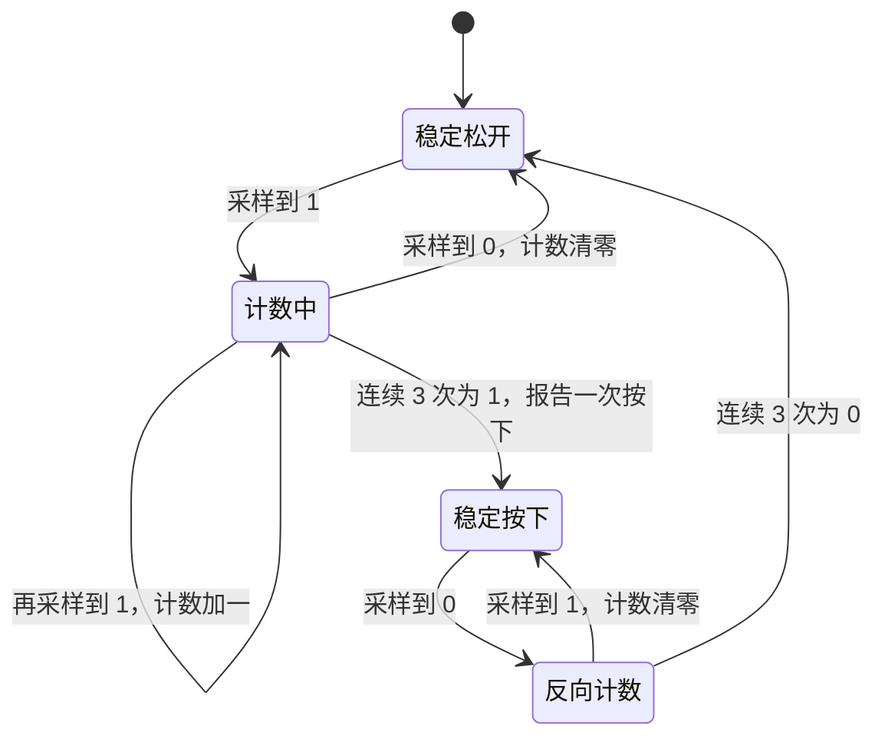
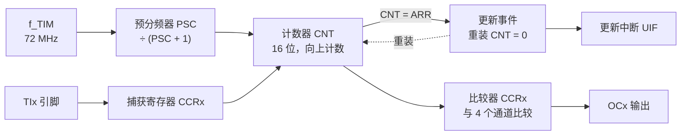

# 2.6 定时器、PWM 与系统节拍

在嵌入式软件的初始阶段，开发者常通过空转循环（Busy-waiting loop）实现延时控制。然而这种依靠 CPU 执行无意义自增指令的方式存在根本性的工程缺陷：延时的绝对时长与处理器的时钟频率、编译器指令排布以及优化级别紧密绑定，缺乏可复现的物理基准；更为严重的是，在空转等待的整个时间窗口内，CPU 核心完全被死等独占，无法兼顾物理按键采样、通信数据接收或状态机流转。

无论是实现平滑调节 LED 亮度的呼吸灯、构建抗抖动的周期性按键轮询机制，还是驱动直流电机与舵机所需的稳定 PWM 脉冲，系统都需要脱离对 CPU 纯指令计数的依赖。微控制器内部集成了独立于 CPU 指令流的专用硬件定时计数单元，它们直接挂接在片上时钟总线上，能够自主递增或递减计数，并在达到预设阈值时自动产生电平翻转、捕获边沿或触发硬件中断。

在 STM32F103 体系中，片上定时资源由内核与外设两层架构共同构成：ARM Cortex-M 内核专属的 24 位系统节拍定时器（SysTick）专门用于为裸机或实时操作系统提供统一的毫秒时间基准；片上外设总线挂载的 TIM2～TIM4 等 16 位通用定时器，则配备了灵活的预分频器（PSC）、自动重装载寄存器（ARR）以及多通道捕获/比较单元，支持周期中断、脉宽调制输出（PWM）与外部脉冲测频；此外，Cortex-M 内核的数据观察点与跟踪单元（DWT）中集成的时钟周期计数器（CYCCNT），更为纳秒至微秒级的高精度代码执行时间测量提供了底层物理依据。

示例都在 `code/嵌入式/2_MCU裸机开发/2_6_定时器_PWM与系统节拍/` 下，节拍模块 `tick.c/h` 是后面各节共用的。

## 1. 为什么需要定时器

依赖软件空转实现延时主要受制于两大固有限制。其一在于精度的脆弱性：形如 `for (volatile uint32_t i = 0; i < count; ++i)` 的循环，每轮迭代具体耗用多少个汇编指令周期完全取决于编译器的优化策略与代码生成模板，一旦更改构建参数（例如从 `-O0` 切换到 `-O2`），实际延时便会成倍漂移。其二在于 CPU 算力的严重浪费：空转等待期间处理器被彻底占死，既无法执行主业务计算，也无法对外部通信或物理按键进行响应。

硬件定时器将计时的职责完全移交给了独立的硬件时序电路。计数器在总线基准时钟的驱动下以固定周期自动递增或递减，全程无需 CPU 介入。当计数值达到预设门限时，硬件自动产生更新事件并触发中断，或直接在物理引脚上翻转电平与输出脉宽调制信号。CPU 仅在特定时间节点以极低开销介入处理，而在绝大多数时间窗口内均可从容执行其他任务。

在具体的系统设计中，片上定时资源主要支撑三类核心诉求：

- **系统节拍基准**：配置固定周期（如 1 ms）的中断，驱动全局毫秒时间戳的递增，主循环依据时间戳有序调度多项非阻塞任务；
- **模拟量与脉宽调制（PWM）**：定时器硬件自动比较当前计数值与比较捕获寄存器的设定值，在引脚上生成精确的方波占空比，CPU 仅需更新比较寄存器即可无缝调控外部灯光或电机转速；
- **物理信号测量与捕获**：外部脉冲直接连接到捕获通道，引脚上的电平边沿跳变触发硬件在单周期内将当前计数值转存至寄存器中，通过计算连续两次捕获值的差值，便能精确求得外部信号的周期与频率。

## 2. SysTick 与系统节拍

SysTick 是 Cortex-M 内核自带的定时器，属于内核外设，和 NVIC 一样由 Arm 定义，各厂商的 Cortex-M 芯片都有（[1.2 MCU、MPU、SoC 与执行环境](/教程/正文/嵌入式/1_平台与工具链/1_2_MCU_MPU_SoC与执行环境) 讲内核系列时提到过 ARMv7-M 的这一组外设）。它的寄存器不在外设地址空间，而在内核的 0xE000_E010：

| 偏移 | 名称 | 作用 |
| --- | --- | --- |
| 0x00 | `CTRL` | 使能、中断使能、时钟源选择、计数标志 |
| 0x04 | `LOAD` | 重装载值，24 位，最大 0x00FF_FFFF |
| 0x08 | `VAL` | 当前计数值，写任意值会清零，读回时清零 |
| 0x0C | `CALIB` | 校准值，本节的用法用不到 |

SysTick 是递减计数器：从 `LOAD` 开始减到 0，下一个周期自动重装 `LOAD` 并产生一次计数结束事件；`CTRL` 的 TICKINT 置位时同时产生 SysTick 异常。`CTRL` 的 CLKSOURCE 位选时钟源，置 1 用处理器时钟（F103 上等于 HCLK），清 0 用 HCLK/8。本教程统一置 1，让计数频率直接等于 72 MHz。

CMSIS 提供了 `SysTick_Config`，一步完成三件事：写入 `LOAD`、清零 `VAL`、打开中断和计数器，并把 SysTick 的中断优先级设为最低：

```c
/* SystemCoreClock = 72 000 000，每 72 000 个周期中断一次，即 1 ms */
SysTick_Config(SystemCoreClock / 1000u);
```

`LOAD` 会被算成 72000 − 1 = 71999，因为计数器从 `LOAD` 减到 0 一共是 `LOAD + 1` 个周期。

节拍模块在 `tick.c`：

```c
#include "tick.h"
#include "stm32f1xx.h"

static volatile uint32_t g_ms = 0;

void SysTick_Handler(void) {
    ++g_ms;
}

void tick_init(void) {
    SysTick_Config(SystemCoreClock / 1000u);
}

uint32_t tick_now(void) {
    return g_ms;
}

int tick_elapsed(uint32_t start, uint32_t interval_ms) {
    return (uint32_t)(tick_now() - start) >= interval_ms;
}

void delay_ms(uint32_t ms) {
    uint32_t start = tick_now();
    while ((uint32_t)(tick_now() - start) < ms) {
    }
}
```

`g_ms` 必须显式携带 `volatile` 限定符：确保 `tick_now()` 在被主循环频繁调用时，编译器每次都从 SRAM 物理地址中重新加载最新的计数值，而不是将其缓存在通用寄存器中。由于 `g_ms` 在 SysTick 中断服务程序中执行自增，而在主循环上下文中仅执行单次 32 位读取，根据 ARMv7-M 架构规范，对自然对齐的 32 位字访问具备单总线周期的原子性，因此该读取操作无需额外包裹临界区。

`tick_elapsed()` 的实现方式体现了处理嵌入式时钟回绕的关键考量。直觉上容易将时间到达条件写为 `now >= start + interval`。然而在微控制器长期连续运行的环境下，作为 32 位无符号整型的 `g_ms` 在连续递增约 49.7 天后必然会发生自然溢出并回绕至 0。一旦发生回绕，表达式 `start + interval` 将产生整数溢出，使得逻辑比较完全偏离物理时序。采用“先计算流逝差值再与间隔比较”的写法，利用 C 语言无符号整数在模 $2^{32}$ 下严格定义的减法回绕特性，即使 `now` 已经翻转回小整数而 `start` 仍停留在高地址，两者相减得到的差值依然能够精确代表物理流逝的真实毫秒数（只要单次检测间隔不超过 $2^{32}-1$ 毫秒）：

::: compare left-title="回绕时出错" right-title="差值比较，回绕也正确"

```c
return tick_now() >= start + interval_ms;
```

---

```c
return (uint32_t)(tick_now() - start) >= interval_ms;
```

:::

在宿主机上模拟执行可以清晰透视这一底层差异。`tim_calc.c` 在 `0xFFFFFFF0` 临界点附近构造了回绕测试向量：

::: terminal title="bash - 计数回绕与差值比较"

```text
$ gcc -std=c17 -Wall -Wextra tim_calc.c -o tim_calc
$ ./tim_calc
=== 1. SysTick 32 位毫秒计数回绕演示 (start = 0xFFFFFFF0, interval = 20) ===
  now = 0xFFFFFFF5 | (uint32_t)(now - start) =  5 ms | now >= start + interval: 1 | 差值比较: 0
  now = 0xFFFFFFFF | (uint32_t)(now - start) = 15 ms | now >= start + interval: 1 | 差值比较: 0
  now = 0x00000003 | (uint32_t)(now - start) = 19 ms | now >= start + interval: 0 | 差值比较: 0
  now = 0x00000004 | (uint32_t)(now - start) = 20 ms | now >= start + interval: 1 | 差值比较: 1
```

:::

前两行数据直观暴露了逻辑缺陷：由于 `start + interval` 发生溢出折返，在物理时间仅过去 5 ms 与 15 ms 时，左侧的简单比较就被误判为“超时”；而当时间走到 19 ms 时，却又被误判为“未到达”。只有在第 4 行，即当前时间恰好越过溢出点时，左侧逻辑才偶然成立。与之相对，右侧的无符号差值运算在全部场景下均维持了正确的时序裁决。

::: concept emb-timer-tick-wrap title="时间间隔用无符号差值比较"

用 `(uint32_t)(now - start) >= interval` 判断间隔是否到达，在计数器回绕时仍然正确。直接写 `now >= start + interval` 会在回绕点附近出错：加法溢出使终点落到回绕之后的地址，比较结果与真实经过时间无关。这条结论对 32 位毫秒节拍和 16 位定时器捕获值都成立。

:::

<Quiz
  type="single"
  :options="[
    { label: '每 1 ms 中断一次，LOAD = 72000', value: 'A' },
    { label: '每 1 ms 中断一次，LOAD = 71999', value: 'B' },
    { label: '每 72 ms 中断一次，LOAD = 71', value: 'C' },
    { label: '每 1 μs 中断一次，LOAD = 71', value: 'D' }
  ]"
  answer="B"
>

<template #question>

`SysTick_Config(72000000 / 1000)` 在 72 MHz 下写入 `LOAD` 的值是多少，节拍周期是多长？

</template>

正确答案是 **B**。72 000 个周期是 1 ms，`SysTick_Config` 写入的是 `LOAD = 周期数 − 1 = 71999`，因为计数器从 `LOAD` 降到 0 一共 `LOAD + 1` 个周期。

</Quiz>

## 3. 不阻塞的超级循环

在确立了稳定的 1 ms 系统节拍后，`delay_ms` 仅用于系统上电初始化等极少数简单的等待场景。构建高并发响应裸机系统的核心模式，是“基于时间戳差值的非阻塞轮询”：各个独立功能任务分别维护各自上一次被调度的历史时间戳，主循环在自由旋转过程中持续计算当前时间戳与历史时刻的时间跨度，一旦跨度达到预设周期便执行对应任务并更新时间戳：

```c
int main(void) {
    clock_init_72mhz();
    tick_init();
    gpio_init();

    debounce_t key_pa0 = { 0u, 0u };
    uint32_t last_led_ms = tick_now();
    uint32_t last_key_ms = last_led_ms;
    uint32_t led_period_ms = 500u;

    for (;;) {
        uint32_t now = tick_now();

        if ((uint32_t)(now - last_led_ms) >= led_period_ms) {
            last_led_ms = now;
            led_toggle();
        }

        if ((uint32_t)(now - last_key_ms) >= 10u) {
            last_key_ms = now;
            if (button_scan_10ms(&key_pa0) != 0) {
                led_period_ms = (led_period_ms == 500u) ? 100u : 500u;
            }
        }
    }
}
```

在此架构下，LED 指示灯任务以 500 ms 为周期有节奏地翻转，按键检测任务则以 10 ms 为基准周期执行离散采样。两个任务在主循环中完全解耦运转，主循环单次迭代的时间仅取决于当前轮次实际触发的那部分逻辑，彻底杜绝了空转延时对处理器的占用。若系统中需要新增第三方任务，仅需声明独立的时间戳对象并在主循环中添加相应的周期判定即可，无需重构现有代码的时序逻辑。

按键消抖状态机同样依托该节拍构建：主循环每 10 ms 对 PA0 引脚采样一次原始逻辑电平，唯有连续 3 次采样结果均与当前确认的稳态电平相悖时，才正式认可物理状态发生了实质迁移，并在首次确认由松开到按下的边沿瞬间返回 1：

```c
static int button_scan_10ms(debounce_t *db) {
    uint8_t raw = (GPIOA->IDR & GPIO_IDR_IDR0) != 0u ? 1u : 0u;
    if (raw == db->stable_level) {
        db->confirm_cnt = 0u;
        return 0;
    }

    ++db->confirm_cnt;
    if (db->confirm_cnt >= 3u) {
        db->stable_level = raw;
        db->confirm_cnt = 0u;
        if (raw == 1u) {
            return 1;
        }
    }
    return 0;
}
```

机械按键在触点接触与断开的短暂过程中会伴随微观弹性振颤，引脚逻辑在 0 与 1 之间剧烈抖动。以 10 ms 间隔执行采样并要求连续 3 次判定一致，等价于要求电平必须在物理上连续稳定维持 30 ms 方能通过滤波检验，抖动期内的瞬态高频毛刺会被状态机判定直接复位。整个过程既无任何死等阻塞，也无需耗费额外的硬件定时器中断。



这种基于单一物理时钟源调度多周期任务的架构，构成了典型的时间触发合作式系统（Time-Triggered Co-operative System）。其设计哲学在于保证各任务执行体的轻量与短促，使得主循环单次轮转耗时远小于最小任务周期。如果某项任务因复杂数学运算或长时间总线等待而超时，后续所有任务的触发时序将被整体滞后。在后续进阶的实时操作系统（RTOS）中，抢占式调度与动态优先级机制正是为了彻底克服这一协同阻塞限制，而 RTOS 任务时间片轮转的物理节拍，依然构建在底层的 SysTick 定时器中断之上。

## 4. 通用定时器

TIM2、TIM3、TIM4 是通用定时器，TIM1 是高级定时器（多出死区、互补输出、刹车输入，本节只在 PWM 一处提一句）。通用定时器的计数部分可以画成这样：



时钟先过预分频器 (prescaler)，除以 `PSC + 1`；计数器在这个频率下从 0 向上数到 `ARR`，再回到 0，产生一次更新事件。四个通道各自有一个捕获/比较寄存器 (Capture/Compare Register, CCRx)，比较模式用来输出波形，捕获模式用来记录外部边沿到来时的计数值。

TIM2～TIM4 挂在 APB1 上。2.3 把 PCLK1 配成 36 MHz，而 RM0008 规定：APB 预分频系数不为 1 时，定时器时钟自动乘 2。所以 TIM2～TIM4 实际拿到的是 72 MHz，和 HCLK 相同：

```
f_TIM = PCLK1 × 2 = 36 MHz × 2 = 72 MHz      （PPRE1 ≠ 1 时）
f_TIM = PCLK1                                （PPRE1 = 1 时）
```

计数频率与更新频率分别是：

```
f_CNT = f_TIM / (PSC + 1)
f_UEV = f_CNT / (ARR + 1) = f_TIM / ((PSC + 1)(ARR + 1))
```

要让 TIM2 每秒产生一次更新中断，取 `PSC = 7199`（计数频率 10 kHz）、`ARR = 9999`（10000 个数到 1 Hz）。要 1 kHz，取 `PSC = 71`、`ARR = 999`。用宿主程序把几组参数算出来：

::: terminal title="bash - PSC / ARR 计算"

```text
$ ./tim_calc
=== 2. 通用定时器 PSC / ARR 与分辨率计算 (f_TIM = 72 MHz) ===
  TIM2 周期更新中断 (1 Hz): PSC = 7199, ARR =  9999 | f_CNT =    10000 Hz (步进 100.000 us) | f =     1.0 Hz, 共 10000 级
  TIM3 呼吸灯 PWM (1 kHz)  : PSC =   71, ARR =   999 | f_CNT =  1000000 Hz (步进  1.000 us) | f =  1000.0 Hz, 共  1000 级
  TIM3 舵机控制 PWM (50 Hz): PSC =   71, ARR = 19999 | f_CNT =  1000000 Hz (步进  1.000 us) | f =    50.0 Hz, 共 20000 级
  TIM3 电机驱动 PWM (20 kHz): PSC =    0, ARR =  3599 | f_CNT = 72000000 Hz (步进  0.014 us) | f = 20000.0 Hz, 共  3600 级
```

:::

“共 N 级”指 `ARR + 1`，也就是占空比能分成多少档。同样要 20 kHz，`PSC = 0`、`ARR = 3599` 有 3600 级；如果先把 `PSC` 设大，档位就少了。频率越低，能拿到的分辨率越高。

TIM2 的初始化：

```c
static void tim2_init_1hz(void) {
    RCC->APB1ENR |= RCC_APB1ENR_TIM2EN;

    TIM2->PSC = 7199u;
    TIM2->ARR = 9999u;
    TIM2->CR1 |= TIM_CR1_ARPE;

    /* 产生一次更新事件，使 PSC 与 ARR 立即装入影子寄存器 */
    TIM2->EGR = TIM_EGR_UG;
    /* 清除 UG 置位的 UIF 标志（rc_w0 位：写 0 清零，写 1 无影响） */
    TIM2->SR = (uint16_t)~TIM_SR_UIF;

    TIM2->DIER |= TIM_DIER_UIE;
    NVIC_SetPriority(TIM2_IRQn, 2u);
    NVIC_EnableIRQ(TIM2_IRQn);

    TIM2->CR1 |= TIM_CR1_CEN;
}
```

`PSC` 有影子寄存器，写进去的值要等到下一次更新事件才装入计数路径，这样运行中改分频不会把当前周期切成两半。初始化时希望它立刻生效，写 `EGR` 的 UG 位强制产生一次更新；这次更新同时会把 `SR` 的 UIF 置 1，如果不清掉，刚打开中断就会立刻进一次。`ARR` 的缓冲由 `CR1` 的 ARPE 位控制，置 1 时才等更新事件生效；本节在初始化里就把 ARPE 置 1，之后运行中改频率也不会出现半个周期。

`UIF` 是 rc_w0 类型：写 0 清零，写 1 无影响。所以清标志写 `TIM2->SR = ~TIM_SR_UIF`，不是常见的"写 1 清零"。用 `TIM2->SR &= ~TIM_SR_UIF` 也能清掉自己这一位，但读和写之间若来了新的更新事件，那个事件会被这次写回一起清掉。

::: concept emb-timer-sr-rcw0 title="定时器状态寄存器的标志位写 0 清除"

STM32F1 通用定时器的 `SR` 寄存器里，UIF、CCxIF 等标志位是 rc_w0 类型：写 0 清除，写 1 保持。清标志写 `TIMx->SR = (uint16_t)~TIM_SR_UIF`，不要写 `TIMx->SR |= TIM_SR_UIF`。这与 EXTI 的 `PR`（写 1 清除）正好相反，同一颗芯片上两种约定都有，写之前先查参考手册的访问类型一列。

:::

处理函数翻转 LED：

```c
void TIM2_IRQHandler(void) {
    if ((TIM2->SR & TIM_SR_UIF) != 0u) {
        TIM2->SR = (uint16_t)~TIM_SR_UIF;
        if ((GPIOC->ODR & GPIO_ODR_ODR13) != 0u) {
            GPIOC->BSRR = GPIO_BSRR_BR13;
        } else {
            GPIOC->BSRR = GPIO_BSRR_BS13;
        }
    }
}
```

主循环里只有 `__WFI()`，等待中断时内核进入睡眠，功耗降下来，被中断唤醒后继续等。板上现象是 LED 以 0.5 Hz 闪烁（每秒进一次中断，翻转一次，亮暗各 1 s）。

改 `CCRx` 改占空比时，`CCMRx` 的 `OCxPE` 起同样的作用：置 1 后新比较值等更新事件生效，PWM 的脉冲宽度不会在一个周期中间被截断。

## 5. PWM

PWM 模式下，定时器把计数值 `CNT` 与比较值 `CCRx` 比较，按比较结果决定输出电平。模式 1 的规则是：`CNT < CCRx` 时输出有效电平，否则输出无效电平。`ARR` 决定周期，`CCRx` 决定高电平占多少：

```
占空比 = CCRx / (ARR + 1)
```

TIM3 的通道 3 在 PB0 上。配置前先确认 PB0 的复用功能：PB0 除了普通 GPIO，还复用为 TIM3_CH3、ADC12_IN8；复用推挽输出对应 `CRL` 的低 4 位写 `0xA`（CNF = 10，MODE = 10，2 MHz 复用推挽）。频率取 1 kHz，`PSC = 71`、`ARR = 999`，`CCR3` 在 0～1000 之间变化对应 0%～100%：

```c
static void tim3_pwm_pb0_init(void) {
    RCC->APB2ENR |= RCC_APB2ENR_IOPBEN;
    RCC->APB1ENR |= RCC_APB1ENR_TIM3EN;

    /* PB0（TIM3_CH3）：复用推挽输出，最大速度 2 MHz（CNF0 = 10，MODE0 = 10） */
    GPIOB->CRL &= ~(0xFu << 0);
    GPIOB->CRL |= 0xAu << 0;

    TIM3->PSC = 71u;
    TIM3->ARR = 999u;
    TIM3->CCR3 = 0u;

    /*
     * 通道 3 配置在 CCMR2 低 8 位：
     *   CC3S[1:0] = 00（输出）
     *   OC3PE     = 1 （开启 CCR3 预装载）
     *   OC3M[2:0] = 110（PWM 模式 1）
     */
    TIM3->CCMR2 &= ~(TIM_CCMR2_CC3S_Msk | TIM_CCMR2_OC3M_Msk);
    TIM3->CCMR2 |= (0x6u << TIM_CCMR2_OC3M_Pos) | TIM_CCMR2_OC3PE;

    /* 使能通道 3 输出，高电平有效（CC3P = 0，CC3E = 1） */
    TIM3->CCER &= ~TIM_CCER_CC3P;
    TIM3->CCER |= TIM_CCER_CC3E;

    TIM3->CR1 |= TIM_CR1_ARPE;
    TIM3->EGR = TIM_EGR_UG;
    TIM3->SR = (uint16_t)~TIM_SR_UIF;
    TIM3->CR1 |= TIM_CR1_CEN;
}
```

主循环每 10 ms 改一次 `CCR3`，让它从 0 逐渐加到 1000 再逐渐减回 0，外接 LED 就呈现呼吸效果：

```c
for (;;) {
    uint32_t now = tick_now();
    if ((uint32_t)(now - last_step_ms) >= 10u) {
        last_step_ms = now;
        duty += delta;
        if (duty >= 1000) {
            duty = 1000;
            delta = -10;
        } else if (duty <= 0) {
            duty = 0;
            delta = 10;
        }
        TIM3->CCR3 = (uint16_t)duty;
    }
}
```

10 ms 一步、每步 1%、1000 步走完一个来回，整个呼吸周期约 20 s。要快就减少步数或缩短间隔。

同样的公式换几组参数就是不同用途：

| 用途 | 频率 | PSC | ARR | 分辨率 | CCR 范围 |
| --- | --- | --- | --- | --- | --- |
| 呼吸灯 | 1 kHz | 71 | 999 | 1000 级 | 0～1000 |
| 舵机控制 | 50 Hz | 71 | 19999 | 20000 级 | 500～2500（对应 0.5～2.5 ms 脉宽） |
| 电机驱动 | 20 kHz | 0 | 3599 | 3600 级 | 0～3599 |

舵机看脉宽而不是占空比：50 Hz 周期 20 ms，脉宽 1.5 ms 对应中间位置，`CCR = 1.5 ms / 1 μs = 1500`。电机驱动要 20 kHz 是为了让人耳听不见，这时 `PSC` 不能再分频，只能靠 3600 级的分辨率。

<Quiz
  type="single"
  :options="[
    { label: 'PSC = 71，ARR = 999，CCR3 = 500', value: 'A' },
    { label: 'PSC = 0，ARR = 3599，CCR3 = 1800', value: 'B' },
    { label: 'PSC = 3599，ARR = 0，CCR3 = 0', value: 'C' },
    { label: 'PSC = 71，ARR = 19999，CCR3 = 1000', value: 'D' }
  ]"
  answer="A"
>

<template #question>

要在 PB0（TIM3_CH3）上输出 1 kHz、占空比 50% 的 PWM，下面哪组参数正确？

</template>

正确答案是 **A**。72 MHz 经 `PSC = 71` 分频得到 1 MHz，`ARR = 999` 时 1000 个数一个周期，正好 1 kHz；`CCR3 = 500` 时高电平占一半。D 的 `ARR = 19999` 是 50 Hz 舵机参数，B 的 `ARR = 3599` 是 20 kHz。

</Quiz>

TIM1 是高级定时器，输出前还要把 `BDTR` 的 MOE（主输出使能）置 1，否则通道使能了引脚上也没有波形。除此之外它多出互补输出、死区和刹车输入，驱动半桥时用，本教程不展开。

## 6. 输入捕获

输入捕获 (input capture) 反过来用定时器：外部信号接到通道引脚，边沿到来时硬件把当前的 `CNT` 复制进 `CCRx`，并置 `CCxIF`。两次捕获值相减就是信号的一个周期。

把 PB0 的 PWM 用跳线接到 PA0（TIM2_CH1），让 TIM2 以 1 MHz（1 μs 一步）自由计数，`ARR = 0xFFFF`，捕获上升沿：

```c
static void tim2_ic_pa0_init(void) {
    RCC->APB2ENR |= RCC_APB2ENR_IOPAEN;
    RCC->APB1ENR |= RCC_APB1ENR_TIM2EN;

    /* PA0（TIM2_CH1）：浮空输入（CNF0 = 01，MODE0 = 00） */
    GPIOA->CRL &= ~(0xFu << 0);
    GPIOA->CRL |= 0x4u << 0;

    /* 1 MHz 计数（1 us/步），ARR = 0xFFFF 满量程自由运行 */
    TIM2->PSC = 71u;
    TIM2->ARR = 0xFFFFu;

    /* CC1S = 01：IC1 映射到 TI1（PA0），无滤波、无预分频 */
    TIM2->CCMR1 &= ~(TIM_CCMR1_CC1S_Msk | TIM_CCMR1_IC1F_Msk | TIM_CCMR1_IC1PSC_Msk);
    TIM2->CCMR1 |= 0x1u << TIM_CCMR1_CC1S_Pos;

    /* CC1P = 0（上升沿捕获），CC1E = 1（使能捕获） */
    TIM2->CCER &= ~TIM_CCER_CC1P;
    TIM2->CCER |= TIM_CCER_CC1E;

    TIM2->EGR = TIM_EGR_UG;
    TIM2->SR = 0u;
    TIM2->DIER |= TIM_DIER_CC1IE;

    NVIC_SetPriority(TIM2_IRQn, 1u);
    NVIC_EnableIRQ(TIM2_IRQn);

    TIM2->CR1 |= TIM_CR1_CEN;
}
```

通道 1 的配置在 `CCMR1` 低 8 位：`CC1S = 01` 把通道 1 接到 TI1，`IC1PSC = 00` 每次边沿都捕获，`IC1F = 0000` 不做数字滤波。计数值是 16 位，两次捕获相减要用 `uint16_t`：

```c
void TIM2_IRQHandler(void) {
    if ((TIM2->SR & TIM_SR_CC1IF) != 0u) {
        /* 读取 CCR1 会由硬件自动清除 CC1IF */
        uint16_t cap = (uint16_t)TIM2->CCR1;
        if (s_has_first != 0u) {
            uint16_t diff = (uint16_t)(cap - s_last_cap);
            g_period_us = diff;
            if (diff != 0u) {
                g_freq_hz = 1000000u / diff;
            }
        } else {
            s_has_first = 1u;
        }
        s_last_cap = cap;
    }
}
```

`uint16_t` 相减天然按模 65536 处理，计数器从 0xFFFF 回到 0 也不用特殊处理。这和上一节 32 位毫秒计数的差值比较是同一条规则，只是位宽不同。

::: terminal title="bash - 16 位捕获回绕"

```text
$ ./tim_calc | sed -n '/=== 3/,$p'
=== 3. 16 位输入捕获跨 0xFFFF 回绕相减 ===
  上次捕获 cap1 = 65000 (0xFDE8)，本次捕获 cap2 = 464 (0x01D0)
  (uint16_t)(cap2 - cap1) = 1000 步 = 1000 us -> 实测频率 1000 Hz
```

:::

接线时 1 kHz 的 PWM 周期是 1000 μs，捕获差应为 1000。`g_period_us` 和 `g_freq_hz` 在调试器里可以直接看，不需要串口。

输入捕获还能做两件事：PWM 输入模式用两个通道分别捕获上升沿和下降沿，能同时测周期和占空比；编码器模式让定时器接正交编码器的 A、B 两相，自动加减计数，做旋钮和电机测速时用。这两种模式各改几个 `CCMR` 的位，结构不变。

## 7. DWT 周期计数器

有些延时比 1 ms 还短，比如读一个传感器需要 2 μs 的建立时间。SysTick 的 1 ms 分辨率不够用，空转循环又不可靠。Cortex-M3 的内核里有一个数据观察点与跟踪单元 (Data Watchpoint and Trace, DWT)，其中的 `CYCCNT` 每来一个内核时钟周期就加一，72 MHz 下分辨率为 13.9 ns。

启动它需要两步：先置 `CoreDebug->DEMCR` 的 TRCENA 位，再置 `DWT->CTRL` 的 CYCCNTENA 位：

```c
void dwt_init(void) {
    CoreDebug->DEMCR |= CoreDebug_DEMCR_TRCENA_Msk;
    DWT->CYCCNT = 0u;
    DWT->CTRL |= DWT_CTRL_CYCCNTENA_Msk;
}

void delay_us(uint32_t us) {
    uint32_t start = DWT->CYCCNT;
    uint32_t cycles = us * (SystemCoreClock / 1000000u);
    while ((uint32_t)(DWT->CYCCNT - start) < cycles) {
    }
}
```

`CYCCNT` 是 32 位，72 MHz 下大约 59.6 s 回绕一次，用差值比较同样正确。测量一段代码的耗时就是前后各读一次：

```c
uint32_t t0 = DWT->CYCCNT;
delay_us(10u);
g_ten_us_cycles = DWT->CYCCNT - t0;

t0 = DWT->CYCCNT;
for (int i = 0; i < 1000; ++i) {
    GPIOC->BSRR = GPIO_BSRR_BR13;
    GPIOC->BSRR = GPIO_BSRR_BS13;
}
g_toggle_cycles = DWT->CYCCNT - t0;
```

`code/嵌入式/2_MCU裸机开发/2_6_定时器_PWM与系统节拍/dwt_demo/main.c` 就是这段程序。`g_ten_us_cycles` 与 `g_toggle_cycles` 声明成 `volatile` 对象，调试器 halt 之后用 `print` 直接读：

::: terminal title="bash - 构建 dwt_demo"

```text
$ arm-none-eabi-gcc -std=c11 -mcpu=cortex-m3 -mthumb -O2 -g -Wall -Wextra \
    -ffunction-sections -fdata-sections -DSTM32F103xB -I. \
    -nostartfiles --specs=nano.specs --specs=nosys.specs -Wl,--gc-sections \
    -T stm32f103c8.ld clock.c dwt_demo/main.c startup_stm32f103.c -o dwt_demo.elf
$ arm-none-eabi-size dwt_demo.elf
   text	   data	    bss	    dec	    hex	filename
    648	      4	   1548	   2200	    898	dwt_demo.elf
```

:::

72 MHz 下 10 μs 应当落在 720 个周期附近。`g_ten_us_cycles` 通常比 720 略大，多出来的是读 `CYCCNT`、比较、跳转这些循环自身的开销，读一次减一次就能看出偏差有多少。`g_toggle_cycles` 除以 2000（1000 次循环、每次翻转两次）就是单次 BSRR 写入的周期数。

::: tip 用 DWT 而不是空转循环来标定延时

需要精确等待时，先写空转循环，再用 DWT 量出它实际消耗的周期数，按比例修正。比对着指令表数周期的做法可靠，换优化级别或编译器版本也只需要重新量一次。

:::

`DWT->CYCCNT` 在 Cortex-M0 上不存在，M3、M4、M7 都有。F103 是 M3，板上可用。

<Quiz
  type="single"
  :options="[
    { label: 'SysTick 频率只有 1 kHz，测不了微秒', value: 'A' },
    { label: 'CYCCNT 每个内核周期加一，72 MHz 下分辨率约 13.9 ns', value: 'B' },
    { label: '空转循环最准，因为它不受中断影响', value: 'C' },
    { label: '用 TIM2 的输入捕获测代码耗时', value: 'D' }
  ]"
  answer="B"
>

<template #question>

要测量一段只有几微秒的代码耗时，用哪个时间基准？

</template>

正确答案是 **B**。SysTick 的节拍是 1 ms，测 10 μs 只能得到 0 或 1，分辨率不够。DWT 的 `CYCCNT` 直接对内核周期计数，72 MHz 下每个计数是 13.9 ns，测 10 μs 能得到 700 多的计数值，误差在个位数周期。C 错在空转循环的迭代时间和优化级别强相关，没法换算成绝对时间；D 的输入捕获是给外部信号用的，测不了代码。

</Quiz>

## 8. HAL 对照

CubeMX 生成的工程默认用 SysTick 做 HAL 的时基：`SysTick_Handler` 调用 `HAL_IncTick`，`HAL_GetTick` 返回它的值，`HAL_Delay` 基于它忙等。所以用 HAL 时不要另写 `SysTick_Handler`，否则链接时自己那份会和 HAL 里的重复定义；需要自己的节拍就在 `HAL_IncTick` 之后顺势使用，或者把 HAL 的时基换到别的定时器（`HAL_InitTick`）。

| 寄存器写法 | HAL 写法 |
| --- | --- |
| `SysTick_Handler` 里 `++g_ms` | `HAL_IncTick`，用 `HAL_GetTick` 读 |
| `delay_ms` | `HAL_Delay` |
| `TIM2->DIER |= TIM_DIER_UIE` | `HAL_TIM_Base_Start_IT(&htim2)` |
| `TIM2_IRQHandler` 里清 UIF | `HAL_TIM_IRQHandler(&htim2)` 内部清，调用 `HAL_TIM_PeriodElapsedCallback` |
| `TIM3->CCR3 = duty` | `__HAL_TIM_SET_COMPARE(&htim3, TIM_CHANNEL_3, duty)` |
| `TIM3->CR1 |= TIM_CR1_CEN` | `HAL_TIM_PWM_Start(&htim3, TIM_CHANNEL_3)` |
| 捕获中断读 `CCR1` | `HAL_TIM_IC_Start_IT(&htim4, TIM_CHANNEL_1)` + `HAL_TIM_ReadCapturedValue` |

HAL 的定时器句柄把 `PSC`、`ARR` 和四个通道的配置都包进 `TIM_Base_InitTypeDef` 与 `TIM_OC_InitTypeDef`，`HAL_TIM_PWM_ConfigChannel` 计算并写入 `CCMR`、`CCER`。公式和本节一样，只是参数从寄存器变成了结构体字段。

## 9. 习题

### 9.1 巩固

<Exercise id="62248" :d="2" :w="2">

取 f_TIM = 72 MHz，为下面三组需求求 PSC 与 ARR，并写一个宿主程序把结果打印出来核对。

1. 更新频率 2 Hz，比较值分辨率不低于 10000 级。
2. 更新频率 400 Hz，分辨率 5000 级。
3. 更新频率 20 kHz，分辨率 1800 级。

对每一组写出 `f_CNT`、`f_UEV` 和 `ARR + 1`，确认 PSC 与 ARR 都不超过 65535。

然后回答：`tim2_init_1hz` 里 `TIM2->EGR = TIM_EGR_UG;` 之后为什么紧接着写 `TIM2->SR = (uint16_t)~TIM_SR_UIF;`？漏掉这一句，`main` 进入 `__WFI()` 后会发生什么？如果把这一句误写成 `TIM2->SR |= TIM_SR_UIF;`，现象又是什么？

</Exercise>

<Exercise id="62249" :d="2" :w="2">

周期任务有两种记上次时刻的写法：

```c
/* A：记成当前时刻 */
if ((uint32_t)(now - last_ms) >= period_ms) {
    last_ms = now;
    do_work();
}

/* B：按周期累加 */
if ((uint32_t)(now - last_ms) >= period_ms) {
    last_ms += period_ms;
    do_work();
}
```

写一个宿主程序模拟主循环。每圈耗时按 `0, 1, 2, 3, 0, 1, 2, 3, ...` 毫秒循环，`period_ms = 10`，一共跑 100 圈。分别记录 A、B 两种写法下 `do_work` 被调用的时刻，打印前 10 次和总次数。

1. 两种写法各调用多少次？
2. 把某一圈的耗时临时改成 29 ms，哪一种写法会在之后连续几圈都立刻触发，直到把落后的进度补回来？
3. 按键扫描、控制环这类“每次都要按固定间隔采样”的任务该用哪一种？整点上报、按时间表排班的任务又该用哪一种？

</Exercise>

<Exercise id="62250" :d="2" :w="2">

下面是本节的寄存器写法和对应的 HAL 写法。只写函数名、参数与调用顺序，不要求编译。

1. `tim3_pwm_pb0_init` 里配置 PSC、ARR、通道 3 为 PWM 模式 1、开启 CCR 预装载、使能通道、启动计数器，分别由 `HAL_TIM_PWM_Init`、`HAL_TIM_PWM_ConfigChannel`、`HAL_TIM_PWM_Start` 中的哪一步完成？
2. `TIM2->DIER |= TIM_DIER_UIE; NVIC_EnableIRQ(TIM2_IRQn); TIM2->CR1 |= TIM_CR1_CEN;` 对应哪两个 HAL 调用？
3. `TIM2_IRQHandler` 里判断并清除 UIF 的工作由哪个 HAL 函数完成？用户应该实现哪个回调？
4. `__HAL_TIM_SET_COMPARE(&htim3, TIM_CHANNEL_3, duty)` 展开后写的是哪个寄存器？在 `OC3PE = 1` 时，它与直接写 `TIM3->CCR3` 的生效时机是否相同？
5. 同样的代码换成 TIM1，`HAL_TIM_PWM_Start` 比 TIM3 多做了什么？不做会有什么现象？

</Exercise>

### 9.2 编程

<Exercise id="62251" :d="3" :w="3">

把下面的阻塞式主循环改成单节拍、非阻塞的超级循环：

```c
for (;;) {
    led_toggle();
    delay_ms(500);
    if (button_pressed()) {
        led_period_ms = (led_period_ms == 500) ? 100 : 500;
    }
    delay_ms(10);
    uart_puts("alive\n");
    delay_ms(1000);
}
```

要求：

1. 三个任务分别记录上次执行时刻，周期为 500 ms（LED 翻转）、10 ms（按键扫描）、1000 ms（心跳打印）。按键处理改用第 3 节的 `button_scan_10ms` 状态机。
2. 把调度逻辑放进 `superloop_step(uint32_t now)`，硬件读写用函数指针或弱符号隔开，使它能在 PC 上用假时钟测试。
3. 用假时钟从 t = 0 走到 t = 4999，每 1 ms 调用一次 `superloop_step`，三个任务在 t = 0 先各执行一次，之后按周期触发。

验收：三个任务在 5 s 内分别执行 10 次、500 次、5 次。把周期改成 300 ms / 7 ms / 700 ms 再跑一次，给出新的次数。

</Exercise>

<Exercise id="62252" :d="3" :w="3">

写一个软件定时器模块，用 1 ms 节拍驱动，不再占用额外的硬件定时器。接口如下：

```c
typedef void (*sw_timer_cb)(void *arg);

typedef struct {
    uint32_t period_ms;
    uint32_t last_ms;
    sw_timer_cb cb;
    void *arg;
    int repeat;
    int active;
} sw_timer;

void sw_timer_start(sw_timer *t, uint32_t period_ms, int repeat,
                    sw_timer_cb cb, void *arg);
void sw_timer_stop(sw_timer *t);
void sw_timer_poll(sw_timer *t, uint32_t now);
```

要求：

1. 单次定时器到期后自动停止；周期定时器到期后把 `last_ms` 推进一个 `period_ms`，不要写成 `now`。
2. 处理 32 位毫秒计数回绕。如果一次 `poll` 时已经落后了好几个周期，说明你的实现会补发几次，为什么这样选。
3. 在 PC 上用假 `now` 测试：启动一个 10 ms 周期定时器和一个 25 ms 单次定时器，让 `now` 从 `0xFFFFFFF0` 走到 `0x00000060`，打印每次回调的时刻。

验收：10 ms 定时器跨过回绕点后仍按 10 ms 间隔触发；25 ms 单次定时器只触发一次。

</Exercise>

<Exercise id="62253" :d="3" :w="3">

用 TIM3_CH3（PB0）驱动一个舵机。舵机要求 50 Hz，脉宽 0.5～2.5 ms 对应 0°～180°。

1. 取 PSC = 71、ARR = 19999，说明计数步进和 CCR 的取值范围，写出 `servo_set_pulse_us(uint16_t us)`，把 500～2500 限制在范围内并写入 `CCR3`。
2. 写出 `servo_set_angle(int deg)`，把 0～180° 线性映射成脉宽，角度超出范围时钳位。
3. 在主循环里让舵机从 0° 转到 180° 再转回来，每 20 ms 走 1°，用 `tick_now` 调度。
4. 没有示波器时，把 PB0 接到 PA0，用第 6 节的输入捕获测脉宽验收。第 6 节只捕获上升沿，得到的是周期；要得到高电平时间，应当在捕获中断里翻转 `CCER` 的 `CC1P`，让下一次捕获落在下降沿。写出改法，并说明两次捕获值相减对应的是高电平还是低电平。

验收：读到的脉宽在 500～2500 μs 之间，误差不超过 2 μs（一个计数）。

</Exercise>

<Exercise id="62254" :d="3" :w="2">

用 DWT 标定一个空转延时循环。

1. 写 `uint32_t measure_loop_cycles(uint32_t n)`，测出 `for (volatile uint32_t i = 0; i < n; ++i) { __NOP(); }` 消耗的周期数。n 取 1、10、100、1000，各测 5 次取平均。
2. 用两点法或线性拟合求每轮迭代的周期数 k 和固定开销 b，按 72 MHz 写出 `delay_loops(uint32_t us)`。
3. 与直接用 DWT 忙等的 `delay_us` 对照，测量两者在 1 μs、10 μs、100 μs 上的误差。
4. 把编译选项从 `-O0` 换成 `-O2` 重测 k。说明 k 为什么必须实测，不能按指令表推算。

验收：给出四组 n 的周期数表；k 在两种优化级别下明显不同；标定后的延时误差小于 5%。

</Exercise>

### 9.3 综合与挑战

<Exercise id="62255" :d="4" :w="3">

有些产品要求系统节拍不受调试器和低优先级中断影响，会把节拍源从 SysTick 换成通用定时器。

1. 写 `tick_init_tim4(void)`：TIM4 挂在 APB1 上，PSC = 71、ARR = 999，更新中断里给同一个 `g_ms` 加一。保持 `tick.h` 的四个函数接口不变。
2. 说明 PSC = 71、ARR = 999 为什么得到 1 ms。初始化里 `EGR = UG` 之后为什么还要清 UIF。
3. `SysTick_Config` 会把 SysTick 的中断优先级设为最低。换成 TIM4 后如果把优先级设得比串口、EXTI 都高，`delay_ms` 的精度会怎样变化？把优先级设低又会怎样？给出你的选择。
4. 两种时钟源都来自 HCLK，为什么节拍频率应当相同？用 DWT 或逻辑分析仪测 60 s 内的节拍数，比较两者的偏差，说明偏差的来源。

验收：`tick_now` 的调用方代码一行不改；示波器或调试器读数在 60 s 内偏差不超过 1 ms。

</Exercise>

<Exercise id="62256" :d="5" :w="4">

一块 F103C8 控制板要同时运行：

- 1 ms 系统节拍；
- PB0 上 1 kHz、占空比可调的 LED PWM；
- 20 kHz 电机 PWM；
- 一路 1 Hz～10 kHz 外部信号的频率测量；
- 每 100 ms 一次的串口状态输出。

1. 给出定时器与通道分配表（定时器、通道、引脚、PSC、ARR、中断优先级），说明哪些任务必须用硬件定时器，哪些可以挂在 1 ms 节拍上。
2. 20 kHz 电机 PWM 在 PSC = 0 时 ARR = 3599，分辨率是多少级？若改用 PSC = 1，ARR 取多少仍是 20 kHz，分辨率变成多少？若要求分辨率不低于 1024 级，PSC 最大能取多少？
3. 写程序用 DWT 统计主循环一轮的周期数，输出最小值、最大值和平均值。在某个定时器更新中断里翻转 PC13 制造抖动，比较中断打开与关闭时的最大值。
4. 若某个任务的执行时间超过它的周期，超级循环会出现什么现象？给出两种补救办法并比较代价。

验收：分配表中没有引脚或定时器冲突；抖动统计每 100 ms 从串口打印一行。

</Exercise>

<Exercise id="62257" :d="6" :w="4" scope="*">

TIM2 以 1 MHz 计数、ARR = 0xFFFF 时，16 位计数器每 65.536 ms 回绕一次。测 1 Hz 的慢信号时，两次捕获之间会回绕约 15 次，单次 `uint16_t` 差值不再够用。

1. 在更新中断里累加一个 32 位溢出计数 `s_overflow`，在捕获中断里把 `CNT` 与溢出计数拼成 32 位时间戳。写出两个中断服务函数，说明读 `CNT` 与读 `s_overflow` 的先后顺序为什么会影响结果。
2. 用 32 位差值计算频率，测量 1 Hz、10 Hz、1 kHz 三个信号，给出理论计数值和量化误差。
3. 捕获中断与更新中断同时挂起时先处理哪个？NVIC 优先级怎么设才能保证时间戳不丢计数？给出设置和最坏误差。
4. 若把 PSC 改成 7199（10 kHz 计数），量程扩大到多少？1 Hz 信号的量化误差变成多少？说明量程、分辨率与测量时间之间的取舍。

</Exercise>

## 10. 参考资料

1. STMicroelectronics, [*RM0008 Reference manual: STM32F101xx, STM32F102xx, STM32F103xx, STM32F105xx and STM32F107xx advanced Arm-based 32-bit MCUs*, Rev 21](https://www.st.com/resource/en/reference_manual/rm0008-stm32f101xx-stm32f102xx-stm32f103xx-stm32f105xx-and-stm32f107xx-advanced-armbased-32bit-mcus-stmicroelectronics.pdf)：第 14 章 Advanced-control timers（TIM1）、第 15 章 General-purpose timers（TIM2～TIM5），表 41 定时器时钟。
2. STMicroelectronics, [*PM0056 Programming manual: STM32F10xxx/20xxx/21xxx/L1xxxx Cortex-M3 programming manual*, Rev 7](https://www.st.com/resource/en/programming_manual/pm0056-stm32f10xxx20xxx21xxxl1xxxx-cortexm3-programming-manual-stmicroelectronics.pdf)：第 4.5 节 SysTick timer（STK_CTRL、STK_LOAD、STK_VAL）。
3. Arm, [*CMSIS-Core (Cortex-M): SysTick*](https://arm-software.github.io/CMSIS_5/Core/html/group__SysTick__gr.html)：`SysTick_Config` 的实现与返回值。
4. Arm, [*Cortex-M3 Devices Generic User Guide*](https://developer.arm.com/documentation/dui0552/latest)：DWT 的 `CYCCNT` 与 `DEMCR.TRCENA`。
5. cpq, [*Bare-metal programming guide*](https://github.com/cpq/bare-metal-programming-guide)：SysTick 与系统节拍一节。
6. Miro Samek, [*Modern Embedded Systems Programming*](https://www.state-machine.com/video-course)：前后台系统、时间触发的事件驱动写法。
7. STMicroelectronics, [*STM32F1 HAL driver*](https://github.com/STMicroelectronics/stm32f1xx-hal-driver)：`stm32f1xx_hal_tim.c`、`stm32f1xx_hal_tim_ex.c`。
