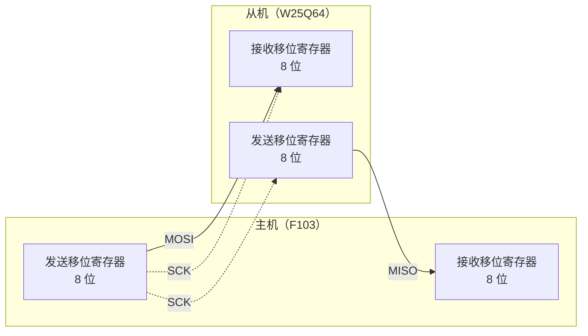

# 2.8 SPI 与 I²C

在异步串口通信中，通信双方依赖预先商定的波特率各自维持独立的本地时钟，数据帧通过起始位与停止位实现松散对齐。这种机制在低频控制台与点对点诊断中十分高效，但在板级高速外设互联中，波特率发生器的时钟漂移限制了其数据吞吐上限。

为了在板级芯片之间实现高速、确定性且高密度的数据交互，同步串行总线应运而生。同步通信通过引入显式的物理时钟信号线（Clock Line），由通信主控端（Master）统一驱动总线时钟，从属端（Slave）直接在时钟信号的上升沿或下降沿对数据引脚实施物理电平采样。这种时钟与数据伴随传输的硬件机制，彻底消除了异步通信中的时钟漂移与累积相位误差，使得通信带宽得以提升至数兆乃至数十兆赫兹。

在典型的嵌入式硬件板卡上，通常同时集成了两类代表性的同步串行总线：
- **串行外设接口（SPI）**：采用四线制推挽全双工拓扑，具备独立的片选线（CS），时钟速率高达数十兆赫兹，常用于连接大容量存储芯片（如 8 MB SPI Flash W25Q64）、TFT 液晶显示屏或 SD 卡；
- **集成电路间总线（I²C）**：采用两线制开漏半双工拓扑，依靠总线上拉电阻与片上 7 位地址寻址，仅用两根物理走线即可并联挂接数十个片外外设，广泛用于板载参数存储器（如 256 字节 EEPROM AT24C02）、温湿度传感器与高精度实时时钟（RTC）。

掌握这两类总线的底层电气拓扑、时钟相位模式、事件状态机以及异常死锁的防护策略，是微控制器外设驱动开发的核心功底。

## 1. 两种同步串行总线

UART 依赖预设波特率进行异步盲测采样，为了吸收频差，帧长通常被限制在 10 个位宽左右。与之不同，SPI 与 I²C 均通过专用的时钟线直接传递采样节拍，从设备无需揣测比特边界，因而传输带宽相比异步串口可实现成倍跃升。

| 项目 | SPI | I²C |
| --- | --- | --- |
| 信号线 | SCK、MOSI、MISO、CS，每个从机一根 CS | SCL、SDA，所有器件共用 |
| 寻址方式 | 片选：拉低哪根 CS 就选中哪个从机 | 地址：每帧开头发 7 位地址 |
| 双工 | 全双工，收发同时进行 | 半双工，读写分时 |
| 输出形式 | 推挽，只由一方驱动 | 开漏，所有器件线与，外接上拉电阻 |
| F103 上的速率 | SPI1 最高 18 Mbit/s | 100 kbit/s 或 400 kbit/s |
| 典型器件 | W25Q64、SD 卡、LCD | AT24C02、MPU6050、温度传感器 |

在系统架构选型中，外设总线的选用呈现出分明的层次特征：当系统存在吞吐大量连续数据流的需求（如更新显示帧缓冲或快速载入固件备份）时，SPI 凭借全双工物理通路与极高时钟带宽占据统治地位；而当系统中挂载了大量仅需低频读写配置参数或采样周期性环境量的小型芯片时，I²C 凭借极简的两线并联架构最大程度节约了宝贵的引脚与 PCB 走线空间。两者在 STM32F103 硬件上物理独立，可互不干扰地并发运行。

## 2. SPI 协议

### 2.1 四根线

SPI (Serial Peripheral Interface) 由 Motorola 在 1980 年代提出，是一种主从结构的同步串行总线。总线上只有一个主机，其余都是从机。四根线各管一件事：

- SCK (Serial Clock)：主机产生的时钟，每个周期搬运一位。
- MOSI (Master Out Slave In)：主机发、从机收。
- MISO (Master In Slave Out)：从机发、主机收。
- CS (Chip Select)，在 ST 的文档里叫 NSS：主机拉低它来选中某个从机。

一根 SPI 总线上可以挂多个从机，SCK、MOSI、MISO 三根线共用，每个从机各有一根独立的 CS。主机同一时刻只拉低一根 CS，其余保持高电平；被选中的从机才驱动 MISO，没被选中的从机把 MISO 置为高阻，不会互相打架。CS 的高电平同时也把从机的移位寄存器复位，一次完整的命令由 CS 的下降沿开始、上升沿结束。

### 2.2 两个移位寄存器

SPI 的收发机制可以用两个 8 位移位寄存器首尾相接来说明。主机的移位寄存器从高位端经 MOSI 送到从机的低位端，从机的移位寄存器从高位端经 MISO 送回主机，两边共用同一个 SCK。



每个时钟周期，两个移位寄存器都左移一位，主机的高位移出到 MOSI，从机的高位移出到 MISO，移入的一端接到对方。8 个周期之后，主机发出去的字节进了从机，从机准备好的字节进了主机，一次交换完成。这就是为什么 SPI 没有“只读”操作：想读一个字节，必须同时写一个字节，写进去的内容从机可能不关心，通常填 `0xFF`。

::: concept emb-spi-full-duplex title="SPI 收发同时发生"

SPI 是全双工总线。主机每发出一个字节，同时收到一个字节；读数据时也要发出一个字节，通常用 `0xFF` 作哑字节。主机拉低 CS、发出命令、再发若干个 `0xFF` 把返回的数据“顶”出来，整个过程都在同一根 SCK 上完成。

:::

### 2.3 时钟极性与相位

时钟空闲时是高还是低，数据在第一个边沿还是第二个边沿被采样，这两个选择组合出四种模式，由 CPOL (Clock Polarity) 与 CPHA (Clock Phase) 两个位决定。

| 模式 | CPOL | CPHA | 空闲电平 | 采样边沿 | 数据在哪个边沿改变 |
| --- | --- | --- | --- | --- | --- |
| 0 | 0 | 0 | 低 | 上升沿（第一个边沿） | 下降沿 |
| 1 | 0 | 1 | 低 | 下降沿（第二个边沿） | 上升沿 |
| 2 | 1 | 0 | 高 | 下降沿（第一个边沿） | 上升沿 |
| 3 | 1 | 1 | 高 | 上升沿（第二个边沿） | 下降沿 |

模式 0 的波形如下。CS 拉低之后，SCK 的每个上升沿采样 MOSI 上的一位，下降沿由发送方换下一位；8 个上升沿采完一个字节。

<TimingDiagram
  title="SPI 模式 0（CPOL = 0，CPHA = 0），发送 0xA5"
  :signals="[
    { name: 'CS', wave: '10...............1' },
    { name: 'SCK', wave: '0.1010101010101010' },
    { name: 'MOSI', wave: 'x=.=.=.=.=.=.=.=.x', data: ['1', '0', '1', '0', '0', '1', '0', '1'] }
  ]"
  :marks="[2, 4, 6, 8, 10, 12, 14, 16]"
/>

主机和从机必须使用同一个模式。W25Q64 支持模式 0 和模式 3，两者只在时钟空闲电平上不同，都在上升沿采样；多数 SPI Flash、SD 卡和显示屏都支持模式 0，选它最省事。模式选错时数据整体错开一位，读回来的值是原来的一半左右，这种“看起来像数据、其实全错”的现象在调试时最费时间。

<Quiz
  type="single"
  :options="[
    { label: '第一个边沿，也就是上升沿', value: 'A' },
    { label: '第二个边沿，也就是下降沿', value: 'B' },
    { label: '两个边沿都采样，取平均值', value: 'C' },
    { label: '由从机决定，主机不需要配置', value: 'D' }
  ]"
  answer="A"
>

<template #question>

SPI 模式 0（CPOL = 0，CPHA = 0）下，主机在 SCK 的哪个边沿采样 MISO？

</template>

正确答案是 **A**。

- CPHA = 0 表示在第一个时钟边沿采样。CPOL = 0 表示空闲为低，第一个边沿就是上升沿。
- 下降沿是发送方改变数据位的时刻。如果在下降沿采样，采到的正是对方刚要换掉的那一位，数据整体错位。

</Quiz>

### 2.4 片选与命令

W25Q64 把一次操作定义成“CS 拉低 → 命令字节 → 地址或数据 → CS 拉高”。CS 拉高之后芯片内部才认为这条命令结束，开始执行擦除或编程。因此 CS 必须由软件用普通 GPIO 控制，不交给 SPI 外设的 NSS：硬件 NSS 在主机模式下只在多主机仲裁时才有用，单主机、单从机的板子上把它交给软件最省事，也最不容易在命令中间被抬起。

<Quiz
  type="single"
  :options="[
    { label: '因为 PA4 只能用作普通 GPIO', value: 'A' },
    { label: '因为一条命令由 CS 的下降沿开始、上升沿结束，软件控制才能保证整条命令期间 CS 一直为低', value: 'B' },
    { label: '因为硬件 NSS 的驱动能力不够', value: 'C' },
    { label: '因为 W25Q64 要求 CS 在时钟上升沿变化', value: 'D' }
  ]"
  answer="B"
>

<template #question>

读 W25Q64 时，为什么片选要用普通 GPIO 控制，而不是让 SPI 外设管理 NSS？

</template>

正确答案是 **B**。

- 一次读数据的命令包含命令字节、3 个地址字节和任意长度的数据，全部要在同一次 CS 低电平期间完成。软件控制 CS 才能明确知道什么时候开始、什么时候结束。
- PA4 本身是普通 GPIO，与能不能复用无关；NSS 的驱动能力足够驱动一个 CMOS 输入；CS 也不要求在特定边沿变化。

</Quiz>

## 3. SPI1 寄存器

### 3.1 引脚与时钟

F103 的 SPI1 挂在 APB2 上，用默认引脚 PA5 (SCK)、PA6 (MISO)、PA7 (MOSI)，片选另外用 PA4。四个引脚都在 GPIOA 的 CRL 里：

| 引脚 | 功能 | CRL 字段值 | 含义 |
| --- | --- | --- | --- |
| PA4 | CS | 0x3 | 通用推挽输出，50 MHz |
| PA5 | SCK | 0xB | 复用推挽输出，50 MHz |
| PA6 | MISO | 0x4 | 浮空输入 |
| PA7 | MOSI | 0xB | 复用推挽输出，50 MHz |

SCK 与 MOSI 由 SPI 外设驱动，所以要配成复用推挽；MISO 是从机驱动的输入，配成浮空输入或上拉输入都可以。PA4 由软件置位和清零，配成普通推挽输出。

### 3.2 控制寄存器与状态寄存器

SPI1_CR1 的位分配如下，本节只用其中的模式、分频和使能位。

<BitField
  title="SPI_CR1（偏移 0x00，复位值 0x0000）"
  :fields="[
    { name: 'BIDIMODE', range: [15, 15], access: 'rw' },
    { name: 'BIDIOE', range: [14, 14], access: 'rw' },
    { name: 'CRCEN', range: [13, 13], access: 'rw' },
    { name: 'CRCNEXT', range: [12, 12], access: 'rw' },
    { name: 'DFF', range: [11, 11], access: 'rw', desc: '0 为 8 位帧，1 为 16 位帧' },
    { name: 'RXONLY', range: [10, 10], access: 'rw' },
    { name: 'SSM', range: [9, 9], access: 'rw', tone: 'brand', desc: '软件管理 NSS' },
    { name: 'SSI', range: [8, 8], access: 'rw', tone: 'brand', desc: 'SSM = 1 时，这一位代替 NSS 引脚的电平' },
    { name: 'LSBFIRST', range: [7, 7], access: 'rw', desc: '0 为高位先发' },
    { name: 'SPE', range: [6, 6], access: 'rw', desc: 'SPI 使能' },
    { name: 'BR[2:0]', range: [5, 3], access: 'rw', tone: 'green', desc: 'SCK 分频：000 为 PCLK/2，001 为 /4，依此类推' },
    { name: 'MSTR', range: [2, 2], access: 'rw', desc: '1 为主机模式' },
    { name: 'CPOL', range: [1, 1], access: 'rw' },
    { name: 'CPHA', range: [0, 0], access: 'rw' }
  ]"
/>

SPI1_SR 里常用的几个位：

| 位 | 名称 | 含义 |
| --- | --- | --- |
| 7 | BSY | 忙标志，移位过程未结束时为 1 |
| 6 | OVR | 溢出，接收缓冲区还没读走又收到一个字节 |
| 5 | MODF | 模式错误，NSS 被外部拉低 |
| 4 | CRCERR | CRC 校验错，本节不启用 CRC，恒为 0 |
| 1 | TXE | 发送缓冲区空，可以写 DR |
| 0 | RXNE | 接收缓冲区非空，读 DR 取走数据 |

SPI1_DR 是一个 32 位寄存器，低 16 位有效。写它把数据放进发送缓冲区，读它取走接收缓冲区里的数据；读 DR 同时清除 RXNE。

### 3.3 收发函数

一次交换的步骤是：等 TXE，写 DR，等 RXNE，读 DR。写成函数就是一个字节进、一个字节出：

```c
uint8_t spi1_xfer(uint8_t tx) {
    while ((SPI1->SR & SPI_SR_TXE) == 0) {
    }
    SPI1->DR = tx;
    while ((SPI1->SR & SPI_SR_RXNE) == 0) {
    }
    return (uint8_t)SPI1->DR;
}
```

函数里的两个等待不能省。第一次等 TXE 是等发送缓冲区空出来，第二次等 RXNE 是等 8 个时钟走完、接收缓冲区有了数据。如果不等 RXNE 就去读 DR，读到的是上一次的残留值；如果连发两个字节都不读 DR，第二个字节收到时 RXNE 仍然是 1，接收缓冲区放不下，硬件置位 OVR，这一字节就丢了。

片选的拉高有一个容易忽略的细节。TXE 置位只说明发送缓冲区空了，最后一个字节可能还在移位寄存器里往外送。这时候拉高 CS，最后几位会被截断，从机收到的是一条不完整的命令。

::: compare left-title="发完立刻拉高 CS" right-title="等 BSY 清零再拉高 CS"

```c
void spi1_cs_high(void) {
    /* TXE 为 1 只说明缓冲区空，
       最后一位可能仍在移位 */
    GPIOA->BSRR = GPIO_BSRR_BS4;
}
```

---

```c
void spi1_cs_high(void) {
    while ((SPI1->SR & SPI_SR_BSY) != 0) {
    }
    GPIOA->BSRR = GPIO_BSRR_BS4;
}
```

:::

BSY 在移位过程全部结束后由硬件清零，等待它只是一种开销很小的保险。读 W25Q64 时，最后截断的那一位正好是数据的末位，现象是读到的最后一个字节时对时错，且与温度、编译优化级别都有关系。

### 3.4 初始化与构建

初始化按顺序做四件事：开 GPIOA 与 SPI1 的时钟、配置四个引脚、写 CR2 与 CR1、置 SPE 使能。SPI1 挂在 APB2 上，PCLK2 为 72 MHz，BR 取 001 时分频为 4，SCK 为 18 MHz。这个数字正好是 F103 数据手册标称的 SPI 上限，再快一档就是 36 MHz，超出规格。

```c
void spi1_init(void) {
    RCC->APB2ENR |= RCC_APB2ENR_IOPAEN | RCC_APB2ENR_SPI1EN;

    /* 先把 CS 的输出锁存置高，避免配置成输出的瞬间产生一个假片选 */
    GPIOA->BSRR = GPIO_BSRR_BS4;

    /* PA4 = 0x3，PA5 = 0xB，PA6 = 0x4，PA7 = 0xB */
    GPIOA->CRL = (GPIOA->CRL & ~(0xFFFFu << 16)) | (0xB4B3u << 16);

    SPI1->CR2 = 0;
    SPI1->CR1 = SPI_CR1_SSM | SPI_CR1_SSI | SPI_CR1_BR_0 |
                SPI_CR1_MSTR | SPI_CR1_SPE;
}
```

SSM 与 SSI 必须同时置位。SSM = 1 表示 NSS 由软件管理，此时 SSI 的值被当作内部 NSS 的电平；把 SSI 置 1，等于告诉外设“片选没有被别人拉低”。如果 SSI 为 0，SPI 会认为自己被另一个主机抢占了总线，置位 MODF 并自动退出主机模式，现象是第一次传输之后就再也发不出数据。

把分频全列出来，便于按从机器件的手册挑档位：

::: terminal title="bash - ./spi_br_calc"

```text
SPI1 on APB2, PCLK2 = 72000000 Hz, datasheet limit = 18000000 bit/s
BR[2:0]  分频   f_SCK        周期(ns) 是否可用
000      /2       36000000     27         超出手册上限
001      /4       18000000     55         可用
002      /8       9000000      111        可用
003      /16      4500000      222        可用
004      /32      2250000      444        可用
005      /64      1125000      888        可用
006      /128     562500       1777       可用
007      /256     281250       3555       可用

JEDEC ID 一次 32 个时钟，18 MHz 下约 1.78 us
```

:::

工程用 CMake 构建，两个可执行文件 `w25q_id` 与 `eeprom_rw` 共用同一份 `common/` 骨架，编译选项与第 1 章统一：

::: terminal title="bash - CMake 构建"

```text
$ cmake -B build -G Ninja -DCMAKE_TOOLCHAIN_FILE=../../common/arm-none-eabi.cmake
-- The C compiler identification is GNU 13.3.1
-- Detecting C compiler ABI info - done
-- Check for working C compiler: …/arm-none-eabi-gcc.exe - skipped
-- Detecting C compile features
-- Detecting C compile features - done
-- Configuring done (0.9s)
-- Generating done (0.0s)
$ cmake --build build
[11/12] Linking C executable w25q_id.elf
   text	   data	    bss	    dec	    hex	filename
   5080	     96	   1872	   7048	   1b88	w25q_id.elf
[12/12] Linking C executable eeprom_rw.elf
   text	   data	    bss	    dec	    hex	filename
   6040	     96	   1872	   8008	   1f48	eeprom_rw.elf
```

:::

链接时会打印几条 `_close is not implemented and will always fail` 之类的消息，这是 newlib 对裸机上不存在的系统调用给出的提示，`printf` 只用得到 `_write`，其余几条不影响固件，可以忽略。

## 4. 例：读 W25Q64

### 4.1 JEDEC ID

W25Q64 上电后最直接的一步是读 JEDEC ID。命令字节 0x9F，之后连续读 3 个字节，返回制造商、存储类型和容量：

| 字节 | 含义 | W25Q64 的值 |
| --- | --- | --- |
| 第 1 字节 | 制造商 ID | 0xEF（Winbond） |
| 第 2 字节 | 存储类型 | 0x40 |
| 第 3 字节 | 容量 | 0x17，即 2 的 23 次方字节 = 8 MB |

```c
void w25q_read_jedec_id(uint8_t id[3]) {
    spi1_cs_low();
    spi1_xfer(0x9Fu);
    id[0] = spi1_xfer(0xFFu);
    id[1] = spi1_xfer(0xFFu);
    id[2] = spi1_xfer(0xFFu);
    spi1_cs_high();
}
```

三个 `0xFF` 是哑字节。SPI 没有只读操作，要得到从机的一位，必须同时送出一位；送什么由主机决定，W25Q64 在这三个字节期间忽略 MOSI。

### 4.2 状态寄存器与读数据

读状态寄存器 1 用命令 0x05，返回一个字节。最低位 BUSY 表示芯片正在擦除或编程，第 1 位 WEL 是写使能锁存。读数据用命令 0x03 加 24 位地址，之后可以连续读任意多个字节，芯片内部地址自动递增，读满 8 MB 会回到 0。

```c
void w25q_read(uint32_t addr, void *buf, size_t len) {
    uint8_t *dst = (uint8_t *)buf;
    spi1_cs_low();
    spi1_xfer(0x03u);
    spi1_xfer((uint8_t)((addr >> 16) & 0xFFu));
    spi1_xfer((uint8_t)((addr >> 8) & 0xFFu));
    spi1_xfer((uint8_t)(addr & 0xFFu));
    for (size_t i = 0; i < len; ++i) {
        dst[i] = spi1_xfer(0xFFu);
    }
    spi1_cs_high();
}
```

地址按高字节在前发送。这与 STM32 内部的小端存储相反，是 W25Q64 的协议规定，写错了会读到完全不相干的区域，而且不报错。

### 4.3 完整程序

`w25q_id/main.c` 把上面三步串起来，通过 USART1 打印：

```c
int main(void) {
    clock_init_72mhz();
    console_init(72000000u, 115200u);
    spi1_init();

    uint8_t id[3] = {0};
    w25q_read_jedec_id(id);
    uint8_t sr1 = w25q_read_sr1();

    uint8_t head[8] = {0};
    w25q_read(0x000000u, head, sizeof head);

    printf("W25Q64 JEDEC ID: %02X %02X %02X, SR1: 0x%02X\n",
           id[0], id[1], id[2], sr1);
    printf("First 8 bytes:");
    for (size_t i = 0; i < sizeof head; ++i) {
        printf(" %02X", head[i]);
    }
    printf("\n");

    for (;;) {
    }
}
```

接好线、烧进去之后，串口第一行应当是 `W25Q64 JEDEC ID: EF 40 17, SR1: 0x00`，第二行是 8 个十六进制字节。`SR1` 为 0x00 表示芯片空闲且写使能没有置位；前 8 个字节全为 0xFF 是空片或被擦除过的片子的正常内容——Flash 擦除后每个位都是 1。这两行里能说明通信成功的是 JEDEC ID：三个字节与数据手册一致，说明时钟极性、相位、位序、片选时机全都对了。如果读到 `00 00 00` 或 `FF FF FF`，先检查 MISO 有没有接反、CS 是不是接到了 PA4、模式是不是 0。

## 5. I²C 协议

### 5.1 开漏与上拉

I²C (Inter-Integrated Circuit) 由 Philips 在 1982 年提出，只用两根线：SCL (Serial Clock) 和 SDA (Serial Data)。这两根线都是开漏输出，每个器件只能把它们拉低，不能主动拉高；高电平由总线上的上拉电阻提供。

开漏带来的性质叫线与：只要有一个器件把线拉低，整条线就是低；所有器件都释放，线才被上拉拉高。这样多个器件同时驱动同一根线也不会短路，而且任何一个器件都能从总线上读到自己写出去的电平，用来检测冲突和应答。

上拉电阻的典型值是 4.7 kΩ（100 kHz）到 2.2 kΩ（400 kHz）。阻值太大，上升沿变缓，高速时来不及拉高；阻值太小，器件拉低时的灌电流超过规格。很多模块板上已经带了上拉电阻，两块模块并联时等于把两个 4.7 kΩ 并成 2.35 kΩ，一般仍在可接受范围内，但四块以上就要留意。

::: concept emb-i2c-open-drain title="I²C 的线与"

I²C 的 SCL 与 SDA 都是开漏引脚，只能拉低、不能拉高。总线电平由所有器件共同决定：任一器件拉低则为低，全部释放才由上拉电阻拉高。因此多个器件可以共用两根线，主机也能通过回读引脚判断线上是不是自己期望的电平。

:::

### 5.2 起始、停止与数据位

I²C 把起始和停止定义成 SCL 为高时 SDA 的跳变：

- 起始条件 (START)：SCL 为高，SDA 由高变低。
- 停止条件 (STOP)：SCL 为高，SDA 由低变高。
- 数据位：SCL 为低时改变 SDA，SCL 为高时采样 SDA。

<TimingDiagram
  title="I²C 起始条件与停止条件"
  :signals="[
    { name: 'SCL', wave: '1..0.1.0|.1...' },
    { name: 'SDA', wave: '1.0.=...|0.1..', data: ['A6'] }
  ]"
  :marks="[{ at: 2, label: '起始' }, { at: 11, label: '停止' }]"
/>

数据位只在 SCL 为低时变化，SCL 为高时保持稳定，这条规则把数据跳变和起始、停止区分开。总线空闲时 SCL 与 SDA 都是高；一次传输以起始开始，以停止结束，停止之后总线回到空闲。

重复起始 (repeated START) 是不发停止、直接再发一个起始。它用于一次传输里切换方向：先写地址，再读数据，中间不能让出总线。从机看到重复起始时知道自己还被同一个主机占着，不会释放。

### 5.3 地址与应答

每个从机有一个 7 位地址。一次传输的第一个字节是“7 位地址 + 1 位读写标志”，最低位为 0 表示主机要写，为 1 表示主机要读。第 9 个时钟由接收方回应答：

- 应答 (ACK)：接收方把 SDA 拉低。
- 非应答 (NACK)：接收方释放 SDA，线保持高。

主机写数据时，从机每收到一个字节回一个 ACK；主机读数据时，每读到一个字节由主机回 ACK，读到最后一个字节回 NACK，告诉从机“不要再发了”，然后发停止条件。主机也可以用 NACK 来探测某个地址上有没有器件：发了地址没有人应答，说明器件不在。

AT24C02 的 7 位地址由固定部分 1010 和三个地址引脚 A2、A1、A0 组成。模块上三个引脚都接地时地址是 0x50，写成带读写位的 8 位形式：写 0xA0，读 0xA1。

<Quiz
  type="single"
  :options="[
    { label: '0x50', value: 'A' },
    { label: '0xA0', value: 'B' },
    { label: '0xA1', value: 'C' },
    { label: '0x51', value: 'D' }
  ]"
  answer="C"
>

<template #question>

要读 AT24C02（A2、A1、A0 接地），线上发出的第一个字节应当是多少？

</template>

正确答案是 **C**。

- 7 位地址是 0x50，左移一位得到 0xA0，再或上读写位。读操作读写位为 1，所以是 0xA1。
- 0xA0 是写方向；0x50 是没移位的 7 位地址，不能直接发到线上；0x51 既不是地址也不是任何合法组合。

</Quiz>

### 5.4 AT24C02 的两种传输

AT24C02 是 256 字节的 EEPROM，内部地址是一个字节，0x00～0xFF。它有两种最常用的传输。

字节写：起始、0xA0、字地址、数据、停止。芯片收到停止之后才开始内部写周期，最长 5 ms，这期间它不应答任何请求。

随机读：先做一次“伪写”把内部地址指针拨到目标位置，再发重复起始并切换成读：

<BitField
  mode="frame"
  title="AT24C02 随机读：读内部地址 0x10（按发送顺序，起止条件与应答各占 1 位）"
  :fields="[
    { name: '起始', bytes: 1, value: 'S', group: '伪写', tone: 'brand' },
    { name: '地址 + 写', bytes: 1, value: '0xA0', group: '伪写', tone: 'brand', desc: '7 位地址 0x50 左移一位，读写位为 0' },
    { name: 'ACK', bytes: 1, value: 'ACK', group: '伪写' },
    { name: '字地址', bytes: 1, value: '0x10', group: '伪写' },
    { name: 'ACK', bytes: 1, value: 'ACK', group: '伪写' },
    { name: '重复起始', bytes: 1, value: 'Sr', group: '读', tone: 'green' },
    { name: '地址 + 读', bytes: 1, value: '0xA1', group: '读', tone: 'green', desc: '读写位为 1' },
    { name: 'ACK', bytes: 1, value: 'ACK', group: '读' },
    { name: '数据', bytes: 1, value: 'D7…D0', group: '读', tone: 'green' },
    { name: 'NACK', bytes: 1, value: 'NACK', group: '读' },
    { name: '停止', bytes: 1, value: 'P', group: '读', tone: 'brand' }
  ]"
/>

::: concept emb-i2c-random-read title="I²C 随机读的结构"

读一个带内部地址的 I²C 器件，要用“伪写 + 重复起始 + 读”：先按写方向发一次地址和字地址，把器件内部的地址指针拨到位；不发停止，改发重复起始，再按读方向发地址；随后读出的每个字节由主机回 ACK，最后一个字节回 NACK 再发停止。

:::

伪写里写进去的字地址不会真的写进存储单元，因为这次传输没有数据字节，芯片只把它当作地址指针。伪写之后必须发重复起始。发停止等于让出总线，地址指针虽然还停在 0x10，但从机已经结束了这次会话，多字节读的中间更不能让出总线，否则别的器件可能插进来把指针改掉。

## 6. 用 GPIO 模拟 I²C

### 6.1 引脚与延时

F103 的 I2C1 用 PB6 (SCL) 与 PB7 (SDA)。这两个引脚配成 50 MHz 通用开漏输出（CRL 字段 0x7），输出锁存置 1 时引脚由上拉拉高，置 0 时拉低。开漏输出模式下 IDR 仍然反映引脚的真实电平，所以同一个引脚既能写也能读。

半周期用一个空循环拖出来：

```c
static void i2c_delay_half(void) {
    for (volatile uint32_t i = 0; i < 45u; ++i) {
        __NOP();
    }
}
```

循环次数按 72 MHz 估算，半周期大约几微秒，对应 100 kHz 上下的速率。这个数字随编译器优化级别变化，`volatile` 只保证循环不被优化掉，不保证每次都是同样的周期数。要求严格的场合应当改用 [2.6 定时器、PWM 与系统节拍](/教程/正文/嵌入式/2_MCU裸机开发/2_6_定时器_PWM与系统节拍) 里的 DWT 周期计数器，或者干脆用硬件 I²C。

### 6.2 起始、停止与收发一个字节

起始条件要先把 SDA 释放、再把 SCL 拉高，然后在 SCL 为高时拉低 SDA：

```c
void i2c_start(void) {
    sda_high();
    scl_high();
    i2c_delay_half();
    sda_low();
    i2c_delay_half();
    scl_low();
    i2c_delay_half();
}
```

函数一开始就释放 SDA，这样即使在 SCL 为低时被调用，也能产生正确的重复起始。停止条件反过来：SCL 为高时把 SDA 从低释放到高。

发一个字节就是 8 次“放数据位 → 拉高 SCL → 拉低 SCL”，第 9 个时钟主机释放 SDA，读回的电平为 0 表示从机应答：

```c
bool i2c_write_byte(uint8_t byte) {
    for (uint32_t i = 0; i < 8u; ++i) {
        if ((byte & 0x80u) != 0u) {
            sda_high();
        } else {
            sda_low();
        }
        byte <<= 1;
        i2c_delay_half();
        scl_high();
        i2c_delay_half();
        scl_low();
    }

    sda_high();
    i2c_delay_half();
    scl_high();
    i2c_delay_half();
    bool ack = (sda_read() == 0u);
    scl_low();
    i2c_delay_half();
    return ack;
}
```

读字节时方向反过来：主机先释放 SDA，每来一个高电平读一次，8 位读完由主机决定第 9 个时钟拉低（ACK）还是释放（NACK）。完整实现见 `soft_i2c.c`。

### 6.3 在 PC 上验证时序

软件 I²C 的全部逻辑都建立在“引脚怎么变”上，与具体芯片无关。把引脚操作抽象出来，换成会记录电平变化的假实现，就能在 PC 上把一次随机读的电平序列打出来，核对起始、重复起始、应答位的位置是否符合协议。

`host/soft_i2c_trace.c` 用两个整数模拟 SDA 的“线与”：主机一侧和从机一侧都释放时总线为高，任一方拉低则为低；每个 SCL 为高的区间检查 SDA 有没有跳变，有就报告起始或停止。运行结果：

::: terminal title="PowerShell - ./soft_i2c_trace.exe"

```text
=== AT24C02 random read: dev=0x50, word_addr=0x10 ===
[BUS] START condition  (SCL=1, SDA: 1 -> 0)
[TX ] 0xA0 (10100000) -> master SDA=1, bus SDA=0 (ACK)
[TX ] 0x10 (00010000) -> master SDA=1, bus SDA=0 (ACK)
[BUS] START condition  (SCL=1, SDA: 1 -> 0)
[TX ] 0xA1 (10100001) -> master SDA=1, bus SDA=0 (ACK)
[RX ] 0xA5 (10100101) <- master drives SDA=1 (NACK)
[BUS] STOP condition   (SCL=1, SDA: 0 -> 1)
Result: read 0xA5, total SCL pulses = 36, final bus SCL=1 SDA=1
```

:::

36 个 SCL 脉冲正好是 4 个字节各 9 个时钟：地址 0xA0、字地址 0x10、地址 0xA1、数据 0xA5。中间两次 START 之间没有 STOP，说明重复起始的写法正确。这个程序在主机上运行，不需要任何硬件，改一行代码就能立刻看到时序变成什么样——第 3 段把重复起始改成停止再起始，输出里就会多出一个 STOP，随后的行为也不再符合规范。

### 6.4 读写 AT24C02

在时序函数之上，两个完整操作各几行：

```c
bool at24c02_write_byte(uint8_t word_addr, uint8_t data) {
    i2c_start();
    bool ok = i2c_write_byte((uint8_t)((AT24C02_ADDR << 1) | 0u)) &&
              i2c_write_byte(word_addr) &&
              i2c_write_byte(data);
    i2c_stop();
    return ok;
}
```

写完之后不能马上读。EEPROM 的内部写周期最长 5 ms，这期间器件不响应任何请求。判断写周期是否结束的办法是应答轮询：反复发“起始 + 地址 + 停止”，直到收到 ACK 为止。

```c
bool at24c02_wait_ready(uint32_t max_tries) {
    for (uint32_t i = 0; i < max_tries; ++i) {
        i2c_start();
        bool ack = i2c_write_byte((uint8_t)((AT24C02_ADDR << 1) | 0u));
        i2c_stop();
        if (ack) {
            return true;
        }
    }
    return false;
}
```

随机读把伪写、重复起始和读串起来：

```c
bool at24c02_read(uint8_t word_addr, void *buf, size_t len) {
    uint8_t *dst = (uint8_t *)buf;

    i2c_start();
    if (!i2c_write_byte((uint8_t)((AT24C02_ADDR << 1) | 0u)) ||
        !i2c_write_byte(word_addr)) {
        i2c_stop();
        return false;
    }

    i2c_start();
    if (!i2c_write_byte((uint8_t)((AT24C02_ADDR << 1) | 1u))) {
        i2c_stop();
        return false;
    }

    for (size_t i = 0; i < len; ++i) {
        dst[i] = i2c_read_byte(i + 1u < len);
    }
    i2c_stop();
    return true;
}
```

`eeprom_rw/main.c` 往地址 0x10 写 0xA5 再读回，串口上的预期输出是 `AT24C02[0x10]: wrote 0xA5, read 0xA5`。

读到 0x00 或 0xFF 时，先看应答轮询有没有通过：写周期还没结束就去读，器件不应答，读回的自然不是刚写进去的值。读回 0xA5 说明位序、应答和重复起始全部正确。

::: generate emb-i2c-random-read-walkthrough kind=explanation concepts=emb-i2c-random-read,emb-i2c-open-drain

面向第一次接触 I²C 时序的读者，以读 AT24C02 地址 0x10 为例，按 36 个 SCL 时钟的顺序逐位走一遍：每个字节的 8 位数据在哪个边沿变化、第 9 个时钟由谁驱动 SDA、主机在什么时候回 ACK 或 NACK。讲清“伪写”为什么不写入存储单元，以及如果把重复起始误写成停止再起始，从机会怎样理解这段总线活动。

:::

## 7. 硬件 I²C 与 HAL

### 7.1 I2C1 寄存器

I2C1 挂在 APB1 上，PCLK1 为 36 MHz。初始化时先把 PE 清零，再写 CR2、CCR、TRISE，最后置 PE：

| 寄存器 | 字段 | 本节取值 | 说明 |
| --- | --- | --- | --- |
| CR2 | FREQ[5:0] | 36 | 外设时钟频率，单位 MHz |
| CCR | CCR[11:0] | 180 | 100 kHz 下的分频系数 |
| CCR | F/S | 0 | 标准模式；1 为快速模式 |
| CCR | DUTY | 0 | 快速模式下 tlow/thigh 的比值 |
| TRISE | TRISE[5:0] | 37 | 最大上升时间加一 |

### 7.2 CCR 与 TRISE 的计算

标准模式下 SCL 的高低电平各持续 CCR 个 PCLK1 周期：

$$
T_{\text{high}} = T_{\text{low}} = \mathrm{CCR} \times T_{\text{PCLK1}}, \qquad f_{\text{SCL}} = \frac{f_{\text{PCLK1}}}{2 \times \mathrm{CCR}}
$$

36 MHz、100 kHz 时 CCR = 36 000 000 / (2 × 100 000) = 180，高低电平各 5 µs。TRISE 按手册给的算法：最大上升时间除以 T_PCLK1 再加一，标准模式下最大上升时间是 1000 ns，1000 / 27.78 ≈ 36，加一得 37。

快速模式 400 kHz 有两档占空比。DUTY = 0 时 Tlow 是 Thigh 的两倍，CCR = 36 000 000 / (3 × 400 000) = 30；DUTY = 1 时按 9:16 分配，CCR = 36 000 000 / (25 × 400 000) = 3.6，向上取整为 4。把三组都算出来：

::: terminal title="PowerShell - ./i2c_ccr_calc.exe"

```text
PCLK1 = 36 MHz (T_PCLK1 = 27.78 ns), CR2.FREQ = 36 (0x24)

Mode                 CCR    CCR_REG    TRISE   T_high(ns) T_low(ns)  f_SCL(kHz)
Sm 100 kHz           180    0x00B4     37      5000.0     5000.0     100.00
Fm 400 kHz (DUTY=0)  30     0x801E     11      833.3      1666.7     400.00
Fm 400 kHz (DUTY=1)  4      0xC004     11      1000.0     1777.8     360.00
```

:::

DUTY = 1 的 CCR 只有 4，按公式算出的频率是 360 kHz，比目标的 400 kHz 低。这是整数分频带来的偏差，方向偏保守，仍在器件能接受的范围内；要正好 400 kHz，用 DUTY = 0 那组。CCR 的写入条件也要注意：手册要求 PE = 0 时才能改 CCR，运行中改分频要先关外设。

### 7.3 主机发送的事件顺序

寄存器版的主机发送要按事件顺序逐位等标志：

1. 置 CR1 的 START，等 SR1 的 SB 置位。
2. 写 DR 发地址字节（含读写位），等 SR1 的 ADDR 置位，然后先读 SR1 再读 SR2，清掉 ADDR。
3. 等 SR1 的 TXE，写第一个数据字节；每写一个字节都重复这一步。
4. 最后一个字节写完后等 SR1 的 BTF，它表示数据寄存器和移位寄存器都空了。
5. 置 CR1 的 STOP，等 SR2 的 BUSY 清零。

ADDR 必须连读 SR1 和 SR2 两个寄存器才能清除，只读一个会一直停在原地。接收方向的序列按要读的字节数是 1、2 还是 N 分成三种，每种清除标志的时机都不一样；这是 F1 的 I²C 最繁琐的地方。

### 7.4 用 HAL 读写

ST 的 HAL 把这些序列包在 `HAL_I2C_Mem_Write`、`HAL_I2C_Mem_Read` 里，参数是器件地址、内部地址、地址长度和超时：

```c
HAL_StatusTypeDef eeprom_hal_write_and_read(uint16_t word_addr,
                                            uint8_t tx_val,
                                            uint8_t *rx_val) {
    HAL_StatusTypeDef st = HAL_I2C_Mem_Write(&hi2c1,
                                             AT24C02_DEV_ADDR,
                                             word_addr,
                                             I2C_MEMADD_SIZE_8BIT,
                                             &tx_val,
                                             1U,
                                             100U);
    if (st != HAL_OK) {
        return st;
    }

    st = HAL_I2C_IsDeviceReady(&hi2c1, AT24C02_DEV_ADDR, 50U, 100U);
    if (st != HAL_OK) {
        return st;
    }

    return HAL_I2C_Mem_Read(&hi2c1,
                            AT24C02_DEV_ADDR,
                            word_addr,
                            I2C_MEMADD_SIZE_8BIT,
                            rx_val,
                            1U,
                            100U);
}
```

`AT24C02_DEV_ADDR` 是移位之后的 8 位地址 0xA0。`I2C_MEMADD_SIZE_8BIT` 表示内部地址占一个字节，AT24C02 是这样，容量更大的 24C32 以上要换成 `I2C_MEMADD_SIZE_16BIT`。`HAL_I2C_IsDeviceReady` 做的事与第 6 节的应答轮询一样，参数 50 是尝试次数。

这份代码基于 STM32F1 HAL 驱动库编译通过。在工程实践中，STM32F1 早期芯片的硬件 I2C 控制器在状态机设计上存在较为著名的硬件勘误缺陷（参见官方勘误手册 ES096）。若直接通过裸机寄存器按位轮询事件标志（如 EV5、EV6、EV8 等），在发生总线扰动、从机时钟拉伸（Clock Stretching）或多任务打断时，容易陷入状态机死锁或总线挂起。因此在产业界开发中，针对 STM32F1 的 I2C 接口，工程师普遍采取两种成熟策略：一是直接使用经过官方多轮迭代修补的 HAL/LL 库函数，并配置合理的硬件超时窗口；二是采用基于 GPIO 的软件模拟 I2C 时序——软件模拟方案时序完全可控、易于插入微秒级容错保护，且在排查物理故障时具有极高的可观测性。

## 8. 怎样选择

| 需求 | 选择 | 理由 |
| --- | --- | --- |
| 大块数据、连续读写（Flash、LCD、SD 卡） | SPI | 速率高一个数量级，全双工 |
| 多个低速器件共用少数引脚 | I²C | 两根线挂一总线，靠地址区分 |
| 器件本身只支持其中一种 | 按器件 | 由不得选 |
| 板上有多个主机要共享总线 | I²C | 有仲裁和时钟延展，SPI 没有 |
| 需要中断通知 | 取决于器件 | 两种总线都只是通道，中断另行引出 |

在板级硬件架构设计中，总线的选择本质上是带宽性能与引脚资源之间的工程折中：对于需要吞吐大量连续数据块的存储介质与显示外设（如 SPI Flash、TFT 屏幕、SD 卡），具备全双工能力且时钟速率高达数十兆赫兹的 SPI 总线是必然之选；而对于温湿度传感器、加速度计、参数存储 EEPROM 以及实时时钟 RTC 等低频低吞吐器件，I²C 仅用两根走线即可通过总线寻址挂接数十个节点的特性，能够极大节省 MCU 的物理管脚并大幅精简 PCB 走线复杂度。

## 9. 习题

### 9.1 巩固

<Exercise id="62268" :d="2" :w="2">

写一个宿主机程序 `spi_bits.c`，把字节流按 SPI 模式 0 的时序展开。

1. 对 `0x3C`、`0x81`、`0xA5` 三个字节，打印 8 个时钟周期里 MOSI 上的电平序列（高位先发），并在每个上升沿后面标出从机采到的位。
2. 如果主机配成 CPHA = 1（模式 1）而从机仍在模式 0，从机在下降沿采样，收到的字节是多少？用程序算出三个字节的结果。
3. 把 `LSBFIRST` 置 1，改发 `0x96`，线上顺序变成什么？从机按高位先发解析会得到哪个字节？对 `0x81` 做同样的计算：它位序反转后还是自己，说明拿它当位序测试向量为什么看不出错误。
4. 读 W25Q64 的 JEDEC ID 得到 `EF 40 17`，由第三个字节算出容量；再算 `EF 40 18` 与 `EF 40 16` 各是多少。

验收：程序输出中 `0x81` 在模式 0 下的位序为 `1 0 0 0 0 0 0 1`；第 2、3 问的结果与手算一致。

</Exercise>

<Exercise id="62269" :d="2" :w="2">

下面四段 SPI 代码各有一处问题。指出问题、说明芯片上的现象，并给出改法。

```c
/* A */
uint8_t xfer_a(uint8_t tx) {
    SPI1->DR = tx;
    while ((SPI1->SR & SPI_SR_RXNE) == 0) {
    }
    return (uint8_t)SPI1->DR;
}

/* B */
void w25q_read_b(uint32_t addr, uint8_t *buf, size_t len) {
    spi1_cs_low();
    spi1_xfer(0x03u);
    spi1_xfer((uint8_t)(addr >> 16));
    spi1_xfer((uint8_t)(addr >> 8));
    spi1_xfer((uint8_t)addr);
    for (size_t i = 0; i < len; ++i) {
        buf[i] = spi1_xfer(0xFFu);
    }
    GPIOA->BSRR = GPIO_BSRR_BS4; /* 直接拉高 CS */
}

/* C */
SPI1->CR1 = SPI_CR1_MSTR | SPI_CR1_BR_0 | SPI_CR1_SPE;

/* D */
void send_two_d(uint8_t a, uint8_t b) {
    while ((SPI1->SR & SPI_SR_TXE) == 0) {
    }
    SPI1->DR = a;
    while ((SPI1->SR & SPI_SR_TXE) == 0) {
    }
    SPI1->DR = b;
    while ((SPI1->SR & SPI_SR_TXE) == 0) {
    }
}
```

1. A 少等了一个标志。第一次调用时读回什么？连续调用时为什么“看起来偶尔正确”？
2. B 在最后一个字节之后直接写 BSRR 拉高 CS。读 8 字节时最后几位会怎样？为什么这个缺陷在室温下可能测不出来，换了优化级别又换了表现？
3. C 少了哪两个位？缺失后第一次传输正常、第二次开始发不出数据，用 `SR` 的哪一位可以确认？
4. D 连续写两个字节却一次也不读 `DR`。哪一个字节的接收结果丢了？`OVR` 置位后要按什么顺序读哪两个寄存器才能清掉（查 RM0008 的 SPI 章节）？

</Exercise>

<Exercise id="62270" :d="2" :w="2">

扩展 `code/嵌入式/2_MCU裸机开发/2_8_SPI与I2C/host/spi_br_calc.c`，为给定的目标速率挑分频档。

1. 读入一组目标 SCK（1 MHz、8 MHz、12 MHz、18 MHz），对每个目标遍历 `BR[2:0]` 的 8 个取值，选出与目标最接近的一档（高于或低于目标都可以），打印档位、实际频率、与目标的偏差百分比，并标出超过 18 Mbit/s 的档位。
2. 说明为什么 36 MHz 不能用在 W25Q64 上，以及“选到比从机上限略高”的档位时芯片上会出现什么现象。
3. 算一次 JEDEC ID 读（4 个字节 = 32 个时钟）在 18 MHz 与 9 MHz 下各用多少微秒。
4. 读 4 KiB 数据在 18 MHz 下需要多少毫秒？把命令、地址和 CS 的开销按 4 个字节计入。

验收：1 MHz 选到 `/64`（1.125 MHz，偏差 +12.5%），8 MHz 选到 `/8`（9 MHz），12 MHz 选到 `/8`（偏差 −25%），18 MHz 选到 `/4`；`/2` 被标为超规格。

</Exercise>

### 9.2 编程

<Exercise id="62271" :d="3" :w="3">

不接硬件，在宿主机上给 W25Q64 写一个器件模型，验证第 4 节的三个函数。

1. 用一个 `spi1_xfer` 的假实现把字节流交给模型；模型内部维护片选状态、当前命令、地址指针和一个 8 MiB 的虚拟存储区（用 `malloc` 或只保留首尾若干字节加地址记录）。
2. 实现命令 `0x9F`（返回 `EF 40 17`）、`0x05`（返回一个可设置的 SR1）、`0x03`（24 位地址、自动递增、到 0x7FFFFF 后回到 0）。
3. 把第 4 节原样的 `w25q_read_jedec_id`、`w25q_read_sr1`、`w25q_read` 编译进来，验证：
   - JEDEC 读出 `EF 40 17`；
   - 从 0x7FFFFE 读 4 个字节会跨过末尾回到 0；
   - CS 拉高后模型结束当前命令，再拉低时重新解析命令字节。
4. 故意把 `w25q_read` 里的地址字节改成低字节先发，模型返回什么？这与真实芯片的现象是否一致？

验收：三次调用的输出与预期逐字节相符；地址字节改序后读到的是另一片区域的数据。

</Exercise>

<Exercise id="62272" :d="3" :w="3">

补全软件 I²C 的读字节函数，并在 PC 上核对时序。

```c
uint8_t i2c_read_byte(bool ack);
```

1. 按第 6 节的引脚抽象（`sda_high`、`sda_low`、`sda_read`、`scl_high`、`scl_low`、`i2c_delay_half`）实现：主机先释放 SDA，8 个时钟逐位读入（高位在前），第 9 个时钟按 `ack` 拉低或释放 SDA。
2. 在 `host/soft_i2c_trace.c` 的模型上跑一次 AT24C02 随机读，验证 SCL 脉冲总数仍是 36，且数据字节之后主机驱动 SDA 为 1（NACK）。
3. 把 `at24c02_read` 的最后一个字节改成回 ACK，总线会怎样？从机接下来会继续输出什么？
4. 写一个检查函数，输入是记录下来的 `(SCL, SDA)` 序列，输出起始、重复起始、停止的个数。对正确实现和“把重复起始写成停止再起始”的版本各跑一次，比较计数。

验收：正确版本报告 1 个起始、1 个重复起始、1 个停止；错误版本多出一个停止。

</Exercise>

<Exercise id="62273" :d="3" :w="3">

给 AT24C02 写一个带写周期模型的宿主机测试。

1. 在 PC 上实现一个 256 字节的 EEPROM 模型：收到字节写后进入 5 ms 的忙期，忙期内对地址不回应答；用一个虚拟毫秒计数推进时间。
2. 把 `at24c02_write_byte`、`at24c02_wait_ready`、`at24c02_read` 接到模型上，验证写 0xA5 到 0x10 后读回 0xA5。
3. 去掉 `at24c02_wait_ready` 直接读，模型返回失败还是脏数据？说明真实器件上看到的现象。
4. 连续读从 0xFE 开始读 4 个字节，验证地址指针回绕到 0x00，给出读到的地址序列。
5. 把 `max_tries` 设成 1，在写周期 5 ms、每次轮询 0.1 ms 的情况下成功率是多少？给出能让成功率接近 100% 的 `max_tries`。

验收：第 1、4 问的输出与预期一致；第 5 问给出计算过程而不是猜一个数。

</Exercise>

<Exercise id="62274" :d="3" :w="2">

写一个宿主机程序 `i2c_timing.c`，按第 7 节的公式算 CCR 与 TRISE。

1. PCLK1 = 36 MHz 与 24 MHz 两种情况下，分别算标准模式 100 kHz、快速模式 400 kHz（DUTY = 0 和 DUTY = 1）的 CCR、实际 `f_SCL`、TRISE。标准模式最大上升时间 1000 ns，快速模式 300 ns。
2. 对每个结果给出相对目标频率的误差，指出哪些组合因为整数取整偏离较大。
3. 验证 36 MHz 的四组结果与 `i2c_ccr_calc` 的输出一致；不一致时说明是公式还是程序的问题。
4. 说明为什么运行中修改 CCR 之前必须先清 CR1 的 PE，以及重新使能后需要等多久总线才恢复空闲。

验收：36 MHz、100 kHz 的 CCR 为 180、TRISE 为 37；快速模式 DUTY = 0 的 CCR 为 30、TRISE 为 11。

</Exercise>

### 9.3 综合与挑战

<Exercise id="62275" :d="4" :w="3">

用 I2C1 的寄存器（不调 HAL）向 AT24C02 的地址 0x10 写一个字节，按第 7.3 节的事件顺序实现：

```c
bool i2c1_write_byte_polled(uint8_t dev_addr, uint8_t word_addr, uint8_t data);
```

1. 写出初始化：PE = 0 时写 CR2.FREQ、CCR、TRISE，再置 PE。
2. 按 START → SB → 地址 → ADDR（读 SR1 再读 SR2）→ TXE → 字地址 → TXE → 数据 → BTF → STOP → BUSY = 0 的顺序实现，每一步等哪个位、超时怎么返回。
3. 说明 ADDR 为什么必须连读两个寄存器，只读 SR1 会卡在哪一步；BTF 与 TXE 在这一步的区别是什么。
4. 对照 `HAL_I2C_Mem_Write(&hi2c1, 0xA0, 0x10, I2C_MEMADD_SIZE_8BIT, &data, 1, 100)`，指出 HAL 内部的哪几步对应你写的哪几行。
5. 用 `arm-none-eabi-gcc -mcpu=cortex-m3 -mthumb -O2 -Wall -Wextra -ffreestanding -c` 编译通过。有硬件时用逻辑分析仪核对：START 之后第一个字节是 0xA0，第 9 个时钟 SDA 被从机拉低。

</Exercise>

<Exercise id="62276" :d="4" :w="4">

用一根杜邦线把 PA7（MOSI）与 PA6（MISO）短接，给 SPI1 写自检固件。

1. 实现 `uint32_t spi1_selftest(void)`，依次发送 `0x00`、`0xFF`、`0x55`、`0xAA`、`0x01`、`0x80`，回读并比较，返回失败位掩码。注意 `0x00` 与 `0xFF` 也要测：它们能抓到 MISO 被固定拉高或拉低。
2. 把 `DFF` 置 1 改成 16 位帧，重测 `0x1234`、`0xFFFF`、`0x0000`，说明帧长改变后 `spi1_xfer` 的返回类型与读取方式要怎么改。
3. 故意把 CPHA 改成 1，再跑一遍。记录每个模式的回读值，说明它等于发送值左移或右移一位，以及空出的那一位为什么是固定的。指出在 6 个测试向量里，哪些即使位序错位也碰巧得到相同的结果，哪些能立刻暴露问题。
4. 通过串口打印每个模式的结果。说明这个自检能发现哪些接线与配置错误，不能发现哪些（提示：CS 是否接到 PA4、从机是否存在）。
5. 若把短接线换成 1 kΩ 电阻，结果会变吗？换成 10 kΩ 呢？

验收：模式 0 下 6 个 8 位模式全部通过；CPHA = 1 时回读值整体错一位，且能指出哪些向量看不出这个偏移；串口输出一行一个模式的结论。

</Exercise>

<Exercise id="62277" :d="5" :w="4" scope="*">

给一块同时挂多种器件的板子做总线规划与时间预算。

器件清单：W25Q64（SPI）、1.8 英寸 SPI 屏（SPI，最高 12 MHz）、SD 卡（SPI）、AT24C02（I²C）、MPU6050（I²C，400 kHz）、OLED（I²C）。已有的固定引脚：PC13 LED、PA0 按键、PA9/PA10 串口、PB0 PWM、PA4～PA7 SPI1、PB6/PB7 I2C1。

1. 画出引脚分配表。SPI 的 SCK、MOSI、MISO 三根线共用，每个从机一根独立 CS；说明三根 CS 分别用哪些引脚（PA4 已给 W25Q64），是否与已有功能冲突。I²C 的三个器件如何共用 PB6/PB7 两根线，地址会不会冲突（MPU6050 默认 0x68，OLED 常见 0x3C，AT24C02 为 0x50）。
2. 计算从 W25Q64 读 4 KiB、往屏刷一帧 128×160×2 字节、从 SD 卡读一个 512 字节扇区的时间。SPI 按 18 MHz、12 MHz 分别算；I²C 读 6 字节的传感器数据按 400 kHz 算，列出公式和结果。
3. 按第 8 节的准则给出选型理由，并指出清单里哪一种器件如果改成 I²C 会明显拖慢系统。
4. I²C 总线被从机拉住 SDA 不放（常见于复位中途被打断）时，主机无法发起始条件。写出用 GPIO 手动打 9 个 SCL 脉冲恢复总线的函数，说明为什么是 9 个而不是 8 个，恢复后要补发停止条件。
5. 多个 SPI 从机共用 MISO 时，某一根 CS 忘记拉高会怎样？如何在初始化时用读 JEDEC ID 的办法确认总线上只有一个从机在被选中？

验收：引脚表中没有重复占用；三种传输的时间估算给出算式；总线恢复函数能编译通过并说明调用时机。

</Exercise>

## 10. 参考资料

1. STMicroelectronics, [*RM0008 Reference manual: STM32F101xx, STM32F102xx, STM32F103xx, STM32F105xx and STM32F107xx advanced Arm-based 32-bit MCUs*, Rev 21](https://www.st.com/resource/en/reference_manual/rm0008-stm32f101xx-stm32f102xx-stm32f103xx-stm32f105xx-and-stm32f107xx-advanced-armbased-32bit-mcus-stmicroelectronics.pdf)：第 25 章 Serial peripheral interface（SPI_CR1、SPI_SR 的位定义与 CPOL/CPHA 时序图）、第 26 章 Inter-integrated circuit（CCR、TRISE 与主机事件序列）。
2. STMicroelectronics, [*DS5319 Datasheet: STM32F103x8, STM32F103xB medium-density performance line Arm-based 32-bit MCU*, Rev 20](https://www.st.com/resource/en/datasheet/stm32f103c8.pdf)：SPI 最高 18 Mbit/s、I/O 翻转速度与引脚复用表。
3. NXP, [*UM10204 I²C-bus specification and user manual*, Rev 7](https://www.nxp.com/docs/en/user-guide/UM10204.pdf)：起始与停止条件、7 位寻址、应答、重复起始、时钟延展。
4. Winbond, [*W25Q64JV 3V 64M-bit Serial Flash Memory Datasheet*](https://www.winbond.com/)：命令表（0x9F、0x05、0x03）、JEDEC ID EF 40 17 与状态寄存器位定义。
5. Microchip, [*AT24C02C I²C-Compatible Serial EEPROM Datasheet*](https://www.microchip.com/en-us/product/at24c02c)：7 位地址构成、字节写与随机读的时序、写周期时间。
6. Analog Devices, [*Introduction to SPI Interface*](https://www.analog.com/en/resources/analog-dialogue/articles/introduction-to-spi-interface.html)：SPI 四种模式的波形与主从连接。
7. STMicroelectronics, [*stm32f1xx-hal-driver 1.1.10*](https://github.com/STMicroelectronics/stm32f1xx-hal-driver)：`stm32f1xx_hal_i2c.c` 中 `HAL_I2C_Mem_Write`、`HAL_I2C_Mem_Read`、`HAL_I2C_IsDeviceReady` 的实现与超时处理。
8. STMicroelectronics, [*ES096 Errata sheet: STM32F101x8/B, STM32F102x8/B and STM32F103x8/B medium-density device limitations*](https://www.st.com/resource/en/errata_sheet/es096-stm32f101x8b-stm32f102x8b-and-stm32f103x8b-mediumdensity-device-limitations-stmicroelectronics.pdf)：I²C 外设的限制条目，第 7.4 节的建议据此。
