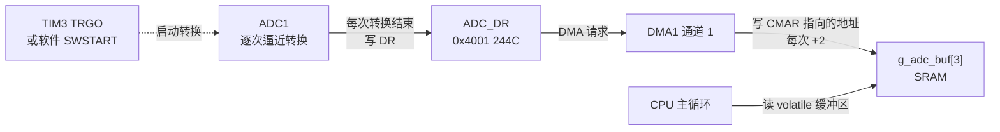

# 2.9 ADC、DAC 与 DMA

在此前的外设探讨中，系统处理的对象全部是离散的数字信号：GPIO 传递高低逻辑电平，串口传输格式化 ASCII 码，SPI 与 I²C 在总线上交换二进制字节。然而在物理现实世界中，绝大多数物理量——无论是电位器旋钮分压、电池两端跌落的端电压、热敏电阻的阻抗压降，还是芯片内核结温传感器产生的微弱电压——均以连续模拟量的形式存在。将外部连续变化的电压量化为离散的数字码值，是模数转换器（Analog-to-Digital Converter, ADC）的核心使命；反之，将计算得到的数字量逆向还原为平滑连续的模拟电压输出，则依赖数模转换器（Digital-to-Analog Converter, DAC）。

然而在高速或多通道数据采集系统中，模拟量采样往往伴随着巨大的吞吐压力。若仅采样单路低频信号，CPU 尚能通过轮询或中断勉强应付；一旦需要对多路通道实施连续高频同步采样（例如以 1 kHz 以上的速率连续采集电位器、母线电压与片内参考源），频繁触发的读寄存器中断将在微秒级别密集打断 CPU，导致主业务循环彻底停滞。为了将处理器算力从繁琐的底层数据搬移中解放出来，微控制器引入了直接内存访问控制器（Direct Memory Access, DMA）。DMA 控制器作为挂载在片上 AHB 总线矩阵上的独立总线主控，能够在硬件外设与内部 SRAM 之间建立点对点的自主数据通道，在无需 CPU 介入指令执行的前提下实现海量数据的高速吞吐。

深入掌握逐次逼近型 ADC 的工作时序、片内基准源校准算法、DMA 通道请求仲裁以及循环缓冲区（Circular Buffer）机制，是构建高吞吐、零 CPU 占用数据采集系统的必备基石。

## 1. 从电压到数字

在物理机理上，ADC 负责将时间与幅度均连续的模拟电压信号离散化为有限精度的数字整数。STM32F103 集成的片上 ADC 属于典型的 12 位逐次逼近型（Successive Approximation Register, SAR）架构：其内部集成了一个高精度数模转换电阻电容网络和一个高速模拟电压比较器。在启动转换后，控制逻辑从最高有效位（MSB）开始自上而下逐位尝试设置数值，每次将内部 DAC 生成的中间比较电压与外部输入电压进行幅度判定，大则保留当前比特为 1、小则置 0 翻转，经过 12 个时钟周期的连续二分逼近，最终输出最贴近输入电平的 12 位二进制数字编码。

12 位量化位宽对应 $2^{12} = 4096$ 个离散等级，其数字输出范围为 0～4095。微控制器的模拟供电轨 VDDA 充当整个转换的基准满量程参考电压（通常标称为 3.3V）。由此可计算出该 ADC 的理论最小可分辨电压步进（Least Significant Bit, LSB）：

$$
\Delta = \frac{V_{\text{DDA}}}{4096} = \frac{3.3\ \text{V}}{4096} \approx 0.806\ \text{mV}
$$

当模拟引脚输入 0V 地电平时，输出量化码值为 0；当输入电压无限逼近 VDDA 时，输出码值饱和至 4095。这一量化分辨率对于绝大多数工业控制、电池监控与常规温度传感而言已具有充足的精度冗余；若面临微弱应变片桥式称重或毫伏级热电偶信号，则需选用外挂的 16 位或 24 位外部 Σ-Δ 型 ADC 芯片。

逐次逼近型架构在时序上具备明确的阶段性：每一次完整的转换必须包含内部采样保持电容（Sampling Capacitor）的充电建立阶段，以及后续 12.5 个时钟周期的逐位二分比较阶段。因此单次转换的物理耗时并非恒定常数，而是严格取决于通道采样时间与预分频时钟的联合配置。

## 2. F103 的 ADC

### 2.1 通道

STM32F103C8T6 有两个 12 位 ADC，ADC1 和 ADC2。每个 ADC 有 18 个通道，其中 16 个接到外部引脚，两个接内部信号：

| 通道 | 引脚或信号 | 说明 |
| --- | --- | --- |
| IN0～IN7 | PA0～PA7 | 外部模拟输入 |
| IN8、IN9 | PB0、PB1 | 外部模拟输入 |
| IN10～IN15 | PC0～PC5 | 外部模拟输入（LQFP48 封装没有这些引脚） |
| IN16 | 片内温度传感器 | 仅 ADC1 |
| IN17 | VREFINT，内部参考电压 | 仅 ADC1 |

本教程的实验板把电位器接在 PA1，也就是 IN1。片内温度传感器和 VREFINT 只连在 ADC1 上，用 ADC2 时这两个通道读不到。

### 2.2 时钟与转换时间

ADC 的时钟 ADCCLK 由 PCLK2 经 ADC 预分频器得到，上限 14 MHz。72 MHz 的 PCLK2 除以 6 得 12 MHz，是分频系数里最接近上限又不超的一个：

| ADCPRE[1:0] | 分频 | ADCCLK（PCLK2 = 72 MHz） | 是否可用 |
| --- | --- | --- | --- |
| 00 | 2 | 36 MHz | 超出上限 |
| 01 | 4 | 18 MHz | 超出上限 |
| 10 | 6 | 12 MHz | 可用 |
| 11 | 8 | 9 MHz | 可用 |

一次转换的时间由采样时间和固定的 12.5 个周期组成：

$$
T_{\text{conv}} = T_{\text{sampling}} + 12.5 \times T_{\text{ADCCLK}}
$$

采样时间由 SMPR1、SMPR2 里每个通道各自的 3 位选择，可取 1.5、7.5、13.5、28.5、41.5、55.5、71.5、239.5 个周期。12 MHz 下把八档都算出来：

::: terminal title="PowerShell - ./adc_calc.exe"

```text
=== 1. ADC conversion time table (ADCCLK = 12 MHz vs 14 MHz) ===
SMP  Cycles   t_conv@12MHz   f_s@12MHz     t_conv@14MHz   f_s@14MHz
 0     1.5      1.17 us      857.1 kS/s      1.00 us     1000.0 kS/s
 1     7.5      1.67 us      600.0 kS/s      1.43 us      700.0 kS/s
 2    13.5      2.17 us      461.5 kS/s      1.86 us      538.5 kS/s
 3    28.5      3.42 us      292.7 kS/s      2.93 us      341.5 kS/s
 4    41.5      4.50 us      222.2 kS/s      3.86 us      259.3 kS/s
 5    55.5      5.67 us      176.5 kS/s      4.86 us      205.9 kS/s
 6    71.5      7.00 us      142.9 kS/s      6.00 us      166.7 kS/s
 7   239.5     21.00 us       47.6 kS/s     18.00 us       55.6 kS/s
```

:::

::: concept emb-adc-timing title="ADC 的转换时间"

ADC 的时钟 ADCCLK 不得超过 14 MHz。一次转换的时间等于采样时间加 12.5 个 ADCCLK 周期，采样时间按通道在 SMPR1、SMPR2 中选择。采样时间越长，对高阻抗信号源的适应性越好，转换速度越慢。

:::

源阻抗高的时候采样时间必须放长。电位器的滑动端通常接成 10 kΩ 左右的分压，采样电容要在这段时间里充满，1.5 个周期远不够；55.5 个周期是常用的折中。片内温度传感器和 VREFINT 手册要求至少 17.1 µs，只有 239.5 个周期（12 MHz 下 20 µs）满足。

<Quiz
  type="single"
  :options="[
    { label: '寄存器里有直接设 ADCCLK 的位', value: 'A' },
    { label: 'ADCCLK 由 PCLK2 经 ADC 预分频器得到，72 MHz 除以 6 得 12 MHz', value: 'B' },
    { label: 'ADCCLK 固定为 14 MHz，与 PCLK2 无关', value: 'C' },
    { label: 'ADCCLK 由 HSI 直接提供', value: 'D' }
  ]"
  answer="B"
>

<template #question>

F103 的 ADC 时钟从哪里来，怎样配到不超过 14 MHz？

</template>

正确答案是 **B**。

- ADC 挂在 APB2 上，时钟源是 PCLK2，再经 RCC_CFGR 的 ADCPRE 两位分频，没有独立的分频寄存器。
- 72 MHz 下只有 ÷6（12 MHz）和 ÷8（9 MHz）两档不超上限，÷2 和 ÷4 分别是 36 MHz 和 18 MHz，都超出规格。

</Quiz>

### 2.3 规则组与注入组

ADC 的转换序列分两组。规则组 (regular group) 最多 16 个通道，按 SQR1～SQR3 里的顺序依次转换，结果都写进同一个数据寄存器 DR；注入组 (injected group) 最多 4 个通道，有自己的数据寄存器，可以在规则组转换中途插进来，相当于一次高优先级的采样。本节只用规则组，注入组在电机控制一类需要紧急采样的场合才用得上。

规则组的序列长度写在 SQR1 的 L[3:0] 里，值是“通道数减一”：1 个通道写 0，3 个通道写 2。每个位置对应的通道号写在 SQR3 里，SQ1 占位 4:0，SQ2 占位 9:5，SQ3 占位 14:10。

## 3. 单次转换

### 3.1 配置顺序

单次转换的流程是：开时钟、把引脚设为模拟输入、上电、校准、设采样时间与序列、启动、等 EOC、读 DR。每一步都有它的道理。

```c
static void adc1_init_single(void) {
    RCC->APB2ENR |= RCC_APB2ENR_IOPAEN | RCC_APB2ENR_ADC1EN;

    RCC->CFGR &= ~RCC_CFGR_ADCPRE;
    RCC->CFGR |= RCC_CFGR_ADCPRE_DIV6;

    /* PA1 模拟输入：MODE1 = 00，CNF1 = 00 */
    GPIOA->CRL &= ~(GPIO_CRL_MODE1 | GPIO_CRL_CNF1);

    ADC1->SMPR2 &= ~ADC_SMPR2_SMP1;
    ADC1->SMPR2 |= 5u << ADC_SMPR2_SMP1_Pos;   /* 55.5 个周期 */

    ADC1->SQR1 &= ~ADC_SQR1_L;                 /* 序列长度 1 */
    ADC1->SQR3 = 1u;                           /* 第 1 个转换通道 1 */

    ADC1->CR2 &= ~ADC_CR2_EXTSEL;
    ADC1->CR2 |= ADC_CR2_EXTSEL | ADC_CR2_EXTTRIG;

    ADC1->CR2 |= ADC_CR2_ADON;
    delay_ms(1);

    ADC1->CR2 |= ADC_CR2_RSTCAL;
    while ((ADC1->CR2 & ADC_CR2_RSTCAL) != 0) {
    }
    ADC1->CR2 |= ADC_CR2_CAL;
    while ((ADC1->CR2 & ADC_CR2_CAL) != 0) {
    }
}
```

PA1 必须配成模拟输入而不是浮空输入。模拟输入模式下施密特触发器被关掉，输入阻抗高，引脚不会给信号源增加负载；配成浮空输入时施密特触发器仍然工作，在信号接近阈值时会消耗额外电流。

校准不能省。ADC 内部的比较器和电容阵列存在制造偏差，不校准直接转换，读数的误差可能有几十个码。校准前先置 RSTCAL 复位校准寄存器，等硬件清零；再置 CAL 开始校准，同样等硬件清零。这两步都在初始化里做一次，之后不用重复。

::: warning 上电后要等稳定时间

第一次置 ADON 只是把 ADC 从掉电模式唤醒，唤醒需要 tSTAB（数据手册给出 1.5 µs 的典型值、1 µs 的最小值）。代码里用 `delay_ms(1)` 留足余量，省掉这一步时第一次读数不可靠。

:::

### 3.2 启动与读取

软件触发的方式是把 EXTSEL 设成 111（SWSTART），再把 EXTTRIG 置 1 打开外部触发，之后每次写 SWSTART 就启动一次转换：

```c
static uint16_t adc1_read_once(void) {
    ADC1->CR2 |= ADC_CR2_SWSTART;

    while ((ADC1->SR & ADC_SR_EOC) == 0) {
    }

    return (uint16_t)ADC1->DR;
}
```

EOC (End Of Conversion) 在转换结束时由硬件置位，读 DR 时自动清除。如果开了连续转换 (CONT = 1)，EOC 会在每次转换后置位，下一次转换自动开始。

`adc_single` 每 500 ms 读一次并把读数换算成电压打印：

```c
for (;;) {
    uint16_t raw = adc1_read_once();
    uint32_t mv = ((uint32_t)raw * 3300u + 2047u) / 4095u;
    printf("PA1 raw = %4u, voltage = %4lu mV\n",
           (unsigned)raw, (unsigned long)mv);
    delay_ms(500);
}
```

转动电位器时，串口上每 500 ms 出一行，读数随滑动端位置连续变化。满量程 3.3 V 对应 4095，中途任意位置的读数与电压按比例对应：滑动端在正中时读数约 2048、电压约 1650 mV，转到靠近 3.3 V 一端时读数接近 4095。这里不贴具体数字，因为它们取决于电位器的实际位置和供电电压。

## 4. 换算电压与温度

### 4.1 用 VREFINT 修正

上面用的 3300 mV 是标称值。USB 供电时 VDDA 通常在 3.2～3.3 V 之间，电池供电时随电量下降；用固定的 3300 换算，电压误差可以达到几十毫伏。片内的 VREFINT 通道提供一个校准过的 1.20 V 基准，用它反推实际的 VDDA：

$$
V_{\text{DDA}} = \frac{1.20\ \text{V} \times 4095}{N_{\text{VREFINT}}}
$$

先读 IN17 得到 N_VREFINT，算出真实的 VDDA，再用它换算目标通道：

```c
uint32_t adc_vdda_mv(uint16_t raw_vref) {
    return (1200u * 4095u + (raw_vref / 2u)) / raw_vref;
}

uint32_t adc_to_mv_calibrated(uint16_t raw_ch, uint32_t vdda_mv) {
    return ((uint32_t)raw_ch * vdda_mv + 2047u) / 4095u;
}
```

两处除法里的 `+ 2047` 和 `+ raw_vref / 2` 是四舍五入，整数运算里把结果修正到最近的整数。

### 4.2 片内温度

温度传感器的输出是一个随温度线性下降的电压。手册给出两个典型值：25 ℃ 时 1.43 V，平均斜率 4.3 mV/℃。换算公式是：

$$
T = \frac{V_{25} - V_{\text{sense}}}{\text{Avg\_Slope}} + 25
$$

读 IN16 得到码值，先用第 4.1 节的方法换成电压，再代入公式。读数需要 239.5 个周期的采样时间。

```c
int32_t adc_temp_decic(uint16_t raw_temp, uint32_t vdda_mv) {
    uint32_t vsense_mv = ((uint32_t)raw_temp * vdda_mv + 2047u) / 4095u;
    return ((1430 - (int32_t)vsense_mv) * 100) / 43 + 250;
}
```

函数返回以 0.1 ℃ 为单位的整数，284 表示 28.4 ℃；用整数是为了避免在小容量芯片上拖进浮点库。

用三个假想的供电条件把换算走一遍：

::: terminal title="PowerShell - ./adc_calc.exe"

```text
=== 2. Voltage & temperature conversion with VREFINT calibration ===
[LDO 3.30 V] raw_pa1=2048 raw_vref=1489 -> nominal=1650 mV, VDDA=3300 mV, calibrated=1650 mV, T=28.4 C
[USB 3.18 V] raw_pa1=2125 raw_vref=1545 -> nominal=1712 mV, VDDA=3181 mV, calibrated=1651 mV, T=28.4 C
[Bat 3.00 V] raw_pa1=2252 raw_vref=1638 -> nominal=1815 mV, VDDA=3000 mV, calibrated=1650 mV, T=28.4 C
```

:::

三组数据的输入是同一个实际电压 1650 mV，VDDA 分别是 3.30 V、3.18 V、3.00 V。不做修正时，读数从 1650 mV 一路漂到 1815 mV，差了 10%；用 VREFINT 修正之后三组都回到 1651 mV。温度值也随之稳定在 28.4 ℃，因为温度的换算也用到了修正后的 VDDA。

V25 的离散范围是 1.34～1.52 V，平均值 1.43 V。也就是说，同一块板子上用典型值算出的绝对温度可能有几摄氏度的偏差，而且每颗芯片不同。片内温度传感器适合看变化——比如判断设备是否过热、有没有温升——不适合当作温度计报告绝对温度。要测绝对温度就接外部传感器。

<Quiz
  type="single"
  :options="[
    { label: '读 IN16 得到码值，乘以 3300 再除以 4095', value: 'A' },
    { label: '读 IN17 得到 VREFINT 码值，先反推 VDDA，再换算 IN16 的电压，最后代入 V25 与斜率的公式', value: 'B' },
    { label: '直接读 DR，温度由硬件换算好', value: 'C' },
    { label: '用 ADC2 的 IN16 通道读，结果会自动补偿', value: 'D' }
  ]"
  answer="B"
>

<template #question>

要用片内温度传感器读出可信的温度，正确做法是哪一种？

</template>

正确答案是 **B**。

- 温度传感器的输出是电压，必须先换成电压再套公式；而电压的绝对值取决于 VDDA，所以要用 VREFINT 先修正 VDDA。
- IN16 只在 ADC1 上，ADC2 读不到；DR 里只有原始码值，硬件不做任何换算。

</Quiz>

## 5. DMA

### 5.1 为什么需要 DMA

在启用多通道扫描模式时，ADC 控制器会按照预设规则序列依次轮转采样每一个物理通道，然而转换产生的所有通道结果最终都会被硬件强制写入同一个共享的数据寄存器 `ADC_DR`。由于该寄存器不具备深层硬件 FIFO 缓冲，每当下一个通道完成转换，其新数据就会立即将前一个通道的值强行覆盖。以 3 个通道、12 MHz 的 ADC 时钟为例，通道间的转换间隔仅有约 5.67 µs。若依靠 CPU 通过常规的中断服务程序来读取并转存数据，处理器不仅会在极短的微秒级时间窗口内被连续密集打断，而且一旦主循环存在短暂的关中断临界区，未及读取的转换结果就会被静默覆盖，产生严重的通道数据错位。

直接内存访问（DMA）控制器从硬件层面化解了这一总线带宽冲突。作为挂载在微控制器 AHB 总线矩阵上的独立主控单元，DMA 能够在完全不消耗 CPU 指令执行周期的前提下，依照预先配置的外设物理地址、内存基地址、数据位宽与传输计数器，自主完成总线周期的仲裁与数据搬移。每当 ADC 完成一个通道的转换，硬件自动向 DMA 控制器发起传输请求，DMA 瞬时接管总线并将 `ADC_DR` 中的 16 位码值写入预分配的 SRAM 缓冲区，同时将目标内存指针自动推进下一个元素位置。当整批数据完整就绪后，DMA 控制器一次性置位中断标志通知软件栈，从而实现了高吞吐采样与 CPU 业务解耦。



### 5.2 通道与请求映射

DMA1 有 7 个通道，每个通道固定接几个外设请求，不能任意指定。本教程会用到的几条映射如下：

| 通道 | 外设请求 | 用在哪里 |
| --- | --- | --- |
| 1 | ADC1 | 本节 |
| 4 | USART1_TX | [3.3](/教程/正文/嵌入式/3_驱动_通信与中间件/3_3_轮询_中断_DMA与非阻塞驱动) 的串口 DMA 发送 |
| 5 | USART1_RX | 3.3 的串口 DMA 接收 |

ADC1 只能用通道 1，这一点没有选择余地。每个通道还挂着 SPI、I²C 和定时器的若干请求，完整列表见 RM0008 表 78。多个外设共用同一个通道时，同一时刻只能使能其中一个请求，否则两个外设的数据会混在一起。C8T6 没有 DMA2。

### 5.3 通道寄存器

每个通道有一组寄存器：CCR 是配置，CNDTR 是剩余传输次数，CPAR 是外设地址，CMAR 是内存地址。所有通道共用 DMA_ISR（状态）和 DMA_IFCR（清除）。

CCR 的位分配：

<BitField
  title="DMA_CCRx（复位值 0x0000）"
  :fields="[
    { name: 'MEM2MEM', range: [14, 14], access: 'rw', desc: '内存到内存模式' },
    { name: 'PL[1:0]', range: [13, 12], access: 'rw', desc: '通道优先级' },
    { name: 'MSIZE[1:0]', range: [11, 10], access: 'rw', desc: '内存数据宽度：00 为 8 位，01 为 16 位，10 为 32 位' },
    { name: 'PSIZE[1:0]', range: [9, 8], access: 'rw', desc: '外设数据宽度' },
    { name: 'MINC', range: [7, 7], access: 'rw', tone: 'green', desc: '内存地址递增' },
    { name: 'PINC', range: [6, 6], access: 'rw', desc: '外设地址递增' },
    { name: 'CIRC', range: [5, 5], access: 'rw', desc: '循环模式' },
    { name: 'DIR', range: [4, 4], access: 'rw', desc: '0 为外设到内存，1 为内存到外设' },
    { name: 'TEIE', range: [3, 3], access: 'rw', desc: '传输错误中断使能' },
    { name: 'HTIE', range: [2, 2], access: 'rw', desc: '半传输中断使能' },
    { name: 'TCIE', range: [1, 1], access: 'rw', desc: '传输完成中断使能' },
    { name: 'EN', range: [0, 0], access: 'rw', tone: 'brand', desc: '通道使能' }
  ]"
/>

EN 必须为 0 时才能改 CPAR、CMAR、CNDTR 和 CCR 的其他位。改配置之前先写 `CCR = 0`，再写 ISR 对应的清除位。

### 5.4 先用内存到内存看清它

外设触发的 DMA 依赖 ADC 的时序，出问题时不好判断是 ADC 错了还是 DMA 错了。先用内存到内存模式做一次纯搬运：源和目标都是数组，没有外设参与。

```c
DMA1_Channel1->CCR = 0u;
DMA1->IFCR = DMA_IFCR_CGIF1;
DMA1_Channel1->CPAR = (uint32_t)(uintptr_t)src;
DMA1_Channel1->CMAR = (uint32_t)(uintptr_t)dst;
DMA1_Channel1->CNDTR = count;

DMA1_Channel1->CCR = DMA_CCR_MEM2MEM |
                     DMA_CCR_PSIZE_1 |
                     DMA_CCR_MSIZE_1 |
                     DMA_CCR_PINC |
                     DMA_CCR_MINC |
                     DMA_CCR_EN;

while ((DMA1->ISR & DMA_ISR_TCIF1) == 0) {
}
```

MEM2MEM 置 1 之后，通道不再等外设请求，EN 一置位就开始搬。CNDTR 每搬一个字减一，减到 0 时传输结束、置传输完成标志 TCIF1。非循环模式下 CNDTR 到 0 后不再响应请求，要再传一次得先清 EN、重写 CNDTR、再置 EN；循环模式下 CNDTR 自动重装，通道继续工作。

::: concept emb-dma-volatile title="DMA 写的缓冲区要用 volatile"

DMA 在 CPU 之外改写内存。CPU 一侧读这块内存之前，必须让编译器知道内容可能被外部改变：把缓冲区声明为 `volatile`，或者在读之前先等待传输完成标志，并通过函数调用或内存屏障让编译器不能把读操作提前到标志检查之前。

:::

`volatile` 只阻止编译器把读操作优化掉或合并，不负责时序。真正保证数据完整的是“在传输完成之后才读”：先等 TCIF 置位，再访问缓冲区。两者一起用才可靠。

## 6. 扫描转换与 DMA 循环

### 6.1 三个通道一次采完

把 IN1（电位器）、IN16（温度）、IN17（VREFINT）串成一个规则序列，开扫描模式，让 ADC 每转换完一个通道就发一次 DMA 请求：

```c
ADC1->SQR1 = (ADC_CH_COUNT - 1u) << ADC_SQR1_L_Pos;
ADC1->SQR3 = (1u << 0) | (16u << 5) | (17u << 10);

ADC1->CR1 = ADC_CR1_SCAN;

ADC1->CR2 = ADC_CR2_TSVREFE |
            ADC_CR2_EXTTRIG |
            ADC_CR2_EXTSEL |
            ADC_CR2_DMA |
            ADC_CR2_CONT |
            ADC_CR2_ADON;
```

SQR3 里的三个 5 位字段分别是 SQ1、SQ2、SQ3，写出 `1 | 16 << 5 | 17 << 10`。CR2 的 TSVREFE 打开温度传感器和 VREFINT 两个内部通道；DMA 位置 1 表示允许 ADC 发 DMA 请求；CONT 让转换连续进行，一轮结束立刻开始下一轮。

DMA 一侧设成循环模式，CNDTR 等于通道数 3，每轮转换完自动回到初值重新计数：

```c
DMA1_Channel1->CPAR = (uint32_t)(uintptr_t)&ADC1->DR;
DMA1_Channel1->CMAR = (uint32_t)(uintptr_t)g_adc_buf;
DMA1_Channel1->CNDTR = ADC_CH_COUNT;
DMA1_Channel1->CCR = DMA_CCR_PSIZE_0 |
                     DMA_CCR_MSIZE_0 |
                     DMA_CCR_MINC |
                     DMA_CCR_CIRC |
                     DMA_CCR_EN;
```

PSIZE 与 MSIZE 都是 `01`（16 位）。ADC 的 DR 是 16 位有效，DMA 每次从 DR 读 16 位写进 `uint16_t` 的元素，正好对齐。缓冲区声明为 `volatile uint16_t g_adc_buf[3]`，主循环直接读它就拿到最新一轮的三个结果。

主循环每 500 ms 打印一次：

```c
printf("VDDA=%4lu mV | PA1=%4lu mV (raw=%4u) | T=%ld.%ld C\n",
       (unsigned long)vdda_mv,
       (unsigned long)pa1_mv,
       (unsigned)raw_pa1,
       (long)(temp_decic / 10),
       (long)(temp_decic >= 0 ? temp_decic % 10 : -(temp_decic % 10)));
```

串口每 500 ms 出一行，格式是 `VDDA=… mV | PA1=… mV (raw=…) | T=… C`。相邻两行之间只差一两个码，这是 ADC 本身的噪声；VDDA 在 3.3 V 上下浮动几毫伏，是 USB 供电的常态。CPU 在这期间一直空闲，转换和搬运都由硬件完成。三个数值都要靠实际板子上的读数确认，本节不贴具体数字。

### 6.2 忘开 MINC 会怎样

MINC 是内存地址递增位。它忘了置 1 时，三次转换的结果全部写进 `g_adc_buf[0]`，后一次覆盖前一次，`g_adc_buf[1]` 和 `g_adc_buf[2]` 保持初值 0。

在 PC 上模拟一下地址的行为：

::: terminal title="PowerShell - ./dma_addr_sim.exe"

```text
== MINC = 1，PSIZE = MSIZE = 16 位 ==
  第 1 次：读 DR+0 -> 写 buf+0，值 0x0A11
  第 2 次：读 DR+0 -> 写 buf+2，值 0x0B22
  第 3 次：读 DR+0 -> 写 buf+4，值 0x0C33
  缓冲区： 0A11 0B22 0C33

== MINC = 0，PSIZE = MSIZE = 16 位 ==
  第 1 次：读 DR+0 -> 写 buf+0，值 0x0A11
  第 2 次：读 DR+0 -> 写 buf+0，值 0x0B22
  第 3 次：读 DR+0 -> 写 buf+0，值 0x0C33
  缓冲区： 0C33 0000 0000

MINC = 0 时三次写入都落在 buf+0，后一次覆盖前一次，buf[1]、buf[2] 保持初值。
源地址始终是 DR：ADC 的 DR 只有一个，每次转换后硬件把新值放进去，所以 PINC 必须为 0。
```

:::

这段输出也说明了另一件事：源地址始终是 DR+0，所以 PINC 必须为 0。ADC 只有一个数据寄存器，每次转换后硬件把新值覆盖进去；DMA 每次都从同一个地址读，读到的才是“最近一次转换的结果”。把 PINC 置 1 会让 DMA 去读 DR 后面的寄存器，读到的全是无意义的值。

::: compare left-title="只配了 PSIZE/MSIZE/CIRC" right-title="补上 MINC"

```c
DMA1_Channel1->CCR = DMA_CCR_PSIZE_0 |
                     DMA_CCR_MSIZE_0 |
                     DMA_CCR_CIRC |
                     DMA_CCR_EN;
```

---

```c
DMA1_Channel1->CCR = DMA_CCR_PSIZE_0 |
                     DMA_CCR_MSIZE_0 |
                     DMA_CCR_MINC |
                     DMA_CCR_CIRC |
                     DMA_CCR_EN;
```

:::

漏掉 MINC 的现象很有辨识度：打印出来的三个值里，第一个在变，后两个永远是 0。看到这个模式就该去检查 CCR。

### 6.3 用定时器触发

连续转换 (CONT) 让 ADC 全速跑，采样率由转换时间决定，不能精确控制。需要固定采样率时，把触发源换成定时器的 TRGO：

```c
static void tim3_trigger_init_1khz(void) {
    RCC->APB1ENR |= RCC_APB1ENR_TIM3EN;

    TIM3->PSC = 71u;
    TIM3->ARR = 999u;

    TIM3->CR2 &= ~TIM_CR2_MMS;
    TIM3->CR2 |= TIM_CR2_MMS_1;

    TIM3->EGR = TIM_EGR_UG;
}
```

TIM3 的时钟是 72 MHz，PSC = 71 让它每 1 µs 计一次，ARR = 999 让每 1000 次溢出一次，更新频率 1 kHz。MMS = 010 把更新事件送到 TRGO 上输出。ADC 一侧把 EXTSEL 设成 100（TIM3_TRGO），并清掉 CONT，这样每个触发脉冲只转换一次：

```c
ADC1->CR2 = ADC_CR2_EXTTRIG |
            ADC_CR2_EXTSEL_2 |
            ADC_CR2_DMA |
            ADC_CR2_ADON;
```

`ADC_CR2_EXTSEL_2` 是 EXTSEL 的第 2 位，单独置它就是 100。DMA 通道设成非循环模式，CNDTR 等于要采集的点数，采满之后 TCIF 置位、通道关闭：

```c
while ((DMA1->ISR & DMA_ISR_TCIF1) == 0) {
}
TIM3->CR1 &= ~TIM_CR1_CEN;
```

`adc_timer_trigger` 每次采 64 点，采满后算平均值、最小值、最大值并打印一行 `64 samples @ 1 kHz: avg=…, min=…, max=…`。输入端接固定电压时，极差在几个码以内；极差明显变大，先看 TIM3 的触发频率与 ADC 采样时间是否匹配。采样率现在精确等于 1 kHz，与转换时间无关——只要转换时间小于触发间隔。239.5 个周期的采样时间对应 21 µs，远小于 1 ms，余量充足。

<Quiz
  type="single"
  :options="[
    { label: '把 DMA_CCR 的 DIR 置 1', value: 'A' },
    { label: '保持 PINC = 0、置 MINC = 1，并把 CMAR 指向缓冲区首元素', value: 'B' },
    { label: '把 MSIZE 改成 8 位', value: 'C' },
    { label: '把 CNDTR 设成字节数', value: 'D' }
  ]"
  answer="B"
>

<template #question>

ADC 扫描三个通道，结果依次写进同一个 DR。要让这三个结果落在缓冲区的三个不同元素里，DMA 必须怎么配？

</template>

正确答案是 **B**。

- ADC 一侧固定是 DR，每次转换后新值覆盖旧值，所以 PINC 必须为 0；内存一侧要移动，MINC 必须为 1。
- DIR = 1 是内存到外设，方向反了；把 MSIZE 改成 8 位会截掉高 4 位；CNDTR 是传输次数，与数据宽度无关。

</Quiz>

## 7. DAC 与 PWM 模拟输出

### 7.1 DAC 的原理

DAC 把数字量换回电压。F103 的 DAC 是 12 位，输出公式是：

$$
V_{\text{out}} = V_{\text{REF}} \times \frac{\text{DOR}}{4096}
$$

DOR 是数据输出寄存器，写入 0～4095 得到 0 到接近 VREF 的电压。DAC 可以工作在正常模式，写入即更新；也可以由定时器触发，每次触发输出一个采样点。

C8T6 没有 DAC。STM32F103 系列里只有大容量型号（如 F103RC、F103VE）在 PA4、PA5 上有两路 DAC。代码写法是：

```c
RCC->APB1ENR |= RCC_APB1ENR_DACEN;
DAC->CR |= DAC_CR_EN1;
DAC->DHR12R1 = value;
```

这段代码在针对中容量 F103C8T6 构建时将无法通过编译：在定义了 `STM32F103xB` 的设备头文件 `stm32f103xb.h` 中，既不存在 `DAC` 外设寄存器结构体，也没有分配 `RCC_APB1ENR_DACEN` 门控时钟位。唯有换用大容量芯片并切换至 `STM32F103xE` 宏定义后，硬件 DAC 接口方才可见。

### 7.2 用 PWM 加 RC 滤波

在缺乏片内硬件 DAC 的中小容量芯片上，工程界最普遍且低成本的模拟电压生成方案，是利用定时器输出高频 PWM 脉冲并级联一阶 RC 低通滤波器。PWM 脉宽调制信号的占空比在数学上决定了输出电压的直流平均分量，而外接的无源 RC 滤波网络则负责滤除开关方波的高频谐波，将其平滑重构为平稳的直流模拟电平：

$$
V_{\text{out}} = \frac{\text{CCR}}{\text{ARR} + 1} \times V_{\text{DD}}
$$

为了将 PWM 方波的高频开关纹波衰减至可接受的毫伏级以下，低通滤波器的转折截止频率 $f_c$ 必须远低于 PWM 的开关载波频率：

$$
f_c = \frac{1}{2\pi RC}
$$

示例程序 `pwm_dac` 选用 PB0 引脚的 TIM3_CH3 输出 20 kHz 载波（PSC = 0、ARR = 3599），外接 $R = 10\ \text{k}\Omega$ 电阻与 $C = 1\ \mu\text{F}$ 陶瓷电容，理论仿真数据如下：

::: terminal title="PowerShell - ./adc_calc.exe"

```text
=== 3. PWM + RC low-pass filter (f_PWM = 20 kHz, VDDA = 3.3 V) ===
R= 10.0 kOhm, C= 0.10 uF -> fc=159.15 Hz, tau= 1.00 ms, 50% duty ripple ~= 41.25 mVpp
R= 10.0 kOhm, C= 1.00 uF -> fc= 15.92 Hz, tau=10.00 ms, 50% duty ripple ~= 4.13 mVpp
R=  4.7 kOhm, C= 1.00 uF -> fc= 33.86 Hz, tau= 4.70 ms, 50% duty ripple ~= 8.78 mVpp
```

:::

$10\ \text{k}\Omega$ 与 $1\ \mu\text{F}$ 的硬件滤波组合将转折截止频率压制在 15.92 Hz，对应时间常数 $\tau = RC = 10\ \text{ms}$。由于 20 kHz 的 PWM 开关基频处于转折频率的一千倍以上，交流纹波分量被深度衰减，峰峰值纹波仅约 4 mV。该方案的主要代价在于阶跃建立时间变慢：在改变 PWM 占空比后，输出端需经历约五个时间常数（$5\tau \approx 50\ \text{ms}$）方能充放电建立至终值的 99% 以上。若系统更追求动态响应速度，可权衡选用 $R = 10\ \text{k}\Omega$ 与 $C = 0.1\ \mu\text{F}$ 组合，其截止频率提升至 159 Hz，建立时间缩短十倍，但残留纹波相应扩大至约 41 mV。在工程选型中需依据后级负载对纹波与动态响应的具体要求审慎权衡。

`pwm_dac` 依次输出 500、1000、1650、2500、3000 mV 五个档位，每档用 PA1 的 ADC 回读：

```c
uint32_t ccr = (target_mv * (PWM_ARR + 1u) + 1650u) / 3300u;
TIM3->CCR3 = (uint16_t)ccr;
```

代入 ARR = 3599 的五个目标电压，算出的 CCR3 与理论输出如下（公式的整数运算结果）：

| 目标 | CCR3 | 理论输出 | 差值 |
| --- | --- | --- | --- |
| 500 mV | 545 | 545 / 3600 × 3300 = 499.6 mV | −0.4 mV |
| 1000 mV | 1091 | 1000.1 mV | +0.1 mV |
| 1650 mV | 1800 | 1650.0 mV | 0 mV |
| 2500 mV | 2727 | 2499.8 mV | −0.2 mV |
| 3000 mV | 3273 | 3000.2 mV | +0.2 mV |

理论值与目标之间的差来自 CCR 只能取整数，误差不超过 1 个 CCR 步进（约 0.9 mV）。实际上 ADC 回读还会再偏几毫伏，来源是 RC 的元件容差、PWM 边沿的非理想性和 ADC 自身的偏差。要更精确的输出只能换带 DAC 的型号，或者用外部的 DAC 芯片。

PB0 同时也是 ADC 的 IN8 通道。上面用 PA1 回读，是因为实验板上电位器的滑动端接在那里；如果跳线把 PB0 接到 PA1，就能读到自己的输出。

## 8. HAL 对照

HAL 把这些寄存器操作包成函数，初始化的部分由 CubeMX 生成。

| 寄存器写法 | HAL 写法 |
| --- | --- |
| 置 CAL 并等清零 | `HAL_ADCEx_Calibration_Start(&hadc1)` |
| 置 SWSTART 等 EOC | `HAL_ADC_Start(&hadc1)` + `HAL_ADC_PollForConversion(&hadc1, timeout)` |
| 读 DR | `HAL_ADC_GetValue(&hadc1)` |
| 配置 DMA 通道并启动 | `HAL_ADC_Start_DMA(&hadc1, (uint32_t *)buf, 3)` |
| 直接启动 DMA 通道 | `HAL_DMA_Start(&hdma_adc1, src, dst, len)` |

`HAL_ADC_Start_DMA` 的第三个参数是转换次数，不是字节数。它的内部会把 buffer 地址写进 CMAR、次数写进 CNDTR，再置 EN。转换完成中断的回调是 `HAL_ADC_ConvCpltCallback`，在里面处理整块数据。

HAL 的轮询版在超时之后返回 `HAL_TIMEOUT`，代码里照常检查。中断与 DMA 的回调都在中断上下文执行，里面不能调用会阻塞的函数。

## 9. 习题

### 9.1 巩固

<Exercise id="62278" :d="1" :w="2">

第 2.2 节的转换时间表给出了 ADCCLK 为 12 MHz 与 14 MHz 时八档采样时间的结果。不运行程序，回答：

(1) SMP = 3 时采样时间为 28.5 个周期。一次转换占多少微秒？单通道连续转换、两次转换之间没有额外开销时，采样率上限是多少？与表中 12 MHz 一列的两个数字核对。

(2) 换一个系统：PCLK2 = 48 MHz，ADC 预分频器只有 ÷2、÷4、÷6、÷8 四档。四档的 ADCCLK 各是多少？哪几档超出 14 MHz 的上限，剩下几档里为什么选大的那个？

(3) 片内温度传感器要求采样时间不短于 17.1 µs。在 (2) 选出的 ADCCLK 下，八档采样时间里哪几档满足这个要求？

(4) 规则序列要依次转换 IN1、IN16、IN17 三个通道。SQR1 的 L[3:0] 应该写几？写出把这三个通道号放进 SQR3 的表达式，并解释 L 为什么是“通道数减一”。

</Exercise>

<Exercise id="62279" :d="2" :w="2">

下面的初始化函数是照着第 3.1 节抄下来的，实际运行时读出的电压比万用表低一截，读数还会随手指靠近引脚而乱跳：

```c
static void adc1_init_broken(void) {
    RCC->APB2ENR |= RCC_APB2ENR_IOPAEN | RCC_APB2ENR_ADC1EN;

    RCC->CFGR &= ~RCC_CFGR_ADCPRE;
    RCC->CFGR |= RCC_CFGR_ADCPRE_DIV2;

    GPIOA->CRL &= ~(GPIO_CRL_MODE1 | GPIO_CRL_CNF1);
    GPIOA->CRL |= 0x1u << 6;   /* CNF1[1:0] = 01 */

    ADC1->SMPR2 &= ~ADC_SMPR2_SMP1;
    ADC1->SMPR2 |= 0u << ADC_SMPR2_SMP1_Pos;

    ADC1->SQR1 &= ~ADC_SQR1_L;
    ADC1->SQR3 = 1u;

    ADC1->CR2 &= ~ADC_CR2_EXTSEL;
    ADC1->CR2 |= ADC_CR2_EXTSEL | ADC_CR2_EXTTRIG;
    ADC1->CR2 |= ADC_CR2_ADON;
}
```

(1) 找出其中的错误（不少于五处），逐处说明它违反了本页的哪条结论，以及在读数上表现为什么。

(2) 重写这个函数，保留原有结构，补上缺少的步骤。

(3) 实验板上把 ADCCLK 配成 36 MHz 时程序仍然出数。能否据此认为这一档可用？从器件手册的角度说明理由，并指出长期这样用的风险。

</Exercise>

<Exercise id="62280" :d="2" :w="2">

第 4 节的换算函数都做整数运算。不写程序，按代码逐行计算：

```c
uint32_t adc_vdda_mv(uint16_t raw_vref) {
    return (1200u * 4095u + (raw_vref / 2u)) / raw_vref;
}

uint32_t adc_to_mv_calibrated(uint16_t raw_ch, uint32_t vdda_mv) {
    return ((uint32_t)raw_ch * vdda_mv + 2047u) / 4095u;
}

int32_t adc_temp_decic(uint16_t raw_temp, uint32_t vdda_mv) {
    uint32_t vsense_mv = ((uint32_t)raw_temp * vdda_mv + 2047u) / 4095u;
    return ((1430 - (int32_t)vsense_mv) * 100) / 43 + 250;
}
```

已知 raw_vref = 1516、raw_pa1 = 1024、raw_temp = 1756。

(1) 依次算出 VDDA、PA1 的电压（mV）和温度（0.1 ℃），每一步写出除法之前的被除数与除数。

(2) 保持 raw_pa1 = 2048 不变，把 raw_vref 从 1489 改成 1491 再算一遍。VDDA 变了多少毫伏？PA1 的电压变了多少毫伏？用这两组数说明 VREFINT 一个码的量化误差会被放大成多大的电压误差。VDDA 降到 3.0 V 时，同一个码差引起的相对误差是变大还是变小？

(3) 把 `adc_to_mv_calibrated` 末尾的 `+ 2047u` 删掉，用 raw_ch = 1003、vdda_mv = 3196 算一遍，两个结果各是多少？这个差值的上限是多少，为什么？

(4) 第 1 节说 12 位对应 4096 个等级，代码里却处处除以 4095。raw = 4095、vdda = 3300 mV 时，除数取 4095 与取 4096 分别得到多少毫伏？VDDA 反推式 `1200 * 4095 / N` 里的 4095 若换成 4096，raw_vref = 1489 时 VDDA 从 3300 变成多少？解释这两种约定各自的含义，以及为什么本页统一用 4095。

</Exercise>

### 9.2 编程

<Exercise id="62281" :d="3" :w="3">

在主机上写 `adc_conv.c`，把第 4 节的换算做成一个可以单独测试的小模块。

要求：

1. 提供三个函数：`uint32_t adc_to_mv(uint16_t raw, uint32_t vdda_mv)`、`uint32_t adc_vdda_mv(uint16_t raw_vref)`、`int32_t adc_temp_decic(uint16_t raw_temp, uint32_t vdda_mv)`，行为与第 4 节的代码一致，四舍五入用整数完成。
2. `main` 打印一张表，至少包含下面六组输入，每组给出 raw、VDDA、电压与温度：

   - `raw_pa1 = 2048`、`raw_vref = 1489`、`raw_temp = 1756`
   - `raw_pa1 = 2125`、`raw_vref = 1545`、`raw_temp = 1822`
   - `raw_pa1 = 2252`、`raw_vref = 1638`、`raw_temp = 1932`
   - `raw = 0`、`vdda = 3300`
   - `raw = 4095`、`vdda = 3300`
   - 一组让温度高于 30 ℃ 的 `raw_temp`

3. 前三行的输出必须与第 4.2 节终端里的 `nominal`、`VDDA`、`calibrated`、`T` 四列完全一致。
4. 用 `gcc -std=c17 -Wall -Wextra adc_conv.c -o adc_conv` 编译，无警告，运行输出贴进报告。

另外回答两个问题：

(1) `(uint32_t)raw * vdda_mv + 2047` 在 raw = 4095、vdda = 3300 时等于多少？它离 `UINT32_MAX` 还有多远？

(2) 有人想输出微伏，把 `vdda_mv` 换成 `vdda_uv`（3300000）。同一个表达式在 Cortex-M3 上会得到什么？给出两种不用 64 位整数的改写方法，并说明哪一种在 raw 接近满量程时仍然精确。

</Exercise>

<Exercise id="62282" :d="3" :w="3">

下面是 `dma_mem2mem` 的一个改写版。第一次调用正常，第二次调用时程序卡在等待循环里：

```c
static void dma1_mem2mem_copy(volatile uint32_t *dst, const uint32_t *src,
                              uint16_t count) {
    RCC->AHBENR |= RCC_AHBENR_DMA1EN;

    DMA1->IFCR = DMA_IFCR_CGIF1;
    DMA1_Channel1->CPAR = (uint32_t)(uintptr_t)src;
    DMA1_Channel1->CMAR = (uint32_t)(uintptr_t)dst;
    DMA1_Channel1->CNDTR = count;

    DMA1_Channel1->CCR = DMA_CCR_MEM2MEM |
                         DMA_CCR_PSIZE_1 |
                         DMA_CCR_MSIZE_1 |
                         DMA_CCR_PINC |
                         DMA_CCR_MINC |
                         DMA_CCR_EN;

    while ((DMA1->ISR & DMA_ISR_TCIF1) == 0) {
    }
}
```

(1) 分别写出第一次调用结束时与第二次进入函数时 CCR 的 EN 位、CNDTR 的值，指出第二次调用卡住的原因。再说明 `IFCR` 的清除为什么没有帮助。

(2) 修正这个函数，使它可以在同一次运行里连续调用任意次。要求开头先关闭通道，结束时清除标志并关闭通道。

(3) 把函数拆成"只启动"（写寄存器、置 EN）和"等待完成"两段。说明拆开之后主循环能在等待期间做什么，以及此时读目标缓冲区会看到什么。

(4) `CNDTR` 是 16 位，一次最多搬 65535 项。把 `count` 写成 70000 时寄存器里实际装进的是什么值？在函数入口加一个检查，说明它为什么必须放在写任何寄存器之前。

</Exercise>

<Exercise id="62283" :d="4" :w="4">

把 `adc_scan_dma` 扩展成四通道扫描：在 IN1（PA1 电位器）、IN16（温度）、IN17（VREFINT）之外加入 IN4（PA4）。PA4 用两个 10 kΩ 电阻从 3.3 V 分压，理论电压 1650 mV。

(1) 写出完整的初始化改动：序列长度与 SQR3 的四个 5 位域、PA4 的模拟输入配置、CNDTR 与缓冲区大小。说明序列顺序改变时主循环里哪些下标要跟着改。只改 SQR3 而忘改 SQR1 时（L 仍为 2），实际会发生什么？

(2) 主循环打印四列，给出实际运行的一行输出，PA4 一列应接近 1650 mV。

(3) IN4 需要配置 GPIO，IN16、IN17 不需要。说明原因。再把 PB0（IN8）加进序列会与第 7 节的 PWM 输出冲突，说明冲突在哪里。

(4) 用 HAL 写等价实现：假设 CubeMX 已生成 `hadc1` 和 `hdma_adc1`，写出启动调用和在 `HAL_ADC_ConvCpltCallback` 里取四个值的代码。指出 `HAL_ADC_Start_DMA` 第三个参数在四通道时写什么，它与 CNDTR 是什么关系。

</Exercise>

### 9.3 综合与挑战

<Exercise id="62284" :d="5" :w="4">

用第 7 节的 PWM 加 RC 输出一个 50 Hz 正弦波。TIM3 仍以 20 kHz、ARR = 3599 输出 PWM，在更新中断里每 4 个 PWM 周期换一次 CCR3，一个正弦周期 100 个点。

(1) 生成一张 100 点的表，第 n 点取 `CCR = 1800 + 1799 * sin(2πn/100)` 的整数结果。说明中心值为什么取 1800、幅度为什么取 1799 而不是 1800。表可以先用脚本算好再粘进 `const uint16_t` 数组。

(2) 写更新中断服务程序：每 4 次更新推进一次表下标并写 CCR3。说明更新中断的频率，以及主循环还剩多少时间。

(3) 沿用 R = 10 kΩ、C = 1 µF，截止频率约 15.9 Hz。用一阶低通的幅频特性算出 50 Hz 的衰减（dB）与相位滞后，说明输出会变成什么样。

(4) 把 PWM 频率提高到 100 kHz（ARR = 719），重新选电容，使 50 Hz 的衰减不超过 3 dB，并估算 100 kHz 的纹波。纹波按 VDD × D × (1 − D) / (f_PWM × R × C) 估算。给出计算过程和最终元件值，并说明提高 PWM 频率带来的另一个限制。

(5) 同一块 C8T6 上按第 7.1 节写 `DAC->CR |= DAC_CR_EN1;` 编译不过。说明是哪一层阻止了它（头文件、宏、还是链接），以及换成 F103VE 后除了编译还要改什么。比较真 DAC 与 PWM 加 RC 在分辨率、建立时间、纹波上的差别，各用一句话。

</Exercise>

<Exercise id="62285" :d="5" :w="4">

`pwm_dac` 用固定 200 ms 等待 RC 稳定。把这个程序改成带标定的版本。

(1) 输出 100 mV 到 3200 mV、步进 100 mV 共 32 个档位。每档写 CCR3、等滤波器稳定、用 PA1 回读，记录目标、CCR3、回读值、误差四列。

(2) 等待时间改成按时间常数计算：R = 10 kΩ、C = 1 µF 时 5τ = 50 ms。用第 2.6 节的 `tick_now()` 与 `tick_elapsed()` 实现等待，或说明为什么这里直接用 `delay_ms(50)` 就够。比较改动前后的总耗时。

(3) 用 (1) 的误差表做一阶补偿：CCR3 加上 `-error_mv * 3600 / 3300`，再测一遍，给出补偿前后的最大误差。

(4) 补偿之后误差仍然存在。按影响从大到小排列下面几个来源并说明理由：RC 元件容差、PWM 边沿的非理想性、ADC 自身的增益与偏移误差、CCR 的量化。算出量化误差有多大。

</Exercise>

<Exercise id="62286" :d="6" :w="5">

做一个电池电压监测模块，把本页的 ADC、DMA、定时器触发和第 2.5 节的中断串起来。

1. TIM3 的 TRGO 以 1 kHz 触发 ADC1 扫描 IN1 与 IN17，DMA 循环写入 `volatile uint16_t buf[64]`，内容为交替的 PA1 值与 VREFINT 值。半传输中断与传输完成中断各对应半区的 32 个元素，也就是 16 组采样。
2. 中断服务程序里只置标志、记录半区序号，不做换算，也不调用 `printf`。主循环看到标志后处理刚写满的半区：分别对偶数下标与奇数下标求平均，用 VREFINT 的平均值反推 VDDA，再换算 PA1 的电压。
3. 电压低于 3000 mV 时打印一行报警，包含电压、VDDA 和 `tick_now()` 的时刻。报警在每次越限时只打印一次，回到阈值以上后复位。
4. 在主机上验证统计算法：自己造 16 组样本（均值约 2048、极差 20 左右）与对应的 VREFINT 样本，算出平均值和电压，与逐点求和的结果核对。

报告里给出：

- 中断与主循环共享的对象，以及各自的 `volatile` 用法；说明标志为什么必须加 `volatile`，缓冲区为什么按半区交替。
- 半传输中断与传输完成中断在循环模式下各在什么时候触发，这两个时刻 CNDTR 的值。
- 若主循环处理半区的时间超过 16 ms，会发生什么，运行中怎样发现。
- 用 HAL 实现同样的功能时，`HAL_ADC_Start_DMA(&hadc1, (uint32_t *)buf, 64)` 的第三个参数写 64 还是 32？回调 `HAL_ADC_ConvCpltCallback` 与半传输回调 `HAL_ADC_ConvHalfCpltCallback` 各对应寄存器里的哪个标志？在回调里能不能调用 `printf`，为什么。

</Exercise>

<Exercise id="62287" :d="6" :w="3">

一个用 C8T6 的数据采集节点要做三件事：电位器位置以 1 kHz 连续采样、每批 64 点求平均；电池电压每秒读一次；按键按下时软件触发一次 PA1 的读数，用于自检。

(1) 分别为三件事选择触发方式（软件触发、连续转换、定时器 TRGO）与搬运方式（轮询 DR、DMA），写出各自要置位的 CR2、CR1 位，并说明电池电压为什么不必用 DMA。

(2) 有人把 IN1（电位器）、IN4（电池分压）、IN17（VREFINT）三路放进同一个规则序列，用 1 kHz 的 TIM3 TRGO 触发、DMA 循环搬运。写出 CNDTR、缓冲区大小、三个数据各自的下标规律，以及电池电压的实际采样率。说明这种做法在什么条件下可行，在什么条件下不可行；把按键自检也塞进这个序列时又会遇到什么问题。

(3) VREFINT 与片内温度传感器只连在 ADC1 上。如果 ADC1 已经用于电位器采样，能否把 VDDA 的修正改到 ADC2 上做？依据本页的通道表回答，并给出替代办法。

(4) 三件事若都想用 DMA1 通道 1 搬运，DMA 一侧会出现什么问题？写出本页表格中 USART1_TX、USART1_RX 各自的通道号，说明怎样让串口发送与 ADC 采集同时使用 DMA。

</Exercise>

## 10. 参考资料

1. STMicroelectronics, [*RM0008 Reference manual: STM32F101xx, STM32F102xx, STM32F103xx, STM32F105xx and STM32F107xx advanced Arm-based 32-bit MCUs*, Rev 21](https://www.st.com/resource/en/reference_manual/rm0008-stm32f101xx-stm32f102xx-stm32f103xx-stm32f105xx-and-stm32f107xx-advanced-armbased-32bit-mcus-stmicroelectronics.pdf)：第 11 章 Analog-to-digital converter（通道、SMPR、SQR、校准、转换时间）、第 12 章 Digital-to-analog converter、第 13 章 DMA（表 78 请求映射、CCR 位定义）。
2. STMicroelectronics, [*DS5319 Datasheet: STM32F103x8, STM32F103xB medium-density performance line Arm-based 32-bit MCU*, Rev 20](https://www.st.com/resource/en/datasheet/stm32f103c8.pdf)：表 12 内部参考电压 VREFINT、表 47 ADC 特性、表 51 温度传感器参数（V25、Avg_Slope、最小采样时间）。
3. STMicroelectronics, [*stm32f1xx-hal-driver 1.1.10*](https://github.com/STMicroelectronics/stm32f1xx-hal-driver)：`stm32f1xx_hal_adc.c` 与 `stm32f1xx_hal_adc_ex.c` 中 `HAL_ADC_Start_DMA`、`HAL_ADCEx_Calibration_Start` 的实现。
4. STMicroelectronics, [*cmsis_device_f1*](https://github.com/STMicroelectronics/cmsis_device_f1)：`stm32f103xb.h` 中 ADC、DMA 寄存器结构与位定义，`stm32f103xe.h` 中的 DAC 定义（大容量型号才有）。
5. cpq, [*Bare-metal programming guide*](https://github.com/cpq/bare-metal-programming-guide)：ADC 与 DMA 的寄存器级配置示例。
