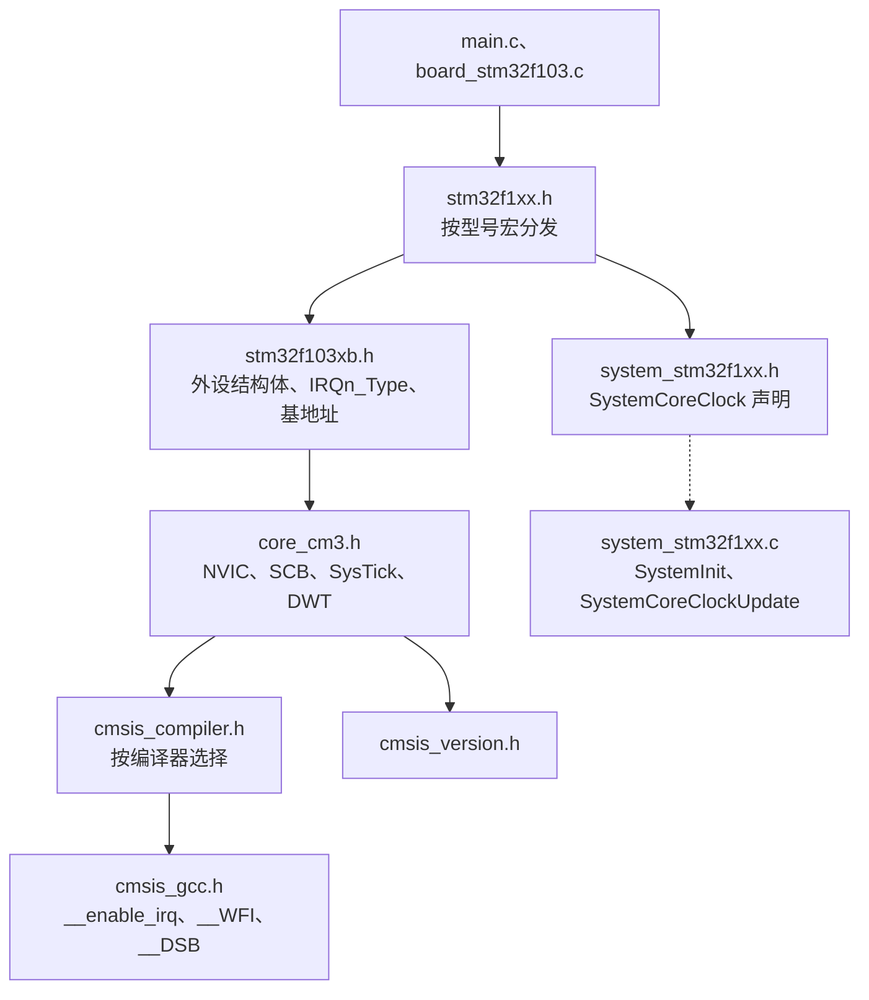
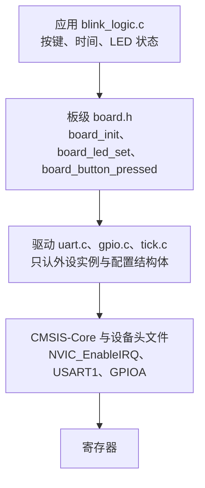

# 3.1 驱动接口、CMSIS 与设备头文件

第 2 章的程序大多长成同一个样子：`main.c` 里直接写 `RCC->APB2ENR |= ...`，接着改 `GPIOC->CRH`，再算一个波特率常量塞进 `USART1->BRR`，最后 `for (;;)` 里翻转引脚。整块板子只有这一个文件时，这样写最快。等到要接第二个串口、换一块 LED 接在 PB0 的板子、或者想在 PC 上跑一遍按键逻辑而不插硬件，这套写法就处处掣肘：引脚号散落在十几处，串口名写死在函数体里，寄存器一访问就没法在主机上执行。

本节先把第 2 章一直在用却没有交代清楚的三个头文件讲透：`stm32f1xx.h`、`stm32f103xb.h` 和 `core_cm3.h` 分别来自哪里、里面有什么、`-DSTM32F103xB` 这个宏在起什么作用。然后把那些散在 `main.c` 里的寄存器操作收进带接口的驱动模块，让应用代码只认 `board.h` 里的几个函数，同一份应用逻辑既能在 STM32F103 上跑，也能在 PC 上编译运行。

## 1. 问题：寄存器代码散在各处

下面这段程序把第 2 章的写法集中到一处：开时钟、配引脚、设波特率、循环闪灯并往外发一个字符。

```c
#include "stm32f1xx.h"

static void delay(void) {
    for (volatile uint32_t i = 0; i < 200000u; ++i) {
    }
}

int main(void) {
    RCC->APB2ENR |= RCC_APB2ENR_IOPCEN | RCC_APB2ENR_IOPAEN |
                    RCC_APB2ENR_USART1EN;
    GPIOC->CRH &= ~(0xFu << 20);
    GPIOC->CRH |= (0x2u << 20);
    GPIOA->CRH &= ~((0xFu << 4) | (0xFu << 8));
    GPIOA->CRH |= (0xBu << 4) | (0x4u << 8);
    USART1->BRR = 0x271u;
    USART1->CR1 = USART_CR1_UE | USART_CR1_TE | USART_CR1_RE;

    for (;;) {
        GPIOC->BSRR = GPIO_BSRR_BR13;
        delay();
        GPIOC->BSRR = GPIO_BSRR_BS13;
        delay();
        while (READ_BIT(USART1->SR, USART_SR_TXE) == 0u) {
        }
        USART1->DR = 'x';
    }
}
```

它能编译、能跑，问题不在正确性，而在扩展性。

第一，引脚号是散开的。`<< 20` 是 PC13 在 `CRH` 里的位置，`GPIO_BSRR_BS13` 里又写了一遍 13。要改成 PB0，得同时改移位量、引脚号和端口名，漏一处就是「程序在跑但灯不亮」。

第二，外设实例写死在函数体里。`USART1` 在这个函数里出现四次（`BRR`、`CR1`、`SR`、`DR`），想再驱动 USART2 只能把整个函数复制一份再改名。波特率常量 `0x271` 是按 PCLK2 等于 72 MHz 算出来的，时钟一改，这个常量就悄悄错了。

第三，这段代码没法在 PC 上验证。按键抖动怎么消、闪灯节奏对不对，这些逻辑本身与寄存器无关，却和寄存器语句缠在一起，只能插上板子看。

第四，`delay()` 用空循环拖时间，优化级别一变延时就不一样了。第 2 章用 SysTick 解决过这个问题，但那份 SysTick 代码同样写在某个 `main.c` 里，下个工程又要复制一遍。

本节的做法分两步。先看清头文件提供了什么，让「写寄存器」这件事本身有据可查；再把代码分成应用、板级、驱动三层，每层只暴露必要的函数。

## 2. 头文件从哪里来

第 2 章每个程序的第一行都是 `#include "stm32f1xx.h"`，谁也没问过这个文件是谁写的、剩下的头文件在哪。这组头文件来自两个各自发布的包。

Arm 发布的是 CMSIS-Core，即 Cortex-M 内核的寄存器定义与访问函数，与本教程配合的版本是 CMSIS_5 5.9.0，目录是 `CMSIS/Core/Include`，四个文件：

| 文件 | 内容 |
| --- | --- |
| `core_cm3.h` | Cortex-M3 内核的寄存器结构体与访问函数：NVIC、SCB、SysTick、ITM、DWT、CoreDebug |
| `cmsis_gcc.h` | 编译器相关的内建函数：`__enable_irq`、`__WFI`、`__DSB`、`__CLZ`、`__BKPT` |
| `cmsis_compiler.h` | 按编译器挑选上面那个文件，GCC 选 `cmsis_gcc.h` |
| `cmsis_version.h` | 版本号，本教程用的这份定义 `__CM_CMSIS_VERSION_MAIN` 为 5、`__CM_CMSIS_VERSION_SUB` 为 9 |

ST 发布的是 cmsis_device_f1，版本 v4.3.5，目录 `Include` 与 `Source/Templates`。它提供三样东西：按型号分发的 `stm32f1xx.h`、每种型号一份的寄存器定义（本教程用 `stm32f103xb.h`）、以及 `system_stm32f1xx.c` 与 `startup_stm32f103xb.s` 模板。

`stm32f1xx.h` 本身几乎不含寄存器定义，它是一张分发表：

```c
#if defined(STM32F100xB)
  #include "stm32f100xb.h"
/* …其余型号略… */
#elif defined(STM32F103xB)
  #include "stm32f103xb.h"
#elif defined(STM32F103xE)
  #include "stm32f103xe.h"
/* …其余型号略… */
#else
 #error "Please select first the target STM32F1xx device used in your application (in stm32f1xx.h file)"
#endif
```

所以 `-DSTM32F103xB` 不是可有可无的编译选项，它是这张表的输入。没有它，预处理阶段就直接落到 `#error`。

选 `xB` 而不是别的，取决于芯片的容量等级。STM32F103C8T6 的 Flash 是 64 KB、SRAM 20 KB，属于中容量；同系列的 C6（32 KB）对应 `x6`，CB（128 KB）也属于中容量，同样用 `xB`。ST 的头文件按容量而不是按具体型号划分，`STM32F103xB` 覆盖了 C8、CB、R8、RB 等一批芯片。

把两个包放好之后，工程里只需要两个包含路径：CMSIS_5 的 `CMSIS/Core/Include` 和 cmsis_device_f1 的 `Include`。谁包含谁可以直接让编译器打印出来（下面删掉了 `stdint.h` 与 newlib 的那几行，只留工程自己的头文件）：

::: terminal title="bash - 头文件的包含关系"

```text
$ arm-none-eabi-gcc -std=c11 -mcpu=cortex-m3 -mthumb -DSTM32F103xB \
    -I cmsis/CMSIS/Core/Include -I cmsis/cmsis_device_f1/Include \
    -H -c probe.c -o /dev/null
. cmsis/cmsis_device_f1/Include/stm32f1xx.h
.. cmsis/cmsis_device_f1/Include/stm32f103xb.h
... cmsis/CMSIS/Core/Include/core_cm3.h
.... cmsis/CMSIS/Core/Include/cmsis_version.h
.... cmsis/CMSIS/Core/Include/cmsis_compiler.h
..... cmsis/CMSIS/Core/Include/cmsis_gcc.h
... cmsis/cmsis_device_f1/Include/system_stm32f1xx.h
```

:::

这张图里设备的头文件在上面，内核的头文件在它下面，包含关系是反的：`stm32f103xb.h` 主动去包含 `core_cm3.h`。它自己先定义好 `IRQn_Type` 与配置宏，再包含内核头文件，这样 `core_cm3.h` 里的 `NVIC_EnableIRQ(IRQn_Type IRQn)` 等函数就有类型可用；它后面的外设结构体也要用 `core_cm3.h` 提供的 `__IO` 修饰符。包含路径两个都要写，缺一个就编译不过，顺序则由头文件自己保证。



CMSIS 一共包含哪几个部分、各管什么，[8 术语表](/教程/正文/嵌入式/8_术语表) 第 7 节已经列过，本节不重复。这里只关心与本页有关的两个包：内核的 CMSIS-Core 和厂商的设备头文件。

::: tip 版本要固定在工程里

头文件不跟着编译器升级。CMSIS_5 5.9.0 与 cmsis_device_f1 v4.3.5 这一对版本是配套验证过的，换版本可能改掉结构体成员名或者宏名，编译错误还好办，最怕的是某个宏从 `0x1UL` 悄悄换成了别的值。工程里应当把版本号写进构建脚本或依赖清单，而不是让每个人去官网下最新的一份。

:::

## 3. 设备头文件里有什么

`stm32f103xb.h` 有一万多行，绝大部分是每个位的位置、掩码、位名三个宏反复铺开，真正用到的部分只有五类。

**中断号**。`IRQn_Type` 是一个枚举，前九个是 Cortex-M3 的系统异常（`NonMaskableInt_IRQn` 为 -14，`SysTick_IRQn` 为 -1），后面 43 个是 STM32F103 的外设中断，从 `WWDG_IRQn` 等于 0 排到 `USBWakeUp_IRQn` 等于 42，与 RM0008 表 63 的编号一一对应，共 52 项。负数的那几个是内核的系统异常，`NVIC_EnableIRQ` 传它们没有意义，写在这里是为了让异常编号有一份完整的名字。外设中断那 43 项与 [1.8 复位、启动与链接](/教程/正文/嵌入式/1_平台与工具链/1_8_复位_启动与链接) 里向量表的外设部分逐项对齐。

**配置宏**。这几个值描述的是这块芯片的内核配置，CMSIS-Core 靠它们决定编译出什么代码：

| 宏 | 值 | 含义 |
| --- | --- | --- |
| `__CM3_REV` | `0x0200U` | 内核修订号 r2p0 |
| `__MPU_PRESENT` | `0U` | 本芯片没有存储器保护单元 |
| `__NVIC_PRIO_BITS` | `4U` | 优先级寄存器只用高 4 位，取值 0～15 |
| `__Vendor_SysTickConfig` | `0U` | SysTick 用 Arm 的标准实现，不需要厂商版本 |

`__NVIC_PRIO_BITS` 是 4 而不是 8，这解释了 [2.5 中断与 NVIC](/教程/正文/嵌入式/2_MCU裸机开发/2_5_中断与NVIC) 里优先级为什么写成 0～15。`NVIC_SetPriority` 内部会用它把 8 位的写入值左移，硬件不认的低位被丢掉。

**外设结构体**。每种外设一个结构体，成员顺序就是寄存器偏移顺序，成员类型是 `__IO uint32_t`：

```c
typedef struct
{
  __IO uint32_t CRL;
  __IO uint32_t CRH;
  __IO uint32_t IDR;
  __IO uint32_t ODR;
  __IO uint32_t BSRR;
  __IO uint32_t BRR;
  __IO uint32_t LCKR;
} GPIO_TypeDef;
```

没有寄存器的地址空洞用 `RESERVED` 成员补齐，成员名里带序号。这类保留成员不是摆设，去掉一个，后面所有成员的偏移都会前移。

**基地址链与实例宏**。地址从 `PERIPH_BASE` 一层层加出来，最后变成指向结构体的宏：

```c
#define PERIPH_BASE           0x40000000UL
#define APB2PERIPH_BASE       (PERIPH_BASE + 0x00010000UL)
#define GPIOA_BASE            (APB2PERIPH_BASE + 0x00000800UL)
#define GPIOC_BASE            (APB2PERIPH_BASE + 0x00001000UL)
#define USART1_BASE           (APB2PERIPH_BASE + 0x00003800UL)
#define GPIOA                 ((GPIO_TypeDef *)GPIOA_BASE)
#define USART1                ((USART_TypeDef *)USART1_BASE)
```

`GPIOA->ODR` 展开后就是「把 0x4001_0800 当成 `GPIO_TypeDef *`，取偏移 0x0C 的成员」，编译器生成一条 `ldr` 或 `str`，与手写 `*(volatile uint32_t *)0x4001080C` 生成的指令完全一样。这正是 [2.2 内存映射 I/O、寄存器与 volatile](/教程/正文/嵌入式/2_MCU裸机开发/2_2_内存映射IO_寄存器与volatile) 讲的用法，设备头文件只是把地址和偏移替你算好、把类型检查加上。

**位定义三件套**。每个位都有位置、掩码、位名三个宏：

```c
#define GPIO_BSRR_BS13_Pos                   (13U)
#define GPIO_BSRR_BS13_Msk                   (0x1UL << GPIO_BSRR_BS13_Pos)
#define GPIO_BSRR_BS13                       GPIO_BSRR_BS13_Msk
```

写 `GPIO_BSRR_BS13` 与写 `1u << 13` 生成的代码相同，区别在于前者的名字能自解释，改名或查手册时也有据可依。

`__IO` 之类的修饰符来自 `core_cm3.h`，用编译器打印出来是这样：

::: terminal title="bash - 修饰符的真实展开"

```text
$ arm-none-eabi-gcc -DSTM32F103xB -I cmsis/CMSIS/Core/Include \
    -I cmsis/cmsis_device_f1/Include -dM -E probe.c \
    | grep -E "^#define (__I|__O|__IO|__IM|__OM|__IOM) " | sort
#define __I volatile const
#define __IM volatile const
#define __IO volatile
#define __IOM volatile
#define __O volatile
#define __OM volatile
```

:::

`__IO` 就是 `volatile`，`__I` 是 `volatile const`（只读），`__O` 在 GCC 下也是 `volatile`。`__IM`、`__OM`、`__IOM` 是内核结构体里用的同一组修饰符，展开完全一样。只读修饰符的用处在内核结构体里能直接看到：`core_cm3.h` 的 `SCB_Type` 里 `CPUID`、`PFR` 这些成员是 `__IM`，写 `SCB->CPUID = 1u` 直接编译失败：

::: terminal title="bash - 只读成员的写入被编译器拒绝"

```text
idr_test.c: In function 'write_idr':
idr_test.c:9:16: error: assignment of read-only member 'CPUID'
    9 |     SCB->CPUID = 1u;
      |                ^
```

:::

STM32 的设备头文件没有这么严格，GPIO 的 `IDR` 也写成了 `__IO` 而不是 `__I`，所以写 `GPIOA->IDR` 能编译通过，但它对输入寄存器没有意义。这类约束要靠参考手册里的访问类型（rw、r、rc_w1 等）来判断，头文件只提供一部分保护。

<Quiz
  type="single"
  :options="[
    { label: '一个普通的 uint32_t，volatile 由调用者自己加', value: 'A' },
    { label: 'volatile，每次访问都真正读写内存', value: 'B' },
    { label: 'volatile const，只能读不能写', value: 'C' },
    { label: '一个位域，编译器负责生成位操作指令', value: 'D' }
  ]"
  answer="B"
>

<template #question>

在 STM32F1 的设备头文件里，`__IO uint32_t BSRR;` 中的 `__IO` 展开成什么？

</template>

正确答案是 **B**。`__IO` 定义为 `volatile`，`__I` 才是 `volatile const`。D 不对：设备头文件里没有位域，一个寄存器就是一个完整的 32 位成员，位操作靠 BSRR、BRR 这样的硬件机制或 `MODIFY_REG` 这样的宏完成。

</Quiz>

设备头文件还提供一组寄存器操作宏，定义在 `stm32f1xx.h` 里：

| 宏 | 展开 | 用途 |
| --- | --- | --- |
| `SET_BIT(REG, BIT)` | `REG \|= BIT` | 置位，读改写 |
| `CLEAR_BIT(REG, BIT)` | `REG &= ~BIT` | 清零，读改写 |
| `READ_BIT(REG, BIT)` | `REG & BIT` | 取某位的值 |
| `WRITE_REG(REG, VAL)` | `REG = VAL` | 整体写入 |
| `MODIFY_REG(REG, CLEARMASK, SETMASK)` | `REG = (REG & ~CLEARMASK) \| SETMASK` | 先清后置，一次完成 |

`MODIFY_REG` 是配引脚时的主力。[2.4 GPIO](/教程/正文/嵌入式/2_MCU裸机开发/2_4_GPIO) 里手工写的「先 `&= ~(0xF << shift)` 再 `|= cfg << shift`」就是它的展开。它仍然是一次读改写，在中断里改同一个寄存器时要注意，方法见 2.5 的临界区一节。

结构体的成员顺序对不对，不用等到上板才发现。C11 的 `_Static_assert` 配合 `offsetof` 可以在编译期核对，`code/嵌入式/3_驱动_通信与中间件/3_1_驱动接口_CMSIS与设备头文件/offset_check.c` 就是这么写的：

```c
#include <stddef.h>
#include "stm32f1xx.h"

/* C11 编译期断言：核对 GPIO_TypeDef 各成员偏移与 RM0008 第 9.5 节一致 */
_Static_assert(offsetof(GPIO_TypeDef, CRL)  == 0x00, "GPIO CRL offset mismatch");
_Static_assert(offsetof(GPIO_TypeDef, CRH)  == 0x04, "GPIO CRH offset mismatch");
_Static_assert(offsetof(GPIO_TypeDef, IDR)  == 0x08, "GPIO IDR offset mismatch");
_Static_assert(offsetof(GPIO_TypeDef, ODR)  == 0x0C, "GPIO ODR offset mismatch");
_Static_assert(offsetof(GPIO_TypeDef, BSRR) == 0x10, "GPIO BSRR offset mismatch");
_Static_assert(offsetof(GPIO_TypeDef, BRR)  == 0x14, "GPIO BRR offset mismatch");
_Static_assert(offsetof(GPIO_TypeDef, LCKR) == 0x18, "GPIO LCKR offset mismatch");
```

加上设备的宏编译，只要通过就说明偏移与 RM0008 对得上：

::: terminal title="bash - 用一个编译期断言核对全部偏移"

```text
$ arm-none-eabi-gcc -std=c11 -mcpu=cortex-m3 -mthumb -O2 -Wall -Wextra \
    -DSTM32F103xB -I cmsis/CMSIS/Core/Include \
    -I cmsis/cmsis_device_f1/Include -c offset_check.c -o offset_check.o
$ echo $?
0
```

:::

把 `BSRR` 那一行的 `0x10` 改成 `0x14`，编译器立刻停住：

::: terminal title="bash - 偏移写错时"

```text
offset_check.c:9:1: error: static assertion failed: "GPIO BSRR offset mismatch"
    9 | _Static_assert(offsetof(GPIO_TypeDef, BSRR) == 0x14, "GPIO BSRR offset mismatch");
      | ^~~~~~~~~~~~~~
```

:::

这种检查适合放在工程里长期保留。它不产生任何代码，只在编译时多花几毫秒，却能挡住「头文件版本换错了」这类最难查的问题。

::: concept emb-cmsis-struct-layout title="外设结构体与寄存器偏移"

设备头文件用结构体描述一组连续排列的寄存器：成员顺序、成员大小、保留成员的数量都必须与参考手册的偏移表完全一致，成员类型必须带 `volatile`。满足这三条时，`PORT->MEMBER` 生成的指令与直接按绝对地址读写该寄存器相同；任何一条不满足，读写的都是错误的地址或者被编译器优化掉。

:::

::: details `stm32f103xb.h` 里一个完整的外设定义

`USART_TypeDef` 只有七个成员，没有保留空洞，因为 RM0008 第 27.6 节里这七个寄存器本来就是连续的：

```c
typedef struct
{
  __IO uint32_t SR;
  __IO uint32_t DR;
  __IO uint32_t BRR;
  __IO uint32_t CR1;
  __IO uint32_t CR2;
  __IO uint32_t CR3;
  __IO uint32_t GTPR;
} USART_TypeDef;
```

对比 `ADC_TypeDef`：它的成员之间有大量 `RESERVED0`、`RESERVED1`，因为 ADC 的寄存器在地址空间里并不连续。这些成员从不被代码引用，但少了任何一个，后面的偏移就全错。

:::

## 4. CMSIS-Core 的内核访问

第 2 章操作 NVIC、SysTick、SCB 时都直接写过寄存器，例如 `SCB->AIRCR = 0x05FA0004`。这些寄存器属于 Cortex-M3 内核，所有 Cortex-M3 芯片都一样，所以 Arm 在 CMSIS-Core 里把它们统一封装成了函数与宏。换成 GD32、NXP 或者任何别家的 M3，这一层原样保留。

| 第 2 章的做法 | CMSIS 名称 | 说明 |
| --- | --- | --- |
| 写 `NVIC->ISER[n]` | `NVIC_EnableIRQ(USART1_IRQn)` | 参数是 `IRQn_Type`，内部算好字与位 |
| 写 `NVIC->IP[n]` | `NVIC_SetPriority(USART1_IRQn, 1u)` | 按 `__NVIC_PRIO_BITS` 对齐到高位 |
| 写 `NVIC->ICER[n]` | `NVIC_DisableIRQ(...)` | 与使能对称 |
| 写 `SCB->AIRCR` 的 SYSRESETREQ | `NVIC_SystemReset()` | 自动带上 VECTKEY |
| 写 SysTick 的 LOAD、VAL、CTRL | `SysTick_Config(ticks)` | 一次配好，返回 0 表示成功 |
| 读 `SCB->CPUID`、`CFSR` | `SCB->CPUID`、`SCB->CFSR` | 结构体成员，名字与手册一致 |
| 写 `SCB->VTOR` | `SCB->VTOR = ...` | 向量表重定位 |
| `cpsid i`、`cpsie i` | `__disable_irq()`、`__enable_irq()` | 操作 PRIMASK |
| 读、写 PRIMASK | `__get_PRIMASK()`、`__set_PRIMASK(mask)` | 用于保存与恢复中断状态 |
| `dsb`、`isb`、`dmb` | `__DSB()`、`__ISB()`、`__DMB()` | 指令与存储器屏障 |
| `wfi`、`wfe` | `__WFI()`、`__WFE()` | 进入低功耗等待 |
| `nop` | `__NOP()` | 空操作，也常用于延时占位 |
| `bkpt` | `__BKPT(0)` | 断点，调试器会在这里停下 |
| 手工字节反转 | `__REV(x)`、`__RBIT(x)` | 反转字节序、反转位序 |
| 手工数前导零 | `__CLZ(x)` | 前导零个数，`POSITION_VAL` 用它 |
| 自己写 SWO 输出 | `ITM_SendChar(c)` | 经 ITM 往 SWO 发一个字符 |
| 用定时器数周期 | `DWT->CYCCNT` | 内核周期计数器，调试时估算耗时 |
| 开 DWT、ITM | `CoreDebug->DEMCR \|= CoreDebug_DEMCR_TRCENA_Msk` | 使用前要先打开跟踪 |

`SysTick_Config` 的实现不长，它把第 2 章手工做的那几步一次做完：

```c
__STATIC_INLINE uint32_t SysTick_Config(uint32_t ticks)
{
  if ((ticks - 1UL) > SysTick_LOAD_RELOAD_Msk)
  {
    return (1UL);                                                   /* Reload value impossible */
  }

  SysTick->LOAD  = (uint32_t)(ticks - 1UL);                         /* set reload register */
  NVIC_SetPriority (SysTick_IRQn, (1UL << __NVIC_PRIO_BITS) - 1UL); /* set Priority for Systick Interrupt */
  SysTick->VAL   = 0UL;                                             /* Load the SysTick Counter Value */
  SysTick->CTRL  = SysTick_CTRL_CLKSOURCE_Msk |
                   SysTick_CTRL_TICKINT_Msk   |
                   SysTick_CTRL_ENABLE_Msk;                         /* Enable SysTick IRQ and SysTick Timer */
  return (0UL);                                                     /* Function successful */
}
```

三个细节：装载值写的是 `ticks - 1`；优先级被设成最低（`(1 << 4) - 1` 等于 15）；时钟源选的是处理器时钟，不是外部参考。最后一条决定了传进来的参数应当是 HCLK 除以每秒中断次数，而不是别的时钟。

::: concept emb-cmsis-core-scope title="CMSIS-Core 管内核，设备头文件管外设"

CMSIS-Core 只覆盖 Cortex-M 内核自身的资源：NVIC、SCB、SysTick、MPU、ITM、DWT 与调试寄存器。GPIO、USART、DMA、ADC 这些外设由芯片厂商定义，地址和位含义各家不同，CMSIS-Core 不提供任何封装，只能靠设备头文件里的结构体与宏。换厂商时内核那一半代码可以原样搬走，外设那一半必须重写。

:::

<Quiz
  type="multi"
  :options="[
    { label: 'NVIC_EnableIRQ(USART1_IRQn)', value: 'A' },
    { label: 'SysTick_Config(72000u)', value: 'B' },
    { label: 'SET_BIT(RCC->APB2ENR, RCC_APB2ENR_IOPAEN)', value: 'C' },
    { label: '__WFI()', value: 'D' }
  ]"
  :answer="['A', 'B', 'D']"
>

<template #question>

把工程从 STM32F103 换到另一家的 Cortex-M3 芯片，下列哪几行代码通常可以原样保留？

</template>

正确答案是 **A、B、D**。前两项与 `__WFI` 都属于 Cortex-M3 内核那一层，CMSIS-Core 在所有 M3 芯片上提供同样的名字与语义。C 里的 `RCC` 和 `RCC_APB2ENR_IOPAEN` 是 ST 的外设，换厂商后寄存器地址与位定义都变了，必须重写。

</Quiz>

## 5. system_stm32f1xx.c

`cmsis_device_f1` 的 `Source/Templates` 下还有一个 `system_stm32f1xx.c`，它提供两个符号：一个对象 `SystemCoreClock` 和两个函数 `SystemInit`、`SystemCoreClockUpdate`。

`SystemInit` 在 v4.3.5 里短得让人意外，去掉大容量型号的条件编译之后只剩这些：

```c
void SystemInit (void)
{
#if defined(USER_VECT_TAB_ADDRESS)
  /* Configure the Vector Table location add offset address ------------------*/
  SCB->VTOR = VECT_TAB_BASE_ADDRESS | VECT_TAB_OFFSET;
#endif /* USER_VECT_TAB_ADDRESS */
}
```

它不配 PLL，也不开 HSE。复位之后芯片仍然跑在 HSI 8 MHz 上，时钟配置留给 [2.3 时钟与复位](/教程/正文/嵌入式/2_MCU裸机开发/2_3_时钟与复位) 里的 `clock_init_72mhz()`。`USER_VECT_TAB_ADDRESS` 默认是注释掉的，只有做 Bootloader 需要把向量表挪到 0x0800_3000 时才打开。

`SystemCoreClock` 的初值是 8000000，它落在 `.data` 段，启动时由复位处理函数从 Flash 复制到 RAM。链接出来的结果是：

::: terminal title="bash - SystemCoreClock 的初值"

```text
$ arm-none-eabi-nm blink_fw.elf | grep SystemCoreClock
20000000 D SystemCoreClock
08000448 T SystemCoreClockUpdate
$ arm-none-eabi-objdump -s -j .data blink_fw.elf

blink_fw.elf:     file format elf32-littlearm

Contents of section .data:
 20000000 00127a00                             ..z.
```

:::

0x007A_1200 就是 8 000 000，与小端存储一致。任何按 `SystemCoreClock` 算出来的分频值、节拍值，在时钟被改过之后都必须让它跟着变，否则算出来的都是按 8 MHz 得出的错误结果。

`SystemCoreClockUpdate` 负责这件事。它读 `RCC->CFGR` 的 SWS 位判断当前系统时钟源，是 HSI 就取 `HSI_VALUE`，是 HSE 就取 `HSE_VALUE`，是 PLL 就把 `PLLMULL` 与 `PLLXTPRE` 一起算进去。`HSI_VALUE` 与 `HSE_VALUE` 的默认值都是 8000000，与 Blue Pill 上的 8 MHz 晶振一致。

规则很简单：时钟树改完，调用一次 `SystemCoreClockUpdate()`，之后所有用到 `SystemCoreClock` 的地方取值才是对的。`board_init` 的第一行就是它：

```c
void board_init(void) {
    SystemCoreClockUpdate();
    tick_init(SystemCoreClock);
    /* …引脚与串口略… */
}
```

::: warning 不要混用旧标准外设库的 `system_stm32f10x.c`

ST 早期的标准外设库里有一份名字相近的 `system_stm32f10x.c`，它的 `SystemInit` 会把时钟直接配到 72 MHz（HSE × 9）。两份文件都叫「system_stm32f1xx」，符号名也几乎一样，复制工程时很容易带错一份：带错的后果是 `SystemInit` 偷偷改了 PLL，而自己的 `clock_init_72mhz()` 又改一遍，Flash 等待周期、ADC 分频、USART 波特率全部对不上。

:::

`SystemInit` 要不要调用，由启动代码决定。[1.8 复位、启动与链接](/教程/正文/嵌入式/1_平台与工具链/1_8_复位_启动与链接) 里的 `Reset_Handler` 没有调用它，本教程的时钟配置自己负责，所以不需要；CubeMX 生成的汇编启动文件会调用，那种工程里就要保证 `SystemInit` 与自己的时钟初始化不冲突。

## 6. 设计驱动接口

看清头文件之后，把第 2 章的代码重排成三层：



分层的判据是「谁需要知道引脚号」。应用层不该知道 LED 接在 PC13 还是 PB0，也不该知道串口是 USART1 还是 USART2；驱动层不该知道板子上 LED 是低电平亮还是高电平亮；只有板级那一层同时知道芯片和外设实例。

接口按下面几条来定。

**头文件只暴露操作，不暴露寄存器。** `uart.h` 里出现 `USART_TypeDef *` 是必要的，因为一个驱动要能服务多个实例；但不该出现 `USART1`，那是具体接线，属于板级。

**外设实例作参数。** 同一个 `uart_init` 既能配 USART1，也能配 USART2：

```c
enum uart_err {
    UART_OK = 0,
    UART_ERR_PARAM = -1,
};

struct uart_config {
    uint32_t baudrate;
};

enum uart_err uart_init(USART_TypeDef *u, uint32_t pclk_hz,
                        const struct uart_config *cfg);
void uart_write(USART_TypeDef *u, const void *buf, size_t len);
bool uart_read_byte(USART_TypeDef *u, uint8_t *out);
```

`pclk_hz` 单独传进来，是因为波特率与挂在哪条总线上有关：USART1 挂在 PCLK2，USART2 挂在 PCLK1，两个时钟不同。把时钟频率写死在驱动里，换实例就算错。

**配置用结构体。** 现在 `struct uart_config` 只有一个字段，看起来多此一举；等要加数据位、停止位、校验、硬件流控时，加字段不会破坏已有调用。函数参数表一旦发布出去，加参数就得改所有调用点。

**错误用枚举返回值。** `UART_ERR_PARAM` 是负数，`UART_OK` 是 0，调用方可以 `if (uart_init(...) != UART_OK)` 判断，也可以直接当整数用。`uart_read_byte` 用 `bool` 是因为「这次有没有读到」只有两种结果，不需要错误码。

**引脚放在板级。** `board.h` 只有四个函数：

```c
void board_init(void);
void board_led_set(bool on);
bool board_button_pressed(void);
void board_console_puts(const char *s);
```

`board_led_set(true)` 在 Blue Pill 上写的是 `GPIOC->BSRR = GPIO_BSRR_BR13`（低电平点亮），在一块 LED 接 PB0、高电平点亮的板子上写的是 `GPIOB->BSRR = GPIO_BSRR_BS0`。应用代码一个字都不用改。

**不用动态分配。** 驱动里不调用 `malloc`，缓冲区由调用者提供或者放在静态存储期对象里。这一点在 3.3 讲非阻塞接口时会变成硬性要求。

对比一下写死实例和把实例作参数的区别：

::: compare left-title="驱动里写死 USART1" right-title="实例作参数"

```c
void uart_init_115200(void) {
    USART1->CR1 = 0u;
    USART1->BRR = 0x271u;
    USART1->CR1 = USART_CR1_UE |
                  USART_CR1_TE |
                  USART_CR1_RE;
}

void uart_puts(const char *s) {
    while (*s != '\0') {
        while (READ_BIT(USART1->SR, USART_SR_TXE) == 0u) {
        }
        USART1->DR = (uint8_t)*s++;
    }
}
```

---

```c
enum uart_err uart_init(USART_TypeDef *u, uint32_t pclk_hz,
                        const struct uart_config *cfg);

void uart_write(USART_TypeDef *u, const void *buf, size_t len);

/* 板级决定哪个实例、哪个时钟 */
uart_init(USART1, SystemCoreClock, &cfg);
uart_init(USART2, SystemCoreClock / 2u, &cfg2);
```

:::

左边只能服务一个串口，波特率固定在 115200，换时钟就失效。右边同一份代码服务任意实例，时钟由调用者给出。代价是函数多一个参数，调用点要写清楚实例名。

`uart_init(USART2, SystemCoreClock / 2u, &cfg2)` 这一行里的 `/ 2u` 是按 PCLK2 为 72 MHz、PCLK1 为 36 MHz 的时钟约定写的：USART1 挂 PCLK2，USART2 挂 PCLK1。实际工程里从 `RCC->CFGR` 读分频系数现算更可靠，这里用常量是为了把接口形状讲清楚。

规模再大一点时，接口会演变成函数指针表。CMSIS-Driver 就是这个思路：它定义 `ARM_DRIVER_USART` 结构体，里面是一组函数指针 `Initialize`、`Uninitialize`、`PowerControl`、`Send`、`Receive`、`GetStatus`、`GetModemStatus`、`SetModemControl`，外加一个 `SignalEvent` 回调。应用代码只持有这个结构体的指针，具体是 STM32 的 USART 还是别家的 UART，由链接时挂上哪个实现决定。3.3 会用到它的异步完成通知方式，本页只需知道这种表可以把「驱动」与「具体芯片」彻底分开。

第 2 章写过的 `clock_init_72mhz()`、SysTick 节拍、`printf` 重定向，到这一步应当从各自的 `main.c` 里搬进 `code/嵌入式/common/`，编译成 `clock.c`、`tick.c`、`console.c`。`common/CMakeLists.txt` 里已经按这个结构预留了位置：它把 `clock`、`tick`、`console`、`retarget`、`fault` 几个文件编成一个静态库，只有被引用到的目标文件才会进固件。

## 7. 在 PC 上替换实现

分层之后，应用逻辑只依赖 `board.h` 和 `tick.h`，这两个头文件里没有任何 STM32 的东西。`app/blink_logic.c` 就是这样写的：

```c
#include "blink_logic.h"
#include "board.h"
#include "../drivers/tick.h"

void blink_logic_init(struct blink_ctx *ctx, uint32_t now_ms) {
    ctx->last_toggle_ms = now_ms;
    ctx->period_ms = 500u;
    ctx->led_on = false;
    ctx->prev_button = false;
    board_led_set(false);
}

void blink_logic_step(struct blink_ctx *ctx, uint32_t now_ms) {
    bool pressed = board_button_pressed();
    if (pressed && !ctx->prev_button) {
        if (ctx->period_ms == 500u) {
            ctx->period_ms = 100u;
            board_console_puts("mode: fast (100 ms)\n");
        } else {
            ctx->period_ms = 500u;
            board_console_puts("mode: slow (500 ms)\n");
        }
    }
    ctx->prev_button = pressed;

    if (tick_elapsed(ctx->last_toggle_ms, ctx->period_ms)) {
        ctx->led_on = !ctx->led_on;
        ctx->last_toggle_ms = now_ms;
        board_led_set(ctx->led_on);
    }
}
```

按键按下时切换 500 ms 与 100 ms 两档闪烁周期，时间到了就翻转 LED。这里没有一行寄存器操作，`board_led_set` 与 `tick_elapsed` 都由外部提供。

PC 版实现 `board_host.c` 用 `printf` 打印动作，用一个全局对象当模拟时钟，主循环按 50 ms 一帧推进时间，在 550 ms 到 650 ms 之间把按键置为按下：

```c
int main(void) {
    board_init();

    struct blink_ctx ctx;
    blink_logic_init(&ctx, tick_now());

    for (uint32_t t = 50u; t <= 800u; t += 50u) {
        g_sim_ms = t;
        /* 在 550 ms 按下按键，650 ms 松开 */
        g_sim_btn = (t >= 550u && t < 650u);
        blink_logic_step(&ctx, tick_now());
    }
    return 0;
}
```

这份文件里同时实现 `board_init`、`board_led_set`、`board_button_pressed`、`board_console_puts`，以及 `tick_init`、`tick_now`、`tick_elapsed` 三个函数，把固件里由 `board_stm32f103.c` 和 `drivers/tick.c` 承担的角色接了过来。编译运行：

::: terminal title="PowerShell - 在 PC 上跑同一份应用逻辑"

```text
$ gcc -std=c17 -Wall -Wextra -I. board_host.c app/blink_logic.c -o blink_host
$ ./blink_host
[t=   0 ms] LED -> OFF
[t= 500 ms] LED -> ON
[t= 550 ms] UART: mode: fast (100 ms)
[t= 600 ms] LED -> OFF
[t= 700 ms] LED -> ON
[t= 800 ms] LED -> OFF
```

:::

读这段输出就能核对接线以外的一切：上电先熄灯（`blink_logic_init` 里调了一次 `board_led_set(false)`）；500 ms 第一次翻转；550 ms 按键按下，周期切到 100 ms，于是下一次翻转发生在 600 ms 而不是 1000 ms；800 ms 时又翻回熄灭。整个过程不插电、不接串口，改一行逻辑重新编译只要一秒。

固件版 `board_stm32f103.c` 用同一套接口，实现换成寄存器操作。LED 与按键都表示成「端口 + 引脚号 + 有效电平」：

```c
static const struct gpio_pin k_led_pin = { GPIOC, 13u, true };
static const struct gpio_pin k_btn_pin = { GPIOA, 0u, false };

void board_led_set(bool on) {
    gpio_pin_write(&k_led_pin, on);
}

bool board_button_pressed(void) {
    return gpio_pin_read(&k_btn_pin);
}
```

`active_low` 为 `true` 表示低电平是有效态，`gpio_pin_write` 内部据此选 BSRR 的低 16 位还是高 16 位。于是换一块 LED 接 PB0、高电平点亮的板子，只需要改这一个数组初始化，应用和驱动都不动。

两个目标由同一份 `CMakeLists.txt` 生成。宿主机编译时只收 `board_host.c` 与 `app/blink_logic.c`，交叉编译时收固件的一整套，并从 `CMSIS_DIR` 指向的目录引入两个头文件路径与 `system_stm32f1xx.c`：

```cmake
if(CMAKE_CROSSCOMPILING)
    include("${CMAKE_CURRENT_LIST_DIR}/../../common/firmware.cmake")
    stm32f103_firmware(blink_fw
        board_stm32f103.c
        app/blink_logic.c
        drivers/gpio.c
        drivers/uart.c
        drivers/tick.c
        offset_check.c
        "${CMSIS_DIR}/cmsis_device_f1/Source/Templates/system_stm32f1xx.c")
    target_include_directories(blink_fw PRIVATE
        "${CMAKE_CURRENT_LIST_DIR}"
        "${CMSIS_DIR}/CMSIS/Core/Include"
        "${CMSIS_DIR}/cmsis_device_f1/Include")
else()
    add_executable(blink_host
        board_host.c
        app/blink_logic.c)
    target_compile_options(blink_host PRIVATE -std=c17 -Wall -Wextra)
endif()
```

固件目标链接之后，`size` 给出三段占用：

::: terminal title="bash - 固件目标的大小"

```text
$ arm-none-eabi-size blink_fw.elf
   text	   data	    bss	    dec	    hex	filename
   1336	      4	   1540	   2880	    b40	blink_fw.elf
```

:::

`data` 那 4 个字节就是 `SystemCoreClock`。`bss` 的 1540 字节里，真正有名字的对象只有 4 个字节（`drivers/tick.c` 里的毫秒计数 `g_tick_ms`），其余 1536 字节是链接脚本为堆和栈预留的 `._user_heap_stack`，也就是 [1.8 复位、启动与链接](/教程/正文/嵌入式/1_平台与工具链/1_8_复位_启动与链接) 里 `_Min_Heap_Size` 与 `_Min_Stack_Size` 之和。用 `nm -S` 能直接看出这个结构：

::: terminal title="bash - 谁占了 bss"

```text
$ arm-none-eabi-nm -S blink_fw.elf | awk '$3 == "b" || $3 == "B" { print }'
20000004 00000004 b g_tick_ms
```

:::

`._user_heap_stack` 没有符号名，所以不在这里出现；它的大小由链接脚本算出来，占了 `bss` 的绝大部分。这些数字与第 2 章同一功能的手写版本相差不多，多出来的是接口分层带来的少量胶水函数。

这种「应用只依赖头文件、平台各给一份实现」的做法，后面几节还会反复出现：3.4 的帧解析器、3.8 的 AT 命令解析、3.9 的配置记录，都在 PC 上跑同一套测试。测试怎么写、断言怎么组织，见 [11 自动化测试](/教程/正文/开发与工程基础/11_自动化测试)。

## 8. 写错了会怎样

### 8.1 忘了 `-DSTM32F103xB`

最常遇到的一个错误。忘了这个宏，`stm32f1xx.h` 的分发表落到 `#else` 分支，后面每一个用到外设类型的语句都跟着报错：

::: terminal title="bash - 缺少型号宏"

```text
In file included from offset_check.c:2:
cmsis/cmsis_device_f1/Include/stm32f1xx.h:140:3: error: #error "Please select first the target STM32F1xx device used in your application (in stm32f1xx.h file)"
  140 |  #error "Please select first the target STM32F1xx device used in your application (in stm32f1xx.h file)"
      |   ^~~~~
In file included from offset_check.c:1:
offset_check.c:5:25: error: unknown type name 'GPIO_TypeDef'
    5 | _Static_assert(offsetof(GPIO_TypeDef, CRL)  == 0x00, "GPIO CRL offset mismatch");
      |                         ^~~~~~~~~~~~
```

:::

第一条 `#error` 是关键，后面几十条 `unknown type name` 都是它的连锁反应。看编译日志时从第一条错误看起，能省掉大半时间。

### 8.2 型号宏写成了 `STM32F103xE`

改成 `xE` 之后，工程照样能编译，因为 `stm32f103xe.h` 存在，而且它是 `stm32f103xb.h` 的超集：多出 DMA2、FSMC、SDIO、更多的定时器，中断号一直排到 59。写成 `xE` 的后果是编译器不再拦住那些芯片上根本不存在的访问。下面这段在 `xE` 下编译通过，在 `xB` 下报错：

::: compare left-title="定义成 STM32F103xB" right-title="定义成 STM32F103xE"

```text
$ arm-none-eabi-gcc -DSTM32F103xB ... -c xe_probe.c
xe_probe.c: In function 'enable_dma2':
xe_probe.c:4:20: error: 'DMA2_Channel1_IRQn' undeclared (first use in this function); did you mean 'DMA1_Channel1_IRQn'?
    4 |     NVIC_EnableIRQ(DMA2_Channel1_IRQn);
      |                    ^~~~~~~~~~~~~~~~~~
      |                    DMA1_Channel1_IRQn
xe_probe.c:4:20: note: each undeclared identifier is reported only once for each function it appears in
xe_probe.c:5:20: error: 'RCC_AHBENR_DMA2EN' undeclared (first use in this function); did you mean 'RCC_AHBENR_DMA1EN'?
    5 |     RCC->AHBENR |= RCC_AHBENR_DMA2EN;
      |                    ^~~~~~~~~~~~~~~~~
      |                    RCC_AHBENR_DMA1EN
```

---

```text
$ arm-none-eabi-gcc -DSTM32F103xE ... -c xe_probe.c
$ echo $?
0
```

:::

左边的错误看着烦人，其实是好事：它告诉开发者这颗芯片没有 DMA2。右边编译通过、链接通过、烧进去之后，`NVIC_EnableIRQ(DMA2_Channel1_IRQn)` 往 NVIC 的 `ISER[1]` 第 24 位置了 1（中断号 56），芯片上没有任何外设会触发它，中断永远不来；`RCC->AHBENR` 的那一位同样写进了一个保留位。

### 8.3 驱动里写死引脚

接口分层的收益要等到换板子时才看得出来，而写错往往也发生在这里。把「LED 是低电平点亮」这件事写进驱动，换一块高电平点亮的板子就要改驱动；把 PC13 写进驱动，换引脚就要改驱动。两者的后果相同：应用逻辑与硬件细节重新缠在一起，第 7 节那套 PC 测试也跟着失效。

判断分层是否到位有一个简单办法：把 `board_stm32f103.c` 整个换成 `board_host.c`，应用与驱动都能编译、能跑，说明书签对了。如果换完之后 `blink_logic.c` 报出「`GPIOC` 未定义」之类的错误，说明有寄存器访问漏到了应用层。

## 9. 习题

### 9.1 巩固

<Exercise id="63301" :d="2" :w="3">

在一个只放了 CMSIS 两个包的工程里，`probe.c` 只有一行 `#include "stm32f1xx.h"`。用编译器把包含关系打印出来：

```sh
arm-none-eabi-gcc -std=c11 -mcpu=cortex-m3 -mthumb -DSTM32F103xB \
    -I cmsis/CMSIS/Core/Include -I cmsis/cmsis_device_f1/Include \
    -H -c probe.c -o probe.o
```

(1) 按 `-H` 输出的缩进写出完整的包含链，指出哪一层是设备头文件，哪几层来自 CMSIS-Core。

(2) 用 `-dM -E` 查出 `__NVIC_PRIO_BITS`、`__MPU_PRESENT`、`__CM3_REV` 各由哪个文件定义、值是多少。

(3) 分别只保留 `CMSIS/Core/Include`、只保留 `cmsis_device_f1/Include` 再编译一次，各贴出第一条错误，说明两个包含路径为什么都不能少。

(4) 去掉 `-DSTM32F103xB` 再编译，贴出第一条错误，说明这个宏在分发表里的作用，以及后面那一串 `unknown type name` 是不是独立的错误。

</Exercise>

<Exercise id="63302" :d="3" :w="3">

`code/嵌入式/3_驱动_通信与中间件/3_1_驱动接口_CMSIS与设备头文件/offset_check.c` 只核对了 `GPIO_TypeDef`。把检查扩展到 USART、RCC 与 DMA 通道，并加上结构体大小：

| 结构体 | 成员与偏移 |
| --- | --- |
| `USART_TypeDef` | `SR` 0x00、`DR` 0x04、`BRR` 0x08、`CR1` 0x0C、`CR2` 0x10、`CR3` 0x14、`GTPR` 0x18，大小 0x1C |
| `RCC_TypeDef` | `CR` 0x00、`CFGR` 0x04、`APB2ENR` 0x18、`APB1ENR` 0x1C，大小 0x28 |
| `DMA_Channel_TypeDef` | `CCR` 0x00、`CNDTR` 0x04、`CPAR` 0x08、`CMAR` 0x0C，大小 0x10 |

(1) 写出全部 `_Static_assert`，用 `arm-none-eabi-gcc -std=c11 -mcpu=cortex-m3 -mthumb -DSTM32F103xB` 编译通过，贴出 `echo $?` 的结果。

(2) 故意把 `USART_TypeDef` 的 `CR1` 断言改成 `0x10`，贴出编译器的错误，说明这类错误为什么不会拖到上板才出现。

(3) 说明检查成员偏移与检查 `sizeof` 各自能挡住哪类错误。只检查前七个成员的偏移、不检查大小，能不能发现结构体末尾被多加了一个成员？

(4) 这组断言只在编译期起作用。用它解释：换了一份版本不对的头文件，什么情况下编译立刻报错，什么情况下会安静地编出一个能烧、能跑、但读写错误地址的固件。

</Exercise>

<Exercise id="63303" :d="3" :w="3">

`drivers/uart.c` 的 `uart_init` 只通过 `USART_TypeDef *` 访问寄存器，因此同一份代码可以在 PC 上用一个 RAM 中的结构体测试。写 `test_uart_init.c`：

```c
USART_TypeDef u1 = {0};
USART_TypeDef u2 = {0};
struct uart_config cfg = { .baudrate = 115200u };
```

分别以 `72000000u`、`36000000u` 作为 `pclk_hz` 调用 `uart_init`，再测试 `baudrate` 为 0、`cfg` 为 `NULL`、以及 `pclk_hz` 为 8 MHz、波特率为 4 MHz 三种失败情况。编译：

```sh
gcc -std=c17 -Wall -Wextra -DSTM32F103xB -Idrivers \
    -I cmsis/CMSIS/Core/Include -I cmsis/cmsis_device_f1/Include \
    test_uart_init.c drivers/uart.c -o test_uart_init
```

合格的标准是输出下列内容：

```text
uart_init(USART1, 72 MHz): 0
USART1 @ PCLK2         BRR=0x0271 (625) CR1=0x200C CR2=0x0000 CR3=0x0000
uart_init(USART2, 36 MHz): 0
USART2 @ PCLK1         BRR=0x0139 (313) CR1=0x200C CR2=0x0000 CR3=0x0000
baudrate 0 -> -1
NULL cfg   -> -1
too fast   -> -1
```

回答两个问题：`CR1` 的 `0x200C` 由哪三个位拼成；宿主机是 64 位时 `core_cm3.h` 会报两条 `cast to pointer from integer of different size` 警告，为什么它不影响这次测试，又该用什么编译选项压掉。

</Exercise>

<Exercise id="63304" :d="3" :w="2">

`IRQn_Type` 把内核异常与外设中断排在同一张表里。

(1) 从 `stm32f103xb.h` 的枚举里数出内核系统异常与外设中断各有多少项，写出你用的命令与结果。

(2) 写一个宿主机程序，打印 `USART1_IRQn`、`WWDG_IRQn`、`SysTick_IRQn`、`USBWakeUp_IRQn` 的值，并算出 `USART1` 在向量表里的下标。说明下标与中断号相差的那个常数来自哪里。

(3) 打开 `core_cm3.h` 的 `__NVIC_EnableIRQ` 实现，说明传入负数时函数做了什么。再解释 `NVIC_EnableIRQ(SysTick_IRQn)` 为什么不起作用，SysTick 实际靠哪个寄存器的哪一位打开。

(4) 对照本仓库 `code/嵌入式/common/startup_stm32f103.c` 的向量表，说明 `USBWakeUp_IRQHandler` 落在表的第几项，与 `IRQn_Type` 的值是什么关系。

</Exercise>

<Exercise id="63305" :d="4" :w="3">

第 8.2 节说把型号宏写成 `xE` 时编译照样通过。亲手复现这个陷阱：

```c
/* xe_probe.c */
#include "stm32f1xx.h"

void enable_dma2(void) {
    NVIC_EnableIRQ(DMA2_Channel1_IRQn);
    RCC->AHBENR |= RCC_AHBENR_DMA2EN;
}
```

(1) 用 `-DSTM32F103xB` 与 `-DSTM32F103xE` 各编译一次，分别贴出结果。

(2) 在 `-DSTM32F103xE` 下用 `-dM -E` 列出所有与 `F103` 有关的宏，说明编译器此时认为自己面对的是哪颗芯片。

(3) 用 `arm-none-eabi-objdump -d` 看 `enable_dma2` 的反汇编，写出 `NVIC_EnableIRQ(DMA2_Channel1_IRQn)` 展开后访问的地址与写入的位。对照 RM0008 第 4 章的中断号表，说明这个中断在 C8T6 上有没有对应的外设。

(4) 写一个编译期检查，让「型号宏与目标芯片不符」在编译时就停下来。提示：`stm32f103xe.h` 定义自己的宏，`stm32f103xb.h` 也定义自己的宏，两者可以互相判断。说明为什么这类检查要放在板级文件里，而不是放进每个驱动。

</Exercise>

### 9.2 编程

<Exercise id="63306" :d="5" :w="4">

把第 1 节那段集中在一个 `main.c` 里的程序拆成应用、板级、驱动三层，目录结构与第 6、7 节一致：

```text
blink/
├── app/
│   ├── blink_logic.c
│   ├── blink_logic.h
│   └── board.h
├── drivers/
│   ├── gpio.c
│   ├── gpio.h
│   ├── tick.c
│   └── tick.h
├── board_host.c
├── board_stm32f103.c
└── CMakeLists.txt
```

要求：

(1) `app/blink_logic.c` 只包含 `board.h`、`tick.h` 与自己的头文件，不出现 `stm32f1xx.h`，也不出现任何端口名。

(2) `board_host.c` 在 PC 上模拟时间与按键，主循环从 50 ms 到 800 ms 每 50 ms 推进一步，550 ms 按下、650 ms 松开。

(3) 编译运行后输出与第 7 节完全一致：

```text
[t=   0 ms] LED -> OFF
[t= 500 ms] LED -> ON
[t= 550 ms] UART: mode: fast (100 ms)
[t= 600 ms] LED -> OFF
[t= 700 ms] LED -> ON
[t= 800 ms] LED -> OFF
```

(4) 用 `arm-none-eabi-gcc -c` 单独编译 `app/blink_logic.c`，再用 `arm-none-eabi-nm -u` 看它引用了哪些符号。结果应当只有 `board_led_set`、`board_button_pressed`、`board_console_puts`、`tick_elapsed` 四个。

(5) 在 `blink_logic_init` 里加一句 `GPIOC->BSRR = GPIO_BSRR_BS13;`，重新编译，再看 `nm -u`。未定义符号没有变化。用 `arm-none-eabi-objdump -d` 在反汇编里找出 `0x40011000`，说明为什么 `nm` 查不出这处越层访问，以及评审代码时该用什么办法补上这一项检查。

</Exercise>

<Exercise id="63307" :d="5" :w="3">

`SystemCoreClockUpdate` 从 `RCC->CFGR` 反推时钟频率。把它读 SWS、PLLSRC、PLLXTPRE、PLLMULL 与 HPRE 的逻辑写成两个纯函数：

```c
uint32_t sysclk_from_cfgr(uint32_t cfgr);
uint32_t hclk_from_cfgr(uint32_t cfgr, uint32_t sysclk);
```

`HSI_VALUE` 与 `HSE_VALUE` 都取 8000000，`AHBPrescTable` 按 `system_stm32f1xx.c` 里的定义抄一份。用下面五个输入验证，输出必须一致：

| `cfgr` | 期望结果 |
| --- | --- |
| `0x00000000` | `sysclk_from_cfgr` 得 8000000（HSI） |
| `0x00000004` | `sysclk_from_cfgr` 得 8000000（HSE） |
| `0x001D0008` | `sysclk_from_cfgr` 得 72000000（HSE × 9） |
| `0x001D0088` | `hclk_from_cfgr` 得 36000000（HPRE 分频后） |
| `0x00280008` | `sysclk_from_cfgr` 得 48000000（HSI / 2 × 12） |

(1) 贴出程序与输出。

(2) 对每个输入写出 SWS、PLLSRC、PLLXTPRE、PLLMULL、HPRE 的取值，以及算出的中间结果。

(3) 说明为什么 `SystemCoreClock` 存的是 HCLK 而不是 PLL 输出，以及 `board_init` 里先调用 `SystemCoreClockUpdate`、再调用 `tick_init(SystemCoreClock)` 的顺序为什么不能颠倒。

(4) 这两组函数不碰寄存器，可以直接在 PC 上跑。说明要让它与真实硬件一致，还需要拿什么去核对结果。

</Exercise>

<Exercise id="63308" :d="5" :w="3">

`drivers/gpio.c` 直接操作 `GPIO_TypeDef` 的成员，所以可以用普通的 `GPIO_TypeDef` 对象代替硬件，在 PC 上测试引脚驱动。写 `test_gpio.c`，用下面的命令编译（`core_cm3.h` 在 64 位宿主机上会报两条指针转换警告，加 `-Wno-int-to-pointer-cast` 即可）：

```sh
gcc -std=c17 -Wall -Wextra -Wno-int-to-pointer-cast -DSTM32F103xB \
    -Idrivers -I cmsis/CMSIS/Core/Include -I cmsis/cmsis_device_f1/Include \
    test_gpio.c drivers/gpio.c -o test_gpio
```

(1) 定义 `static GPIO_TypeDef fake_a; static GPIO_TypeDef fake_c;`，用 `struct gpio_pin` 构造 LED（`fake_c`，13 号，低电平有效）与按键（`fake_a`，0 号，高电平有效）。

(2) 调用 `gpio_pin_write` 并断言 `fake_c.BSRR`：点亮时为 `0x20000000`，熄灭时为 `0x00002000`。

(3) 设置 `fake_a.IDR` 的第 0 位，验证 `gpio_pin_read` 的返回值；再用一个低电平有效的引脚验证取反逻辑。

(4) 对 11 号引脚调用 `gpio_pin_init(..., GPIO_MODE_IN_PULL_UP)`，确认 `CRH` 为 `0x00008000`、`BSRR` 为 `0x00000800`；换成 3 号引脚再做一次，确认走的是 `CRL`，`CRH` 保持 0。

(5) `gpio_pin_init` 里会调用 `enable_port_clock`，它拿 `p->port` 与 `GPIOA` 等宏比较。说明为什么传入假端口时这一步什么也不做，以及这个测试覆盖了 `gpio.c` 的哪些分支、覆盖不到哪些。

</Exercise>

### 9.3 综合与挑战

<Exercise id="63309" :d="6" :w="3">

下面这段 `board_init` 能编译、能烧写，串口上也确实有波形，但 `printf` 出来全是乱码：

```c
void board_init(void) {
    SystemCoreClockUpdate();   /* 复位后跑在 HSI 上，这里得到 8000000 */
    struct uart_config cfg = { .baudrate = 115200u };
    uart_init(USART1, SystemCoreClock, &cfg);   /* 按 8 MHz 算 BRR */
    clock_init_72mhz();        /* 之后才把系统时钟切到 72 MHz */
    tick_init(SystemCoreClock);
}
```

(1) 按 `uart_init` 里的公式算出实际写进 `BRR` 的值，再按切到 72 MHz 之后的真实 PCLK2 算出线上实际的波特率。写出两个结果与相对误差。

(2) 算一算接收方按 115200 采样时会看到什么，解释为什么现象是乱码而不是完全没数据。

(3) 把 `uart_init` 那一句挪到 `clock_init_72mhz()` 之后、并重新取一次 `SystemCoreClock`，就修好了。给出另一种不依赖调用顺序的写法（提示：让 `uart_init` 自己去读 `RCC->CFGR`），比较两种做法在「以后有人再改时钟初始化」时哪种更稳。

(4) 写一个宿主机程序，`pclk_hz` 各取 8 MHz 与 72 MHz、波特率取 9600、57600、115200、921600，打印每个组合的 `BRR` 与对应的实际波特率。用这张表说明为什么「按 8 MHz 算、在 72 MHz 上跑」时没有一档能工作；再说明如果时钟只错了一点（例如 PCLK2 实际是 72 MHz 而程序按 71 MHz 算），这些档的误差是否仍落在 [2.7 UART](/教程/正文/嵌入式/2_MCU裸机开发/2_7_UART) 讲的 4% 容限之内。

(5) 加一条能在启动时自己报警的检查：在时钟初始化之后断言 `SystemCoreClock` 等于期望值，失败时通过控制台打印一行明确的提示（提示里不要用 `printf` 的浮点格式化，nano 版 newlib 默认不带）。说明这条检查为什么比在调试器里看对象的值更可靠。

</Exercise>

## 10. 参考资料

1. Arm, [*CMSIS-Core (Cortex-M)*](https://arm-software.github.io/CMSIS_5/Core/html/index.html)：内核寄存器结构体、`NVIC_*` 函数、`SysTick_Config` 与编译器内建函数的说明。
2. Arm, [*CMSIS-Core Device Files*](https://arm-software.github.io/CMSIS_6/latest/Core/cmsis_device_files.html)：设备头文件与 `system_<device>.c` 的职责分工。
3. Arm, [*CMSIS_5*](https://github.com/ARM-software/CMSIS_5)：本页使用的 `CMSIS/Core/Include`，版本 5.9.0。
4. STMicroelectronics, [*cmsis_device_f1*](https://github.com/STMicroelectronics/cmsis_device_f1)：`stm32f1xx.h`、`stm32f103xb.h`、`system_stm32f1xx.c` 与启动文件模板，版本 v4.3.5。
5. STMicroelectronics, [*RM0008 Reference manual: STM32F101xx, STM32F102xx, STM32F103xx, STM32F105xx and STM32F107xx advanced Arm-based 32-bit MCUs*, Rev 21](https://www.st.com/resource/en/reference_manual/rm0008-stm32f101xx-stm32f102xx-stm32f103xx-stm32f105xx-and-stm32f107xx-advanced-armbased-32bit-mcus-stmicroelectronics.pdf)：第 7 章 RCC、第 9 章 GPIO、第 27 章 USART 的寄存器偏移表，本页 `offset_check.c` 的核对依据。
6. STMicroelectronics, [*PM0056 Programming manual: STM32F10xxx/20xxx/21xxx/L1xxxx Cortex-M3 programming manual*, Rev 7](https://www.st.com/resource/en/programming_manual/pm0056-stm32f10xxx20xxx21xxxl1xxxx-cortexm3-programming-manual-stmicroelectronics.pdf)：第 4 章 SCB、NVIC 与 SysTick 的寄存器定义。
7. Arm, [*CMSIS-Driver: USART Interface*](https://arm-software.github.io/CMSIS_5/Driver/html/group__usart__interface__gr.html)：`ARM_DRIVER_USART` 的函数表与 `SignalEvent` 回调约定。
8. cpq, [*Bare-metal programming guide*](https://github.com/cpq/bare-metal-programming-guide)：厂商 CMSIS 头文件的接入方式与最小工程结构。
