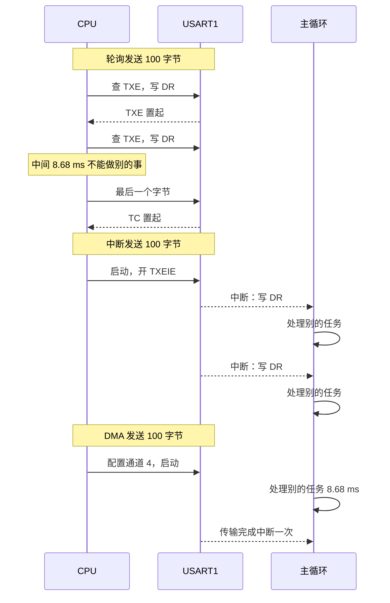

# 3.3 轮询、中断、DMA 与非阻塞驱动

[2.7 UART](/教程/正文/嵌入式/2_MCU裸机开发/2_7_UART) 里的 `uart_write` 长这样：

```c
void uart_write(USART_TypeDef *u, const void *buf, size_t len) {
    const uint8_t *p = (const uint8_t *)buf;
    for (size_t i = 0; i < len; ++i) {
        while (READ_BIT(u->SR, USART_SR_TXE) == 0u) {
        }
        u->DR = p[i];
    }
    while (READ_BIT(u->SR, USART_SR_TC) == 0u) {
    }
}
```

当函数执行完毕返回时，数据虽然已经悉数送出，但其代价是在整个发送期间 CPU 都在原地执行死循环查询。在偶尔输出单行调试日志的场景下，这种开销尚可接受；但若系统需要持续外发高频传感器采样数据，或者在通信的同时还要维系精准的控制回路与按键检测，这种同步忙等机制便会彻底破坏实时响应。

要从根本上化解这一矛盾，关键在于将繁重的数据搬运工作从 CPU 的直接指令干预中解脱出来，转交由硬件中断机制或直接存储器访问（DMA）控制器分担，并将上层接口重塑为异步非阻塞形式——即发起传输后立即返回，待物理链路搬运完毕后再通过状态查询或回调机制通知上层。在接下来的推演中，我们将深入对比轮询、中断与 DMA 在算力损耗与响应延迟上的权衡，剖析中断驱动与 DMA 循环接收配合空闲线检测的底层机理，并探讨异步传输中内存缓冲区生命周期管理的工程原则。

## 1. 阻塞的代价

串口是异步的，收发双方按约定的波特率各自计时。115200 bps、8 位数据、无校验、1 位停止位（简称 8N1），每个字节在线上占 1 个起始位、8 个数据位、1 个停止位，共 10 位。于是：

- 每秒最多传输 115200 ÷ 10 = 11520 字节；
- 每个字节占用线路 1 ÷ 11520 ≈ 86.8 µs；
- 发送 100 字节需要 100 × 86.8 µs ≈ 8.68 ms。

8.68 ms 在桌面程序里不值一提，在 72 MHz 的 MCU 上是 62 万个时钟周期。用上面的 `uart_write` 发送这 100 字节，CPU 有 8.68 ms 完全被 `while` 循环占住，别的什么都做不了。

接收方向的损失更隐蔽。轮询接收的典型写法是在主循环里不断查 `RXNE`：

```c
uint8_t byte;
while (uart_read_byte(USART1, &byte)) {
    handle(byte);
}
```

串口不会等主循环。两个字节之间的间隔只有 86.8 µs，如果主循环正在做一件耗时 200 µs 的事（比如刷新一块屏、算一次滤波器），这期间到来的字节就会被下一个字节覆盖，`USART_SR` 的 `ORE`（Overrun Error，溢出错误）置起，数据永久丢失。轮询接收能不能用，取决于主循环最长的一段代码有多长，而这个长度往往随着功能增加而悄悄变长。

::: concept emb-uart-blocking-cost title="阻塞式收发的代价"

阻塞式发送让 CPU 在数据全部移出移位寄存器之前反复查询状态位，这段时间不能执行其他工作；阻塞式接收要求主循环的周转时间短于一个字节的传输时间，否则接收数据寄存器被覆盖，`ORE` 置位，数据丢失。两种阻塞都随数据量与波特率线性恶化。

:::

## 2. 三种搬运方式

把数据从内存搬到外设（或反过来），硬件上有三条路。

**轮询（polling）**。CPU 主动查询状态位，就绪就写数据寄存器。实现最简单，不需要中断向量，不需要配置 DMA，代码不用几行就能看懂。缺点是全程占用 CPU，等待期间什么也做不了。

**中断（interrupt）**。外设状态变化时向 NVIC 发中断请求，CPU 暂停当前工作跳进中断服务程序搬运一个字节。CPU 只在需要搬运的那一刻花时间，等待期间可以执行别的任务。

**DMA（Direct Memory Access，直接存储器访问）**。由 DMA 控制器接管搬运，CPU 只负责配置源地址、目的地址、长度和触发源，然后就可以去做别的事，传输结束时 DMA 发一次中断通知。整个过程中 CPU 完全不参与逐字节操作。

三者放在一起对比：

| 维度 | 轮询 | 中断 | DMA |
| --- | --- | --- | --- |
| CPU 占用 | 全部等待时间 | 每字节一次中断开销 | 只有配置与完成通知 |
| 响应延迟 | 取决于轮询周期 | 一个中断延迟，通常几微秒 | 传输完成才通知，单字节延迟最大 |
| 实现复杂度 | 最低 | 中：要处理描述符、状态机 | 高：要配置通道、处理标志、管缓冲区 |
| 适合的数据量 | 几十字节、偶发 | 几十到几百字节、命令式交互 | 成块数据、连续数据流 |
| 缓冲区要求 | 无 | 传输期间保持有效 | 传输期间保持有效，且不能被 CPU 改写 |

中断的开销可以估出来。115200 bps 下每收到一个字节进一次中断，中断频率是 11520 Hz；每次中断按进出栈、读状态、搬一个字节、清标志算 120 个周期，在 72 MHz 上占用的 CPU 是 11520 × 120 ÷ 72 000 000 ≈ 1.9%。把波特率提到 921600 bps，中断频率涨到 92160 Hz，同样 120 个周期就是 15.4%，还没算上中断打断其他高优先级任务带来的抖动。

这几个数用一段小程序算一遍，避免手算出错：

```c
#include <stdio.h>

int main(void) {
    double bytes_per_s = 115200.0 / 10.0;
    printf("115200 8N1: %.0f B/s, 100 B takes %.2f ms\n",
           bytes_per_s, 100.0 / bytes_per_s * 1000.0);

    double bps2 = 921600.0 / 10.0;
    printf("921600 8N1: %.0f B/s -> %.0f IRQ/s\n", bps2, bps2);
    printf("CPU load: %.0f IRQ/s * 120 cyc / 72e6 = %.1f%%\n",
           bps2, bps2 * 120.0 / 72e6 * 100.0);
    return 0;
}
```

::: terminal title="PowerShell - 三种方式的量级估算"

```text
$ gcc -std=c17 -Wall -Wextra idle_calc.c -o idle_calc
$ ./idle_calc
115200 8N1: 11520 B/s, 100 B takes 8.68 ms
921600 8N1: 92160 B/s -> 92160 IRQ/s
CPU load: 92160 IRQ/s * 120 cyc / 72e6 = 15.4%
```

:::

在工程选型中，针对命令交互式的一问一答短帧数据，中断驱动通常是轻量直接的选择；而在持续的数据流吞吐、大块数据回传以及吞吐率达到几十 KB/s 以上的场景下，DMA 则能显著减轻内核的上下文切换负担。在工程实践中，UART 接收普遍青睐于『DMA 循环接收 + 空闲中断检测』的组合方案，发送端则根据单次传输的数据吞吐密度在中断与 DMA 之间按需权衡。



三种方式的时间线放进同一张图，差别很清楚：轮询的 CPU 全程被占，中断被切成 100 个碎片，DMA 只在头尾各出现一次。

## 3. 非阻塞接口的形式

阻塞接口返回时传输已经结束；非阻塞接口在传输还在进行时就返回，完成后用另外的方式通知。通知有两条路。

**启动 + 查询**。函数返回后调用者自己决定什么时候来问：

```c
enum uart_status uart_tx_start(const void *buf, size_t len);
bool uart_tx_busy(void);
```

主循环在每个周期调用 `uart_tx_busy()`，返回 `false` 时表示上一次传输已经完成，可以发下一批。这种方式不需要回调，在前后台系统里最常用。

**启动 + 完成回调**。启动时把回调函数和数据指针一起登记，传输完成由中断服务程序调用：

```c
typedef void (*uart_callback_t)(void *user_data);

enum uart_status uart_tx_start_async(const void *buf, size_t len,
                                     uart_callback_t cb, void *user_data);
```

回调函数直接运行在硬件中断上下文中，这一特性对回调的实现提出了严苛要求：其执行路径必须极其简短，严禁在回调内部等待其他低优先级中断发生，也不能调用包含内部阻塞与长循环的函数，更不应执行复杂的文本格式化或直接调用串口输出。在规范的设计中，回调通常仅负责置位事件通知标志或拷贝关键的少量状态，将耗时较长、复杂度较高的业务处理妥善移交至主循环完成。

两种方式都要求「忙的时候返回错误」。上一次传输没结束又来一次启动请求，函数应当返回忙错误码，上一次的参数保持不动：

```c
enum uart_status {
    UART_OK = 0,
    UART_ERR_PARAM = -1,
    UART_ERR_BUSY = -2,
};
```

::: concept emb-uart-buffer-ownership title="传输完成前缓冲区归驱动所有"

无论是中断方式还是 DMA 方式，一旦启动函数返回，缓冲区的内容由驱动在与硬件交互的过程中读取。调用者在收到完成通知之前不能修改、不能重新使用、也不能让这块内存失效。最常见的一种错误是把栈上的局部数组交给 DMA，函数返回后栈帧作废，同一块内存马上被后续调用覆盖，DMA 读到的就是别人的数据。

:::

这条规则最容易被忽略。下面的函数把局部数组交给 DMA 后立刻返回：

::: compare left-title="把栈上缓冲区交给 DMA" right-title="用静态存储期对象"

```c
void send_greeting(void) {
    uint8_t tmp[16];
    memcpy(tmp, "hello\r\n", 7);
    uart_dma1_send_async(&g_uart1, tmp, 7u, NULL, NULL);
    /* 函数返回，tmp 所在的栈内存随时会被下一次调用覆盖 */
}
```

---

```c
static uint8_t g_tx_frame[128];

void send_greeting(void) {
    memcpy(g_tx_frame, "hello\r\n", 7);
    uart_dma1_send_async(&g_uart1, g_tx_frame, 7u, NULL, NULL);
}
```

:::

左边能编译、能链接，甚至在很多时候看起来工作正常：`send_greeting` 返回后如果没人调用别的函数，栈上的内容还没被覆盖，串口上就收到了正确的字节。等主循环里多了一个函数调用，收到的就变成乱码了。这种缺陷随程序规模增长而出现，最难定位。

<Quiz
  type="single"
  :options="[
    { label: '栈上的数组太小，DMA 会写到栈帧之外', value: 'A' },
    { label: '函数返回后栈内存可能被覆盖，DMA 读到的是别人的数据', value: 'B' },
    { label: '栈内存不在 DMA 能访问的地址范围内', value: 'C' },
    { label: '编译期就会报错，因为不能用自动对象初始化 DMA', value: 'D' }
  ]"
  answer="B"
>

<template #question>

把函数里的局部数组交给 DMA 发送，为什么它是错的？

</template>

正确答案是 **B**。DMA 在函数返回之后才去读这块内存，而栈帧已经作废，同一块地址随时会被下一次函数调用覆盖。A 说的是越界，C 在 F103 上不成立（SRAM 整体都能被 DMA 访问），D 也不对：编译器和链接器都不会拦这种写法。

</Quiz>

::: warning 回调在中断里执行

状态标志、缓冲区的归属、回调的时机这三件事要一起考虑。回调里只置标志、复制少量数据，不要在回调里启动下一次传输后再等待它完成，也不要假定回调执行期间其它对象没被改动过。中断里能做的事越少，出错的机会越少。

:::

[CMSIS-Driver 的 USART 接口](https://arm-software.github.io/CMSIS_5/Driver/html/group__usart__interface__gr.html) 用的是第二种形式：`Send` 与 `Receive` 启动传输，`SignalEvent` 回调报告完成，事件码里有 `ARM_USART_EVENT_SEND_COMPLETE`、`ARM_USART_EVENT_RECEIVE_COMPLETE`、`ARM_USART_EVENT_RX_TIMEOUT`、`ARM_USART_EVENT_RX_OVERFLOW` 等。ST 的 HAL 也走这条路：`HAL_UART_Transmit_IT`、`HAL_UART_Transmit_DMA` 启动，`HAL_UART_TxCpltCallback` 通知完成。第 9 节对照 HAL 的具体写法。

## 4. 中断发送

中断发送要维护一个描述符：缓冲区指针、总长度、已经发出的位置、忙标志，以及完成回调。

```c
struct uart_it_handle {
    USART_TypeDef *instance;

    const uint8_t *tx_buf;
    size_t tx_len;
    volatile size_t tx_pos;
    volatile bool tx_busy;
    uart_callback_t tx_cb;
    void *tx_user;

    uint8_t *rx_buf;
    size_t rx_len;
    volatile size_t rx_pos;
    volatile bool rx_busy;
    uart_callback_t rx_cb;
    void *rx_user;
};
```

`tx_pos` 与 `tx_busy` 会被中断服务程序改写，主循环也会读，所以要 `volatile`。这一条在 [16.3 const 与 volatile](/教程/正文/语法和标准库/16_对象与内存模型/16_3_const与volatile) 里讲过：`volatile` 保证每次访问都读写内存，不会被优化进寄存器。

启动函数只登记参数、置忙标志、打开 `TXEIE`：

```c
enum uart_status uart_it_send_async(struct uart_it_handle *h,
                                    const void *buf,
                                    size_t len,
                                    uart_callback_t cb,
                                    void *user_data) {
    if (h == NULL || buf == NULL || len == 0u) {
        return UART_ERR_PARAM;
    }
    if (h->tx_busy) {
        return UART_ERR_BUSY;
    }

    h->tx_buf = (const uint8_t *)buf;
    h->tx_len = len;
    h->tx_pos = 0u;
    h->tx_cb = cb;
    h->tx_user = user_data;
    h->tx_busy = true;

    h->instance->CR1 |= USART_CR1_TXEIE;
    return UART_OK;
}
```

中断服务程序分两段。`TXE` 置起说明数据寄存器空了，可以写下一个字节；全部写完之后，最后一个字节还在移位寄存器里往外移，此时不能立刻通知完成，要关掉 `TXEIE`、打开 `TCIE`，等 `TC`（Transmission Complete，发送完成）置起才算发完：

```c
void uart_it_irq_handler(struct uart_it_handle *h) {
    USART_TypeDef *u = h->instance;
    uint32_t sr = u->SR;
    uint32_t cr1 = u->CR1;

    /* 接收分支：读 SR 后再读 DR 可同时清除 RXNE 与 ORE */
    if ((cr1 & USART_CR1_RXNEIE) != 0u &&
        (sr & (USART_SR_RXNE | USART_SR_ORE)) != 0u) {
        uint8_t byte = (uint8_t)(u->DR & 0xFFu);
        if (h->rx_pos < h->rx_len) {
            h->rx_buf[h->rx_pos++] = byte;
        }
        if (h->rx_pos >= h->rx_len) {
            u->CR1 &= ~USART_CR1_RXNEIE;
            h->rx_busy = false;
            if (h->rx_cb != NULL) {
                h->rx_cb(h->rx_user);
            }
        }
    }

    /* 发送数据寄存器空：继续填入下一个字节 */
    if ((cr1 & USART_CR1_TXEIE) != 0u && (sr & USART_SR_TXE) != 0u) {
        if (h->tx_pos < h->tx_len) {
            u->DR = h->tx_buf[h->tx_pos++];
        }
        if (h->tx_pos >= h->tx_len) {
            /* 最后一个字节已写入 DR，关闭 TXEIE，改等移位寄存器发完（TC） */
            u->CR1 = (u->CR1 & ~USART_CR1_TXEIE) | USART_CR1_TCIE;
        }
    }

    /* 发送完成：停止位也已发出，通知上层 */
    if ((cr1 & USART_CR1_TCIE) != 0u && (sr & USART_SR_TC) != 0u) {
        u->CR1 &= ~USART_CR1_TCIE;
        u->SR = ~USART_SR_TC;
        h->tx_busy = false;
        if (h->tx_cb != NULL) {
            h->tx_cb(h->tx_user);
        }
    }
}
```

这个函数值得逐段读。开头的 `sr` 与 `cr1` 各读一次存进局部对象，因为读 `SR` 再读 `DR` 会清标志，中途再读 `SR` 拿到的已经不是进入中断时的状态。

发送分支中最容易出现隐蔽边界缺陷的是最后一个字节的处理。如果所有字节刚写入数据寄存器就把 `tx_busy` 置为 `false` 并触发完成回调，调用者可能立即复用甚至释放原有缓冲区；而此时最后一个数据字节仍在底层的硬件移位寄存器中逐位输出，过早干预会导致尾部波形被新内容破坏。只有等到发送完成标志 `TC` 真正置位，才意味着包括停止位在内的所有波形均已安全离开引脚。

`TC` 的清除方式是向它写 0。`u->SR = ~USART_SR_TC` 写进去的是「除 TC 位之外全 1」，而 `SR` 里除 `TC` 之外的位要么是只读的，要么也是写 0 才清（`RXNE`、`ORE`、`IDLE` 等清法是读 `SR` 再读 `DR`），写 1 对它们没有影响，所以这一句只清了 `TC`。这种写法看着别扭，但比「读 `SR` 再写 `DR`」省一次数据写入，HAL 的 `__HAL_UART_CLEAR_FLAG` 也是这么做的。

发完不关 `TXEIE` 会怎样：

::: compare left-title="发完不关 TXEIE" right-title="关闭 TXEIE，改等 TC"

```c
if ((cr1 & USART_CR1_TXEIE) != 0u && (sr & USART_SR_TXE) != 0u) {
    if (h->tx_pos < h->tx_len) {
        u->DR = h->tx_buf[h->tx_pos++];
    }
}
```

---

```c
if ((cr1 & USART_CR1_TXEIE) != 0u && (sr & USART_SR_TXE) != 0u) {
    if (h->tx_pos < h->tx_len) {
        u->DR = h->tx_buf[h->tx_pos++];
    }
    if (h->tx_pos >= h->tx_len) {
        u->CR1 = (u->CR1 & ~USART_CR1_TXEIE) | USART_CR1_TCIE;
    }
}
```

:::

左边的错误不在「多发了一个字节」上，而在标志永远不清。数据发完之后 `TXE` 一直是 1（数据寄存器本来就是空的），`TXEIE` 又没关，于是中断服务程序返回后立刻又被同一条件触发，形成中断风暴。CPU 100% 时间在进出中断，主循环一步也走不了。串口上什么也看不到，调试器里看到的是一片「程序还在跑」的假象。

这类隐蔽缺陷反映出中断编程中的共性规律：硬件外设的中断标志位往往仅在特定总线操作下才会被清除，而若中断使能位未在条件满足后及时屏蔽，就会造成同一事件在中断服务函数退出后瞬间重复触发。因此在设计中断驱动时，必须严格确保当数据传输结束或边界到达时，对应的中断使能被同步关闭。

## 5. 中断接收

接收方向的代码在同一个中断服务程序里，逻辑是「收满指定长度就通知」。收到 `RXNE` 时读走数据寄存器，顺便清掉 `ORE`（读 `SR` 再读 `DR` 是 `RXNE` 与 `ORE` 的共同清除方式）；`rx_pos` 到达 `rx_len` 后关 `RXNEIE`、清忙标志、调回调。

这种「收满一包」的接口适合定长协议，比如读一个固定长度的传感器响应。它不适合文本命令与变长帧：调用者事先不知道对方会发多少字节。连续数据流的正确做法是让中断（或 DMA）只管把字节放进一个环形缓冲区，由主循环按需取走，环形缓冲区本身在 [3.4 数据帧、环形缓冲区与状态机](/教程/正文/嵌入式/3_驱动_通信与中间件/3_4_数据帧_环形缓冲区与状态机) 里完整实现。本节只把 DMA 收来的数据交给回调，回调怎么写由 3.4 接着讲。

溢出错误标志 `ORE` 揭示了单片机在接收高频数据时面临的缓冲瓶颈：当接收移位寄存器解析完一个新字节准备载入数据寄存器时，若先前的字节尚未被 CPU 读出，该位便会置高，造成旧数据的不可逆丢失。在中断驱动中，系统必须保证中断响应与读取延迟始终短于单个字节的线上传输时间；而采用 DMA 搬运时，由于总线控制器能够以极低延迟直接写入内存，从硬件机制上规避了数据被覆盖的风险。

::: concept emb-uart-irq-handler-rules title="中断服务程序的三条规则"

一、进入中断后先把用到的状态寄存器读一次存到局部对象，后续判断都用这份快照，避免读操作本身改变标志。二、只做搬运和置标志，解析、格式化、打印都留给主循环。三、每一种使能的中断源都要有明确的关闭时机，不能出现「条件不再成立但使能还开着」的状态。

:::

<Quiz
  type="multi"
  :options="[
    { label: '在中断服务程序里调用 printf 打印收到的数据', value: 'A' },
    { label: '进入中断后先读一次 SR，后续判断都用这份快照', value: 'B' },
    { label: '收满指定长度后关闭 RXNEIE 再调用回调', value: 'C' },
    { label: '在中断里完成整帧的解析与 CRC 校验', value: 'D' }
  ]"
  :answer="['B', 'C']"
>

<template #question>

下列哪些做法符合中断服务程序的分工原则？

</template>

正确答案是 **B、C**。B 避免读状态寄存器本身改变标志，C 保证条件不再成立时使能也关掉。A 会在中断里等串口，D 让中断执行时间随帧长增长，两者都会拖延其他中断，属于应该放到主循环的工作。

</Quiz>

## 6. DMA 发送

F103 的 DMA1 有 7 个通道，每个通道固定绑定一组外设请求。USART1 的发送请求固定走通道 4，接收请求固定走通道 5（RM0008 第 13 章的 DMA1 请求映射表）。这个对应关系是硬件写死的，不能换。

正因为如此，上一节的中断驱动能以 `USART_TypeDef *` 作参数服务任意实例，而本节的函数名里带 `dma1` 且不带实例参数：`uart_dma1_init` 直接操作 `USART1` 与 `DMA1_Channel4/5`。要让 USART2 也走 DMA，得另写一份用通道 6、7 的实现，接口可以完全一样。这种「接口相同、实现按实例各写一份」的做法在嵌入式里很常见，[3.1 驱动接口、CMSIS 与设备头文件](/教程/正文/嵌入式/3_驱动_通信与中间件/3_1_驱动接口_CMSIS与设备头文件) 第 6 节讲的函数指针表就是为了在调用方这一侧把差异藏起来。

发送通道要配置的寄存器有四个：

| 寄存器 | 写什么 | 含义 |
| --- | --- | --- |
| `CPAR` | `&USART1->DR` | 外设地址，每次传输后不变 |
| `CMAR` | 缓冲区地址 | 存储器地址，`MINC` 打开后每次加一 |
| `CNDTR` | 字节数 | 剩余待传字节数，每传一个减一 |
| `CCR` | 控制位 | 方向、自增、中断使能、循环模式、通道使能 |

`CCR` 里用到的位：`MINC`（第 7 位，存储器地址自增）、`DIR`（第 4 位，1 表示存储器到外设）、`TCIE`（第 1 位，传输完成中断）、`EN`（第 0 位，通道使能）。

```c
enum uart_dma_status uart_dma1_send_async(struct uart_dma_handle *h,
                                          const void *buf,
                                          uint16_t len,
                                          uart_dma_tx_cb_t cb,
                                          void *user_data) {
    if (h == NULL || buf == NULL || len == 0u) {
        return UART_DMA_ERR_PARAM;
    }
    if (h->tx_busy) {
        return UART_DMA_ERR_BUSY;
    }

    h->tx_cb = cb;
    h->tx_user = user_data;
    h->tx_busy = true;

    /* 关闭通道后写入本次缓冲区地址和长度，清除残留标志后重启 */
    DMA1_Channel4->CCR &= ~DMA_CCR_EN;
    DMA1->IFCR = DMA_IFCR_CGIF4 | DMA_IFCR_CTCIF4 |
                 DMA_IFCR_CHTIF4 | DMA_IFCR_CTEIF4;
    USART1->SR = ~USART_SR_TC;

    DMA1_Channel4->CMAR = (uint32_t)(uintptr_t)buf;
    DMA1_Channel4->CNDTR = len;
    DMA1_Channel4->CCR = DMA_CCR_MINC |
                         DMA_CCR_DIR |
                         DMA_CCR_TCIE |
                         DMA_CCR_EN;
    return UART_DMA_OK;
}
```

这段代码有三处不能省。

先关通道再改参数。`CNDTR`、`CMAR` 在通道使能状态下写入无效，必须先清 `EN`。传输还没结束就重新启动时，也要先关通道，否则新参数写不进去，通道还在按旧参数跑。

清标志要在启动之前。上一次传输留下的 `TCIF4` 如果不清，新传输一启动，中断服务程序会立刻看到「完成」标志，误判成本次传输完成。`IFCR` 的写 1 清零与 `SR` 的写 0 清零相反，这两个外设的清标志规则不一样，写代码时要各自查手册。

先清 `TC` 再启动。`USART_SR` 的 `TC` 若还留着上一次的 1，用 `TC` 判断发送完成的逻辑会提前通过。

传输完成的中断服务程序只做三件事：清标志、关通道、通知上层：

```c
void uart_dma1_tx_dma_isr(struct uart_dma_handle *h) {
    if ((DMA1->ISR & DMA_ISR_TCIF4) != 0u) {
        DMA1->IFCR = DMA_IFCR_CTCIF4 | DMA_IFCR_CGIF4;
        DMA1_Channel4->CCR &= ~DMA_CCR_EN;
        h->tx_busy = false;
        if (h->tx_cb != NULL) {
            h->tx_cb(h->tx_user);
        }
    }
}
```

DMA 的「传输完成」只表示最后一个字节写进了 `USART1->DR`，不表示它已经从线上发出去。要确保整帧数据离开引脚（比如 RS-485 收发器需要在此之后才释放 DE 引脚），还得等 `USART_SR` 的 `TC`。本节的示例不涉及方向控制，[3.5 CAN 与 Modbus](/教程/正文/嵌入式/3_驱动_通信与中间件/3_5_CAN与Modbus) 里会用到。

「上一次未完成时不启动新传输」这条在 `send_async` 开头用 `tx_busy` 挡住了。如果没有这道检查，两次启动会先后写 `CMAR` 与 `CNDTR`，后一次覆盖前一次，而通道可能已经在跑，结果是发出半帧旧数据接半帧新数据。

## 7. DMA 循环接收与空闲线检测

相较于发送过程，异步通信的接收端往往面临更大的不确定性。发送时的主动权在本地，数据长度由业务预先确定；而接收时的数据包长度、帧间隔以及到达时机均由外部通信对端决定。若依然采用设定固定字节数的接收接口来应对变长通信帧，往往只能基于协议预设进行粗暴的长度猜测。

DMA 的循环模式（`CIRC`）解决了「收不完」的问题：通道配置一次，缓冲区填满后 `CNDTR` 自动重装，地址回到缓冲区开头，永远不需要软件干预。缓冲区大小取 64 字节，DMA 就一直在 `rx_dma_buf[0..63]` 之间循环写。

但光有循环写还不够：数据写进去了，什么时候去取？取的时候怎么知道哪些是新的？两个机制配合使用。

**半传输与全传输中断**。`HTIE` 在传完一半（32 字节）时中断一次，`TCIE` 在传完一整圈（64 字节）时中断一次。这样即使线路一直不空闲，只要中断处理跟得上，缓冲区积压的数据也不会多过半个缓冲区。

**空闲线检测（IDLE）**。串口线上连续一个字节时间没有新数据时，`USART_SR` 的 `IDLE` 置起，同时产生中断。它恰好对应「对方一帧发完了」这个事件，是变长帧的天然分隔符。清除方式是先读 `SR` 再读 `DR`。

三种事件的处理逻辑相同：读当前 `CNDTR`，算出新的写位置，把从上次位置到新位置之间的数据交给上层。

```c
size_t dma_rx_calc_pos(size_t buf_size, size_t cndtr) {
    if (buf_size == 0u || cndtr == 0u || cndtr >= buf_size) {
        return 0u;
    }
    return buf_size - cndtr;
}
```

`CNDTR` 从 64 递减到 1，减到 0 时重装为 64。所以写入位置 `pos = 64 - CNDTR`：`CNDTR` 为 64 时 `pos` 为 0，为 1 时 `pos` 为 63。`cndtr == 0` 与 `cndtr >= buf_size` 这两种情况在循环模式下不会出现，保护一下是为了让函数在任何输入下都有确定结果。

有了新位置，还要处理「这一批新数据跨越了缓冲区末尾」的情况：

```c
struct dma_rx_slice dma_rx_diff(size_t buf_size, size_t old_pos, size_t cndtr) {
    struct dma_rx_slice s = {0};
    if (buf_size == 0u || old_pos >= buf_size) {
        return s;
    }

    size_t pos = dma_rx_calc_pos(buf_size, cndtr);
    s.new_pos = pos;

    if (pos == old_pos) {
        return s;
    }

    if (pos > old_pos) {
        s.span_count = 1u;
        s.spans[0].offset = old_pos;
        s.spans[0].len = pos - old_pos;
        s.total_len = s.spans[0].len;
    } else {
        s.spans[0].offset = old_pos;
        s.spans[0].len = buf_size - old_pos;
        s.total_len = s.spans[0].len;
        s.span_count = 1u;

        if (pos > 0u) {
            s.spans[1].offset = 0u;
            s.spans[1].len = pos;
            s.total_len += pos;
            s.span_count = 2u;
        }
    }
    return s;
}
```

`pos > old_pos` 时新数据是一段连续的，`pos < old_pos` 时被缓冲区末尾切成两段：前一段从 `old_pos` 到末尾，后一段从 0 到 `pos`。`pos == old_pos` 表示没有新数据，常见于「上一条中断刚处理完，又来了一个别的中断」。

这个函数是纯函数：不碰寄存器，不碰全局对象，输入是三个整数，输出是一个结构体。纯函数能在 PC 上完整测试。测试程序模拟 DMA 往缓冲区写字节并递减 `CNDTR`，覆盖不回绕、半满、回绕、重复调用四种情形：

::: terminal title="PowerShell - 在 PC 上验证位置计算"

```text
$ gcc -std=c17 -Wall -Wextra test_dma_rx_pos.c dma_rx_pos.c -o test_dma_rx_pos
$ ./test_dma_rx_pos
[1. IDLE after 12 bytes]
  CNDTR = 52, old_pos =  0 -> new_pos = 12, spans = 1, bytes = 12
  span[0]: offset =  0, len = 12
  payload: "AT+GMR_OK_12"
[2. HT at 32 bytes]
  CNDTR = 32, old_pos = 12 -> new_pos = 32, spans = 1, bytes = 20
  span[0]: offset = 12, len = 20
  payload: "0123456789ABCDEFGHIJ"
[3. IDLE at 56 bytes]
  CNDTR =  8, old_pos = 32 -> new_pos = 56, spans = 1, bytes = 24
  span[0]: offset = 32, len = 24
  payload: "SENSOR:TEMP=25.4,HUMI=60"
[4. Wrap-around across 64-byte boundary]
  CNDTR = 52, old_pos = 56 -> new_pos = 12, spans = 2, bytes = 20
  span[0]: offset = 56, len =  8
  span[1]: offset =  0, len = 12
  payload: "WRAP_TAIL_AND_HEAD!!"
[5. Duplicate check without new bytes]
  CNDTR = 52, old_pos = 12 -> new_pos = 12, spans = 0, bytes =  0
```

:::

第 4 组是本节的核心：从 56 开始又收到 20 字节，写指针越过末尾回到 12，`dma_rx_diff` 把它拆成 8 字节与 12 字节两段，拼起来正好是完整的 `WRAP_TAIL_AND_HEAD!!`。第 5 组验证重复调用不会重复交出数据，这一条如果没有，接收数据会被重复处理一遍。

把它接进中断就是一层薄封装：

```c
void uart_dma1_poll_rx(struct uart_dma_handle *h) {
    size_t cndtr = (size_t)DMA1_Channel5->CNDTR;
    dma_rx_drain(h->rx_dma_buf,
                 UART_DMA_RX_BUF_SIZE,
                 &h->rx_old_pos,
                 cndtr,
                 h->rx_on_data,
                 h->rx_user);
}

void uart_dma1_rx_dma_isr(struct uart_dma_handle *h) {
    if ((DMA1->ISR & (DMA_ISR_HTIF5 | DMA_ISR_TCIF5)) != 0u) {
        DMA1->IFCR = DMA_IFCR_CHTIF5 | DMA_IFCR_CTCIF5 | DMA_IFCR_CGIF5;
        uart_dma1_poll_rx(h);
    }
}

void uart_dma1_usart_isr(struct uart_dma_handle *h) {
    uint32_t sr = USART1->SR;
    if ((sr & USART_SR_IDLE) != 0u) {
        /* 读 SR 后再读 DR 才能清除 IDLE 标志 */
        (void)USART1->DR;
        uart_dma1_poll_rx(h);
    }
}
```

初始化部分把通道 5 配成循环模式，同时开 `HTIE` 与 `TCIE`，并把 `USART1->CR3` 的 `DMAR` 位打开，让接收数据寄存器空时自动向 DMA 发请求：

```c
    /* 3. 配置 DMA1 通道 5 用于 USART1_RX 循环接收 */
    DMA1_Channel5->CCR = 0u;
    DMA1->IFCR = DMA_IFCR_CGIF5;
    DMA1_Channel5->CPAR = (uint32_t)(uintptr_t)&USART1->DR;
    DMA1_Channel5->CMAR = (uint32_t)(uintptr_t)h->rx_dma_buf;
    DMA1_Channel5->CNDTR = UART_DMA_RX_BUF_SIZE;
    DMA1_Channel5->CCR = DMA_CCR_MINC |
                         DMA_CCR_CIRC |
                         DMA_CCR_HTIE |
                         DMA_CCR_TCIE |
                         DMA_CCR_EN;
```

`DMAR` 与 `DMAT` 分别在 `CR3` 的第 6、7 位。不开这两位，DMA 通道配置得再对也没人给它发请求。

`rx_old_pos` 由中断与回调共同维护，`dma_rx_drain` 在最后把它更新成新位置。这个对象只在中断上下文里读写，主循环不碰，所以不需要额外加锁。

::: concept emb-uart-circular-dma-is-ring title="循环模式下的 DMA 缓冲区就是一个硬件环形缓冲区"

DMA 循环模式让写指针在固定长度的数组里自动回绕，与软件环形缓冲区是同一个结构，只是推进指针的动作由 DMA 控制器完成、不占用 CPU。软件只需要记住上次处理到的位置，每次中断时用 `CNDTR` 换算出当前写位置，把两者之间的区间取走。位置计算可以写成不依赖任何硬件的纯函数，从而在 PC 上用一组 `CNDTR` 序列完整测试。

:::

::: generate emb-uart-dma-wrap-walkthrough kind=explanation concepts=emb-uart-circular-dma-is-ring

面向第一次接触循环 DMA 的读者，用「缓冲区 64 字节、上次处理到 56、这次中断时 CNDTR 读到 52」这一组具体数值，逐步算出写指针落在 12、说明为什么新数据被拆成 56～63 和 0～11 两段、两段长度相加为什么等于 20，再说明如果忘了处理第二段会丢掉哪几个字节、程序会出现什么现象。

:::

## 8. 中断与主循环的分工

在职责划分上，中断服务程序应当聚焦于纯粹的底层数据搬移与状态快照保存，迅速完成数据移出并更新标志，随后立即退出。所有涉及协议校验、报文解析、数据格式化等计算密集型或潜在耗时的任务，均应剥离并推迟至主循环中调度。

这一分工原则的底层约束来源于系统时序。在某一中断服务函数执行期间，同优先级及更低优先级的中断请求均会被硬件仲裁机制屏蔽。若在中断处理中执行 `printf` 这样的重型格式化与字符等待操作，其消耗的数十微秒足以导致后续串口字节发生 `ORE` 溢出；更严重的是，过长的中断关闭或延迟会打乱关键定时器与闭环控制任务的采样节拍。

主循环那边的写法是查标志、取数据、处理：

```c
static struct uart_dma_handle g_uart1;
static volatile bool g_rx_event;
static uint8_t g_app_buf[128];
static size_t g_app_len;

static void on_rx_chunk(const uint8_t *data, size_t len, void *user_data) {
    (void)user_data;
    size_t space = sizeof(g_app_buf) - g_app_len;
    size_t copy_len = len < space ? len : space;
    if (copy_len > 0u) {
        memcpy(&g_app_buf[g_app_len], data, copy_len);
        g_app_len += copy_len;
        g_rx_event = true;
    }
}

/* …主循环… */
    for (;;) {
        if (g_rx_event && !uart_dma1_tx_busy(&g_uart1)) {
            __disable_irq();
            size_t n = g_app_len;
            memcpy(g_tx_frame, g_app_buf, n);
            g_app_len = 0u;
            g_rx_event = false;
            __enable_irq();

            if (n > 0u) {
                (void)uart_dma1_send_async(&g_uart1, g_tx_frame,
                                           (uint16_t)n, NULL, NULL);
            }
        }
    }
```

取数据的那一小段用 `__disable_irq()` 与 `__enable_irq()` 包住，因为主循环读完 `g_app_len` 并清零的过程中，中断可能又往 `g_app_buf` 里追加数据。这段临界区只有几条指令，关中断的时间以微秒计，不会影响串口接收。

关中断还有更讲究的写法：保存原来的 PRIMASK，退出时恢复。如果这段代码本身可能在某个已经关中断的上下文里被调用，无条件 `__enable_irq()` 会提前把中断打开。用 CMSIS-Core 的函数是这样写：

```c
uint32_t primask = __get_PRIMASK();
__disable_irq();
/* 临界区 */
__set_PRIMASK(primask);
```

本节的例子在 `main` 里调用，确定中断是开着的，所以用了简单写法。RTOS 里的做法见 [4.4 中断与任务协作](/教程/正文/嵌入式/4_RTOS与固件架构/4_4_中断与任务协作)，那里要处理任务与中断的优先级嵌套，简单的开关中断不够用。

优先级安排也属于分工的一部分。示例里 DMA 接收与 USART 空闲中断设成 1，DMA 发送完成设成 2：

```c
    NVIC_SetPriority(DMA1_Channel5_IRQn, 1u);
    NVIC_SetPriority(USART1_IRQn, 1u);
    NVIC_SetPriority(DMA1_Channel4_IRQn, 2u);
```

接收的两条路径优先级相同，因为它们不会互相打断；发送完成只是通知，晚一点没关系，设成更低的优先级（数值更大）可以让它不打断接收。[2.5 中断与 NVIC](/教程/正文/嵌入式/2_MCU裸机开发/2_5_中断与NVIC) 讲过 F103 的 4 位优先级，取值 0～15，数值越小优先级越高。

<Quiz
  type="single"
  :options="[
    { label: '不需要，因为 volatile 已经保证了两个执行者之间的先后顺序', value: 'A' },
    { label: '需要，因为主循环读取并清零 g_app_len 期间中断可能继续追加数据', value: 'B' },
    { label: '不需要，因为中断永远不会打断主循环', value: 'C' },
    { label: '需要，因为环形缓冲区的下标必须由主循环和中断共同推进', value: 'D' }
  ]"
  answer="B"
>

<template #question>

主循环从 `g_app_buf` 取数据时为什么要短暂关中断？

</template>

正确答案是 **B**。共享对象是长度 `g_app_len` 与缓冲区内容，主循环「读长度、复制、清零」这三步之间如果被中断插入一次追加，就会丢掉新到的那几个字节。A 错在把 `volatile` 当成了同步原语，D 错在把单写者规则说反了：中断只写 `head`，主循环只写 `tail`。

</Quiz>

## 9. HAL 对照

ST 的 HAL 把上面这些机制封装成了现成的函数。同一件事有三种发起方式，函数名后缀直接说明了搬运方式：

| 函数 | 方式 | 返回时机 | 完成通知 |
| --- | --- | --- | --- |
| `HAL_UART_Transmit(&huart1, buf, len, timeout)` | 轮询 | 全部发完或超时 | 无 |
| `HAL_UART_Transmit_IT(&huart1, buf, len)` | 中断 | 启动后立即返回 | `HAL_UART_TxCpltCallback` |
| `HAL_UART_Transmit_DMA(&huart1, buf, len)` | DMA | 启动后立即返回 | `HAL_UART_TxCpltCallback` |

接收方向除了定长的 `HAL_UART_Receive_IT` 与 `HAL_UART_Receive_DMA`，F1 HAL 1.1.10 还提供了 `HAL_UARTEx_ReceiveToIdle_DMA`。它把本节第 7 节的两件事做在了一起：DMA 接收，加上空闲线检测。完成时调用 `HAL_UARTEx_RxEventCallback(huart, Size)`，`Size` 是本次收到的字节数，事件来源可能是空闲线、半传输或全传输，`huart->RxEventType` 里写着是哪一种。

```c
HAL_StatusTypeDef hal_status;
uint8_t rx_buf[64];

hal_status = HAL_UARTEx_ReceiveToIdle_DMA(&huart1, rx_buf, sizeof(rx_buf));
if (hal_status != HAL_OK) {
    /* 启动失败，huart1 的状态里能看到具体原因 */
}

void HAL_UARTEx_RxEventCallback(UART_HandleTypeDef *huart, uint16_t Size) {
    if (huart->Instance != USART1) {
        return;
    }
    /* Size 为本批数据长度，回调在中断上下文里执行 */
}
```

HAL 的回调全部在中断上下文执行，这条与本节自己写的驱动一致，规则也一样：回调要短。

要留意的是空闲事件之后接收还继不继续，取决于 DMA 通道配成了哪种模式。普通模式下，空闲中断一来 HAL 就关掉 `DMAR`、中止 DMA、把接收状态恢复为就绪，回调返回后必须再调一次 `HAL_UARTEx_ReceiveToIdle_DMA` 才能收下一批；循环模式下 DMA 不停，HAL 只报告进度，接收自动继续。用普通模式而忘了重新启动，现象是第一批数据正常、此后再也收不到东西，而且没有任何错误提示。本节自己写的循环 DMA 不存在这个问题，通道一直在跑，软件只需要记住处理到哪。

采用 HAL 能够省去直接配置寄存器与手工清标志的琐碎细节，但其代价在于引入了更深的对象句柄封装与内部状态机，排查异常时往往需要从多层回调调用栈层层回溯。掌握寄存器与中断的底层交互机理，有助于透视高级封装背后的硬件时序原貌。HAL 的句柄设计与回调机制在 [3.2 HAL、LL 与 BSP](/教程/正文/嵌入式/3_驱动_通信与中间件/3_2_HAL_LL与BSP) 中有详细梳理。

固件目标能链接出来，`size` 的结果是：

::: terminal title="bash - 3.3 的固件目标"

```text
$ arm-none-eabi-size uart_nonblock_demo.elf
   text	   data	    bss	    dec	    hex	filename
   1308	      0	   1888	   3196	    c7c	uart_nonblock_demo.elf
```

:::

`bss` 里除了链接脚本预留的 1536 字节堆栈（3.1 第 7 节解释过这部分），剩下的是 `main.c` 里的 `g_app_buf[128]` 与 `g_tx_frame[128]`，各占 128 字节，`g_uart1` 连同其中的 `rx_dma_buf[64]` 占 88 字节，都放在静态存储期。这是第 3 节那条所有权规则的直接结果：交给 DMA 的缓冲区在传输完成前必须一直有效，栈上做不到。

## 10. 习题

### 10.1 巩固

<Exercise id="60314" :d="1" :w="1">

第 1、2 节用 115200 bps 与 921600 bps 估算了阻塞与中断的代价。把常用的四档波特率都算出来，填成一张表，保留两位小数：

| 波特率 | 字节/秒 | 单字节占线时间 | 中断频率 | CPU 占用（每次 120 周期） |
| --- | --- | --- | --- | --- |
| 9600 | | | | |
| 115200 | | | | |
| 460800 | | | | |
| 921600 | | | | |

(1) 写出计算过程，用一段几十行的 C 程序或表格软件核对，贴出程序的输出。

(2) 按同样的 120 周期估算，波特率升到多少时 CPU 有 50% 的时间在进出中断？

(3) 115200 bps 下主循环有一处耗时 200 µs 的代码。按单字节占线时间算出这段时间里线上能过去几个字节，指出 DR 被填满之后再来一个字节时 `USART_SR` 的哪一位会置起、被覆盖的是哪个字节，以及为什么这段代码只丢字节而不报错。

(4) 结合这张表，说明本页「命令式交互用中断、连续数据流用 DMA」这条判断的分界线大致落在哪一档，并给出你用的依据。

</Exercise>

<Exercise id="60315" :d="2" :w="2">

`code/嵌入式/3_驱动_通信与中间件/3_3_轮询_中断_DMA与非阻塞驱动/exercises/dma_table_starter.c` 是一个表驱动测试的骨架，目前只有一条用例。补全到七条，每条给出 `dma_rx_diff` 的输入 `old_pos`、`cndtr` 与期望的 `new_pos`、`total_len`、`span_count`、两段 span 的偏移与长度：

| 用例 | `old_pos` | `cndtr` | 期望 |
| --- | --- | --- | --- |
| `normal_advance` | 0 | 44 | 已有 |
| `no_new_data` | 20 | 44 | |
| `reaches_byte63` | 0 | 1 | |
| `wrap_to_twelve` | 56 | 52 | |
| `wrap_to_zero` | 56 | 64 | |
| `full_lap_looks_empty` | 0 | 64 | |
| `cndtr_zero_guard` | 32 | 0 | |

在 `code/嵌入式/3_驱动_通信与中间件/3_3_轮询_中断_DMA与非阻塞驱动/` 目录下编译运行：

```sh
gcc -std=c17 -Wall -Wextra exercises/dma_table_starter.c dma_rx_pos.c -o test_dma_table
./test_dma_table
```

合格标准是七条全部 `[PASS]`、最后一行 `Passed 7 / 7`、退出码 0。

(1) 贴出完整的用例表与运行输出。

(2) `full_lap_looks_empty` 这一条说明循环 DMA 有一个天生的盲区。写出 `dma_rx_diff` 在这种情况下算出什么，并解释为什么「刚好收满一整圈」与「一个字节都没收到」在 `CNDTR` 上无法区分。

(3) 要消除这个盲区，软件必须引入什么额外信息？给出一种具体做法（不要求写完整代码）。

(4) `cndtr_zero_guard` 在循环模式下实际不会出现。说明这个用例为什么仍然值得保留。

</Exercise>

<Exercise id="60316" :d="3" :w="3">

下面是某同学写的中断发送服务程序，启动函数与中断服务程序各有一处以上的问题：

```c
enum uart_status uart_it_send_async_bad(struct uart_it_handle *h,
                                        const void *buf, size_t len,
                                        uart_callback_t cb, void *user_data) {
    h->tx_buf = (const uint8_t *)buf;
    h->tx_len = len;
    h->tx_pos = 0u;
    h->tx_cb = cb;
    h->tx_user = user_data;
    h->tx_busy = true;
    h->instance->CR1 |= USART_CR1_TXEIE;
    return UART_OK;
}

static void uart_it_irq_handler_bad(struct uart_it_handle *h) {
    if ((h->instance->CR1 & USART_CR1_TXEIE) != 0u &&
        (h->instance->SR & USART_SR_TXE) != 0u) {
        if (h->tx_pos < h->tx_len) {
            h->instance->DR = h->tx_buf[h->tx_pos++];
        }
        if (h->tx_pos >= h->tx_len) {
            h->tx_busy = false;
            if (h->tx_cb != NULL) {
                h->tx_cb(h->tx_user);
            }
        }
    }
}
```

(1) 逐条列出缺陷，每条写清触发条件与现象。至少找出三处：一处让 CPU 永远出不了中断，一处让调用者过早复用缓冲区，一处让上一次未完成的传输被这次请求覆盖。

(2) 写出改正后的两个函数（启动函数要有忙检查与 `TC` 清除，服务程序要按 `TXE`、`TC` 两段处理）。

(3) 用一个模拟的 `USART_TypeDef`（普通结构体即可）和一段循环，证明错误版本的中断服务程序被反复调用而无法退出，正确版本只进入三次。贴出两边的调用次数与 `CR1` 的值。

(4) 改正后的版本在最后一个字节写进 `DR` 之后，为什么还要等 `TC` 才算传输完成？用一个具体场景说明只等 `TXE` 会出什么事。

</Exercise>

### 10.2 编程

<Exercise id="60317" :d="3" :w="3">

补全 `code/嵌入式/3_驱动_通信与中间件/3_3_轮询_中断_DMA与非阻塞驱动/exercises/uart_write_async_starter.c`。这个骨架用 `struct mock_usart` 模拟状态寄存器与数据寄存器，要求：

(1) 定义一个发送描述符，保存缓冲区指针、长度、当前位置、忙标志、回调与用户数据。

(2) `uart_write_async` 在参数非法时返回 -1，在上一次未完成时返回 -2，成功返回 0，并按第 4 节的方式打开 `TXEIE`。

(3) `mock_usart_isr` 按 `TXE` 继续填字节，发完关闭 `TXEIE`、打开 `TCIE`，看到 `TC` 后清标志、清忙、调回调。

(4) 在 `main` 里依次做：启动发送、立刻再启动一次、两次中断、置 `TC` 后再进一次中断、重启一次。期望输出：

```text
start rc=0 CR1=0x80
second start rc=-2
after isr1: DR='O' CR1=0x80 busy=1 done=0
after isr2: DR='K' CR1=0x40 busy=1 done=0
after tc : CR1=0x00 busy=0 done=1
restart rc=0
```

(5) 如果 `main` 里连续两次启动之后不检查返回值，第二次调用会覆盖描述符里的哪些对象？协议上会看到什么现象？

(6) 把描述符扩展成接收：加一个 `uart_read_async(u, buf, len, cb, user)`，收满 `len` 字节后关 `RXNEIE`、清 `rx_busy`、调回调，并在主循环里用 `uart_read_busy` 等它结束。说明收满之后为什么必须关 `RXNEIE`，以及 `ORE` 置起时「读 `SR` 再读 `DR`」为什么能同时清掉 `RXNE` 与 `ORE`。

</Exercise>

<Exercise id="60318" :d="3" :w="3">

临界区代码经常写成无条件开关中断：

```c
static void frame_take(void) {
    __disable_irq();
    size_t n = g_app_len;
    memcpy(g_tx_frame, g_app_buf, n);
    g_app_len = 0u;
    g_rx_event = false;
    __enable_irq();
}
```

这段代码在主循环里调用是对的，一旦被别处调用就不对。

(1) 写出一个具体调用场景，说明「进入 `frame_take` 之前中断本来就是关着的」时这段代码会造成什么后果。

(2) 把它改成保存与恢复 `PRIMASK` 的写法，函数签名改为返回本次取走的字节数。

(3) 在 PC 上写一个对照实验：用两个布尔对象模拟 `PRIMASK` 与「中断挂起」，让被测函数在「中断已关」与「中断已开」两种初始状态下各跑一次，打印每次结束时 `PRIMASK` 的值。期望的结果是两次都保持进入时的状态。

(4) 第 8 节的例子在 `main` 里调用，作者说用简单写法即可。把这个判断写成一条可以讲给同事听的规则：什么条件下可以无条件开关中断，什么条件下必须保存恢复。

</Exercise>

<Exercise id="60319" :d="4" :w="3">

`uart_dma1_poll_rx` 依赖 `dma_rx_diff` 算出的两段 span。有人把它改写成了下面这样，只用一个连续的区间：

```c
void uart_dma1_poll_rx_bad(struct uart_dma_handle *h) {
    size_t cndtr = (size_t)DMA1_Channel5->CNDTR;
    size_t pos = UART_DMA_RX_BUF_SIZE - cndtr;
    size_t len = (pos - h->rx_old_pos) & (UART_DMA_RX_BUF_SIZE - 1u);
    if (len > 0u) {
        h->rx_on_data(&h->rx_dma_buf[h->rx_old_pos], len, h->rx_user);
    }
    h->rx_old_pos = pos;
}
```

(1) 用 `UART_DMA_RX_BUF_SIZE` 为 64、`rx_old_pos` 为 56、`cndtr` 为 52 这组数，算出 `pos`、`len`，指出回调拿到的那段内存对应缓冲区下标的哪一个范围、哪一部分数据被漏掉、又有哪些下标越过了数组末尾。

(2) 说明这处越界读在什么时候才会表现成故障，为什么单元测试里往往看不出来。

(3) 用 `dma_rx_diff` 与 `dma_rx_drain` 重写这个函数，保持回调签名不变。

(4) 写一个 PC 测试：缓冲区用 `uint8_t buf[64]`，在合法范围之外再放一段哨兵数据，喂一组依次回绕的 `CNDTR` 序列，比较「按字节拼起来的结果」与原始字节流。要求测试在错误版本上失败、在正确版本上通过。如果手边的编译器带 AddressSanitizer（Linux 上的 gcc 一般自带），再加 `-fsanitize=address` 跑一次，说明它报出了什么；本教程用的 MinGW 没有 `libasan`，跳过这一步，改用哨兵的取值判断是否越界。

(5) 这个函数只碰 `CNDTR` 这一个寄存器，`rx_old_pos` 也只在中断里读写。据此说明为什么这一部分能在 PC 上完整测试，而 `uart_dma1_init` 不能。

</Exercise>

<Exercise id="60320" :d="4" :w="3">

下面的 DMA 发送函数漏掉了第 6 节强调的两步：

```c
enum uart_dma_status uart_dma1_send_async_bad(struct uart_dma_handle *h,
                                              const void *buf, uint16_t len,
                                              uart_dma_tx_cb_t cb, void *user) {
    DMA1_Channel4->CMAR = (uint32_t)(uintptr_t)buf;
    DMA1_Channel4->CNDTR = len;
    DMA1_Channel4->CCR = DMA_CCR_MINC | DMA_CCR_DIR | DMA_CCR_TCIE | DMA_CCR_EN;
    h->tx_busy = true;
    h->tx_cb = cb;
    h->tx_user = user;
    return UART_DMA_OK;
}
```

(1) 用一个「第一帧还没发完就请求第二帧」的场景，推演这个函数写下去之后通道按哪一帧的参数继续跑，串口上最后看到什么。

(2) 补上忙检查、先关通道、清 `IFCR`、清 `USART_SR` 的 `TC` 四步，写出正确版本。

(3) 写一个 PC 上的通道模型（`CMAR`、`CNDTR`、`EN`、`TCIF` 四个成员加一个搬运函数），让 `EN` 为 1 时写参数无效、`TCIF` 只能由写 1 清除。用它复现 (1) 的现象并验证 (2) 的修复，贴出两边的输出。

(4) DMA 的传输完成中断只表示最后一个字节写进了 `USART1->DR`。要确认最后一个字节已经离开引脚（例如 RS-485 收发器要在此之后才释放 DE），应当怎么做？说明为什么不能在 DMA 完成中断里原地等 `USART_SR` 的 `TC`。

</Exercise>

<Exercise id="60321" :d="5" :w="4">

把本页的两套驱动合成一个模块 `uart_async`，对外只暴露一组接口：

```c
typedef void (*uart_done_fn)(void *user);
typedef void (*uart_data_fn)(const uint8_t *data, size_t len, void *user);

enum uart_async_status {
    UART_ASYNC_OK = 0,
    UART_ASYNC_ERR_PARAM = -1,
    UART_ASYNC_ERR_BUSY = -2,
};

enum uart_async_status uart_async_send(const void *buf, uint16_t len,
                                       uart_done_fn cb, void *user);
enum uart_async_status uart_async_recv_start(uart_data_fn on_data, void *user);
bool uart_async_tx_busy(void);
```

要求：

(1) 发送走 DMA1 通道 4，接收走 DMA1 通道 5 的循环模式加空闲线检测。底层仍用 `uart_dma.c` 与 `dma_rx_pos.c`，上层不再出现 `DMA1_Channel4` 这类名字。

(2) 启动接收前若上一次接收还在进行，返回 `UART_ASYNC_ERR_BUSY`；发送忙时同理。

(3) 给出一个 PC 上可测的内核：把「一帧数据的交付」与「驱动状态机」分开，状态机只吃事件（`TX_DONE`、`IDLE`、`HT`、`TC`），不碰寄存器。写出事件驱动的表或 switch，并为它写测试，至少覆盖：正常发送、发送中再请求、接收分片、接收回绕。

(4) 固件侧的适配层只做三件事：把中断翻译成事件、把事件喂给状态机、把状态机的动作写回寄存器。贴出这一层的代码，说明它有多少行、为什么可以几乎没有分支。

(5) 用 `arm-none-eabi-gcc -mcpu=cortex-m3 -mthumb -O2 -Wall -Wextra` 编译固件侧，用 `gcc -std=c17` 运行 PC 测试，贴出两边的结果。

</Exercise>

### 10.3 综合与挑战

<Exercise id="60322" :d="5" :w="4">

第 9 节提到 `HAL_UARTEx_ReceiveToIdle_DMA` 在普通模式下回调返回后必须重新启动，否则第一批之后再也收不到数据。用一份宿主机上的仿 HAL 验证这个说法。

(1) 写一个最小的仿 HAL：`HAL_UARTEx_ReceiveToIdle_DMA(handle, buf, size)` 把 `buf`、`size` 记进句柄并置「接收中」；再写一个 `fake_inject(handle, const uint8_t *data, size_t n)`，它模拟一次空闲事件，调用 `HAL_UARTEx_RxEventCallback(handle, Size)`，并按当前模式决定接收状态是否保留。

(2) 写两份应用代码，共用同一个回调：A 版在回调里只处理数据，不重启；B 版在回调里处理完再调用一次 `HAL_UARTEx_ReceiveToIdle_DMA`。连喂三批数据，打印每批到达的字节数。A 版应当只有第一批到达，B 版三批都到达。

(3) 再加一个 C 版：把 DMA 通道设成循环模式（仿 HAL 里用 `DMA_CIRCULAR` 表示，空闲事件不中止通道），回调不重启。说明 C 版与 B 版在「每批 `Size` 的含义」上有什么不同，以及为什么循环模式下必须靠 `RxEventType` 区分空闲、半传输与全传输。

(4) 用同样的三批数据，说明本页手写的循环 DMA 版本在 A 版那种「忘记重启」的错误下会不会出问题，并解释原因。

(5) 给出选择建议：什么情况下用 HAL 的普通模式、什么情况下用循环模式、什么情况下干脆自己写。每条一句话，落到具体的帧长与数据率上。

</Exercise>

<Exercise id="60323" :d="6" :w="5" scope="*">

为一块以 500 Hz 采样、每帧 32 字节、连续输出的传感器节点选传输方式，并用实测数据支撑结论。

(1) 算出 500 Hz × 32 字节对应的字节率，换算成所需的最低波特率（8N1），并估算逐字节中断在 72 MHz 下的 CPU 占用。

(2) 设计一个能同时测三种方式的固件：轮询、中断发送、DMA 发送各发同样的 2000 帧，用 `DWT->CYCCNT` 记录主循环被占用的周期数。`DWT` 要先打开：

```c
CoreDebug->DEMCR |= CoreDebug_DEMCR_TRCENA_Msk;
DWT->CYCCNT = 0u;
DWT->CTRL |= DWT_CTRL_CYCCNTENA_Msk;
```

(3) 把三种方式的实测 CPU 占用与 (1) 的估算对照，说明差在哪里（中断开销、函数调用、DMA 配置的固定成本）。给出一张表：方式、总周期、每帧平均周期、CPU 占用百分比。

(4) 在同样的固件里加一个 1 kHz 的控制任务，测量三种方式下这个任务的周期抖动（连续两次进入的间隔与 1000 µs 的最大偏差）。说明为什么中断方式在高波特率下抖动会变大，而 DMA 方式不会。

(5) 根据实测给出选型结论，并说明如果帧率翻倍到 1 kHz、帧长不变，结论会不会改变。没有硬件时，(1)(2)(5) 照做，实测部分写明需要哪些仪器与接线，并给出预期的量级。

</Exercise>

## 11. 参考资料

1. STMicroelectronics, [*RM0008 Reference manual: STM32F101xx, STM32F102xx, STM32F103xx, STM32F105xx and STM32F107xx advanced Arm-based 32-bit MCUs*, Rev 21](https://www.st.com/resource/en/reference_manual/rm0008-stm32f101xx-stm32f102xx-stm32f103xx-stm32f105xx-and-stm32f107xx-advanced-armbased-32bit-mcus-stmicroelectronics.pdf)：第 13 章 DMA（通道与外设请求的对应、`CCR`、`CNDTR`、`ISR`/`IFCR` 的清除规则）、第 27 章 USART（`SR` 的 `ORE`/`IDLE`/`TC`、`CR1` 的中断使能位、`CR3` 的 `DMAT`/`DMAR`）。
2. STMicroelectronics, [*stm32f1xx-hal-driver*](https://github.com/STMicroelectronics/stm32f1xx-hal-driver)：`stm32f1xx_hal_uart.c` 中 `HAL_UARTEx_ReceiveToIdle_DMA` 与 `HAL_UARTEx_RxEventCallback` 的实现，版本 1.1.10。
3. Arm, [*CMSIS-Driver: USART Interface*](https://arm-software.github.io/CMSIS_5/Driver/html/group__usart__interface__gr.html)：`Send`、`Receive`、`GetStatus` 与 `SignalEvent` 的事件码。
4. MaJerle, [*STM32 UART DMA RX/TX*](https://github.com/MaJerle/stm32-usart-uart-dma-rx-tx)：循环 DMA 加空闲线检测的常见实现与位置计算方式。
5. STMicroelectronics, [*PM0056 Programming manual: STM32F10xxx/20xxx/21xxx/L1xxxx Cortex-M3 programming manual*, Rev 7](https://www.st.com/resource/en/programming_manual/pm0056-stm32f10xxx20xxx21xxxl1xxxx-cortexm3-programming-manual-stmicroelectronics.pdf)：第 4 章 NVIC 与中断优先级、异常进入与退出。
6. 本项目源码：`code/嵌入式/3_驱动_通信与中间件/3_3_轮询_中断_DMA与非阻塞驱动/` 下的 `uart_it.c/h`、`uart_dma.c/h`、`dma_rx_pos.c/h`、`main.c` 与 `test_dma_rx_pos.c`，本页的输出均在其中实测。
