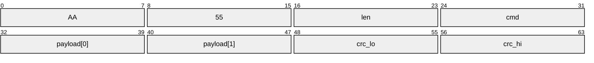
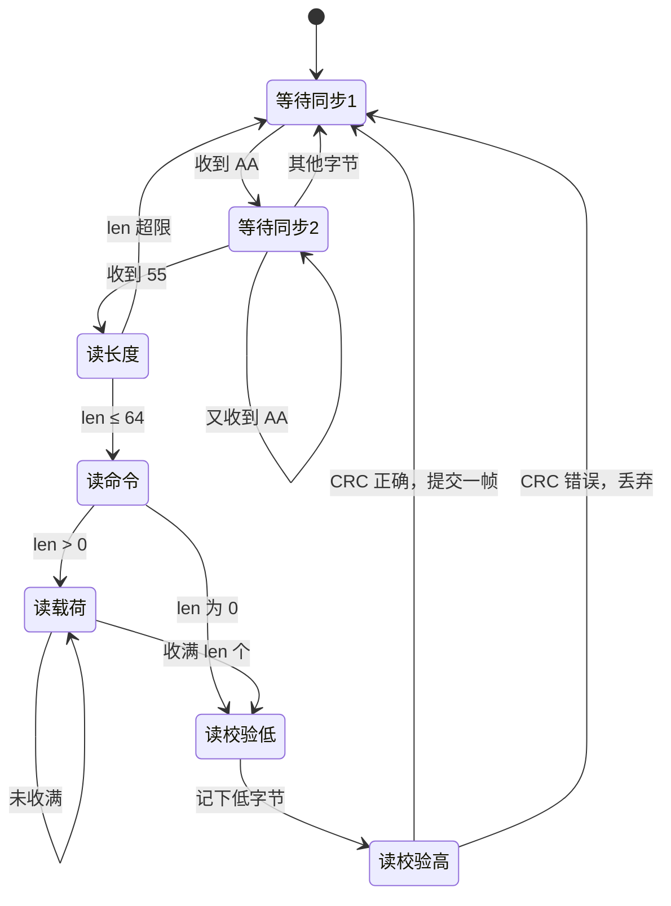
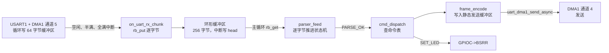

# 3.4 数据帧、环形缓冲区与状态机

上一节把串口接收改成了「DMA 循环写缓冲区 + 空闲中断通知」，数据不再丢，可新的问题马上出现：回调交给上层的是一段没有边界的字节。上位机发来一条命令，可能在传输中途被空闲中断切成两段，也可能两条命令紧挨着一次送达，线路受干扰时还会混进几个来路不明的字节。把这些字节原样打印出来是对的，想按命令处理就不行了。

本节补齐中间缺的三块：一个能在中断与主循环之间安全传递字节的环形缓冲区，一种带同步字节、长度和校验的帧格式，以及一个逐字节推进的解析状态机。三块拼起来就是一条完整的接收路径：中断往里放字节，主循环取出字节喂给解析器，解析器凑够一帧就交给命令分发。示例全部可以脱离硬件在 PC 上编译运行，拆包、粘包、干扰字节、坏帧这几种情形都能在终端里复现出来。

## 1. 字节流没有边界

串口是一条字节流，不保留任何「消息」的概念。发送方写三次、每次 10 个字节，接收方可能一次收到 30 个字节，也可能分五次收到 3、7、9、8、3 个字节，取决于两次调用之间的间隔和设备驱动内部的缓冲策略。

于是同一个「发送两条命令」的动作，接收端看到的情形至少有四种：

1. 一帧完整到达。第一条命令的所有字节在一次读取里全部给出。
2. 拆包。一条命令被切成几段，中间隔着若干毫秒的空闲。上一节的空闲中断恰好按段触发，回调被调用多次。
3. 粘包。两条命令的字节连在一起，一次读取全部给出。
4. 夹带干扰。线路噪声、上电瞬间的电平抖动、或者对方刚复位时输出的半帧，都会混进接收数据。

前三种靠「把字节先存起来、再按规则切开」解决，第四种靠「帧内自带校验」解决。存字节的容器要能承受「写的人快、读的人慢」这个时间差，环形缓冲区就是干这个的。

## 2. 环形缓冲区

环形缓冲区的结构极简：一个定长数组，两个下标，一个写下、一个读。

```c
struct ringbuf {
    uint8_t *buf;
    size_t cap;
    size_t mask;
    atomic_size_t head;
    atomic_size_t tail;
};
```

`cap` 是容量，`mask` 是 `cap - 1`。`head` 是写入位置，`tail` 是读取位置。两者都是无符号整数，并且**不做取模**：写完第 8 个字节，`head` 变成 8 而不是 0。

关键约定有三条。

**容量取 2 的幂**。这样「下标换算成数组位置」可以用按位与代替取模：`index = head & mask`。在 Cortex-M3 上，`&` 是一条指令，`%` 在没有硬件除法器的 M3 上要调用库函数，几十个周期。接收中断每来一个字节都要算一次位置，这个差别不小。

**下标自由增长，靠无符号回绕处理越界**。`head` 加到 `SIZE_MAX` 之后再加一，按无符号运算规则回到 0。由于「元素个数」是由差值算出来的，回绕之后差值仍然正确。

**元素个数等于 `head - tail`**。这是整套规则的核心。举一个具体例子：`head` 为 2，`tail` 为 0xFFFF_FFFE（假设是 32 位），直接相减得到 4，因为 2 − 0xFFFF_FFFE 按 32 位无符号运算等于 2 + 2 = 4。缓冲区里确实有 4 个字节。如果按「先取模再相减」的写法，`head` 取模后是 2，`tail` 取模后是 6，再相减得到 -4，必须额外判负，麻烦得多。

缓冲区满的判据同样简单：元素个数等于容量。

```c
bool rb_put(struct ringbuf *rb, uint8_t byte) {
    size_t head = atomic_load_explicit(&rb->head, memory_order_relaxed);
    size_t tail = atomic_load_explicit(&rb->tail, memory_order_acquire);

    if (head - tail == rb->cap) {
        return false;
    }

    rb->buf[head & rb->mask] = byte;
    atomic_store_explicit(&rb->head, head + 1u, memory_order_release);
    return true;
}

bool rb_get(struct ringbuf *rb, uint8_t *out) {
    size_t tail = atomic_load_explicit(&rb->tail, memory_order_relaxed);
    size_t head = atomic_load_explicit(&rb->head, memory_order_acquire);

    if (head == tail) {
        return false;
    }

    *out = rb->buf[tail & rb->mask];
    atomic_store_explicit(&rb->tail, tail + 1u, memory_order_release);
    return true;
}
```

`rb_put` 满时返回 `false` 而不是覆盖旧数据，`rb_get` 空时返回 `false` 而不是给出垃圾值。两个返回值都要检查，但正文里为了简洁往往省略。原子操作与内存序在下一节解释，这一节先把它们当成「普通的读写」看，功能上完全一样。

`rb_count` 与 `rb_free` 是两个查询：

```c
size_t rb_count(const struct ringbuf *rb) {
    size_t head = atomic_load_explicit(&rb->head, memory_order_acquire);
    size_t tail = atomic_load_explicit(&rb->tail, memory_order_acquire);
    return head - tail;
}

size_t rb_free(const struct ringbuf *rb) {
    return rb->cap - rb_count(rb);
}
```

测试程序把三种情形都跑一遍：填满、绕回数组开头、下标跨越 `SIZE_MAX`：

::: terminal title="PowerShell - 环形缓冲区的基本行为"

```text
$ gcc -std=c17 -Wall -Wextra test_ringbuf.c ringbuf.c -o test_ringbuf
$ ./test_ringbuf
[1] fill to capacity (cap=8)
    count=8, free=0, 9th put=false
[2] pop 5 bytes, then push 5 bytes (slot wrap-around)
    head=13 (slot 5), tail=5 (slot 5), count=8
    data: 15 16 17 A0 A1 A2 A3 A4
[3] unsigned index wrap-around across SIZE_MAX
    after 6 puts: head=3 (wrapped), tail=SIZE_MAX-2, head-tail=6
    data: 01 02 03 04 05 06
```

:::

第 1 组建了 8 字节的缓冲区，放满之后第 9 次 `rb_put` 返回 `false`，`free` 归零。

第 2 组先取走 5 个字节，`tail` 从 0 变成 5；再放 5 个字节，`head` 从 8 变成 13。此时 `head` 与 `tail` 换算成数组位置都是 5（13 & 7 与 5 & 7 都等于 5），看上去下标重合，但 `count` 是 8，正好等于容量，说明这是「满」而不是「空」。取出的字节顺序是 `15 16 17 A0 A1 A2 A3 A4`：前三个是第一次放进去的 0x10、0x11、0x12 剩下没读的，后面五个是新放的。数组里 0x13、0x14 两个旧字节已经被新数据覆盖，因为它们早就被读走了。

第 3 组把两个下标都设到 `SIZE_MAX - 2`，再放 6 个字节。`head` 跨过回绕点变成 3，`tail` 仍是 `SIZE_MAX - 2`，`head - tail` 等于 6，6 个字节一个不少地读了出来。这一组是「无符号下标」这个设计的价值所在：如果没有回绕，`head` 变成 3 之后，计数逻辑必须写成一堆分支。

::: concept emb-ring-free-growth-index title="环形缓冲区的下标规则"

容量取 2 的幂时，下标到数组位置的映射是 `index & (cap - 1)`。写入下标 `head` 与读取下标 `tail` 是无符号整数且只增不减，元素个数恒为 `head - tail`（无符号回绕仍然成立），满的条件是 `head - tail == cap`，空的条件是 `head == tail`。读写下标各自只由一个执行者修改，是本设计成立的前提。

:::

<Quiz
  type="single"
  :options="[
    { label: '2 个：head 与 tail 直接相减取绝对值', value: 'A' },
    { label: '4 个：无符号回绕后 head − tail 等于 4', value: 'B' },
    { label: '无法判断，需要看容量', value: 'C' },
    { label: '0 个：head 小于 tail，说明缓冲区是空的', value: 'D' }
  ]"
  answer="B"
>

<template #question>

一个 32 位的环形缓冲区里，`head` 为 2，`tail` 为 `0xFFFFFFFE`，此刻有多少个元素？

</template>

正确答案是 **B**。`head - tail` 在 32 位无符号运算下等于 2 − 0xFFFF_FFFE = 4。D 错在把「下标大小」当成了「先后顺序」：下标只增不减，回绕之后的 2 表示的是更晚的时刻。

</Quiz>

## 3. 中断与主循环共享

上一节的接收回调在中断上下文里执行，主循环在另一处读取，两边同时碰同一个环形缓冲区。这需要一点约定。

第一个约定：**每个下标只有一个写者**。中断（或 DMA 回调）只写 `head`，主循环只写 `tail`。`rb_put` 里没有读改写 `tail` 的地方，`rb_get` 里也没有读改写 `head` 的地方。只要守住这一条，两个执行者就不需要关中断来互斥——没有任何一个下标会被两边同时修改。

第二个约定：**先写数据，再推进下标，并且这个顺序要让另一方看得见**。

第二条比第一条难。C 语言里 `rb->buf[head & rb->mask] = byte;` 与随后的 `head` 更新是两条普通语句，编译器有权交换它们，只要单线程语义不变。单线程里当然不变：没有别的执行者观察中间状态。可这里有另一个执行者，它只认内存里的最终顺序。

`volatile` 解决不了这个问题。它保证的是「被 `volatile` 修饰的对象每次都真正访问内存、不被优化掉」，并不保证它与其他对象的访问顺序。

::: compare left-title="只把下标声明为 volatile" right-title="用 C11 原子类型与内存序"

```c
struct ringbuf_plain {
    uint8_t *buf;
    size_t cap;
    size_t mask;
    volatile size_t head;
    volatile size_t tail;
};

void put_plain(struct ringbuf_plain *rb, size_t head, uint8_t byte) {
    rb->buf[head & rb->mask] = byte;
    rb->head = head + 1u;
}
```

---

```c
#include <stdatomic.h>

struct ringbuf {
    uint8_t *buf;
    size_t cap;
    size_t mask;
    atomic_size_t head;
    atomic_size_t tail;
};

void put_atomic(struct ringbuf *rb, size_t head, uint8_t byte) {
    rb->buf[head & rb->mask] = byte;
    atomic_store_explicit(&rb->head, head + 1u, memory_order_release);
}
```

:::

两段代码在 ARM 上编译出来的差别只有一条指令。左边：

```text
	strb	r2, [ip, r3]        @ 写入数据字节
	str	r1, [r0, #12]       @ 推进 head
```

右边：

```text
	strb	r2, [ip, r3]        @ 写入数据字节
	dmb	ish                     @ 数据存储器屏障
	str	r1, [r0, #12]       @ 推进 head
```

`dmb ish` 是数据存储器屏障，它保证屏障之前的所有存储器访问都完成后，屏障之后的访问才开始。`memory_order_release` 的语义就落在这一条上：本次写入之前的所有写操作，对「以 acquire 方式读取该原子对象之后」的另一方可见。

在 Cortex-M3 这种单核、顺序执行的内核上，加上实际可用的编译器，左边这版在 `-O1`、`-O2`、`-O3`、`-Os` 下编译出来都是「先写数据、后写 head」。问题在于这只是一种实现选择，C 语言本身没有规定普通写入与 `volatile` 写入之间的先后。编译器只要认定两者互不干扰，交换顺序并不违反语言规则；换一个编译器、换一个版本、或者在更大的函数里内联之后，这个顺序都可能变。一旦真的变了，消费者会在 head 已经推进、数据还没落盘的窗口里读到旧字节，而且错误只在高负载或特定优化下出现。

`memory_order_acquire` 加在另一端的读取上。`rb_put` 读 `tail` 时用 acquire，`rb_get` 读 `head` 时也用 acquire，配合对方的 release 存储，构成一对完整的同步。

注意 `rb_count` 只做查询，不参与数据传递，它的两次读取都用了 acquire 也无害。

C11 的原子类型在 Cortex-M3 上是不是真的无锁，编译期就能确认。头文件里放一句断言：

```c
/* C11 编译期断言：确认目标平台上的整型原子操作是真正无锁的硬件指令 */
_Static_assert(ATOMIC_INT_LOCK_FREE == 2,
               "atomic int/size_t must be always lock-free");

struct ringbuf {
    /* … */
    atomic_size_t head;
    atomic_size_t tail;
};
```

`ATOMIC_INT_LOCK_FREE` 取 2 表示「总是无锁」，取 0 表示「从不是」，取 1 表示「运行时才知道」。取 0 或 1 时，`atomic_size_t` 的读写可能走 libatomic 的锁，在裸机上根本链接不进去。两个工具链都通过：

::: terminal title="bash - 确认原子类型无锁"

```text
$ arm-none-eabi-gcc -std=c11 -mcpu=cortex-m3 -mthumb -O2 -Wall -Wextra \
    -ffreestanding -c atomic_probe.c -o /dev/null
$ gcc -std=c17 -Wall -Wextra -c atomic_probe.c -o /dev/null
```

:::

两条命令都没有输出，表示断言成立。32 位的 `atomic_size_t` 在 Cortex-M3 上就是一条 `ldr` 或 `str` 加一条 `dmb`，没有库调用。

::: concept emb-ring-spsc-lock-free title="单生产者单消费者环形缓冲区无需关中断"

生产者只修改 `head`、消费者只修改 `tail` 时，两个下标不会被并发改写，因此不需要互斥。唯一要保证的是「数据先写、下标后更新」这个顺序对另一方可见，做法是在推进下标时使用 C11 的 release 存储，在读取对方下标时使用 acquire 载入。只用 `volatile` 不足以约束编译器与其他存储器访问的相对顺序。

:::

上面这套规则只适用于一个生产者、一个消费者。多个中断源都往同一个缓冲区里写（比如串口中断与定时器中断），就变成了多生产者，必须另外加临界区或者改用别的结构。[4.1 临界区与 RTOS 边界](/教程/正文/嵌入式/4_RTOS与固件架构/4_1_临界区与RTOS边界) 讨论这类情形；原子操作本身的语言规则见 [23.2 原子操作](/教程/正文/语法和标准库/23_原子操作与并发/23_2_原子操作)。

## 4. 帧格式

有了缓冲区，接下来要规定「哪些字节属于同一帧」。三种常见办法。

**分隔符**。用一个特殊字节标记帧尾。文本协议最典型：以 `\n` 结尾，之前的都算一行。二进制数据里如果也可能出现这个字节，就必须转义。SLIP（RFC 1055）用 `0xC0` 作帧尾，遇到数据里的 `0xC0` 与 `0xDB` 就替换成两字节序列；COBS 换了个思路，把数据里的 0 全部消掉，留出 `0x00` 专作分隔符，代价是每个 254 字节的块最多多出 1 个字节的开销。

**同步字节 + 长度**。帧头放一两个固定字节，随后跟长度字段，接收方读到长度就知道还要收多少。这种格式不需要转义，任意字节都能直接出现在载荷里，代价是「找同步」这件事要在字节流里做——数据里碰巧出现同步字节时，靠校验把它排掉。

**时间间隔**。靠线路上的静默时间来划分帧，Modbus RTU 就是这么做的：静默时间达到 3.5 个字符的传输时间，就认为一帧结束。它不需要额外的定界字节，但对定时精度有要求，[3.5 CAN 与 Modbus](/教程/正文/嵌入式/3_驱动_通信与中间件/3_5_CAN与Modbus) 会讲。

本节采用第二种，帧格式是这样：



图按发送顺序画，每个格子是一个字节，取载荷 2 字节的情形为例。载荷从 0 字节到 64 字节，帧的总长度随载荷变化。`AA 55` 是同步字节，`len` 是载荷长度（0～64），`cmd` 是命令码，载荷之后是两个字节的 CRC，低字节先发。

::: concept emb-frame-wire-format title="本页的帧格式"

一帧由六个部分按固定顺序组成：同步字节 `0xAA`、同步字节 `0x55`、载荷长度 `len`（0～64）、命令码 `cmd`、`len` 个载荷字节、CRC-16/CCITT-FALSE 的低字节与高字节。CRC 覆盖 `len`、`cmd` 与全部载荷，不含两个同步字节；多字节字段一律小端，低字节先发。

:::

选 CRC 而不是简单的累加和，是因为累加和对「两个字节调换顺序」「某一位翻转两次」这类错误不敏感。CRC-16/CCITT-FALSE 的参数是：多项式 `0x1021`，初值 `0xFFFF`，输入输出都不反转，结果不异或。它的标准校验值是 `"123456789"` 算出 `0x29B1`：

```c
uint16_t crc16_ccitt_update(uint16_t crc, const uint8_t *data, size_t len) {
    for (size_t i = 0u; i < len; ++i) {
        crc ^= (uint16_t)data[i] << 8;
        for (int bit = 0; bit < 8; ++bit) {
            if ((crc & 0x8000u) != 0u) {
                crc = (uint16_t)((crc << 1) ^ 0x1021u);
            } else {
                crc = (uint16_t)(crc << 1);
            }
        }
    }
    return crc;
}

uint16_t crc16_ccitt(const uint8_t *data, size_t len) {
    return crc16_ccitt_update(CRC16_CCITT_INIT, data, len);
}
```

这段代码逐位计算，慢但不需要查表，64 字节的载荷大约几百个周期。用校验值验证实现是最省事的办法：

::: terminal title="PowerShell - 用标准校验值验证 CRC 实现"

```text
$ ./test_frame
CRC-16/CCITT-FALSE("123456789") = 0x29B1
```

:::

`0x29B1` 对上，说明多项式、初值、移位方向全对。换一个参数（比如把初值改成 0，或者把多项式写成 `0x8005`）就算不出这个值，这是比「拿自己的实现校验自己」可靠得多的验证方式。

帧的编码要逐字段写，不能把结构体直接 `memcpy` 到发送缓冲区：

::: compare left-title="直接发送结构体" right-title="逐字段编码"

```c
struct status_msg {
    uint8_t cmd;
    uint32_t value;
};

struct status_msg m;
memset(&m, 0, sizeof m);
m.cmd = 0x02;
m.value = 0x00010203u;
memcpy(wire, &m, sizeof m);
/* wire 上是 8 个字节 */
```

---

```c
uint8_t wire[5];

wire[0] = 0x02u;
wire[1] = (uint8_t)(value & 0xFFu);
wire[2] = (uint8_t)((value >> 8) & 0xFFu);
wire[3] = (uint8_t)((value >> 16) & 0xFFu);
wire[4] = (uint8_t)((value >> 24) & 0xFFu);
/* wire 上是 5 个字节，字节序由代码写死 */
```

:::

左边在 64 位主机上跑一遍，`sizeof(struct status_msg)` 是 8，`memcpy` 出来的 8 个字节是：

::: terminal title="PowerShell - 结构体里多出来的字节"

```text
$ ./pad_demo
sizeof(struct status_msg) = 8
wire: 02 00 00 00 03 02 01 00
```

:::

`cmd` 占 1 个字节，`value` 是 4 字节整数，为了让它对齐到 4 的倍数，编译器在两者之间插了 3 个填充字节；整条消息再补齐到 4 的倍数，末尾又多了 1 个字节。填充字节的内容是未定义的，`memset` 之后就变成 0，可换成别的初始化方式就可能是垃圾。同样两个字段的结构体在 Cortex-M3 上也是 8 字节、`value` 的偏移也是 4（用 `_Static_assert` 核对过），可只要某个平台的对齐要求不同，或者给结构体加一个 `packed` 属性，大小就变成 5，字段偏移也跟着变。字节序同样不由代码决定，小端机器上 `0x00010203` 发出去是 `03 02 01 00`，大端机器上是 `00 01 02 03`。

右边同样是这五个字节，但是由代码一个一个写出来的，长度、顺序、字节序全在源码里，与编译器和处理器无关。解码用的也是逐字节拼接：

```c
value = (uint32_t)payload[0]
      | ((uint32_t)payload[1] << 8)
      | ((uint32_t)payload[2] << 16)
      | ((uint32_t)payload[3] << 24);
```

多字节字段在线上的字节序必须在协议文档里写死。本节统一用小端（低字节先发），与 STM32 的存储顺序一致，读代码时不容易搞混；用什么顺序本身无所谓，两端一致就行。

::: warning 结构体不能直接当线路格式

`struct` 的布局受对齐规则、编译器扩展、目标平台的字长影响，`sizeof` 也不等于各字段大小之和。把它整个 `memcpy` 到发送缓冲区，等于把编译器的实现细节发到线上；换一个编译器或者加一个字段，对方就解析不出来了。

:::

`frame_encode` 负责把命令、载荷与校验拼成完整的一帧：

```c
size_t frame_encode(uint8_t *out_buf,
                    size_t out_cap,
                    uint8_t cmd,
                    const uint8_t *payload,
                    uint8_t len) {
    if (out_buf == NULL || len > FRAME_MAX_PAYLOAD) {
        return 0u;
    }
    if (len > 0u && payload == NULL) {
        return 0u;
    }
    size_t total = (size_t)len + FRAME_OVERHEAD;
    if (out_cap < total) {
        return 0u;
    }

    out_buf[0] = FRAME_SYNC1;
    out_buf[1] = FRAME_SYNC2;
    out_buf[2] = len;
    out_buf[3] = cmd;
    if (len > 0u) {
        memcpy(&out_buf[4], payload, len);
    }

    uint16_t crc = crc16_ccitt(&out_buf[2], (size_t)len + 2u);
    out_buf[4u + len] = (uint8_t)(crc & 0xFFu);
    out_buf[5u + len] = (uint8_t)((crc >> 8) & 0xFFu);
    return total;
}
```

CRC 覆盖的范围是 `len` 与 `cmd` 加上载荷，不含同步字节。同步字节不参与校验是有意的：它在找同步阶段就被消费掉了，万一数据里混进 `AA 55`，后面的长度与校验会把这一帧否掉。

`FRAME_OVERHEAD` 是 6：两个同步字节、一个长度、一个命令、两个 CRC。

<Quiz
  type="single"
  :options="[
    { label: '不对：收发双方自己商定字节序即可，与代码无关', value: 'A' },
    { label: '不对：多字节字段统一小端，并且在协议里写明', value: 'B' },
    { label: '对：STM32 是小端芯片，所以线上自然就是小端', value: 'C' },
    { label: '对：只要两端都用同一个编译器，字节序一定一致', value: 'D' }
  ]"
  answer="B"
>

<template #question>

只要收发双方都是小端机器，多字节字段的字节序就不用管了。这个说法对吗？

</template>

正确答案是 **B**。字节序是协议的一部分，必须在文档里写死并由代码逐字节实现，否则换一个大端的上位机、或者中间加一个网关，数据就解析错了。C 只说明了自己这边的存储顺序，D 把编译器当成了字节序的保证，两者都不构成协议。

</Quiz>

## 5. 状态机解析

解析器每收到一个字节就推进一步，收到完整且校验正确的一帧时返回成功。七个状态对应帧的七个部分：



实现用 `enum` 加 `switch`，这是最直白的写法，改起来也方便：

```c
enum parser_state {
    PARSE_WAIT_SYNC1 = 0,
    PARSE_WAIT_SYNC2,
    PARSE_LEN,
    PARSE_CMD,
    PARSE_PAYLOAD,
    PARSE_CRC_LO,
    PARSE_CRC_HI,
};

enum parser_result {
    PARSE_INCOMPLETE = 0,
    PARSE_OK         = 1,
    PARSE_ERR_LEN    = -1,
    PARSE_ERR_CRC    = -2,
};

enum parser_result parser_feed(struct frame_parser *p,
                               uint8_t byte,
                               struct frame *out_frame) {
    switch (p->state) {
    case PARSE_WAIT_SYNC1:
        if (byte == FRAME_SYNC1) {
            p->state = PARSE_WAIT_SYNC2;
        }
        return PARSE_INCOMPLETE;

    case PARSE_WAIT_SYNC2:
        if (byte == FRAME_SYNC2) {
            p->state = PARSE_LEN;
        } else if (byte == FRAME_SYNC1) {
            p->state = PARSE_WAIT_SYNC2;
        } else {
            p->state = PARSE_WAIT_SYNC1;
        }
        return PARSE_INCOMPLETE;

    case PARSE_LEN:
        if (byte > FRAME_MAX_PAYLOAD) {
            p->err_len_count++;
            p->state = PARSE_WAIT_SYNC1;
            return PARSE_ERR_LEN;
        }
        p->working.len = byte;
        p->crc_calc = crc16_ccitt_update(CRC16_CCITT_INIT, &byte, 1u);
        p->state = PARSE_CMD;
        return PARSE_INCOMPLETE;

    case PARSE_CMD:
        p->working.cmd = byte;
        p->crc_calc = crc16_ccitt_update(p->crc_calc, &byte, 1u);
        p->idx = 0u;
        if (p->working.len == 0u) {
            p->state = PARSE_CRC_LO;
        } else {
            p->state = PARSE_PAYLOAD;
        }
        return PARSE_INCOMPLETE;

    case PARSE_PAYLOAD:
        p->working.payload[p->idx++] = byte;
        p->crc_calc = crc16_ccitt_update(p->crc_calc, &byte, 1u);
        if (p->idx >= p->working.len) {
            p->state = PARSE_CRC_LO;
        }
        return PARSE_INCOMPLETE;

    case PARSE_CRC_LO:
        p->crc_rx = (uint16_t)byte;
        p->state = PARSE_CRC_HI;
        return PARSE_INCOMPLETE;

    case PARSE_CRC_HI:
        p->crc_rx |= (uint16_t)byte << 8;
        p->state = PARSE_WAIT_SYNC1;
        if (p->crc_rx == p->crc_calc) {
            p->ok_count++;
            *out_frame = p->working;
            return PARSE_OK;
        }
        p->err_crc_count++;
        return PARSE_ERR_CRC;

    default:
        p->state = PARSE_WAIT_SYNC1;
        return PARSE_INCOMPLETE;
    }
}
```

几个细节。

**CRC 边收边算**，不在收满之后再遍历一遍载荷。`PARSE_LEN` 与 `PARSE_CMD` 两个状态各算一个字节，`PARSE_PAYLOAD` 每收一个算一个，收满载荷时 `crc_calc` 已经就绪，直接从 `PARSE_CRC_LO` 开始比对。这样解析器不需要额外的循环，也不会因为忘记把 `len` 与 `cmd` 算进去而算错。

**`PARSE_WAIT_SYNC2` 收到第二个 `AA` 时停在原地**。如果只写「不是 `55` 就回 `WAIT_SYNC1`」，那么流 `AA AA 55 ...` 会丢掉同步：第一个 `AA` 进入 `WAIT_SYNC2`，第二个 `AA` 不对，退回 `WAIT_SYNC1`，第三个字节 `55` 不是 `AA`，再一次退回。正确的结果应当是第二个 `AA` 被当成新的帧头。这一支就是为此而写的。

**失败之后回到 `WAIT_SYNC1`**，不是回到上一个状态。长度超限说明这一帧的结构已经不可信，继续往下读只会把后面的字节也读串；CRC 错误同理。从头重新找同步是最不容易出错的选择。

**出错时返回负值**，调用方可以选择记录日志、发一个错误应答，或者什么都不做。返回 0 表示「还没收完」，1 表示「收到一帧」，这三个返回值把「继续」「成功」「失败」区分开了。

`default` 分支本身不该被执行，写上是为了让状态对象被意外改坏时能退回到安全状态。

同一件事也可以用表驱动实现：把「当前状态、输入字节 → 下一状态、动作」做成一张二维表，`switch` 换成一次查表。状态少的时候表驱动更冗长，状态多到二十几个、转移规则复杂时才显出优势。本节用 `switch`，`switch` 与状态机的对应关系在 [12.4 switch 与状态机](/教程/正文/语法和标准库/12_函数接口进阶/12_4_switch与状态机) 里有更细的讨论。

一个致命但常被忽略的情形是半帧。对方发到一半断电、复位，或者线路断了，解析器会永远停在 `PARSE_PAYLOAD`。此后所有正常的帧都被当成载荷的一部分，直到某个字节凑巧让它走到 `PARSE_CRC_HI` 并校验失败，才退回 `WAIT_SYNC1`。解决办法是加一个半帧超时：距离上一个字节超过 50 ms 还没收齐，就把状态复位。超时需要知道时间，所以解析器的接口要多一个时间参数，或者由调用方在别处检测。

<Quiz
  type="multi"
  :options="[
    { label: '出现长度超限时回到 WAIT_SYNC1，重新找帧头', value: 'A' },
    { label: 'CRC 校验失败后停在 PARSE_CRC_HI，等下一个字节再判断', value: 'B' },
    { label: '在 WAIT_SYNC2 收到第二个 0xAA 时停在 WAIT_SYNC2', value: 'C' },
    { label: '收到完整一帧后进入一个「等待确认」状态，直到上层应答', value: 'D' }
  ]"
  :answer="['A', 'C']"
>

<template #question>

关于本节的解析器，下列说法正确的是哪些？

</template>

正确答案是 **A、C**。长度超限和 CRC 错误都意味着这一帧的结构已经不可信，必须回到找同步的状态；`WAIT_SYNC2` 遇到第二个 `0xAA` 时停在原地，才不会把连着的两个 `AA` 当中的一个丢掉。B 会让解析器在错误状态下继续吞字节，D 把「解析」和「通信握手」混成了一件事。

</Quiz>

::: generate emb-frame-parser-walkthrough kind=explanation concepts=emb-ring-free-growth-index,emb-frame-wire-format

面向第一次写逐字节解析器的读者，以「一帧 8 字节被切成 3 + 3 + 2 三段送达」为例，按字节走一遍状态机的七个状态，每一段结束时指出当前停在哪个状态、`crc_calc` 已经累积到哪几个字节、为什么第二段结束时还没有提交任何帧。不引入新的状态，只用本页给出的状态转移。

:::

## 6. 命令分发与应答

解析器交出一帧之后，要按 `cmd` 找到对应的处理函数。用一组 `{命令码, 函数指针}` 做表，比一长串 `if-else` 好维护：加一条命令只改表，不动分发逻辑。

```c
typedef void (*cmd_handler_fn)(struct device_state *dev,
                               const struct frame *req,
                               struct frame *resp);

struct cmd_entry {
    uint8_t cmd;
    cmd_handler_fn handler;
};

static const struct cmd_entry g_cmd_table[] = {
    { CMD_PING,       handle_ping       },
    { CMD_GET_STATUS, handle_get_status },
    { CMD_SET_LED,    handle_set_led    },
};

void cmd_dispatch(struct device_state *dev,
                  const struct frame *req,
                  struct frame *resp) {
    dev->rx_frames++;
    size_t n = sizeof(g_cmd_table) / sizeof(g_cmd_table[0]);
    for (size_t i = 0u; i < n; ++i) {
        if (g_cmd_table[i].cmd == req->cmd) {
            g_cmd_table[i].handler(dev, req, resp);
            return;
        }
    }

    resp->cmd = CMD_ERROR;
    resp->len = 2u;
    resp->payload[0] = req->cmd;
    resp->payload[1] = ERR_UNKNOWN_CMD;
}
```

三条命令分别是：`CMD_PING`（0x01）原样回显载荷，`CMD_GET_STATUS`（0x02）返回 4 字节运行时间加 2 字节收帧计数，`CMD_SET_LED`（0x03）设置 LED 并回显状态。应答的 `cmd` 是请求的 `cmd` 按位或上 `0x80`，请求与应答在命令码的最高位上就分开了。

未知命令回一帧 `CMD_ERROR`（0xFF），载荷是「不认识的命令码 + 错误码 0x01」。参数不合法时同样回 `CMD_ERROR`，错误码是 0x02。调用方靠这两级信息判断问题出在协议层还是参数层。

状态应答的 6 个字节逐字节写，不直接发结构体：

```c
    resp->cmd = (uint8_t)(req->cmd | CMD_RESP_MASK);
    resp->len = 6u;
    /* 逐字节按小端编码，避免结构体对齐填充与字节序问题 */
    resp->payload[0] = (uint8_t)(dev->uptime_ms & 0xFFu);
    resp->payload[1] = (uint8_t)((dev->uptime_ms >> 8) & 0xFFu);
    resp->payload[2] = (uint8_t)((dev->uptime_ms >> 16) & 0xFFu);
    resp->payload[3] = (uint8_t)((dev->uptime_ms >> 24) & 0xFFu);
    resp->payload[4] = (uint8_t)(dev->rx_frames & 0xFFu);
    resp->payload[5] = (uint8_t)((dev->rx_frames >> 8) & 0xFFu);
```

这与第 4 节的规则一致：线上一律逐字节写出，字节序固定为小端。

## 7. 在 PC 上测试

测试程序把环形缓冲区、解析器、分发三件串起来，用一个 `feed_stream` 模拟「一次读到若干字节」：

```c
static void feed_stream(struct ringbuf *rb,
                        struct frame_parser *parser,
                        struct device_state *dev,
                        const uint8_t *chunk,
                        size_t chunk_len) {
    for (size_t i = 0u; i < chunk_len; ++i) {
        (void)rb_put(rb, chunk[i]);
    }

    uint8_t byte = 0u;
    while (rb_get(rb, &byte)) {
        struct frame req;
        enum parser_result res = parser_feed(parser, byte, &req);
        if (res == PARSE_OK) {
            /* 分发并编码应答，略 */
        } else if (res == PARSE_ERR_CRC) {
            /* 记录坏帧，略 */
        } else if (res == PARSE_ERR_LEN) {
            /* 记录长度错误，略 */
        }
    }
}
```

每次调用先往缓冲区里放一批字节，再全部取出来喂给解析器，模拟一次「中断收了一批、主循环处理一批」的循环。这在 PC 上完全等价于真实的时序，因为它检验的正是「分几次到达」这件事。

五组测试依次是：完整一帧、拆成三段、两帧粘连、前置垃圾字节、坏帧加未知命令。

::: terminal title="PowerShell - 五组帧解析测试"

```text
$ gcc -std=c17 -Wall -Wextra test_frame.c ringbuf.c crc16.c frame.c -o test_frame
$ ./test_frame
CRC-16/CCITT-FALSE("123456789") = 0x29B1

[Case 1] Single complete frame (PING "Hi")
  raw wire (8 B): AA 55 02 01 48 69 72 27
  -> RX frame: cmd=0x01 len=2 payload=48 69 
  <- TX resp  (8 B): AA 55 02 81 48 69 28 1C

[Case 2] One frame split into 3 chunks
  chunk 1 (3 B)...
  chunk 2 (3 B)...
  chunk 3 (4 B)...
  -> RX frame: cmd=0x01 len=4 payload=10 20 30 40 
  <- TX resp  (10 B): AA 55 04 81 10 20 30 40 00 50

[Case 3] Two back-to-back frames in one read
  -> RX frame: cmd=0x03 len=1 payload=01 
  <- TX resp  (7 B): AA 55 01 83 01 46 A5
  -> RX frame: cmd=0x02 len=0 payload=
  <- TX resp  (12 B): AA 55 06 82 40 E2 01 00 04 00 00 D5

[Case 4] Leading noise bytes (00 FF AA 12 AA) before valid frame
  -> RX frame: cmd=0x02 len=0 payload=
  <- TX resp  (12 B): AA 55 06 82 40 E2 01 00 05 00 31 E6

[Case 5] Corrupted frame followed by unknown command 0x99
  -> RX error: CRC mismatch (err_crc=1)
  -> RX frame: cmd=0x99 len=0 payload=
  <- TX resp  (8 B): AA 55 02 FF 99 01 99 14

Summary: ok=6, err_crc=1, err_len=0, led=1
```

:::

逐组看。

第 1 组，`AA 55 02 01 48 69` 是帧头加长度、命令与 `"Hi"` 两个字节，`72 27` 是 CRC 的低字节与高字节。应答 `AA 55 02 81 48 69 28 1C` 的命令码变成 0x81，载荷不变，CRC 重新计算。

第 2 组值得注意的地方是：三段分别到达，而 `parser_feed` 是逐字节推进的，无论怎么切都不影响最终结果。测试里三段的分法（3、3、4）是随意的，换成 1、6、3 结果一样。这正是状态机相对「攒够再解析」的优势。

第 3 组一次读到两帧。解析器提交第一帧后状态已经回到 `WAIT_SYNC1`，剩下的字节继续新一轮，于是第二个 `PARSE_OK` 在同一次 `while` 循环里就出现了。粘包不需要任何特殊处理。

第 4 组前置了 `00 FF AA 12 AA` 五个垃圾字节，紧接着是一帧真正的 `AA 55 00 02 ...`（`GET_STATUS`，载荷为空）。前两个字节在 `WAIT_SYNC1` 里被丢弃；第三个 `AA` 让它进入 `WAIT_SYNC2`；第四个 `12` 不对，退回 `WAIT_SYNC1`；第五个 `AA` 又进入 `WAIT_SYNC2`。这时真正的帧头第一个字节 `AA` 到了，`WAIT_SYNC2` 走到「又收到 `AA`」那一支，停在原地；下一个字节 `55` 才让它进入 `LEN`。这一组同时验证了两件事：垃圾字节之后能重新找同步，以及连续两个 `AA` 不会把帧头吃掉——后者正是第 5 节强调的那条自环。

第 5 组把载荷中的一个位翻掉，制造 CRC 错误。解析器报 `PARSE_ERR_CRC` 并把状态复位；紧随其后的第二帧命令码是 0x99，表里没有，分发函数回一帧错误应答，载荷 `99 01` 表示「命令 0x99，错误码 0x01（未知命令）」。

最后一行 `ok=6, err_crc=1, led=1` 是三个计数器与 LED 状态的汇总：6 帧成功、1 帧校验失败、LED 处于点亮状态（第 3 组的 `SET_LED` 设的）。

整个测试不碰任何寄存器，用 `gcc` 一条命令就能跑。这是第 3.1 节「在 PC 上替换实现」的直接收益：协议逻辑与硬件彻底分开，测试可以在每次改动后立刻重跑。

## 8. 接到串口上

把三块接进固件，数据流是：DMA 循环接收 → 环形缓冲区 → 主循环取字节 → 解析器 → 分发 → 非阻塞发送。



中断侧只需要一个回调，把收到的字节逐个放进环形缓冲区。这个回调是环形缓冲区唯一的写者：

```c
static struct uart_dma_handle g_uart1;
static uint8_t g_rx_rb_mem[256];
static struct ringbuf g_rx_rb;
static struct frame_parser g_parser;
static struct device_state g_dev;

/* 发送缓冲区采用静态存储期，保证 DMA 传输期间一直有效 */
static uint8_t g_tx_frame_buf[FRAME_MAX_WIRE];

/* 在 DMA 半传输/全传输/USART IDLE 中断回调中作为唯一生产者写入环形缓冲区 */
static void on_uart_rx_chunk(const uint8_t *data, size_t len, void *user_data) {
    struct ringbuf *rb = (struct ringbuf *)user_data;
    for (size_t i = 0u; i < len; ++i) {
        (void)rb_put(rb, data[i]);
    }
}
```

主循环每次取一个字节喂给解析器，凑成一帧就分发、把应答交给 DMA 发出：

```c
    for (;;) {
        uint8_t byte = 0u;
        while (!uart_dma1_tx_busy(&g_uart1) && rb_get(&g_rx_rb, &byte)) {
            struct frame req;
            if (parser_feed(&g_parser, byte, &req) == PARSE_OK) {
                struct frame resp;
                cmd_dispatch(&g_dev, &req, &resp);
                board_led_apply(g_dev.led_on);

                size_t tx_len = frame_encode(g_tx_frame_buf,
                                             sizeof(g_tx_frame_buf),
                                             resp.cmd,
                                             resp.payload,
                                             resp.len);
                if (tx_len > 0u) {
                    (void)uart_dma1_send_async(&g_uart1,
                                               g_tx_frame_buf,
                                               (uint16_t)tx_len,
                                               NULL, NULL);
                    break;
                }
            }
        }
    }
```

`while` 的条件里带 `!uart_dma1_tx_busy()`，是为了避免上一帧应答还在发送时又编码下一帧，把 `g_tx_frame_buf` 覆盖掉。这正是 3.3 第 3 节那条缓冲区所有权规则：DMA 还在读的缓冲区不能改。`break` 在成功启动一次发送之后退出内层循环，等发送完成再继续处理。

发送缓冲区是 70 字节（`FRAME_MAX_WIRE`），接收缓冲区是 256 字节，两者都放在静态存储期。这个固件的 `size` 输出是：

::: terminal title="bash - 带帧解析的固件目标"

```text
$ arm-none-eabi-size uart_frame_demo.elf
   text	   data	    bss	    dec	    hex	filename
   2212	      0	   2064	   4276	   10b4	uart_frame_demo.elf
```

:::

`bss` 从 3.3 的 1888 涨到 2064。两个固件里都有链接脚本预留的 1536 字节堆栈，把它减掉之后，本页多出来的部分用 `nm -S` 能逐个看到：`g_rx_rb_mem` 占 256 字节、`g_parser` 84 字节、`g_rx_rb` 20 字节、`g_dev` 8 字节，而发送缓冲区从 3.3 的 128 字节缩到了 70 字节。20 KB 的 SRAM 里这点开销不算什么，可容量一旦紧张，256 字节这个数就该按实际波特率与主循环周期算：缓冲区要能装下「主循环最坏情况下停顿期间收到的全部字节」。

文本命令行是同一套结构的简化版。不需要帧头和 CRC，只要按行切分：环形缓冲区里取字节，遇到 `\n` 就把这一行交给命令解析，按空格切成若干个词，第一个词匹配命令名，其余当参数。环形缓冲区、逐字节喂入、遇到分隔符提交，这三件事与本节完全一样，差别只在「一帧的边界怎么定义」。3.8 讲 AT 命令时会看到同一套结构处理另一种文本协议。

## 9. 习题

### 9.1 巩固

<Exercise id="63325" :d="1" :w="2">

一个容量 8 的环形缓冲区，`rb_init` 之后依次执行：

1. 写入 `0x10` 到 `0x17` 共 8 个字节。
2. 再写一个 `0x18`。
3. 取走 3 个字节。
4. 写入 `0xA0`、`0xA1`。

写出每一步之后的 `head`、`tail`、`rb_count()`、`rb_free()`，以及第 3 步取出的三个字节、第 4 步之后再取一个字节拿到的是什么。第 2 步的返回值是什么，为什么不是覆盖旧数据。

</Exercise>

<Exercise id="63326" :d="2" :w="2">

用第 4 节的 `frame_encode` 编码 `cmd = 0x04`、载荷 `"ABC"` 的一帧。

1. 写出这 9 个字节，标出其中哪些字节参与 CRC。
2. 把 `frame_encode` 里计算 CRC 的调用改成从 `out_buf[0]` 开始、长度 `len + 4`，重新编译并运行 `test_frame`。哪一组测试先失败，输出变成了什么样？
3. 恢复上一步，再把 CRC 的两个字节改成高字节在前。`test_frame` 还能通过吗？要同时改解析器的哪两行才能重新通过？

</Exercise>

<Exercise id="63327" :d="3" :w="2">

`parser_feed` 依次收到下面的字节：

```text
AA 55 41 01 AA 55 00 02 4D 3D AA 55 01 03 05 00 00
```

1. 写出每个字节处理完之后的状态，以及 `ok_count`、`err_len_count`、`err_crc_count` 的最终值。
2. 第三个 `AA 55` 开头的那一帧，本意是 `cmd = 0x03`、载荷 `0x05`。它的 CRC 应该是多少？把最后两个字节换成正确的值，三个计数器变成多少？
3. 第一个 `AA 55` 之后跟着 `0x41`，解析器报告的是哪一种错误？如果 `0x41` 换成 `0x10`，结果会不同吗？

</Exercise>

### 9.2 编程

<Exercise id="63328" :d="3" :w="3">

`code/嵌入式/3_驱动_通信与中间件/3_4_数据帧_环形缓冲区与状态机/exercises/rb_bulk_starter.c` 已经写好了 `main` 与测试序列，缺 `rb_write`、`rb_read` 两个函数。按文件里的四条要求补全，然后：

1. 用 `gcc -std=c17 -Wall -Wextra rb_bulk_starter.c ../ringbuf.c -o rb_bulk` 编译运行，贴出输出。
2. 解释 `w2` 为什么是 6 而不是 8，`r2` 为什么是 8。
3. 把测试序列改成「写 6、读 4、再写 8」，先预测三个返回值，再运行核对。
4. 用 `-fsanitize=address` 再跑一遍。

验收：输出第一行是 `w1=6 r1=4 w2=6 r2=8`，`data:` 后面是 `5 6 10 20 30 40 50 60`。

</Exercise>

<Exercise id="63329" :d="3" :w="3">

`.../exercises/timeout_parser_starter.c` 只差 `timeout_parser_feed` 的实现，文件注释里写了三条要求。

1. 补全后运行，确认输出 `res=1 (expected 1), cmd=0x02, timeout_count=1 (expected 1)`。
2. 把 `PARSER_TIMEOUT_MS` 分别改成 20 与 100 各跑一次。两次结果不同，分别解释原因。
3. 超时判断写的是 `(uint32_t)(now_ms - tp->last_rx_ms) > PARSER_TIMEOUT_MS`，而不是 `now_ms > tp->last_rx_ms + PARSER_TIMEOUT_MS`。说明前者在 `now_ms` 回绕之后仍然成立的理由。

</Exercise>

<Exercise id="63330" :d="4" :w="4">

COBS 编解码，起始代码在 `.../exercises/cobs_starter.c`。

1. 实现 `cobs_encode` 与 `cobs_decode`，编码结果中不能出现 `0x00`。
2. 用文件里 `main` 的测试向量验证：`11 22 00 33 00 00 44` 应编码成 `03 11 22 02 33 01 02 44`。
3. 另写三个测试：连续 254 个非零字节、连续 255 个非零字节、单个 `0x00`。分别报告编码后的字节数与首尾字节，说明多出来的字节从哪来。
4. 让 `cobs_decode` 在 `code` 字节指向的长度超出剩余输入时返回 0，用一个被截断的编码串验证。
5. 把帧的定界方式换成「COBS 载荷 + `0x00` 帧尾」，与第 4 节的同步字节方案相比，最坏情况下每 254 字节多几个字节，解析器少做了哪些事。

</Exercise>

<Exercise id="63331" :d="4" :w="4">

给命令表加一条 `CMD_ECHO`（`0x04`）：把载荷原样复制进应答、字节顺序反转，应答命令码为 `0x84`；载荷超过 16 字节时回 `CMD_ERROR`，错误码用 `ERR_BAD_PARAM`。

1. 在 `frame.h` 加枚举值，在 `frame.c` 写处理函数并登记进 `g_cmd_table`，其余代码不动。
2. 写一个宿主机测试，发 `AA 55 03 04 41 42 43 BB 0C`，期望收到 `AA 55 03 84 43 42 41 A1 9F`。
3. 再发一帧 17 字节载荷，期望收到 `AA 55 02 FF 04 02 4D 4A`。说明错误应答里的第一个载荷字节为什么是 `0x04` 而不是 `0x84`。
4. 统计两种情况下 `dev.rx_frames` 各增加几次，说明 `cmd_dispatch` 把计数放在查表之前带来的影响。

</Exercise>

### 9.3 综合与挑战

<Exercise id="63332" :d="5" :w="4">

内存序实验。把 `ringbuf.c` 复制两份，一份保留 `memory_order_release` 与 `memory_order_acquire`，另一份全部换成 `memory_order_relaxed`。

1. 用 `arm-none-eabi-gcc -mcpu=cortex-m3 -mthumb -O2 -ffreestanding -S` 各生成一份汇编，数一数 `dmb ish` 各有几条，贴出 `rb_put` 里写数据与推进 `head` 之间的几条指令。
2. 把优化级别换成 `-O0`、`-O1`、`-O3` 各做一遍。哪种级别下两版的指令顺序看不出差别，原因是什么？
3. 在 x86-64 主机上重复第 1 步，说明为什么 x86 的 release 存储不需要额外指令，Cortex-M3 却需要。
4. 只保留 `rb_get` 里的 acquire、去掉 `rb_put` 里的 release，可以吗？从「谁需要看到谁的写入」回答。

</Exercise>

<Exercise id="63333" :d="6" :w="5">

拆包等价性测试。写一个测试程序，验证一帧数据无论被切成几段、以什么顺序到达，解析结果都一样。

1. 用固定种子生成 200 帧，命令码取 1 到 5，载荷长度 0 到 64，内容随机，拼成一条字节流。
2. 写一个 `feed_chunks`：把流按 1 到 7 字节随机切块，每块先逐个 `rb_put` 进 256 字节的环形缓冲区，再全部 `rb_get` 出来喂给 `parser_feed`，记录提交的每一帧。
3. 与「整条流一次喂完」的结果逐帧比较，必须完全一致，最后打印 `frames=200 mismatches=0`。
4. 在流里随机插入 0 到 3 个不为 `0xAA` 的垃圾字节，成功帧数是否变化？把一个垃圾字节换成 `0xAA` 呢？
5. 保留切块方式，但把每块之后的取出改成只取 3 个字节，缓冲区仍是 256 字节。运行后说明丢帧发生在哪一步，`rb_put` 的返回值在这里能提供什么信息。

</Exercise>

<Exercise id="63334" :d="6" :w="5" scope="*">

表驱动解析器。把第 5 节的 `switch` 改成一张二维表：行是七个状态，列是「字节类别」（`0xAA`、`0x55`、长度合法、长度超限、其他），表项是「下一状态 + 动作」。

1. 设计表结构与动作枚举，重写 `parser_feed`，七个状态与四个返回值保持不变。
2. 用 63333 的随机流分别喂两版实现，逐字节比较状态与返回值，必须完全一致。
3. 用 `arm-none-eabi-gcc -Os` 编译两版，比较 `frame.o` 的 `.text` 段大小（`arm-none-eabi-size` 或 `nm -S`）。
4. 用一两句话说明状态增加到 20 个时，两版各要改哪些地方。

</Exercise>

## 10. 参考资料

1. [RFC 1055: A Nonstandard for Transmission of IP Datagrams over Serial Lines: SLIP](https://www.rfc-editor.org/rfc/rfc1055)：以 `0xC0` 作帧尾、`0xDB` 作转义符的分帧方式。
2. Stuart Cheshire、Mary Baker, [*Consistent Overhead Byte Stuffing*](http://www.stuartcheshire.org/papers/COBSforToN.pdf), IEEE/ACM Transactions on Networking, 1999：COBS 的原理与开销分析。
3. [CRC RevEng catalogue: CRC-16/CCITT-FALSE](https://reveng.sourceforge.io/crc-catalogue/16.htm)：本页所用 CRC 的参数与 `0x29B1` 校验值。
4. [cppreference: Atomic operations library](https://en.cppreference.com/w/c/atomic)：`atomic_size_t`、`memory_order_release` / `memory_order_acquire` 的语义，`ATOMIC_INT_LOCK_FREE` 的取值含义。
5. Phillip Johnston, [*Creating a Circular Buffer in C and C++*](https://embeddedartistry.com/blog/2017/05/17/creating-a-circular-buffer-in-c-and-c/), Embedded Artistry：环形缓冲区的接口设计与「满/空」判定方式。
6. Miro Samek, [*Modern Embedded Systems Programming*](https://www.state-machine.com/video-course)：逐字节状态机与表驱动状态机的取舍。
7. 本项目源码：`code/嵌入式/3_驱动_通信与中间件/3_4_数据帧_环形缓冲区与状态机/` 下的 `ringbuf.c/h`、`crc16.c/h`、`frame.c/h`、`test_ringbuf.c`、`test_frame.c` 与 `uart_frame_demo.c`，本页的输出均在其中实测。
