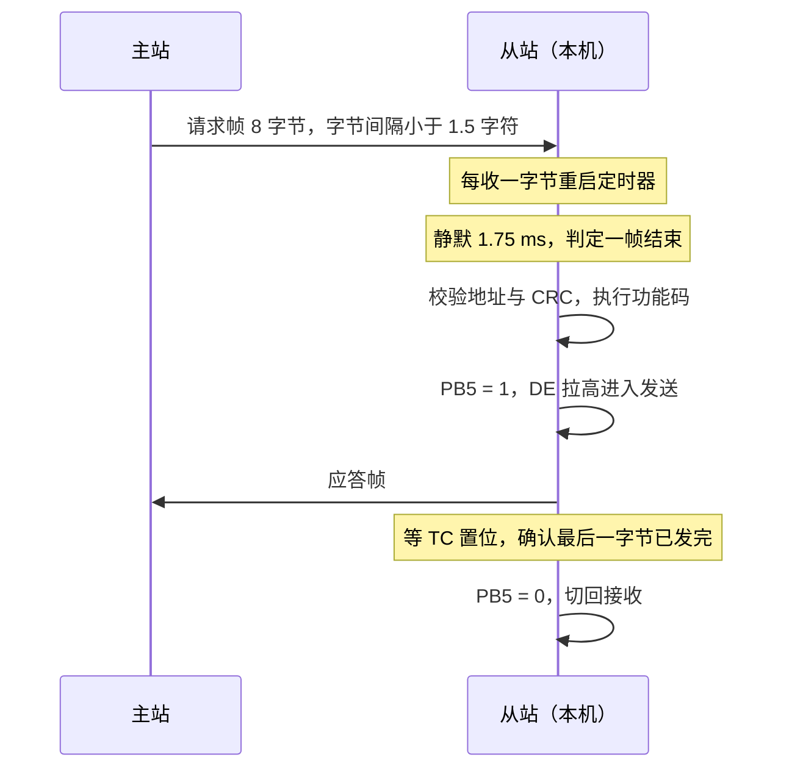

# 3.5 CAN 与 Modbus

电池管理板上，采样板、电机控制器和仪表盘挂在同一对双绞线上，线束不到两米，紧挨着功率开关；车间另一头，一台 PLC 用一对 RS-485 线轮流询问八块电表，每 100 ms 把所有保持寄存器读一遍。前者用 CAN，后者用 Modbus RTU。两种总线都只要两根信号线，都把多台设备串在同一条线上，但一个允许任意节点主动发言，另一个坚持一问一答。

本节从 CAN 的差分电平和帧结构讲起，算出 F103 在 36 MHz 的 APB1 时钟下怎样得到 500 kbit/s，配置 bxCAN 的过滤器和回环自测；然后转到 Modbus，算 CRC-16、拼 RTU 帧、控制 RS-485 的收发方向，写出一个能在 PC 上测试、也能烧进板子的 RTU 从站。完整程序在 `code/嵌入式/3_驱动_通信与中间件/3_5_CAN与Modbus/` 下。串口接收的数据在固件里用一段定长缓冲区加定时器分帧，帧的定界思路与 [3.4 数据帧、环形缓冲区与状态机](/教程/正文/嵌入式/3_驱动_通信与中间件/3_4_数据帧_环形缓冲区与状态机) 相通，但这里的帧边界由静默时间决定，不靠同步字节。

## 1. 现场总线

现场总线 (fieldbus) 是铺设在设备现场、连接传感器、执行器和控制器的一类串行总线。CAN (Controller Area Network) 由 Bosch 在 1980 年代为汽车内部通信设计，后来扩展到电机、电池、电梯和农机；Modbus 由 Modicon 在 1979 年为 PLC 通信公开，今天是工控设备最通用的协议之一。两者都用差分线传输、都用 CRC 检错，组织通信的方式却相反。

CAN 是多主总线。总线上没有主站和从站，任何节点在总线空闲时都可以开始发送；几个节点同时开口时，靠标识符逐位仲裁 (arbitration) 决定谁继续，输的一方自动退让并在空闲后重发，报文不会因此损坏。Modbus 是主从协议。总线上只有一个主站，从站平时保持沉默，只有收到点名自己的请求才回答；主站用超时判断从站是否在线，从站用超时判断一帧何时结束。

| 项目 | CAN | Modbus RTU |
| --- | --- | --- |
| 物理层 | 差分 CAN_H、CAN_L，双绞线，两端各 120 Ω 终端电阻 | 差分 A、B，双绞线，末端接终端电阻 |
| 角色 | 多主，任意节点可主动发送 | 单主多从，从站只应答 |
| 寻址 | 11 位或 29 位标识符，表示报文内容 | 1 字节从站地址 |
| 典型速率 | 125 kbit/s～1 Mbit/s | 9600～115200 bit/s |
| 检错 | 硬件 CRC、应答位、错误计数、自动重发 | CRC-16，出错时不回答，由主站超时重试 |
| 典型用途 | 汽车、电机驱动、电池管理 | 电表、温控器、变频器、PLC |
| F103 上的外设 | bxCAN | USART 加外部 RS-485 收发器 |

选哪一种由对接的设备决定，不由个人偏好决定。板子内部几个节点之间传实时控制量，CAN 的仲裁和硬件重发省掉大量协议代码；要和现成的仪表、变频器、组态软件说话，Modbus 是对方的母语。两种接口在 F103 上可以同时存在，本节的两套示例分别用 PB8/PB9 和 USART2。

## 2. CAN 的物理层与帧

### 2.1 差分信号与收发器

CAN 收发器把微控制器的单端 TX、RX 信号换成总线上的差分电压。总线空闲时，两条线都经过终端电阻拉到大约 2.5 V，差分电压接近 0，称为隐性 (recessive)，表示逻辑 1；收发器主动把 CAN_H 拉高、CAN_L 拉低，差分电压约 2 V，称为显性 (dominant)，表示逻辑 0。

| 总线状态 | CAN_H（典型值） | CAN_L（典型值） | 差分电压 | 逻辑值 |
| --- | --- | --- | --- | --- |
| 显性 | 3.5 V | 1.5 V | 2 V | 0 |
| 隐性 | 2.5 V | 2.5 V | 0 V | 1 |

显性在电气上压过隐性：只要有一个节点输出显性，整条总线就是显性。这个性质称为线与，它是 CAN 仲裁不需要额外控制线的根本原因。两个节点同时发送时，一个发显性、一个发隐性，总线呈现显性，发隐性的那个节点从总线上读回的位与自己发出的不一致，立刻知道自己输了，停止发送并转为接收。

总线两端各接一个 120 Ω 终端电阻，吸收信号到达线端时的反射。实验室里几十厘米的短线不接电阻常常也能通信，但线一长、速率一高就会出现随机的位错误和错误帧。CAN_H 与 CAN_L 应使用同一对双绞线，节点用短支线挂上去，支线越短越好。

收发器是总线与 MCU 之间的必备器件，F103 只有 CAN 控制器，没有收发器。常见的两类是 TJA1050 与 SN65HVD230：前者用 5 V 供电，RX 输出高电平接近 5 V，接到 F103 之前要确认所用引脚是 5 V 容忍的；后者用 3.3 V 供电，和 F103 的电源电压一致，接线更省事。实验板上用哪一种都行，本节按 3.3 V 的 SN65HVD230 描述，程序与收发器型号无关。

### 2.2 标准数据帧

CAN 2.0A 标准数据帧的字段按发送顺序排成下图。图只画数据帧，远程帧把 RTR 置为隐性、不带数据段。

<BitField
  mode="frame"
  title="CAN 2.0A 标准数据帧（按发送顺序）"
  :fields="[
    { name: 'SOF', bits: 1, value: '0', group: '帧起始' },
    { name: '标识符', bits: 11, group: '仲裁段', tone: 'brand', desc: '同时决定优先级：数值越小优先级越高' },
    { name: 'RTR', bits: 1, value: '0', group: '仲裁段', desc: '显性表示数据帧，隐性表示远程帧' },
    { name: 'IDE', bits: 1, value: '0', group: '控制段', desc: '显性表示标准帧' },
    { name: 'r0', bits: 1, value: '0', group: '控制段', desc: '保留位，发送显性' },
    { name: 'DLC', bits: 4, group: '控制段', desc: '数据长度码，0～8' },
    { name: '数据', bits: 64, variable: true, size: '0～64 位', group: '数据段', tone: 'green' },
    { name: 'CRC', bits: 15, group: 'CRC 段', desc: '对前面所有位计算，不含填充位' },
    { name: '界定符', bits: 1, value: '1', group: 'CRC 段' },
    { name: 'ACK 槽', bits: 1, group: 'ACK 段', desc: '发送方发隐性，任一接收方发显性即表示收到' },
    { name: '界定符', bits: 1, value: '1', group: 'ACK 段' },
    { name: 'EOF', bits: 7, value: '1111111', group: '帧结束' }
  ]"
/>

标识符长度是 11 位，取值范围 0～0x7FF，所以一条总线上最多有 2048 种不同的报文。扩展帧把标识符扩到 29 位，IDE 发隐性：11 位基本标识符之后依次是 SRR 位、隐性 IDE 和 18 位扩展标识符，再往后才是 RTR。F103 的 bxCAN 两者都支持，本节只用标准帧。

为了让接收方能从位流中恢复时钟，CAN 在连续 5 个相同电平之后自动插入一个反相电平，称为位填充 (bit stuffing)。填充与去填充由控制器硬件完成，写协议代码时不用管，但计算帧长时要记住它会让一帧的实际位数比字段之和多。

### 2.3 仲裁

标识符不是节点地址，它描述的是报文内容。同一个节点可以发送多种不同标识符的报文，不同节点也可以发送相同标识符的报文（例如两个温度传感器都发 0x120，需要事先约定好分工）。接收方按标识符决定收不收，而不是按发送方地址。

仲裁逐位进行，从标识符的最高位开始。每个发送方在发完一位后读回总线电平：自己发隐性而总线是显性，说明有别的节点在发更靠前的显性位，自己立刻退出，转为接收；赢的一方察觉不到任何异常，继续发送。由于标识符数值越小，靠前的显性位越多，优先级就越高。

::: concept emb-can-id-content title="CAN 的标识符表示报文内容"

CAN 的 11 位标识符（或 29 位扩展标识符）标识的是报文的内容与优先级，不是节点的地址。多个节点同时开始发送时，标识符数值较小的一方在逐位仲裁中胜出，报文不受破坏，输的一方在总线空闲后自动重发。

:::

举例：0x100 与 0x0FF 同时发送。0x0FF 的 11 位二进制是 000 1111 1111，0x100 是 001 0000 0000。从最高位开始比，前两位双方都是 0，第三位 0x0FF 发显性、0x100 发隐性，总线呈显性，0x100 退出。0x0FF 的报文先上总线。

<Quiz
  type="single"
  :options="[
    { label: '0x100 先发完，因为数值大', value: 'A' },
    { label: '0x0FF 赢得仲裁先发，0x100 等总线空闲后重发', value: 'B' },
    { label: '两帧都损坏，双方各自重发', value: 'C' },
    { label: '由软件配置的发送邮箱编号决定谁先发', value: 'D' }
  ]"
  answer="B"
>

<template #question>

标识符为 0x100 和 0x0FF 的两个节点同时开始发送，结果是什么？

</template>

正确答案是 **B**。

- 仲裁从标识符最高位开始比较，数值小的标识符在更靠前的位上发显性。0x0FF 在标识符的第三位（bit8）赢下总线，0x100 随即退出并转为接收。
- 仲裁失败的报文不会损坏，控制器会在总线空闲后自动重发，这是 CAN 硬件的行为，不需要软件干预。

</Quiz>

### 2.4 错误处理

CAN 的每个节点都维护两个错误计数器：发送错误计数器 (Transmit Error Counter, TEC) 与接收错误计数器 (Receive Error Counter, REC)。检测到错误时发送错误帧，通知全总线丢弃当前报文；计数超过 127 进入错误被动 (error passive) 状态，超过 255 进入总线关闭 (bus off) 状态，自行退出总线，直到软件或自动恢复机制重新初始化。F103 的 CAN_MCR 里有 ABOM 位，置位后硬件在检测到连续 128 次 11 个隐性位后自动退出总线关闭状态。

这段机制由控制器硬件完成，应用代码通常只需要在初始化时打开自动恢复，并在总线关闭时记录一次故障。错误计数器的增减规则不必背，RM0008 第 24 章的错误管理一节有完整表格。

CAN FD 是 CAN 的后续标准，数据段可以到 64 字节、速率可以更高。F103 的 bxCAN 只支持经典 CAN，遇到 CAN FD 设备时不能直接互通。

## 3. 位时序

CAN 没有独立的时钟线，所有节点按自己的时钟采样，靠位时序 (bit timing) 在每一位内约定好采样点。一个位时间被分成若干时间量子 (time quantum, tq)，tq 由 APB1 时钟分频得到：

$$t_{q} = (BRP + 1) \times t_{PCLK1}$$

每个位时间由三段组成：同步段 (SYNC_SEG) 固定 1 tq；时间段 1 (BS1) 用于补偿网络传播延迟和节点之间的相位差，长度 1～16 tq；时间段 2 (BS2) 用于吸收节点时钟的频率误差，长度 1～8 tq。采样点 (sample point) 在 BS1 结束、BS2 开始的位置，一个位时间共 1 + BS1 + BS2 个 tq。重同步跳转宽度 (SJW) 限制一次重同步能调整的 tq 数，取 1～4。实验室与车间里通常取 1，误差较大的场合才加大。

采样点位置由下式给出：

$$\text{采样点} = \frac{1 + BS1}{1 + BS1 + BS2}$$

工程上常用的采样点在 75%～87.5% 之间，速率越高，留给传播延迟的余量越少，采样点越靠后。

RM0008 的 CAN_BTR 寄存器每一位对应一个参数：BRP 占 0～9 位，TS1 占 16～19 位，TS2 占 20～22 位，SJW 占 24～25 位。寄存器里的 TS1、TS2 是减一后的值：写 14 表示 BS1 = 15 tq。

<BitField
  title="CAN_BTR（偏移 0x1C，复位值 0x0123 0000）"
  :width="32"
  :fields="[
    { name: 'SILM', range: 31, access: 'rw', desc: '静默模式' },
    { name: 'LBKM', range: 30, access: 'rw', desc: '回环模式' },
    { name: 'SJW[1:0]', range: [25, 24], access: 'rw', desc: '重同步跳转宽度，写入值 = SJW - 1' },
    { name: 'TS2[2:0]', range: [22, 20], access: 'rw', desc: '时间段 2，写入值 = BS2 - 1' },
    { name: 'TS1[3:0]', range: [19, 16], access: 'rw', desc: '时间段 1，写入值 = BS1 - 1' },
    { name: 'BRP[9:0]', range: [9, 0], access: 'rw', desc: '波特率分频，写入值 = 分频系数 - 1' }
  ]"
/>

APB1 时钟 36 MHz 时，500 kbit/s 需要每个位时间 72 个 PCLK1 周期。把 72 拆成「分频 × 每位的 tq 数」，每位的 tq 数在 8～25 之间比较常见。程序 `bit_timing_calc.c` 枚举了 8～25 tq、采样点 85%～90% 的所有组合：

::: terminal title="bash - bit_timing_calc"

```text
$ gcc -std=c17 -Wall -Wextra bit_timing_calc.c -o bit_timing_calc
$ ./bit_timing_calc
=== PCLK1 = 36000000 Hz, target = 500000 bit/s ===
Presc  BS1    BS2    TotalTq  SamplePt   CAN_BTR(SJW=1)
9      6      1      8          87.5%    0x00050008
8      7      1      9          88.9%    0x00060007
4      15     2      18         88.9%    0x001E0003

=== PCLK1 = 36000000 Hz, target = 250000 bit/s ===
Presc  BS1    BS2    TotalTq  SamplePt   CAN_BTR(SJW=1)
18     6      1      8          87.5%    0x00050011
16     7      1      9          88.9%    0x0006000F
9      13     2      16         87.5%    0x001C0008
8      15     2      18         88.9%    0x001E0007

=== PCLK1 = 36000000 Hz, target = 125000 bit/s ===
Presc  BS1    BS2    TotalTq  SamplePt   CAN_BTR(SJW=1)
36     6      1      8          87.5%    0x00050023
32     7      1      9          88.9%    0x0006001F
18     13     2      16         87.5%    0x001C0011
16     15     2      18         88.9%    0x001E000F
```

:::

每行对应一组参数。第一行的分频 9、BS1 = 6、BS2 = 1，共 8 tq，采样点 87.5%，写入 CAN_BTR 的值为 `(SJW - 1) << 24 | (TS2 - 1) << 20 | (TS1 - 1) << 16 | BRP`，即 `0 << 24 | 0 << 20 | 5 << 16 | 8`，得 0x0005_0008。本节的 `can_drv.c` 用这一组。

::: tip CAN 位时序计算器

手工算采样点时容易把「写入值 = 参数 - 1」搞反。CAN 社区维护的在线计算器 https://www.bittiming.can-wiki.info/ 输入时钟与速率后直接给出所有合规组合和对应的寄存器值，算完再与自己的结果对照一遍。

:::

总线上所有节点的速率必须相同，采样点也应尽量接近。一个节点按 87.5% 采样、另一个按 75%，在长线、多节点、温度漂移同时出现时容易触发错误帧。新设备接入前，先问清对方的位速率和采样点。

## 4. bxCAN

F103 中容量芯片内置一个 bxCAN (Basic Extended CAN) 控制器。RM0008 第 24 章列出它的主要资源：

- 3 个发送邮箱 (transmit mailbox)，软件把待发帧写入空闲邮箱即可，硬件按标识符优先级或写入顺序发送。
- 2 个接收 FIFO，各 3 级，共可缓存 6 帧。
- 14 组过滤器 (filter)，可以设成 32 位掩码、32 位列、16 位掩码或 16 位列模式。
- 支持标准帧、扩展帧、远程帧，支持回环、静默、环回静默三种测试模式。

### 4.1 引脚与重映射

F103 的 CAN1 默认在 PA11 (CAN_RX)、PA12 (CAN_TX)，与 USB 的 D−、D+ 是同一对引脚。本节把 CAN 重映射到 PB8 (CAN_RX)、PB9 (CAN_TX)，重映射编号 CAN_REMAP = 10。

```c
/* AFIO_MAPR 的 CAN_REMAP[1:0] = 10：CAN1 重映射到 PB8/PB9 */
AFIO->MAPR = (AFIO->MAPR & ~AFIO_MAPR_CAN_REMAP) | AFIO_MAPR_CAN_REMAP_REMAP2;
GPIOB->CRH = (GPIOB->CRH & ~0xFFu) | 0xB8u; /* PB8 上拉输入，PB9 复用推挽 50 MHz */
GPIOB->BSRR = (1u << 8);
```

PB8 作为 CAN_RX 配置成上拉输入，0x8 是「输入模式、上拉/下拉」的配置位，再写 BSRR 把 ODR8 置 1 选择上拉。PB9 作为 CAN_TX 配置成复用推挽输出、50 MHz，对应 CRH 低 8 位里的 0xB。引脚设置必须在使能 CAN 外设之前完成。

USB 与 CAN 共用片内一块 512 字节的专用 SRAM，RM0008 明确写着两者可以在同一个应用里出现但不能同时工作。重映射只解决引脚冲突，不解决这块 RAM 的冲突。

### 4.2 进入初始化模式

bxCAN 复位后处于睡眠模式，与多数外设复位即可用的习惯不同。要配置它，先清 SLEEP、再置 INRQ，等 MSR 的 INAK 置位，表示已经进入初始化模式；配置完成后清 INRQ，再等 INAK 清零，表示回到正常工作模式。

::: concept emb-can-init-sequence title="bxCAN 复位后处于睡眠模式"

bxCAN 复位后 SLEEP 位为 1，处于睡眠模式。配置前必须先清 SLEEP，再置 INRQ 并等待 MSR 的 INAK 置位进入初始化模式；只有在初始化模式下才能写 BTR 和过滤器寄存器。配置完成后清 INRQ 并等待 INAK 清零，控制器才进入正常工作模式，开始参与总线。

:::

`can_drv.c` 里的 `can1_init_500k()` 把整个过程包成一个函数：

```c
/* 退出睡眠模式并请求进入初始化模式，等待硬件置位 INAK */
CAN1->MCR &= ~CAN_MCR_SLEEP;
CAN1->MCR |= CAN_MCR_INRQ;
if (!can1_wait_msr_bit(CAN_MSR_INAK, CAN_MSR_INAK)) {
    return false;
}

/* 开启自动离线恢复（ABOM），发送优先级按请求先后顺序（TXFP） */
CAN1->MCR &= ~(CAN_MCR_TTCM | CAN_MCR_NART | CAN_MCR_RFLM);
CAN1->MCR |= CAN_MCR_ABOM | CAN_MCR_TXFP;

/* PCLK1 = 36 MHz，500 kbit/s：分频 9，BS1 = 6 tq，BS2 = 1 tq，SJW = 1 tq */
uint32_t btr = (0u << CAN_BTR_SJW_Pos) |
               (0u << CAN_BTR_TS2_Pos) |
               (5u << CAN_BTR_TS1_Pos) |
               (8u << CAN_BTR_BRP_Pos);
if (loopback_silent) {
    btr |= CAN_BTR_LBKM | CAN_BTR_SILM;
}
CAN1->BTR = btr;
```

`can1_wait_msr_bit()` 用一个计数的空循环等待状态位，超时返回 false。这里用轮询等待，等待时间在几微秒量级，不阻塞系统。

### 4.3 过滤器

bxCAN 收到一帧后，把标识符与 14 组过滤器逐一比对，命中某组就按该组关联的 FIFO 存进去；一组都不命中，这一帧直接被硬件丢弃。

::: concept emb-can-filter-required title="不配置过滤器就收不到帧"

bxCAN 的接收路径由过滤器组决定：报文标识符必须命中至少一组已激活的过滤器，才会被写入接收 FIFO。过滤器组在复位后全部处于停用状态，因此初始化时必须显式配置并激活至少一组，否则控制器能正常发送，却永远收不到任何报文。

:::

过滤器有两种工作模式：掩码模式 (mask) 与列表模式 (list)；每种又有 32 位与 16 位两种位宽。32 位掩码模式最常用：FR1 存期望的标识符，FR2 存掩码，掩码某位为 1 表示该位必须与标识符一致，为 0 表示不关心。

```c
/* 过滤器组 0：32 位掩码模式，掩码全 0（接收全部报文），关联 FIFO 0 */
CAN1->FMR |= CAN_FMR_FINIT;
CAN1->FA1R &= ~(1u << 0);        /* 修改前先停用过滤器组 0 */
CAN1->FS1R |= (1u << 0);         /* 1 = 单个 32 位位宽 */
CAN1->FM1R &= ~(1u << 0);        /* 0 = 标识符掩码模式 */
CAN1->FFA1R &= ~(1u << 0);       /* 0 = 关联到 FIFO 0 */
CAN1->sFilterRegister[0].FR1 = 0x00000000u; /* ID = 0 */
CAN1->sFilterRegister[0].FR2 = 0x00000000u; /* Mask = 0（不关心任何位） */
CAN1->FA1R |= (1u << 0);         /* 激活过滤器组 0 */
CAN1->FMR &= ~CAN_FMR_FINIT;
```

写过滤器前必须先置 FMR 的 FINIT 进入过滤器初始化模式。FR1、FR2 的位布局与接收寄存器一致：标准标识符占寄存器的第 31～21 位，第 20～3 位放扩展标识符，第 2 位是 IDE，第 1 位是 RTR。因此只想接收 0x100 时 FR1 应写 `0x100 << 21`，不是直接写 0x100。这一点在习题里会再遇到。

### 4.4 发送与接收

发送一帧的过程是：在 TSR 里找一个空邮箱（TME0、TME1、TME2 为 1 表示空），把长度写进 TDTR 的 DLC、数据写进 TDLR 和 TDHR，最后写 TIR 并在其中置 TXRQ 启动发送。硬件按标识符优先级或按请求顺序（MCR 的 TXFP 位）决定先发哪个邮箱。

```c
uint8_t dlc = (frame->dlc <= 8u) ? frame->dlc : 8u;
CAN1->sTxMailBox[mbox].TDTR = (uint32_t)dlc;

uint32_t low = 0u;
uint32_t high = 0u;
for (uint8_t i = 0u; i < dlc; ++i) {
    if (i < 4u) {
        low |= (uint32_t)frame->data[i] << (8u * i);
    } else {
        high |= (uint32_t)frame->data[i] << (8u * (i - 4u));
    }
}
CAN1->sTxMailBox[mbox].TDLR = low;
CAN1->sTxMailBox[mbox].TDHR = high;

/* 最后写入 TIR 并置位 TXRQ 启动发送 */
CAN1->sTxMailBox[mbox].TIR = tir | CAN_TI0R_TXRQ;
```

数据按字节顺序从低到高填 TDLR 的低字节到高字节，再填 TDHR。也就是说 `data[0]` 在线上先发，它落在 TDLR 的位 7～0。

接收侧先读 RF0R 的 FMP0，非零表示 FIFO 0 里有帧；依次读 RIR、RDTR、RDLR、RDHR，最后置 RFOM0 释放邮箱，硬件把 FMP0 减一。

```c
if ((CAN1->RF0R & CAN_RF0R_FMP0) == 0u) {
    return false;
}

uint32_t rir = CAN1->sFIFOMailBox[0].RIR;
uint32_t rdtr = CAN1->sFIFOMailBox[0].RDTR;
uint32_t rdlr = CAN1->sFIFOMailBox[0].RDLR;
uint32_t rdhr = CAN1->sFIFOMailBox[0].RDHR;

frame->dlc = (uint8_t)(rdtr & CAN_RDT0R_DLC);
if (frame->dlc > 8u) {
    frame->dlc = 8u;
}

/* 置位 RFOM0 释放 FIFO 0 当前邮箱，硬件将 FMP0 减 1 */
CAN1->RF0R |= CAN_RF0R_RFOM0;
```

### 4.5 回环自测

没有收发器、没有第二个节点，也能验证控制器和驱动代码。把 CAN_BTR 的 LBKM 与 SILM 同时置位，控制器进入环回静默模式：发送的帧不发到引脚上，直接在自己内部回送给接收过滤器，接收路径照常工作。这是上板前的第一道检查，能把位时序、过滤器、邮箱顺序的问题全部暴露出来，而不必怀疑外部接线。

```c
struct can_frame tx = {
    .id = 0x123u,
    .is_ext = 0u,
    .is_rtr = 0u,
    .dlc = 4u,
    .data = { 0x11u, 0x22u, 0x33u, 0x44u },
};
(void)can1_send(&tx);

for (;;) {
    struct can_frame rx;
    if (can1_receive_fifo0(&rx)) {
        if (rx.id == 0x123u && rx.dlc == 4u && rx.data[0] == 0x11u) {
            GPIOC->BSRR = GPIO_BSRR_BR13; /* 收到预期回环帧，点亮 PC13 */
        }
    }
}
```

收到自己发的帧时 PC13 点亮，说明位时序、过滤器、发送邮箱、接收 FIFO 这一整条路径都通了。`can_loopback` 目标是完整的固件工程，编译与链接（在 `3_5_CAN与Modbus` 目录下执行；`$CMSIS` 是 CMSIS-Core 与 ST 设备头文件的包含目录，来源见 [3.1 驱动接口、CMSIS 与设备头文件](/教程/正文/嵌入式/3_驱动_通信与中间件/3_1_驱动接口_CMSIS与设备头文件)）：

::: terminal title="bash - 编译 CAN 回环固件"

```text
$ arm-none-eabi-gcc -std=c11 -mcpu=cortex-m3 -mthumb -O2 -g -Wall -Wextra \
    -ffunction-sections -fdata-sections -DSTM32F103xB \
    -I$CMSIS -Ican_loopback \
    ../../common/startup_stm32f103.c can_loopback/main.c can_loopback/can_drv.c \
    -T../../common/stm32f103c8.ld -nostartfiles --specs=nano.specs --specs=nosys.specs \
    -Wl,--gc-sections -o can_loopback.elf
$ arm-none-eabi-size can_loopback.elf
   text    data     bss     dec     hex filename
   1184       0    1536    2720     aa0 can_loopback.elf
```

:::

一个 CAN 驱动连同启动代码只占 1.2 KB Flash；`bss` 为 0，RAM 里唯一的占用是链接脚本预留的 1.5 KB 栈。回环模式下 PC13 是否点亮需要上板确认，程序逻辑本身在编译期就能保证没有警告。

## 5. PC 端工具

调试 CAN 设备时，PC 上通常要有一个 USB-CAN 适配器。Linux 上多数适配器由 SocketCAN 驱动接管，成为 `can0` 网络接口，配置好位速率后可以用 can-utils 里的工具收发：

::: terminal title="bash - SocketCAN 收发"

```text
$ sudo ip link set can0 type can bitrate 500000
$ sudo ip link set up can0
$ candump can0
$ cansend can0 123#DEADBEEF
```

:::

`ip link set ... type can bitrate 500000` 设定速率，只有设定的速率与总线上其他节点一致，接口才能正常收帧；`candump` 打印收到的帧，格式形如 `can0  123   [4]  11 22 33 44`；`cansend` 发送一帧数据帧，`#` 后是十六进制数据。Windows 下这类工具由适配器厂商提供，命令与 Linux 不同，不在本书范围内。

## 6. Modbus 的数据模型与报文

Modbus 把设备暴露给外部的数据分成四类，每类最多 65536 项：

| 数据类 | 位宽 | 访问 | 典型用途 | 功能码 |
| --- | --- | --- | --- | --- |
| 线圈 (coil) | 1 位 | 读写 | 继电器、指示灯 | 0x01、0x05、0x0F |
| 离散输入 (discrete input) | 1 位 | 只读 | 限位开关、按键 | 0x02 |
| 输入寄存器 (input register) | 16 位 | 只读 | ADC 读数、温度 | 0x04 |
| 保持寄存器 (holding register) | 16 位 | 读写 | 设定值、累计量 | 0x03、0x06、0x10 |

规范把通信双方称为客户端 (client) 和服务器 (server)。习惯上工程师仍说主站 (master) 和从站 (slave)，本教程正文统一写「主站/从站」，首次出现时说明规范的新叫法。

### 6.1 PDU 与 ADU

Modbus 的报文有两层。协议数据单元 (Protocol Data Unit, PDU) 由功能码和紧随其后的数据组成，与传输方式无关。应用数据单元 (Application Data Unit, ADU) 在 PDU 外面加上与传输方式有关的头尾。

RTU 方式下，ADU 等于从站地址（1 字节）加 PDU，再加 CRC（2 字节）。

<BitField
  mode="frame"
  title="Modbus RTU 读保持寄存器请求（按发送顺序）"
  :fields="[
    { name: '从站地址', bytes: 1, value: '0x01', desc: '1～247；0 为广播' },
    { name: '功能码', bytes: 1, value: '0x03', desc: '读保持寄存器' },
    { name: '起始地址', bytes: 2, value: '0x0000', tone: 'green', desc: '高字节在前' },
    { name: '寄存器数量', bytes: 2, value: '0x0002', tone: 'green', desc: '高字节在前' },
    { name: 'CRC', bytes: 2, value: 'C4 0B', tone: 'yellow', desc: 'CRC-16/MODBUS，低字节在前' }
  ]"
/>

两个「高字节在前、低字节在前」的约定必须同时记住。寄存器地址与寄存器值都是 16 位，在线上先发高字节；CRC 的计算结果也是 16 位，在线上却先发低字节。两个方向相反，写拼帧代码时最容易在这里出错。

::: concept emb-modbus-byte-order title="Modbus RTU 的字节序"

Modbus 的寄存器地址与寄存器值按大端序传输，高字节在前。CRC-16/MODBUS 的计算结果按小端序附加到帧尾，低字节在前。CRC 的计算范围是从站地址到数据区的最后一个字节，不含 CRC 本身。

:::

### 6.2 CRC-16/MODBUS

Modbus 用的是 CRC-16/MODBUS：初值 0xFFFF，反射多项式 0xA001（正向多项式 0x8005 的位反转），输入输出都反射，最终不异或。它对字符串 "123456789" 的校验值是 0x4B37，可以用来验证实现。

```c
uint16_t crc16_modbus(const uint8_t *data, size_t len) {
    uint16_t crc = 0xFFFFu;
    for (size_t i = 0u; i < len; ++i) {
        crc ^= (uint16_t)data[i];
        for (int bit = 0; bit < 8; ++bit) {
            if ((crc & 0x0001u) != 0u) {
                crc = (uint16_t)((crc >> 1) ^ 0xA001u);
            } else {
                crc >>= 1;
            }
        }
    }
    return crc;
}
```

这段逐位算法每字节循环 8 次，算一个 8 字节帧不到一万个指令周期，在 72 MHz 的 F103 上远短于一个字符的传输时间，对 Modbus 的速率来说完全可以接受。要更快可以用查表法，256 项表的生成与用法留给习题。

### 6.3 常用功能码与示例帧

本节实现两个功能码 (function code)：0x03 读保持寄存器、0x06 写单个保持寄存器；0x10 写多个保持寄存器留给习题。0x01 读线圈与 0x05 写单个线圈只在需要时再看规范，数据模型里的四类与功能码一一对应，照着上表查即可。

一次完整的 0x03 交互：主站读从站 1 的保持寄存器 0～1，请求帧与应答帧如下。

```text
请求：01 03 00 00 00 02 C4 0B
应答：01 03 04 00 64 00 C8 BA 7A
```

请求里的 `00 00` 是起始地址 0，`00 02` 是数量 2，`C4 0B` 是 CRC（低字节 0xC4 在前）。应答里的 `04` 是字节数，2 个寄存器共 4 字节，`00 64` 是寄存器 0 的值 100，`00 C8` 是寄存器 1 的值 200。

0x06 写单个寄存器把寄存器 1 写成 3：请求 `01 06 00 01 00 03 98 0B`，正常应答原样回显请求，所以应答与请求完全相同。

异常应答把功能码最高位置 1，再加一个异常码：`01 83 02 C0 F1` 表示对从站 1 的 0x03 请求返回异常码 0x02（非法数据地址）。常用的异常码有三个：0x01 非法功能码、0x02 非法数据地址、0x03 非法数据值。

Modbus 规范文档里有一个经典例子，从站 0x11 的保持寄存器 0x006B 起读 3 个，请求帧是 `11 03 00 6B 00 03 76 87`。这些帧的 CRC 都可以用上面的函数验证。

<Quiz
  type="single"
  :options="[
    { label: '0xCD 0xC5，低字节在前', value: 'A' },
    { label: '0xC5 0xCD，高字节在前', value: 'B' },
    { label: '由功能码决定', value: 'C' },
    { label: 'CRC 在 Modbus RTU 中不发送', value: 'D' }
  ]"
  answer="A"
>

<template #question>

某帧计算出的 CRC 值是 0xCDC5，附加到帧尾的两个字节是什么顺序？

</template>

正确答案是 **A**。

- Modbus RTU 的 CRC 低字节在前，所以先发 0xCD，再发 0xC5。
- 与之相对，寄存器地址和寄存器值都是高字节在前，两者方向相反。

</Quiz>

## 7. RTU 定界与 RS-485

### 7.1 用静默时间分帧

RTU 没有帧头、帧尾，也没有长度字段。接收方判断一帧的开始与结束，靠的是字节之间的静默时间：帧内字节间隔不超过 1.5 个字符时间，一帧结束之后至少静默 3.5 个字符时间，下一个字节才属于下一帧。这套规则写在 Modbus 串行线规范里，一个字符按 11 位算：带校验时是 1 起始位 + 8 数据位 + 1 校验位 + 1 停止位，不带校验时规范要求 2 个停止位，合计仍是 11 位。

在 9600 bit/s 下，一个字符约 1.15 ms，t3.5 约 4 ms；速率越高，字符时间越短，间隔越难分辨。规范建议在 19200 bit/s 以上固定用 t1.5 = 750 μs、t3.5 = 1.75 ms，不再按实际速率换算。

实现方式有两种。一种是用一个定时器：每收到一个字节就清零并重启定时器，定时器到期就认为一帧结束。另一种是利用 USART 的空闲中断 (IDLE)：总线连续空闲一个字符时间后触发中断。后一种简单，但 1 个字符的静默明显短于规范的 3.5 个字符，在主站发送间隔稍长的场合可能把一帧误切成两帧。作者的做法是：空闲中断够用时先用它，产品里对时序敏感时换成定时器方案。本节固件用的是定时器。

### 7.2 RS-485 的方向控制

RS-485 是半双工差分总线，同一对线上不能同时收发。MAX3485 之类的收发器用两个引脚控制方向：DE（Driver Enable，驱动器使能）接高时芯片把 DI 上的信号推到 A、B 线上；/RE（Receiver Enable，低有效）接低时芯片把总线上的差分信号送到 RO。把 DE 与 /RE 短接在一起，一个引脚就能切换：高电平发送、低电平接收。本教程的板子把这一对引脚接到 PB5。

发送流程是：拉高 PB5，写数据到 USART2，等最后一个字节完全移出移位寄存器，再拉低 PB5。这里有一步容易写错：等待的必须是 TC（Transmission Complete），不能是 TXE（Transmit Data Register Empty）。TXE 置位只表示数据寄存器空了、可以写下一个字节，此刻最后一个字节还在移位寄存器里，线上还没发完；此时拉低 DE，收发器立刻关闭驱动器，最后一个字节的尾部就被截断，接收方看到 CRC 错误。

::: compare left-title="等 TXE 就释放方向" right-title="等 TC 再释放方向"

```c
GPIOB->BSRR = GPIO_BSRR_BS5; /* DE = 1，进入发送 */
for (size_t i = 0u; i < len; ++i) {
    while ((USART2->SR & USART_SR_TXE) == 0u) {
    }
    USART2->DR = buf[i];
}
GPIOB->BSRR = GPIO_BSRR_BR5; /* 最后一个字节还在移位寄存器里 */
```

---

```c
GPIOB->BSRR = GPIO_BSRR_BS5; /* DE = 1，进入发送 */
for (size_t i = 0u; i < len; ++i) {
    while ((USART2->SR & USART_SR_TXE) == 0u) {
    }
    USART2->DR = buf[i];
}
/* 等最后一个字节的停止位也发完，再切回接收 */
while ((USART2->SR & USART_SR_TC) == 0u) {
}
GPIOB->BSRR = GPIO_BSRR_BR5;
```

:::

一次问答的完整时序如下。主站发出请求后，从站在 t3.5 静默之后开始应答，应答期间 DE 为高，结束前必须读到 TC：



`modbus_rtu_fw/main.c` 里的发送函数只有几行：

```c
static void rs485_send_bytes(const uint8_t *buf, size_t len) {
    GPIOB->BSRR = GPIO_BSRR_BS5; /* DE = 1，切换为发送态 */

    for (size_t i = 0u; i < len; ++i) {
        while ((USART2->SR & USART_SR_TXE) == 0u) {
        }
        USART2->DR = buf[i];
    }

    /* 必须等待最后一个字节从移位寄存器完整发出（TC = 1），再拉低 DE */
    while ((USART2->SR & USART_SR_TC) == 0u) {
    }
    GPIOB->BSRR = GPIO_BSRR_BR5; /* DE = 0，切回接收态 */
}
```

### 7.3 帧结束检测

固件用 TIM2 的单脉冲模式做 t3.5 检测。TIM2 的时钟是 72 MHz（APB1 分频不为 1 时定时器时钟乘 2，见 [2.6 定时器、PWM 与系统节拍](/教程/正文/嵌入式/2_MCU裸机开发/2_6_定时器_PWM与系统节拍)），预分频 72 得 1 MHz，自动重装载值 1750 对应 1.75 ms。每收到一个字节就把计数器清零、重新启动，到期中断里置一个「帧就绪」标志。

```c
void USART2_IRQHandler(void) {
    uint32_t sr = USART2->SR;
    if ((sr & (USART_SR_RXNE | USART_SR_ORE)) != 0u) {
        uint8_t byte = (uint8_t)USART2->DR;
        if (!g_frame_ready) {
            if (g_rx_len < RTU_RX_BUF_CAP) {
                g_rx_buf[g_rx_len++] = byte;
            }
            /* 每收到一个字节，将 TIM2 计数器清零并重新启动 1.75 ms 定时 */
            TIM2->CNT = 0u;
            TIM2->SR = 0u;
            TIM2->CR1 |= TIM_CR1_CEN;
        }
    }
}

void TIM2_IRQHandler(void) {
    if ((TIM2->SR & TIM_SR_UIF) != 0u) {
        TIM2->SR = 0u;
        if (g_rx_len > 0u) {
            g_frame_ready = true;
        }
    }
}
```

`g_frame_ready` 用 `volatile` 修饰，主循环与中断共享。主循环发现标志后把数据拷到本地缓冲区、清零长度、清标志，再调用协议处理函数。串口中断只做搬运，不做协议解析，避免在中断里长时间占用 CPU。

## 8. 实现 Modbus RTU 从站

从站的核心是一个纯函数：输入一帧完整的请求，输出应答，不依赖任何寄存器。这样就能在 PC 上编译测试，也能原样搬进固件。

```c
size_t modbus_rtu_process(struct modbus_rtu_slave *slave,
                          const uint8_t *req,
                          size_t req_len,
                          uint8_t *resp,
                          size_t resp_cap);
```

`struct modbus_rtu_slave` 里有从站地址和一个 16 项的保持寄存器数组。函数依次做四件事：检查地址是否为本机或广播 0；校验 CRC；按功能码分发；生成应答并补上 CRC。地址不匹配、广播的读请求、CRC 错误一律返回 0，表示不回答。

| 情况 | 行为 |
| --- | --- |
| 地址不是本机，也不是 0 | 静默丢弃，不回答 |
| CRC 校验失败 | 静默丢弃，不回答（规范如此，不返回异常） |
| 广播地址 0 的写请求 | 执行写入，不回答 |
| 广播地址 0 的读请求 | 丢弃，不回答 |
| 功能码不支持 | 异常应答：功能码 \| 0x80 + 0x01 |
| 寄存器地址越界 | 异常应答：功能码 \| 0x80 + 0x02 |
| 寄存器数量为 0 或超过 125 | 异常应答：功能码 \| 0x80 + 0x03 |

### 8.1 处理 0x03

0x03 的请求固定 8 字节：地址、功能码、起始地址（2 字节）、数量（2 字节）、CRC（2 字节）。应答是地址、功能码、字节数、数据、CRC，字节数是数量乘 2。

```c
uint16_t start_addr = get_be16(&req[2]);
uint16_t qty = get_be16(&req[4]);

if (qty < 1u || qty > 125u) {
    return build_exception(addr, func, MODBUS_EX_ILLEGAL_DATA_VALUE,
                           resp, resp_cap);
}
if ((uint32_t)start_addr + (uint32_t)qty > MODBUS_HOLDING_REG_COUNT) {
    return build_exception(addr, func, MODBUS_EX_ILLEGAL_DATA_ADDR,
                           resp, resp_cap);
}

size_t total_len = 3u + (size_t)qty * 2u + 2u;
if (resp_cap < total_len) {
    return 0u;
}

resp[0] = addr;
resp[1] = func;
resp[2] = (uint8_t)(qty * 2u);
for (uint16_t i = 0u; i < qty; ++i) {
    put_be16(&resp[3u + i * 2u], slave->holding_regs[start_addr + i]);
}
return append_crc_le16(resp, 3u + (size_t)qty * 2u);
```

### 8.2 在 PC 上测试

`modbus/test_rtu_slave.c` 构造五组请求，用 `crc16_modbus()` 补上 CRC，交给 `modbus_rtu_process()`，再把请求与应答按十六进制打印出来。编译运行：

::: terminal title="bash - test_rtu_slave"

```text
$ gcc -std=c17 -Wall -Wextra -I modbus modbus/test_rtu_slave.c \
    modbus/crc16_modbus.c modbus/rtu_slave.c -o test_rtu_slave
$ ./test_rtu_slave
CRC-16/MODBUS("123456789") = 0x4B37
Spec example 11 03 00 6B 00 03 -> CRC = 0x8776 (wire: 76 87)

--- 1. Read holding regs [0..1] ---
Request          ( 8 B): 01 03 00 00 00 02 C4 0B
Response         ( 9 B): 01 03 04 00 64 00 C8 BA 7A
--- 2. Write holding reg [1] = 3 ---
Request          ( 8 B): 01 06 00 01 00 03 98 0B
Response         ( 8 B): 01 06 00 01 00 03 98 0B
--- 3. Read holding regs [0..1] after write ---
Request          ( 8 B): 01 03 00 00 00 02 C4 0B
Response         ( 9 B): 01 03 04 00 64 00 03 FB ED
--- 4. Read out-of-range address 0x0020 ---
Request          ( 8 B): 01 03 00 20 00 02 C5 C1
Response         ( 5 B): 01 83 02 C0 F1
--- 5. Broadcast write reg [2] = 10 ---
Request          ( 8 B): 00 06 00 02 00 0A A9 DC
Response         ( 0 B): <no response>
holding_regs[2] after broadcast = 10
```

:::

输出印证了几件在正文里说过的事。第 1 组请求与应答和 6.3 节给出的示例帧完全一致；第 3 组里寄存器 1 已经从 200 变成 3（`00 03`），说明第 2 组的写入生效；第 4 组请求越界地址 0x0020，从站返回 `01 83 02 C0 F1`，与 6.3 节的异常帧一致；第 5 组是广播写，从站不回答案，但寄存器 2 已经改成 10。

`crc16_modbus("123456789")` 返回 0x4B37，规范例子的 CRC 是 0x8776，在线上发 76 87。两个已知答案都对上，说明 CRC 实现正确。

### 8.3 接上硬件

`modbus_rtu_fw` 把上面这些接到 USART2 与 RS-485 上：USART2 用 PA2 (TX)、PA3 (RX)，PCLK1 为 36 MHz 时 115200 bit/s 的 BRR 取 0x0139（USARTDIV ≈ 19.5625，误差 0.16%）；PB5 控制 MAX3485 的方向；TIM2 做 t3.5 检测。主循环解析一帧、调用 `modbus_rtu_process()`、有应答就发出去。

::: terminal title="bash - 编译 Modbus RTU 固件"

```text
$ arm-none-eabi-gcc -std=c11 -mcpu=cortex-m3 -mthumb -O2 -g -Wall -Wextra \
    -ffunction-sections -fdata-sections -DSTM32F103xB \
    -I$CMSIS -I. \
    ../../common/startup_stm32f103.c modbus_rtu_fw/main.c \
    modbus/crc16_modbus.c modbus/rtu_slave.c \
    -T../../common/stm32f103c8.ld -nostartfiles --specs=nano.specs --specs=nosys.specs \
    -Wl,--gc-sections -o modbus_rtu_fw.elf
$ arm-none-eabi-size modbus_rtu_fw.elf
   text    data     bss     dec     hex filename
   1232       0    1800    3032     bd8 modbus_rtu_fw.elf
```

:::

接好 MAX3485 之后，可以用 PC 上的 Modbus 主站软件测试。Linux 下 `mbpoll` 的用法如下，参数含义见它的 man page：

::: terminal title="bash - mbpoll"

```text
# 读从站 1 的保持寄存器 0~1，115200 8N1
mbpoll -m rtu -b 115200 -P none -a 1 -t 4 -r 1 -c 2 /dev/ttyUSB0
```

:::

Python 的 `pymodbus` 或 `minimalmodbus` 也能用，具体参数见各自文档。这类工具的用法随版本变化，命令只作示意。

## 9. Modbus TCP

Modbus TCP 把同一套 PDU 放到 TCP 上，端口 502。报文外面套一个 MBAP 头 (Modbus Application Protocol header)，共 7 字节：

<BitField
  mode="frame"
  title="Modbus TCP 的 MBAP 头与 PDU（按发送顺序）"
  :fields="[
    { name: '事务标识', bytes: 2, desc: '主站自选，应答原样带回，用来配对请求与应答' },
    { name: '协议标识', bytes: 2, value: '0x0000', desc: 'Modbus 固定为 0' },
    { name: '长度', bytes: 2, desc: '其后字节数：单元标识 + PDU' },
    { name: '单元标识', bytes: 1, desc: '网关后面挂 RTU 从站时用作从站地址' },
    { name: 'PDU', bytes: 1, variable: true, size: '2～253 字节', tone: 'green', desc: '功能码 + 数据，与 RTU 完全相同' }
  ]"
/>

有 MBAP 头之后，TCP 自带分帧，不需要 t3.5 静默，也没有 CRC。地址检查交给 TCP 的连接与端口，单元标识只在经过网关转 RTU 时才有意义。

同一个 `modbus_rtu_process()` 只差一层外壳：把 MBAP 头剥掉，剩下的字节就是 PDU 前面加了一个单元标识，与 RTU 的「地址 + PDU」结构一致，只是 CRC 换成了 MBAP 的长度字段。因此 TCP 服务器可以复用同一份 PDU 处理逻辑：把 RTU 处理的 CRC 部分拆出来，就是一个 `modbus_pdu_process()`。TCP 连接与收发在 [3.7 以太网、TCP/IP 与 lwIP](/教程/正文/嵌入式/3_驱动_通信与中间件/3_7_以太网_TCPIP与lwIP) 讲完 lwIP 的 raw API 之后就能接上。

## 10. 习题

### 10.1 巩固

<Exercise id="63335" :d="1" :w="2">

四个节点在同一时刻开始发送，标识符分别是 `0x120`、`0x0A5`、`0x1FF`、`0x080`，都是标准数据帧。

1. 写出四帧上总线的先后顺序。
2. `0x0A5` 与 `0x120` 的仲裁在第几位（标识符的 bit 编号）分出胜负？`0x0A5` 与 `0x080` 呢？
3. 把 `0x080` 那帧改成远程帧，顺序会变吗？说明 RTR 位在帧里的位置与它的作用。
4. 用一段几十行的 C 程序，把一组标识符按 CAN 仲裁优先级排序并打印，输入取上面四个值再加 `0x000`、`0x7FF`。说明排序依据为什么就是标识符的数值。

</Exercise>

<Exercise id="63336" :d="2" :w="2">

`bit_timing_calc.c` 只算了 500k、250k、125k 三档，采样点筛选范围写死为 85%～90%。

1. 把目标速率改成从命令行参数读入，采样点下限改为可配置，重新编译。
2. 在 PCLK1 = 36 MHz 下算 800 kbit/s 与 1 Mbit/s，各列出所有满足 8～25 tq、采样点 85%～90% 的组合，写出对应的 `CAN_BTR`（SJW = 1）。
3. 对 1 Mbit/s 的两组结果，分别算出每位的 tq 数与分频系数，验证乘积等于 36。
4. 把采样点范围放宽到 75%～90%，1 Mbit/s 会多出哪几组？采样点最靠前的组合是多少，为什么工程上一般不用它。
5. 总线上已有节点按 87.5% 采样，新节点选了 75%。说明两节点速率相同却在长线下频繁报错的原因。

验收：1 Mbit/s 的两行里，`CAN_BTR` 分别为 `0x00060003` 与 `0x001E0001`。

</Exercise>

<Exercise id="63337" :d="2" :w="2">

下面四帧都是 Modbus RTU 请求，CRC 均已正确：

```text
A: 01 03 00 00 00 02 C4 0B
B: 01 04 00 00 00 01 31 CA
C: 01 01 00 00 00 08 3D CC
D: 01 06 00 01 00 03 98 0B
```

1. 分别写出功能码名称、访问的数据类（线圈、离散输入、输入寄存器、保持寄存器）、起始地址与数量。
2. 写出每帧正常应答的字节数（含地址与 CRC）；应答里有字节数域的，写出它的值，没有的说明为什么没有。
3. A 帧的应答数据为寄存器 0 的值 100、寄存器 1 的值 200，写出完整应答的十六进制。用 `crc16_modbus()` 核对帧尾。
4. D 帧的应答为什么与请求逐字节相同？
5. 把 A 帧的 `C4 0B` 交换成 `0B C4`，从站会怎么处理？规范为什么规定 CRC 错误时不回异常应答？

</Exercise>

### 10.2 编程

<Exercise id="63338" :d="3" :w="3">

CAN 过滤器配置，起始代码在 `code/嵌入式/3_驱动_通信与中间件/3_5_CAN与Modbus/exercises/can_filter_starter.c`。

1. 修改 `fr1` 与 `fr2`，让过滤器只接收标准数据帧、标识符在 `0x100`～`0x10F` 之间。运行程序，验收输出依次为 `REJECT`、`ACCEPT`、`ACCEPT`、`ACCEPT`、`REJECT`。
2. 逐段解释 `fr1` 与 `fr2` 的取值：标识符部分哪些位参与比较、`IDE` 与 `RTR` 两位为什么也要写进掩码。
3. 把范围改成只接收 `0x105`，写出新的 `fr1`、`fr2`，并说明一个标识符为 `0x105` 的远程帧会不会被接收。
4. 要同时接收 `0x100`～`0x10F` 与 `0x200`～`0x20F` 两段，一个 32 位掩码过滤器能做到吗？写出需要几个过滤器组，以及第二个组的 `FR1`、`FR2` 和使能该组要写的寄存器位。
5. 回到真实芯片：如果只写了 `FR1`、`FR2` 而漏掉 `FA1R` 的置位，程序能发送却不能接收。说明原因，并写出进入与退出过滤器初始化模式的两行代码。

</Exercise>

<Exercise id="63339" :d="3" :w="3">

实现 Modbus 功能码 0x10（写多个保持寄存器），起始代码是 `.../exercises/modbus_fc10_starter.c`，要改的是 `modbus/rtu_slave.c`。

1. 按文件头注释的帧格式实现 0x10：校验数量、字节数与帧长，写入连续寄存器，正常应答回显地址、功能码、起始地址与数量。
2. 运行起始代码的测试，验收输出 `Resp (8 B): 01 10 00 02 00 02 E0 08`，随后 `regs[2]=0x000A, regs[3]=0x0102`。
3. 补三组测试并给出期望应答：数量为 0（帧 `01 10 00 00 00 00 00 09 50`）、起始地址 15 加数量 2 越界（帧 `01 10 00 0F 00 02 04 00 0A 00 0B D2 2A`）、字节数写错（帧 `01 10 00 00 00 02 02 00 01 67 D4`）。前两组应为异常码 0x03 与 0x02。
4. 广播帧 `00 10 00 02 00 02 04 00 0A 01 02 D6 D9` 应写入寄存器但不回应答。验证 `modbus_rtu_process` 的返回值与寄存器内容。
5. 说明 0x10 正常应答为什么只有 8 字节，而 0x03 的应答长度随数量变化。

</Exercise>

<Exercise id="63340" :d="4" :w="4">

Modbus RTU 的接收定时状态机，起始代码是 `.../exercises/rtu_timer_fsm_starter.c`。

1. 补全三个函数：字节到达时按状态收进缓冲区，t1.5 到期把当前帧标为作废，t3.5 到期结算并回到空闲。
2. 运行起始代码，验收输出 `Normal frame len = 4`。
3. 在 `main` 里加第二组序列：收到 `0x01`、`0x03` 后触发 t1.5，再收到 `0x00`，最后触发 t3.5，打印结果应为 `Broken frame len = 0`。说明 t1.5 之后到达的 `0x00` 是否应该被收进帧，你的实现把它放在了哪里。
4. 起始代码的 `main` 在打印 `Normal frame len = 4` 之后没有再调一次 `rtu_fsm_on_t35_expired`。补上这一行，第二次应返回 0。如果实现里只清了 `len`、没有把状态改回 `RTU_STATE_IDLE`，第二次调用会返回什么，随后第一个到达的字节又会被怎么处理？
4. 缓冲区满 256 字节后仍有字节到达，状态机应进入 `RTU_STATE_FRAME_NOK`。构造一个 300 字节的输入验证，并说明为什么不能直接丢弃多出来的字节而不改状态。
5. 把状态机接进第 7.3 节的 USART2 中断：写出中断里需要做的三件事（收字节、清零并重启定时器、置标志），以及主循环如何取走 `g_frame_ready` 与缓冲区。t1.5 与 t3.5 用同一个定时器还是两个，各自怎么设比较值。

</Exercise>

<Exercise id="63341" :d="4" :w="4">

给从站加功能码 0x04（读输入寄存器）。输入寄存器是只读的 ADC 结果，用 `uint16_t input_regs[8]` 表示，初值取 100、200、300 直到 800。

1. 在 0x03 的处理旁边加 0x04：广播读请求不回答，数量为 0 或超过 8 回异常码 0x03，起始地址加数量超过 8 回 0x02。
2. 写出下列请求的完整应答并运行验证（CRC 已给出）：读 2 个（`01 04 00 00 00 02 71 CB`）、数量 0（`01 04 00 00 00 00 F0 0A`）、起始 7 读 2 个（`01 04 00 07 00 02 C0 0A`）、广播读 1 个（`00 04 00 00 00 01 30 1B`）。
3. 再写一个写 0x04 的请求，确认从站回的是非法功能码 0x01 还是别的异常码，并说明依据。
4. 写一个模糊测试：用固定种子生成 100000 个长度 0～300 的随机帧，逐帧调用 `modbus_rtu_process`，断言返回值不超过 `resp_cap`、返回非 0 时应答地址等于请求地址或本机地址、且应答 CRC 正确。用 `-fsanitize=address,undefined` 编译运行。
5. 统计测试中出现的应答数、异常应答数与静默丢弃数，并说明随机帧里能产生正常 0x04 应答的概率为什么极低。

</Exercise>

### 10.3 综合与挑战

<Exercise id="63342" :d="5" :w="4">

Modbus TCP 与 RTU 之间的网关，起始代码是 `.../exercises/modbus_gateway_starter.c`。

1. 实现 `modbus_tcp_to_rtu`：校验 MBAP 的协议标识为 0、长度域与实际字节数一致，取出事务标识，把单元标识与 PDU 拼成 RTU 帧并补 CRC。
2. 实现 `modbus_rtu_to_tcp`：校验 RTU 的 CRC，剥掉末尾两字节，套上 7 字节 MBAP 头，长度域填单元标识加 PDU 的字节数。
3. 运行起始代码里的请求，验收 `TID = 0x002A, RTU len = 8`，RTU 帧为 `01 03 00 00 00 02 C4 0B`。
4. 增加一条反向测试：把从站应答 `01 03 04 00 64 00 C8 BA 7A` 转成 TCP，期望 `TID` 仍为 0x002A、长度域为 7，完整帧是 `00 2A 00 00 00 07 01 03 04 00 64 00 C8`。
5. 构造三种坏输入各验证一次：协议标识非 0、长度域比实际多 1、RTU 的 CRC 错一位。函数都应返回 0。
6. Modbus TCP 里没有 CRC，也没有 t3.5。说明网关两侧各自由什么保证帧边界，以及为什么不能把 TCP 收到的两个报文段直接当成两帧。

</Exercise>

<Exercise id="63343" :d="5" :w="4">

RS-485 方向控制的缺陷定位。下面三个发送函数，只有一个是正确的：

```c
/* A */
static void send_a(const uint8_t *buf, size_t len) {
    GPIOB->BSRR = GPIO_BSRR_BS5;
    for (size_t i = 0; i < len; ++i) {
        while ((USART2->SR & USART_SR_TXE) == 0u) {
        }
        USART2->DR = buf[i];
    }
    GPIOB->BSRR = GPIO_BSRR_BR5;
}

/* B */
static void send_b(const uint8_t *buf, size_t len) {
    GPIOB->BSRR = GPIO_BSRR_BS5;
    for (size_t i = 0; i < len; ++i) {
        while ((USART2->SR & USART_SR_TXE) == 0u) {
        }
        USART2->DR = buf[i];
    }
    while ((USART2->SR & USART_SR_TC) == 0u) {
    }
    GPIOB->BSRR = GPIO_BSRR_BR5;
}

/* C */
static void send_c(const uint8_t *buf, size_t len) {
    GPIOB->BSRR = GPIO_BSRR_BS5;
    for (size_t i = 0; i < len; ++i) {
        USART2->DR = buf[i];
        while ((USART2->SR & USART_SR_TC) == 0u) {
        }
    }
    GPIOB->BSRR = GPIO_BSRR_BR5;
}
```

1. A 错在哪里，会造成什么线路现象。B 与 C 都不截断最后一个字节，但 C 慢得多：说明 C 为什么正确（提示：查 RM0008 里 TC 的清除条件，看每次写 `DR` 之前都发生了什么），以及它的代价是多少。若把 C 的循环体改成先写 `DR`、再等 `TXE`，最后不单独等 `TC`，退化成哪种写法。
2. 在 115200 bit/s、8N1 下算一个字符的传输时间，以及 A 在写完最后一个字节后立刻拉低 DE 会截掉多少时间。
3. 9600 bit/s、带校验的 Modbus 字符按 11 位算：算出 t1.5 与 t3.5 的毫秒数。115200 bit/s 下按规范固定值取多少？
4. 用 TIM2 产生 t3.5：72 MHz 时钟，预分频寄存器 PSC 写多少得到 1 MHz 计数，1.75 ms 对应多少个计数周期（计数器从 0 数到 ARR，共 ARR + 1 个周期），ARR 取多少。再算 9600 bit/s 下 t1.5 对应的计数周期与 ARR。
5. 把 B 改写成带超时的版本：等待 TC 超过 1 ms 就强制拉低 DE 并返回 false，调用方据此记录错误。
6. DE 与 /RE 短接时，发送期间接收器是关闭的，自己发出的字节不会回到接收端。如果把两个引脚分开控制且 /RE 一直使能，会在接收侧看到什么？接收状态机应该怎么处理这段时间的字节。

</Exercise>

<Exercise id="63344" :d="6" :w="5" scope="**">

bxCAN 回环自测固件（需要 Blue Pill 与下载器，没有硬件时至少编译通过）。

1. 在 `can_drv.c` 的初始化里增加一个 `loopback` 参数：置 `CAN_BTR` 的 LBKM 与 SILM，其余参数仍为 36 MHz、500 kbit/s、分频 9、BS1 = 6、BS2 = 1、SJW = 1。写出这时 `CAN_BTR` 的完整 32 位值。
2. 过滤器只接收标识符 `0x123` 的标准数据帧，关联 FIFO 0。写出 `FR1`、`FR2`，并说明回环模式下为什么仍然需要配置过滤器。
3. 写 `can_loopback/main.c`：发一帧 `0x123`、`dlc = 4`、数据 `11 22 33 44`，在主循环里从 FIFO 0 取帧，核对标识符、长度与前两个数据字节，全部符合时翻转 PC13。
4. 用 `arm-none-eabi-gcc` 按第 4.5 节的命令编译链接，贴出 `arm-none-eabi-size` 的输出，并解释 `bss` 为什么是 0。
5. 上板后 PC13 不翻转，列出排查顺序：先确认 INAK 的进入与退出，再确认过滤器 `FA1R` 的置位，最后确认 `TXRQ` 是否写进了 `TIR`。每一项给出一个可以在调试器里读的寄存器或位。
6. 回环通过之后接上收发器与第二个节点，仍可能出现收不到帧。列出至少三个与回环无关的原因，并各给一条验证方法。

</Exercise>

## 11. 参考资料

1. STMicroelectronics, [*RM0008 Reference manual*, Rev 21](https://www.st.com/resource/en/reference_manual/rm0008-stm32f101xx-stm32f102xx-stm32f103xx-stm32f105xx-and-stm32f107xx-advanced-armbased-32bit-mcus-stmicroelectronics.pdf)：第 24 章 bxCAN（24.4 工作模式、24.5 测试模式、24.7.7 位时序）、第 9 章 AFIO（表 34 重映射）。
2. Texas Instruments, [*Introduction to the Controller Area Network (CAN)*, Application Report SLOA101B](https://www.ti.com/lit/an/sloa101b/sloa101b.pdf)：CAN 物理层、帧结构与仲裁。
3. The Linux Kernel Documentation, [*CAN*](https://docs.kernel.org/networking/can.html) 与 [can-utils](https://github.com/linux-can/can-utils)：SocketCAN 的配置与工具用法。
4. [CAN Bit Timing Calculator](https://www.bittiming.can-wiki.info/)：各时钟与速率下的位时序组合。
5. Modbus Organization, [*Modbus Application Protocol Specification V1.1b3*](https://www.modbus.org/file/secure/modbusprotocolspecification.pdf)：数据模型、功能码、异常码、MBAP 头。
6. Modbus Organization, [*Modbus over Serial Line Specification and Implementation Guide V1.02*](https://www.modbus.org/file/secure/modbusoverserial.pdf)：RTU 帧格式、t1.5 与 t3.5、RS-485 物理层。
7. [CRC RevEng Catalogue: CRC-16/MODBUS](https://reveng.sourceforge.io/crc-catalogue/16.htm)：CRC 参数与 "123456789" 的校验值。
8. 本教程示例代码：`code/嵌入式/3_驱动_通信与中间件/3_5_CAN与Modbus/`（`can_loopback`、`bit_timing_calc.c`、`modbus/`、`modbus_rtu_fw`）。
