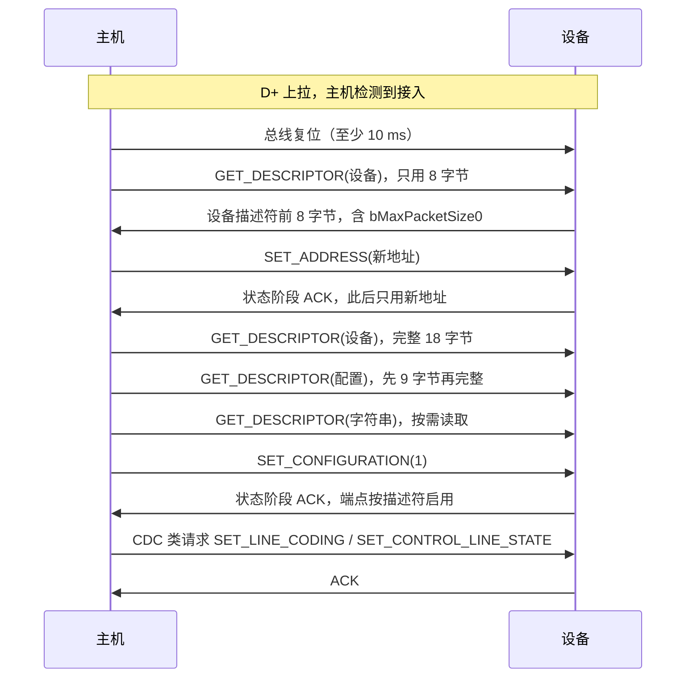

# 3.6 USB

在此前的通信实验中，开发板通常需要借助外接的 CH340 或 CP2102 等电平转换芯片与主机通信。转换芯片在物理层充当协议翻译桥梁，微控制器只需维系最基础的 UART 异步收发时序。事实上，STM32F103 内部集成了原生的 USB 2.0 全速（Full-Speed）设备控制器，只需将差分引脚 PA11（D−）与 PA12（D+）直接引出至 USB 接口，微控制器便能在宿主机操作系统中直接枚举为一个标准的虚拟串口。这不仅省去了板载辅助芯片的物料开销，还能突破传统异步串口的波特率瓶颈，获得高达 12 Mbit/s 的理论传输带宽。

原生支持 USB 意味着软件栈需要承担远比 UART 复杂的协议交互。USB 属于严格的主从轮询架构，通信过程依托于端点（Endpoint）与四种不同特性的传输类型展开；设备在接入主机之初，必须经历严密的枚举（Enumeration）阶段，逐层呈递设备描述符、配置描述符、接口描述符以及功能特性集。在接下来的梳理中，我们将剖析 USB 主从交互的底层时序与描述符内存排布规则，透视 CDC ACM 虚拟串口的类协议模型，并借助轻量级开源协议栈 TinyUSB 构建完整的虚拟串口驱动，进而理解固件库中端点事件分发与任务轮询的工程实质。完整程序位于 `code/嵌入式/3_驱动_通信与中间件/3_6_USB/` 下。

## 1. 让芯片自己出现在电脑上

把 Blue Pill 的 PA11 接到 USB 口的 D−、PA12 接到 D+，再供电，电脑会提示发现新硬件。这背后没有任何应用代码：芯片一上电，PA12 上的上拉电阻就让主机察觉有设备插入，随后主机发起一连串标准请求，设备逐条应答，最终主机加载驱动、分配一个 COM 口。这套流程叫枚举 (enumeration)，是每个 USB 设备都必须实现的最小子集。

F103C8T6 的 USB 外设是 USB 2.0 全速 (full speed) 设备控制器，速率 12 Mbit/s，只做设备、不做主机。它内部有一块 512 字节的包缓冲区 (Packet Memory Area, PMA)，端点通过一张缓冲区描述表 (BTABLE) 在这里分配空间；寄存器包括中断状态 ISTR、控制 CNTR 和每个端点的 EPnR。这些细节都是给协议栈作者看的，应用代码一般不碰，但知道 512 字节这个上限，就能理解为什么 F103 上的 USB 不可能同时开很多端点。

外设需要 48 MHz 时钟，只能来自 HSE 经 PLL：HSE 8 MHz × 9 = 72 MHz 作为 SYSCLK，USB 时钟取 PLL 输出的 1.5 分频，即 48 MHz。时钟树与 PLL 的配置见 [2.3 时钟与复位](/教程/正文/嵌入式/2_MCU裸机开发/2_3_时钟与复位)。用 HSI 做系统时钟时 PLL 输入是 4 MHz，分不出精确的 48 MHz，USB 无法工作。

USB 与 CAN 共用 512 字节的专用 SRAM，也共用 PA11、PA12 两个引脚（CAN 默认就在这两个脚上）。本节用 USB 时，CAN 要么不用，要么像 [3.5 CAN 与 Modbus](/教程/正文/嵌入式/3_驱动_通信与中间件/3_5_CAN与Modbus) 那样重映射到 PB8、PB9。

## 2. USB 基础

### 2.1 主机与设备

USB 采用严格的主从交互体系：总线上的所有物理传输均必须由主机发起，外设仅充当被动响应者。主机控制器以 1 ms 为基准周期向总线广播帧起始包（Start of Frame, SOF），并将通信时间划分为离散的时隙帧，在各个帧内依据内部调度策略有序向各个端点分发传输令牌。微控制器无法在产生数据的第一时间单方面向总线推入电平，它只能预先将待发数据写入指定的端点硬件缓冲区中；当主机根据预定时间表向该端点发送 IN 令牌包索取数据时，片上硬件控制器才会自动将缓冲区内容移出总线。

这一严格的主机轮询机制决定了 USB 设备端驱动的编程模型：上层业务的『数据发送』实质上是将数据压入驱动维护的环形或端点发送缓冲区；而系统的主循环任务则需要保持高频调度，调用协议栈的核心任务函数（如 `tud_task()`），及时响应并处理由主机总线轮询触发的各类底层事件。

::: concept emb-usb-direction title="USB 端点的方向以主机为参照"

USB 的端点号带方向，方向从主机的角度命名：IN 表示数据流向主机，OUT 表示数据离开主机。一个端点号（如 2）可以同时有一个 IN 端点 0x82 和一个 OUT 端点 0x02，两者是独立的缓冲区和独立的传输通道。

:::

端点 (endpoint) 地址的最高位表示方向，0x80 置位是 IN，清零是 OUT，低 4 位是端点号。所以 0x82 是「端点 2 的 IN 方向」，0x02 是「端点 2 的 OUT 方向」。

<Quiz
  type="single"
  :options="[
    { label: '可以，设备检测到数据就能立刻发', value: 'A' },
    { label: '可以，但要先发一个令牌包通知主机', value: 'B' },
    { label: '不可以，设备只能等主机来取，把数据放在缓冲区里', value: 'C' },
    { label: '只有中断传输可以，批量传输不行', value: 'D' }
  ]"
  answer="C"
>

<template #question>

USB 设备能不能在任意时刻主动把数据发给主机？

</template>

正确答案是 **C**。

- USB 的一切传输都由主机发起。设备把数据写进端点缓冲区，主机按调度表来取（IN 传输）或来送（OUT 传输）。
- 中断传输与批量传输的差别是主机保证的延迟和带宽，两种传输都由主机发起。

</Quiz>

### 2.2 四种传输类型

USB 定义了四种传输类型，各自解决不同的问题：

| 类型 | 带宽保证 | 延迟保证 | 数据完整性 | 典型用途 |
| --- | --- | --- | --- | --- |
| 控制 (control) | 无 | 尽力 | 有 | 枚举、标准请求、类请求 |
| 批量 (bulk) | 无（有空闲带宽就用） | 无 | 有，出错自动重传 | 串口数据、U 盘、打印机 |
| 中断 (interrupt) | 有上限 | 有上限（主机保证轮询间隔） | 有 | 键盘、鼠标、HID 报告 |
| 同步 (isochronous) | 有保证 | 有保证 | 无，出错不重传 | 音频、视频 |

控制传输用于端点 0，负责枚举和所有标准请求，任何设备都必须支持。它的结构是「建立阶段 + 数据阶段 + 状态阶段」三段式，建立阶段固定是一个 8 字节的建立包 (setup packet)。

批量传输适合大量、不要求实时但要求不丢的数据，虚拟串口用的就是它。全速设备上批量端点的最大包长是 64 字节，所以一次传输超过 64 字节要拆成多个包。

中断传输名字有误导性：设备自己不发中断，主机按固定的轮询间隔来问。键盘每 8 ms 或 10 ms 被问一次，因此延迟有上限。同步传输为音频视频保留固定带宽，宁可丢包也不重传。

### 2.3 接入检测

主机怎么知道有设备插进来了？靠 D+ 或 D− 上的 1.5 kΩ 上拉电阻。全速设备把 D+ 上拉，低速设备把 D− 上拉；主机检测到某条数据线被拉高，就认为有设备接入，开始复位总线并枚举。Blue Pill 上这个上拉是焊死的电阻，因此插着 USB 线时设备一直「在场」，重新下载程序后主机未必会重新枚举，第 6 节会给出解决办法。

## 3. 枚举

### 3.1 建立包

所有控制传输都从 8 字节的建立包开始，字段按小端序排列：

<BitField
  mode="frame"
  title="USB 建立包（8 字节，按发送顺序）"
  :fields="[
    { name: 'bmRequestType', bytes: 1, desc: '方向位 7：0 主机到设备，1 设备到主机；位 6～5 请求类型：0 标准、1 类、2 厂商；位 4～0 接收者：0 设备、1 接口、2 端点' },
    { name: 'bRequest', bytes: 1, desc: '请求码，如 GET_DESCRIPTOR = 0x06、SET_ADDRESS = 0x05' },
    { name: 'wValue', bytes: 2, desc: '随请求而定，GET_DESCRIPTOR 时高字节是描述符类型，低字节是索引' },
    { name: 'wIndex', bytes: 2, desc: '随请求而定，类请求里常放接口号或端点号' },
    { name: 'wLength', bytes: 2, desc: '数据阶段要传输的字节数' }
  ]"
/>

以「读设备描述符」为例：`80 06 00 01 00 00 12 00`。bmRequestType = 0x80 表示设备到主机、标准请求、接收者是设备；bRequest = 0x06 是 GET_DESCRIPTOR；wValue = 0x0100 表示描述符类型 1（设备描述符）、索引 0；wIndex = 0；wLength = 0x0012 = 18，正好是一个设备描述符的长度。

### 3.2 枚举流程

主机插入设备后按下面的顺序走。每一步都是主机发起，设备应答；任何一步失败，主机会复位总线并重来，重试几次仍不行就放弃，设备在系统里根本不出现。



第一步读设备描述符时主机还不知道端点 0 能收多大的包，所以只读 8 字节，从中拿到 bMaxPacketSize0，后续传输按这个大小分块。地址分配之后，设备只响应新地址，老地址（0）不再理会。

SET_CONFIGURATION 是分水岭：在此之前只有端点 0 可用，之后配置描述符里声明的端点才被启用，应用的数据通道才通。CDC 的两个类请求在配置之后到来：SET_LINE_CODING 携带波特率、数据位、停止位、校验位，SET_CONTROL_LINE_STATE 携带 DTR、RTS 的状态。

## 4. 描述符

描述符 (descriptor) 是设备向主机描述自己的一组数据结构：我是谁、要多少电、有几个接口、每个接口有几个端点。主机读走这些字节，就能在没有专用驱动的情况下知道该怎么和设备说话。

### 4.1 设备描述符

设备描述符固定 18 字节，是所有描述符的入口：

| 偏移 | 字段 | 长度 | 本文示例的取值 | 含义 |
| --- | --- | --- | --- | --- |
| 0 | bLength | 1 | 18 | 本描述符的字节数 |
| 1 | bDescriptorType | 1 | 0x01 | 设备描述符 |
| 2 | bcdUSB | 2 | 0x0200 | 支持的 USB 版本 2.00 |
| 4 | bDeviceClass | 1 | 0xEF | 杂类设备（配合 IAD 使用） |
| 5 | bDeviceSubClass | 1 | 0x02 | 通用类 |
| 6 | bDeviceProtocol | 1 | 0x01 | 使用接口关联描述符 |
| 7 | bMaxPacketSize0 | 1 | 64 | 端点 0 的最大包长 |
| 8 | idVendor | 2 | 0xCAFE | 厂商编号 |
| 10 | idProduct | 2 | 0x4001 | 产品编号 |
| 12 | bcdDevice | 2 | 0x0100 | 设备版本 1.00 |
| 14 | iManufacturer | 1 | 1 | 厂商字符串的索引 |
| 15 | iProduct | 1 | 2 | 产品字符串的索引 |
| 16 | iSerialNumber | 1 | 3 | 序列号字符串的索引 |
| 17 | bNumConfigurations | 1 | 1 | 配置的数量 |

bDeviceClass 为 0 表示由接口各自声明类，为 0xEF 表示杂类设备，需要配合接口关联描述符 (Interface Association Descriptor, IAD) 把多个接口绑成一个功能。CDC 设备正是这种情况：它有两个接口（控制接口和数据接口），必须用 IAD 捆在一起，否则 Windows 会把它们当成两个互不相干的设备。

VID 与 PID 决定主机加载哪个驱动。0xCAFE 是实验用的测试值，不在 USB-IF 的正式分配范围内；做产品必须向 USB-IF 申请自己的 VID，否则可能与别的设备冲突。

### 4.2 配置描述符的层次

配置描述符是一串首尾相接的描述符，总长由配置描述符自己的 wTotalLength 字段给出。主机的 GET_DESCRIPTOR(配置) 一次读回整串，然后按每条描述符的 bLength 逐条走。

::: concept emb-usb-descriptor-chain title="配置描述符是一串首尾相接的字节"

配置描述符、接口描述符、类描述符与端点描述符依次拼接，组成一串字节。主机按第一条的 bLength 跳过它，落在第二条的开头，依此类推，直到走满 wTotalLength。任何一条的 bLength 写错，后面所有描述符的解析都会错位，枚举随之失败。

:::

```text
配置描述符（9 字节，type 0x02）
├─ IAD（8 字节，type 0x0B）：把接口 0、1 绑成一个 CDC 功能
├─ 接口 0（9 字节，type 0x04）：CDC 控制接口，class 0x02
│  ├─ Header 功能描述符（5 字节，type 0x24，subtype 0x00）
│  ├─ Call Management（5 字节，subtype 0x01）
│  ├─ ACM（4 字节，subtype 0x02）
│  ├─ Union（5 字节，subtype 0x06）
│  └─ 端点 0x81（7 字节，type 0x05）：中断 IN，8 字节，16 ms
└─ 接口 1（9 字节，type 0x04）：CDC 数据接口，class 0x0A
   ├─ 端点 0x02（7 字节）：批量 OUT，64 字节
   └─ 端点 0x82（7 字节）：批量 IN，64 字节
```

这串字节一共 75 字节。本节的 `desc_decode.c` 逐条解码它，同时对比了「用普通结构体表示描述符」和「用字节数组」两种做法：

::: details 完整的 75 字节配置描述符

```text
09 02 4B 00 02 01 00 80 32  配置：9 字节，总长 75，2 个接口，最大 100 mA
08 0B 00 02 02 02 00 04     IAD：接口 0 起 2 个，class 0x02/0x02
09 04 00 00 01 02 02 00 04  接口 0：1 个端点，CDC 控制，class 0x02
05 24 00 20 01              Header：bcdCDC 1.20
05 24 01 00 01              Call Management：无呼叫管理，数据接口 1
04 24 02 06                 ACM：支持 Set_Line_Coding 与 Set_Control_Line_State
05 24 06 00 01              Union：主接口 0，从接口 1
07 05 81 03 08 00 10        端点 0x81：中断 IN，8 字节，间隔 16
09 04 01 00 02 0A 00 00 00  接口 1：2 个端点，CDC 数据，class 0x0A
07 05 02 02 40 00 00        端点 0x02：批量 OUT，64 字节
07 05 82 02 40 00 00        端点 0x82：批量 IN，64 字节
```

:::

::: terminal title="bash - desc_decode"

```text
$ gcc -std=c17 -Wall -Wextra desc_decode.c -o desc_decode
$ ./desc_decode
=== Struct Alignment vs Wire Layout ===
  cdc_header_desc_bad   : sizeof=6, offsetof(bcd_cdc)=4 (wire expects 5, offset 3)
  cdc_header_desc_packed: sizeof=5, offsetof(bcd_cdc)=3
  usb_config_desc_bad   : sizeof=10 (wire expects 9)

=== Device Descriptor (18 bytes) ===
  bcdUSB            : 0x0200
  Class/Sub/Proto   : 0xEF / 0x02 / 0x01
  bMaxPacketSize0   : 64
  idVendor          : 0xCAFE
  idProduct         : 0x4001
  bcdDevice         : 0x0100
  String indices    : Mfg=1, Prod=2, Serial=3
  bNumConfigurations: 1

=== Configuration Descriptor Bundle (75 bytes) ===
  [+00, 9B] type=0x02 CONFIGURATION: wTotalLength=75, numInterfaces=2, maxPower=100 mA
  [+09, 8B] type=0x0B IAD: firstIf=0, count=2, class=0x02/0x02
  [+17, 9B] type=0x04 INTERFACE 0: numEP=1, class=0x02/0x02/0x00
  [+26, 5B] type=0x24 CS_INTERFACE subtype=0x00
  [+31, 5B] type=0x24 CS_INTERFACE subtype=0x01
  [+36, 4B] type=0x24 CS_INTERFACE subtype=0x02
  [+40, 5B] type=0x24 CS_INTERFACE subtype=0x06
  [+45, 7B] type=0x05 ENDPOINT 0x81 (EP1 IN): Interrupt, maxPacket=8, interval=16
  [+52, 9B] type=0x04 INTERFACE 1: numEP=2, class=0x0A/0x00/0x00
  [+61, 7B] type=0x05 ENDPOINT 0x02 (EP2 OUT): Bulk, maxPacket=64, interval=0
  [+68, 7B] type=0x05 ENDPOINT 0x82 (EP2 IN): Bulk, maxPacket=64, interval=0
```

:::

输出的前三行说明了为什么描述符不能直接用带 `uint16_t` 成员的普通结构体表示。`cdc_header_desc_bad` 按字段声明是 5 字节，编译出来却是 6 字节：`bcd_cdc` 是 16 位，编译器为了让它对齐到偶数地址，在 `b_descriptor_subtype` 后面插了一个填充字节。同样的原因让配置描述符从 9 字节变成 10 字节。把这些结构体直接写到总线上，主机收到的字节就错位了。

::: compare left-title="用普通结构体表示描述符" right-title="用字节数组或打包结构体"

```c
struct cdc_header_desc {
    uint8_t b_length;
    uint8_t b_descriptor_type;
    uint8_t b_descriptor_subtype;
    uint16_t bcd_cdc;   /* 偏移 4，sizeof = 6 */
};
```

---

```c
struct __attribute__((packed)) cdc_header_desc {
    uint8_t b_length;
    uint8_t b_descriptor_type;
    uint8_t b_descriptor_subtype;
    uint16_t bcd_cdc;   /* 偏移 3，sizeof = 5 */
};

_Static_assert(sizeof(struct cdc_header_desc) == 5,
               "CDC header functional descriptor must be 5 bytes");
```

:::

打包属性 (packed) 能去掉填充，代价是访问打包结构体里的 16 位成员时编译器要生成逐字节访问的代码。TinyUSB 的做法更直接：描述符全部定义为字节数组，用宏拼装，运行时不访问结构体成员。字节序也要注意，描述符里的 16 位字段都是小端序，而 wValue、wIndex 之类在建立包里也是小端序，与多数网络协议的大端序相反。

### 4.3 字符串描述符

字符串描述符的格式是：bLength、bDescriptorType（0x03）、然后是一串 UTF-16LE 编码的字符。索引 0 的字符串固定为语言 ID 列表，通常是 `04 03 09 04`，表示只支持 0x0409（美式英语）。

`usb_descriptors.c` 里的字符串回调把 ASCII 字符零扩展成 UTF-16LE：

```c
for (size_t i = 0u; i < chr_count; ++i) {
    g_desc_str[1u + i] = (uint16_t)(uint8_t)str[i];
}

/* 首字节为 bLength（2 + 2 * chr_count），次字节为 TUSB_DESC_STRING (0x03) */
g_desc_str[0] = (uint16_t)(((uint16_t)TUSB_DESC_STRING << 8) |
                           (2u * chr_count + 2u));
```

用 `uint16_t` 数组、按主机字节序（小端）存放，正好就是线上的 UTF-16LE 字节序列，不需要再手工拼字节。这是少数几个可以直接用 16 位数组的场合。

## 5. 设备类与 CDC ACM

USB 把常见设备分成若干类 (class)，每类规定一组标准接口和请求，主机据此加载通用驱动，设备厂商不必为每个产品写驱动。

| 类 | 代码 | 用途 | 主机驱动 |
| --- | --- | --- | --- |
| CDC ACM | 0x02 / 0x0A | 虚拟串口 | Windows 10 起内置 usbser，Linux `cdc_acm`，macOS 内置 |
| 人机接口设备 (Human Interface Device, HID) | 0x03 | 键盘、鼠标、自定义输入 | 各系统内置，无需驱动 |
| 大容量存储 (Mass Storage Class, MSC) | 0x08 | U 盘、读卡器 | 各系统内置 |
| 音频 | 0x01 | 声卡 | 各系统内置 |

CDC (Communications Device Class) 的抽象控制模型 (Abstract Control Model, ACM) 就是「虚拟串口」：设备提供一对批量端点传数据，再用一个中断端点传串口控制信号（线路状态变化）。主机把它当成一个普通串口，应用程序用 `ReadFile`、`read()`、`SerialPort` 之类接口访问，完全不用知道底下是 USB。

CDC 的「波特率」对 USB 传输本身没有意义：USB 全速 12 Mbit/s，与 9600 或 115200 无关。主机会在 SET_LINE_CODING 里下发一个波特率数值，设备通常只把它存起来，用来配置另一侧的物理串口（比如 USB 转 RS-485 的桥），或者干脆忽略。主机侧驱动要求这个请求必须被接受，否则打开串口会失败。

选 CDC ACM 做调试通道的理由很实际：CDC 在三大系统上都免驱，Windows 10 起自带 usbser.inf，插上就出一个 COM 口；HID 同样免驱，但受限于固定的报告格式和全速下 64 字节的最大包长，拿它当命令通道要自己套一层协议。

## 6. 用 TinyUSB 实现虚拟串口

### 6.1 为什么不从寄存器写起

从零构建一个完整的 USB 硬件驱动涉及繁冗的协议规范与状态机管理：既要兼顾底层的 NRZI 编码、位填充与 CRC 校验，又要维护四种传输类型的时序分支，同时处理数十项标准请求与复杂的类特定请求。在缺乏物理抓包分析仪的裸机环境中，枚举早期的任何微小字节错位都会导致主机静默放弃重置，这使得完全手写硬件寄存器驱动的试错成本极其高昂。

在实际工程研发中，基于工业级成熟协议栈构建应用是更为严谨的选择。TinyUSB 作为当前嵌入式生态中广泛采用的轻量级开源 USB 协议栈，不仅内存占用极低，且提供了跨芯片平台的统一接口与良好的微控制器驱动适配。其针对 STM32F103 的 `stm32_fsdev` 底层驱动封装了 PMA 包内存管理与寄存器状态流转，上层业务仅需关注端点描述符定制与数据收发接口，这为开发高可靠性的 USB 外设提供了规范的实现范本。板级支持的 LED 引脚映射为 PC13（低电平点亮）、按键引脚为 PA0（高电平有效）、串口引脚为 USART1（PA9/PA10），与本教程其他章节的硬件约定保持一致。

F103 的 USB 外设本身在本节只介绍到这个程度：512 字节 PMA 由 BTABLE 划分给各端点，端点寄存器 EPnR 控制收发与状态，中断入口有 USB_HP_CAN1_TX、USB_LP_CAN1_RX0、USBWakeUp 三个。这些由 `dcd_stm32_fsdev.c` 负责，写应用时不用管。

### 6.2 工程组成

`code/嵌入式/3_驱动_通信与中间件/3_6_USB/cdc_echo/` 下有四个文件：

| 文件 | 作用 |
| --- | --- |
| `tusb_config.h` | 选择 MCU 与操作系统模式、启用哪些设备类、缓冲区大小 |
| `usb_descriptors.c` | 设备描述符、配置描述符、字符串描述符与三个回调 |
| `main.c` | 时钟、LED、重新枚举脉冲、中断入口、主循环 |
| `CMakeLists.txt` | 指定 TinyUSB 源码目录并列出要编译的源文件 |

`tusb_config.h` 只改必要的几项：

```c
#define CFG_TUSB_MCU          OPT_MCU_STM32F1
#define CFG_TUSB_OS           OPT_OS_NONE
#define CFG_TUD_ENDPOINT0_SIZE 64
#define CFG_TUD_CDC    1
#define CFG_TUD_MSC    0
#define CFG_TUD_HID    0
#define CFG_TUD_CDC_RX_BUFSIZE 64
#define CFG_TUD_CDC_TX_BUFSIZE 64
```

`OPT_OS_NONE` 表示裸机运行，不需要操作系统适配层。`CFG_TUD_ENDPOINT0_SIZE` 必须与设备描述符里的 bMaxPacketSize0 一致，全速设备可以取 8、16、32、64，取 64 最省事。

描述符用 TinyUSB 提供的两个宏拼装，比手写字节数组清楚得多：

```c
#define CONFIG_TOTAL_LEN (TUD_CONFIG_DESC_LEN + TUD_CDC_DESC_LEN)

static const uint8_t g_desc_configuration[] = {
    /* 配置号 1，接口数 2，字符串索引 0，总长 75 字节，无远程唤醒，最大电流 100 mA */
    TUD_CONFIG_DESCRIPTOR(1, ITF_NUM_TOTAL, 0, CONFIG_TOTAL_LEN, 0x00, 100),
    /* CDC 控制接口 0，字符串索引 4，通知端点 0x81（8B），批量 OUT 0x02 / IN 0x82（64B） */
    TUD_CDC_DESCRIPTOR(ITF_NUM_CDC, 4, EPNUM_CDC_NOTIF, 8,
                       EPNUM_CDC_OUT, EPNUM_CDC_IN, 64)
};
```

再加一句静态断言，把长度钉死：

```c
_Static_assert(sizeof g_desc_configuration == 75,
               "CDC configuration descriptor bundle must be 75 bytes");
```

三个描述符回调很简单，返回对应的数组即可：

```c
uint8_t const *tud_descriptor_device_cb(void) {
    return (uint8_t const *)&g_desc_device;
}

uint8_t const *tud_descriptor_configuration_cb(uint8_t index) {
    (void)index;
    return g_desc_configuration;
}

uint16_t const *tud_descriptor_string_cb(uint8_t index, uint16_t langid);
```

### 6.3 主循环

设备侧的 USB 协议栈是事件驱动的：中断里把硬件事件交给 TinyUSB，主循环调 `tud_task()` 处理排队的事件并推进状态机。应用的数据收发也走同一套接口。

::: concept emb-usb-tud-task title="tud_task() 必须在主循环中持续调用"

TinyUSB 的设备协议栈在中断里只记录硬件事件，枚举状态机、标准请求处理和数据搬运都在 `tud_task()` 里完成。主循环如果长时间不调用它，主机发来的请求得不到应答，枚举会超时失败，或者已建立的连接会因超时断开。任何耗时操作都不能阻塞这个循环。

:::

```c
static void cdc_echo_task(void) {
    if (!tud_cdc_available()) {
        return;
    }

    uint8_t buf[64];
    uint32_t count = tud_cdc_read(buf, sizeof buf);
    if (count > 0u) {
        tud_cdc_write(buf, count);
        tud_cdc_write_flush();
        led_toggle();
    }
}

int main(void) {
    clock_init_72mhz();
    led_init();
    usb_reenumerate_pulse();

    RCC->APB1ENR |= RCC_APB1ENR_USBEN;
    tusb_init();

    for (;;) {
        tud_task();
        cdc_echo_task();
    }
}
```

`tud_cdc_available()` 返回接收缓冲区里可读的字节数；`tud_cdc_read()` 取出数据；`tud_cdc_write()` 放进发送缓冲区，`tud_cdc_write_flush()` 告诉协议栈可以往端点里填了。三个函数都不阻塞，回显的数据量小于 64 字节时一次就能走完。

Blue Pill 的 D+ 上是固定上拉，下载新程序后主机看不到「拔出」，往往不会重新枚举，串口在系统里仍是旧的那一个。`usb_reenumerate_pulse()` 在启动 USB 外设之前把 PA12 拉低几毫秒再放开，模拟一次拔插：

```c
static void usb_reenumerate_pulse(void) {
    RCC->APB2ENR |= RCC_APB2ENR_IOPAEN;
    /* PA12（CRH[19:16]）设为 2 MHz 通用推挽输出（0x2），输出低电平 */
    GPIOA->CRH = (GPIOA->CRH & ~(0xFu << 16)) | (0x2u << 16);
    GPIOA->BSRR = GPIO_BSRR_BR12;
    for (volatile uint32_t i = 0u; i < 72000u; ++i) {
    }
    /* 恢复 PA12 为浮空输入（0x4），随后由 USB 外设接管引脚 */
    GPIOA->CRH = (GPIOA->CRH & ~(0xFu << 16)) | (0x4u << 16);
}
```

三个 USB 中断入口全部转交给 TinyUSB：

```c
void USB_HP_CAN1_TX_IRQHandler(void) {
    tud_int_handler(0);
}

void USB_LP_CAN1_RX0_IRQHandler(void) {
    tud_int_handler(0);
}

void USBWakeUp_IRQHandler(void) {
    tud_int_handler(0);
}
```

F103 的 USB 中断名字里带 CAN，因为两者共用一个中断向量。这也是「USB 与 CAN 不能同时用」在中断层面的体现。

### 6.4 编译

`cdc_echo/CMakeLists.txt` 用 `TINYUSB_DIR` 指向 TinyUSB 0.21.0 的源码根目录，并列出要编译的 TinyUSB 源文件。这些文件不多，用一条 gcc 命令也能完成同样的构建，启动代码、CMSIS 头文件与 TinyUSB 的固定源文件一起编译链接：

::: terminal title="bash - 编译 CDC 回显固件"

```text
$ arm-none-eabi-gcc -std=c11 -mcpu=cortex-m3 -mthumb -O2 -g -Wall -Wextra \
    -ffunction-sections -fdata-sections -DSTM32F103xB -Dasm=__asm \
    -I. -I../../2_MCU裸机开发/2_3_时钟与复位 -I$CMSIS -I$TINYUSB/src \
    ../../common/startup_stm32f103.c ../../2_MCU裸机开发/2_3_时钟与复位/clock.c \
    main.c usb_descriptors.c \
    $TINYUSB/src/tusb.c $TINYUSB/src/common/tusb_fifo.c \
    $TINYUSB/src/device/usbd.c $TINYUSB/src/class/cdc/cdc_device.c \
    $TINYUSB/src/portable/st/stm32_fsdev/dcd_stm32_fsdev.c \
    $TINYUSB/src/portable/st/stm32_fsdev/fsdev_common.c \
    -T../../common/stm32f103c8.ld -nostartfiles --specs=nano.specs --specs=nosys.specs \
    -Wl,--gc-sections -o cdc_echo.elf
$ arm-none-eabi-size cdc_echo.elf
   text    data     bss     dec     hex filename
  11216      28    2436   13680    3570 cdc_echo.elf
```

:::

11 KB Flash、约 2.4 KB RAM，离 64 KB / 20 KB 还有很大余量。TinyUSB 自带的 `cdc_msc` 示例（CDC 虚拟串口加 MSC 模拟 U 盘）用同一套 arm-none-eabi-gcc 和它的 Blue Pill 板级支持编译，size 是：

::: terminal title="bash - TinyUSB 官方 cdc_msc 示例的 size"

```text
$ arm-none-eabi-size cdc_msc.elf
   text    data     bss     dec     hex filename
  18472    8308    3084   29864    74a8 cdc_msc.elf
```

:::

`data` 从 28 字节涨到 8308 字节，多出来的主要是 MSC 的 8 KB 磁盘镜像数组，它带初值，因此占用 Flash 与 RAM 各一份。一个设备类就是一个功能模块，用不到就不要在 `tusb_config.h` 里打开。

### 6.5 上板现象

烧写后把 USB 线插上电脑：Windows 设备管理器里出现一个新的 COM 口，Linux 的 `dmesg` 输出类似 `cdc_acm 1-1:1.0: ttyACM0: USB ACM device`，macOS 出现 `/dev/tty.usbmodem*`。用任意串口终端打开这个口、随便发几个字符，终端收到同样的字符，板上 PC13 随着每次接收翻转。

这部分现象取决于主机与线材，本节不贴实际截图。可以确定的是：如果设备管理器里出现「未知 USB 设备（设备描述符请求失败）」，多半是 bMaxPacketSize0 与 `CFG_TUD_ENDPOINT0_SIZE` 不一致，或 48 MHz 时钟没配好。

## 7. 对照 CubeMX 的 USB 设备库

STM32CubeMX 生成的 USB 设备工程用的是 ST 自己的 `STM32_USB_Device_Library`，与 TinyUSB 是两套独立实现，但概念一一对应：

| 概念 | TinyUSB | ST USB Device Library |
| --- | --- | --- |
| 描述符来源 | `usb_descriptors.c` 里的三个回调 | `usbd_desc.c` 里的 `USBD_DeviceDesc` 等结构体 |
| 类实现 | `src/class/cdc/cdc_device.c` | `usbd_cdc.c` |
| 应用接口 | `tud_cdc_read/write` | `CDC_Receive_FS`、`CDC_Transmit_FS` |
| 主循环任务 | `tud_task()` | `MX_USB_DEVICE_Init()` 后由中断驱动，无需任务 |
| 中断入口 | `tud_int_handler(0)` | `HAL_PCD_IRQHandler(&hpcd_USB_FS)` |

ST 库的接收回调长这样，应用要在回调里把数据拷走并尽快返回：

```c
static int8_t CDC_Receive_FS(uint8_t *Buf, uint32_t *Len) {
    /* 处理收到的 *Len 字节，然后重新挂上接收 */
    USBD_CDC_SetRxBuffer(&hUsbDeviceFS, &Buf[0]);
    USBD_CDC_ReceivePacket(&hUsbDeviceFS);
    return USBD_OK;
}
```

发送用 `CDC_Transmit_FS(buf, len)`，上一个包还没发完时返回 `USBD_BUSY`，应用要自己重试。TinyUSB 把这些差异藏在缓冲区后面，接口更接近普通串口，但底层同样是批量端点、同样是主机来取。

::: tip 下载后主机不重新枚举

Blue Pill 的 D+ 上拉是固定电阻，只有断电重来才会被主机当成拔出。用调试器下载新固件后若 COM 口消失或设备管理器报错，先拔插一次 USB 线；加了 `usb_reenumerate_pulse()` 的工程可以省掉这一步。

:::

## 8. 习题

### 8.1 巩固

<Exercise id="60344" :d="1" :w="2">

主机在枚举时读回 18 字节的设备描述符：

```text
12 01 00 02 EF 02 01 40 FE CA 01 40 00 01 01 02 03 01
```

按第 4.1 节的字段表逐字节填出：`bLength`、`bDescriptorType`、`bcdUSB`、`bDeviceClass`、`bDeviceSubClass`、`bDeviceProtocol`、`bMaxPacketSize0`、`idVendor`、`idProduct`、`bcdDevice`、三个字符串索引与 `bNumConfigurations`。

1. `bcdUSB` 与 `idVendor` 在线上为什么是 `00 02` 与 `FE CA`，而不是书写顺序？USB 描述符的多字节字段统一用什么字节序，这与 [3.5 CAN 与 Modbus](/教程/正文/嵌入式/3_驱动_通信与中间件/3_5_CAN与Modbus) 里 Modbus 的寄存器地址有什么区别。
2. `bDeviceClass = 0xEF` 时为什么必须配合 IAD 使用？把 `bDeviceClass` 改成 0 会怎样。
3. `bMaxPacketSize0 = 64` 与 `tusb_config.h` 里的哪一项必须相同？不一致时主机端会看到什么。

</Exercise>

<Exercise id="60345" :d="2" :w="2">

解析下面四个建立包，写出每个的 `bmRequestType` 分解（方向、类型、接收者）、请求名、`wValue` 的含义、`wIndex` 与 `wLength`：

```text
A: 80 06 00 01 00 00 12 00
B: 80 06 00 02 00 00 4B 00
C: 00 05 05 00 00 00 00 00
D: 21 20 00 00 00 00 07 00
```

1. B 的 `wLength` 为什么是 75 而不是 18？主机读配置描述符时为什么先读 9 字节再读完整长度。
2. C 执行完之后，设备还响应地址 0 吗？主机的数据阶段方向是什么？
3. D 属于标准请求还是类请求？它在枚举流程里的哪一步之后出现，7 个字节分别是什么（提示：波特率占 4 字节）。
4. 写出 `SET_CONFIGURATION(1)` 的 8 个字节（`bRequest` 为 `0x09`），并说明为什么它是「分水岭」：在它之前与之后，可用的端点有什么不同。
5. 端点地址 `0x82` 与 `0x02` 是同一条通道吗？用一个具体例子说明两者能否同时存在。

</Exercise>

<Exercise id="60346" :d="2" :w="2">

第 4.2 节给出了 75 字节的 CDC 配置描述符串。不运行程序，按 `bLength` 手工走一遍：

1. 写出每一条描述符在串里的字节偏移，至少到 `[+68]`。
2. 如果把接口 0 的第 4 条功能描述符（Union，5 字节）的 `bLength` 误写成 4，后面哪几条会错位？主机会在哪一步失败？
3. 把端点 `0x81` 的 `wMaxPacketSize` 从 `08 00` 改成 `08 01`，值变成多少？这个端点还是中断端点吗？
4. 配置描述符的 `wTotalLength` 写 75，实际串长也是 75。若改成 74，主机会读到什么；若改成 76 呢？
5. `bmAttributes = 0x80` 与 `0xC0` 的区别是什么，`bMaxPower = 0x32` 对应多少毫安。

</Exercise>

### 8.2 编程

<Exercise id="60347" :d="3" :w="3">

`code/嵌入式/3_驱动_通信与中间件/3_6_USB/exercises/config_walk_starter.c` 已经能遍历一段 100 字节的复合设备描述符（CDC ACM 加 HID 键盘）。先运行它，得到的层次是 3 个接口、4 个端点。

1. 给 `walk_config_descriptor` 增加对 IAD（type `0x0B`）与 HID 描述符（type `0x21`）的解析，打印「关联的接口范围」与「报告描述符长度」。
2. 增加一项检查：每遇到一条描述符就累加 `bLength`，走完之后与配置描述符的 `wTotalLength` 比较，不一致时打印 `total mismatch: walked=N declared=M`。
3. 故意把 HID 接口描述符的 `bLength` 从 9 改成 7，运行后报告 `walked` 与 `declared` 各是多少，输出在哪一行开始乱掉。
4. 再故意把 HID 报告描述符长度的低字节从 `0x41` 改成 `0x00`，程序会不会报错？说明为什么这类错误只能靠主机侧表现发现。
5. 验收：原始数据下输出第一行 `Config 1: total=100 bytes, interfaces=3`，最后不打印 mismatch；修改后打印 mismatch。

</Exercise>

<Exercise id="60348" :d="3" :w="3">

`.../exercises/uid_serial_starter.c` 已经把 UID 转字符串的部分写好了，缺的是把它接到真正的设备上。

1. 运行起始代码，验收 `bLength=50, bDescriptorType=0x03, serial="57FF6E064980535635431087" (returned 50)`。
2. 把 `uid_to_string_desc` 改成输出小写十六进制，说明为什么必须同时改 `bLength` 与 `desc[0]` 之外的哪一处（如果改了字符数）。
3. 在 `usb_descriptors.c` 的 `tud_descriptor_string_cb` 里加上 `index == 3` 的分支：从 `0x1FFFF7E8` 读 12 字节 UID（F103 的唯一设备 ID 地址，见 RM0008），转成描述符返回。说明这个地址读出来的字节顺序与上面的样例是否一致。
4. 主机侧验证：Linux 下 `lsusb -v -d cafe:4001 | grep iSerial` 与 `udevadm info` 读到的序列号应当与程序里打印的一致；Windows 下设备管理器里看不到，要用 `USBView` 之类的工具。没有硬件时说明应该看到什么。
5. 两次复位后序列号是否变化？说明「序列号固定」对主机分配 COM 口号有什么影响。

</Exercise>

<Exercise id="60349" :d="4" :w="4">

给 CDC 回显加统计与缓冲。起点是第 6.3 节的 `cdc_echo`。

1. 在 `cdc_echo_task` 里把「读一批、回写一批」改成经过 3.4 节的环形缓冲区：中断或主循环从 USB 取到的字节先 `rb_put`，再统一从缓冲区取出回写。说明在这个结构里谁是生产者、谁是消费者，USB 侧的 `tud_cdc_read` 为什么不能放在中断里。
2. 增加三个计数器：收到的字节数、回写的字节数、因发送缓冲区满而丢弃的字节数，每 1 秒通过 CDC 打印一行，格式 `rx=... tx=... drop=... ok=...`。
3. 构造一次溢出：把主机发送速率提到回显跟不上，验证 `drop` 增长而 `rx` 与 `tx` 的差值等于 `drop`。没有硬件时在 `cdc_echo_task` 里插入一段人为延时模拟。
4. 比较两种回显策略：攒满 64 字节再发，与收到就发。各发 1000 字节，用主机侧的接收时间估算吞吐，说明哪种延迟低、哪种包开销小。
5. 验收：`size` 输出与第 6.4 节的 `11216/28/2436` 相比，`text` 增加不超过 1 KB。

</Exercise>

<Exercise id="60350" :d="4" :w="4">

`.../exercises/cdc_frame_starter.c` 把 3.4 节的帧解析器接到 CDC 上，用一组模拟的 `tud_cdc_*` 代替真实 USB。

1. 编译运行，验收 `led_on=1, rx_frames=2, tx_bytes=19: AA 55 01 83 01 46 A5 AA 55 06 82 E0 2E 00 00 02 00 A9 50`。
2. 解释应答里的 `E0 2E 00 00`：`uptime_ms = 12000` 对应的小端编码是多少，`02 00` 又是什么。
3. 把 `tud_cdc_read` 的块大小从 `sizeof rx_chunk` 改成 1，结果是否变化？改成 3 呢？说明原因。
4. 增加一条「坏帧后紧跟好帧」的测试：在两帧之间插入一个载荷字节被翻转的帧，期望 `tx_bytes` 只增加好帧的应答长度，并统计出错误计数。
5. 把 `cdc_frame_task` 里的 `tud_cdc_write` 返回值检查补上：缓冲区只剩 5 字节空间而一帧应答有 12 字节时，写出一个能保证整帧要么全发、要么不发的版本。说明 TinyUSB 里 `tud_cdc_write_flush` 的返回值代表什么。
6. 这个测试桩与真实 USB 的差别在哪里？列出两点（提示：主机发起时机、包边界）。

</Exercise>

### 8.3 综合与挑战

<Exercise id="60351" :d="5" :w="4">

算一算 F103 的 USB 资源与吞吐。

1. 本节 CDC 设计里端点缓冲区是 EP0 64、通知端点 8、批量 OUT 64、批量 IN 64，合计多少字节？PMA 共 512 字节，BTABLE 按 8 个端点、每个 8 字节算，还剩多少字节可以再开端点。
2. 在这个剩余空间里，能不能再加一个 64 字节的批量 IN 端点与一个 64 字节的批量 OUT 端点？写出算式。
3. 全速 USB 每 1 ms 一帧，批量端点最大包 64 字节。按每帧最多 19 个批量包估算，单向的理论上限是多少字节每秒？为什么实际达不到。
4. USB 与 CAN 共用片内 512 字节专用 SRAM，因此两者不能同时工作。假设把 USB 关掉、只用 CAN，bxCAN 自己也需要在别处分配报文缓冲；说明「共用 SRAM」这个限制在软件上为什么绕不过去，以及工程上通常怎么取舍。
5. `tud_task()` 里如果插一个 5 ms 的忙等，枚举会怎样？把 5 ms 换成 500 μs 呢？从主机侧的超时行为解释，并给出一个测量 `tud_task` 两次调用间隔的方法。
6. 48 MHz 时钟必须来自 HSE 经 PLL。用 HSI 8 MHz 时算出的 USB 时钟是多少，为什么这个值会让设备完全枚举不了。

</Exercise>

<Exercise id="60352" :d="6" :w="5" scope="*">

写一个描述符生成器与解析器的往返测试。

1. 用 C 写 `build_cdc_config(uint8_t *out, size_t cap)`，按第 4.2 节的 75 字节布局逐字节生成配置描述符串，接口数、端点地址、包长由参数给出。返回写入的字节数。
2. 用宏（类似 `TUD_CONFIG_DESCRIPTOR`）改写一版，验收两版输出逐字节相同。
3. 写 `parse_config(const uint8_t *buf, size_t len, struct config_info *info)`：解析出接口数、每个接口的类与端点数、每个端点的方向与类型与包长。用 `build_cdc_config` 的输出往返，断言与输入参数一致。
4. 写一个变异测试：随机翻转输出串里的一个字节，重复 1000 次，要求 `parse_config` 要么返回错误，要么解析出的信息与翻转前的某个字段不同，但绝不越界读取。用 `-fsanitize=address,undefined` 运行。
5. 统计 1000 次里有几次翻转完全不被发现（例如翻转了保留位或字符串索引），说明为什么描述符解析器无法发现这类改动。
6. 把生成器改成支持 CDC 加 HID 的复合设备，用 60347 的 100 字节数据作为对照，要求逐字节一致。

</Exercise>

## 9. 参考资料

1. Beyond Logic, [*USB in a NutShell*](https://www.beyondlogic.org/usbnutshell/usb1.shtml)：USB 协议的分层讲解，本节描述符与传输类型的组织参考了它的顺序。
2. USB Implementers Forum, [*Universal Serial Bus Specification, Revision 2.0*](https://www.usb.org/document-library/usb-20-specification)：第 5 章 USB 数据流模型、第 9 章设备框架与标准请求。
3. USB Implementers Forum, [*Class Definitions for Communication Devices 1.2*](https://www.usb.org/document-library/class-definitions-communication-devices-12)：CDC 的接口、功能描述符与类请求。
4. Ha Thach, [*TinyUSB*](https://github.com/hathach/tinyusb) 0.21.0 与 [官方文档](https://docs.tinyusb.org/)：`src/portable/st/stm32_fsdev`、`examples/device/cdc_msc`、`hw/bsp/stm32f1/boards/stm32f103_bluepill`。
5. STMicroelectronics, [*RM0008 Reference manual*, Rev 21](https://www.st.com/resource/en/reference_manual/rm0008-stm32f101xx-stm32f102xx-stm32f103xx-stm32f105xx-and-stm32f107xx-advanced-armbased-32bit-mcus-stmicroelectronics.pdf)：第 23 章 USB 全速设备接口。
6. The Linux Kernel Documentation, [*USB ACM*](https://docs.kernel.org/usb/acm.html)：`cdc_acm` 驱动的行为与 tty 命名。
7. STMicroelectronics, [*STM32CubeF1*](https://github.com/STMicroelectronics/STM32CubeF1)：`Middlewares/ST/STM32_USB_Device_Library` 与生成的 `usbd_desc.c`、`usbd_cdc_if.c`。
8. 本教程示例代码：`code/嵌入式/3_驱动_通信与中间件/3_6_USB/`（`desc_decode.c`、`cdc_echo/`）。
