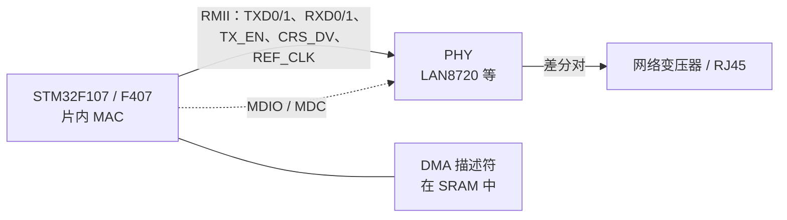
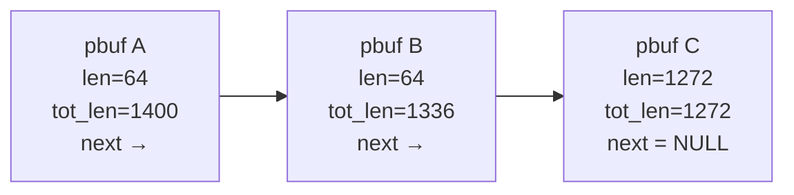
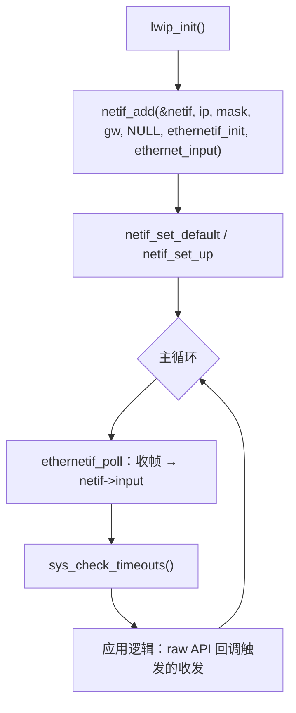

# 3.7 以太网、TCP/IP 与 lwIP

当嵌入式设备需要提供内嵌的 Web 配置界面，或是将工业现场高频采样数据通过长距离局域网稳定推送给数据中枢时，传统的串口与 CAN 总线在通信拓扑与带宽上便显现出局限。STM32F103C8T6 片内并未集成以太网介质访问控制器（MAC），直接引出物理线路无法实现通信；要接入局域网，系统必须借助外挂网络芯片构建物理信道，并在微控制器端或外挂芯片内维系一套完整的 TCP/IP 协议栈。选择硬件全集成协议栈还是通过软件协议栈自研驱动，涉及算力、内存与成本的深度权衡。

在嵌入式网络化设计中，硬件方案通常分为两派：基于带 MAC 微控制器搭配外置 PHY 芯片的高速方案，以及通过 SPI 接口外挂网络控制器的紧凑方案。面对仅有 20 KB SRAM 的单片机环境，选择纯 MAC 芯片配合轻量级软件协议栈 lwIP，还是选用硬件集成 TCP/IP 协议栈的专用芯片（如 W5500），决定了整个固件的架构走向。在接下来的梳理中，我们将重温数据链路层与网络层报文结构，剖析 lwIP 在事件驱动（NO_SYS）模式下基于 raw API 构建非阻塞 TCP 服务端的底层时序，并以经典网络芯片 ENC28J60 为载体，量化评估有限内存预算与协议栈功能特性的边界平衡。完整示例代码位于 `code/嵌入式/3_驱动_通信与中间件/3_7_以太网_TCPIP与lwIP/` 下，网络协议本身的分层与 TCP 状态机见 [9 网络基础](/教程/正文/系统编程/9_网络基础)。

## 1. 让设备接入局域网

车间里的设备要把运行日志送到监控电脑，实验室里的传感器要响应上位机的查询。串口和 CAN 只适合短距离、点对点或小范围总线；要接入现有局域网、和 PC 上的软件直接对话，就得用以太网和 TCP/IP。

F103C8T6 的片内只有以下与网络沾边的资源：USART、SPI、I2C、CAN，没有以太网介质访问控制器 (Media Access Control, MAC)，也没有物理层收发器 (Physical Layer Transceiver, PHY)。要用网线，只能从外面补上这两块。补的方式有两类，成本和灵活性差别很大，选错了会在 RAM 和功能上反复返工。

## 2. 硬件方案

### 2.1 带 MAC 的 MCU 加外置 PHY

STM32F107、F407、F429 这类芯片片内集成了以太网 MAC，外部只需接一颗 PHY 芯片和网络变压器。MAC 与 PHY 之间走精简介质独立接口 (Reduced Media-Independent Interface, RMII)，数据线是单端的，另有一路 50 MHz 参考时钟；MAC 通过管理数据接口 (Management Data Input/Output, MDIO) 读写 PHY 的寄存器，配置速率、双工、自协商。



这种方案吞吐最高，MAC 自带 DMA，收发不占 CPU，协议栈可以跑满 100 Mbit/s。代价是芯片贵、引脚多、原理图复杂，F103 用不了。带 MAC 芯片的完整联网工程放在 [7.3 联网固件](/教程/正文/嵌入式/7_综合实践/7_3_联网固件)。

### 2.2 SPI 接口的以太网芯片

把 MAC 和 PHY 一起做进一颗小芯片，用 SPI 与 MCU 相连。常见两颗：

- ENC28J60：Microchip 的 10BASE-T 控制器，SPI 最高 20 MHz，片内 8 KB 收发缓冲区。它只做 MAC 与 PHY，TCP/IP 协议栈要 MCU 用软件跑。
- W5500：WIZnet 的 10/100 芯片，片内集成硬件 TCP/IP 协议栈，提供 8 个独立 socket，发送与接收缓冲各 16 KB，合计 32 KB。MCU 只需通过 SPI 读写 socket 的寄存器，TCP 握手、重传、分片全部由芯片完成。

| 项目 | ENC28J60 | W5500 |
| --- | --- | --- |
| 速率 | 10 Mbit/s | 10/100 Mbit/s |
| 协议栈位置 | MCU 软件（lwIP 等） | 芯片硬件 |
| MCU 的 RAM 占用 | 几 KB 到十几 KB | 几百字节 |
| MCU 的 Flash 占用 | 20～40 KB | 几 KB |
| 支持 TCP 连接数 | 受 RAM 限制，通常 1～4 | 8 |
| 灵活性 | 高，可换协议栈、可加自定义协议 | 低，只有芯片支持的协议 |
| 典型价格 | 低 | 略高 |

在工程选型实践中，针对 STM32F103 这类 RAM 极其受限的芯片，采用 W5500 等硬件协议栈方案通常更具工业性价比。将复杂的 TCP 滑动窗口、重传队列和连接状态机完全移交由外挂专用硅片处理，不仅释放了 MCU 宝贵的十余千字节内存空间，还将单片机侧的开发重心简化为常规的 SPI 报文搬运。相比之下，纯硬件控制器 ENC28J60 则适合需要深度定制网络协议栈、精细控制报文分片或在既有 lwIP 生态上实现算法复用的场合。

在教学与技术探究维度，以 lwIP 结合 ENC28J60 展开实践能够提供最透明的技术视窗。它将网络接口对象（netif）的抽象绑定、数据包缓冲区（pbuf）的动态链表管理，以及基于事件回调的 raw API 状态流转完整裸露在眼前。这些核心知识不仅在裸机环境中成立，也是后续在具备片上 MAC 控制器的高性能 MCU（如 STM32F4/F7）以及 RTOS 多任务网络编程（如 [7.3 联网固件](/教程/正文/嵌入式/7_综合实践/7_3_联网固件)）中不可或缺的基础能力。通过该链路掌握协议栈全貌后，后续接触 W5500 这类固化硬件也只需对照其寄存器手册按图索骥。

## 3. 协议栈回顾

### 3.1 以太网帧

以太网帧以 14 字节的首部开始：6 字节目的 MAC、6 字节源 MAC、2 字节类型。类型 0x0800 表示载荷是 IPv4，0x0806 表示 ARP，0x86DD 表示 IPv6。首部之后是载荷，最短 46 字节、最长 1500 字节，不足 46 字节要填充；帧尾是 4 字节帧校验序列 (Frame Check Sequence, FCS)，由网卡硬件计算和校验，软件协议栈看不到它。

<BitField
  mode="frame"
  title="以太网 II 帧（按发送顺序）"
  :fields="[
    { name: '目的 MAC', bytes: 6, desc: '接收方的硬件地址，广播为 FF:FF:FF:FF:FF:FF' },
    { name: '源 MAC', bytes: 6, desc: '发送方的硬件地址' },
    { name: '类型', bytes: 2, value: '0x0800', tone: 'brand', desc: '0x0800 IPv4、0x0806 ARP、0x86DD IPv6' },
    { name: '载荷', bytes: 46, variable: true, size: '46～1500 字节', tone: 'green', desc: 'IPv4 分组，不足 46 字节时填充' },
    { name: 'FCS', bytes: 4, desc: 'CRC-32，由网卡硬件处理' }
  ]"
/>

### 3.2 IPv4 首部

IPv4 首部最短 20 字节，最长 60 字节（带选项时）。关键字段是版本与首部长度、总长度、标识与分片偏移、生存时间 (Time To Live, TTL)、协议号和首部校验和。

<BitField
  mode="packet"
  title="IPv4 首部（RFC 791，最短 20 字节）"
  :fields="[
    { name: '版本', bits: 4, value: '0100' },
    { name: '首部长度', bits: 4, value: '0101', desc: '以 4 字节为单位，5 表示 20 字节' },
    { name: '服务类型', bits: 8 },
    { name: '总长度', bits: 16, desc: '首部加数据，以字节为单位' },
    { name: '标识', bits: 16 },
    { name: '标志', bits: 3 },
    { name: '分片偏移', bits: 13 },
    { name: '生存时间', bits: 8, desc: '每经过一个路由器减一，减到 0 丢弃' },
    { name: '协议', bits: 8, tone: 'brand', desc: '1 ICMP、6 TCP、17 UDP' },
    { name: '首部校验和', bits: 16, tone: 'yellow' },
    { name: '源地址', bits: 32 },
    { name: '目的地址', bits: 32 },
    { name: '选项', bits: 32, variable: true, size: '0～40 字节' }
  ]"
/>

首部校验和只覆盖首部本身，不覆盖数据。它的算法是 RFC 1071 定义的互联网校验和：把首部按 16 位字相加（反码和），再把进位折回低位，最后取反。

```c
/* RFC 1071：计算 16 位反码和的二进制反码（互联网校验和） */
uint16_t inet_checksum(const void *data, size_t len) {
    const uint8_t *bytes = (const uint8_t *)data;
    uint32_t sum = 0u;

    while (len > 1u) {
        sum += read_be16(bytes);
        bytes += 2;
        len -= 2u;
    }
    if (len == 1u) {
        sum += (uint32_t)bytes[0] << 8;
    }

    while ((sum >> 16) != 0u) {
        sum = (sum & 0xFFFFu) + (sum >> 16);
    }
    return (uint16_t)(~sum & 0xFFFFu);
}
```

`frame_parse.c` 构造一帧 ICMP 回显请求，算出校验和填入，再重新校验；随后翻转 TTL 的一个位，看校验是否报错：

::: terminal title="bash - frame_parse"

```text
$ gcc -std=c17 -Wall -Wextra frame_parse.c -o frame_parse
$ ./frame_parse
--- Verify valid frame ---
Dst MAC: 02:00:00:12:34:56
Src MAC: aa:bb:cc:dd:ee:ff
EtherType: 0x0800 (IPv4)
IPv4: version=4, hdr_len=20, total_len=36, ttl=64, proto=1
Src IP: 192.168.1.100
Dst IP: 192.168.1.50
IPv4 header checksum=0xA4BE, verify_result=0x0000 [OK]
ICMP: type=8 (Echo Request), code=0, id=0x0001, seq=1, verify_result=0x0000 [OK]

--- Flip 1 bit in TTL and re-verify ---
After 1-bit flip: verify_result=0xFEFF [BAD]
```

:::

校验和的验证方法很巧妙：把校验和字段也算进去再求一次，结果应为 0。这正是输出里 `verify_result=0x0000` 的含义：协议栈收到帧后就是这么检查的，不需要重新算一遍再逐字节比较。

### 3.3 ARP 与 TCP

以太网靠 MAC 地址寻址，IP 靠 IP 地址寻址，两者之间的翻译由地址解析协议 (Address Resolution Protocol, ARP) 完成。主机要发一个 IP 分组时，先查 ARP 缓存里目的 IP 对应的 MAC；没有就发一个 ARP 请求（广播），对方用 ARP 应答回自己的 MAC。lwIP 的 `etharp` 模块负责这件事，并在发送时把 IP 分组封装成以太网帧。

TCP 的三次握手、滑动窗口、拥塞控制、四次挥手属于传输层，本节不重复，需要的读者先看 [9.2 TCP](/教程/正文/系统编程/9_网络基础/9_2_TCP)。这里只提 lwIP 暴露给应用的那一层：连接、接收、发送、关闭各对应一个回调函数，状态机藏在协议栈内部，应用看不到也不需要看到。

## 4. lwIP 的结构

lwIP (lightweight IP) 是瑞典计算机科学研究所 (SICS) 的 Adam Dunkels 发起的开源 TCP/IP 协议栈，专为资源受限的嵌入式系统设计。它的目标是「完整的 TCP，但 RAM 占用只有几十 KB」。

### 4.1 模块划分

| 模块 | 职责 |
| --- | --- |
| `netif` | 网络接口 (netif)，一个物理网卡对应一个 netif |
| `pbuf` | 包缓冲 (pbuf, packet buffer)，分组在各层之间传递的载体 |
| `etharp` | ARP 缓存与以太网帧的封装、解封装 |
| `ip` / `icmp` | IPv4 的收发与差错报文 |
| `udp` / `tcp` | 传输层协议实现 |
| `dhcp` / `dns` | 动态获取地址与域名解析（可选） |
| `api` | 对上层提供的三套接口 |

### 4.2 三套 API

lwIP 提供三套编程接口，选择的依据是有没有操作系统：

| API | 风格 | 需要 RTOS | 典型场景 |
| --- | --- | --- | --- |
| raw API | 回调函数，事件驱动 | 否 | 裸机 NO_SYS 模式 |
| netconn API | 顺序式，阻塞调用 | 是 | RTOS 任务里写网络代码 |
| socket API | 兼容 BSD socket | 是 | 从 PC 移植过来的代码 |

裸机上的 F103 只能用 raw API。它的写法与 PC 上的 socket 差别很大：不能 `recv()` 阻塞等待，只能注册一个接收回调，协议栈收到数据时调用它；发送也是把数据交给协议栈后立即返回，不等对端确认。

::: concept emb-lwip-no-sys title="NO_SYS = 1 时只能用 raw API，且不能在中断里调用 lwIP"

lwIP 配置 `NO_SYS = 1` 时没有操作系统，netconn 与 socket API 都不可用，只能使用 raw 回调式 API。此时 lwIP 不是线程安全的，所有 lwIP 函数（包括 `netif->input`、`tcp_write`、`sys_check_timeouts`）都必须在同一个主循环上下文里调用。中断里只能把收到的帧放进队列，由主循环取出后再交给 lwIP。

:::

### 4.3 pbuf

pbuf 是 lwIP 的包缓冲区，一个分组可能由多个 pbuf 用 `next` 串成链。每个 pbuf 有 `payload`（数据起始地址）、`len`（本段长度）、`tot_len`（本段及后续所有段的总长）和 `ref`（引用计数）。链表的头节点 `tot_len` 等于整个分组的长度，后续节点依次递减。



pbuf 有三种分配方式：`PBUF_POOL` 从固定大小的池里分配，适合网卡驱动收包，分配快、不产生碎片；`PBUF_RAM` 从堆里分配连续内存，适合应用构造要发送的数据；`PBUF_ROM` 只引用 ROM 里的数据，不复制。

用完之后必须调用 `pbuf_free()` 释放，它把引用计数减一，减到 0 才回收。忘记释放会耗尽内存池，症状是网络时通时断、`tcp_write` 开始返回 `ERR_MEM`。

### 4.4 内存配置

lwIP 的内存全部在编译期由 `lwipopts.h` 决定，运行时不再增长。这一点对裸机很重要：RAM 预算在编译时就知道，不会因为连接数增加而突然耗尽。

| 宏 | 含义 | 典型取值（本节的紧凑配置） |
| --- | --- | --- |
| `MEM_SIZE` | 堆的大小，PBUF_RAM 与应用数据从这里分配 | 1600 |
| `PBUF_POOL_SIZE` | 池中 pbuf 的数量 | 6 |
| `PBUF_POOL_BUFSIZE` | 每个池 pbuf 的字节数 | 592 |
| `TCP_MSS` | TCP 最大报文段长度 | 536 |
| `TCP_WND` | 接收窗口 | 2 × TCP_MSS |
| `TCP_SND_BUF` | 发送缓冲区 | 2 × TCP_MSS |
| `MEMP_NUM_TCP_PCB` | 同时存在的 TCP 控制块数量 | 4 |

### 4.5 netif 的接口

一个 netif 结构体把协议栈和网卡驱动连起来，其中三个函数指针是关键：

- `netif->output`：协议栈要把 IP 分组发出去时调用，通常设成 `etharp_output`，负责查 ARP 并封装成以太网帧。
- `netif->linkoutput`：ARP 层把帧准备好后调用，由驱动实现，负责把帧写进网卡。
- `netif->input`：网卡收到帧后，驱动把 pbuf 交给它，通常设成 `ethernet_input`，由它按类型分发给 ARP 或 IP 层。

驱动的职责因此很清晰：初始化硬件、填 `linkoutput`、在轮询或中断里把收到的帧交给 `netif->input`。

## 5. NO_SYS 主循环

没有操作系统时，lwIP 靠主循环驱动。初始化顺序是：`lwip_init()`、`netif_add()`、`netif_set_default()`、`netif_set_up()`，然后进入循环，反复做三件事：

1. 从网卡取出收到的帧，交给 `netif->input()`。
2. 调用 `sys_check_timeouts()`，处理所有超时事件（ARP 重试、TCP 重传、连接回收）。
3. 执行应用自己的逻辑，包括 raw API 的回调。



`sys_check_timeouts()` 依赖 `sys_now()` 返回毫秒计数。裸机上用 [2.6 定时器、PWM 与系统节拍](/教程/正文/嵌入式/2_MCU裸机开发/2_6_定时器_PWM与系统节拍) 里的 SysTick 节拍提供：

```c
/* 由 2.6 节的 SysTick 毫秒节拍直接提供 lwIP 时钟源 */
u32_t sys_now(void) {
    return (u32_t)tick_now();
}
```

固件的 `main()` 就是这段流程：

```c
int main(void) {
    clock_init_72mhz();
    tick_init();
    console_init(72000000u, 115200u);

    lwip_init();

    ip4_addr_t ipaddr;
    ip4_addr_t netmask;
    ip4_addr_t gw;
    IP4_ADDR(&ipaddr, 192, 168, 1, 50);
    IP4_ADDR(&netmask, 255, 255, 255, 0);
    IP4_ADDR(&gw, 192, 168, 1, 1);

    netif_add(&g_netif, &ipaddr, &netmask, &gw,
              NULL, ethernetif_init, ethernet_input);
    netif_set_status_callback(&g_netif, netif_status_cb);
    netif_set_default(&g_netif);
    netif_set_up(&g_netif);

    /* 若需要通过路由器动态获取 IP，先将静态地址置 0 再调用 dhcp_start(&g_netif) */
    (void)echo_server_init();

    for (;;) {
        ethernetif_poll(&g_netif);
        sys_check_timeouts();
    }
}
```

中断里只把帧放进一个队列，主循环再取出来交给 lwIP。这个队列可以用 [3.4 数据帧、环形缓冲区与状态机](/教程/正文/嵌入式/3_驱动_通信与中间件/3_4_数据帧_环形缓冲区与状态机) 的环形缓冲区实现。本节的 ENC28J60 驱动为了简单，直接在 `ethernetif_poll()` 里轮询芯片的接收计数，连中断都没有用。

## 6. raw API 的 TCP 回显服务器

### 6.1 建立监听

raw API 里一个 TCP 连接由一个 `struct tcp_pcb` 表示。服务器的建立过程是：新建 pcb、绑定端口、进入监听状态、注册接受回调。

```c
err_t echo_server_init(void) {
    struct tcp_pcb *pcb = tcp_new_ip_type(IPADDR_TYPE_ANY);
    if (pcb == NULL) {
        return ERR_MEM;
    }
    err_t err = tcp_bind(pcb, IP_ANY_TYPE, 7);
    if (err != ERR_OK) {
        tcp_close(pcb);
        return err;
    }
    struct tcp_pcb *lpcb = tcp_listen(pcb);
    if (lpcb == NULL) {
        tcp_close(pcb);
        return ERR_MEM;
    }
    tcp_accept(lpcb, echo_accept_cb);
    printf("[server] listening on port 7\n");
    return ERR_OK;
}
```

`tcp_listen()` 会释放原来的 pcb 并返回一个新的、专用于监听的 pcb，所以之后不能再使用 `pcb`。`tcp_accept()` 注册的回调在有客户端连上来时被调用，参数里带着新连接的 pcb。

### 6.2 接受、接收与关闭

接受回调里给新连接挂上接收回调和错误回调：

```c
static err_t echo_accept_cb(void *arg, struct tcp_pcb *newpcb, err_t err) {
    (void)arg;
    if (err != ERR_OK || newpcb == NULL) {
        return ERR_VAL;
    }
    printf("[server] accepted connection from %s:%u\n",
           ipaddr_ntoa(&newpcb->remote_ip), (unsigned)newpcb->remote_port);
    tcp_recv(newpcb, echo_recv_cb);
    tcp_err(newpcb, echo_err_cb);
    return ERR_OK;
}
```

接收回调是 raw API 的核心。它被调用时有三种情况：`p` 非空表示收到了数据；`p` 为 NULL 表示对端关闭了连接；`err` 非 `ERR_OK` 表示出错。收到数据时遍历 pbuf 链，把每一段写进发送队列，然后必须做两件收尾工作：通知协议栈已经消费了多少字节，释放 pbuf。

```c
static err_t echo_recv_cb(void *arg, struct tcp_pcb *tpcb,
                          struct pbuf *p, err_t err) {
    (void)arg;
    if (p == NULL) {
        /* 对端已发送 FIN 关闭连接 */
        printf("[server] peer closed connection\n");
        tcp_arg(tpcb, NULL);
        tcp_recv(tpcb, NULL);
        tcp_err(tpcb, NULL);
        return tcp_close(tpcb);
    }
    if (err != ERR_OK) {
        pbuf_free(p);
        return err;
    }

    printf("[server] recv tot_len=%u bytes\n", (unsigned)p->tot_len);

    /* 遍历 pbuf 链，将每一段载荷写入发送队列 */
    for (struct pbuf *q = p; q != NULL; q = q->next) {
        u8_t flags = TCP_WRITE_FLAG_COPY;
        if (q->next != NULL) {
            flags |= TCP_WRITE_FLAG_MORE;
        }
        err_t wr_err = tcp_write(tpcb, q->payload, q->len, flags);
        if (wr_err != ERR_OK) {
            /* 发送缓冲区不足时返回 ERR_MEM，保留 pbuf 留待下次处理 */
            return wr_err;
        }
    }

    /* 通知协议栈应用层已消费 p->tot_len 字节，推进接收窗口 */
    tcp_recved(tpcb, p->tot_len);
    pbuf_free(p);

    /* 立即把发送队列中的报文段发往网络层 */
    return tcp_output(tpcb);
}
```

`tcp_recved()` 是 raw API 里最容易被忘掉的一步。TCP 的接收窗口是有限的，协议栈收到数据后不会自动把窗口往后推，必须由应用显式告诉它「这批数据我用完了」。忘了调用，窗口逐渐缩到 0，对端就再也发不出数据，连接看起来还活着但彻底停滞。

::: concept emb-lwip-tcp-recved title="接收数据后必须调用 tcp_recved"

raw API 的接收回调交出数据后，TCP 的接收窗口不会自动推进。应用必须调用 `tcp_recved(pcb, len)` 告诉协议栈已经消费了多少字节，协议栈据此扩大通告窗口。未调用时窗口逐步收缩到 0，对端停止发送，连接表面上仍然存在。

:::

::: compare left-title="忘记 tcp_recved" right-title="处理完数据后推进窗口"

```c
static err_t recv_cb(void *arg, struct tcp_pcb *pcb,
                     struct pbuf *p, err_t err) {
    (void)arg;
    (void)err;
    if (p == NULL) {
        return tcp_close(pcb);
    }
    /* 只把数据拷走，没有通知协议栈 */
    memcpy(g_buf, p->payload, p->len);
    pbuf_free(p);
    return ERR_OK;
}
```

---

```c
static err_t recv_cb(void *arg, struct tcp_pcb *pcb,
                     struct pbuf *p, err_t err) {
    (void)arg;
    (void)err;
    if (p == NULL) {
        return tcp_close(pcb);
    }
    memcpy(g_buf, p->payload, p->len);
    /* 告诉协议栈这批数据已消费，接收窗口重新打开 */
    tcp_recved(pcb, p->tot_len);
    pbuf_free(p);
    return ERR_OK;
}
```

:::

`tcp_write()` 返回 `ERR_MEM` 表示发送缓冲区满了。产品代码里应把没写完的数据留着，等 `tcp_sent` 回调通知有空间了再继续；本节为了让测试程序简短，直接返回错误，由上层重试。

## 7. 在 PC 上测试

写网络代码最痛苦的是上板调试：设备一旦 panic 或死循环，串口日志也没有了。lwIP 提供了一个折中方案：在 PC 上编译同一个协议栈，用回环接口在同一进程里同时跑客户端和服务器，收发逻辑与固件完全一致，只是物理层换成了内存。

`lwip_host_echo/` 目录下需要三样东西：

- `lwipopts.h`：打开 `NO_SYS`、`LWIP_NETIF_LOOPBACK`、`LWIP_HAVE_LOOPIF`，关掉 DHCP 和 socket API。
- `arch/cc.h`：把 lwIP 需要的编译器相关定义补上，Windows 下用 MinGW 编译时只要定义 `BYTE_ORDER` 和几个宏。
- `main.c`：`lwip_init()` 之后初始化服务器，再用 raw API 建一个客户端连 127.0.0.1:7，发一句话，等回显。

主循环同样要推动协议栈：

```c
/* NO_SYS 主循环：轮询回环接口并检查协议栈定时器 */
for (int step = 0; step < 200 && !g_client_done; ++step) {
    g_sim_ms += 10u;
    netif_poll_all();
    sys_check_timeouts();
}
/* 再推进几轮使 FIN/ACK 四次挥手完成 */
for (int step = 0; step < 20; ++step) {
    g_sim_ms += 10u;
    netif_poll_all();
    sys_check_timeouts();
}
```

`netif_poll_all()` 处理回环接口的待发数据；`sys_check_timeouts()` 处理超时。`g_sim_ms` 是模拟时钟，每次循环加 10 ms，让超时事件在几轮之内就能触发。真实硬件上 `sys_now()` 由 SysTick 提供，不需要这种模拟。

编译时把 lwIP 的 `src/core/*.c`、`src/core/ipv4/*.c` 和 `src/netif/ethernet.c` 一起链接进来，运行：

::: terminal title="bash - lwip_host_echo"

```text
$ gcc -std=c17 -Wall -Wextra -Ilwip_host_echo -I$LWIP/src/include \
    lwip_host_echo/main.c lwip_host_echo/echo_server.c \
    $LWIP/src/core/*.c $LWIP/src/core/ipv4/*.c $LWIP/src/netif/ethernet.c \
    -o lwip_host_echo
$ ./lwip_host_echo
[server] listening on port 7
[client] connected, sending 12 bytes: hello, lwip
[server] accepted connection from 127.0.0.1:51236
[server] recv tot_len=12 bytes
[client] echoed (12 bytes): hello, lwip
[server] peer closed connection
[client] server closed connection
[main] test finished, client_done=1
```

:::

输出把一次完整连接的顺序摊开了：服务器先监听，客户端连上，服务器接受连接并打印对端地址端口，收到 12 字节，回显给客户端，客户端打印收到的内容，然后双方依次关闭。端口 51236 是客户端临时分配的，每次运行都不同。

这套测试的价值在于：`echo_server.c` 的代码与固件里的完全一样，`main.c` 里的客户端可以换成任何测试场景，例如发大包测试分片、连续发多次测试窗口、连上后立刻关闭测试错误回调。上板前把逻辑都验证一遍，剩下要排查的就只有驱动。

## 8. 接到真实硬件

### 8.1 ENC28J60 的驱动要点

ENC28J60 挂在 SPI2 上：PB13 SCK、PB14 MISO、PB15 MOSI、PB12 片选。SPI 模式 0，PCLK1 36 MHz 时四分频得 9 MHz 足够。

芯片的 SPI 指令有七条，高 3 位是操作码，低 5 位是寄存器地址：

| 操作码 | 指令 | 作用 |
| --- | --- | --- |
| 0x00 | RCR | 读控制寄存器 |
| 0x40 | WCR | 写控制寄存器 |
| 0x80 | BFS | 把控制寄存器的指定位置 1 |
| 0xA0 | BFC | 把控制寄存器的指定位清 0 |
| 0x3A | RBM | 从接收缓冲区读数据 |
| 0x7A | WBM | 向发送缓冲区写数据 |
| 0xFF | SRC | 软件复位 |

控制寄存器分在四个 Bank 里，切换 Bank 要写 ECON1 的低两位。读一个寄存器是「发操作码与地址、再发一个空字节、读回第二个字节」；写是「发操作码与地址、再发数据」。这些细节在 `enc28j60.c` 里，正文不逐条展开。

收包靠读 EPKTCNT 判断有多少帧待处理。每帧前面有一个 6 字节的接收状态向量：前 2 字节是下一帧的地址（接收缓冲区是环形的），接着 2 字节是帧长（含 4 字节 FCS），最后 2 字节是状态位。读完帧数据后要写 ECON2 的 PKTDEC 位，把 EPKTCNT 减一。

```c
uint16_t enc28j60_begin_rx(void) {
    enc_write_reg(ENC_ERDPTL, (uint8_t)(g_next_pkt_ptr & 0xFFu));
    enc_write_reg(ENC_ERDPTH, (uint8_t)(g_next_pkt_ptr >> 8));

    /* 读取 6 字节接收状态向量：前 2 字节为下一包指针，第 3～4 字节为帧长（含 4B FCS） */
    uint8_t hdr[6];
    enc28j60_read_buf(hdr, sizeof(hdr));
    g_next_pkt_ptr = (uint16_t)(((uint16_t)hdr[1] << 8) | hdr[0]);
    uint16_t wire_len = (uint16_t)(((uint16_t)hdr[3] << 8) | hdr[2]);
    uint16_t status = (uint16_t)(((uint16_t)hdr[5] << 8) | hdr[4]);

    if ((status & 0x0080u) == 0u || wire_len < 4u) {
        return 0u;
    }
    return (uint16_t)(wire_len - 4u); /* 去掉末尾 4 字节硬件 CRC */
}
```

### 8.2 netif 的粘合层

驱动之上就是 lwIP 的 `netif`。`ethernetif.c` 实现三个函数：`low_level_init` 填 MAC 地址和 MTU，`low_level_output` 把 pbuf 链逐段写进发送缓冲区，`low_level_input` 从接收缓冲区读出一帧并包装成 pbuf。

```c
static err_t low_level_output(struct netif *netif, struct pbuf *p) {
    (void)netif;
    enc28j60_begin_tx();
    for (struct pbuf *q = p; q != NULL; q = q->next) {
        enc28j60_write_buf(q->payload, q->len);
    }
    enc28j60_end_tx(p->tot_len);
    return ERR_OK;
}

static struct pbuf *low_level_input(struct netif *netif) {
    (void)netif;
    if (enc28j60_pending_packets() == 0u) {
        return NULL;
    }

    uint16_t len = enc28j60_begin_rx();
    if (len == 0u) {
        enc28j60_end_rx();
        return NULL;
    }

    struct pbuf *p = pbuf_alloc(PBUF_RAW, len, PBUF_POOL);
    if (p != NULL) {
        for (struct pbuf *q = p; q != NULL; q = q->next) {
            enc28j60_read_buf(q->payload, q->len);
        }
    }
    enc28j60_end_rx();
    return p;
}
```

`pbuf_alloc(PBUF_RAW, len, PBUF_POOL)` 分配出来的 pbuf 可能由多段组成（每段最大 `PBUF_POOL_BUFSIZE`），所以读取时要遍历链表，逐段填。`ethernetif_init` 里把 `output` 设为 `etharp_output`、`linkoutput` 设为 `low_level_output`；收包方向的 `netif->input` 不在这里设，它由 `netif_add()` 的最后一个参数给出，也就是第 5 节调用时的 `ethernet_input`。

### 8.3 静态地址与 DHCP

`netif_add()` 的第二个参数是 IP 地址，第三、四个是子网掩码和网关，第五个是给驱动自用的状态指针。静态 IP 直接填入；要 DHCP，先把 IP 置为 0，`netif_set_up()` 之后调用 `dhcp_start(&g_netif)`，地址到手后 `netif_status_callback` 被调用，可以在里面把 IP 打印出来。

上面固件的 `main()` 用静态地址 192.168.1.50，并注册了状态回调：

```c
static void netif_status_cb(struct netif *netif) {
    if (netif_is_up(netif) && !ip4_addr_isany_val(*netif_ip4_addr(netif))) {
        uart_puts("netif IP: ");
        uart_puts(ip4addr_ntoa(netif_ip4_addr(netif)));
        uart_puts("\r\n");
    }
}
```

上板后，把 PC 与设备接到同一个交换机（或直连网线，注意现在的网卡都支持自动翻转），在 PC 上：

::: terminal title="bash - 从 PC 测试设备"

```text
ping 192.168.1.50
nc 192.168.1.50 7
```

:::

`ping` 通说明 IP 层和 ARP 正常；`nc` 连上 7 端口后敲几个字符，应当看到回显。这两条命令的具体输出取决于网络环境，本节不贴。

## 9. 内存预算

### 9.1 紧凑配置下的占用

F103C8T6 只有 20 KB SRAM。本节 `fw_enc28j60_echo/lwipopts.h` 里的紧凑配置按这个上限挑选：`MEM_SIZE` 1600 字节、`PBUF_POOL_SIZE` 6 个、每包 592 字节、`TCP_WND` 与 `TCP_SND_BUF` 都是 2 × MSS。编译出来的占用：

::: terminal title="bash - 紧凑配置的固件 size"

```text
$ arm-none-eabi-size fw_compact.elf
   text    data     bss     dec     hex filename
  31836      20    8860   40716    9f0c fw_compact.elf
```

:::

31.1 KB Flash。`size` 报告的 `bss` 是 8860 字节，它由三部分构成：纯数据段 `.bss` 7324 字节、链接脚本在末尾预留的栈（1024 字节）与堆（512 字节）。再加上 `.data` 的 20 字节，运行时占用的 RAM 约 8.7 KB，20 KB 里还剩 11 KB 左右给应用。这个余量能跑一个回显服务器，再加一个 HTTP 服务就非常紧张。

RAM 的分布可以从符号表里看出来：

::: terminal title="bash - 最大的 RAM 对象"

```text
$ arm-none-eabi-nm --size-sort -S -td fw_compact.elf | grep -iE " [bBdD] " | tail -6
536877072 00000131 B memp_memory_TCP_SEG_base
536876904 00000163 B memp_memory_REASSDATA_base
536876536 00000363 B memp_memory_FRAG_PBUF_base
536877272 00000627 B memp_memory_TCP_PCB_base
536871032 00001619 B ram_heap
536872656 00003651 B memp_memory_PBUF_POOL_base
```

:::

`ram_heap` 是 `MEM_SIZE` 加上管理开销，`memp_memory_PBUF_POOL_base` 是 6 个 592 字节的池 pbuf 加上每个 pbuf 的结构体开销，`memp_memory_TCP_PCB_base` 是 4 个 TCP 控制块。想省 RAM，优先盯住这三项。

### 9.2 宽松配置放不下

把同一份 `lwipopts.h` 里 `LWIP_PROFILE_LARGE` 那一组参数打开（`MEM_SIZE` 6144、`PBUF_POOL_SIZE` 16、窗口 4 × MSS、8 个 TCP 控制块），编译直接失败：

::: terminal title="bash - 宽松配置的链接结果"

```text
$ arm-none-eabi-gcc ... -DLWIP_PROFILE_LARGE ... -Wl,-Map=fw_large.map -o fw_large.elf
arm-none-eabi-ld: fw_large.elf section `._user_heap_stack' will not fit in region `RAM'
arm-none-eabi-ld: region `RAM' overflowed by 120 bytes
collect2.exe: error: ld returned 1 exit status
```

:::

只超出 120 字节，看起来快成功了，但链接失败就是链接失败。把栈和堆的预留再压一压也许能勉强链接，那只是把问题推给运行时，而栈溢出的表现是随机死机，比链接错误难查得多。

从工程实施的角度来看，在仅拥有 20 KB SRAM 的 STM32F103C8T6 上运行软件协议栈 lwIP，其资源配置必须极度收敛，通常仅能承载一到两个低频并发的 TCP 连接通道，难以支撑开销较大的嵌入式 Web 服务器或多协议并发应用。若系统需要扩展复杂的网络中间件或接入密集的云端长连接，合理的架构演进应当是将微控制器升级至具备数十乃至数百千字节 RAM 的高性能芯片，或者改用硬件集成 TCP/IP 协议栈的专用网络控制器。

## 10. 习题

### 10.1 巩固

<Exercise id="63354" :d="1" :w="2">

`frame_parse.c` 的最后一段把 `frame[22]` 翻转一位（TTL 字段），重新校验得到 `0xFEFF`。

(1) 编译运行原程序，抄下 `IPv4 header checksum` 与两次 `verify_result`。

(2) 把翻转位置改到目的地址的最后一个字节（`frame[14 + 16 + 3]`），重新运行，记下新的 `verify_result`。说明它为什么不是 `0x0000`，以及能否从校验和的值判断是哪一位出错。

(3) 说明校验和字段本身参与运算时，正确首部的验证结果为什么是 0，而不是当初算出的 `0xA4BE`。

</Exercise>

<Exercise id="63355" :d="2" :w="2">

`fw_enc28j60_echo/lwipopts.h` 的紧凑配置里 `MEM_SIZE` 为 1600、`PBUF_POOL_SIZE` 为 6、`PBUF_POOL_BUFSIZE` 为 592。

(1) 算出 pbuf 池的载荷总字节数，与第 9 节 `nm` 输出里 `memp_memory_PBUF_POOL_base` 的 3651 字节比较，差值的来源是什么。

(2) 自己跑一遍第 9.1 节的 `arm-none-eabi-nm --size-sort -S -td fw_compact.elf | grep -iE " [bBdD] "`，把输出里属于 lwIP 的符号（`ram_heap`、`memp_memory_*`、`arp_table` 等）的字节数相加，再与 `size` 报出的 bss 减去 1536（栈 1024 加堆 512）比较。差出来的部分是哪些对象，`size` 的 bss 为什么不能直接当成 lwIP 的占用。

(3) 把 `PBUF_POOL_SIZE` 改成 10，重新链接，用 `arm-none-eabi-size` 给出新的 bss，并与按每个池 pbuf 592 字节加结构体开销估算的增量比较。

</Exercise>

<Exercise id="63356" :d="2" :w="2">

`code/嵌入式/3_驱动_通信与中间件/3_7_以太网_TCPIP与lwIP/exercises/pbuf_copy_starter.c` 里的 `pbuf_copy_out` 还没有实现。

(1) 补全它：按 `next` 顺序把各节点的 `payload` 复制到 `dst`，最多复制 `max_len` 字节，返回实际复制的字节数；最后一个节点只复制剩余的部分，不能越界。

(2) 编译运行，输出应当与下面一致：

```text
Full copy (26 bytes): GET /index.html HTTP/1.1
Partial copy (15 bytes): GET /index.html
```

(3) 说明循环为什么用 `q->len` 而不是 `q->tot_len` 决定每段复制多少字节。

</Exercise>

<Exercise id="63357" :d="3" :w="3">

`frame_parse.c` 的 `inet_checksum` 只用来验证已有首部，现在用它算两段首部：

(1) 对下面这个 20 字节首部算出校验和，填入第 11、12 字节后再验证一次：

```text
45 00 00 3C 1C 46 40 00 40 06 00 00 C0 A8 01 64 C0 A8 01 32
```

结果应当是 `0x9A8F`，验证结果是 `0x0000`。

(2) 带 4 字节选项的首部（IHL = 6）如下，同样算一遍，结果应当是 `0x988A`：

```text
46 00 00 40 1C 46 40 00 40 06 00 00 C0 A8 01 64 C0 A8 01 32 01 01 00 00
```

(3) 写一个 `inet_checksum_selftest()`，对长度 0、1、2、3 的缓冲区各算一次，说明奇数字节时最后一个字节为什么按高 8 位处理。

(4) `frame_parse.c` 用 `ihl * 4` 定位 ICMP，而不是固定写 20。把第 (2) 个首部换进去，说明如果改回固定 20，ICMP 字段会从哪个字节开始读，输出会错成什么。

</Exercise>

### 10.2 编程

<Exercise id="63358" :d="3" :w="3">

`exercises/line_echo_starter.c` 实现了一个按行回显的服务器，`line_recv_cb` 里只留了 TODO。一行可能跨多个 pbuf 节点，也可能跨多次回调。

(1) 补全接收回调：逐字节追加到 `st->buf`；遇到 `'\n'` 时用 `tcp_write` 发回 `ECHO: ` 加整行；行满 63 字节仍未遇到换行时清空缓冲区并发送 `ERR: line too long\n`。

(2) 运行程序，输出应当是：

```text
[client] recv: ECHO: hello
[client] recv: ECHO: world
Total echoed lines: 2
```

(3) 把 `main` 里的三个分片改成 `"h"`、`"ello\nwor"`、`"ld\n"`，结果是否一样？说明回调结果为什么与 pbuf 边界无关。

(4) 说明 `tcp_recved` 为什么在处理完整个 `p` 之后调用，而不是每取一个字节调用一次。

</Exercise>

<Exercise id="63359" :d="3" :w="3">

`exercises/udp_discovery_starter.c` 用 UDP 做设备发现：客户端发 `WHO?`，服务器回设备信息。补全 `discovery_recv_cb`。

(1) 只对长度为 4、内容为 `WHO?` 的数据报回应；回应内容是 26 字节的 `DEV=F103-NODE;IP=127.0.0.1`，用 `pbuf_alloc(PBUF_TRANSPORT, len, PBUF_RAM)` 分配，`udp_sendto` 发出，再 `pbuf_free`。

(2) 运行，输出应当是：

```text
[client] reply from 127.0.0.1:9999 -> DEV=F103-NODE;IP=127.0.0.1
```

(3) 再发一个 3 字节的 `WHO`，确认服务器不回应。说明 UDP 回调里 `p` 在所有分支上都必须释放，漏掉会怎样。

(4) 与 TCP 回显服务器对比：UDP 版本没有 `tcp_recved`，也没有连接建立与关闭回调。说明 UDP 为什么不需要接收窗口。

</Exercise>

<Exercise id="63360" :d="4" :w="4">

`exercises/modbus_tcp_starter.c` 已经搭好客户端与服务器，只差 `modbus_tcp_handle`。

(1) 实现它：检查 MBAP 的协议 ID 为 0；支持功能码 `0x03`（读保持寄存器）与 `0x06`（写单个寄存器），寄存器地址与数值按大端解释；应答复制事务 ID、单元标识，长度字段填 `1 + PDU 长度`；协议 ID 不对或功能码不支持时返回 0。

(2) 运行，客户端应当打印两行应答：

```text
[client] rx (12 bytes): 00 01 00 00 00 06 01 06 00 01 12 34
[client] rx (13 bytes): 00 02 00 00 00 07 01 03 04 00 64 12 34
```

(3) 第二行的 `04` 是字节数，`00 64` 与 `12 34` 是两个寄存器的值。说明这里为什么不需要 Modbus RTU 的 CRC，也不需要 3.5 个字符时间的静默。

(4) 把第一个请求的协议 ID 改成 `0x0001`，确认服务器不应答。说明 MBAP 的哪个字段把请求与应答配成一对。

</Exercise>

<Exercise id="63361" :d="4" :w="3">

`fw_enc28j60_echo/enc28j60.c` 的收包路径先读 6 字节接收状态向量。把这段逻辑做成可在 PC 上测试的函数：

(1) 写 `bool enc_rx_decode(const uint8_t hdr[6], uint16_t *next_ptr, uint16_t *payload_len)`：前 2 字节小端是下一帧地址，第 3、4 字节小端是帧长（含 4 字节 FCS），第 5、6 字节是状态；状态位 `0x0080` 为 0 或帧长小于 4 时返回 `false`，否则 `*payload_len` 取帧长减 4。

(2) 用下面三组向量测试，写出每组的结果：

```text
12 0A 2F 00 80 00
12 0A 2F 00 00 00
12 0A 03 00 80 00
```

(3) 说明接收缓冲区为什么是环形的，`g_next_pkt_ptr` 为什么不能用「当前地址 + 帧长」算出来。

(4) 每取走一帧要写 `ECON2` 的 `PKTDEC` 位。不写时 `EPKTCNT` 会怎样，轮询循环会出现什么现象。

(5) 若把这块板换成 W5500，本节哪些代码会整个消失（`netif`、`pbuf`、`tcp_*` 回调），MCU 一侧改成什么样的编程模型？结合 20 KB SRAM 的预算，说明第 2 节为什么建议产品优先 W5500。

</Exercise>

### 10.3 综合与挑战

<Exercise id="63362" :d="5" :w="4">

正文的 `echo_recv_cb` 在 `tcp_write` 返回 `ERR_MEM` 时直接返回错误，数据就丢了。改成不丢数据的版本：

(1) 为每个连接准备一个发送队列（可以用 3.4 节的环形缓冲区），接收回调只把数据追加进队列，再从队列尽量 `tcp_write`；遇到 `ERR_MEM` 就停下，等 `tcp_sent` 回调再继续。

(2) 用 host 测试：客户端一次发 8192 字节，服务器原样回显。验收标准是客户端收到的字节数等于 8192、内容逐字节相同，服务器没有丢弃任何一段。给出测试输出，至少包含发送字节数、收到字节数与比较结果。

(3) 说明 `tcp_sent` 回调的 `len` 表示什么，它为什么可能大于你上一次 `tcp_write()` 的长度；发送缓冲区的空间是按什么口径释放的。

(4) 队列满时（客户端长时间不读）你选择丢最旧的数据还是拒绝新数据？说明理由，并指出另一种选择更适合什么场景。

</Exercise>

<Exercise id="63363" :d="6" :w="5" scope="*">

在 `lwip_host_echo` 的基础上写一个最小的 HTTP/1.0 服务器，端口 80。

(1) 接收回调按行解析请求，只支持 `GET /`，返回 `200 OK`、`Content-Type: text/plain`、`Content-Length` 与正文 `F103 lwIP demo\n`；其他路径返回 `404`。

(2) 响应发完后调用 `tcp_close`。说明为什么不能在一次 `tcp_write` 之后立刻 `tcp_close` 而不看返回值，`tcp_close` 返回 `ERR_MEM` 时该怎么办。

(3) 用 host 客户端发 `GET / HTTP/1.0\r\n\r\n`，打印收到的完整响应；再发 `GET /x` 验证 404。

(4) 把 `TCP_SND_BUF` 调成 1 × MSS 重新运行，说明响应为什么可能分成多次 `tcp_sent`，这对 `tcp_close` 的时机有什么影响。

</Exercise>

## 11. 参考资料

1. Adam Dunkels 等, [*lwIP - A Lightweight TCP/IP stack*](https://savannah.nongnu.org/projects/lwip/)，版本 STABLE-2_2_1_RELEASE：`doc/doxygen/main_page.h` 的模块划分与 [`NO_SYS_SampleCode.c`](https://raw.githubusercontent.com/lwip-tcpip/lwip/master/doc/NO_SYS_SampleCode.c) 的主循环结构。
2. lwIP 文档, [*TCP raw API*](https://www.nongnu.org/lwip/2_1_x/group__tcp__raw.html)：`tcp_new`、`tcp_bind`、`tcp_listen`、`tcp_recv`、`tcp_recved`、`tcp_write` 的语义与返回值。
3. J. Postel 编, [*RFC 791: Internet Protocol*](https://www.rfc-editor.org/rfc/rfc791)：IPv4 首部与校验和。
4. R. Braden 等, [*RFC 1071: Computing the Internet Checksum*](https://www.rfc-editor.org/rfc/rfc1071)：互联网校验和算法。
5. Microchip, [*ENC28J60 Data Sheet*](https://www.microchip.com/en-us/product/enc28j60)：SPI 指令、控制寄存器与接收缓冲区的环形结构。
6. WIZnet, [*W5500*](https://docs.wiznet.io/Product/Chip/Ethernet/W5500)：硬件 TCP/IP 与 socket 缓冲。
7. 本教程示例代码：`code/嵌入式/3_驱动_通信与中间件/3_7_以太网_TCPIP与lwIP/`（`frame_parse.c`、`lwip_host_echo/`、`fw_enc28j60_echo/`）。
