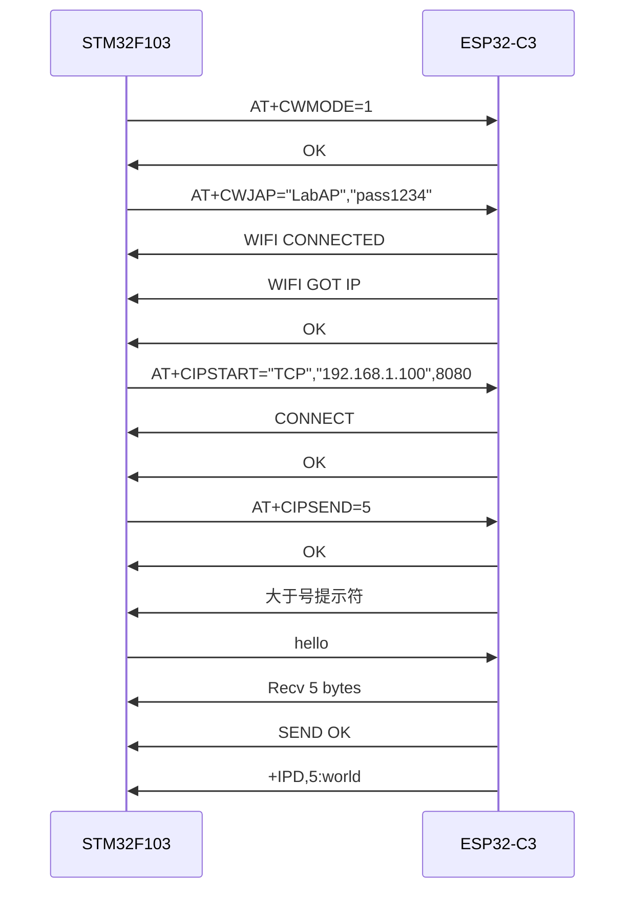
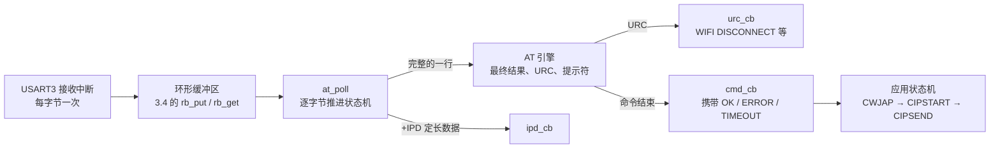
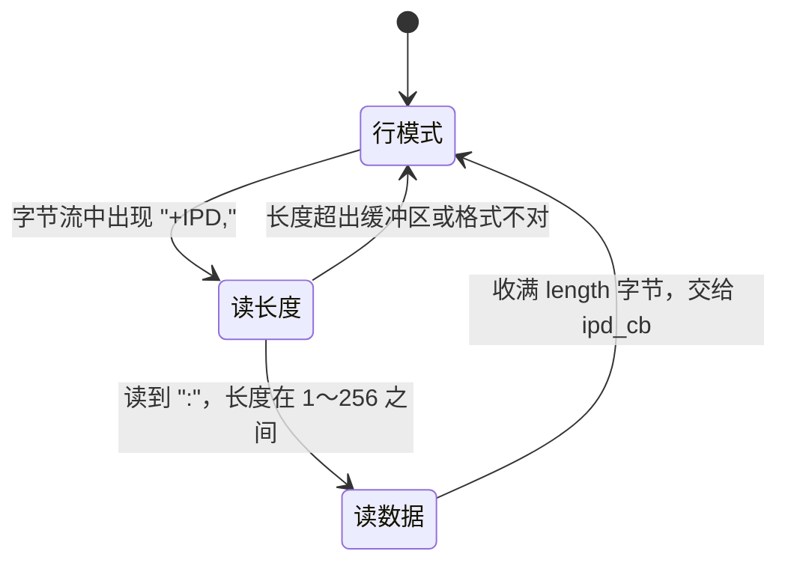
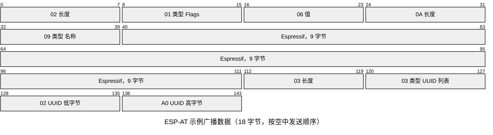

# 3.8 BLE、Wi-Fi 与通信模块

在环境监控或工业物联网终端的硬件方案中，主控微控制器可能仅配备了一颗基础的 STM32F103C8T6。芯片本身既缺乏片上射频电路，亦无充裕的内存运行沉重的 Wi-Fi 与蓝牙协议栈。若系统既需要将周期性的传感器遥测数据上传至远程服务器，又期望移动端能够在设备近场直接通过低功耗蓝牙（BLE）读取运行状态与配置参数，业界通行的做法便是在通用异步串口上外挂一颗专用的无线通信协处理器（如烧录了 ESP-AT 固件的 ESP32-C3 模块）。微控制器通过标准的 UART 接口下发文本命令，模块内部的独立核心则全权接管物理层射频收发、复杂网络协议栈维护以及射频校准，形成高效的主从协同拓扑。

在这种主控与外挂通信模块协同的架构中，系统交互的核心转变为如何通过异步串口稳定承载文本控制协议。AT 命令具备半双工指令交互与异步主动上报（非请求结果码，URC）混杂的特征，加之网络数据包（如 `+IPD`）中常常包含不可预期的任意二进制字节甚至伪装的控制字符，传统的简单逐行文本解析在此类复杂场景下极易崩溃。在接下来的梳理中，我们将系统比对当前主流无线扩展架构的权衡考量，拆解 AT 客户端在应对定长数据流、异步网络事件与指令超时机制时的状态机设计，并结合 Wi-Fi 传输与 BLE GATT 广播特性，建立一套既能在宿主机上脱机自动化测试、又能稳固落地于单片机固件的通信驱动架构。完整示例代码位于 `code/嵌入式/3_驱动_通信与中间件/3_8_BLE_WiFi与通信模块/` 目录下。

## 1. 给没有射频的 MCU 加无线

F103 的 64 KB Flash 装不下 802.11 与 BLE 的协议栈，芯片里也没有 2.4 GHz 的收发器。把射频做进同一颗芯片是无线 SoC 的做法；手上已经有一块 F103 的板子时，加一颗现成的无线模块更省事。模块把射频、协议栈、TCP/IP 和加密都封在里面，对外只留一个串口，串口上跑一组文本命令。这组命令叫 AT 命令 (AT command)，名字来自 Hayes 调制解调器时代每条命令前面的 `AT` 前缀。

AT 模块在系统里的位置和当年的电话调制解调器一样：主控发命令，模块回结果，网络数据走另一条独立的字节流。好处是主控一侧只依赖串口，换模块时改的是命令字符串，不是驱动；代价是每条命令都要等模块回应，时延从几十毫秒到几秒不等，不适合硬实时的控制回路。文本协议本身也要自己解析，`+IPD` 这类异步消息还要求解析器在按行读取与按长度读取之间切换，这是第 4 节的主要内容。

## 2. 方案与模块

接无线有三条路，选中哪条由产品形态决定。

| 方案 | 代表器件 | 优点 | 代价 |
| --- | --- | --- | --- |
| AT 命令模块，串口控制 | ESP32-C3 烧 ESP-AT、经典蓝牙 SPP 模块、BLE 透传模块 | 主控代码只碰串口，几天就能联调，模块可单独认证 | 时延高，吞吐受串口限制，模块固件的局限就是产品的局限 |
| 无线 SoC 当主控 | ESP32、nRF52、CC2530 | 单芯片，省掉主控与模块之间的串口，RAM 和 Flash 够跑应用 | 要把应用迁到另一套 SDK 上，原来的 MCU 代码要重写 |
| 网络协处理器，SPI/SDIO 接口 | W5500（有线）、ESP32 跑 esp-hosted | 吞吐高，主控仍写自己的逻辑 | 驱动复杂，要移植一套主机侧协议栈接口 |

在具体的工程实践中，技术路线的决策应当紧密结合业务生命周期与研发成本：若现有硬件平台与传感器业务逻辑已经成熟，仅需新增远程上云或近场蓝牙调试通道，采用 AT 模块是以最小软件侵入代价达成目标的路径；若产品核心功能高度依赖多连接并发、复杂配网界面交互或模块级 OTA，直接采用无线 SoC 作为单芯片主控能够彻底消除串口瓶颈；而当通信需求达到持续数兆比特每秒的高带宽吞吐时，基于 SPI 或 SDIO 接口的高性能网络协处理器则是更为合宜的方案。

实验板上用 ESP32-C3 开发板，烧 ESP-AT 固件。接线按 ESP-AT 的硬件连接文档，只用 AT 串口：

| F103 引脚 | 方向 | ESP32-C3 引脚 | 说明 |
| --- | --- | --- | --- |
| PB10 (USART3_TX) | → | GPIO6（AT 口 RX） | 命令与数据发往模块 |
| PB11 (USART3_RX) | ← | GPIO7（AT 口 TX） | 模块的应答与 URC |
| GND | — | GND | 两块板必须共地 |
| 3.3 V | — | 3V3 | 供电能力见下面的提示 |

波特率 115200 bit/s、8 位数据、无校验、1 位停止位。ESP32-C3 的 GPIO5 与 GPIO4 是 AT 口可选的 CTS、RTS，波特率再高或者数据量大时接上，打开硬件流控。模块的 EN 脚接一个上拉电阻，需要硬复位时由 F103 拉低再放开；BOOT 脚不要由主控驱动，否则模块会进错启动模式。

::: warning 模块的 3.3 V 要能供出几百毫安

Wi-Fi 发射瞬间的电流峰值可达数百毫安。ST-LINK 的 3.3 V 输出只有几十毫安，直接拿它给模块供电，模块会在连接路由器的瞬间掉电复位，现象是 `AT+CWJAP` 永远等不到 `WIFI GOT IP`。用板上单独的 3.3 V 稳压器，输入端并一个 100 µF 以上的电解电容。

:::

## 3. AT 命令协议

一条命令是一行文本，以回车换行结束，形如 `AT+<命令>[=<参数>]`，参数之间用逗号分隔，字符串参数加双引号。模块看完命令，先回零行或多行信息，最后给一个最终结果：成功是 `OK`，失败是 `ERROR`。查询写成 `AT+<命令>?`，问参数取值范围写成 `AT+<命令>=?`。

模块默认把收到的命令原样回显一遍，叫回显 (echo)。调试时有用，写解析器时是噪声，所以联调的第一步通常发 `ATE0` 关掉它。关掉之后，上位机发什么不会再被模块重复一遍。

最终结果之外，模块还会在任何时刻主动吐出一行，这类行叫非请求结果码 (Unsolicited Result Code, URC)。URC 不隶属于任何一条命令，可能出现在命令与它的 `OK` 之间，也可能在两条命令之间。常见的几条：

| 行 | 出现时机 | 含义 |
| --- | --- | --- |
| `ready` | 上电或复位完成 | 模块初始化完毕，可以接收命令 |
| `WIFI CONNECTED` | 与路由器关联成功 | 已连上 AP，还没拿到 IP |
| `WIFI GOT IP` | DHCP 完成 | 拿到了 IP 地址 |
| `WIFI DISCONNECT` | 与路由器断开 | 需要重连 |
| `CONNECT` | TCP 或 UDP 连接建立 | 紧跟着才是命令的 `OK` |
| `CLOSED` | 连接断开 | 对端关闭或网络出错 |
| `+IPD,<len>:<data>` | 收到网络数据 | 冒号后是定长的原始字节 |
| `busy p...` | 上一条命令还没执行完 | 过一会儿重发这条命令 |
| `>` | 等待输入数据 | 不是一行，是提示符，后面不带换行 |

最后一条要单独说。`AT+CIPSEND=5` 的应答是 `OK` 再跟一个 `>`，这个 `>` 不带回车换行，它表示“现在把 5 个字节发过来”。`AT+BLEGATTSNTFY` 也一样。解析器不能只按行读，得在行模式里认出这个单字符。

一次完整的联网与发送按下面的顺序走。模块的应答与 URC 混在一起，`WIFI CONNECTED`、`WIFI GOT IP`、`CONNECT` 都不是命令的最终结果，只有 `OK` 才是。



把整段会话原样打出来是这样。注意 `AT+CIPSEND=5` 先回 `OK` 再给提示符，`hello` 是本地终端敲进去时回显的，模块并不会把它再发回来。

::: terminal title="串口终端 - ESP-AT 会话（引自 ESP-AT 文档）"

```text
AT+CWMODE=1
OK
AT+CWJAP="LabAP","pass1234"
WIFI CONNECTED
WIFI GOT IP
OK
AT+CIPSTART="TCP","192.168.1.100",8080
CONNECT
OK
AT+CIPSEND=5
OK
> hello
Recv 5 bytes
SEND OK
+IPD,5:world
```

:::

::: details 完整 URC 与消息表（摘自 ESP-AT 文档）

| 消息 | 方向 | 说明 |
| --- | --- | --- |
| `ready` | 模块 → 主控 | 上电完成 |
| `busy p...` | 模块 → 主控 | 上一条命令还在执行 |
| `WIFI CONNECTED` | 模块 → 主控 | 关联到 AP |
| `WIFI GOT IP` | 模块 → 主控 | DHCP 或静态地址配置完成 |
| `WIFI DISCONNECT` | 模块 → 主控 | 与 AP 断开 |
| `CONNECT` | 模块 → 主控 | TCP/UDP 连接建立 |
| `CLOSED` | 模块 → 主控 | 连接关闭 |
| `+IPD,<len>:<data>` | 模块 → 主控 | 单连接时收到数据 |
| `+IPD,<link_id>,<len>:<data>` | 模块 → 主控 | 多连接时收到数据 |
| `SEND OK` | 模块 → 主控 | 数据已交给协议栈 |
| `SEND FAIL` | 模块 → 主控 | 数据没能交给协议栈 |
| `Recv <n> bytes` | 模块 → 主控 | 模块确认收到了 n 字节待发送数据 |

:::

<Quiz
  type="single"
  :options="[
    { label: '收到 `OK` 时，说明上一条命令执行完了', value: 'A' },
    { label: '收到 `WIFI GOT IP` 时，说明 `AT+CWJAP` 执行完了', value: 'B' },
    { label: '`CONNECT` 是 `AT+CIPSTART` 的最终结果，收到就可以发数据', value: 'C' },
    { label: 'URC 只会在两条命令之间出现', value: 'D' }
  ]"
  answer="A"
>

<template #question>

关于 ESP-AT 的应答，下面哪一句是对的？

</template>

正确答案是 **A**。`WIFI CONNECTED`、`WIFI GOT IP`、`CONNECT` 都是 URC，命令是否成功要看最终结果 `OK` 或 `ERROR`；URC 也可能插在命令与它的最终结果之间。

</Quiz>

## 4. AT 客户端的结构

AT 客户端要同时处理三件事：把串口上零散到达的字节拼成行，把行分成“命令的应答”与“URC”，以及处理 `+IPD` 后面那段不按行分界的原始数据。把它分成四层，每一层只做一件事：



接口只有四个函数，全部非阻塞：

```c
void at_client_init(struct at_client *at, struct ringbuf *rx_rb,
                    at_write_fn_t write_fn, void *io_user);
void at_set_callbacks(struct at_client *at, at_urc_cb_t urc_cb,
                      at_ipd_cb_t ipd_cb, at_prompt_cb_t prompt_cb,
                      void *cb_user);
bool at_send(struct at_client *at, const char *cmd, uint32_t timeout_ms,
             at_cmd_cb_t cb, void *cmd_user);
void at_poll(struct at_client *at, uint32_t now_ms);
```

`at_send` 只负责把命令加上 `\r\n` 写进串口并登记超时，不等待应答；`at_poll` 在主循环里反复调用，从环形缓冲区取字节、推进状态机、在超时后回调。`at_send` 在已经有一条命令在等结果时返回 `false`，调用者应当保持原状态，下一轮再试。

同一时刻只允许一条命令在等结果，这是 AT 协议本身决定的：应答里没有事务号，两条命令的结果一旦交错就分不清谁是谁。模块执行命令期间收到新命令，会回 `busy p...`，所以“单条在途”既是对协议的限制，也是对自己的保护。

命令的超时按命令分别设置。`AT+CWJAP` 可能要十几秒，给 15 s；`AT+CIPSTART` 视网络给 10 s；`ATE0`、`AT+CWMODE` 这种一两条应答就结束的给 1～2 s。超时后回调收到 `AT_RES_TIMEOUT`，命令本身并不会被模块取消，重发之前最好先确认模块的状态。

### 4.1 状态机与 `+IPD`

行的处理之外，状态机多两个状态，专门对付 `+IPD`：



进入 `AT_RX_IPD_DATA` 之后，字节不再看内容，只数字数：

```c
if (at->state == AT_RX_IPD_DATA) {
    at->ipd_buf[at->ipd_received++] = b;
    if (at->ipd_received == at->ipd_expected) {
        size_t len = at->ipd_expected;
        at->state = AT_RX_LINE;
        at->line_len = 0u;
        if (at->ipd_cb != NULL) {
            at->ipd_cb(at->ipd_buf, len, at->cb_user);
        }
    }
    return;
}
```

::: concept emb-wireless-ipd-fixed-length title="`+IPD` 之后必须按长度读"

`+IPD,<len>:` 的冒号之后是 `<len>` 个原始字节，里面可以出现 `\r`、`\n`、`0x00`，也可以恰好是 `OK`、`CLOSED` 这样的字符串。按行解析会把这些字节误当成应答或 URC，必须在读到冒号后切换到定长模式，收满 `<len>` 字节再回到行模式。

:::

这一段不能省。假设服务器发来的是 8 个字节 `41 42 0D 0A 00 7F 4F 4B`，按行处理会在 `0D 0A` 处切出一行 `AB`，把后面的 `00 7F 4F 4B` 当成新的行首，再往后整条命令的应答就对不上了。

`AT+CIPSEND` 的 `>` 也是同一种“跳出按行处理”的情况。提示符不带换行，解析器在行模式下每收一个字节都要检查它是不是单独的一个 `>`。另外，`AT+CIPSEND` 会先回一个 `OK` 再给 `>`，如果见到 `OK` 就结束命令，后面的 `>` 会被当成 URC，负载就永远发不出去：

```c
if (strcmp(line, "OK") == 0) {
    if (at->expect_prompt && !at->prompt_seen) {
        return;             /* 这是 CIPSEND 的第一段应答，继续等 '>' */
    }
    finish_command(at, AT_RES_OK);
    return;
}
```

`at_send` 根据命令名把 `expect_prompt` 置位，收到 `>` 时由 `prompt_cb` 把负载写出去。负载发完，模块回 `Recv 5 bytes` 与 `SEND OK`，`SEND OK` 才是这条命令的最终结果。

### 4.2 在 PC 上测试

模块不在手边时，AT 客户端照样能测：把“模块的回复”按真实时序切成几段，塞进环形缓冲区，再调用 `at_poll`。测试程序里负责投递字节的函数只有五行：

```c
static void feed_chunk(struct ringbuf *rb, const void *buf, size_t len) {
    const uint8_t *p = (const uint8_t *)buf;
    for (size_t i = 0u; i < len; ++i) {
        (void)rb_put(rb, p[i]);
    }
}
```

四组测试分别覆盖：应答被拆成三段且中间夹着 URC、`AT+CIPSEND` 的提示符与负载、含二进制字节的 `+IPD`、以及命令超时。

::: terminal title="PowerShell - test_at_parser"

```text
$ gcc -std=c17 -Wall -Wextra -I. -I../3_4_数据帧_环形缓冲区与状态机 \
    test_at_parser.c at_parser.c ../3_4_数据帧_环形缓冲区与状态机/ringbuf.c \
    -o test_at_parser
$ ./test_at_parser
[TX] AT+CWJAP="LabAP","pass1234"
[TX] \r\n
[URC] WIFI CONNECTED
[URC] WIFI GOT IP
[CMD CWJAP] result=OK
[TX] AT+CIPSEND=5
[TX] \r\n
[PROMPT] got '>', sending 5 bytes
[TX] hello
[CMD CIPSEND] result=OK info="Recv 5 bytes"
[IPD] len=8: 41 42 0D 0A 00 7F 4F 4B
[URC] CLOSED
[TX] AT+CIPSTART="TCP","192.168.1.100",8080
[TX] \r\n
[CMD CIPSTART] result=TIMEOUT
```

:::

逐段看。第一组把 `WIFI CONNECTED\r\nWIFI GOT IP\r\n` 切成 `WIFI CON` 与 `NECTED\r\n...` 两段投递，`OK` 单独一段。第一段到达时 `WIFI CON` 停在 `line_buf` 里，没有换行就不算一行，解析器不会因为暂时不完整就丢掉它；第二段把这一行补齐，两个 URC 依次上报；第三段开头的 `\r\n` 是一行空行，被忽略，随后的 `OK` 结束命令。每投递一段就调用一次 `at_poll`，等价于主循环在两个中断之间处理了一批字节。

第二组先投 `\r\nOK\r\n>`。`OK` 没有结束命令，`>` 触发了 `prompt_cb`，回调通过 `write_fn` 把 `hello` 写出去，终端上打出 `[PROMPT] got '>', sending 5 bytes` 和 `[TX] hello`。之后投 `Recv 5 bytes\r\n\r\nSEND OK`，`Recv 5 bytes` 不是最终结果，被存进 `last_info`，随 `SEND OK` 一起交给回调，所以最后一行带 `info="Recv 5 bytes"`。

第三组是一段 25 字节的 `+IPD` 数据：`+IPD,8:` 后面跟 `41 42 0D 0A 00 7F 4F 4B`，紧接着 `\r\nCLOSED\r\n`。输出里的 `[IPD] len=8: 41 42 0D 0A 00 7F 4F 4B` 说明这 8 个字节一个不少地按原样交了出来，其中 `0D 0A` 没有被当成换行，`4F 4B`（也就是 `OK`）也没有被当成命令结果；数据收完之后解析器回到行模式，紧接着的 `CLOSED` 正常作为 URC 上报。

第四组发一条 `AT+CIPSTART`，5 s 内没有任何回复，`at_poll` 在 5600 ms 时判定超时，回调收到 `TIMEOUT`。真实模块在连不上目标时也可能一直不回，超时是唯一能保证主循环继续往下走的手段。

同一份解析器接上 USART3 就是固件。`at_wifi_demo.c` 用 USART3 的接收中断往环形缓冲区写字节，主循环调用 `at_poll`，`drive_steps` 按 `ATE0 → CWMODE → CWJAP → CIPSTART → CIPSEND` 的顺序推进：

```c
for (;;) {
    at_poll(&g_at, g_ms);
    drive_steps();
}
```

编译与链接：

::: terminal title="bash - 编译 AT 客户端固件"

```text
$ arm-none-eabi-gcc -std=c11 -mcpu=cortex-m3 -mthumb -O2 -g -Wall -Wextra \
    -ffunction-sections -fdata-sections -DSTM32F103xB \
    -I../../common -I. -I../3_4_数据帧_环形缓冲区与状态机 \
    -I../../cmsis/CMSIS/Core/Include -I../../cmsis/cmsis_device_f1/Include \
    ../../common/startup_stm32f103.c at_wifi_demo.c at_parser.c \
    ../3_4_数据帧_环形缓冲区与状态机/ringbuf.c \
    -T../../common/stm32f103c8.ld -nostartfiles --specs=nano.specs --specs=nosys.specs \
    -Wl,--gc-sections -o at_wifi_demo.elf
$ arm-none-eabi-size at_wifi_demo.elf
   text	   data	    bss	    dec	    hex	filename
   3048	      0	   2400	   5448	   1548	at_wifi_demo.elf
```

:::

两条 `-I` 指向 CMSIS 的内核头文件与设备头文件，来源与版本见 [3.1 驱动接口、CMSIS 与设备头文件](/教程/正文/嵌入式/3_驱动_通信与中间件/3_1_驱动接口_CMSIS与设备头文件)。

`size` 里的 `bss` 一共 2400 字节，其中 1536 字节是链接脚本预留的堆与栈，真正属于程序的只有 864 字节：256 字节的接收环形缓冲区、580 字节的 `struct at_client`（内含 256 字节的 `+IPD` 缓冲与 128 字节的行缓冲）、20 字节的环形缓冲区描述符与几个小对象。F103C8 的 20 KB SRAM 放得下，但再开第二路 AT 端口就要重新算一遍。

## 5. Wi-Fi：连接路由器并收发 TCP 数据

ESP-AT 把 Wi-Fi 的操作拆成几条命令，按顺序发即可。

| 命令 | 作用 | 成功时的最终结果 |
| --- | --- | --- |
| `AT+CWMODE=1` | 设为站点 (station) 模式，像手机一样连路由器 | `OK` |
| `AT+CWJAP="ssid","pwd"` | 连接指定路由器 | `OK`，此前有 `WIFI CONNECTED`、`WIFI GOT IP` |
| `AT+CIPSTART="TCP","ip",port` | 建立 TCP 连接 | `OK`，此前有 `CONNECT` |
| `AT+CIPSEND=<len>` | 声明接下来要发 `<len>` 个字节 | `OK` 与 `>` |
| `AT+CIPCLOSE` | 关闭连接 | `OK` |
| `AT+CIPMODE=1` | 进入透传模式 | `OK` |

第 3 节的那段会话就是这组命令的完整用法。`CWJAP` 的参数是 SSID 和密码，都带双引号；SSID 里有逗号或引号时按文档转义。`CIPSTART` 的第一个参数是协议名，`"TCP"`、`"UDP"`、`"SSL"` 三选一；后面是目标地址与端口，地址可以是点分十进制，也可以是域名（模块自己做 DNS）。

`SEND OK` 只表示这 5 个字节已经交给模块的协议栈，不表示服务器收到了。要确认对方收到，得让应用层回一个确认，或者在服务器一侧看日志。这一点和套接字编程里 `send` 返回成功不是一回事：`send` 至少把数据交给了本机内核，`SEND OK` 连“已经发到空中”都不保证。

收到数据时模块主动吐一行 `+IPD,5:world`，其中 `5` 是字节数，冒号后正好 5 个字节。数据里可能出现任意字节，所以第 4 节的定长模式是必须的。开了多连接（`AT+CIPMUX=1`）之后，格式变成 `+IPD,<link_id>,<len>:<data>`，多一个连接号，解析器要相应改一处。

PC 一侧要有一个监听端。Linux 上最省事的是 `nc`：

```bash
nc -l 8080
```

Windows 上没有自带 `nc`，可以用 Python 的 `socket` 模块写十几行 TCP 服务器，写法在[系统编程 10 套接字编程](/教程/正文/系统编程/10_套接字编程)里。设备与 PC 要在同一个网段，`AT+CIPSTART` 里填 PC 的局域网地址，不是 `127.0.0.1`；`127.0.0.1` 在模块自己身上。

透传模式省掉每次发送的 `AT+CIPSEND`：`AT+CIPMODE=1` 之后再发 `AT+CIPSEND`，模块回 `>`，此后串口上的所有字节原样进 TCP 连接，不再需要长度。退出用 `+++`，前后各留至少 1 s 的静默。透传的代价是收不到 URC：`CLOSED` 不会再来，连接断了主控不知道，只能靠应用层的超时发现。数据量大、协议简单的场合用透传；要感知连接状态、要同时用 BLE 或 HTTP 命令时，用普通模式。

Wi-Fi 密码不要写进源代码仓库。编译进去的字符串在 `.rodata` 里明文躺着，`strings` 一下就能看到，改密码还得重新烧固件。把 SSID 和密码放进 Flash 的配置区，由串口或 BLE 配网写入，配置区的做法见 [3.9 Flash、EEPROM、SD 与文件系统](/教程/正文/嵌入式/3_驱动_通信与中间件/3_9_Flash_EEPROM_SD与文件系统)。

<Quiz
  type="single"
  :options="[
    { label: '服务器已经收到这 5 个字节', value: 'A' },
    { label: '这 5 个字节已经交给模块的协议栈，不保证对方收到', value: 'B' },
    { label: 'TCP 连接已经关闭', value: 'C' },
    { label: '模块已经把这 5 个字节写进 Flash', value: 'D' }
  ]"
  answer="B"
>

<template #question>

`AT+CIPSEND=5` 之后收到 `SEND OK`，说明什么？

</template>

正确答案是 **B**。`SEND OK` 表示模块接受了这批数据并交给协议栈，网络上的送达要靠应用层确认。同理，`CONNECT` 也只表示连接建立，不表示对端应用已经准备好。

</Quiz>

## 6. BLE：作为外设与手机通信

BLE 和经典蓝牙是两套不同的东西。经典蓝牙 (BR/EDR) 面向连续的数据流，最典型的用法是把串口搬到空中 (SPP)；BLE (Bluetooth Low Energy) 面向短包和低功耗，连接间隔以毫秒计，一次交互只有几十字节。BLE 不是“蓝牙 4 的串口”，它把数据组织成一组属性，手机要先发现服务，再按句柄读写特征。

BLE 里有两种角色。外设 (peripheral) 周期性地发广播，中央设备 (central) 扫描到广播后发起连接。手机通常是中央设备，模块是外设。这套角色与发现流程叫通用访问规范 (Generic Access Profile, GAP)；连接建立之后怎么组织数据，归通用属性规范 (Generic Attribute Profile, GATT) 管。

### 6.1 广播数据

广播包由一串 AD 结构 (Advertising Data structure) 拼成。每个结构是三段：1 字节长度、1 字节类型、若干字节数据。长度只算类型和数据，不算长度字节自己；长度为 0 表示后面没有更多结构了。类型由蓝牙技术联盟分配，常用的几个是 `0x01`（Flags）、`0x09`（完整设备名）、`0x03`（完整的 16 位服务 UUID 列表）、`0xFF`（厂商自定义数据）。

ESP-AT 文档里的示例广播数据是 `0201060A09457370726573736966030302A0`，一共 18 字节。拆开画出来：



三个结构依次是：长度 2、类型 `0x01`、值 `0x06`，表示 LE 通用可发现且不支持 BR/EDR；长度 10、类型 `0x09`、数据是 9 个字节的 `Espressif`；长度 3、类型 `0x03`、数据是 `02 A0`，小端解释为 16 位 UUID `0xA002`。写一个小程序按同样的规则拆一遍：

```c
while (pos < total_len) {
    uint8_t len = adv[pos];
    if (len == 0u) {
        break;
    }
    uint8_t type = adv[pos + 1u];
    const uint8_t *data = &adv[pos + 2u];
    size_t data_len = (size_t)len - 1u;
    /* 按 type 解释 data，略 */
    pos += 1u + (size_t)len;
}
```

::: terminal title="PowerShell - adv_decode"

```text
$ gcc -std=c17 -Wall -Wextra adv_decode.c -o adv_decode
$ ./adv_decode
AD[0] offset= 0 len= 2 type=0x01: Flags = 0x06 (LE General Discoverable=1, BR/EDR Not Supported=1)
AD[1] offset= 3 len=10 type=0x09: Complete Local Name = "Espressif"
AD[2] offset=14 len= 3 type=0x03: 16-bit Service UUIDs = 0xA002
```

:::

输出里的 `offset` 是每个结构在包里的起始位置，下一个结构从 `offset + 1 + len` 开始：第一个在 0，长度 2，所以第二个在 3；第二个长度 10，第三个在 14；第三个长度 3，正好到 18。解析广播时最容易犯的错是把长度当成“类型加数据加长度字节”，那样每读完一个结构就会多跳一个字节，后面的类型全部对不上。

### 6.2 GATT

连接建立后，数据按 GATT 的层次组织：

- 服务 (service) 是一组相关特征的集合，用一个 UUID 标识。蓝牙技术联盟给常用服务分配了 16 位 UUID，例如电池服务是 `0x180F`；自定义服务用 128 位 UUID。
- 特征 (characteristic) 是服务里的一个数据项，有自己的 UUID、值句柄和属性 (properties)。属性说明这个特征支持读、写、无应答写、通知还是指示。
- 描述符 (descriptor) 描述特征的附加信息。最常用的是 `0x2902`，叫客户端特征配置描述符 (Client Characteristic Configuration Descriptor, CCCD)。手机往 CCCD 写 `01 00` 表示打开通知，写 `00 00` 关闭。

读和写是手机主动发起的；通知 (notification) 是外设主动推给手机的，不需要手机逐条确认。手机要收到通知，前提是先打开对应特征的 CCCD，这一步在 nRF Connect 这类调试工具里就是一个开关。

::: concept emb-wireless-ble-mtu title="默认 ATT MTU 是 23 字节"

BLE 的 ATT (Attribute Protocol) 默认最大传输单元 (Maximum Transmission Unit, MTU) 是 23 字节，其中 3 字节是 ATT 头（1 字节操作码、2 字节句柄），所以一次通知最多携带 20 字节的应用数据。要发更长的数据，要么由双方协商更大的 MTU（ESP-AT 支持 `AT+BLEGATTMTU`），要么在应用层自己分包。

:::

20 字节这个上限会直接影响协议设计。把 2.9 节测到的温度发出去，`int16_t` 的原始值加一个序号只要 6 字节，绰绰有余；把一整段 JSON 塞进一条通知就不行，得分片，并在手机一侧按序号拼起来。

### 6.3 让模块当 BLE 外设

ESP-AT 的服务端流程是固定的几步：初始化 BLE 为服务端、创建服务、启动服务、设置广播参数与广播数据、开始广播。

::: terminal title="串口终端 - ESP-AT 的 BLE 服务端（引自 ESP-AT 文档）"

```text
AT+BLEINIT=2
OK
AT+BLEGATTSSRVCRE
OK
AT+BLEGATTSSRVSTART
OK
AT+BLEADVPARAM=50,50,0,0,7,0,,
OK
AT+BLEADVDATA="0201060A09457370726573736966030302A0"
OK
AT+BLEADVSTART
OK
```

:::

`AT+BLEINIT=2` 把角色设为服务端；`AT+BLEGATTSSRVCRE` 按固件里预置的表创建服务与特征；`AT+BLEADVPARAM` 的八个参数依次是最小广播间隔、最大广播间隔、广播类型、本机地址类型、广播信道、过滤策略、对端地址类型与对端地址，间隔的单位是 0.625 ms，50 即 31.25 ms，信道 7 表示三个广播信道都用，最后两个留空；`AT+BLEADVDATA` 接收十六进制字符串，就是第 6.1 节拆过的那 18 字节。

手机用 nRF Connect 扫描，能看到名为 `Espressif` 的设备。点连接之后，模块在串口上吐一行 `+BLECONN:0,"<手机地址>"`。手机往可写特征写数据，模块吐 `+WRITE:<conn_index>,<srv_index>,<char_index>,<len>,<value>`，字段的位置以 ESP-AT 文档为准。外设要主动推数据时：

::: terminal title="串口终端 - 发送一条通知（引自 ESP-AT 文档）"

```text
AT+BLEGATTSNTFY=0,1,6,10
OK
>
```

:::

四个参数是连接号、服务序号、特征序号、字节数。模块先回 `OK`、再给 `>`，把 10 个字节写进去之后，它把这批数据作为通知发给手机，这条命令随之结束。手机没打开 CCCD 时，通知发不出去，模块不会报错，现象就是手机收不到，调试时先检查这个开关。

只想把一串现成的串口协议搬到 BLE 上时，不必逐条拼 GATT 命令。ESP-AT 提供 BLE SPP：用 `AT+BLESPPCFG` 指定收发用的服务与特征，再用 `AT+BLESPP` 进入透传，此后串口与 BLE 之间原样转发字节，退出同样用 `+++`。SPP 的方便之处是手机端也有现成的串口 App；代价和 Wi-Fi 透传一样，连接状态变化收不到 URC。

<Quiz
  type="multi"
  :options="[
    { label: '手机要先打开该特征的 CCCD，通知才会到达', value: 'A' },
    { label: '一条通知最多带 20 字节应用数据，除非协商了更大的 MTU', value: 'B' },
    { label: '通知必须由手机先发一条读请求触发', value: 'C' },
    { label: '广播数据里的 UUID 列表让手机在扫描阶段就能看到服务', value: 'D' }
  ]"
  :answer="['A', 'B', 'D']"
>

<template #question>

关于 BLE 的通知与广播，下面哪些说法正确？

</template>

正确答案是 **A、B、D**。通知是外设主动推送，不需要手机逐条读；C 错在“必须”。默认 MTU 23 字节、ATT 头 3 字节，所以一条通知最多 20 字节应用数据。

</Quiz>

## 7. 工程要点

上电后先等 `ready` 再发命令。模块从复位到打印 `ready` 需要几百毫秒到两秒，这段时间发的命令会被丢掉。等不到 `ready` 时按固定间隔重发 `AT`，收到 `OK` 也说明模块就绪；`at_wifi_demo` 里用 3 s 的保底超时兜住模块已经启动完毕、`ready` 已经错过的情况。

模块的 EN 脚接到 F103 的一个 GPIO，需要确定状态时拉低 100 ms 再放开，比发 `AT+RST` 可靠。`AT+RST` 依赖模块的软件还活着，死机时只有硬复位有效。

固件版本要记录。`AT+GMR` 返回 AT 版本、SDK 版本和编译时间，把这三行写进设备信息或日志，现场出问题时先核对模块固件与开发时是否一致。ESP-AT 不同版本的命令参数有过变化，版本对不上时先怀疑这里。

收到 `busy p...` 不要立即重发，等几十毫秒再发同一条命令。模块正在执行上一条命令时，新命令不会被排队，直接丢弃。命令超时后也一样，先确认模块状态，再决定重发还是复位。

波特率提高或者持续收发大块数据时，打开硬件流控，把模块的 CTS、RTS 接到 F103 的 USART3 流控引脚。没有流控时，主控在模块缓冲区满之后继续写，字节会丢，现象是偶发的 `ERROR` 或者数据缺一段。

## 8. 习题

### 8.1 巩固

<Exercise id="63364" :d="1" :w="2">

下面是一段从 USART3 收到的字节流（`\r\n` 已标出）：

```text
\r\nWIFI CONNECTED\r\nWIFI GOT IP\r\n\r\nOK\r\n+IPD,5:hello\r\nCLOSED\r\n
```

(1) 按第 4 节的解析器，逐条列出它认出的每个完整行，并标出每一行被归入哪一类：URC、当前命令的最终结果，还是存进 `last_info` 的中间信息。`+IPD,5:hello` 不是一行，单独说明它被怎样拆开处理。

(2) 此时如果有一条 `AT+CIPSTART` 正在等结果，哪一行结束它、结果是什么？

(3) 如果这条命令是 `AT+CIPSEND=5`，`OK` 之后又收到 `\r\n>`，解析器会不会在 `OK` 处结束命令，为什么。

</Exercise>

<Exercise id="63365" :d="2" :w="2">

`code/嵌入式/3_驱动_通信与中间件/3_8_BLE_WiFi与通信模块/exercises/adv_mfg_starter.c` 已经能解 Flags、设备名、16 位 UUID 与厂商数据。编译运行，它会输出：

```text
Flags: 0x06
Name: MdrBLE
UUID16: 0x1809 0x180F
Manufacturer: company=0x02E5 payload=011964
```

(1) 按第 6.1 节的规则，写出样例数组里四个 AD 结构各自的起始偏移、长度字段值与类型码，并验证 `pos += 1 + len` 给出的下一个偏移与输出里的顺序一致。

(2) `0x1809` 是健康温度计服务，`0x180F` 是电池服务，厂商 ID `0x02E5` 属于 Espressif。说明这些 16 位值与厂商 ID 为什么都是小端存放，而广播包的字节顺序又为什么不能反过来。

(3) 把样例数组里第三个结构的长度字节从 `0x05` 改成 `0x06`，重新运行。指出哪一个结构从输出里消失了，并说明解析器当时走到了哪一步、为什么没有报错。

</Exercise>

<Exercise id="63366" :d="2" :w="2">

`exercises/wifi_backoff_starter.c` 实现断线后的指数退避重连。

(1) 编译运行，抄下四行 `[t= ... ms]` 的输出，核对间隔是不是 1、2、4、8 秒。

(2) `wifi_poll` 用 `(uint32_t)(now_ms - r->disconnect_ms) >= r->next_delay_ms` 判断是否到点。说明 `now_ms` 从 0 涨到 `0xFFFFFFFF` 回绕之后这个减法为什么仍然表示「经过了多久」，换成 `now_ms >= r->disconnect_ms + r->next_delay_ms` 会出什么问题。

(3) 把上限从 30000 改成 60000，从 `t = 0` 断线开始，写出前 6 次重发的时刻与每次使用的退避值。

(4) 现在的代码在握手失败时会一直退避到 30 秒一次，永远不放弃。加一个「连续失败 6 次后硬复位模块」的分支，说明触发点落在第几次重发。

</Exercise>

### 8.2 编程

<Exercise id="63367" :d="3" :w="3">

`exercises/ipd_mux_starter.c` 已能同时解析单连接 `+IPD,<len>:` 与多连接 `+IPD,<id>,<len>:`，但 `RX_IPD_HEADER` 分支里丢了 TODO 之外的检查。先运行现有版本，确认输出：

```text
link=-1 len=5 data="world"
link=0 len=4 data="ping"
link=2 len=6 data="sensor"
```

(1) 补上输入检查：`link_id` 只接受 0～4；长度超过 256 或为 0 时回到行模式并且不回调；长度字段超过 5 位数字时立即放弃。

(2) 增加一组测试，数据里包含 `\r\n`、`0x00` 与字符串 `OK`（例如 8 字节 `41 42 0D 0A 00 7F 4F 4B`），确认这 8 个字节原样交给回调，紧接着的 `CLOSED` 仍作为行处理。

(3) 再构造一条 `+IPD,9,3:abc`，说明多连接格式下 `link_id` 与长度分别取了哪个字段，解析器在读到第几个字节时切进定长模式。

(4) 说明为什么不能先把整条 `+IPD` 行读进 `line` 缓冲区再解析。

</Exercise>

<Exercise id="63368" :d="3" :w="3">

给 `test_at_parser.c` 增加一组用例：`AT+CIPSEND` 的 `OK` 与 `>` 之间插入一条 URC。

(1) 分三次投递 `\r\nOK\r\n`、`WIFI DISCONNECT\r\n`、`>`，每次之后调用一次 `at_poll`。写出三行应当出现的输出，并说明 `WIFI DISCONNECT` 为什么没有把命令结束掉。

(2) 修改 `at_parser.c` 之前的版本里，`handle_line` 对 `OK` 的处理在 `expect_prompt` 为真时直接 `return`。说明这个 `return` 之后 `last_info` 是否被改写，`>` 到达之前如果又来一行 `Recv 5 bytes`，它会去哪儿。

(3) 投递 `>hello` 五个字节（`>` 与负载粘在一起）。现有解析器会怎样处理，与模块真实行为是否一致。

(4) 再补一组：命令超时后立刻收到迟到的 `OK`，确认它被当作 URC 上报而不是结束下一条命令。

</Exercise>

<Exercise id="63369" :d="4" :w="3">

在 `exercises/adv_mfg_starter.c` 上扩展广播解码：

(1) 增加类型 `0x07`（完整的 128 位 UUID 列表），按小端打印成 `xxxxxxxx-xxxx-xxxx-xxxx-xxxxxxxxxxxx`。用下面的结构测试，输出应当是 `6E400001-B5A3-F393-E0A9-E50E24DCCA9E`：

```text
11 07 9E CA DC 24 0E E5 A9 E0 93 F3 A3 B5 01 00 40 6E
```

(2) 增加类型 `0x0A`（TX 功率，1 字节有符号），打印为 `TX Power: -4 dBm`。

(3) 遇到没见过的类型时打印 `AD[i] type=0xNN len=N data=...`，数据按十六进制逐字节给出，不能越界读。

(4) 把四个结构拼成一条 31 字节的广播包交给解析器，确认总长度、最后一个结构的结束偏移与包的字节数一致。说明 31 字节这个上限是哪里来的，超了该怎么处理。

</Exercise>

### 8.3 综合与挑战

<Exercise id="63370" :d="5" :w="4">

用第 4 节的 `at_client` 与 `ringbuf` 写一个完整的联网状态机，在 PC 上喂字节测试。

(1) 状态依次是 `ATE0 → AT+CWMODE=1 → AT+CWJAP → AT+CIPSTART → AT+CIPSEND`，每一步成功才进入下一步，失败按 1、2、4 秒退避重试（可复用 `wifi_backoff_starter.c` 的结构）。

(2) `WIFI DISCONNECT` 与 `CLOSED` 这两个 URC 要能把状态机拉回重连分支，且已经发出去的 `AT+CIPSEND` 不再等待结果。

(3) 用脚本投递一段包含「`+IPD` 数据里恰好是 `OK`」的字节流，输出每一步的 `[TX]`、`[URC]`、`[CMD ...] result=`，验收标准是最终打出 `SEND OK` 且没有把 `+IPD` 里的 `OK` 当成命令结果。

(4) 说明为什么超时回调里不能直接重发命令，而要先确认模块当前状态。

</Exercise>

<Exercise id="63371" :d="5" :w="4" scope="*">

BLE 默认 MTU 只有 23 字节，一条通知最多 20 字节应用数据。把 2.9 节的温度采样打包成通知流：

(1) 设计一个分片格式：每片 20 字节以内，含 1 字节序号、1 字节总片数或标志位、剩余为数据。给出结构定义与一个 JSON 例子（温度、时间戳、序号）的分片结果。

(2) 写发送侧：`ble_notify_send(conn, srv, chr, buf, len)` 按片调用 `AT+BLEGATTSNTFY=<conn>,<srv>,<chr>,<n>`，每片等 `>` 再写数据、等命令结束。写成不阻塞主循环的状态机。

(3) 写接收侧：手机端按序号重组，丢片时向用户报错而不是拼出错误数据。用 PC 上的模拟器测试，至少覆盖正常 3 片、丢第 2 片、乱序到达三种情况，写出测试输出。

(4) 说明为什么通知不需要对方逐条确认，以及丢片在什么情况下会发生。

</Exercise>

<Exercise id="63372" :d="6" :w="5" scope="**">

写一个模块自检工具 `at_selftest`，在设备出厂或现场排查时运行。需要真实模块，没有模块时只做编译检查并在报告里说明。

(1) 依次检查：等 `ready`（3 s 保底）、`AT` 回 `OK`、`ATE0` 关回显、`AT+GMR` 记录三行版本、`AT+CWMODE?` 读当前模式、`AT+CIPSTA?` 读 IP。

(2) 每项给出通过/失败与耗时，失败时打印原始应答。全部通过时返回 0，任一项失败返回非零，并把结果写进一段可粘贴的文本。

(3) 增加「模块无响应」分支：连续 3 次 `AT` 无应答时拉低 EN 脚 100 ms 硬复位，重新等 `ready`；复位两次仍失败则报错退出。说明为什么不用 `AT+RST`。

(4) 说明 `AT+GMR` 的三行版本在现场排查中的用途，以及为什么版本不一致时应当先怀疑固件而不是自己的代码。

</Exercise>

## 9. 参考资料

1. Espressif, [*ESP-AT 硬件连接*](https://docs.espressif.com/projects/esp-at/en/latest/esp32c3/Get_Started/Hardware_connection.html)：AT 串口的引脚、供电与流控。
2. Espressif, [*ESP-AT 命令集*](https://docs.espressif.com/projects/esp-at/en/latest/esp32c3/AT_Command_Set/index.html)：命令格式、应答与 URC 的完整列表。
3. Espressif, [*Wi-Fi AT Commands*](https://docs.espressif.com/projects/esp-at/en/latest/esp32c3/AT_Command_Set/Wi-Fi_AT_Commands.html)：`AT+CWMODE`、`AT+CWJAP` 的参数与示例。
4. Espressif, [*TCP/IP AT Commands*](https://docs.espressif.com/projects/esp-at/en/latest/esp32c3/AT_Command_Set/TCP-IP_AT_Commands.html)：`AT+CIPSTART`、`AT+CIPSEND`、`+IPD` 的格式。
5. Espressif, [*BLE AT 示例*](https://docs.espressif.com/projects/esp-at/en/latest/esp32c3/AT_Command_Examples/bluetooth_le_at_examples.html)：BLE 服务端命令流程与广播数据示例。
6. Bluetooth SIG, [*Assigned Numbers*](https://www.bluetooth.com/specifications/assigned-numbers/)：AD 类型、服务与特征的 UUID 分配。
7. Bluetooth SIG, [*Core Specification*](https://www.bluetooth.com/specifications/specs/core-specification/)：GAP、GATT 与 ATT MTU 的规定。
8. 本教程示例代码：`code/嵌入式/3_驱动_通信与中间件/3_8_BLE_WiFi与通信模块/`（`at_parser.c`、`test_at_parser.c`、`adv_decode.c`、`at_wifi_demo.c`）。
