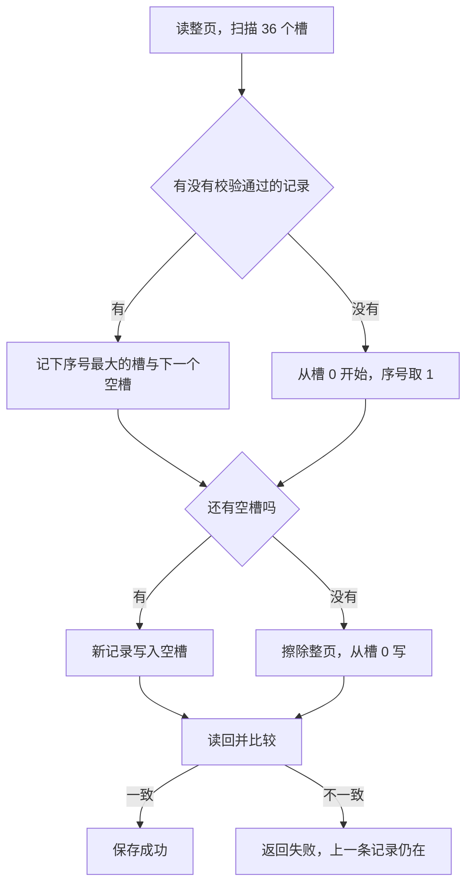
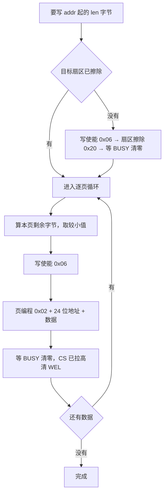

# 3.9 Flash、EEPROM、SD 与文件系统

在工业现场或户外监测设备的设计中，非易失性存储系统必须在意外掉电与反复重启中维系三类关键数据：设备物理地址与传感器零点校准参数、累计运行时长与电量底数、以及带有时间戳的历史故障与报警日志。前两类数据在上电初始化时必须立即载入，其体积虽仅有数十至上百字节，但写入频次却极其密集；第三类数据则伴随系统运转线性增长，不仅存储容量需求较大，往往还要求能够被外部宿主机读取并在电子表格中直接解析。面对 STM32F103C8T6 内部仅有的 64 KB Flash，以及板载外挂的 I²C EEPROM（AT24C02）、SPI NOR Flash（W25Q64）与可插拔 SD 卡，如何在不同的物理特性、擦写寿命约束与掉电安全风险之间权衡选型，是嵌入式存储设计的核心命题。

从物理机理来看，不同非易失性介质在擦除粒度、读写耗时与寿命极限上存在本质差异。片内 Flash 具备零外围硬件成本的优势，但受制于『只能将 1 写入为 0、改写前必须整页擦除』的半导体物理特性，加之仅有万次级别的擦写耐久度，若采用简单粗暴的整页擦除覆盖策略，不仅会迅速耗尽硅片寿命，还会在擦除瞬间面临灾难性的掉电数据清空风险。为了在微控制器有限的资源下达成掉电原子性（Atomicity）与擦写寿命的平摊，本章将深入探讨基于魔数、递增序号与 CRC-32 校验的环形页内追加算法，对比外挂 EEPROM 的写周期与页回绕机理，并进一步延伸至针对 NOR Flash 磨损均衡的 littlefs 与面向可移动介质的 FatFs 文件系统架构。完整工程实现位于 `code/嵌入式/3_驱动_通信与中间件/3_9_Flash_EEPROM_SD与文件系统/` 目录下。

## 1. 设备要记住什么

非易失存储要放的数据分三类，它们对写入的要求完全不同。

| 内容 | 例子 | 大小 | 写入频率 | 要求 |
| --- | --- | --- | --- | --- |
| 配置 | 设备地址、上报周期、校准系数、Wi-Fi 口令 | 几十字节 | 出厂或配网时几次 | 任何时刻掉电，读出来必须是旧值或新值，不能是半条 |
| 计数 | 运行小时数、启停次数、累计流量 | 几字节到几十字节 | 每分钟到每小时 | 同上，且要能承受多年累积的擦写次数 |
| 日志 | 温度曲线、报警记录、事件 | KB 到 MB | 每分钟到每秒 | 可以丢最后一小段，但要能整段导出 |

计数看起来最简单，其实最考验介质的寿命。每 10 分钟写一次，一年就是 5 万次，片内 Flash 的 1 万次擦写寿命撑不过一年；同样的节奏换成 AT24C02 的 100 万次，能撑几十年。日志的量大，只能放到 W25Q64 或 SD 卡上，并且需要文件系统来管理空间与目录。

## 2. 存储介质对比

四种介质在 F103 这套板子上都用得到，参数如下。片内 Flash 的数字取自 DS5319 表 29，其余取自各器件的数据手册。

| 项目 | 片内 Flash | AT24C02 | W25Q64 | SD 卡 |
| --- | --- | --- | --- | --- |
| 容量 | 64 KB（C8） | 256 字节 | 8 MB | GB 级 |
| 擦除粒度 | 1 KB 页 | 无（按字节覆写） | 4 KB 扇区 | 卡内管理 |
| 写入粒度 | 半字（2 字节） | 1 字节 | 1～256 字节页 | 512 字节块 |
| 擦写寿命 | 1 万次 | 100 万次 | 10 万次 | 取决于卡 |
| 写入耗时 | 页擦除约 20 ms | 每字节周期 ≤5 ms | 扇区擦除约 45 ms，页编程约 0.7 ms | 块写入几毫秒 |
| 接口 | 内部 | I²C | SPI | SPI 或 SDIO |
| 适合放 | 配置、小计数 | 校准系数、设备地址 | 日志、字库、固件备份 | 需要与 PC 交换的大文件 |

拿到一颗新器件，先看数据手册里的三张表：容量与组织方式、擦除与编程的粒度、擦写寿命与时间。这三个数字决定了驱动怎么写、数据怎么摆、多久会写坏。

::: concept emb-store-flash-bit-rules title="Flash 擦除置 1，编程只能把 1 变成 0"

NOR Flash 与片内 Flash 的擦除 (erase) 把整页的位全部置 1，读出为 `0xFF`；编程 (program) 只能把某些位从 1 变成 0，不能把 0 变回 1。所以改写一个字节之前必须先擦掉它所在的整页，而页里其他还有用的数据要一并搬走。EEPROM 与 SD 卡内部有自己的管理，对外表现为可以覆写，这条规则对它们不适用。

:::

这条规则解释了后面几乎所有的设计：配置记录为什么要带序号和 CRC、为什么一页里要分槽追加、W25Q64 为什么每次写之前都要发写使能命令、SD 卡为什么按块读写。

<Quiz
  type="single"
  :options="[
    { label: '先把要写的半字读出来，与 0xFF 按位与，再写回去', value: 'A' },
    { label: '先擦除这个半字所在的整页，再按半字编程', value: 'B' },
    { label: '直接写，硬件会自动处理', value: 'C' },
    { label: '把整个 Flash 全部擦除后重写一遍固件', value: 'D' }
  ]"
  answer="B"
>

<template #question>

片内 Flash 的某个半字里已经是 `0x5678`，要把它改成 `0x1234`，正确的做法是哪一个？

</template>

正确答案是 **B**。编程只能清位，`0x5678` 无论如何与要写的值相与都得不到 `0x1234`：第 12 位需要从 0 变回 1。只有整页擦除（全部变 `0xFF`）之后才能写入新值。

</Quiz>

## 3. 片内 Flash

片内 Flash 存配置的好处是不用外接器件，坏处是擦写次数少、擦除粒度大。F103C8 的 64 KB 分成 64 页，每页 1 KB。把最后一页留给配置，代码部分就少 1 KB，链接脚本见 [1.8 复位、启动与链接](/教程/正文/嵌入式/1_平台与工具链/1_8_复位_启动与链接)第 9 节，本节的 `stm32f103c8_config.ld` 就是那份：

```text
MEMORY
{
    FLASH  (rx)  : ORIGIN = 0x08000000, LENGTH = 63K
    CONFIG (r)   : ORIGIN = 0x0800FC00, LENGTH = 1K
    RAM    (rwx) : ORIGIN = 0x20000000, LENGTH = 20K
}
```

`.config_page` 段用 `NOLOAD` 放在 `CONFIG` 区域，烧录时不会往这一页写内容，运行时由程序自己擦写。

### 3.1 FPEC 与解锁

操作 Flash 的外设叫 Flash 程序与擦除控制器 (Flash Program and Erase Controller, FPEC)，寄存器集中在 `FLASH` 结构体里：

| 寄存器 | 关键位 | 作用 |
| --- | --- | --- |
| `FLASH_KEYR` | 32 位 | 依次写入两个密钥解锁 |
| `FLASH_SR` | `BSY`(0)、`PGERR`(2)、`WRPRTERR`(4)、`EOP`(5) | 忙、编程错误、写保护错误、操作结束；三个错误位与 `EOP` 都是写 1 清零 |
| `FLASH_CR` | `PG`(0)、`PER`(1)、`STRT`(6)、`LOCK`(7) | 编程、页擦除、开始、锁定 |
| `FLASH_AR` | 32 位 | 页擦除的页地址 |

复位后 `LOCK` 为 1，任何写操作都被拒绝。解锁要往 `FLASH_KEYR` 依次写 `0x45670123` 和 `0xCDEF89AB`（PM0075），两次顺序或数值不对，`LOCK` 保持为 1，直到下次复位。上锁只要把 `LOCK` 置 1。

```c
bool flash_stm32_unlock(void) {
    if ((FLASH->CR & FLASH_CR_LOCK) != 0u) {
        FLASH->KEYR = FLASH_KEY1; /* 0x45670123 */
        FLASH->KEYR = FLASH_KEY2; /* 0xCDEF89AB */
    }
    return (FLASH->CR & FLASH_CR_LOCK) == 0u;
}
```

### 3.2 擦页与半字编程

擦一页分三步：置 `PER`、把页地址写进 `AR`、置 `STRT`，然后等 `BSY` 清零。编程一个半字更简单：置 `PG`，往目标地址写 16 位，等 `BSY` 清零，再清 `PG`。

```c
bool flash_stm32_program_halfword(uint32_t addr, uint16_t data) {
    if ((addr & 1u) != 0u) {
        return false;
    }
    flash_wait_busy();
    flash_clear_flags();

    FLASH->CR |= FLASH_CR_PG;
    *(volatile uint16_t *)addr = data;
    flash_wait_busy();
    FLASH->CR &= ~FLASH_CR_PG;

    if ((FLASH->SR & (FLASH_SR_PGERR | FLASH_SR_WRPRTERR)) != 0u) {
        return false;
    }
    return *(volatile const uint16_t *)addr == data;
}
```

写 Flash 用普通的指针赋值，不是在某个数据寄存器里填值，这一点与 UART、SPI 都不同。地址必须是偶数，一次写 16 位；写了奇数地址会得到未对齐访问错误。擦除和编程期间 CPU 从同一块 Flash 取指会被硬件暂停，直到操作结束，所以擦一页的 20 ms 里主循环是停住的。

::: warning 擦写期间取指被暂停

页擦除的 20 ms 里，CPU 从同一块 Flash 取指会被硬件暂停，中断也只能等擦除结束再响应。定时严格的任务要么把处理函数放进 RAM 执行（`.RamFunc` 段，1.8 第 10 节），要么把擦写安排在容许延迟的窗口里。

:::

### 3.3 配置记录

一条配置记录要能回答两个问题：这条记录完整吗，它是第几版。答案分别是 CRC-32 与序号。

```c
typedef struct {
    uint32_t magic;        /* 魔数 0x43464731 */
    uint16_t version;      /* 记录格式版本 */
    uint16_t reserved;     /* 显式对齐填充，置 0 */
    uint32_t seq;          /* 单调递增序号 */
    uint16_t node_addr;    /* 设备地址 */
    uint16_t report_sec;   /* 上报周期（秒） */
    int32_t  calib_offset; /* 零点校准偏移（mV） */
    int32_t  calib_gain;   /* 增益系数（千分比） */
    uint32_t crc32;        /* 前 24 字节的 CRC-32 */
} cfg_record_t;
```

`magic` 区分“写过”与“从没写过”：擦除后的 Flash 是 `0xFF`，不会恰好等于一个任意选的 32 位数（要防的只是巧合，32 位足够）。`version` 让以后扩展字段时不至于把旧记录误读。`seq` 每存一次加一，读的时候选最大的。`crc32` 校验前面所有字节，写到一半断电时它几乎一定对不上。`reserved` 是显式填充，让结构体大小不依赖编译器对对齐的处理，`_Static_assert` 把它钉在 28 字节。

CRC-32 用最常见的反射算法，多项式 `0xEDB88320`，初值与结果都取反，就是 zlib、PNG、以太网用的那一个。验证值：

::: terminal title="PowerShell - CRC-32 的验证值"

```text
$ gcc -std=c17 -Wall -Wextra crc_check.c flash_cfg.c -I. -o crc_check
$ ./crc_check
crc32("123456789") = 0xCBF43926
```

:::

`0xCBF43926` 是 CRC-32/ISO-HDLC 的标准校验值，对上它说明多项式、初值、反射与取反四处都没写错。

### 3.4 在页内追加

一页 1 KB，每条记录 28 字节，可以放 36 条。最省事的写法是每存一次就擦一页，但擦一次就耗掉一次寿命，而且擦除窗口里掉电会把整页清空，旧配置一起没了。

更好的做法是把这一页当环形日志用：新记录追加在下一个空槽里，整页写满才擦一次。掉电时最坏丢掉正在写的那一条，上一条仍然完好。



扫描时只认“魔数正确且 CRC 正确”的槽。断电留下的半条记录魔数可能已经写进去了，CRC 却对不上，它会被跳过，但它占住的槽也不再被复用，因为那里已经不是 `0xFF`，再编程会把 1 写成 0，写不出正确的记录。扫描遇到第一个魔数为 `0xFFFFFFFF` 的槽，就知道后面全是空的。

```c
static bool scan_page(const flash_ops_t *ops, size_t *last_valid,
                      size_t *first_free) {
    bool found = false;
    size_t last = 0u;

    *first_free = CFG_SLOT_COUNT;
    for (size_t i = 0u; i < CFG_SLOT_COUNT; ++i) {
        cfg_record_t rec;
        ops->read_bytes(slot_offset(i), &rec, sizeof(rec));
        if (rec.magic == 0xFFFFFFFFUL) {
            *first_free = i;
            break;
        }
        if (cfg_record_verify(&rec)) {
            found = true;
            last = i;
        }
    }
    *last_valid = last;
    return found;
}
```

把 Flash 的三件操作抽象成一张函数表，同一份配置代码就能在 PC 上用模拟 Flash 跑：

```c
typedef struct {
    bool (*erase_page)(uint32_t page_offset);
    bool (*program_halfword)(uint32_t offset, uint16_t halfword);
    void (*read_bytes)(uint32_t offset, void *buf, size_t len);
} flash_ops_t;
```

这个做法与 [3.1 驱动接口、CMSIS 与设备头文件](/教程/正文/嵌入式/3_驱动_通信与中间件/3_1_驱动接口_CMSIS与设备头文件)里“在 PC 上替换实现”是同一件事。固件侧的实现调用 `flash_stm32_*`，PC 侧的模拟实现把一页字节放在数组里，并且严格按物理规律办事：擦除置 `0xFF`，编程只能把 1 变 0。

### 3.5 在 PC 上测试

模拟 Flash 要做的唯一一件事，是把“只能清位”这条规则写进 `program_halfword`：

```c
static bool sim_program_halfword(uint32_t offset, uint16_t halfword) {
    uint16_t old_val = (uint16_t)sim_flash[offset] |
                       ((uint16_t)sim_flash[offset + 1u] << 8);
    uint16_t new_val = (uint16_t)(old_val & halfword);
    sim_flash[offset] = (uint8_t)(new_val & 0xFFu);
    sim_flash[offset + 1u] = (uint8_t)(new_val >> 8);
    if (old_val != 0xFFFFu) {
        return false;   /* 硬件在这种情况置 PGERR */
    }
    return true;
}
```

测试程序的四组输出：

::: terminal title="PowerShell - test_flash_cfg"

```text
$ gcc -std=c17 -Wall -Wextra test_flash_cfg.c flash_cfg.c -I. -o test_flash_cfg
$ ./test_flash_cfg
[overwrite without erase] first=0x5678(ok=1) second=0x1234(ok=0) -> read=0x1230
[save #1] seq=1 addr=1 offset=-15 crc=0x9431425B
[save #2] seq=2 addr=2 offset=5 crc=0x0DD01899
[save #3] seq=3 addr=3 offset=20 crc=0x880CF4D2
[power loss on #4] save_ok=0 -> recovered: load_ok=1 seq=3 addr=3 offset=20
[append] save #37: page erased, seq 36 -> 37, slot 0
[append] after 70 saves: seq=70 addr=70, page erases=1
```

:::

第一行是不擦除直接改写的对照：

::: compare left-title="不擦除，直接往同一地址编程"

```c
sim_program_halfword(0u, 0x5678u);   /* 成功 */
sim_program_halfword(0u, 0x1234u);   /* 失败，读回 0x1230 */
```

---

```c
sim_erase_page(0u);                  /* 整页变 0xFF */
sim_program_halfword(0u, 0x5678u);   /* 成功 */
sim_erase_page(0u);
sim_program_halfword(0u, 0x1234u);   /* 成功，读回 0x1234 */
```

:::

左栏读回的是 `0x5678 & 0x1234 = 0x1230`，不是要写的值。真实芯片上这一步还会置 `PGERR`，函数返回失败，但显存里的位已经被清掉了几位，原来的配置也毁了。这就是“改写前必须擦除”的现场证据。

后面几行。前三条记录依次落在槽 0、1、2，`seq` 从 1 到 3。第 4 次保存时模拟器在第 6 个半字之后断电，`save_ok=0`，重新加载仍然读到 `seq=3`、`addr=3` 的那一条，写入者要的正是这个结果：新值没落盘，旧值完好。

最后一组从干净的一页开始连写 70 次，正好跨过一次整页擦除。第 37 次保存时槽 0～35 已经写满，`flash_cfg_save` 擦掉整页、从槽 0 重新开始，序号从 36 接着变成 37；到第 70 次保存结束，序号连续涨到 70，中间没有断号，说明整页擦除没有影响“哪一条最新”的判断。这里有个代价：每 36 次保存要擦一页，按每分钟存一次算，1 万次寿命能撑约 250 天。对配置数据这个量级够用，对每分钟都在变的计数就不够了，那种数据要换 AT24C02，或者做磨损均衡 (wear leveling)：让写入在多个页之间轮转，把擦除次数摊开。

如果 Flash 里能匀出两页，可以改成两页轮写：新记录写进空闲的那一页，擦除另一页只在切换时发生，任何时刻都有一页完整数据。ST 的 AN2594 就是用这个思路在片内 Flash 上模拟 EEPROM，它还要求每条记录带一个“有效”标记，扫描时两页一起看。本节的板子按 [1.8 复位、启动与链接](/教程/正文/嵌入式/1_平台与工具链/1_8_复位_启动与链接) 的布局只留了 1 KB，所以用页内追加；两种做法的取舍是一样的：把“擦”的次数压到最低，把“写”尽量变成追加。

### 3.6 接到片内 Flash

固件侧把 `flash_ops_t` 的三个函数接到 `flash_stm32_*` 上，页地址由链接脚本的 `_sconfig` 符号给出：

```c
static bool stm32_cfg_prog_hw(uint32_t offset, uint16_t halfword) {
    uint32_t addr = (uint32_t)(uintptr_t)_sconfig + offset;
    if (!flash_stm32_unlock()) {
        return false;
    }
    bool ok = flash_stm32_program_halfword(addr, halfword);
    flash_stm32_lock();
    return ok;
}
```

每次操作前后都解锁和上锁，看起来啰嗦，但这样一段代码被中断打断时，别人拿到的 Flash 总是锁着的，不会在不知情的情况下写进去。整个固件的构建结果：

::: terminal title="bash - 编译存储与外设固件"

```text
$ arm-none-eabi-gcc -std=c11 -mcpu=cortex-m3 -mthumb -O2 -g -Wall -Wextra \
    -ffunction-sections -fdata-sections -DSTM32F103xB -I. \
    ../../common/startup_stm32f103.c main_fw.c flash_stm32.c flash_cfg.c \
    at24c02.c w25q.c sdspi.c ../../2_MCU裸机开发/2_8_SPI与I2C/spi.c \
    ../../2_MCU裸机开发/2_8_SPI与I2C/soft_i2c.c \
    -T stm32f103c8_config.ld -nostartfiles --specs=nano.specs --specs=nosys.specs \
    -Wl,--gc-sections -o storage_fw.elf
$ arm-none-eabi-size storage_fw.elf
   text	   data	    bss	    dec	    hex	filename
   3732	      0	   2568	   6300	   189c	storage_fw.elf
$ arm-none-eabi-nm storage_fw.elf | grep config
08010000 B _econfig
0800fc00 B _sconfig
```

:::

`-I.` 指向的目录里放着 `stm32f1xx.h`、`stm32f103xb.h`、`core_cm3.h` 等头文件，来源与版本见 [2.3 时钟与复位](/教程/正文/嵌入式/2_MCU裸机开发/2_3_时钟与复位)。`_sconfig` 落在 0x0800_FC00，`_econfig` 在 0x0801_0000，正是第 63 页。用 `objdump -h` 看，`.config_page` 长度 `0x400`、标 `ALLOC` 但没有 `CONTENTS`，所以不占 `.bin` 的体积。

## 4. AT24C02

AT24C02 是 256 字节的 I²C EEPROM，7 位地址 `0x50`，按字节写、按字节读，不需要擦除。2.8 节已经用 GPIO 模拟 I²C 读写过单字节，这一节补上写周期与页写规则。

写入分两步。第一步与写单字节完全一样：起始、器件地址加写位、字地址、数据、停止。第二步不在总线上：器件把数据搬进内部存储单元，这段时间它不应答任何地址，叫写周期 (write cycle)，最长 5 ms。写完立刻读会读到 NACK，正确做法是轮询：

```c
bool at24c02_wait_ready(uint32_t max_tries) {
    for (uint32_t i = 0; i < max_tries; ++i) {
        i2c_start();
        bool ack = i2c_write_byte((uint8_t)((AT24C02_ADDR << 1) | 0u));
        i2c_stop();
        if (ack) {
            return true;
        }
    }
    return false;
}
```

这一段就是 2.8 节 `soft_i2c.c` 里的 `at24c02_wait_ready`，本节的 `at24c02.c` 直接调用它。

发一次起始加地址，收到 ACK 就说明写周期结束。这比固定延时 5 ms 快得多，也不会因为器件快慢不同而出错。

### 4.1 页写与跨页回绕

连续的字节可以一次写完，不用每字节都发一遍字地址。但芯片内部按 8 字节分页，一页写操作最多写 8 字节，且不能跨页。

::: concept emb-store-eeprom-page-wrap title="AT24C02 的页写会回绕到页首"

AT24C02 的页写一次最多 8 字节。如果起始字地址加上字节数越过了 8 字节页边界，多出来的字节不会写进下一页，而是回绕到本页的开头，覆盖刚写进去的数据。所以跨页的写入必须按页拆成多次，每次都在页内。

:::

举例：从地址 `0x04` 开始写 8 个字节，写到第 4 个字节时已经到 `0x07`，再往后本应写 `0x08`，实际会回绕到 `0x00`，把前 4 个字节覆盖掉。这类错误在读回校验时表现为“前几个字节变成了后几个”，很容易误判成 I²C 时序问题。

按页拆分只多几行：

```c
bool at24c02_write(uint8_t word_addr, const void *buf, size_t len) {
    const uint8_t *src = (const uint8_t *)buf;
    while (len > 0u) {
        size_t page_rem = AT24C02_PAGE_SIZE -
                          (word_addr & (AT24C02_PAGE_SIZE - 1u));
        size_t chunk = (len < page_rem) ? len : page_rem;
        if (!at24c02_write_page(word_addr, src, chunk)) {
            return false;
        }
        word_addr = (uint8_t)(word_addr + chunk);
        src += chunk;
        len -= chunk;
    }
    return true;
}
```

`page_rem` 是当前地址到本页末尾还剩几个字节，取它与剩余长度的较小值就是这一页能写的部分。`at24c02_write_page` 内部再检查一次，越界时直接返回失败，不把问题留给器件。

AT24C02 适合放小而常改的数据：校准系数、设备地址、上电次数。写一次最多等 5 ms，一天改一次完全无感；容量只有 256 字节，放不下日志。

## 5. W25Q64

W25Q64 是 8 MB 的 SPI NOR Flash，组织成 2048 个 4 KB 扇区，每个扇区 16 个 256 字节页。它和片内 Flash 遵循同样的“擦除置 1、编程清位”规则，但多了两条硬件约束：每次写之前要先发写使能，写完要等内部忙标志清零。

### 5.1 命令

| 命令 | 操作码 | 作用 |
| --- | --- | --- |
| 写使能 | `0x06` | 置状态寄存器 1 的 WEL 位，每次编程或擦除前都要发 |
| 读状态寄存器 1 | `0x05` | 读 BUSY(0)、WEL(1) 等位 |
| 页编程 | `0x02` | 后跟 24 位地址与 1～256 字节数据 |
| 扇区擦除 | `0x20` | 后跟 24 位地址，擦掉该地址所在的 4 KB 扇区 |
| 读数据 | `0x03` | 后跟 24 位地址，连续读出任意长度 |
| 读 JEDEC ID | `0x9F` | 返回 `EF 40 17` |

写使能不是多余的步骤。芯片出于安全考虑，复位后、每次编程或擦除结束、以及片选拉高之后都会自动清 WEL；没有 WEL 的编程命令被静默忽略，读回来还是 `0xFF`，现象是“写了没反应”。

### 5.2 写入流程

一次完整的写入要先擦后写，并且逐页拆分：



页编程同样不能跨 256 字节页边界，越界会回绕到页首，规则与 AT24C02 一致。`nor_write` 的循环结构也和 `at24c02_write` 一样，只是每条命令前后多了写使能与等忙：

```c
void w25q_page_program(uint32_t addr, const uint8_t *data, size_t len) {
    if (len == 0u || len > W25Q_PAGE_SIZE) {
        return;
    }
    w25q_write_enable();
    spi1_cs_low();
    spi1_xfer(0x02u);
    w25q_send_addr24(addr);
    for (size_t i = 0u; i < len; ++i) {
        spi1_xfer(data[i]);
    }
    spi1_cs_high();
    w25q_wait_busy();
}
```

`w25q_wait_busy` 反复读状态寄存器，直到 BUSY 为 0。页编程约 0.7 ms，扇区擦除约 45 ms。等待期间 CPU 只是在循环里空转，这段时间本来可以用来处理别的事；要把它利用起来，得把“发命令、等忙、下一句”拆成状态机，在主循环里分步推进，而不是把整段写在一次调用里。

NOR Flash 的 10 万次擦写寿命比片内 Flash 高一个数量级，但它是按扇区记的：每次改一个字节也要擦 4 KB。日志这类顺序追加的数据没有问题，反复改同一处的配置就会很快耗掉某个扇区。littlefs 的磨损均衡正是为了解决这个问题。

## 6. SD 卡

SD 卡是大容量、可插拔、能与 PC 直接交换的介质。它有两种访问方式：SDIO 接口需要 4 根数据线，F103C8 没有；SPI 模式只用 4 根线，与 W25Q64 共用 SPI1，片选单独接 PB1。

SD 卡在 SPI 模式下是一个块设备 (block device)，读写的最小单位是 512 字节的块。它内部有自己的控制器和 Flash 管理，对外不再暴露“擦除”这个动作，`disk_write` 直接写块即可。

### 6.1 初始化

初始化分五步，每一步都要按规范来，否则卡不会响应：

1. 以不超过 400 kHz 的时钟、CS 拉高，连续送至少 74 个时钟。卡上电后需要这段时间完成内部复位，进入 SPI 模式。
2. 发 `CMD0`，卡进入 idle 状态，正常应答 `R1 = 0x01`。
3. 发 `CMD8`，参数 `0x000001AA`，检查卡是否支持 2.7～3.6 V 与回声，正常返回 `R1 = 0x01`，后跟 4 字节回声 `00 00 01 AA`。
4. 循环发 `CMD55` + `ACMD41`（参数 `0x40000000`，HCS 位置 1），直到 `R1 = 0x00`，表示初始化完成。这一步可能要几百毫秒。
5. 发 `CMD58` 读 OCR，看第 30 位 CCS：置位表示 SDHC/SDXC，按块寻址；清零表示 SDSC，按字节寻址。

初始化完成后才把 SPI1 提到高速。块读写用 `CMD17`（读单块）与 `CMD24`（写单块），读要等数据令牌 `0xFE`，写要送 `0xFE`、数据、2 字节伪 CRC，再看数据响应。

::: concept emb-store-sd-addressing title="SDHC 按块寻址，SDSC 按字节寻址"

`CMD58` 的应答先是一个 R1 字节，后面跟 4 字节 OCR。OCR 的最高字节的第 6 位是 CCS (Card Capacity Status)：置位表示这张卡是 SDHC 或 SDXC，块地址就是逻辑块号，`CMD17`、`CMD24` 的参数直接填块号；清零表示 SDSC，参数要填字节地址，即块号乘以 512。同一份代码在两种卡上用错寻址方式，读到的全是错误的数据，而命令本身照样返回成功。

:::

```c
bool sd_read_block(uint32_t lba, uint8_t buf[SD_BLOCK_SIZE]) {
    uint32_t addr = (g_card_type == SD_TYPE_SDHC) ? lba : (lba * SD_BLOCK_SIZE);

    sd_cs_low();
    if (sd_send_cmd(17u, addr, 0x01u) != 0x00u) {
        sd_cs_high();
        return false;
    }
    for (uint32_t i = 0; i < 50000u; ++i) {
        if (spi1_xfer(0xFFu) == 0xFEu) {
            for (uint32_t k = 0; k < SD_BLOCK_SIZE; ++k) {
                buf[k] = spi1_xfer(0xFFu);
            }
            (void)spi1_xfer(0xFFu); /* 丢弃 2 字节 CRC */
            (void)spi1_xfer(0xFFu);
            sd_cs_high();
            return true;
        }
    }
    sd_cs_high();
    return false;
}
```

这段代码与 W25Q64 共用 `spi1_xfer`，片选不共用：W25Q64 的 CS 是 PA4，SD 卡的是 PB1，所以 `sdspi.c` 自带一对 `sd_cs_low`、`sd_cs_high`，不调 `spi1_cs_high`。SD 卡与 W25Q64 挂同一条 SPI 总线时，任何时候只能有一个片选拉低，两个器件的 CS 都要由软件明确控制，初始化时先把两个 CS 都拉高。

上板调试时，第一步的时钟最容易出问题。SPI1 在 72 MHz 的 PCLK2 下最低档是 256 分频，即 281 kHz，满足 400 kHz 的上限；`spi1_set_prescaler` 在初始化阶段设这一档，初始化成功后再切到 4 分频的 18 MHz。

## 7. 文件系统

直接按块读写 SD 卡或按扇区擦写 W25Q64，程序里要自己记账：哪块空闲、哪个文件从哪块开始、长度多少。数据量一大，这套记账就成了一个微型的文件系统，而且每个项目重写一遍。现成的两个选择：

| 文件系统 | 典型介质 | 特点 |
| --- | --- | --- |
| FatFs | SD 卡、U 盘 | 与 PC 直接交换，Windows 与 Linux 都认识 FAT；掉电时正在写的文件可能损坏 |
| littlefs | NOR Flash、片内 Flash | 掉电安全、磨损均衡、RAM 占用固定；PC 上默认不认，要用专门的工具读 |

在文件系统的工程选型中，核心考量在于数据的交互边界与物理介质特性：若数据介质需要被终端用户随意拔出并直接插入通用 PC 操作系统中交互（如数据导出卡、参数导入卡），兼容性广泛的 FatFs 是不可替代的标准方案；若存储介质作为板载固化的裸 NOR/NAND Flash，要求长期无人值守运行、频繁改写并对突发断电具备强容错韧性，原生具备磨损均衡与写时复制特性的 littlefs 则是更为可靠的基础构件。在复杂的工业仪器中，两者亦可协同部署——由 W25Q64 依托 littlefs 固守核心配置与事件审计，由外部 SD 卡配合 FatFs 承揽大容量报表导出。

### 7.1 FatFs

FatFs 是 ChaN 写的通用 FAT 实现，与平台无关，移植只需要实现 `diskio.c` 里的五个函数与一个时间戳函数：

| 函数 | 作用 |
| --- | --- |
| `disk_status` | 返回驱动器状态，`STA_NOINIT` 表示没初始化 |
| `disk_initialize` | 初始化卡，成功返回 0 |
| `disk_read` | 读一个或多个 512 字节扇区 |
| `disk_write` | 写一个或多个扇区 |
| `disk_ioctl` | `CTRL_SYNC`、`GET_SECTOR_COUNT`、`GET_SECTOR_SIZE`、`GET_BLOCK_SIZE` |
| `get_fattime` | 返回当前的 FAT 时间戳，没有 RTC 时给固定值 |

`ffconf.h` 里按需打开功能。F103 只有 20 KB RAM，`FF_USE_LFN` 要关掉（长文件名要额外缓冲区），`FF_FS_REENTRANT` 关掉（单线程环境），`FF_USE_MKFS` 打开（要格式化卡）。需要的选项在本页 `fatfs_host_demo/ffconf.h` 里，最关键的几项是：

| 选项 | 取值 | 原因 |
| --- | --- | --- |
| `FF_USE_LFN` | 0 | 长文件名要动态分配内存，主控 RAM 不够 |
| `FF_USE_MKFS` | 1 | 现场格式化的卡没有 FAT |
| `FF_MIN_SS`、`FF_MAX_SS` | 512 | SD 卡的扇区是 512 字节 |
| `FF_FS_NORTC` | 0 | 用 `get_fattime` 给时间戳 |
| `FF_FS_EXFAT` | 0 | exFAT 不在本节范围 |

写文件后要调 `f_sync`。`f_write` 只是把数据写进 FatFs 的内部缓冲区，目录项与 FAT 表要等 `f_close` 或 `f_sync` 才落盘。日志程序每分钟追加一行，每行之后 `f_sync` 一次，掉电最多丢最后一分钟：

```c
res = f_open(&fil, "LOG.CSV", FA_OPEN_APPEND | FA_WRITE);
f_write(&fil, line, (UINT)strlen(line), &bw);
f_sync(&fil);
f_close(&fil);
```

`f_sync` 会同时写数据与元数据，代价是每次写两个扇区以上。每分钟一次没问题，每秒一次就考虑攒几行再 `f_sync`。

格式化用 `f_mkfs`，R0.14 起用 `MKFS_PARM` 结构体传参数：

```c
MKFS_PARM opt = {
    .fmt = FM_FAT | FM_SFD,   /* FAT12/16 自动选择，无分区表 */
    .n_fat = 1,
    .align = 0,
    .n_root = 64,
    .au_size = 512,
};
FRESULT res = f_mkfs("", &opt, g_work, sizeof(g_work));
```

`g_work` 是格式化用的工作缓冲区，大小至少一个扇区。`FM_SFD` 表示整张卡就是一个卷，没有分区表；卡要在 PC 上也能读，用默认的 `FM_FAT` 带分区表更好，那样 PC 会认成一个盘符。

### 7.2 littlefs

littlefs 是 ARM 的 Mbed 团队设计的嵌入式文件系统，三个特性正对 NOR Flash 的痛点：掉电安全（每次写入都是原子提交，要么旧版本要么新版本）、磨损均衡（元数据块轮换，避免总写同一处）、RAM 占用固定（由配置决定，不随文件数增长）。

移植只需要填一个 `lfs_config` 结构体，它把块设备的四个操作与几个参数交给 littlefs：

| 字段 | 本节取值 | 说明 |
| --- | --- | --- |
| `read`、`prog`、`erase`、`sync` | 四个回调 | 分别对应读、编程、擦除、同步 |
| `read_size` | 16 | 最小读单位 |
| `prog_size` | 256 | 最小编程单位，等于 W25Q64 的页大小 |
| `block_size` | 4096 | 擦除块大小，等于 W25Q64 的扇区大小 |
| `block_count` | 2048 | 8 MB ÷ 4 KB |
| `cache_size` | 256 | 读写缓存，必须是 `prog_size` 的倍数 |
| `lookahead_size` | 16 | 分配时的预读位图，每字节能跟踪 8 个块 |
| `block_cycles` | 500 | 元数据块轮换阈值，建议 100～1000 |

`block_size` 与 `block_count` 必须与器件一致，否则挂载后算出来的容量对不上，写入会越界。`block_cycles` 控制磨损均衡的积极程度：值越小，元数据块换得越勤，寿命越均匀，代价是额外的擦除。500 是一个常用的折中。

回调接在 W25Q64 的驱动上，读用 `0x03`、编程用 `0x02`、擦除用 `0x20`，每个都套上写使能与等忙。`sync` 对 NOR Flash 是空操作，因为编程命令返回时数据已经在芯片里了。

### 7.3 在 PC 上验证

两个文件系统都能在 PC 上跑，器件不在手边也能把逻辑走通。

littlefs 自带 RAM 块设备 `lfs_rambd`，正好用来模拟“断电重启”。程序把 boot_count 文件打开、读出计数、加一、写回、关闭、卸载，重复三次，每次卸载再挂载就相当于一次重启：

```c
for (int boot = 1; boot <= 3; ++boot) {
    lfs_t lfs;
    lfs_file_t file;

    int err = lfs_mount(&lfs, &g_lfs_cfg);
    if (err != 0) {
        lfs_format(&lfs, &g_lfs_cfg);
        lfs_mount(&lfs, &g_lfs_cfg);
    }
    uint32_t boot_count = 0;
    lfs_file_open(&lfs, &file, "boot_count", LFS_O_RDWR | LFS_O_CREAT);
    lfs_file_read(&lfs, &file, &boot_count, sizeof(boot_count));
    boot_count += 1;
    lfs_file_rewind(&lfs, &file);
    lfs_file_write(&lfs, &file, &boot_count, sizeof(boot_count));
    lfs_file_close(&lfs, &file);
    lfs_unmount(&lfs);
    printf("[boot #%d] boot_count = %u\n", boot, (unsigned)boot_count);
}
```

::: terminal title="PowerShell - lfs_host_demo"

```text
$ cd lfs_host_demo
$ gcc -std=c17 -Wall -Wextra main.c ../deps/littlefs/lfs.c \
    ../deps/littlefs/lfs_util.c ../deps/littlefs/bd/lfs_rambd.c \
    -I../deps/littlefs -o lfs_host_demo.exe
$ ./lfs_host_demo.exe
../deps/littlefs/lfs.c:1383:error: Corrupted dir pair at {0x0, 0x1}
[boot #1] boot_count = 1
[boot #2] boot_count = 2
[boot #3] boot_count = 3
```

:::

`deps/` 是 littlefs v2.11.3 与 FatFs R0.16 的源码目录，仓库不提交它们，按这两个版本取一份放在本节目录下即可。第一行是 littlefs 的错误日志：RAM 块设备初始为全 0，挂载时读到的根目录对是坏的，于是程序格式化一次再挂载。之后三次启动计数依次是 1、2、3，说明数据跨挂载保留了下来。真实器件上第一次上电也会看到这一行，属于正常流程。正式产品里可以在格式化后把日志关掉（`lfs_util.h` 的 `LFS_NO_ERROR`），或者换一块预格式化的 Flash。

FatFs 用内存盘做同样的验证：格式化、挂载、写一个 CSV、`f_sync`、关闭，再打开读回：

```c
FRESULT res = f_mkfs("", &opt, g_work, sizeof(g_work));
res = f_mount(&fs, "", 1);
res = f_open(&fil, "LOG.CSV", FA_CREATE_ALWAYS | FA_WRITE);
f_write(&fil, csv, (UINT)strlen(csv), &bw);
f_sync(&fil);
f_close(&fil);
```

::: terminal title="PowerShell - fatfs_host_demo"

```text
$ cd fatfs_host_demo
$ gcc -std=c17 -Wall -Wextra main.c ram_diskio.c ../deps/fatfs/source/ff.c \
    -I. -I../deps/fatfs/source -o fatfs_host_demo.exe
$ ./fatfs_host_demo.exe
f_mkfs -> 0
f_mount -> 0
wrote 33 bytes to LOG.CSV
read 33 bytes:
ts_ms,temp_c
1000,25.4
2000,25.6
```

:::

`FRESULT` 为 0 表示 `FR_OK`。`f_mkfs` 在这块 128 KB 的内存盘上选的是 FAT12，`n_root = 64` 给出 64 个根目录项。写进去的 33 字节与读回来的完全一致，中间那句 `f_sync` 是关键：没有它，`f_close` 之前掉电就会丢文件。

两个演示里 `main.c`、`diskio` 的写法都在本节目录下，改几行就能接到真实的 SPI 驱动上。

<Quiz
  type="multi"
  :options="[
    { label: 'AT24C02 页写越过页边界会回绕，必须按页拆分', value: 'A' },
    { label: 'W25Q64 每次编程或擦除前都要发写使能 0x06', value: 'B' },
    { label: '片内 Flash 可以直接把 0x5678 改写成 0x1234', value: 'C' },
    { label: 'FatFs 写完要 f_sync 或 f_close，数据才会落到介质上', value: 'D' }
  ]"
  :answer="['A', 'B', 'D']"
>

<template #question>

下面哪些说法是对的？

</template>

正确答案是 **A、B、D**。C 错：片内 Flash 编程只能清位，从 `0x5678` 到 `0x1234` 需要把第 12 位从 0 变回 1，只有整页擦除才能做到。

</Quiz>

## 8. 习题

### 8.1 巩固

<Exercise id="60372" :d="1" :w="1">

按第 1、2 节的表估算三种数据的介质选择。

(1) 运行小时数每分钟存一次，一年按 525 600 分钟算。三种介质各按下面的口径估：
    - 片内 Flash 用第 3.4 节的页内追加，每 36 次保存擦一页，寿命 1 万次擦除；
    - AT24C02 每次保存重写同一组字节，寿命 100 万次按每个字节的写入计，所以能保存的次数就是 100 万；
    - W25Q64 每条记录都写同一个扇区，每次改一个字节也要先擦 4 KB，寿命 10 万次扇区擦除。

    分别算出能撑多少天，写出算式。

(2) 片内 Flash 用第 3.4 节的页内追加方案，一条记录 28 字节、一页 36 槽，每分钟存一次。擦一页要等 20 ms，一年里因擦除停顿的总时间是多少？

(3) 报警记录每天 200 条、每条 64 字节，一年多少字节？这个量放进 8 MB 的 W25Q64 还剩多少空间？

(4) 给这三类数据各选一种介质，用一句话说明理由。

</Exercise>

<Exercise id="60373" :d="2" :w="2">

`flash_stm32_program_halfword` 写之前不检查目标半字是否是 `0xFFFF`，靠读回比较发现失败。

(1) 对下面四组「原值 → 目标值」，逐位算出 `原值 & 目标值`，判断不擦除直接写能否得到目标值：

```text
0x5678 → 0x1234
0xFFFF → 0x1234
0xF0F0 → 0x00FF
0x8000 → 0x7FFF
```

(2) 写一个 `bool can_program_without_erase(uint16_t old_val, uint16_t new_val)`，只有 `(old_val & new_val) == new_val` 时返回 `true`。用上面四组数据测试，输出应与你的判断一致。

(3) 在 `test_flash_cfg.c` 的模拟器上跑 `sim_program_halfword`，确认第 (1) 问里「不能」的那几组读回的是 `原值 & 目标值`，并说明真实芯片在这种情况下会置哪个状态位。

(4) 第 3.1 节的解锁序列写错时 `LOCK` 保持为 1。说明为什么代码在解锁后要检查 `LOCK` 而不是直接继续，以及写错密钥之后只能靠什么恢复。

</Exercise>

<Exercise id="60374" :d="2" :w="2">

AT24C02 一页 8 字节，`at24c02_write` 用 `page_rem` 把长写拆成多次页写。

(1) 对下面四种「起始字地址 + 长度」，算出每次调用的 `page_rem`、`chunk` 与拆分后的调用次数（第 4 组先看 `at24c02_write` 开头的总长度检查）：

```text
0x00 + 8
0x04 + 8
0x07 + 10
0xFE + 4
```

(2) 第 4.1 节说从 `0x04` 写 8 字节会回绕，把前 4 个字节覆盖掉。用地址、页内偏移与回绕后落点三个数把这句描述算一遍。

(3) 写一个 `size_t at24c02_page_writes(uint8_t word_addr, size_t len)`，返回 `at24c02_write` 会调用几次 `at24c02_write_page`，用第 (1) 问的数据验证。

(4) `at24c02_write_page` 内部又检查了一次 `((word_addr & 0x07) + len) > 8`。说明 `at24c02_write` 已经保证不跨页时，这个检查还有什么用。

</Exercise>

### 8.2 编程

<Exercise id="60375" :d="3" :w="3">

`code/嵌入式/3_驱动_通信与中间件/3_9_Flash_EEPROM_SD与文件系统/exercises/ex2_nor_write_starter.c` 里的 `nor_write` 还没有实现，模拟器已经按 W25Q64 的行为写好了 `mock_page_program`：跨页会回绕，编程后 WEL 自动清零。

(1) 实现 `nor_write`：按 256 字节页边界拆分，每页调用一次 `mock_write_enable` 与 `mock_page_program`，再 `mock_wait_busy`。起始地址不要求页对齐。

(2) 用 starter 里的数据（`addr = 250`、`len = 600`）运行，`page_prog_calls` 应当为 `4`。把每次调用的地址、长度列出来，核对 250～255、256～511、512～767、768～849 这四段。

(3) 增加两组测试：`addr = 0`、`len = 256` 应当是 1 次；`addr = 255`、`len = 2` 应当是 2 次。再把写好的 600 字节读回，逐字节与 `pattern` 比较，输出 `verify OK` 或第一处不同的下标。

(4) 把 `mock_write_enable` 的调用删掉重新运行，说明 `page_prog_calls` 变成多少、数据为什么全是 `0xFF`。

</Exercise>

<Exercise id="60376" :d="3" :w="3">

SD 卡初始化最后一步用 `CMD58` 读 OCR，第 6.1 节的代码取 `ocr[0] & 0x40` 判断卡类型。

(1) 写 `sd_card_type_t sd_parse_ocr(const uint8_t ocr[4])`，按 CCS 位返回 `SD_TYPE_SDHC` 或 `SD_TYPE_SDSC_V2`。用下面两组 OCR 测试：

```text
C0 FF 80 00
80 FF 80 00
```

(2) 写 `uint32_t sd_block_arg(sd_card_type_t type, uint32_t lba)`，SDHC 直接返回 `lba`，SDSC 返回 `lba * 512`。对 `lba = 1000` 分别给出两种卡的参数，说明 SDSC 的参数为什么是 512000 而不是 1000。

(3) 用错寻址方式时 `CMD17` 仍返回 `R1 = 0x00`，读到的却是别的块。说明在 SDHC 卡上按字节寻址读 LBA 0 会落到哪个块，为什么读回的数据「看起来正常」。

(4) `sd_read_block` 等到 `0xFE` 才收数据。说明这个令牌之前的字节是什么，为什么不能收到 `R1` 就立刻读 512 字节。

</Exercise>

<Exercise id="60377" :d="4" :w="4">

`exercises/ex1_dual_page_starter.c` 给了两页模拟 Flash、`crc32_calc` 与断点注入，`config_save`、`config_load` 是空的。

(1) 实现两页轮写的配置存储：记录含 `magic`、`seq`、`baud_rate`、`calib_mv`、`crc32`。保存时扫描两页，选出 `seq` 最大且 CRC 正确的记录，把新记录写进另一页的开头；目标页写入前先擦除。加载时选 `seq` 最大且校验通过的记录。

(2) 连存三次，每次改 `baud_rate` 与 `calib_mv`，确认 `config_load` 读到的是最后一次的值。把三次的 `seq` 与 CRC 打印出来。

(3) 设 `g_cutoff_halfwords` 让第四次保存写到一半失败。验收标准：`config_save` 返回 `false`，`config_load` 仍返回第三次的记录，两个字段都对。

(4) 说明两页轮写比第 3.4 节的页内追加多解决了什么问题，代价是多占多少 Flash。再说明为什么扫描时不能只看 `seq` 最大，必须同时验 CRC。

</Exercise>

### 8.3 综合与挑战

<Exercise id="60378" :d="5" :w="4">

`fatfs_host_demo` 已经能在内存盘上格式化、写 CSV、`f_sync`、读回。给它加掉电注入，验证 `f_sync` 的作用。

(1) 修改 `ram_diskio.c`，加一个全局开关 `g_fail_after_writes`：写扇区计数超过它之后，`disk_write` 直接返回 `RES_ERROR`，已经写下的内容保留。提供 `disk_fault_reset()`。

(2) 写三组测试，每组都用同样的 CSV（`ts_ms,temp_c` 加两行数据）：
    - 不调 `f_sync`，`f_close` 之前注入故障；
    - 每次写一行后 `f_sync`，中途注入故障；
    - 全部写完后 `f_sync`，再注入故障。

    每组重新挂载、打开文件、读回全部内容并打印。验收标准：第一组读回 0 字节或文件不存在；第二组至少保留注入前已 `f_sync` 的完整行，且没有半行；第三组内容与写入完全一致。

(3) 统计三组里 `disk_write` 的调用次数，说明 `f_sync` 每次多写了什么、为什么每分钟一次可以接受、每秒一次要改成什么写法。

(4) 说明为什么第二组可能出现「最后一行只写了一半」以外的损坏（目录项与 FAT 表不同步），以及 `f_sync` 为什么同时写数据与元数据。

</Exercise>

<Exercise id="60379" :d="5" :w="4">

第 3.4 节的页内追加每 36 次保存擦一页，长期跑下来所有擦除都落在同一页上。给配置存储加磨损均衡。

(1) 用 4 个 1 KB 页（`code/` 下可用模拟器，也可以自己写）实现 `cfg_save_wl`：每次保存追加到当前页的空槽，当前页写满后擦除下一个空页并从槽 0 开始，页之间按环形轮转。

(2) 模拟每分钟保存一次、连续保存 10 000 次。输出每页的擦除次数、总擦除次数与最大擦除次数。验收标准：4 页的擦除次数相差不超过 1，最大值约为总次数的四分之一。

(3) 与单页追加方案对比同样 10 000 次的擦除次数，按 1 万次寿命算出两者各能撑多少年。

(4) 扫描时要在 4 页里找出 `seq` 最大的记录。说明为什么记录里必须带 `seq`，只靠页的物理位置（哪页最后写）判断会出什么错。

</Exercise>

<Exercise id="60380" :d="6" :w="5" scope="*">

`exercises/ex3_lfs_powerloss_starter.c` 只有一个上下文结构。把它补成 littlefs 的掉电测试（需要按第 7.3 节的说明准备好 `deps/littlefs`）。

(1) 实现一个 `lfs_config` 的块设备：`read`、`prog`、`erase`、`sync` 四个回调，底层用一个 RAM 数组。`prog_calls` 计数到 `fail_at_call` 时，只写入前一半字节并返回 `LFS_ERR_IO`，模拟编程中途掉电。

(2) 基线：不做故障注入，写一个 200 字节的文件、关闭，重新挂载读回，内容必须一致。

(3) 对 `fail_at_call` 从 1 试到 30，每次都在同一位置写同一份新内容。验收标准：每一轮重新挂载后，文件内容要么是旧版本、要么是新版本，不能是两者的混合，也不能挂载失败。把 30 轮的结果打印成一行一行的 `call=N result=old|new`。

(4) 说明 littlefs 靠什么做到这一点（提示：元数据对与提交时的原子切换），以及为什么同样的注入换成 FatFs 会出现半写文件。

</Exercise>

## 9. 参考资料

1. STMicroelectronics, [*PM0075 Programming manual: STM32F10xxx Flash memory microcontrollers*](https://www.st.com/resource/en/programming_manual/pm0075-stm32f10xxx-flash-memory-microcontrollers-stmicroelectronics.pdf)：FPEC 寄存器、解锁序列、页擦除与半字编程的时序。
2. STMicroelectronics, [*DS5319 Datasheet: STM32F103x8, STM32F103xB*](https://www.st.com/resource/en/datasheet/stm32f103c8.pdf)：表 29 的 Flash 寿命与擦写时间。
3. STMicroelectronics, [*AN2594 EEPROM emulation in STM32F10x microcontrollers*](https://www.st.com/resource/en/application_note/an2594-eeprom-emulation-in-stm32f10x-microcontrollers-stmicroelectronics.pdf)：用两页或多页轮写模拟 EEPROM 的思路。
4. Microchip, [*AT24C02C datasheet*](https://www.microchip.com/en-us/product/at24c02c)：页大小、写周期时间、应答轮询。
5. Winbond, [*W25Q64JV datasheet*](https://www.winbond.com/)：指令集、页编程与扇区擦除时间、状态寄存器。
6. ChaN, [*FatFs - Generic FAT Filesystem Module*](http://elm-chan.org/fsw/ff/)：`diskio` 接口、`ffconf.h` 选项、`f_mkfs` 与 `MKFS_PARM`。
7. ChaN, [*How to Use MMC/SDC*](http://elm-chan.org/docs/mmc/mmc_e.html)：SPI 模式下的初始化命令序列与数据令牌。
8. SD Association, [*SD Specifications*](https://www.sdcard.org/downloads/pls/)：CMD0、CMD8、ACMD41、CMD58 的规定。
9. littlefs project, [*littlefs*](https://github.com/littlefs-project/littlefs)：`lfs_config` 字段、`DESIGN.md` 里的掉电安全与磨损均衡机制。
10. 本教程示例代码：`code/嵌入式/3_驱动_通信与中间件/3_9_Flash_EEPROM_SD与文件系统/`。
