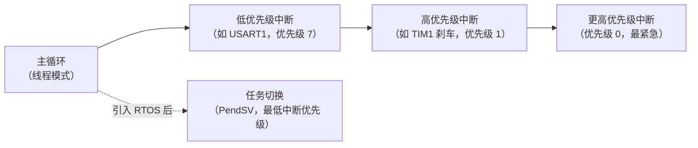
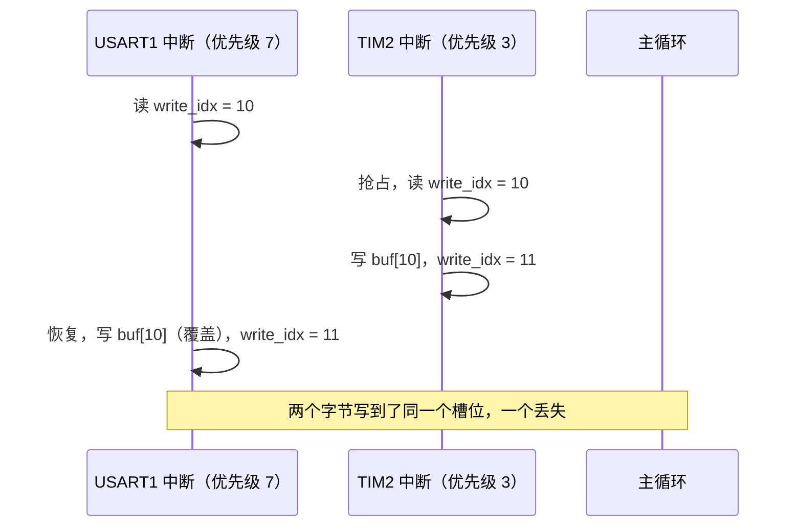
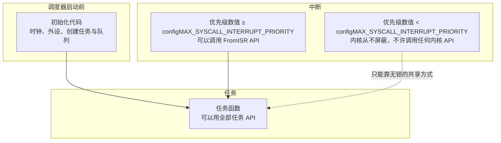

# 4.1 临界区与 RTOS 边界

USART1 的接收中断把收到的每个字节塞进日志缓冲区，TIM2 的定时中断把一句状态说明也塞进同一个缓冲区。两个中断优先级不同，高优先级那个可以在低优先级那个写到一半时插进来。日志偶尔丢几行、偶尔多出半行乱码，单步调试怎么都复现不了。

[2.5 中断与 NVIC](/教程/正文/嵌入式/2_MCU裸机开发/2_5_中断与NVIC) 曾借助“关中断”保护主循环与单个中断共享的计数器，[3.4 数据帧、环形缓冲区与状态机](/教程/正文/嵌入式/3_驱动_通信与中间件/3_4_数据帧_环形缓冲区与状态机) 则依靠单生产者单消费者的下标设计避开了显式加锁。但免锁模型立足于“写者唯一”这一硬性前提。一旦出现多个并发写者，直接关中断又会无差别推迟像电机刹车这类关乎安全的紧急中断。

面对这类多写者竞争，如果一刀切地全局关中断，关键外设的响应延迟就会被大幅拉长；可要是完全不设防，内存数据又随时可能被写穿。要在保证共享数据完整性的同时守住关键中断的响应底线，核心在于梳理清楚系统里各类执行流的打断路径，并在全局关中断（PRIMASK）、按优先级局部屏蔽（BASEPRI）以及硬件支持的独占访问（LDREX/STREX）之间做出权衡。这也是迈向 RTOS 的必经台阶：一旦引入多任务，打断与交织的维度就进一步增加。明确各类保护手段的代价与内核的职责边界，才能在裸机与操作系统之间做出审慎的技术选型。

## 1. 谁会打断谁

Cortex-M3 上，一段代码可能被三类事件打断，按紧迫程度排成一条线：



在单核处理器上，优先级的层级构成了单向的打断关系：低优先级执行流可以随时被高优先级打断，反向则绝无可能。因此分析并发冲突的第一步，永远是顺着执行链梳理清楚谁处于可能被打断的下风位置。

一个 `++` 在 C 语言表述中看似只是一行语句，编译为机器码后却是由多条底层指令拼合而成的：

::: terminal title="bash - 反汇编 count_inc_unprotected"

```text
$ arm-none-eabi-objdump -d race_disasm.o
00000000 <count_inc_unprotected>:
   0:	4a02      	ldr	r2, [pc, #8]
   2:	6813      	ldr	r3, [r2, #0]
   4:	3301      	adds	r3, #1
   6:	6013      	str	r3, [r2, #0]
   8:	4770      	bx	lr
```

:::

自增操作在硬件层面是由加载（LDR）、加法（ADDS）与写回（STR）这三条指令组合而成的流水作业。倘若在这三步执行期间触发了同向修改该对象的高优先级中断，两套上下文便会分别基于相同的旧基准做加法并先后回写。后提交的结果直接覆盖了先前的累计，导致其中一次计数悄然丢失。这就是典型的丢失更新（lost update）。

[2.5 中断与 NVIC](/教程/正文/嵌入式/2_MCU裸机开发/2_5_中断与NVIC) 所应对的冲突仅发生在主循环与单个中断之间，当时只需全局关中断便能稳妥平息。[3.4 数据帧、环形缓冲区与状态机](/教程/正文/嵌入式/3_驱动_通信与中间件/3_4_数据帧_环形缓冲区与状态机) 的环形缓冲区则更进一步：写者只有中断，读者只有主循环，写者单向改写写下标，读者单向改写读下标，双方在各自的指针上互不干扰，即使读写交织也不会产生数据撕裂。然而一旦将场景切换为两个中断同时写入：



当 `write_idx` 同时迎来两个修改者，单生产者模型的前提不复存在，依靠独立游标自洽维护的免锁机制便不再奏效。要挽回共享数据的完整性，摆在面前的通常有两条路径：要么在多个写者之间建立互斥保护，确保同一时刻只有一方获准更新下标；要么借助底层硬件机制，把“读取下标、越界校验、累加回写”打包为不可被打断的连贯操作。后续针对复杂场景的解决思路，正是围绕这两种策略层层展开的。

::: concept emb-rtos-volatile-not-atomic title="volatile 只保证访存，不保证原子"

关键字 `volatile` 明确告知编译器：该内存对象随时可能被当前代码上下文之外的执行流改写，因此每次读写都必须如实映射为总线访问指令，杜绝寄存器暂存或代码重排。但它的管辖边界仅限于编译期优化。当处理器在流水线上逐条执行 `ldr`、`adds` 与 `str` 指令时，任一时钟周期都完全可能被中断异常强行插入。要想把一段复合读写打造成在时间上不可分割的整体，必须依赖临界区保护或硬件原子指令；`volatile` 的职责，仅仅是确保外设或中断刚写入的最新数据能被其他执行流及时读到。

:::

<Quiz
  type="single"
  :options="[
    { label: '中断与主循环共享一个 uint8_t 标志，中断只写 0 或 1，主循环只读', value: 'A' },
    { label: '两个中断都对同一个 uint32_t 计数做 +=，谁来都不关中断', value: 'B' },
    { label: '主循环读中断里更新的 uint64_t 毫秒计数，Cortex-M3 上一次读写 32 位', value: 'C' },
    { label: '中断只往单一写者的环形缓冲区写，主循环只读', value: 'D' }
  ]"
  answer="B"
>

<template #question>

下面哪种情况在 Cortex-M3 上存在数据竞争？

</template>

正确答案是 **B**。两个写者同时做读改写，`+=` 展开成三条指令，中间一定有机会被抢占，会丢更新。A 只是一个字节的读或写，单条指令完成，不存在“改到一半”；C 需要两次 32 位读，但只有一个写者（中断）和一个读者（主循环），只要读者有办法识别“读到一半被改了”并重读，就不需要关中断（本节习题里有一道就写这个）；D 是 3.4 的 SPSC 情形，本来就安全。

</Quiz>

## 2. 关中断的代价

最直接的办法是关中断。2.5 节写过保存和恢复 PRIMASK 的临界区，这里不重复写法，只算代价。

PRIMASK 置 1 后，除 NMI 与 HardFault 外的所有中断都被推迟。设临界区最长持续 $t_c$，一个本应在临界区期间响应的中断就要多等最多 $t_c$。中断延迟的上限因此变成

$$
t_{\text{latency}} = t_{\text{当前指令完成}} + t_{\text{更高优先级中断嵌套}} + t_c
$$

第三项完全由软件决定。72 MHz 的 F103 上，一条 32 位加载大约 2 个周期，复制 64 字节的循环用 `ldr`/`str` 成对搬 32 位，每趟 4 个周期左右：

::: terminal title="bash - 临界区里复制 64 字节的指令数"

```text
$ arm-none-eabi-gcc -std=c11 -mcpu=cortex-m3 -mthumb -O2 -DSTM32F103xB \
    -I<cmsis 目录> -c cp64.c
$ arm-none-eabi-objdump -d cp64.o
00000000 <log_copy>:
   0:	f3ef 8c10 	mrs	ip, PRIMASK
   4:	b672      	cpsid	i
   6:	1f02      	subs	r2, r0, #4
   8:	1f0b      	subs	r3, r1, #4
   a:	f101 003c 	add.w	r0, r1, #60	@ 0x3c
   e:	f853 1f04 	ldr.w	r1, [r3, #4]!
  12:	4283      	cmp	r3, r0
  14:	f842 1f04 	str.w	r1, [r2, #4]!
  18:	d1f9      	bne.n	e <log_copy+0xe>
  1a:	f38c 8810 	msr	PRIMASK, ip
  1e:	4770      	bx	lr
```

:::

循环体包含 4 条指令，总计迭代 16 轮。若按每条指令耗时约 2 个时钟周期粗略核算（考虑到芯片内部 Flash 的访问等待周期与流水线填充，实际取指开销还会更高一些），整段循环大约耗费 128 个周期，在 72 MHz 主频下持续约 1.8 μs。这段延迟在寻常业务逻辑中微不足道，但如果系统里同时运行着响应时限要求在 10 μs 左右的电机过流保护中断，单次数据搬运就会占掉相当可观的容限预算。倘若在临界区内漫不经心地调用复杂库函数甚至引入不可预期的等待，动辄数百微秒的停顿便会直接击穿整个系统的实时性指标。

因此临界区内的代码编写有一条极严谨的纪律：只保留最少、且执行周期完全可控的操作。杜绝调用未预估开销的库函数，杜绝格式化打印，杜绝大块内存拷贝，杜绝读写慢速 Flash。若确实需要流转 64 字节乃至更大的数据块，成熟的做法通常是在临界区内仅用几条指令完成指针或句柄的高速交接，而将耗时较长的数据读取与后续处理挪到临界区外完成（第 4 节的多生产者缓冲区和 4.5 节的内存池正是基于这一思想构建的）。

::: tip 临界区里别用 printf

`printf` 这类函数内部涉及复杂的格式解析、缓冲区管理甚至底层串口发送等待，最坏情况下的执行时间极难给出确切上限。排查并发问题时若草率地在临界区中插入打印语句，往往会导致原有的时间序列被严重拉长，原本偶发的竞争甚至会因为时序改变而暂时被掩盖，给定位真实诱因带来干扰。

:::

## 3. 用 BASEPRI 按优先级屏蔽

一概关断所有中断的做法过于生硬。在上述场景中，日志缓冲区只需要防范同样会改写该缓冲区的同级别或低优先级中断，而控制电机刹车的紧急中断根本不接触日志对象，理应获得及时的执行权限。Cortex-M3 架构为此提供了能够精细调节屏蔽梯度的 BASEPRI 寄存器。

BASEPRI 的核心判定机制相当直观：当写入非零阈值时，凡是优先级数值大于等于该阈值的中断都会被暂时挂起，而数值更小（即更为紧急）的中断则照常放行；向其写入 0 则代表清除屏蔽限制，全额恢复中断响应。

| 字段 | 位 | 含义 |
| --- | --- | --- |
| — | 31:8 | 保留，读回 0 |
| PRI | 7:0 | 屏蔽阈值。非零时，优先级数值 ≥ PRI 的中断被屏蔽；0 表示全开 |

STM32F1 只实现了 8 位中的高 4 位，也就是 16 个优先级。写进去的值低位被忽略，所以阈值要左移 4 位构造，`NVIC_SetPriority()` 对单个中断也是这么做的。

写一个阈值 5 的临界区，编译出来是这样：

::: terminal title="bash - BASEPRI 临界区与 PRIMASK 临界区的指令对比"

```text
$ arm-none-eabi-objdump -d basepri_lock.o
00000000 <log_counter_add_basepri>:
   0:	f3ef 8111 	mrs	r1, BASEPRI
   4:	2350      	movs	r3, #80	@ 0x50
   6:	f383 8812 	msr	BASEPRI_MAX, r3
   a:	f3bf 8f4f 	dsb	sy
   e:	f3bf 8f6f 	isb	sy
  12:	4a03      	ldr	r2, [pc, #12]
  14:	6813      	ldr	r3, [r2, #0]
  16:	4418      	add	r0, r3
  18:	6010      	str	r0, [r2, #0]
  1a:	f381 8811 	msr	BASEPRI, r1
  1e:	4770      	bx	lr

00000024 <log_counter_add_primask>:
  24:	f3ef 8110 	mrs	r1, PRIMASK
  28:	b672      	cpsid	i
  ...
```

:::

`movs r3, #80` 的 80 是 `0x50`，即 `5 << 4`。优先级数值 0～4 的中断（比如刹车中断设为 1）不受影响，5～15 的被挡住。这就是 BASEPRI 相对 PRIMASK 的全部好处：屏蔽范围可以按紧迫程度裁剪。

`code/嵌入式/4_RTOS与固件架构/4_1_临界区与RTOS边界/basepri_lock.h` 把它封装成一对函数：

```c
static inline uint32_t basepri_lock(uint32_t priority_threshold) {
    uint32_t saved = __get_BASEPRI();
    __set_BASEPRI_MAX(priority_threshold);
    __DSB();
    __ISB();
    return saved;
}

static inline void basepri_unlock(uint32_t saved) {
    __set_BASEPRI(saved);
}
```

`__set_BASEPRI_MAX()` 对应 `MSR BASEPRI_MAX` 指令，它的语义是“只有新值更严格时才写入”：新阈值非零且比当前值小（屏蔽范围更宽）时更新，否则保持原值。这让临界区可以嵌套，内层不会放宽外层设的屏蔽。

::: concept emb-rtos-basepri-mask-rule title="BASEPRI 的屏蔽规则"

BASEPRI 写非零值 $p$ 时，优先级数值 $\ge p$ 的中断被屏蔽，数值 $< p$ 的中断照常响应；写 0 表示不屏蔽。`MSR BASEPRI_MAX` 只在“新值比当前值更严格”（新值非零且数值更小时）才更新 BASEPRI，用于嵌套进入临界区。Cortex-M 的中断优先级数值越小越紧急，与 FreeRTOS 任务的优先级方向相反。

:::

嵌套时如果直接写 BASEPRI，问题就来了：

::: compare left-title="直接写 BASEPRI，内层提前放开屏蔽" right-title="用 BASEPRI_MAX，只提高不降低"

```c
uint32_t outer = __get_BASEPRI();
__set_BASEPRI(5u << 4);       /* 挡住 5 及以上 */
{
    uint32_t inner = __get_BASEPRI();
    __set_BASEPRI(9u << 4);   /* 内层阈值更大，屏蔽范围反而更窄 */
    /* 临界区 */
    __set_BASEPRI(inner);     /* 恢复成 0x50 */
}
__set_BASEPRI(outer);
```

---

```c
uint32_t outer = __get_BASEPRI();
__set_BASEPRI_MAX(5u << 4);
{
    uint32_t inner = __get_BASEPRI();
    __set_BASEPRI_MAX(9u << 4);
    /* 临界区 */
    __set_BASEPRI(inner);
}
__set_BASEPRI(outer);
```

:::

左栏表面上也在退出时执行了恢复，漏洞却潜伏在内层的配置阶段：`__set_BASEPRI(9 << 4)` 将阈值从 5 改大到了 9，屏蔽范围随之收窄，导致原本被外层成功阻拦的优先级 5～8 的中断，在内层代码执行期间得以破门而入。右栏采用的 `__set_BASEPRI_MAX(9 << 4)` 则具备单向防护逻辑，当发现新传入的阈值比当前生效的阈值更宽松（数值更大）时，硬件指令直接放弃写入，稳稳守住 5 的门槛。反汇编代码清晰展示了这两者在机器码层面的微妙差异：

::: terminal title="bash - 两种嵌套写法的指令"

```text
00000000 <bad_nesting>:
   0:	f3ef 8311 	mrs	r3, BASEPRI
   4:	2250      	movs	r2, #80	@ 0x50
   6:	f382 8811 	msr	BASEPRI, r2
   a:	f3ef 8211 	mrs	r2, BASEPRI
   e:	2190      	movs	r1, #144	@ 0x90
  10:	f381 8811 	msr	BASEPRI, r1
  ...

00000020 <good_nesting>:
  20:	f3ef 8311 	mrs	r3, BASEPRI
  24:	2250      	movs	r2, #80	@ 0x50
  26:	f382 8812 	msr	BASEPRI_MAX, r2
  2a:	f3ef 8211 	mrs	r2, BASEPRI
  2e:	2190      	movs	r1, #144	@ 0x90
  30:	f381 8812 	msr	BASEPRI_MAX, r1
  ...
```

:::

::: warning 嵌套的临界区一律用 BASEPRI_MAX 进入

内层若直接向 BASEPRI 写入数值更大的阈值，屏蔽范围随即缩窄，原本受外层保护的代码在内层执行期间便会失去屏障，陷入并发撕裂的风险。进入临界区时始终使用 `__set_BASEPRI_MAX()`，退出时则恢复进入前记录的原始值，这样无论嵌套调用深入到第几层，系统都能维持最严格的屏蔽级别。

:::

基于优先级的屏蔽机制同样存在清晰的边界：优先级数值比设定阈值更小（即更为紧急）的中断依然可以随时抢占。因此在系统设计初期，必须梳理清楚每一个共享对象的潜在修改源。假如优先级为 1 的紧急刹车中断同样需要写入日志缓冲区，设为 5 的 BASEPRI 便无法提供任何防护，此时要么退回全局关中断（PRIMASK），要么采用无锁原子方案。设定屏蔽阈值，本质上就是在系统响应确定性与数据一致性之间划定防线。

## 4. LDREX/STREX 与 C11 原子操作

利用临界区将读改写包裹起来，代价在于强制推迟了其他执行流的响应。而在许多轻量同步场景中，需求往往仅仅是递增某个计数或更新状态标志。Cortex-M3 提供的独占访问指令能够在全程不关闭任何中断的前提下，直接由底层硬件提供单次读改写的原子性保障。

Cortex-M3 引入了成对的独占访问指令：`LDREX` 在读取一个 32 位对象的同时，通知处理器内部的局部独占监视器（Local Monitor）锁定该物理地址；随后的 `STREX` 指令只有在监视器标记仍然有效时，才会将新值写回内存并向目标寄存器返回 0，若标记已被清除则放弃写入并返回 1。任何异常事件的进入与返回都会清空独占监视器的状态。因此，若在读与写之间遭遇了中断插入，中断返回后后续的 `STREX` 便会检测到冲突并宣告失败，代码只需退回重试即可，避免了脏写破坏。

C11 的原子操作在 Cortex-M3 架构下正是编译成这对指令的：

```c
#include <stdatomic.h>

atomic_uint_least32_t g_tx_bytes;

void add_tx_bytes(uint32_t n) {
    atomic_fetch_add_explicit(&g_tx_bytes, n, memory_order_relaxed);
}
```

::: terminal title="bash - atomic_fetch_add 生成的指令"

```text
$ arm-none-eabi-objdump -d atomic_inc.o
00000000 <add_tx_bytes>:
   0:	4b04      	ldr	r3, [pc, #16]
   2:	e853 1f00 	ldrex	r1, [r3]
   6:	4401      	add	r1, r0
   8:	e843 1200 	strex	r2, r1, [r3]
   c:	2a00      	cmp	r2, #0
   e:	d1f8      	bne.n	2 <add_tx_bytes+0x2>
  10:	4770      	bx	lr
```

:::

跳转指令 `bne.n` 构成了一条轻量级的 CAS 重试循环。此处选用松弛内存序 `memory_order_relaxed`，仅要求累加过程在底层保持原子性，不附加额外的访存屏障；在仅维护发送字节统计这类无外部数据依赖的计数场景中，这一开销最小的选择已完全足够。在单核微控制器上，这种重试循环不会带来类似对称多处理（SMP）系统的长时间忙等：失败只会在两条指令之间偶发嵌套异常时产生，绝大多数情况下一次尝试便能成功。

::: concept emb-rtos-atomic-limit title="原子操作只保护单个对象"

C11 提供的原子操作仅保证单个独立内存对象的单次读写是原子的。如果业务逻辑要求多个对象联动更新（例如环形缓冲区的游标与有效数据长度、或者状态机当前状态与错误码），原子操作只能分步执行，在多个操作的交界处依然可能被外部执行流观测到不一致的中间状态。遇到这种复合变更，要么将多个字段紧凑合并到一个 32 位整型内统一处理，要么退回临界区以保护整段代码。此外，Cortex-M3 架构在硬件上仅支持 32 位以内的独占访问，64 位整型无法单指令原子读写：在 `-mcpu=cortex-m3` 编译选项下，`_Static_assert(ATOMIC_LLONG_LOCK_FREE == 2, ...)` 无法通过编译，明确指出了其缺乏无锁硬件支撑的现实。

:::

原子操作的另一项经典应用，是将不可预测的并发写入化解为有序的游标预约。当两个不同优先级的中断都需要向同一个环形缓冲区追加日志时，双方可以先通过 CAS 操作各自抢占一个自增的写入序号，再安心向属于自己的数组槽位写入数据：

```c
bool mpsc_rb_put(struct mpsc_ringbuf *rb, uint8_t byte) {
    size_t w = atomic_load_explicit(&rb->write_idx, memory_order_relaxed);

    for (;;) {
        size_t r = atomic_load_explicit(&rb->read_idx, memory_order_acquire);
        if (w - r >= rb->cap) {
            return false; /* 缓冲区已满 */
        }
        if (atomic_compare_exchange_weak_explicit(
                &rb->write_idx, &w, w + 1u,
                memory_order_relaxed, memory_order_relaxed)) {
            break;
        }
    }

    size_t slot = w & rb->mask;
    rb->buf[slot] = byte;
    atomic_store_explicit(&rb->ready[slot], 1u, memory_order_release);
    return true;
}
```

`atomic_compare_exchange_weak_explicit` 在底层展开为成对的 `LDREX`/`STREX` 判定：若当前 `write_idx` 仍等于先前读取的 `w`，则原子更新为 `w + 1` 并返回成功；若已被其他高优先级中断提前递增，则自动将 `w` 刷新为当前最新值并返回失败，驱动循环重新尝试。只要某一方成功获得了序号 `w`，其对应的槽位 `slot = w & mask` 便归其独占，写入动作不再与其他写者产生冲突。

但在流水设计中还有一个容易被忽视的隐患：仅完成槽位预约并不等于数据写入完毕。假设低优先级中断刚刚抢占到槽位，尚未将字节写入数组就被更高优先级的中断打断；后者紧接着预约了下一个槽位并迅速写入完毕。此时主循环读者若单纯以 `write_idx` 作为判定依据，就会直接越过低优先级写者未完工的脏数据。为了弥合这一时间窗口，可以为每个槽位增设一个就绪标志 `ready`。写者在数组内容就绪后以 release 语义将对应标志置 1，而读者在消费前先通过 acquire 语义确认标志，再安全提取数据。完整实现可参考 `code/嵌入式/4_RTOS与固件架构/4_1_临界区与RTOS边界/mpsc_reserve.c`，在桌面环境下经由两个线程各写入一万条记录验证后的终端输出如下：

::: terminal title="PowerShell - MPSC 缓冲区的主机测试"

```text
$ gcc -std=c17 -O2 -Wall -Wextra -pthread test_mpsc.c mpsc_reserve.c -o test_mpsc
$ ./test_mpsc
MPSC host test passed: writer1=10000, writer2=10000
```

:::

两路写者各自注入一万条数据，读者校验全过程无一丢包、无一错位、顺序丝毫不乱。

::: tip 单核 MCU 上不要用自旋锁

在多核对称多处理（SMP）系统中，线程竞争互斥量失败时往往可以选择短暂停留在自旋循环中，因为另一个核心随时可能释放锁。但在单核 MCU 上，自旋等待往往是死锁的温床：若高优先级中断在抢占一把由主循环持有的互斥锁时陷入原地自旋，主循环便永远无法获得 CPU 时间来执行解锁指令，系统瞬间陷入永久停摆。在中断与任务之间协同设计时，必须采用非阻塞的重试或进入临界区，绝不可令中断处于无休止的自旋轮询中。

:::

## 5. 有了任务以后

在前述讨论中，执行流的打断均来自于异步中断。一旦引入 RTOS，系统便多了一种截然不同的抢占源：内核调度器可以在任意时钟节拍（Tick）或同步事件到达后，强行将 CPU 的使用权从一个任务剥离并赋予另一个任务。当两个任务同时对全局累加器 `g_count` 执行自增时，被上下文切换在中间打断的那个任务同样会面临数据覆盖的风险，其破坏机理与中断竞争如出一辙。差异仅仅在于触发抢占的主体由 NVIC 变成了 RTOS 调度器。

FreeRTOS 为此提供了三种手段。

`taskENTER_CRITICAL()` / `taskEXIT_CRITICAL()` 是最常用的。ARM_CM3 移植层的实现用 BASEPRI，并且带一个嵌套计数：

```c
void vPortEnterCritical( void )
{
    portDISABLE_INTERRUPTS();
    uxCriticalNesting++;

    if( uxCriticalNesting == 1 )
    {
        configASSERT( ( portNVIC_INT_CTRL_REG & portVECTACTIVE_MASK ) == 0 );
    }
}

void vPortExitCritical( void )
{
    configASSERT( uxCriticalNesting );
    uxCriticalNesting--;

    if( uxCriticalNesting == 0 )
    {
        portENABLE_INTERRUPTS();
    }
}
```

（摘自 FreeRTOS-Kernel V11.3.0 `portable/GCC/ARM_CM3/port.c`，为篇幅略去注释，MIT 许可。）

在具体实现中，`portDISABLE_INTERRUPTS()` 宏最终展开为 `vPortRaiseBASEPRI()`，它向 BASEPRI 写入 `configMAX_SYSCALL_INTERRUPT_PRIORITY` 所指定的阈值；退出时调用的 `portENABLE_INTERRUPTS()` 则向其写回 0。配套的嵌套计数器确保了即使临界区被层层嵌套，内层退出时也不会过早解除防护。这种设计印证了第 3 节中关于 BASEPRI 的讨论：内核之所以没有采用全局关中断，正是为了保障优先级高于该阈值的关键中断（如硬件过流、电机刹车）在系统进入内核临界区期间依然能够获得微秒级的零等待响应。这一优先级门槛的设定原则与注意事项将在 4.4 节深入剖析。

`vTaskSuspendAll()` 与 `xTaskResumeAll()` 则提供了另一种粒度的控制：它们仅挂起调度器的切换行为，并不触碰硬件中断的使能状态。在此期间硬件中断依然能够正常响应执行，若中断服务程序中调用了以 `FromISR` 结尾的 API 并触发了就绪态切换，内核会把重调度请求暂存起来，等到 `xTaskResumeAll()` 恢复调度时统一触发处理。这种机制适合于那些绝不能推迟中断响应、同时又需要阻止同层或高优先级任务窥见中间状态的复合数据维护。

互斥量（Mutex）的核心职责是保护共享资源，而临界区则是保护简短的指令序列。互斥量遵循“持有后独占、使用完毕归还”的协议，未竞争到锁的任务会主动陷入阻塞让出 CPU，内核转而调度其他就绪任务运行。互斥机制的上下文管理开销虽然显著高于开关中断，但临界区内绝不允许执行任何可能引发任务睡眠的阻塞操作；当保护目标涉及外设通信交互或长时等待时，互斥量是不二之选。关于互斥量的优先级继承与死锁规避将在 4.3 与 4.6 节详细讨论。

把这几种情况合起来看，选择取决于两件事：打断来源是谁，要保护的东西有多大。

| 打断来源 | 数据规模 | 手段 |
| --- | --- | --- |
| 单个中断，与主循环或单任务共享 | 32 位以内的单个对象 | C11 原子操作（`atomic_fetch_add` 等） |
| 多个不同优先级中断 | 32 位以内的单个对象 | 原子操作；需要多个对象一起变时用 PRIMASK 或 BASEPRI |
| 多个不同优先级中断 | 一段数据（缓冲区、结构体） | BASEPRI 阈值选在“所有写者之下、紧急中断之上”；挡不住的写者改用 PRIMASK |
| 任务与任务 | 任何规模 | `taskENTER_CRITICAL()`，或者用队列把数据交出去（4.3） |
| 任务与任务 | 需要等待外设、可能阻塞 | 互斥量 |
| 任务与中断 | 一段数据 | 临界区（任务侧）+ `FromISR` API（中断侧），见 4.4 |

<Quiz
  type="single"
  :options="[
    { label: '高优先级中断只写、任务只读一个 32 位状态字，两边用 atomic_load/atomic_store', value: 'A' },
    { label: '任务与任务共享一个结构体，读写都用 taskENTER_CRITICAL 包住', value: 'B' },
    { label: '任务要发一次 I²C 事务，用互斥量保护总线而不是临界区', value: 'C' },
    { label: '刹车中断（优先级 1）也要写日志缓冲区，只把 BASEPRI 阈值设成 5', value: 'D' }
  ]"
  answer="D"
>

<template #question>

按第 5 节的表，下面哪种手段选错了？

</template>

正确答案是 **D**。BASEPRI 阈值 5 挡不住优先级数值更小的刹车中断（数值 1 更紧急），它照样能插进日志缓冲区的写操作。要挡住它只能用 PRIMASK（所有可屏蔽中断一起推迟），或者把写入改成无锁的方式。A、B、C 都与表里的对应行一致：单个 32 位对象用原子操作，任务之间的一段数据用临界区，需要等外设的场合用互斥量。

</Quiz>

还有一条在表外的规矩：临界区与原子操作保护“代码与数据的正确性”，响应时间要另外算。系统里最紧急的那个中断延迟是多少，必须在设计时就算出来，然后让每一处临界区都为这个预算让路。

## 6. RTOS 内核管什么、不管什么

把 RTOS 当“操作系统”容易期待过高。FreeRTOS 在 STM32F103 上做的事只有四件：

- 决定下一秒哪个任务运行（调度）；
- 让任务在等事件时让出 CPU，事件来了把它唤醒（阻塞与唤醒）；
- 提供时间，也就是节拍与延时；
- 提供任务之间传递数据、同步动作的工具（队列、信号量、互斥量、事件组）。

它不提供驱动、不提供协议栈、不提供文件系统——这些要么自己写，要么另外集成。它也不提供存储器保护：STM32F103 没有 MPU，所有任务都以特权级运行，一个任务写坏了另一个任务的栈，内核不会有任何反应（4.5 节展开）。文件系统、TCP/IP 这类组件在 FreeRTOS 之上单独选择，第 5 章的嵌入式 Linux 是另一条路线。

一个 FreeRTOS 工程的代码分成三类，各自能用什么 API 是硬规矩：



- 调度器启动前的初始化代码：不能再调用会阻塞的 API（4.2 节第 8 节）。
- 任务：什么都能用。
- 中断分两种。优先级数值不小于 `configMAX_SYSCALL_INTERRUPT_PRIORITY` 的中断，内核会屏蔽它，它也可以调用以 `FromISR` 结尾的 API；优先级数值更小的中断，内核从不屏蔽（这正是不让刹车中断被推迟的原因），代价是它绝对不能调用任何内核 API。

最后一类中断如果必须与任务交换数据，就只能用无锁的方式：一个 `volatile` 标志、一对原子操作、或者 3.4 节的单生产者单消费者缓冲区。这也是为什么第 3 章那些免锁设计在 RTOS 里依然有用。

## 7. 什么时候该用 RTOS

回到开头那个需求：LED 每 500 ms 翻转，串口来命令就处理，传感器每 10 ms 采一次。用 [2.6 定时器、PWM 与系统节拍](/教程/正文/嵌入式/2_MCU裸机开发/2_6_定时器_PWM与系统节拍) 里那种非阻塞超级循环写，主循环里三件事轮流查：

```c
while (g_now_ms < RUN_MS) {
    uint32_t now = tick_now();

    if ((uint32_t)(now - last_led_ms) >= 500u) {
        last_led_ms = now;
        led_toggle();
    }

    if (state == SENSOR_IDLE) {
        if ((uint32_t)(now - last_sample_ms) >= 10u) {
            last_sample_ms += 10u;
            sensor_start_conv();
            state = SENSOR_CONVERTING;
        }
    } else if (sensor_conv_ready()) {
        filter_push(sensor_read_raw());
        state = SENSOR_IDLE;
    }

    uint8_t ch = 0u;
    if (uart_try_getc(&ch)) {
        cmd_feed_byte(ch);
    }

    g_now_ms++;
}
```

完整程序在 `code/嵌入式/4_RTOS与固件架构/4_1_临界区与RTOS边界/superloop_vs_tasks/superloop.c`，在 PC 上用一个每轮加一的假时钟跑 1.1 秒的虚拟时间，输出：

::: terminal title="PowerShell - superloop"

```text
$ ./superloop
t= 200 ms  收到命令字节 'A'
t= 252 ms  采样 25 次，均值 999 mg
t= 450 ms  收到命令字节 'B'
t= 500 ms  LED 翻转（第 1 次）
t= 502 ms  采样 50 次，均值 1000 mg
t= 700 ms  收到命令字节 'C'
t= 752 ms  采样 75 次，均值 1000 mg
t= 950 ms  收到命令字节 'D'
t=1000 ms  LED 翻转（第 2 次）
t=1002 ms  采样 100 次，均值 1000 mg
t=1050 ms  收到命令字节 'E'
虚拟时间 1100 ms 结束
```

:::

能跑，也没有丢事件。代价全在写法上：转换要拆成“启动”与“读取”两个状态，串口只能用 `try_getc` 轮询，每加一件事就要在主循环里多一个 `if`，而任何一处不小心写了个阻塞的等待，整个循环的节拍就全乱了。

同一需求的 FreeRTOS 版本（`rtos_tasks.c`）只有三个互不相干的循环：

```c
static void sensor_task(void *param) {
    TickType_t last_wake = xTaskGetTickCount();

    for (;;) {
        sensor_start_conv();
        /* sensor_read_raw() 内部等转换完成，用信号量或任务通知实现（4.3、4.4） */
        filter_push(sensor_read_raw());
        xTaskDelayUntil(&last_wake, pdMS_TO_TICKS(10));
    }
}

static void cmd_task(void *param) {
    for (;;) {
        uint8_t ch = uart_blocking_getc();
        cmd_feed_byte(ch);
    }
}

static void led_task(void *param) {
    for (;;) {
        led_toggle();
        vTaskDelay(pdMS_TO_TICKS(500));
    }
}
```

三处阻塞等待分别由调度器负责：采样任务等周期，命令任务等字节，闪灯任务等时间。每个任务里可以按顺序写代码，不用状态机拆。三个任务的创建、调度与时间在 4.2 节展开，这一节只看结构上的差别。

::: compare left-title="非阻塞超级循环" right-title="三个任务"

```c
for (;;) {
    if (led_due()) { led_toggle(); }
    sensor_poll_step();
    if (uart_try_getc(&ch)) { cmd_feed_byte(ch); }
}
/* 任何一步等太久，全部节拍一起乱 */
```

---

```c
for (;;) { led_toggle(); vTaskDelay(500); }
for (;;) { cmd_feed_byte(uart_blocking_getc()); }
for (;;) { sample(); xTaskDelayUntil(&w, 10); }
/* 各自阻塞，时序由调度器分开管 */
```

:::

系统何时应当从裸机轮询转向 RTOS？通常有几个明确的架构拐点：

- 业务活动具备多样化的执行周期与响应期限，且功能模块处于不断扩展之中。当前后台主循环中的状态分支与标志判断堆叠到十数个以上、每新增一个传感器都要全面重新校核所有轮询分支的时序时，裸机架构的维护成本已经开始失控。
- 业务流程中存在耗时较长的阻塞等待（如等待 SPI Flash 扇区擦除、I²C 从机应答或网络数据包返回），且该停顿决不能阻碍其他周期性任务。在超级循环中往往需要将其生硬切碎为大量繁琐的状态机步进，而在多任务模型中任务可以直接调用阻塞 API 挂起自身，优雅让出处理器。
- 具备严格的硬实时抢占诉求：一旦突发的紧急事件到来，系统必须在微秒级时间内夺回 CPU 执行权，不能容忍在漫长的主循环轮询链中排队等候。

相反，在许多特定场景下引入 RTOS 反而是过度工程：逻辑单一、时序严格同步、追加任务带来的上下文与栈开销远大于架构收益的小型节点；RAM 资源极度捉襟见肘（如片上 SRAM 仅数 KB）的紧凑芯片；以及纯粹由单一定时器中断驱动的平铺式固件。架构设计的通用准则是：若一个主循环在前后台架构下一屏代码即可清晰呈现、追加功能无需侵入已有模块的时序依赖，维持裸机设计往往是最稳健、最透明的方案。若系统规模进一步扩大，需要依赖虚拟内存与 MMU 实现进程沙箱隔离、或者直接复用庞大的 Linux 开源协议栈生态，则需要转向第 5 章探讨的嵌入式 Linux 体系。

## 8. 习题

题面用到的程序都在 `code/嵌入式/4_RTOS与固件架构/4_1_临界区与RTOS边界/` 下。Cortex-M3 片段按各文件开头给出的命令编译，编译前需要一个放有 CMSIS 头文件的目录（CMSIS_5 5.9.0 的 `CMSIS/Core/Include` 与 cmsis_device_f1 v4.3.5 的 `Include` 放在一起）。

### 8.1 巩固

<Exercise id="64401" :d="1" :w="2" multi>

下面五段共享数据，写者与读者各不相同。

| 编号 | 写者 | 读者 | 被共享的对象 |
| --- | --- | --- | --- |
| A | TIM2 中断与 USART1 中断 | 主循环 | `uint32_t g_drop_count`，两个中断都做 `++` |
| B | USART1 中断 | 主循环 | `uint8_t g_rx_byte`，中断整体赋值，主循环只读一次 |
| C | 两个不同优先级的中断 | 主循环 | 环形缓冲区的 `write_idx` 与数据槽位 |
| D | 中断 | 主循环 | `struct { uint32_t seq; int16_t value; } g_sample` |
| E | USART1 中断 | 主循环 | 3.4 节的单生产者单消费者环形缓冲区 |

(1) _[1.2]_ 逐行判断有没有数据竞争，写出依据（写者有几个、读改写是否拆成多条指令、是不是多字对象），并给出该用的手段：不用保护、原子操作、BASEPRI 临界区或 PRIMASK。

(2) _[2.2]_ 编译 `race_disasm.c` 并反汇编，贴出 `count_inc_unprotected` 的指令，指出读、加、写分别对应哪一条，说明中断落在哪两条之间会丢更新。再把 `g_count++` 改成 `g_count = 1u`，重新反汇编，说明这次为什么不需要保护。

(3) _[2.2]_ 把 `race_disasm.c` 里的 `volatile uint32_t g_count` 改成 `atomic_uint_least32_t`，自增改成 `atomic_fetch_add_explicit(&g_count, 1u, memory_order_relaxed)`，重新编译反汇编，数一数多出了哪几条指令，说明重试循环在什么情况下会执行第二次。

</Exercise>

<Exercise id="64402" :d="2" :w="2">

`cp64.c` 在 PRIMASK 临界区里复制 16 个 32 位字。

(1) 用文件开头的命令编译并反汇编，数出循环体的指令条数与循环次数。按每条指令 2 个周期、72 MHz 估算这段临界区的持续时间，写出微秒数。

(2) 电机保护中断的响应预算是 10 μs。算出这段临界区占掉预算的百分比。再估算“临界区里只交换指针”的版本：两次 32 位加载、两次 32 位存储，共多少周期、多少微秒。

(3) 把 `log_copy()` 改成双缓冲：写者填满一块 `struct log_page { uint32_t data[16]; }` 之后，在临界区里只交换一个指向当前页的指针，复制由读者在临界区外完成。写出完整的类型、交换函数与调用方，并用反汇编证明临界区里只剩几条指令。

(4) 说明 (3) 的写法要求写者遵守什么约定，否则读者会读到写了一半的页。

</Exercise>

<Exercise id="64403" :d="3" :w="3">

下面的三层嵌套全部用 `__set_BASEPRI()` 进入，阈值依次是 5、9、3（已按高 4 位左移对齐）：

```c
uint32_t a = __get_BASEPRI();
__set_BASEPRI(5u << 4);
{
    uint32_t b = __get_BASEPRI();
    __set_BASEPRI(9u << 4);
    {
        uint32_t c = __get_BASEPRI();
        __set_BASEPRI(3u << 4);
        /* 最内层 */
        __set_BASEPRI(c);
    }
    /* 中间层 */
    __set_BASEPRI(b);
}
__set_BASEPRI(a);
```

(1) 分别写出最外层、中间层、最内层执行期间，哪些优先级数值的中断能进来。设刹车中断的优先级数值是 1，日志中断是 6，通信中断是 11。

(2) 指出这段代码的缺陷：哪一层把外层的屏蔽范围放开了，放开期间哪个中断能插进来。

(3) 用 `__set_BASEPRI_MAX()` 重写进入动作，说明为什么退出时仍然用 `__set_BASEPRI()` 写回保存值，而不是也用 MAX。如果把退出也改成 MAX 会发生什么？

(4) 把修改前后的两版写成两个函数，编译反汇编，确认进入指令变成了 `msr BASEPRI_MAX`，贴出这两条指令。

</Exercise>

### 8.2 编程

<Exercise id="64404" :d="3" :w="3">

`exercises/clock64_starter.c` 里，64 位时钟由中断维护的高 32 位与硬件计数器的低 32 位拼成。起始代码的 `clock64_read()` 直接拼一次就返回。

(1) 先构造一个能暴露缺陷的用例：读完高 32 位之后、读低 32 位之前，让计数器回绕（高 32 位加一、低 32 位归零）。为了在单线程的 PC 程序里插入这一刻，给 `clock64_read()` 加一个只在 `CLOCK64_TEST` 下编译的钩子：

```c
#ifdef CLOCK64_TEST
extern void (*g_between_reads_hook)(void);
#endif
```

在两次读之间调用它，测试里把钩子设成“模拟中断”的函数。写出这个用例，确认起始代码返回的值比回绕前小。

(2) 补全 `clock64_read()`：读高、读低、再读高，两次高 32 位不同就重试。要求全程不关中断、不调用任何阻塞函数。

(3) 把 (1) 的用例改成随机注入 1000 次回绕，验证返回值单调不减。验收：起始代码的版本出现至少一次倒退，补全后的版本一次都不出现。

(4) 说明这个办法为什么在“高 32 位由中断更新、低 32 位自由计数”的模型下成立，而在“两个 32 位都由软件分别更新”的模型下不成立。

</Exercise>

<Exercise id="64405" :d="4" :w="4">

`exercises/mpsc_ringbuf_starter.c` 是两个不同优先级中断写、主循环读的环形缓冲区骨架，`mpsc_rb_put()` 与 `mpsc_rb_get()` 待补全。

(1) 补全 `mpsc_rb_put()`：用 `atomic_compare_exchange_weak_explicit()` 预约 `write_idx`，写完数据后用 release 语义置 `ready[slot] = 1`。补全 `mpsc_rb_get()`：用 acquire 读 `ready[slot]`，取走数据后清零并推进 `read_idx`。

(2) 编译运行，验收输出为 `verified 20000 records from 2 writers without loss or reorder`。把 `ready` 的 acquire/release 换成 `memory_order_relaxed`，重跑 10 次，记录是否出现断言失败或乱序，并解释为什么在这个程序里它“看起来也能跑”。

(3) 加一个白盒用例：把 `read_idx` 与 `write_idx` 都置成 5，`ready[5]` 保持 0，确认 `mpsc_rb_get()` 返回假；再只把 `ready[5]` 置 1，确认取到的正是 `buf[5]` 里的字节。用这个用例说明 `ready` 数组解决的是“槽位已预约、数据未写完”的哪一段时间，以及为什么消费者不能只凭 `write_idx > read_idx` 就认为有数据可取。

(4) 读 `mpsc_reserve.c` 里 `mpsc_rb_put()` 的满判断，说明 `w - r >= rb->cap` 为什么用无符号减法而不是 `w >= r + cap`。

</Exercise>

<Exercise id="64406" :d="4" :w="4">

`superloop_vs_tasks/superloop.c` 用假时钟跑一个非阻塞超级循环。

(1) 在循环里加一个 `flash_erase()`，用 `g_now_ms += 30;` 模拟一次耗时 30 ms、期间 CPU 被占住的 Flash 擦除，由收到命令字节 `'C'` 时触发。运行程序，记录这次擦除前后两次 LED 翻转的时间间隔与采样次数，说明哪一项时序被拖坏了。

(2) 把擦除改成“启动 + 轮询完成”的状态机，与传感器的转换状态一样拆开。重跑，要求所有 LED 间隔回到 500 ms，采样一个不少。

(3) 在这个需求上再加两件事：一次 20 ms 的 I²C 事务、一次 50 ms 的网络等待。说明全部拆成状态机之后主循环会有多少个分支、每加一件事要改哪几处；据此写出你在第 7 节那几个信号里判断“该换 RTOS”的依据。

(4) 第 6 节说内核不提供驱动、协议栈、文件系统与存储器保护。列出这个超级循环工程换成 FreeRTOS 之后，仍然要自己实现的四样东西，各举一例说明它由内核负责还是由应用负责。

</Exercise>

### 8.3 综合与挑战

<Exercise id="64407" :d="5" :w="4">

下面是一段多中断固件的关键部分，日志缓冲区由两个中断写入、主循环读出。代码里的同步缺陷至少有五处。

```c
static volatile uint32_t g_log_count;
static uint8_t g_log_buf[64];
static uint32_t g_log_widx;

void TIM2_IRQHandler(void) {
    uint32_t saved = __get_BASEPRI();
    __set_BASEPRI(5u << 4);

    g_log_buf[g_log_widx++ & 63u] = 0xA5u;
    g_log_count++;
    printf("log %lu\n", (unsigned long)g_log_count);

    __set_BASEPRI(saved);
    TIM2->SR = 0;
}

void USART1_IRQHandler(void) {
    uint32_t saved = __get_BASEPRI();
    __set_BASEPRI(9u << 4);

    g_log_buf[g_log_widx++ & 63u] = 0x5Au;
    g_log_count++;

    __set_BASEPRI(saved);
    USART1->SR = 0;
}

void app_task(void *param) {
    for (;;) {
        taskENTER_CRITICAL();
        if (g_log_count > 0u) {
            uart_write_blocking(g_log_buf, 64u);
            g_log_count = 0u;
        }
        taskEXIT_CRITICAL();
        vTaskDelay(pdMS_TO_TICKS(10));
    }
}
```

设 TIM2 的中断优先级数值是 6，USART1 是 10，电机刹车中断是 1。

(1) 找出全部五处缺陷。每处写一句话说明后果，并指出它违反了本页哪一节的哪条规则。

(2) 逐处修改，给出改后的完整代码。要求：两个中断都能安全写日志；刹车中断的延迟不受影响；任务侧不阻塞在临界区里。

(3) 说明修改后 `g_log_widx` 与 `g_log_count` 分别由谁修改、用什么手段保护，以及主循环怎样判断“有新日志”。

(4) 这套改法在加入第三个写者（另一个中断）时还成立吗？如果不成立，写出你会换成什么结构，并给出它在 4.1 节里的名字。

</Exercise>

<Exercise id="64408" :d="5" :w="4">

第 5 节给了任务之间保护共享数据的三种手段。用模拟器把它们各自的效果量出来。

(1) 写一个会出错的版本：两个优先级相同的任务（时间片轮转）各自对一个全局 `uint32_t g_total` 做 100000 次 `g_total += 1`，第三个任务最后打印 `g_total`。要求第二个任务每做 1000 次让出一次 CPU（`vTaskDelay(1)` 或不加延时的 `taskYIELD()`），保证切换真的落在读改写中间。运行 10 次，记录 `g_total` 与 200000 的差。

(2) 分别用 `taskENTER_CRITICAL()` / `taskEXIT_CRITICAL()`、`vTaskSuspendAll()` / `xTaskResumeAll()`、`xSemaphoreCreateMutex()` 三种手段包住自增，各跑 10 次，记录结果是否都等于 200000。

(3) 在三种手段里各加一行 `console_printf()`（模拟“临界区里做了耗时的事”），并加一个优先级最高的心跳任务，每 5 ms 醒来打印一次节拍。记录心跳在三种写法下的最大间隔。说明互斥量那一版心跳为什么几乎不受影响：拿着锁的任务照样会被更高优先级的心跳抢占，锁只挡住另外那个计数任务。临界区与 `vTaskSuspendAll()` 两版为什么都被拖长：前者靠 BASEPRI 把 SysTick 一起挡住，后者让调度器停摆，两者都让心跳任务醒不过来。再指出这两版对**中断**的影响不同：哪一版期间串口中断照常响应，哪一版被推迟。

(4) 按第 5 节的表，为下面四种情形各选一种手段并说明理由：两个任务共享一个 32 位计数器；两个任务共享一个 64 字节的结构体；任务要发一次 I²C 事务；任务改一个中断也会读的结构，且不能关中断。

(5) 把 `taskENTER_CRITICAL()` 版本里的自增换成一个会调用 `vTaskDelay()` 的函数。解释运行结果（提示：临界区里不能阻塞），并说明这种情况应该改用哪种手段。

验收：给出 (1)(2) 各 10 次的结果表与 (3) 的三种心跳最大间隔；目标构建可选，模拟器上能跑即可。

</Exercise>

## 9. 参考资料

- ARM, *Cortex-M3 Devices Generic User Guide* (DUI0552A)，异常模型、PRIMASK/BASEPRI、同步原语：https://developer.arm.com/documentation/dui0552/a/
- ST, *PM0056 Cortex-M3 programming manual*：https://www.st.com/resource/en/programming_manual/pm0056-stm32f10xxx20xxx21xxxl1xxxx-cortexm3-programming-manual-stmicroelectronics.pdf
- FreeRTOS, *Running the RTOS on a ARM Cortex-M Core*：https://www.freertos.org/RTOS-Cortex-M3-M4.html
- FreeRTOS, *Mastering the FreeRTOS Real Time Kernel*, ch08 Resource Management：https://github.com/FreeRTOS/FreeRTOS-Kernel-Book/blob/main/ch08.md
- FreeRTOS-Kernel V11.3.0，`portable/GCC/ARM_CM3/port.c`、`portmacro.h`：https://github.com/FreeRTOS/FreeRTOS-Kernel/tree/V11.3.0/portable/GCC/ARM_CM3
- cppreference, *Atomic operations library*：https://en.cppreference.com/w/c/atomic
- Arm, *CMSIS-Core (Cortex-M)：内核寄存器访问函数*：https://arm-software.github.io/CMSIS_5/Core/html/group__Core__Register__gr.html
- Joseph Yiu, *The Definitive Guide to ARM Cortex-M3 and Cortex-M4 Processors*, 3rd ed., Newnes, 2014（ISBN 978-0-12-408082-9）。
