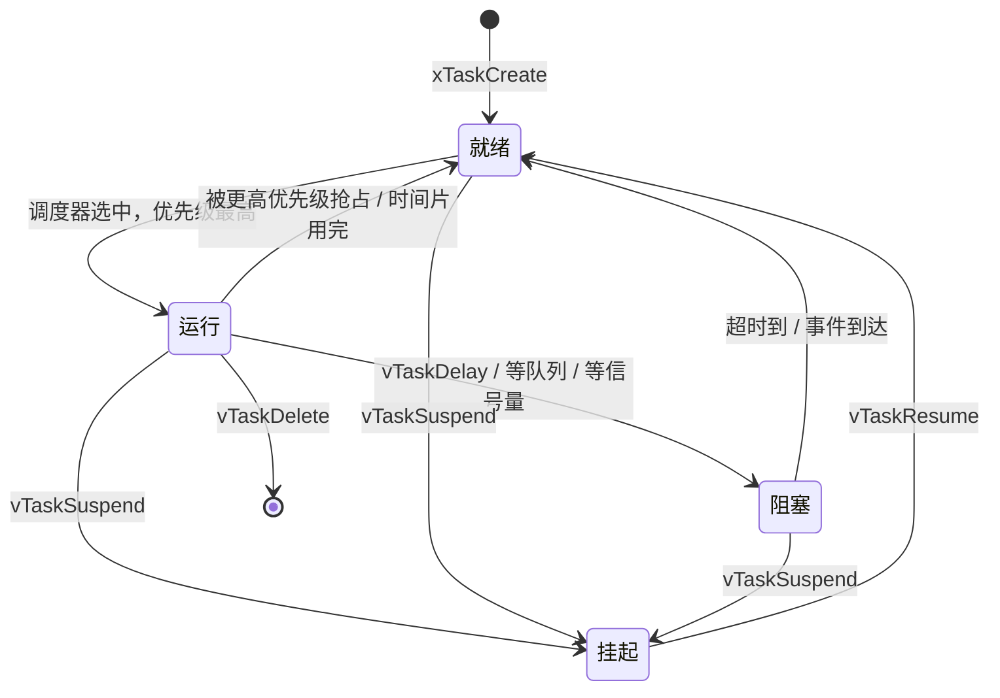
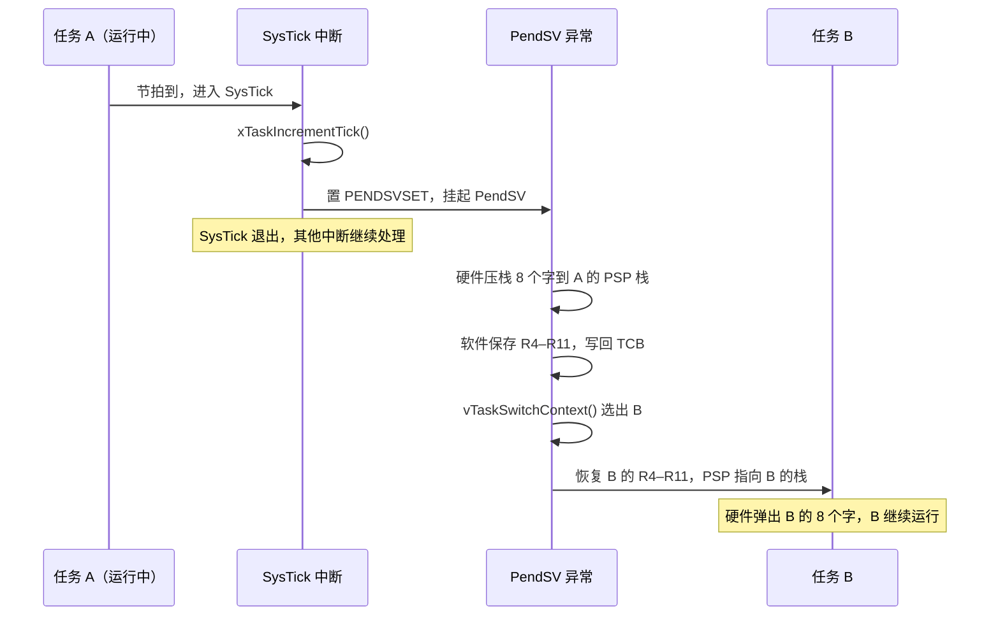

# 4.2 任务、调度与时间

4.1 末尾比过两种写法：LED 每 500 ms 翻转一次、串口随时收命令、传感器每 10 ms 采一次。超级循环把所有活动塞进一个 `for (;;)`，用状态机拆开每一步，写得出来，但每加一件活动就把时间预算再分薄一层。这一节把同一个需求改写成三个任务，每个任务只写自己那件事，等待交给调度器。

读完这一节，读者能用 FreeRTOS 创建周期任务和事件驱动任务，说清任务的四种状态与固定优先级抢占调度，在 `vTaskDelay` 与 `xTaskDelayUntil` 之间选对那一个，知道一次上下文切换在 Cortex-M3 上由哪几个异常完成，并在 PC 模拟器与 STM32F103 两块地方都把程序跑起来。

## 1. 实验环境

本章的例子都在 FreeRTOS-Kernel V11.3.0（2026 年 10 月时的 202604 LTS 版本）上。第三方源码不进仓库，构建前自己拉一份：

::: terminal title="bash - 获取 FreeRTOS-Kernel"

```bash
git clone --depth 1 --branch V11.3.0 https://github.com/FreeRTOS/FreeRTOS-Kernel.git
```

:::

两种构建共用一套应用代码。PC 模拟器用 FreeRTOS 自带的 Windows 移植层 `portable/MSVC-MingW`，每个任务跑在一条 Windows 线程上，节拍由 winmm 的可等待定时器模拟；Linux 与 macOS 上换成 `portable/ThirdParty/GCC/Posix`，应用代码一行不改。STM32F103 上用 `portable/GCC/ARM_CM3` 加 arm-none-eabi-gcc。

两种构建的开关、公共配置与输出函数集中在 `code/嵌入式/common/freertos/`：

```text
code/嵌入式/common/freertos/
├── FreeRTOSConfig_sim.h    模拟器配置模板
├── FreeRTOSConfig_stm32.h  STM32F103 配置模板
├── freertos.cmake          把内核接进 CMake，自动选移植层与配置
├── rtos_console.h          控制台接口与 sim_finish()
├── rtos_console_sim.c      模拟器实现（临界区里的 vprintf）
├── rtos_console_uart.c     STM32F103 实现（USART1，115200 8N1）
└── idle_stub.c             空闲钩子的空实现，给不关心它的示例链接
```

`freertos.cmake` 做四件事：把配置模板与控制台的几个源文件复制到构建目录（内核只认 `FreeRTOSConfig.h` 这个文件名，复制到构建目录还能避开源码路径里的中文），按构建目标选移植层，交叉编译时给内核补上 `-mcpu=cortex-m3 -mthumb`（内核自带的 CMake 工程不带目标架构选项），然后把 FreeRTOS 自带的 CMake 工程加进来。复制之后的路径由 `EMB_FREERTOS_SUPPORT_DIR` 给出，各节的 `CMakeLists.txt` 用它引用控制台实现。应用侧的写法是：

```cmake
include("${CMAKE_CURRENT_LIST_DIR}/../../common/freertos/freertos.cmake")
emb_freertos_add_kernel()
```

之后 `target_link_libraries(<目标> PRIVATE freertos_kernel freertos_config)` 就能用内核。构建 PC 版：

::: terminal title="PowerShell - 构建模拟器示例"

```powershell
$ cmake -B build -G Ninja -DFREERTOS_KERNEL_PATH=C:/src/FreeRTOS-Kernel
$ cmake --build build
$ ./build/two_tasks
```

:::

模拟器不是实时系统。Windows 移植层用一个可等待定时器（waitable timer）按节拍周期触发模拟的节拍中断（1000 Hz 时就是 1 ms），实际间隔受 Windows 调度影响，与设定值差得不少，所以本节所有输出里的节拍数只说明“大致是这个量级”，不能当成时序测量结果。输出的写法也因此统一：一切打印走 `console_printf()`，它把 `vprintf` 与 `fflush` 包在临界区里，因为两个任务同时写同一个 `stdout` 时，C 运行库的状态同样需要保护。

::: tip 模拟器与目标共用应用代码

`console_printf()` 在两种构建里的签名相同，应用代码只 `#include "rtos_console.h"`。示例末尾用 `sim_finish()` 收尾：模拟器上它结束进程，目标上它让当前任务永久阻塞。写新示例时照这个模式，编译到目标上不用改一行。

:::

`FreeRTOSConfig.h` 的每一项在 [4.7 FreeRTOS](/教程/正文/嵌入式/4_RTOS与固件架构/4_7_FreeRTOS) 逐个解释，这里先按模板用。有一点要提前知道：FreeRTOS 接管了 SysTick，[2.6 定时器、PWM 与系统节拍](/教程/正文/嵌入式/2_MCU裸机开发/2_6_定时器_PWM与系统节拍) 那个基于 SysTick 的 `tick_now()` 在 RTOS 工程里换成 `xTaskGetTickCount()`，它返回的就是节拍计数。

## 2. 任务

任务就是一个永不返回的函数，签名固定：

```c
void task_function(void *param);
```

它必须是个死循环。返回意味着这个任务结束了，而没有地方可回，内核会在 `prvTaskExitError()` 里停机。参数 `param` 是 `xTaskCreate` 传进来的那个 `void *`，同一个函数靠它区分实例。

每个任务有两样私有财产：自己的栈，和一块记录状态的任务控制块（Task Control Block, TCB）。栈用来放局部对象和函数调用链，TCB 里存栈顶指针、优先级、状态、事件列表项等。这两块内存默认从 FreeRTOS 堆里分配，`configTOTAL_HEAP_SIZE` 决定堆有多大（4.5 节细讲）。

创建任务用 `xTaskCreate`：

```c
BaseType_t xTaskCreate(TaskFunction_t pxTaskCode,
                       const char *pcName,
                       configSTACK_DEPTH_TYPE usStackDepth,
                       void *pvParameters,
                       UBaseType_t uxPriority,
                       TaskHandle_t *pxCreatedTask);
```

参数依次是任务函数、名字（只用于调试，长度上限 `configMAX_TASK_NAME_LEN`）、栈深度、传给任务的参数、优先级、接收任务句柄的指针（不需要时传 `NULL`）。

::: concept emb-rtos-stack-depth-unit title="栈深度的单位是字，不是字节"

`xTaskCreate` 的 `usStackDepth` 以 `StackType_t` 的个数计。Cortex-M3 与 32 位 PC 上 `StackType_t` 是 `uint32_t`，所以写 128 表示 128 字，即 512 字节。把它当成字节数是新手最常见的错，栈会小四倍，症状是随机崩溃。

:::

最小的双任务程序在 `code/嵌入式/4_RTOS与固件架构/4_2_任务_调度与时间/two_tasks.c`：

```c
static void blink_task(void *param) {
    (void)param;

    for (unsigned round = 1; round <= 3; ++round) {
        console_printf("[blink ] round %u, LED toggled\n", round);
        vTaskDelay(pdMS_TO_TICKS(200));
    }

    for (;;) {
        vTaskDelay(portMAX_DELAY);
    }
}

static void report_task(void *param) {
    (void)param;

    for (unsigned round = 1; round <= 3; ++round) {
        console_printf("[report] round %u at tick %u
",
                       round, (unsigned)xTaskGetTickCount());
        vTaskDelay(pdMS_TO_TICKS(150));
    }

    sim_finish();
    for (;;) {
        vTaskDelay(portMAX_DELAY);
    }
}

int main(void) {
    console_init();

    xTaskCreate(blink_task, "blink", 256, NULL, 1, NULL);
    xTaskCreate(report_task, "report", 256, NULL, 2, NULL);

    vTaskStartScheduler();
    return 0;
}
```

`vTaskStartScheduler()` 启动调度器，从此再也不会返回 `main()`。它选了节拍定时器、建好了空闲任务，然后切到优先级最高的就绪任务。`main()` 里 `vTaskStartScheduler()` 之后的 `return 0;` 只是为了满足编译器的要求。

运行结果（模拟器上某次运行）：

::: terminal title="PowerShell - two_tasks"

```text
$ ./build/two_tasks
[report] round 1 at tick 2
[blink ] round 1, LED toggled
[report] round 2 at tick 152
[blink ] round 2, LED toggled
[report] round 3 at tick 302
[blink ] round 3, LED toggled
```

:::

打印任务优先级 2，闪灯任务优先级 1，所以每次打印任务醒来先跑。两者的周期（150 ms 与 200 ms）不同，交替的顺序与节拍数每次运行会有出入。

同一个任务函数创建两个实例，靠参数区分，见 `task_param.c`：

```c
typedef struct {
    const char *name;
    uint32_t period_ms;
    uint32_t rounds;
} worker_cfg_t;

static void worker_task(void *param) {
    const worker_cfg_t *cfg = (const worker_cfg_t *)param;
    TickType_t last_wake = xTaskGetTickCount();

    for (uint32_t i = 1; i <= cfg->rounds; ++i) {
        console_printf("[%s] round %u at tick %u\n",
                       cfg->name, (unsigned)i, (unsigned)xTaskGetTickCount());
        xTaskDelayUntil(&last_wake, pdMS_TO_TICKS(cfg->period_ms));
    }
    /* … */
}

int main(void) {
    static const worker_cfg_t fast = { "fast", 100, 5 };
    static const worker_cfg_t slow = { "slow", 250, 2 };

    xTaskCreate(worker_task, "fast", 256, (void *)&fast, 2, NULL);
    xTaskCreate(worker_task, "slow", 256, (void *)&slow, 1, NULL);
    /* … */
}
```

配置对象必须是静态存储期的。`main()` 的局部对象在调度器启动时随主栈一起失效（4.5 节有一个专门的例子演示这个错误），任务再拿指针去读就是读别人的栈。

::: terminal title="PowerShell - task_param"

```text
$ ./build/task_param
[fast] round 1 at tick 1
[slow] round 1 at tick 2
[fast] round 2 at tick 101
[fast] round 3 at tick 201
[slow] round 2 at tick 252
[fast] round 4 at tick 301
[fast] round 5 at tick 401
```

:::

## 3. 任务状态

任务在生命周期里只有四种状态：



- 就绪（ready）：可以运行，但在等 CPU。
- 运行（running）：正在占用 CPU。单核上同一时刻只有一个。
- 阻塞（blocked）：在等某个事件或超时，带一个截止节拍，到点自动回到就绪。
- 挂起（suspended）：被 `vTaskSuspend()` 明确停下，没有任何超时，只能由 `vTaskResume()` 唤醒。

调度器启动时会自动创建一个优先级 0 的空闲任务（idle task）。它没有别的事，就是在这个循环里空转，保证 CPU 永远有任务可跑。要是所有任务都阻塞了，跑的就是它。

空闲任务里可以挂一个钩子函数，配置项 `configUSE_IDLE_HOOK` 置 1 后由内核每个循环调用一次：

```c
void vApplicationIdleHook(void) {
    g_idle_loops++;
}
```

`idle_hook.c` 用它统计空闲循环次数，每 200 ms 打印一次：

::: terminal title="PowerShell - idle_hook"

```text
$ ./build/idle_hook
[report] idle loops so far: 139588701
[report] idle loops so far: 266090216
[report] idle loops so far: 389394891
```

:::

数字大得离谱，正说明模拟器上的循环速度与真实硬件无关，只有“CPU 大部分时间闲着”这一点是可读的。钩子里不能调用任何会阻塞的 API，`vTaskDelay`、队列等待、信号量等待都不行——空闲任务阻塞了，就没有任务兜底，调度器的空闲相关逻辑也会乱。实际用途是进低功耗模式（`__WFI()`），以及粗略统计 CPU 负载（4.9 节讲正式做法）。

<Quiz
  type="single"
  :options="[
    { label: '就绪态，等调度器下次选中它', value: 'A' },
    { label: '阻塞态，直到延时的节拍数走完', value: 'B' },
    { label: '挂起态，需要 vTaskResume 才能恢复', value: 'C' },
    { label: '删除态，任务已经不存在', value: 'D' }
  ]"
  answer="B"
>

<template #question>

一个任务调用 `vTaskDelay(pdMS_TO_TICKS(50))` 之后，处在什么状态？

</template>

正确答案是 **B**。`vTaskDelay` 把任务放进阻塞列表并设定一个超时节拍，到点由节拍中断把它移回就绪列表。挂起态只能由 `vTaskSuspend` 进入，且没有超时，两者不要混。

</Quiz>

## 4. 调度策略

FreeRTOS 默认是固定优先级抢占式调度：每个任务有一个固定优先级，调度器永远运行就绪任务里优先级最高的那个；更高优先级的任务一旦就绪，立刻抢占当前任务。

::: concept emb-rtos-priority-direction title="FreeRTOS 的优先级数值越大越高"

FreeRTOS 里 `uxPriority` 数值大表示优先级高，0 是最低，`configMAX_PRIORITIES - 1` 是最高。这与 Cortex-M 中断优先级的方向相反——中断优先级数值小的高。写代码时两个数都会出现，每次都要看清是哪一种。

:::

同优先级的多个任务之间，默认按时间片轮转（`configUSE_TIME_SLICING` 为 1）：每个节拍中断到来时，如果同优先级还有别的就绪任务，就换一个跑。时间片长度就是一个节拍。

优先级必须按时间紧迫程度分，不是按“这个功能重要”。重要但可以慢的功能放低优先级，迟一点没人察觉；采样、控制这类有硬截止时间的活动放高优先级。

先看不设优先级会怎样。`starvation.c` 用一个优先级 2 的任务连续做三轮“计算 + 等待”，两种等待方式各编一个版本：

::: compare left-title="忙等，低优先级任务饿死" right-title="阻塞，让出 CPU"

```c
for (uint32_t round = 1; round <= 3; ++round) {
    for (uint32_t i = 0; i < 200000u; ++i) {
        g_spin_count += i;
    }
    TickType_t start = xTaskGetTickCount();
    while ((TickType_t)(xTaskGetTickCount() - start) < pdMS_TO_TICKS(20)) {
    }
}
```

---

```c
for (uint32_t round = 1; round <= 3; ++round) {
    for (uint32_t i = 0; i < 200000u; ++i) {
        g_spin_count += i;
    }
    vTaskDelay(pdMS_TO_TICKS(20));
}
```

:::

低优先级任务每 10 ms 打印一次“还活着”。左栏的版本跑起来，低优先级任务一次都轮不到：

::: terminal title="PowerShell - starvation_busy"

```text
$ ./build/starvation_busy
[high] start, priority 2
[high] round 1 done
[high] round 2 done
[high] round 3 done
```

:::

右栏换成阻塞等待，低优先级任务就有机会了：

::: terminal title="PowerShell - starvation_block"

```text
$ ./build/starvation_block
[high] start, priority 2
[high] round 1 done
[low ] alive after 10 ms
[high] round 2 done
[low ] alive after 20 ms
[low ] alive after 30 ms
[high] round 3 done
[low ] alive after 40 ms
[low ] alive after 50 ms
```

:::

忙等期间，调度器每个节拍都有机会切换，但就绪列表里优先级最高的仍是高优先级任务，所以切了也还是它。低优先级任务要等到高优先级任务阻塞才轮得上——这叫饥饿（starvation）。把等待写成 `vTaskDelay`、队列等待或信号量等待，任务就从就绪列表里移走，低优先级自然拿到 CPU。

<Quiz
  type="single"
  :options="[
    { label: '任务优先级数值越大越优先，0 是最低', value: 'A' },
    { label: '任务优先级数值越小越优先，0 是最高', value: 'B' },
    { label: '中断优先级数值越大越紧急', value: 'C' },
    { label: '任务优先级与中断优先级方向相同', value: 'D' }
  ]"
  answer="A"
>

<template #question>

FreeRTOS 任务优先级的方向是哪种？

</template>

正确答案是 **A**。FreeRTOS 的 `uxPriority` 数值越大优先级越高，`configMAX_PRIORITIES - 1` 最高。Cortex-M 的中断优先级正好相反，数值越小越紧急，两者在同一个工程里同时出现，写代码时每次都要确认是哪一种。

</Quiz>

这条规则决定了 RTOS 程序的写法：任务在等外部事件时应当阻塞，而不是循环查询。轮询的标志位在多任务下还有一个隐患：另一个任务可能在两次查询之间把标志又改了，读到的“新数据”可能已经过期，或者干脆漏掉某次更新。

## 5. 时间

节拍（tick）是 RTOS 的时间单位。SysTick 每 `configCPU_CLOCK_HZ / configTICK_RATE_HZ` 个时钟周期中断一次，中断里把节拍计数加一。`configTICK_RATE_HZ` 设为 1000 就是一毫秒一个节拍，`TickType_t` 在 32 位配置下能数约 49 天。

毫秒换算成节拍用 `pdMS_TO_TICKS(ms)`，它是编译期算好的。节拍率低的时候短延时会截成 0：`configTICK_RATE_HZ` 为 100 时一个节拍是 10 ms，`pdMS_TO_TICKS(5)` 得 0，而 `vTaskDelay(0)` 不阻塞、只是强制重新调度一次，等于没有等到下一个节拍。要 5 ms 的精度，节拍率得设到 1000 以上。

两种延时函数差别在一个词上：相对和绝对。

- `vTaskDelay(n)`：从调用这一刻起阻塞 n 个节拍。
- `xTaskDelayUntil(&last_wake, n)`：阻塞到 `last_wake + n`，`last_wake` 由函数自己更新。

任务每次循环要干一段活时，两者就分道扬镳了。`delay_drift.c` 的同一个任务先做五轮“工作 10 ms + 自称 100 ms 周期”，用 `vTaskDelay`：

::: terminal title="PowerShell - delay_drift 的第一段"

```text
$ ./build/delay_drift
--- vTaskDelay(100) ---
[delay] round 1 wakes at tick 12
[delay] round 2 wakes at tick 122
[delay] round 3 wakes at tick 232
[delay] round 4 wakes at tick 342
[delay] round 5 wakes at tick 452
```

:::

间隔是 110 个节拍，不是 100。每次循环 10 ms 的活加上 100 个节拍的延时，多出来的 10 个节拍一轮轮累积，这就是漂移（drift）。周期任务用 `vTaskDelay` 时，实际周期等于“干活时间 + 延时”，而干活时间会随分支、数据变化。

换成 `xTaskDelayUntil`，后面五轮：

::: terminal title="PowerShell - delay_drift 的第二段"

```text
--- xTaskDelayUntil(last_wake, 100) ---
[until] round 1 wakes at tick 562
[until] round 2 wakes at tick 662
[until] round 3 wakes at tick 762
[until] round 4 wakes at tick 862
[until] round 5 wakes at tick 962
```

:::

严格 100 个节拍一次，漂移没有了。`last_wake` 要在进入循环之前用 `xTaskGetTickCount()` 初始化一次，之后只管交给函数更新。工作耗时要是超过了周期，`xTaskDelayUntil` 会立即返回（返回值 `pdFALSE`），任务不会“补课”，堆着的周期直接跳过。

::: tip 周期任务一律用 xTaskDelayUntil

只要任务的周期是固定的，就用 `xTaskDelayUntil`。用 `vTaskDelay` 省下的那一行初始化，换来的是随时间累积的相位误差，在采样、控制、通信心跳这类场合都会变成麻烦。

:::

阻塞时给一个超时值，超时到了任务就回到就绪态，哪怕等的事件没来。`portMAX_DELAY` 表示无限等（在 `INCLUDE_vTaskSuspend` 为 1 时它真的是无限，不是 49 天）。等一个可能永远不来的事件时用 `portMAX_DELAY`；等一个有明确时限的事件时给具体节拍，并在返回值里区分“等到了”和“超时了”。

<Quiz
  type="single"
  :options="[
    { label: '任务每轮实际耗时都不同，又要固定 20 ms 采样周期', value: 'A' },
    { label: '任务只需要“过一会儿再跑一次”，周期不要求精确', value: 'B' },
    { label: '任务要在某个绝对的节拍时刻唤醒，由另一个任务决定', value: 'C' },
    { label: '任务在中断里需要延时', value: 'D' }
  ]"
  answer="A"
>

<template #question>

下面哪种场合必须用 `xTaskDelayUntil` 而不是 `vTaskDelay`？

</template>

正确答案是 **A**。每轮耗时变化时，`vTaskDelay` 的周期变成“耗时 + 延时”，会漂移；`xTaskDelayUntil` 以上次唤醒时刻为基准，周期恒定。D 是错误的前提：中断里不能调用任何会阻塞的延时函数，需要延时就把工作交给任务（4.4 节）。

</Quiz>

## 6. 上下文切换在 Cortex-M3 上怎样发生

任务切换要保存旧任务的现场、恢复新任务的现场。Cortex-M3 为此准备了三个异常，分工如下。

Cortex-M3 有两种执行模式：处理模式（handler mode）执行异常处理程序，线程模式（thread mode）执行普通代码。两个栈指针：主栈指针（Main Stack Pointer, MSP）和处理栈指针（Process Stack Pointer, PSP）。复位后在线程模式用 MSP；FreeRTOS 启动第一个任务时把 CONTROL 寄存器的 SPSEL 置 1，此后任务在线程模式用 PSP，异常一律用 MSP。任务的栈因此与中断的栈分开，中断再深也不会吃掉任务栈。

::: concept emb-rtos-privilege-no-mpu title="没有 MPU 的移植层里任务都以特权级运行"

Cortex-M3 的线程模式可以是非特权级，但只有配上存储器保护单元（Memory Protection Unit, MPU）的移植层才会把任务降级。STM32F103 没有 MPU，FreeRTOS 的 ARM_CM3 移植层让所有任务保持特权级，任务能直接写任何寄存器和内存。1.2 节留下的“任务是否受限”这个问题，在这里有了答案：不受限。

:::

一次切换分三步。

第一步，SysTick 中断。`xPortSysTickHandler()` 调用 `xTaskIncrementTick()`，后者把节拍加一、检查有没有延时的任务该醒了。需要切换时，它不直接切，而是往中断控制及状态寄存器（Interrupt Control and State Register, ICSR）的 PENDSVSET 位写 1，把 PendSV 异常挂起。

第二步，PendSV 异常。PendSV 被设成最低中断优先级（移植层写的是 255，即 4 位优先级的 15），所以它会等其他中断都处理完才执行。这一点是设计的核心：切换发生在所有中断之后，中断延迟不受任务切换影响，切换本身也不会被中断打断成两半。

进入 PendSV 时，硬件已经自动把 R0–R3、R12、LR、PC、xPSR 这 8 个字压到当前任务的 PSP 栈上（2.5 节讲过这个压栈过程）。剩下的 R4–R11 由软件保存。两批寄存器在任务栈上的位置如下，地址从低到高排列（栈向下生长，最后压入的在最低地址）：

| 保存方式 | 寄存器 | 大小 | 在栈上的位置 |
| --- | --- | --- | --- |
| 软件 `stmdb r0!, {r4-r11}` | R4–R11 | 32 字节 | 地址最低，保存后的栈顶指向这里 |
| 硬件自动压栈 | R0–R3、R12 | 20 字节 | 中间 |
| 硬件自动压栈 | LR、PC、xPSR | 12 字节 | 地址最高 |

软件保存的 8 个寄存器在栈的更深处，恢复时先 `ldmia r0!, {r4-r11}`，再把栈顶交给硬件，由 `bx r14` 触发硬件弹出它压的那 8 个字。Cortex-M3 的硬件压栈只覆盖调用者保存（caller-saved）的 R0–R3、R12、LR、PC、xPSR；R4–R11 由被调用的函数自己负责，异常发生在任何函数中间，处理器无法替它保存，所以移植层要手动压这 8 个。`xPortPendSVHandler` 的开头几行：

```c
void xPortPendSVHandler( void )
{
    /* This is a naked function. */

    __asm volatile
    (
        "   mrs r0, psp                         \n"
        "   isb                                 \n"
        "                                       \n"
        "   ldr r3, =pxCurrentTCB               \n" /* Get the location of the current TCB. */
        "   ldr r2, [r3]                        \n"
        "                                       \n"
        "   stmdb r0!, {r4-r11}                 \n" /* Save the remaining registers. */
        "   str r0, [r2]                        \n" /* Save the new top of stack into the first member of the TCB. */
        "                                       \n"
        "   stmdb sp!, {r3, r14}                \n"
        "   mov r0, %0                          \n"
        "   msr basepri, r0                     \n"
        "   bl vTaskSwitchContext               \n"
        "   mov r0, #0                          \n"
        "   msr basepri, r0                     \n"
        "   ldmia sp!, {r3, r14}                \n"
        "                                       \n" /* Restore the context, including the critical nesting count. */
        "   ldr r1, [r3]                        \n"
        "   ldr r0, [r1]                        \n" /* The first item in pxCurrentTCB is the task top of stack. */
        "   ldmia r0!, {r4-r11}                 \n" /* Pop the registers. */
        "   msr psp, r0                         \n"
        "   isb                                 \n"
        "   bx r14                              \n"
        "                                       \n"
        "   .ltorg                              \n"
        ::"i" ( configMAX_SYSCALL_INTERRUPT_PRIORITY )
    );
}
```

（摘自 FreeRTOS-Kernel V11.3.0 `portable/GCC/ARM_CM3/port.c`，MIT 许可。）

逐段读：

1. `mrs r0, psp` 取当前任务的栈顶。此时硬件压的 8 个字已经在栈上，`r0` 指向它们。
2. `ldr r3, =pxCurrentTCB` / `ldr r2, [r3]` 把当前 TCB 的地址装进 `r2`。TCB 的第一个成员就是栈顶指针。
3. `stmdb r0!, {r4-r11}` 把软件保存的 8 个寄存器压栈，`r0` 随之下移。
4. `str r0, [r2]` 把新的栈顶写回 TCB。到这里旧任务的现场保存完了。
5. `stmdb sp!, {r3, r14}` 把 `r3`（指向 `pxCurrentTCB` 的指针的地址）和 `r14`（EXC_RETURN）暂存到 MSP 上。接着用 BASEPRI 屏蔽可屏蔽中断，调用 `vTaskSwitchContext()`——它从就绪列表里挑出下一个任务，改写 `pxCurrentTCB`。`pxCurrentTCB` 一变，`r3` 指向的那块内存里的内容就跟着变了，所以 `r3` 本身不用改。
6. 恢复 `r3`、`r14`，读出新任务 TCB 里的栈顶，`ldmia r0!, {r4-r11}` 恢复软件保存的寄存器，`msr psp, r0` 把 PSP 指向新任务栈。
7. `bx r14` 返回。`r14` 是 EXC_RETURN，值为 `0xFFFFFFFD` 表示“返回到线程模式、用 PSP”。硬件从 PSP 上弹出剩下 8 个字，新任务从它上次中断的地方继续。

整个过程可以用一条时序画出来：



第一个任务由 SVC 异常启动。`vTaskStartScheduler()` 最后调用 `prvPortStartFirstTask()`：它先从向量表第 0 项把 MSP 重装回 RAM 末尾（`main()` 用过的栈帧就此作废，4.5 节那个“局部对象交给任务”的错误正是从这一步开始出问题），开中断，然后执行 `svc 0`。`vPortSVCHandler` 从 `pxCurrentTCB` 取出第一个任务的栈，恢复 R4–R11，写 PSP，把 BASEPRI 清零，再用 `orr r14, #0xd` 把 EXC_RETURN 改成“返回线程模式、用 PSP”，`bx r14` 跳进任务，硬件从 PSP 上弹出剩下的 8 个字。

编译出来的机器码与源码逐行对应（`arm-none-eabi-objdump -d blinky_rtos.elf` 里 `PendSV_Handler` 那一段）：

::: terminal title="PowerShell - PendSV_Handler 的反汇编"

```text
08000438 <PendSV_Handler>:
 8000438:	f3ef 8009 	mrs	r0, PSP
 800043c:	f3bf 8f6f 	isb	sy
 8000440:	4b0d      	ldr	r3, [pc, #52]
 8000442:	681a      	ldr	r2, [r3, #0]
 8000444:	e920 0ff0 	stmdb	r0!, {r4, r5, r6, r7, r8, r9, sl, fp}
 8000448:	6010      	str	r0, [r2, #0]
 800044a:	e92d 4008 	stmdb	sp!, {r3, lr}
 800044e:	f04f 0050 	mov.w	r0, #80	@ 0x50
 8000452:	f380 8811 	msr	BASEPRI, r0
 8000456:	f001 fa75 	bl	8001944 <vTaskSwitchContext>
 800045a:	f04f 0000 	mov.w	r0, #0
 800045e:	f380 8811 	msr	BASEPRI, r0
 8000462:	e8bd 4008 	ldmia.w	sp!, {r3, lr}
 8000466:	6819      	ldr	r1, [r3, #0]
 8000468:	6808      	ldr	r0, [r1, #0]
 800046a:	e8b0 0ff0 	ldmia.w	r0!, {r4, r5, r6, r7, r8, r9, sl, fp}
 800046e:	f380 8809 	msr	PSP, r0
 8000472:	f3bf 8f6f 	isb	sy
 8000476:	4770      	bx	lr
```

:::

`mov.w r0, #80` 里的 80 是 `0x50`，即 `configMAX_SYSCALL_INTERRUPT_PRIORITY` 在这个工程里的值（5 左移 4 位）。切换过程中用它屏蔽优先级数值不小于 5 的中断，与 4.1 节的 BASEPRI 临界区是同一套机制。

::: generate emb-rtos-pendsv-walkthrough kind=explanation concepts=emb-rtos-privilege-no-mpu

面向第一次阅读 Cortex-M 异常处理汇编的读者，以任务 A 切换到任务 B 为例，按栈内存从高到低的顺序列出切换瞬间 A 的栈上有哪些内容（硬件压的 8 个字、软件压的 8 个字、A 自己的局部对象），说明为什么要分成硬件与软件两批保存，以及 `bx r14` 之后硬件还做了哪些事。不要重复代码，重点讲栈的变化。

:::

## 7. 在 STM32F103 上跑起来

目标工程的代码在 `code/嵌入式/4_RTOS与固件架构/4_2_任务_调度与时间/blinky_rtos/`。两个任务：一个每 500 ms 翻转 PC13 的 LED，一个每秒打印一次运行时间与剩余堆。

`main.c` 与模拟器示例结构相同，只是多了板级初始化：

```c
int main(void) {
    board_init();
    console_init();

    xTaskCreate(blink_task, "blink", 128, NULL, 1, NULL);
    xTaskCreate(report_task, "report", 256, NULL, 2, NULL);

    vTaskStartScheduler();
    return 0;
}
```

关键的一步在 `FreeRTOSConfig_stm32.h` 末尾，三个宏把内核的处理函数改名为 ST 启动文件里的符号：

```c
#define vPortSVCHandler     SVC_Handler
#define xPortPendSVHandler  PendSV_Handler
#define xPortSysTickHandler SysTick_Handler
```

这是 V11 推荐的直接路由（direct routing）。`startup_stm32f103.c` 里的向量表默认把这三个入口指向 `Default_Handler`，宏改名之后链接器会找到内核里的强定义，向量表自动指向正确的位置。V11 默认打开 `configCHECK_HANDLER_INSTALLATION`，`xPortStartScheduler()` 启动时会核对向量表里 SVC 与 PendSV 两项确实是内核函数，装错了会触发断言；这个检查要求 `FreeRTOSConfig.h` 定义了 `configASSERT`，否则 `FreeRTOS.h` 直接报 `#error`。本节的 `FreeRTOSConfig_stm32.h` 定义了一个“关中断后死循环”的断言实现。

交叉编译用 [1.8 复位、启动与链接](/教程/正文/嵌入式/1_平台与工具链/1_8_复位_启动与链接) 里的 `arm-none-eabi.cmake`，另外两个路径需要指定：FreeRTOS-Kernel 与 CMSIS 头文件（CMSIS_5 5.9.0 的 `CMSIS/Core/Include` 加上 cmsis_device_f1 v4.3.5 的 `Include`，两处内容放在同一个目录即可）。

::: terminal title="PowerShell - 交叉编译 blinky_rtos"

```powershell
$ cmake -B build_stm32 -G Ninja `
    --toolchain ../../common/arm-none-eabi.cmake `
    -DFREERTOS_KERNEL_PATH=C:/src/FreeRTOS-Kernel `
    -DCMSIS_INCLUDE_DIR=C:/src/cmsis_include
$ cmake --build build_stm32
```

:::

构建最后打印 `size` 的结果：

::: terminal title="PowerShell - arm-none-eabi-size"

```text
$ arm-none-eabi-size blinky_rtos.elf
   text	   data	    bss	    dec	    hex	filename
  26612	     96	  12472	  39180	   990c	blinky_rtos.elf
```

:::

`bss` 的 12 KB 里，`ucHeap` 占了 `configTOTAL_HEAP_SIZE` 的 10 KB（两个任务的栈、TCB、空闲任务与定时器任务的栈都在里面），其余约 2 KB 是内核的就绪/延时/挂起任务链表与队列结构。主栈与链接脚本预留的堆另在 `._user_heap_stack` 段，不在 `bss` 里。F103C8 只有 20 KB SRAM，这里已经用掉一大半，加任务之前先算一遍（4.5 节）。

烧录与调试沿用 [1.6 构建、烧录与调试](/教程/正文/嵌入式/1_平台与工具链/1_6_构建_烧录与调试) 与 [1.7 SWD、JTAG 与片上调试](/教程/正文/嵌入式/1_平台与工具链/1_7_SWD_JTAG与片上调试)。板上现象：PC13 的 LED 以约 1 Hz 闪烁，串口每秒钟输出一行运行时间与剩余堆大小，剩余量在几千字节量级，随创建和删除对象变化。串口输出这里只描述，不贴板上的真实数据。

`board.c` 里的时钟初始化与 [2.3 时钟与复位](/教程/正文/嵌入式/2_MCU裸机开发/2_3_时钟与复位) 相同：HSE 8 MHz 经 PLL 倍频到 72 MHz，`configCPU_CLOCK_HZ` 也写 72000000，两者必须一致，否则节拍不是 1 ms。`xPortSetupTimerInterrupt()` 按这个宏算 SysTick 的重装值。

::: tip HAL 的时基要换掉

如果工程里同时用 HAL，`HAL_Init()` 默认也用 SysTick 做时基，与 FreeRTOS 抢同一个定时器。把 HAL 的时基改到 TIM4（`HAL_InitTick()` 里改），或者干脆不用 HAL 的延时函数。FreeRTOS 里代替 `HAL_Delay()` 的是 `vTaskDelay()`。

:::

## 8. 写错了会怎样

三个在 FreeRTOS 上最常踩的坑，每一个都有一句明确的报错或断言。

任务函数返回。每个任务函数末尾必须有死循环，返回时内核会调用 `prvTaskExitError()`：

```c
static void prvTaskExitError( void )
{
    volatile uint32_t ulDummy = 0UL;

    /* A function that implements a task must not exit or attempt to return to
     * its caller as there is nothing to return to.  If a task wants to exit it
     * should instead call vTaskDelete( NULL ).
     *
     * Artificially force an assert() to be triggered if configASSERT() is
     * defined, then stop here so application writers can catch the error. */
    configASSERT( uxCriticalNesting == ~0UL );
    portDISABLE_INTERRUPTS();

    while( ulDummy == 0 )
    {
    }
}
```

（摘自 FreeRTOS-Kernel V11.3.0 `portable/GCC/ARM_CM3/port.c`，MIT 许可。）`uxCriticalNesting` 正常永远不等于全 1，断言必然失败；没开 `configASSERT` 时，程序就停在关中断后的死循环里，看上去是整机卡死。任务函数写完 `for (;;)` 之后再加一个 `vTaskDelay(portMAX_DELAY);` 兜底，比什么都不写安全。

向量表没有指向内核处理函数。症状是程序在启动调度器后立刻跳进 `Default_Handler` 的死循环，或者根本不动。V11 的 `configCHECK_HANDLER_INSTALLATION` 会在 `xPortStartScheduler()` 里检查 `pxVectorTable[portVECTOR_INDEX_SVC] == vPortSVCHandler` 与 PendSV 那一项，装错时进断言，比直接跑飞好查。

在调度器启动前调用阻塞 API。`vTaskDelay()`、`xQueueReceive()`、`xSemaphoreTake()` 都要在调度器运行之后才有意义：任务还没进入就绪列表，阻塞请求没有地方安放，行为的对错取决于内部状态，不能指望。`xTaskGetSchedulerState()` 此时返回 `taskSCHEDULER_NOT_STARTED`，初始化代码需要等待时用轮询延时，或者把这段工作挪进第一个任务。

::: warning 中断里不能调用任务版 API

中断服务程序里只能调用以 `FromISR` 结尾的 API，并且这类中断的优先级数值必须不小于 `configMAX_SYSCALL_INTERRUPT_PRIORITY`。任务版 API 在中断里调用会破坏内核数据结构，而且不一定立刻出错。具体规则与配置在 4.4 节。

:::

## 9. 习题

题面用到的程序都在 `code/嵌入式/4_RTOS与固件架构/4_2_任务_调度与时间/` 下，构建方式见本页第 1 节与目录里的 `README.md`。

### 9.1 巩固

<Exercise id="64410" :d="1" :w="2" multi>

下面是一个能编译的程序的主体：

```c
static void worker_task(void *param) {
    const char *name = (const char *)param;

    for (unsigned round = 1; round <= 3; ++round) {
        console_printf("[%s] round %u\n", name, round);
        vTaskDelay(pdMS_TO_TICKS(50));
    }
}

int main(void) {
    console_init();

    xTaskCreate(worker_task, "fast", 128, (void *)"fast", 3, NULL);
    xTaskCreate(worker_task, "slow", 64, (void *)"slow", 1, NULL);

    vTaskStartScheduler();
    return 0;
}
```

(1) _[1.2]_ 两个任务各有多少字节的栈？它们从哪片内存里分配？Cortex-M3 上 `StackType_t` 是什么类型，为什么写 128 表示 512 字节而不是 128 字节。再判断 64 字（256 字节）的栈对一个要调用 `console_printf()` 的任务够不够，说明依据。

(2) _[1.2]_ 两个任务的优先级分别是多少？谁先运行？如果把两个数字对调，输出顺序怎样变？

(3) _[2.2]_ 上面这段代码里 `worker_task` 打印三轮之后就返回了。说明内核接下来会执行什么，程序表现成什么样，以及在没有开 `configASSERT` 的目标板上为什么看起来像“整机卡死”。给出两种改法：在末尾补一个死循环并用 `vTaskDelay(portMAX_DELAY)` 挂住自己，或者在第三轮之后调用 `vTaskDelete(NULL)`。说明两者的区别（一个任务还在，一个任务被回收）。

(4) _[2.2]_ 任务名与任务参数是两回事。`xTaskCreate()` 的 `pcName` 会被复制进 TCB，传字符串字面量或 `main()` 的局部字符数组都一样安全；`pvParameters` 只保存指针。把程序里的 `(void *)"fast"` 换成 `main()` 里局部字符数组的地址，运行并说明任务打印出来的名字为什么不可靠。再把 `configMAX_TASK_NAME_LEN` 改成 4 重跑，说明名字被截断之后调试时会少掉什么信息。

</Exercise>

<Exercise id="64411" :d="2" :w="2">

`starvation.c` 的高优先级任务在每轮计算之后用忙等占住 20 ms：

```c
TickType_t start = xTaskGetTickCount();
while ((TickType_t)(xTaskGetTickCount() - start) < pdMS_TO_TICKS(20)) {
}
```

(1) 用 `-DBUSY_WAIT=1` 与 `-DBUSY_WAIT=0` 各构建一次（对应 `starvation_busy` 与 `starvation_block` 两个目标），贴出两段输出。说明忙等版本里低优先级任务一次都轮不到，尽管调度器每个节拍都在做切换决策。

(2) 计算忙等版本里高优先级任务的“就绪时间占比”，说明只要它一直就绪，同优先级以下的任务就没有机会。

(3) 把高优先级任务的优先级从 2 改成 1，与低优先级任务相同。在忙等版本上重跑，说明低优先级任务这时为什么能运行，以及它运行时高优先级任务处在什么状态。

(4) 把忙等循环改成 `vTaskDelay(pdMS_TO_TICKS(20))`，说明这一行改动让低优先级任务活了过来的原因，用“就绪列表里最高优先级是谁”来解释。

</Exercise>

<Exercise id="64412" :d="2" :w="3">

`delay_drift.c` 里的任务每轮先做 10 ms 的活，再按 100 ms 的周期延时。

(1) 用 `vTaskDelay(pdMS_TO_TICKS(100))` 时，算出五轮的实际唤醒间隔与累计漂移。用程序输出核对，写出每一轮的唤醒节拍。

(2) 换成 `xTaskDelayUntil(&last_wake, pdMS_TO_TICKS(100))`，算出五轮唤醒节拍，与 (1) 对照。说明 `last_wake` 必须在循环之前初始化一次、之后由函数自己更新的原因。

(3) 把工作耗时从 10 ms 改成 130 ms（超过周期），运行两版。`vTaskDelay` 版本的间隔变成多少？`xTaskDelayUntil` 的返回值是什么，任务会不会“补课”把落下的周期一次跑完？

(4) 把 `configTICK_RATE_HZ` 改成 100，计算 `pdMS_TO_TICKS(5)` 的值，说明 `vTaskDelay(pdMS_TO_TICKS(5))` 在这套配置下实际阻塞多久。要一次延时至少落在一个节拍上、且误差不超过一个节拍，节拍率至少要多少？再说明本页为什么建议 5 ms 这种精度用 1000 Hz 而不是刚好卡在 200 Hz。

</Exercise>

### 9.2 编程

<Exercise id="64413" :d="3" :w="3">

以 `task_param.c` 为起点，写一个 `periodic_lab.c`，用同一个任务函数创建三个实例：

```c
typedef struct {
    const char *name;
    uint32_t period_ms;
    uint32_t rounds;
} periodic_cfg_t;
```

三个实例的参数分别是 `{ "p10", 10, 40 }`、`{ "p25", 25, 16 }`、`{ "p100", 100, 4 }`，优先级按周期从短到长依次为 3、2、1。

(1) 每个实例每轮打印一行：`[p25] round 3 wake=57 late=0`。`wake` 是 `xTaskGetTickCount()`，`late` 是实际唤醒节拍减去应唤醒节拍（用 `TickType_t` 的无符号减法算，再转成有符号）。

(2) 运行程序，统计每个实例的最大 `late` 与总超期次数。验收：三个实例的最大 `late` 都在 3 个节拍以内（模拟器抖动取 1～2 个节拍，要有说明）；`p25` 相邻两次 `wake` 的差恒为 25。

(3) 把 `p10` 每轮的工作量改成一个忙等 12 ms 的有界循环（不要用 `vTaskDelay` 模拟，那会让出 CPU）。重跑，说明 `p10` 自己的 `late` 为什么逐轮增加，以及为什么 `p25` 的 `late` 也跟着涨：`p10` 优先级最高又几乎一直就绪，`p25` 只能等它让出 CPU。再把忙等时长改回 8 ms，说明 `p10` 的 `late` 为什么不再增长。

(4) 配置对象为什么必须写成 `static const`。把它改成 `main()` 的局部对象，运行并说明你看到的输出为什么不再是三个实例各自的周期。

</Exercise>

<Exercise id="64414" :d="3" :w="3">

`idle_hook.c` 只统计空闲循环次数。把它改成一个粗略的 CPU 负载计：

(1) 写 `vApplicationIdleHook()`，每次调用把 `g_idle_loops` 加一。确认 `FreeRTOSConfig.h` 里 `configUSE_IDLE_HOOK` 为 1（模拟器模板已是 1，目标模板是 0，需要改）。

(2) 写一个优先级最低的监视任务，每 100 ms 读一次 `g_idle_loops`，算出这段窗口里的增量，打印 `idle delta` 与占标定值的百分比。标定方法：让系统先空跑 1 秒（不创建工作负载任务），记录每 100 ms 的平均增量，作为“完全空闲”的基准。

(3) 加一个工作负载任务：每 100 ms 醒来一次，计算一段约 30 ms 的固定工作量（用有界循环，不要用 `vTaskDelay` 模拟）。运行 20 个窗口，按 `负载 = 100% − 空闲增量 / 基准增量` 估算占用率。验收：估算值落在 25%～35%，并说明偏差来自哪里。

(4) 把监视任务自己也算进去：它的打印与计算同样占用 CPU，为什么在 1 秒标定里就会被吸收？说明这种“空闲计数法”在什么情况下会给出偏低的负载（提示：有任务忙等但空闲任务仍在跑，以及中断占用的时间算在谁头上）。

</Exercise>

<Exercise id="64415" :d="4" :w="3">

本页第 6 节给出了 `xPortPendSVHandler` 的源码与反汇编。用目标工程核对它。

(1) 按第 7 节构建 `blinky_rtos`，用 `arm-none-eabi-objdump -d` 找出 `PendSV_Handler` 那一段，与正文贴出的机器码逐条对照，指出有没有差异。

(2) 画出一次切换瞬间任务 A 的栈内容，从高地址到低地址列出：硬件压的 8 个字（`R0–R3`、`R12`、`LR`、`PC`、`xPSR`）、软件压的 8 个字（`R4–R11`）、以及这条任务自己的局部对象。标出 `PSP` 在保存前后分别指向哪里。

(3) 算出一次切换在任务栈上占用多少字节（硬件压的 8 个字加软件压的 8 个字），并说明这 64 字节为什么每条任务都要付一次、而不是每个任务切换时共用一份。任务用 `xTaskCreate(..., 128, ...)` 创建（512 字节），扣掉这部分还剩多少给函数调用与局部对象？用 `uxTaskGetStackHighWaterMark()`（4.5 节）核对你的估算思路是否合理。

(4) 在拉下来的 FreeRTOS-Kernel 副本上做一次故意破坏：把 `xPortPendSVHandler` 里的 `stmdb r0!, {r4-r11}` 与对应的 `ldmia r0!, {r4-r11}` 都改成只保存 `r4-r7`，重新构建运行。说明编译器与链接器为什么都不会报错，任务在什么条件下出错、错成什么样，以及为什么这种缺陷用“多跑几次”不一定复现。做完把内核源码恢复原状。

</Exercise>

### 9.3 综合与挑战

<Exercise id="64416" :d="4" :w="3">

下面的程序编译通过，运行起来却有四处问题。找出全部问题，逐条说明后果，并给出改正后的代码。

```c
typedef struct {
    uint32_t period_ms;
} blink_cfg_t;

static void blink_task(void *param) {
    blink_cfg_t *cfg = (blink_cfg_t *)param;

    for (unsigned round = 1; round <= 5; ++round) {
        console_printf("[blink] round %u\n", round);
        vTaskDelay(pdMS_TO_TICKS(cfg->period_ms));
    }
}

static void sensor_task(void *param) {
    (void)param;

    for (;;) {
        vTaskDelay(pdMS_TO_TICKS(10));
    }
}

int main(void) {
    blink_cfg_t cfg = { 200 };

    console_init();
    xTaskCreate(sensor_task, "sensor", 128, NULL, 2, NULL);
    xTaskCreate(blink_task, "blink", 64, &cfg, 1, NULL);

    vTaskDelay(pdMS_TO_TICKS(100));   /* 等传感器上电稳定 */
    vTaskStartScheduler();
    return 0;
}
```

要求：

(1) 指出每个问题违反了本页哪一节的哪条规则（涉及任务函数、栈深度、参数生命周期、调度器启动前的调用四处）。

(2) 改正：`blink_task` 打印三轮后调用 `vTaskDelete(NULL)` 结束自己；配置对象改为静态存储期；等待上电稳定挪进第一个任务；栈深度按 `console_printf()` 的实际需要给出一个合理值。

(3) 另有一个中断里这样写：

```c
void EXTI0_IRQHandler(void) {
    BaseType_t woken = pdFALSE;

    vTaskDelay(pdMS_TO_TICKS(1));
    xSemaphoreGiveFromISR(g_button_sem, &woken);
    portYIELD_FROM_ISR(woken);
}
```

指出其中的错误，说明为什么“延时 1 ms 去抖”这种想法在中断里不能实现，并给出在任务侧去抖的写法。

(4) 用 `xTaskGetSchedulerState()` 写一个检查函数 `require_scheduler_running()`，在初始化代码里调用：调度器未启动时返回 `pdFAIL` 并打印一行说明，已启动时返回 `pdPASS`。说明它在什么场合比“跑起来看看”更可靠，以及为什么它不能替代 `configASSERT` 那种在错误现场立刻停住的机制。

</Exercise>

<Exercise id="64417" :d="5" :w="4">

同优先级的任务之间按时间片轮转。用实验把这句结论量出来。

(1) 写三个任务 `t0`、`t1`、`t2`，优先级都是 2，各自做一件不阻塞的事：连续 5 轮，每轮做 200000 次整数累加，然后打印一次自己的名字与该轮的计数器。三个任务都在做完 5 轮后调用 `vTaskDelete(NULL)`，另建一个优先级 1 的任务在全部结束后打印三个任务各自被运行过的次数并调用 `sim_finish()`。

(2) 在 `configUSE_TIME_SLICING` 为 1 时运行，贴出输出。说明三个任务的输出为什么交替出现，以及“时间片长度等于一个节拍”在 1000 Hz 的配置下是多少毫秒。

(3) 把 `configUSE_TIME_SLICING` 改成 0，重新构建运行。贴出输出，说明为什么变成第一个创建的任务先跑完。这里“第一个”由什么决定？

(4) 把 `t1` 的优先级改成 3，时间片保持为 0，重跑。说明 `t0` 与 `t2` 的输出为什么完全消失，直到 `t1` 删除自己；再让 `t1` 每轮插入 `vTaskDelay(1)`，说明两个低优先级任务为什么又出现了。

(5) 结合 4.1 第 5 节的表，说明“任务与任务共享数据”用临界区时，为什么同优先级的时间片轮转会让一个没有加保护的读改写更容易丢更新。

</Exercise>

<Exercise id="64418" :d="6" :w="5" scope="*">

设计并测量一次“唤醒抖动”。

(1) 写一个周期任务，用 `xTaskDelayUntil()` 按 10 ms 周期运行 1000 轮。每轮读出 `xTaskGetTickCount()`，算出实际唤醒与应唤醒之差的节拍数，记录最大值、平均值与超过 1 个节拍的次数。

(2) 让一个优先级更高的任务每 100 ms 醒来，忙等 3 ms（用有界循环，不用 `vTaskDelay`）。重跑 1000 轮，记录同样的三项统计。说明高优先级任务的忙等如何推迟了周期任务的唤醒，以及为什么延迟是“几个节拍”这种量级而不是微秒。

(3) 在目标板上重复 (1) 与 (2)（没有硬件就只做模拟器部分，并在报告里注明模拟器不是实时系统）。在目标板上用 DWT 的周期计数器（`CoreDebug->DEMCR` 的 `TRCENA` 位与 `DWT->CYCCNT`）测真实唤醒时刻，把节拍量化之外的抖动单独列出来。给出 72 MHz 下一次节拍是多少个周期。

(4) 从数据里得出结论：把 `configTICK_RATE_HZ` 从 1000 提到 2000，抖动的时间分辨率会怎样变，内核开销会怎样变。给出你会怎么选，并说明依据是哪个统计量。

(5) 写一段说明：为什么在 (2) 里提高周期任务的优先级能减小抖动，但会让那个 3 ms 的忙等任务本身的执行被推迟。用第 4 节的固定优先级抢占规则解释，不要用“优先级高就快”这种说法。

验收：给出两组 1000 轮的三项统计与一张（或一段）说明；第 (3) 问的 DWT 数据在目标板上取，模拟器上只作对照；结论要能对应到具体数字。

</Exercise>

## 10. 参考资料

- FreeRTOS, *Mastering the FreeRTOS Real Time Kernel*, ch04 Task Management：https://github.com/FreeRTOS/FreeRTOS-Kernel-Book/blob/main/ch04.md
- FreeRTOS, Windows Simulator (MSVC-MinGW) 说明：https://www.freertos.org/Documentation/02-Kernel/03-Supported-devices/04-Demos/03-Emulation-and-simulation/Windows/FreeRTOS-Windows-Simulator-Emulator-for-Visual-Studio-and-Eclipse-MingW
- FreeRTOS-Kernel V11.3.0，`portable/MSVC-MingW/port.c`、`portmacro.h`：https://github.com/FreeRTOS/FreeRTOS-Kernel/tree/V11.3.0/portable/MSVC-MingW
- FreeRTOS-Kernel V11.3.0，`portable/ThirdParty/GCC/Posix`：https://github.com/FreeRTOS/FreeRTOS-Kernel/tree/V11.3.0/portable/ThirdParty/GCC/Posix
- FreeRTOS-Kernel V11.3.0，`portable/GCC/ARM_CM3/port.c`（`vPortSVCHandler`、`xPortPendSVHandler`、`vPortEnterCritical`）：https://github.com/FreeRTOS/FreeRTOS-Kernel/tree/V11.3.0/portable/GCC/ARM_CM3
- FreeRTOS-Kernel V11.3.0，`include/task.h`（`xTaskCreate`、`xTaskDelayUntil`、`vTaskDelay`）：https://github.com/FreeRTOS/FreeRTOS-Kernel/tree/V11.3.0/include
- FreeRTOS-Kernel releases（V11.3.0）：https://github.com/FreeRTOS/FreeRTOS-Kernel/releases
- Arm, *Cortex-M3 Devices Generic User Guide*（DUI0552A），处理器模式、栈、PendSV、SVC、EXC_RETURN：https://developer.arm.com/documentation/dui0552/a/
- Joseph Yiu, *The Definitive Guide to ARM Cortex-M3 and Cortex-M4 Processors*, 3rd ed., Newnes, 2014（ISBN 978-0-12-408082-9），OS 支持特性一章。
