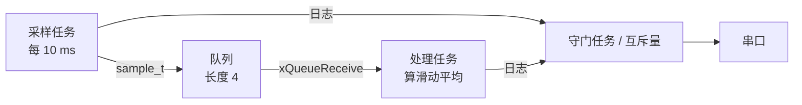
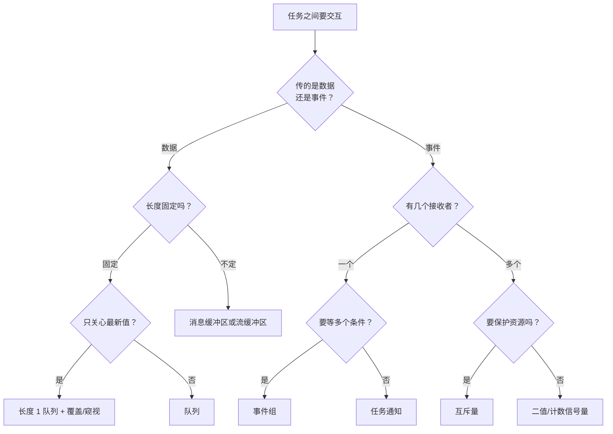

# 4.3 队列、信号量、互斥量与事件

当系统中同时运行着多个独立任务时，它们往往并非孤立运转，而是紧密协作的有机整体：采集任务每隔 10 ms 生成一个传感器样本，处理任务需要在此基础上解算滑动滤波，而通信任务则负责将周期性的遥测数据格式化输出到控制台。这种多任务结构随即引出了两个最直接的工程问题：其一，样本数据该如何安全、解耦地从采集任务移交给处理任务？若简单借由全局内存加读写游标，裸机下遭遇的多写者竞争将原封不动地在多任务抢占中重演；其二，控制台串口作为唯一的物理资源，当常规上报任务正在打印长文本时，若处理任务突然插入一条告警打印，两者的输出片段就会犬牙交错、沦为乱码。

针对并发环境下的数据流转与资源争用，FreeRTOS 构筑了一套完备的任务间通信（IPC）机制。这些工具在职责上有着清晰的边界划分：队列专职承载按值传递的数据流，信号量与轻量级任务通知用于同步事件脉冲，互斥量负责捍卫排他性的物理资源，事件组则能够以位图形式组合等待多重异步条件的就绪。理清这些同步原语的底层特质与适用边界，才能为复杂固件搭建起清晰解耦的生产者—消费者流水线与守门任务（Gatekeeper）架构。

## 1. 队列

三个任务之间的数据流是这样的：



队列（queue）是一个按值复制的先进先出缓冲区。写的一方把一份数据拷进队列，读的一方拷出去；两边的对象互不相干。

```c
QueueHandle_t xQueueCreate(UBaseType_t uxQueueLength, UBaseType_t uxItemSize);
BaseType_t xQueueSend(QueueHandle_t q, const void *item, TickType_t wait);
BaseType_t xQueueReceive(QueueHandle_t q, void *out, TickType_t wait);
```

`xQueueCreate` 给出长度（最多存几项）与每项大小。长度和项大小在创建时就定死，之后不能再改，这也是队列开销可预测的原因。

两个 API 的最后一个参数都是等待时间。队列满时写入方阻塞，最多等这么久；队列空时读取方阻塞，最多等这么久。`xQueueSend` 超时返回 `errQUEUE_FULL`，`xQueueReceive` 超时返回 `pdFALSE`，`portMAX_DELAY` 表示一直等。正是这个“满了就等、空了就等”的行为让队列替代了轮询：写的人不必丢数据，读的人不必空转。

`code/嵌入式/4_RTOS与固件架构/4_3_队列_信号量_互斥量与事件/producer_consumer.c` 把采样到的 `sample_t` 交给处理任务：

```c
static QueueHandle_t g_sample_queue;

static void sampler_task(void *param) {
    TickType_t last_wake = xTaskGetTickCount();

    for (size_t i = 0; i < SAMPLE_COUNT; ++i) {
        sample_t s;
        fake_sensor_read(i, &s);
        if (xQueueSend(g_sample_queue, &s, portMAX_DELAY) == pdPASS) {
            console_printf("[sampler]   sent #%u (az=%d mg)\n",
                           (unsigned)(i + 1u), (int)s.az);
        }
        vTaskDelayUntil(&last_wake, pdMS_TO_TICKS(10));
    }
    /* … */
}

int main(void) {
    g_sample_queue = xQueueCreate(4, sizeof(sample_t));
    /* … */
}
```

处理任务用 `xQueueReceive` 取，取到后更新一个 4 点滑动窗口。运行结果：

::: terminal title="PowerShell - producer_consumer"

```text
$ ./build/producer_consumer
[sampler]   sent #1 (az=998 mg)
[processor] recv #1: ax=12 ay=-18 az=998 -> avg_az=998 mg
[sampler]   sent #2 (az=1006 mg)
[processor] recv #2: ax=16 ay=-14 az=1006 -> avg_az=1002 mg
[sampler]   sent #3 (az=1002 mg)
[processor] recv #3: ax=10 ay=-20 az=1002 -> avg_az=1002 mg
[sampler]   sent #4 (az=994 mg)
[processor] recv #4: ax=14 ay=-16 az=994 -> avg_az=1000 mg
[sampler]   sent #5 (az=1010 mg)
[processor] recv #5: ax=18 ay=-12 az=1010 -> avg_az=1003 mg
[sampler]   sent #6 (az=990 mg)
[processor] recv #6: ax=8 ay=-22 az=990 -> avg_az=999 mg
```

:::

采样任务优先级 2、处理任务优先级 1。采样任务每 10 ms 醒来，发完样本就延时阻塞，处理任务随即拿到 CPU 把它取走，所以输出里收发成对出现。`avg_az` 是最近四个样本的平均，第 4 条之后窗口满了，数值开始随新样本变化。

队列默认的“按值复制”语义是一把典型的双刃剑。优势在于数据的物理独立性：发送方可以安全地将栈上的局部对象传入队列，调用返回后即便该局部对象所在的栈帧被覆写，队列内部的数据副本也丝毫不受影响；但代价则体现在内存拷贝的耗时上。如果传递的目标是一个 1 KB 的通信数据包或图像帧，每一次出入队都伴随着整块内存的搬运，这在 72 MHz 主频的 Cortex-M3 微控制器上会带来显著的开销。在流转大型数据结构时，成熟的设计通常退回到“按指针传递”，队列内部仅维护指针本身，而将实际的缓冲区块交由动态生命周期协议或内存池来集中管理（4.5 节将针对缓冲所有权细致推演）。

还有两个特例 API。`xQueueOverwrite` 往长度为 1 的队列里写，满了就覆盖旧值，用来看“最新值”；`xQueuePeek` 读走一项但不移除，多个读者都能看到同一份。`mailbox.c` 用长度 1 的队列保存配置，一个写入方、两个读取方：

```c
g_cfg_mailbox = xQueueCreate(1, sizeof(sensor_cfg_t));

/* 写：新配置覆盖旧配置，从不阻塞 */
xQueueOverwrite(g_cfg_mailbox, &updates[i]);

/* 读：拿到当前配置，但不消费掉，别的读者还能读 */
xQueuePeek(g_cfg_mailbox, &cfg, portMAX_DELAY);
```

::: terminal title="PowerShell - mailbox"

```text
$ ./build/mailbox
[writer] overwrite cfg seq=1 rate=100 Hz th=1200 mg
[ctrl] peek cfg seq=1 rate=100 Hz th=1200 mg
[ui  ] peek cfg seq=1 rate=100 Hz th=1200 mg
[writer] overwrite cfg seq=2 rate=200 Hz th=1500 mg
[ctrl] peek cfg seq=2 rate=200 Hz th=1500 mg
[ui  ] peek cfg seq=2 rate=200 Hz th=1500 mg
[writer] overwrite cfg seq=3 rate=500 Hz th=1800 mg
[ctrl] peek cfg seq=3 rate=500 Hz th=1800 mg
[ui  ] peek cfg seq=3 rate=500 Hz th=1800 mg
```

:::

这种“只关心最新值”的传递用队列的覆盖模式最省事：生产者不必管消费者是不是跟得上，消费者永远拿到最近的一份，中间过期的值自然被丢掉。

队列与 [3.4 数据帧、环形缓冲区与状态机](/教程/正文/嵌入式/3_驱动_通信与中间件/3_4_数据帧_环形缓冲区与状态机) 的环形缓冲区解决的是同一类问题，差别在等待。环形缓冲区满了，写的人只能丢；空了，读的人只能返回“没数据”。共享内存加下标在多任务里还要自己加锁，而队列把“阻塞等待”和“互斥”都做进了内核。

<Quiz
  type="single"
  :options="[
    { label: '队列空时 xQueueReceive 立即返回 errQUEUE_EMPTY', value: 'A' },
    { label: '队列满时 xQueueSend 阻塞，直到有人取走一项或超时', value: 'B' },
    { label: 'xQueueSend 把指针存进队列，数据仍归发送方所有', value: 'C' },
    { label: '队列长度可以在运行时用 xQueueResize 修改', value: 'D' }
  ]"
  answer="B"
>

<template #question>

关于 FreeRTOS 队列，下面哪条说法正确？

</template>

正确答案是 **B**。A 要看等待时间参数：给 `portMAX_DELAY` 就一直等到有数据。C 错在“按值复制”：队列里存的是数据副本，指针本身会被复制，但它指向的内存不归队列管。D 没有这个 API，长度在创建时定死。

</Quiz>

## 2. 二值信号量与计数信号量

信号量（semaphore）可以理解成“没有数据的队列”：队列里只记“有几项”，不存内容。这个类比不是修辞，FreeRTOS 里二值信号量的创建宏就是建了一个长度 1、项大小 0 的队列：

```c
#define xSemaphoreCreateBinary()    xQueueGenericCreate( ( UBaseType_t ) 1, semSEMAPHORE_QUEUE_ITEM_LENGTH, queueQUEUE_TYPE_BINARY_SEMAPHORE )
```

（摘自 FreeRTOS-Kernel V11.3.0 `include/semphr.h`，MIT 许可；`semSEMAPHORE_QUEUE_ITEM_LENGTH` 定义为 0。）

二值信号量只有“有”和“无”两种状态，用来表示“某件事发生了”。`button_semaphore.c` 里一个任务模拟按键，另一个任务等待按键：

```c
static SemaphoreHandle_t g_button_sem;

/* 检测端：每 20 ms 给一次 */
xSemaphoreGive(g_button_sem);

/* 处理端：没有按键就阻塞，不占 CPU */
if (xSemaphoreTake(g_button_sem, portMAX_DELAY) == pdTRUE) {
    console_printf("[handler] woke up, handling press #%u\n", i);
}
```

::: terminal title="PowerShell - button_semaphore"

```text
$ ./build/button_semaphore
[button]  press #1 -> xSemaphoreGive
[handler] woke up, handling press #1
[button]  press #2 -> xSemaphoreGive
[handler] woke up, handling press #2
[button]  press #3 -> xSemaphoreGive
[handler] woke up, handling press #3
```

:::

计数信号量（counting semaphore）在内部维护一个可在 0 到上限 $N$ 之间波动的整数计数器。在固件开发中它主要承担两项职责：

- 事件发生频率与突发的缓冲累加。例如每触发一次硬件中断便执行一次 `Give` 操作，处理任务则在循环中逐个 `Take` 消费。即使外部事件在短时间内密集爆发，只要未突破计数上限，未被及时处理的事件就不会遗漏。
- 管理固定配额的同构资源池。假设系统维护了一个由 4 个固定块组成的通信缓冲池，便可将初始计数值设为 4。工作任务每成功申请一块内存即消耗一个计数，归还时再累加一个计数；当配额耗尽时，后续调用者将安全陷入阻塞，直至其他任务释放出新的资源。

```c
SemaphoreHandle_t xSemaphoreCreateCounting(UBaseType_t uxMaxCount,
                                           UBaseType_t uxInitialCount);
```

二值信号量本质上正是上限 `uxMaxCount = 1` 的计数信号量特例。在二值模型下，当状态已经处于“满”（计数值为 1）时，后续多次重复的 `Give` 均会被静默忽略，无法保留累加痕迹。若系统需要精确追踪事件到底发生了多少次，计数信号量是唯一的正确选择。

::: concept emb-rtos-semaphore-queue title="信号量、互斥量在内核里都是队列"

在 FreeRTOS 的实现全景中，二值信号量、计数信号量与互斥量在底层共享同一个 `Queue_t` 控制结构体，仅仅在项大小 `uxItemSize`、队列类型枚举以及若干标志位配置上存在分化。这一同构特征解释了它们面临的一致约束：它们的底层内存均需从 FreeRTOS 堆中申请，均可注册到内核队列名录以辅助追踪，也都可以调用统一的队列复位接口。而稍后将讨论的任务通知则属于完全不同的轻量分支，它无需动态创建任何独立结构体，而是直接就地复用任务控制块内预留的整型字段。

:::

## 3. 互斥量

互斥量（Mutex）的核心职能是维护排他性共享资源的访问完整性：它规定只有竞争到该资源的调用者才获准进入受保护区域，且在用毕后必须由原持有者主动交回。尽管互斥量在代码形式上与二值信号量颇为相似，但三项底层维度的分歧从根本上限定了各自的使用场景：

其一，所有权语义。互斥量在内核结构中严格绑定并记录着“当前持有该锁的任务句柄”。正是基于这一身份识别，内核才能实现优先级继承并在嵌套调用时维护递归计数；归还互斥量的动作必须由原本持有它的任务亲自执行，任何外部任务尝试解锁均被视为严重的逻辑违例。二值信号量则完全不存在所有权概念，系统中任何任务乃至中断服务程序都可以随时向其调用 `Give`。

其二，优先级继承协议。当一个低优先级任务持有互斥量期间被高优先级任务尝试抢占时，内核会自动将持锁任务的运行优先级临时抬升至与等待者相同的最高水平，确保其能够尽快完成临界处理并归还锁，彻底规避因中优先级任务横插一脚导致的无界优先级反转（4.6 节将深入展开其数学推演）。二值信号量则完全缺乏这一保护屏障。

其三，中断调用的合法性。由于中断服务程序并不具备 RTOS 任务的实体上下文，更不允许在获取失败时陷入挂起阻塞，因此互斥量严禁在中断上下文中使用。

::: concept emb-rtos-mutex-vs-binary title="互斥量与二值信号量的选择"

保护具有排他性竞争属性的共享资源，必须选用互斥量；而仅用于跨任务或中断到任务之间的单向事件同步时，则选用二值信号量。两者虽然都能驱动任务在资源匮乏时进入阻塞、在就绪时触发唤醒，但只有互斥量具备严格的所有权校验与优先级继承机制。若错误地使用二值信号量来充当互斥锁，既可能在优先级反转场景下引发不可控的时延击穿，又由于缺乏所有者校验而允许任意外部任务随意释放，彻底破坏了临界保护的严密性。

:::

控制台是最典型的共享资源。两个任务各自打印一整行，行里的几个片段之间如果发生切换，输出就会交错。`console_mutex.c` 用一个分段发送的假串口放大这个问题：

```c
static void slow_uart_puts(const char *tag, const char *body, unsigned seq) {
    console_printf("[%s #%u] ", tag, seq);
    vTaskDelay(pdMS_TO_TICKS(2));   /* 模拟慢速串口，期间发生任务切换 */
    console_printf("%s ", body);
    vTaskDelay(pdMS_TO_TICKS(2));
    console_printf("(status=OK)\n");
}

static void print_line(const char *tag, const char *body, unsigned seq) {
    if (g_use_mutex) {
        if (xSemaphoreTake(g_uart_mutex, portMAX_DELAY) == pdTRUE) {
            slow_uart_puts(tag, body, seq);
            xSemaphoreGive(g_uart_mutex);
        }
    } else {
        slow_uart_puts(tag, body, seq);
    }
}
```

不加保护与加互斥量两段各跑一次，输出对比（某次运行）：

::: terminal title="PowerShell - console_mutex"

```text
$ ./build/console_mutex
=== 1. Unprotected output ===
[TaskA #1] [TaskB #1] IMU_ACCEL_X=12mg_Y=-18mg_Z=998mg NET_MQTT_PUB_TOPIC=mdr/dev01/tel (status=OK)
[TaskA #2] (status=OK)
[TaskB #2] IMU_ACCEL_X=12mg_Y=-18mg_Z=998mg NET_MQTT_PUB_TOPIC=mdr/dev01/tel (status=OK)
(status=OK)
=== 2. Mutex-protected output ===
[TaskA #1] IMU_ACCEL_X=12mg_Y=-18mg_Z=998mg (status=OK)
[TaskA #2] IMU_ACCEL_X=12mg_Y=-18mg_Z=998mg (status=OK)
[TaskB #1] NET_MQTT_PUB_TOPIC=mdr/dev01/tel (status=OK)
[TaskB #2] NET_MQTT_PUB_TOPIC=mdr/dev01/tel (status=OK)
```

:::

第一段里两行被拆成了四段，`[TaskA #1]` 与它自己的正文隔了别人的一整行；第二段每一行完整。交错落在哪几段之间取决于任务切换的时机，换一台机器、换一次运行都可能不一样，但只要不加保护，两行就不可能完整。

优先级继承机制仅用于化解“低优先级持锁任务遭遇中优先级计算任务无端剥夺 CPU”的经典反转困境，它并不能修正架构设计本身的缺陷。临界区粒度的权衡同样是系统设计的关键一环：应当将一次完整的 I²C 读写事务封装进互斥保护，而不是在总线上收发每一个单字节时频繁开关锁；同样地，打印整行日志应由单次锁操作一气呵成，而非对内部的多次字符串拼接分别加锁。

递归互斥量（Recursive Mutex）允许同一个任务上下文在未释放锁的前提下重复重入获取同一把锁，内部通过嵌套计数追踪获取深度，只有当释放次数完全配平获取次数时，锁才真正回归可用状态。这种机制主要用于防御深层嵌套调用中难以重构的同源锁竞争；在结构清晰的固件设计中，理应通过明确函数的分层职责尽量避免自锁模式，绝大多数业务直接采用标准互斥量即可。

<Quiz
  type="single"
  :options="[
    { label: '二值信号量，任何任务都能 Give，中断里也能用', value: 'A' },
    { label: '互斥量，有所有者，还带优先级继承', value: 'B' },
    { label: '计数信号量，初始计数 1，上限 1', value: 'C' },
    { label: '事件组，用一个位表示“总线空闲”', value: 'D' }
  ]"
  answer="B"
>

<template #question>

三个任务共用一个 I²C 总线，一次完整的事务要独占总线。该用哪种机制？

</template>

正确答案是 **B**。互斥量有所有者，只有拿到它的任务才能放，内核还能在低优先级持锁任务被中优先级任务拖住时提升它的优先级（4.6 节）。A、C 都能实现“上锁—解锁”的外观，但谁都能打开锁，也没有优先级继承。D 更不合适：事件组不记所有者，多个任务同时看到“位是 1”就会一起上总线。

</Quiz>

## 4. 守门任务

互斥量让调用者在锁上等，持锁的人干完才轮到下一个。还有一种结构把这件事反过来：让一个任务独占资源，其他任务把“要做什么”放进队列，由它依次执行。这个任务叫守门任务。

`console_gatekeeper.c` 用一个日志队列代替互斥量：

```c
#define LOG_MSG_MAX 64

typedef struct {
    char text[LOG_MSG_MAX];
} log_msg_t;

static QueueHandle_t g_log_queue;

/* 任何任务都能调用：格式化进自己的局部对象，再放进队列 */
static void log_print(const char *fmt, ...) {
    log_msg_t msg;
    va_list args;
    va_start(args, fmt);
    vsnprintf(msg.text, sizeof(msg.text), fmt, args);
    va_end(args);
    xQueueSend(g_log_queue, &msg, pdMS_TO_TICKS(50));
}

/* 守门任务独占控制台 */
static void console_gatekeeper_task(void *param) {
    for (;;) {
        log_msg_t msg;
        if (xQueueReceive(g_log_queue, &msg, portMAX_DELAY) == pdPASS) {
            console_printf("%s\n", msg.text);
        }
    }
}
```

::: terminal title="PowerShell - console_gatekeeper"

```text
$ ./build/console_gatekeeper
[sensor] step 1 completed
[net   ] step 1 completed
[net   ] step 2 completed
[sensor] step 2 completed
[net   ] step 3 completed
[sensor] step 3 completed
```

:::

两个工作任务的优先级相同，靠时间片轮转，谁先往队列里放取决于切换落在哪里，所以两边的行交替出现、先后不一定（上面是某次运行）。要点在于每一行都是由守门任务一次 `console_printf` 打出来的，行内的片段不会交错。

守门任务与互斥量在架构哲学上的分水岭，在于“等待与执行”发生的物理位置。使用互斥量时，调用者若竞争失败便会直接在锁对象上挂起，其等待时长完全取决于当前持锁者何时退出临界区；而在守门任务结构下，调用方只需迅速将包含业务意图的消息压入队列（仅在队列满载时才会有界等待），耗时的物理操作则移交由守门任务在后台串行消化。互斥量的优势在于调用即执行、无缓冲中转延迟；守门任务的优势则在于让工作任务最大程度解耦、完全免疫由锁抢占引发的优先级反转隐患，代价是需要额外付出专门任务的栈开销与消息队列内存。

工程选型的一条通用经验准则是：凡是执行耗时极短的独占操作（例如快速读取单个状态寄存器或格式化短文本输出），采用互斥量最为轻快利落；而凡是涉及长时间阻塞、跨芯片通信或具备明确排队诉求的重量级操作（例如 SPI Flash 的扇区擦除、网络数据包的排队重发），采用守门任务能换取远为稳健的解耦体验。在 4.9 节中，守门任务的设计范式将进一步升华并推广为成熟的活动对象（Active Object）架构。

## 5. 事件组

队列传数据，信号量传一次事件。要等“几个条件同时成立”时，一个一个等信号量很别扭，事件组（event group）用一组位来表示多个条件。

```c
EventGroupHandle_t xEventGroupCreate(void);
EventBits_t xEventGroupSetBits(EventGroupHandle_t g, EventBits_t bits);
EventBits_t xEventGroupWaitBits(EventGroupHandle_t g, EventBits_t bits,
                                BaseType_t clearOnExit,
                                BaseType_t waitForAllBits,
                                TickType_t wait);
```

可用的位数随节拍类型而变：32 位节拍（`configUSE_16_BIT_TICKS` 为 0）时可用低 24 位，高 8 位留给内核自己记控制信息；16 位节拍时可用低 8 位。

`xEventGroupWaitBits` 的后两个布尔参数是它好用的地方：

- `waitForAllBits` 为 `pdTRUE` 时，等到给出的位全部置 1 才返回；为 `pdFALSE` 时任一位置 1 就返回。
- `clearOnExit` 为 `pdTRUE` 时，返回前把等到的位清零，相当于“消费掉这些事件”；为 `pdFALSE` 时保留，其他等待者也能看到。

`startup_events.c` 用事件组等三个子系统全部就绪：

```c
#define BIT_SENSOR_READY  ( 1UL << 0 )
#define BIT_STORAGE_READY ( 1UL << 1 )
#define BIT_NET_READY     ( 1UL << 2 )
#define ALL_READY_BITS    ( BIT_SENSOR_READY | BIT_STORAGE_READY | BIT_NET_READY )

EventBits_t bits = xEventGroupWaitBits(
    g_startup_events,
    ALL_READY_BITS,
    pdFALSE,        /* 退出时不清除就绪位，其他等待任务也能看到 */
    pdTRUE,         /* 等待全部 3 个位同时置位（逻辑与） */
    portMAX_DELAY);
```

::: terminal title="PowerShell - startup_events"

```text
$ ./build/startup_events
[init:sensor ] ready, setting bit 0x01
[init:storage] ready, setting bit 0x02
[init:net    ] ready, setting bit 0x04
[app:control  ] all subsystems ready (bits=0x07), entering RUN state
[app:telemetry] all subsystems ready (bits=0x07), entering RUN state
```

:::

三个初始化任务各自完成后置位，两个应用任务都在等三个位，位齐了同时被唤醒。`clearOnExit` 选 `pdFALSE` 就是为了让两个等待者都能看到——如果只有一个等待者并且事件只需消费一次，选 `pdTRUE` 会更干净。

还有 `xEventGroupSync()`，用于“多任务会合”：每个任务到达后置自己的位，然后等所有人到齐，到齐后一起继续，同时把位清零。它把“等待”与“到达”合成一次调用，适合多个任务要在同一时刻开始动作的场合。

## 6. 任务通知

任务通知（task notification）不建任何对象。每个任务控制块里存着一个 32 位的通知值和一个“待处理”标志，发送方直接改目标任务的这个值。

```c
/* 当作二值或计数信号量 */
BaseType_t xTaskNotifyGive(TaskHandle_t task);
uint32_t ulTaskNotifyTake(BaseType_t clearCountOnExit, TickType_t wait);

/* 当作事件组或信箱 */
BaseType_t xTaskNotify(TaskHandle_t task, uint32_t value, eNotifyAction action);
BaseType_t xTaskNotifyWait(uint32_t clearOnEntry, uint32_t clearOnExit,
                           uint32_t *out_value, TickType_t wait);
```

`xTaskNotifyGive()` 把通知值加一；`ulTaskNotifyTake(pdFALSE, …)` 每次取走一个，行为与计数信号量一致，`pdTRUE` 则一次清零。`notify_counter.c` 用它替代信号量：

```c
console_printf("[producer] burst of 3 events -> xTaskNotifyGive x3\n");
xTaskNotifyGive(g_consumer_handle);
xTaskNotifyGive(g_consumer_handle);
xTaskNotifyGive(g_consumer_handle);
```

::: terminal title="PowerShell - notify_counter"

```text
$ ./build/notify_counter
[producer] burst of 3 events -> xTaskNotifyGive x3
[consumer] took 1 event (count before take=3, total=1)
[consumer] took 1 event (count before take=2, total=2)
[consumer] took 1 event (count before take=1, total=3)
[producer] single event -> xTaskNotifyGive x1
[consumer] took 1 event (count before take=1, total=4)
```

:::

三次“给”叠成计数 3，消费者一个一个取，取完才阻塞。行为与计数信号量一致，但不需要额外对象——通知值就在任务控制块里，创建任务时已经有了。

`xTaskNotify()` 用 `eSetBits` 动作时把参数按位或进通知值，可以当一个轻量的事件组；用 `eSetValueWithOverwrite` 时直接覆盖，可以当一个信箱。但它的能力受到两条限制：

- 只有一个接收者。通知值在目标任务的控制块里，别的任务看不到。
- 发送方不能阻塞。通知是直接写目标任务的字段，没有“队列满”的概念，也就没有等待。

FreeRTOS 官方文档常将任务通知定义为常规二值或计数信号量的轻量化替代品，原因正在于它直接削减了队列对象的内存分配与间接寻址开销。工程实践中的通用准则是：凡是一对一的单向事件通知（例如特定中断服务程序定向通知唯一的处理任务、或者一对一的生产者单向唤醒），首选任务通知；而只有在需要一对多广播、发送方在队列满时必须阻塞排队、或者需要流转复合数据项时，才升级选用标准的队列与信号量。由于任务通知的 API 命名与信号量高度对称，两者之间的迁移改动成本也极低。

<Quiz
  type="multi"
  :options="[
    { label: '一个中断要把“DMA 传输完成”告诉唯一的处理任务', value: 'A' },
    { label: '三个任务都要在“存储就绪”之后开始工作，事件要保留到最后一个任务看到', value: 'B' },
    { label: '生产者要确保每条消息都被消费，队列满时它愿意等', value: 'C' },
    { label: '两个任务共用一把锁保护 I²C 总线', value: 'D' }
  ]"
  :answer="['A', 'D']"
>

<template #question>

下面哪些场合适合用任务通知，或者用互斥量（而不是队列、事件组）？

</template>

正确答案是 **A、D**。A 是一对一的事件通知，任务通知最省；D 需要所有者与优先级继承，用互斥量。B 要多个接收者都看到同一个事件且事件要保留，任务通知只有一个接收者，应该用事件组；C 要求发送方在队列满时阻塞等待，任务通知没有“满”的概念，应该用队列。

</Quiz>

## 7. 流缓冲区与消息缓冲区

前面几种机制都按固定大小的项传递。串口收到的是长度不定的字节流，用定长队列要么每字节一项（开销大），要么自己拼帧。FreeRTOS 为此提供了流缓冲区（stream buffer）与消息缓冲区（message buffer）。

流缓冲区是一段字节环形缓冲区，带“可读字节数”的通知：

```c
StreamBufferHandle_t xStreamBufferCreate(size_t xBufferSizeBytes,
                                         size_t xTriggerLevelBytes);
size_t xStreamBufferSend(StreamBufferHandle_t b, const void *src,
                         size_t len, TickType_t wait);
size_t xStreamBufferReceive(StreamBufferHandle_t b, void *dst,
                            size_t len, TickType_t wait);
```

发送与接收都可以只做一部分，返回值是实际读写的字节数。读者阻塞到“可读字节数达到 `xTriggerLevelBytes`”为止，把它设为 1 就是来一个字节就唤醒。

消息缓冲区（message buffer）在流缓冲区之上记录了每条消息的长度：每次发送是一个变长消息，接收方要么拿到完整的一条，要么一条都拿不到。

```c
MessageBufferHandle_t xMessageBufferCreate(size_t xBufferSizeBytes);
size_t xMessageBufferSend(MessageBufferHandle_t b, const void *src,
                          size_t len, TickType_t wait);
size_t xMessageBufferReceive(MessageBufferHandle_t b, void *dst,
                             size_t len, TickType_t wait);
```

两者的默认用法都是一个写者、一个读者。多个写者同时发送需要自己加锁，否则两次发送的内容会互相穿插。4.4 节会用消息缓冲区把串口收到的字节从中断交给任务，那是它最典型的用途：中断里只负责把字节塞进去，拼帧与解析都在任务里做。

## 8. 怎么选

把前面的内容收成一张表：

| 需求 | 机制 | 理由 |
| --- | --- | --- |
| 把一份数据交给另一个任务 | 队列 | 按值复制，双方不必共用内存，写入方满了可阻塞 |
| 只保留最新的一份状态 | 长度 1 的队列 + `xQueueOverwrite`/`xQueuePeek` | 旧值自动被覆盖，多个读者都能看到 |
| 通知“某件事发生了”，一对一 | 任务通知 | 不占额外内存，比信号量快 |
| 统计事件次数 | 计数信号量或任务通知 | 计数不会因为没来得及处理而丢 |
| 管理 N 个同类资源 | 计数信号量 | 取不到时阻塞，而不是忙等 |
| 保护共享资源（控制台、I²C 总线） | 互斥量 | 有所有者、带优先级继承、不能在中断里用 |
| 资源操作长、需要排队 | 守门任务 + 队列 | 调用者不等资源，不会优先级反转 |
| 等多个条件同时成立 | 事件组 | 多位标志，可等全部或任一，可选择退出时清除 |
| 多个任务要在同一时刻开始 | 事件组 + `xEventGroupSync` | 到达与等待合成一次调用 |
| 长度不定的字节流或变长消息 | 流缓冲区 / 消息缓冲区 | 不需要自己拼帧，读者按触发级别唤醒 |

这张表可以画成决策路径：



::: tip 队列长度按“生产速率 × 消费者最长停顿时间”估

长度凭感觉定，短了丢数据，长了白占 RAM。算法是：消费者最长可能停顿多久（等 I²C 总线、等 Flash 擦除、等一次网络往返），这期间生产者最多产出几项，再加上两三项的余量。这个数字与 4.5 节内存池块数的估算方法一样，都要以最坏情况为准，不能用平均值。估算结果如果大到占掉大半 RAM，说明消费者该拆开或提高优先级了。

:::

几个常见误用，写出来对照一下。

用全局标志加轮询代替阻塞等待：

::: compare left-title="全局标志 + 轮询" right-title="队列直接阻塞"

```c
volatile bool g_new_sample;

/* 采样任务里 */
g_new_sample = true;

/* 处理任务里：空转，直到标志出现 */
while (!g_new_sample) {
}
g_new_sample = false;
/* 此时样本可能已经被覆盖 */
```

---

```c
/* 采样任务里 */
xQueueSend(g_sample_queue, &s, portMAX_DELAY);

/* 处理任务里：没数据时让出 CPU */
sample_t s;
xQueueReceive(g_sample_queue, &s, portMAX_DELAY);
```

:::

左栏两个任务都在抢 CPU，处理任务空转还会把低优先级的任务饿死；标志只能表示“有过数据”，不能表示“有几次”，而且写标志与读数据不是一体的，样本可能被下一个覆盖。右栏的阻塞让出 CPU，队列还顺带记住了有多少项没被取走。

用信号量保护资源：

```c
/* 错误：二值信号量保护串口，谁都能 Give，也没有优先级继承 */
g_uart_lock = xSemaphoreCreateBinary();
xSemaphoreGive(g_uart_lock); /* 初始化为“可用” */
```

这段代码读起来像互斥量，但它的语义是“事件已发生”。一个没拿锁的任务也能 `xSemaphoreGive`，把锁打开；低优先级任务持锁时也没有优先级继承。要保护资源，就得用 `xSemaphoreCreateMutex()`。

## 9. 习题

示例与起始代码都在 `code/嵌入式/4_RTOS与固件架构/4_3_队列_信号量_互斥量与事件/` 下。起始代码在 `exercises/` 里，需要按同目录 `CMakeLists.txt` 里现成的写法把它们加进模拟器分支，例如：

```cmake
add_executable(multi_producer
    "${CMAKE_CURRENT_LIST_DIR}/exercises/multi_producer_starter.c"
    "${EMB_SUPPORT_DIR}/rtos_console_sim.c"
    "${EMB_SUPPORT_DIR}/idle_stub.c")
target_include_directories(multi_producer PRIVATE
    "${CMAKE_CURRENT_LIST_DIR}"
    "${EMB_SUPPORT_DIR}")
target_link_libraries(multi_producer PRIVATE freertos_kernel freertos_config)
```

### 9.1 巩固

<Exercise id="64420" :d="1" :w="2" multi>

某任务按下面的顺序调用队列 API，队列创建为 `xQueueCreate(2, sizeof(uint32_t))`，等待时间都是 0。

```c
uint32_t v = 1;  xQueueSend(q, &v, 0);   /* ① */
v = 2;           xQueueSend(q, &v, 0);   /* ② */
v = 3;           xQueueSend(q, &v, 0);   /* ③ */
uint32_t out;    xQueueReceive(q, &out, 0);  /* ④ */
v = 4;           xQueueSend(q, &v, 0);   /* ⑤ */
xQueueReceive(q, &out, 0);               /* ⑥ */
xQueueReceive(q, &out, 0);               /* ⑦ */
xQueueReceive(q, &out, 0);               /* ⑧ */
```

(1) _[1.2]_ 写出 ①～⑧ 每次调用的返回值，以及 ④、⑥、⑦ 取出的值。③ 与 ⑧ 分别失败了，原因有什么区别？

(2) _[1.2]_ 把 ③ 的等待时间从 0 改成 `portMAX_DELAY`，说明这段代码会停在哪一句、要等谁做什么事才能继续。此时若没有别的任务读队列，会发生什么？

(3) _[2.2]_ 队列里存 `uint32_t` 与存 `uint32_t *`，在“发送方用完就覆盖缓冲区”的场景下有什么差别？写三行代码演示指针版本出错的地方，并给出改正。

(4) _[2.2]_ `xQueueOverwrite()` 为什么只接受长度为 1 的队列（写出它在长度大于 1 时的行为）？`xQueuePeek()` 则没有这个限制：在长度为 4 的队列上连做两次 `xQueuePeek()`，两次拿到的是不是同一项，`uxQueueMessagesWaiting()` 变不变？再写出用长度为 1 的队列保存“最新一份配置”的创建、写入、读取三行代码，说明两个读者为什么都能读到同一份。

</Exercise>

<Exercise id="64421" :d="2" :w="2">

下面三段代码都声称在“保护”某样东西。

```c
/* A：保护串口 */
g_uart_lock = xSemaphoreCreateBinary();
xSemaphoreGive(g_uart_lock);

/* B：统计中断次数 */
g_irq_count = xSemaphoreCreateCounting(1000, 0);

/* C：保护配置结构体 */
g_cfg_lock = xSemaphoreCreateMutex();
```

(1) 分别指出 A、B、C 里对象的语义：是“资源可用”、是“事件计数”，还是“所有权”。对 A，写出一个没拿锁的任务就能把锁打开的具体调用，并说明后果。

(2) 对 B，中断里应该调哪个函数？任务侧取一次之后计数怎么变？把上限从 1000 改成 3，连续来 5 次中断后计数是多少，第 4、5 次发生了什么？

(3) 对 C，读 FreeRTOS-Kernel 的 `queue.c` 里 `xQueueGenericSend()` 处理 `queueQUEUE_IS_MUTEX` 的那一段，写出给出一把互斥量时内核额外做了哪两件事（一件与持有者记录有关，一件与优先级有关）。据此说明互斥量为什么不能在中断里取用和给出。

(4) 把 A 改成互斥量后，指出除了“谁都能开锁”之外还多了哪一项能力；用一句话说明它解决的是哪一类问题（4.6 节展开）。

</Exercise>

<Exercise id="64422" :d="3" :w="2">

`startup_events.c` 用事件组等三个子系统就绪。

(1) 指出 `xEventGroupWaitBits()` 四个参数各自的作用，以及本例里 `clearOnExit = pdFALSE`、`waitForAllBits = pdTRUE` 的含义。若把 `waitForAllBits` 改成 `pdFALSE`，第一个初始化任务置位之后两个应用任务会发生什么？

(2) 32 位节拍类型下，事件组可用的位是哪几位？为什么高 8 位不能用？把 `BIT_NET_READY` 改成 `(1UL << 24)` 会怎样？

(3) 用 `xEventGroupSync()` 改写第 5 节的“三个子系统就绪”场景不合适，改用第 5 节末尾提到的会合场景：三个任务各自准备，然后一起开始。写出每个任务里的 `xEventGroupSync()` 调用与参数，说明“等待”与“到达”怎样合成一次调用、位什么时候被清零。

(4) 有两个任务都在等同一组位，一个用 `clearOnExit = pdTRUE`、一个用 `pdFALSE`。说明后醒来的那个还能不能等到，以及这种情况下该怎么设计。

</Exercise>

### 9.2 编程

<Exercise id="64423" :d="3" :w="3">

补全 `exercises/multi_producer_starter.c`：两个生产者任务按各自的周期把带来源标记的样本送进同一条队列，一个消费者任务取走并统计。

(1) 补全生产者：用 `xQueueSend(g_queue, &item, portMAX_DELAY)` 发送，然后按 `cfg->period_ms` 用 `xTaskDelayUntil()` 延时。补全消费者：用 `xQueueReceive()` 取 10 条，按 `source_id` 分别计数并逐条打印 `source tick value`。

(2) 运行程序，贴出输出与 `summary: src1=?, src2=?`。两个生产者的周期是 10 ms 与 15 ms，消费者优先级最低，说明为什么 10 条里两个来源的条数大约是 6 与 4，而不是按创建顺序一半一半。

(3) 把队列长度从 8 改成 2，生产者改成 `xQueueSend(..., 0)` 并统计发送失败次数。重跑，说明失败次数为什么与两个生产者的相对速率有关，以及这时该增大队列还是该提高消费者优先级。

(4) 给每个样本加上 `TickType_t tick`，验证同一个来源的 `tick` 单调不减、且相邻两条的差接近它的周期。若某个来源的 `tick` 出现倒退，说明队列里发生了什么（提示：`xQueueSend` 与时间戳的先后顺序）。

</Exercise>

<Exercise id="64424" :d="3" :w="3">

补全 `exercises/buffer_pool_starter.c`：用计数信号量管理 4 块缓冲区，生产者申请配额取块，消费者读完归还。

(1) 按文件里的 TODO 补全两个任务：生产者 `xSemaphoreTake(g_pool_sem, portMAX_DELAY)` 取得配额后调用 `pool_pop_index()`，把 `job` 写进 `g_buffers[idx][0]` 并发送 `idx`；消费者收到 `idx` 后读取、打印，再 `pool_push_index()` 并 `xSemaphoreGive(g_pool_sem)`。

(2) 运行程序，验收：8 个 job 全部打印，顺序与申请顺序一致；程序结束时 `uxSemaphoreGetCount(g_pool_sem)` 回到 4。为打印这个值，说明需要包含哪个头文件、注意什么。

(3) 把 `pool_pop_index()` 与 `pool_push_index()` 里的 `taskENTER_CRITICAL()` 去掉，先按原配置重跑 20 次，记录输出有没有变化。再加一个生产者任务（也申请配额、也调用 `pool_pop_index()`），把生产者优先级与消费者拉平，重跑 20 次，观察 `g_free_top` 是否越界、有没有两个 job 拿到同一个 `idx`。据此说明“计数信号量管数量”与“互斥量或临界区管代码段”解决的是两件不同的事，以及本例里临界区真正保护的是哪一步。

(4) 把信号量的初始计数改成 2、上限保持 4，说明生产者会在哪里阻塞、系统的吞吐怎样变化。再把它改成 `xSemaphoreCreateMutex()`，说明为什么这样改是错的。

</Exercise>

<Exercise id="64425" :d="4" :w="3">

补全 `exercises/gatekeeper_msgbuf_starter.c`：两个工作任务把变长日志写进消息缓冲区，守门任务独占控制台打印。

(1) 补全 `log_print()`：在 `g_write_mutex` 保护下调用 `xMessageBufferSend(g_log_msgbuf, buf, len, pdMS_TO_TICKS(50))`；补全守门任务：`xMessageBufferReceive()` 收到后补 `'\0'` 再打印，收满 6 条后 `sim_finish()`。

(2) 运行程序，验收：6 行完整输出，每行由守门任务一次打出、行内不错行；两个工作任务的 3 条各自按顺序出现。

(3) 去掉 `g_write_mutex`，把 `log_print()` 的 `vsnprintf()` 结果改成两段发送（先发前半、再发后半）。重跑并说明守门任务打印出来的是什么，以及为什么消息缓冲区本身不能代替这把锁（提示：两次 `xMessageBufferSend` 是两个独立消息）。

(4) 把消息缓冲区大小从 256 改成 32，一行 40 字节的日志会怎样？`xMessageBufferSend()` 的返回值说明什么？这时应该增大缓冲区还是截断消息，给出你的选择与依据。

</Exercise>

<Exercise id="64426" :d="4" :w="3">

`notify_counter.c` 用任务通知替代计数信号量。

(1) 把 `xTaskNotifyGive()` 换成 `xSemaphoreCreateCounting()` 版本，写出两种实现的完整代码（生产者与消费者的关键几行），运行并对比输出。说明两种写法在“连续给三次、消费者一次取一个”上的行为是否一致。

(2) 把 `ulTaskNotifyTake(pdFALSE, ...)` 改成 `pdTRUE`，连续给三次后消费者取几次？说明这两个参数分别对应哪种信号量的语义。

(3) 给消费者加第二个事件源：中断模拟函数里用 `xTaskNotify(g_consumer, BIT_OVERRUN, eSetBits)` 置一个位，消费者用 `xTaskNotifyWait(0, ULONG_MAX, &bits, portMAX_DELAY)` 同时收“计数”和“位”。说明为什么 `eSetBits` 与 `xTaskNotifyGive` 不能混用在同一个通知值上而不加区分。

(4) 列出任务通知相对队列的三条限制（接收者数量、发送方能否阻塞、事件能否累积），每条给一个本页示例里会违反它的场景。再说明为什么作者说“一对一的事件通知首选任务通知”。

</Exercise>

### 9.3 综合与挑战

<Exercise id="64427" :d="5" :w="4">

补全 `exercises/rendezvous_starter.c`，并把它扩展成一个可复用的会合点。

(1) 在 `worker_task` 里用 `xEventGroupSync(g_sync_group, spec->my_bit, ALL_SYNC_BITS, portMAX_DELAY)` 实现会合。运行程序，验收：三行 `preparation done` 按 10、25、40 ms 先后出现，三行 `passed barrier` 的节拍相同（相差不超过 1 个节拍）。

(2) 说明 `xEventGroupSync()` 的第二个参数与第三个参数分别是什么，为什么它会自动把位清零，以及这一点与 `xEventGroupWaitBits()` 的 `clearOnExit` 有什么区别。

(3) 把会合扩展成两轮：三个任务会合一次之后各自再准备 5 ms，然后第二次会合，最后一起退出。说明第二次会合为什么不会受第一次残留位的影响。

(4) 让一个任务在会合前多做 200 ms 的活（模拟某个子系统启动慢）。观察另外两个任务的等待时间，说明会合点与“超时等待”的区别：给 `xEventGroupSync()` 加一个 50 ms 超时，写出超时后返回值的判断代码，并说明某个任务超时退出后其余任务会怎样。

(5) 与第 5 节的 `xEventGroupWaitBits()` 方案对比：三个任务都要“等三个都就绪”，用 `WaitBits` 与用 `Sync` 各要求每个任务做什么、各适合什么场合。

</Exercise>

<Exercise id="64428" :d="5" :w="4">

`console_gatekeeper.c` 与 `console_mutex.c` 是保护控制台的两种做法。用测量把它们比出来。

(1) 以 `console_mutex.c` 为基础写一个对比程序：两个任务各打印 50 行，每行分三段、每段之间 `vTaskDelay(2)` 模拟慢速串口。分别用“互斥量”“守门任务 + 队列”两种方式实现，统计整个过程的墙钟节拍数与每行的平均完成延迟。

(2) 把守门任务的优先级设成高于两个打印任务，重跑。说明两种方式下“谁在等”的差别：互斥量版本里打印任务自己等锁，守门版本里打印任务只等队列空间。

(3) 把日志队列长度设为 2，打印任务从 2 个增加到 6 个，重跑两种方式。说明守门版本从哪里开始丢日志（或者开始阻塞），以及这时该增大队列、提高守门任务优先级，还是减少日志量。

(4) 在两种版本里各加一个“高优先级告警任务”（优先级高于两个打印任务），它也要打印一行，并在醒来时记录自己从调用到打印完成用了多少节拍。把告警任务的唤醒时刻设在某个打印任务正打到一半时，两种版本各测 10 次，记录延迟。解释两种版本里告警任务分别等的是什么：互斥量版本等的是持锁任务放锁（优先级继承让它有界），守门版本等的是队列空间与前面的积压。给出在“告警必须尽快输出”这个要求下你会选哪一种，以及还需要调整什么。

(5) 按第 4 节的规则给出你的选择：写一行日志、读一个寄存器、擦一次 Flash、发一次网络请求，各用互斥量还是守门任务，一句话说明理由。

验收：给出两种方式的节拍数、平均延迟与 (3) 里丢日志的位置；第 (4) 问有一个可运行的演示（告警任务在打印任务持锁期间到来）。

</Exercise>

<Exercise id="64429" :d="6" :w="5" scope="*">

第 8 节末尾的提示说队列长度按“生产速率 × 消费者最长停顿时间”估。设计一次实验，把这个估算与实测对上。

(1) 写一个采样任务（每 5 ms 一项）与一个处理任务（每项耗时 3 ms，但每 20 项会做一次 120 ms 的长操作，模拟等 Flash 擦除）。按公式算出队列长度下限，写出算式，取一个整数长度。

(2) 用 `uxQueueMessagesWaiting()` 每 10 ms 采样一次，记录队列占用的峰值；用 `uxQueueSpacesAvailable()` 记录最小值。跑 5 秒（1000 项），把峰值与 (1) 的估算对照。

(3) 把队列长度改成估算值的一半，重跑。用发送的返回值统计 `errQUEUE_FULL` 次数，说明丢了多少项、丢在哪一段时间（用时间戳定位）。

(4) 把消费者拆成两个任务（一个做短处理、一个专做长操作），重新估算队列长度。说明为什么拆分之后总长度可以变小，以及这与第 4 节“资源操作长用守门任务”是同一个道理。

(5) 用 `xQueueReset()` 在运行中清空队列，观察处理任务与采样任务各自的反应。说明这个 API 在什么调试场合有用、为什么不能拿它当“丢数据”的正常手段。

验收：给出估算算式与三个实测峰值（原长度、半长度、拆分后）；半长度版本的丢包数与时段时间要能对应上长操作；第 (4) 问给出两组长度数字。

</Exercise>

## 10. 参考资料

- FreeRTOS, *Mastering the FreeRTOS Real Time Kernel*, ch05 Queue Management、ch08 Resource Management、ch09 Event Groups、ch10 Task Notifications：https://github.com/FreeRTOS/FreeRTOS-Kernel-Book
- FreeRTOS, Mutexes：https://www.freertos.org/Documentation/02-Kernel/02-Kernel-features/02-Queues-mutexes-and-semaphores/04-Mutexes
- FreeRTOS, Direct to Task Notifications：https://www.freertos.org/Documentation/02-Kernel/02-Kernel-features/03-Direct-to-task-notifications/01-Task-notifications
- FreeRTOS-Kernel V11.3.0，`include/semphr.h`、`include/queue.h`、`include/event_groups.h`、`include/stream_buffer.h`、`include/message_buffer.h`、`queue.c`、`event_groups.c`、`stream_buffer.c`：https://github.com/FreeRTOS/FreeRTOS-Kernel/tree/V11.3.0
- FreeRTOS, Stream Buffers：https://www.freertos.org/Documentation/02-Kernel/02-Kernel-features/04-Stream-buffers
- FreeRTOS, Message Buffers：https://www.freertos.org/Documentation/02-Kernel/02-Kernel-features/05-Message-buffers
- [3.4 数据帧、环形缓冲区与状态机](/教程/正文/嵌入式/3_驱动_通信与中间件/3_4_数据帧_环形缓冲区与状态机)：单生产者单消费者的免锁环形缓冲区。
- [语法和标准库 23.3 互斥](/教程/正文/语法和标准库/23_原子操作与并发/23_3_互斥)：C11 线程库中 `mtx_t` 的用法，可与互斥量对照。
