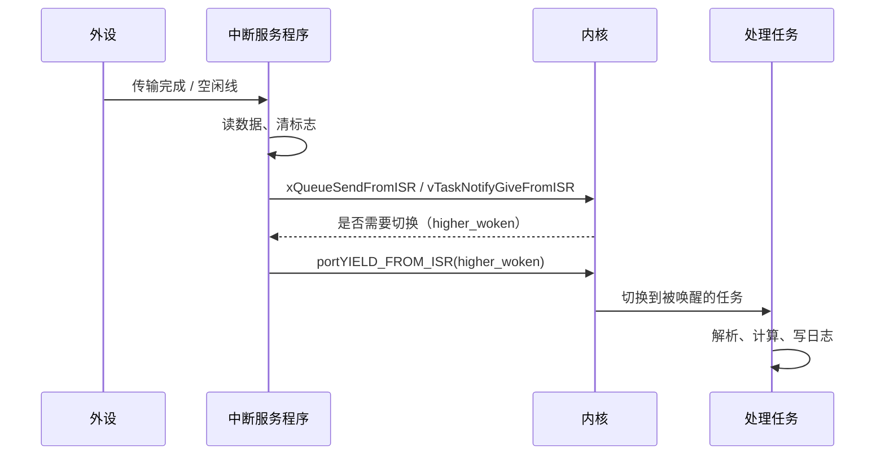
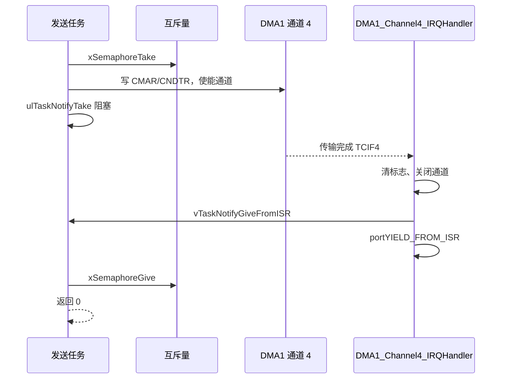

# 4.4 中断与任务协作

在 [3.3 轮询、中断、DMA 与非阻塞驱动](/教程/正文/嵌入式/3_驱动_通信与中间件/3_3_轮询_中断_DMA与非阻塞驱动) 中，我们利用 DMA 循环缓冲结合串口空闲线中断，构建了高效的异步数据接收通道：中断例程在收到帧尾时快速结算数据游标，主循环则通过轮询状态标志提取整帧。在前后台架构下，这种“中断捕获、主循环消费”的模式直观而清晰。然而一旦引入 RTOS，传统的超级主循环被拆分为多个并发任务，中断与后台代码之间的协作链路便发生了质的变化：外设数据究竟应当定向移交给哪一个任务？中断唤醒任务后是否需要强制触发即时重调度？那些具有极高时效诉求的硬实时保护中断，又该如何在内核调度器的临界区之外独善其身？

要构建稳健的嵌入式系统，必须理清硬件中断与 RTOS 任务之间的交接边界。这一协作体系既关乎中断服务程序内部的精简设计原则，更深植于 Cortex-M3 NVIC 硬件优先级与内核 `configMAX_SYSCALL_INTERRUPT_PRIORITY` 边界的严谨划定。本节将深入探讨中断底半部处理的设计范式，解析专用 `FromISR` 接口的工作机理，并展示如何将底层的异步硬件交互优雅封装为高层任务友好的同步阻塞接口。

## 1. 中断与任务的分工

中断服务程序运行在一个极特殊的物理上下文中：它强行打断当前任务的流水线，借用由主栈指针（MSP）支撑的系统栈空间执行（见 [4.2 任务、调度与时间](/教程/正文/嵌入式/4_RTOS与固件架构/4_2_任务_调度与时间)），并在执行完毕后恢复现场。该上下文绝对不允许陷入挂起或长时阻塞，因为只要中断尚未退出，同级别以及所有低优先级的中断请求都会被硬件阻挡。因此中断服务程序内部的执行逻辑必须奉行精简原则，只处置那些具备最高物理时效的动作：

- 迅速读走外设的接收数据寄存器，避免后续到达的新字节引发硬件溢出错误（Overrun Error）；
- 及时清除外设及 NVIC 上的中断挂起标志，防止退出中断后发生死循环反复重入；
- 抓取与当前时刻强相关的时序快照（例如采样时刻的高精时间戳或系统节拍计数值）；
- 借助 `FromISR` 版本的内核 API，向对口的应用任务派发事件通知或投递缓冲数据。

至于那些计算密集型或长耗时流程——例如业务协议帧的拆包解析、传感器多维卡尔曼滤波、格式化日志输出或者擦写内部 Flash——均应移交给常规任务。这种分工模式在实时操作系统领域被称为延迟中断处理（Deferred Interrupt Processing）：中断服务程序充当顶半部负责“快速接手与应答硬件”，而应用任务则充当底半部负责“承接复杂的业务加工”。任务拥有独立的栈空间，可以根据需要自由阻塞、等待互斥资源或执行耗时操作，这些在中断上下文中均属于禁区。

在将工作移交给任务时，通常有两种主流的组织模式：第一种是针对每类独立外设派生专属的后台处理任务（例如串口解析任务、ADC 滤波任务或按键去抖任务），各任务职责分明、互不干扰，但随着外设增多会增加栈内存开销；第二种则是集中式委派，将需要异步执行的回调函数打包抛送给系统守护的定时器服务任务（Timer Service Task）代为串行执行，FreeRTOS 专门提供了 `xTimerPendFunctionCallFromISR()` 接口以支撑这一模式。定时器任务的内部细节将在 4.7 节详述，目前只需将其理解为内核内置的一个按队列顺序消化回调函数的特殊任务。

无论哪种方式，中断与任务之间的路径都是一样的：



图里 `portYIELD_FROM_ISR` 那一步能不能省，是本节最容易写错的地方之一，第 3 节专门讲。

## 2. 中断优先级与内核

在 Cortex-M3 架构中，NVIC 中断优先级遵循“数值越小、级别越高”的规则。STM32F103 硬件仅实现了 8 位优先级寄存器的高 4 位，对应 0 至 15 共计 16 个物理优先级（详见 [2.5 中断与 NVIC](/教程/正文/嵌入式/2_MCU裸机开发/2_5_中断与NVIC)）。FreeRTOS 在这一连续谱系上划出了一条关键的隔离边界：`configMAX_SYSCALL_INTERRUPT_PRIORITY`。优先级数值小于该阈值（即更为紧急）的中断，属于系统最高保障级别，内核临界区通过 BASEPRI 无法屏蔽它们，作为代价，这类中断内部严禁调用任何内核 API；而优先级数值大于等于该阈值的中断，会在内核临界区期间被 BASEPRI 暂时挂起，它们才获准调用专用的 `FromISR` 系列函数与应用任务进行同步通信。

本教程的 `FreeRTOSConfig_stm32.h` 里这两项配置是：

```c
/* 中断优先级：Cortex-M3 数值越小越高。4 位有效位左移 4 位存放。
 * 优先级数值 >= 5 的中断可以被内核屏蔽，也只有它们能调用 FromISR API（4.4）。 */
#define configKERNEL_INTERRUPT_PRIORITY         ( 15u << 4 )
#define configMAX_SYSCALL_INTERRUPT_PRIORITY     ( 5u << 4 )
```

两个宏的值都是“左移之后”的寄存器值：`5 << 4` 是 0x50，`15 << 4` 是 0xF0。而 `NVIC_SetPriority()` 接收的是**未移位**的优先级数值，也就是 5 和 15。这个差别是配错优先级最常见的原因。

| 优先级数值 | 被内核临界区屏蔽 | 能调用 FromISR API | 典型用途 |
| --- | --- | --- | --- |
| 0～4 | 否 | 否 | 电机刹车、电源故障等必须立刻响应的保护中断 |
| 5～15 | 是 | 是 | 串口、DMA、ADC、按键等与任务协作的中断 |
| 15 | 是 | 是 | 内核自己的 SysTick 与 PendSV 在这里 |

::: concept emb44-priority-rule title="中断与内核的分界"

优先级数值小于 `configMAX_SYSCALL_INTERRUPT_PRIORITY`（未移位）的中断，永远不能调用任何 FreeRTOS API，内核的临界区也屏蔽不了它；数值大于等于它的中断可以调用 `...FromISR` 版本的 API，同时会被内核临界区推迟。配错一侧的后果是断言失败或难以复现的破坏。

:::

除了这条分界线，还有一条分组要求：NVIC 的优先级分组必须把所有位都分给抢占优先级。2.5 节里 `NVIC_SetPriorityGrouping(3)` 做的正是这件事（STM32 上 3 表示 4 位全部作为抢占优先级）。分组不符合要求时，FreeRTOS 的 `vPortValidateInterruptPriority()` 会在第一次调用 FromISR API 时停住，这是好消息：错误在第一时间暴露，不必等到现场偶发故障。

::: warning `NVIC_SetPriority()` 收的是未移位的值

配置宏写 `5 << 4`，调用 `NVIC_SetPriority(USART1_IRQn, 5)`。把宏直接传给 `NVIC_SetPriority()`，实际优先级会高得离谱；反过来把 5 写进配置宏，内核会认为自己可以屏蔽到数值 0 的中断。

:::

::: tip 新工程里先给所有协作中断定优先级

STM32 复位后所有中断优先级都是 0，也就是最高。只要有一个中断忘了设优先级又在里面调用了 FromISR API，断言就会停在那里。初始化函数里集中把用到的中断优先级写一遍，比出问题以后再逐个排查省事得多。

:::

<Quiz
  type="single"
  :options="[
    { label: '优先级设为 3 的 USART1 中断，在里面调用 xQueueSendFromISR', value: 'A' },
    { label: '优先级设为 5 的 DMA 传输完成中断，在里面调用 vTaskNotifyGiveFromISR', value: 'B' },
    { label: '优先级设为 15 的按键中断，在里面调用 xQueueSend', value: 'C' },
    { label: '优先级保持复位值 0 的 TIM1 刹车中断，在里面调用 vTaskNotifyGiveFromISR', value: 'D' }
  ]"
  answer="B"
>

<template #question>

`configMAX_SYSCALL_INTERRUPT_PRIORITY` 为 `5 << 4` 时，下面哪种写法合法？

</template>

正确答案是 **B**。

两条条件必须同时满足：中断优先级数值不小于 5，并且调用的是 FromISR 版本。A 与 D 的优先级都小于 5，会触发 `vPortValidateInterruptPriority()` 里的断言；C 的优先级合法，但 `xQueueSend` 是任务版本，中断里不能调用。

</Quiz>

## 3. FromISR API 与 portYIELD_FROM_ISR

中断服务程序绝对不可陷入等待，因此专为中断设计的内核函数一概剔除了超时等待参数，保证调用始终能够在确定的指令周期内立即返回。所有这类 API 共同具备一个关键的输出指针参数 `pxHigherPriorityTaskWoken`：内核在执行诸如释放信号量或压入队列的动作时，若发现本次操作使得某个任务解除阻塞并进入就绪态，且该任务的静态优先级高于当前被打断的任务，内核便会将该指针指向的对象置为 `pdTRUE`。这个标志明确指示系统：在中断退出的临界点上，应当立即发起上下文切换，无需迟滞到下一个时钟节拍。

以发送一个字节到队列为例，两种写法差在好几处：

::: compare left-title="中断里调用普通 API" right-title="中断里调用 FromISR API"

```c
void USART1_IRQHandler(void) {
    uint8_t byte = (uint8_t)(USART1->DR & 0xFFu);

    /* 普通版本可能阻塞，中断里不许调用 */
    xQueueSend(g_rx_queue, &byte, portMAX_DELAY);
}
```

---

```c
void USART1_IRQHandler(void) {
    BaseType_t higher_woken = pdFALSE;
    uint8_t byte = (uint8_t)(USART1->DR & 0xFFu);

    xQueueSendFromISR(g_rx_queue, &byte, &higher_woken);
    portYIELD_FROM_ISR(higher_woken);
}
```

:::

对比左栏与右栏，左栏直接调用常规 API 存在两重缺陷：首先，任务版 API 包含阻塞超时的逻辑分支，当队列已满时会尝试将当前上下文挂入等待链表，而在硬件中断中根本不存在实体任务可供休眠，强行调用既会破坏内核链表，又会触发内部断言停机；其次，即便队列当前尚有余量、写入得以完成，常规 API 也完全无法通知调度器存在高优先级任务刚刚就绪，系统只能被动等待随后的 SysTick 节拍自然轮转，将关键业务的中断唤醒延迟由原本微秒级的确定性响应恶化为长达整整一个毫秒节拍。

右边多出来的 `portYIELD_FROM_ISR(higher_woken)` 在 Cortex-M3 移植层里的定义是：

```c
#define portYIELD_FROM_ISR( x )    portEND_SWITCHING_ISR( x )
```

`portEND_SWITCHING_ISR` 在参数非零时把中断控制与状态寄存器（ICSR）的 PENDSVSET 位置 1，也就是把 PendSV 异常挂起（`portable/GCC/ARM_CM3/portmacro.h`）。PendSV 的优先级最低，所以它会等所有中断都退出之后再执行，切换不会插在某个中断中间。

`higher_woken` 忘记处理是一种很隐蔽的错误。程序看起来是对的：数据照样进了队列，任务照样被唤醒，只是它要等到下一个 SysTick 才轮到运行。周期任务下感觉不出来，毫秒级的响应要求下就是几个节拍的抖动。本节的模拟器示例可以把这个差别演示出来：

```c
vTaskNotifyGiveFromISR(g_processor_handle, &higher_woken);

#ifdef NO_YIELD_FROM_ISR
    /* 反例：丢掉了 higher_woken，被唤醒的任务要等到下一个节拍才运行 */
    (void)higher_woken;
    return 0;
#else
    /* 唤醒的任务优先级更高时返回 pdTRUE，退出中断时立刻切换 */
    return (uint32_t)higher_woken;
#endif
```

模拟器的中断处理函数不用调用 `portYIELD_FROM_ISR()`，它直接以返回值表示“是否需要切换”，因为模拟中断跑在一个 Windows 线程里，内核通过返回值接收这个信息。目标板上就按宏来写。

::: concept emb44-yield-from-isr title="FromISR API 必须把唤醒信息交回内核"

中断里调用任何 FreeRTOS API，都必须用 `...FromISR` 版本，并把 `pxHigherPriorityTaskWoken` 交给 `portYIELD_FROM_ISR()`（或作为模拟中断处理函数的返回值）。丢掉这一步，被唤醒的高优先级任务要等到下一个节拍才运行，中断到任务的响应时间从几个微秒变成一个节拍周期。

:::

<Quiz
  type="single"
  :options="[
    { label: '数据会丢失，因为通知没有送达', value: 'A' },
    { label: '任务永远醒不过来', value: 'B' },
    { label: '数据与通知都正常，但任务要等到下一个节拍才运行', value: 'C' },
    { label: '内核会断言失败并停机', value: 'D' }
  ]"
  answer="C"
>

<template #question>

中断里调用了 `vTaskNotifyGiveFromISR()`，但丢掉了 `higher_woken`，也没有调用 `portYIELD_FROM_ISR()`。会发生什么？

</template>

正确答案是 **C**。任务已经从阻塞态变成就绪态，下一次调度一定会轮到它；只不过这次切换要等 SysTick 带来下一次调度机会，中断退出那一刻没有切。数据没丢，通知也没丢，丢的是时间。

</Quiz>

## 4. 用任务通知处理中断

ADC 的 DMA 传输完成中断是最典型的“中断只发通知”的例子。2.9 节配置好 DMA1 通道 1 之后，每次一批转换完成，硬件置位 TCIF1，中断服务程序要做的只有清标志、把任务叫醒。数据本身已经在内存里，任务醒来直接读。

先看模拟器上的版本。PC 上没有真的 ADC，用一个低优先级任务充当“外设”，每 20 ms 调用一次 `vPortGenerateSimulatedInterrupt()`；中断处理函数由 `vPortSetInterruptHandler()` 注册：

```c
/* 中断处理函数：模拟 ADC 的 DMA 传输完成。运行在模拟中断线程里 */
static uint32_t adc_dma_complete_isr(void) {
    BaseType_t higher_woken = pdFALSE;

    static const int16_t table[][3] = {
        { 12, -18, 998 },
        { 16, -14, 1006 },
        { 10, -20, 1002 },
        { 14, -16, 994 },
    };
    uint32_t index = g_isr_count % 4u;

    /* 中断里只做必须马上做的事：取出数据、记下时刻、通知任务 */
    g_isr_sample.tick = xTaskGetTickCountFromISR();
    g_isr_sample.ax = table[index][0];
    g_isr_sample.ay = table[index][1];
    g_isr_sample.az = table[index][2];
    g_isr_count++;

    vTaskNotifyGiveFromISR(g_processor_handle, &higher_woken);

    /* 唤醒的任务优先级更高时返回 pdTRUE，退出中断时立刻切换 */
    return (uint32_t)higher_woken;
}
```

处理任务在 `ulTaskNotifyTake(pdFALSE, portMAX_DELAY)` 上等，被唤醒后读出数据、处理。完整程序在 `code/嵌入式/4_RTOS与固件架构/4_4_中断与任务协作/isr_notify_sim.c`，用 MinGW 和 FreeRTOS-Kernel V11.3.0 的 Windows 移植层构建，输出：

::: terminal title="PowerShell - isr_notify_sim"

```text
[adc ] 触发第 1 次模拟中断
[proc] 被中断唤醒（优先级 3），tick=22 样本 ax=12 ay=-18 az=998
[adc ] 中断返回后继续执行（本任务优先级 1）
[adc ] 触发第 2 次模拟中断
[proc] 被中断唤醒（优先级 3），tick=42 样本 ax=16 ay=-14 az=1006
[adc ] 中断返回后继续执行（本任务优先级 1）
[adc ] 触发第 3 次模拟中断
[proc] 被中断唤醒（优先级 3），tick=62 样本 ax=10 ay=-20 az=1002
[adc ] 中断返回后继续执行（本任务优先级 1）
[adc ] 触发第 4 次模拟中断
[proc] 被中断唤醒（优先级 3），tick=82 样本 ax=14 ay=-16 az=994
```

:::

“触发”与“被唤醒”这两行之间没有插进“中断返回后继续执行”，这说明切换发生在中断退出的那一刻：adc 任务还没从 `vPortGenerateSimulatedInterrupt()` 返回，处理器已经去跑优先级更高的处理任务了。把 `isr_notify_sim.c` 用 `-DNO_YIELD_FROM_ISR` 重新编译，同样的程序会给出不同的顺序：

::: terminal title="PowerShell - isr_notify_sim（丢掉 higher_woken）"

```text
[adc ] 触发第 1 次模拟中断
[adc ] 中断返回后继续执行（本任务优先级 1）
[proc] 被中断唤醒（优先级 3），tick=22 样本 ax=12 ay=-18 az=998
[adc ] 触发第 2 次模拟中断
[adc ] 中断返回后继续执行（本任务优先级 1）
[proc] 被中断唤醒（优先级 3），tick=42 样本 ax=16 ay=-14 az=1006
[adc ] 触发第 3 次模拟中断
[adc ] 中断返回后继续执行（本任务优先级 1）
[proc] 被中断唤醒（优先级 3），tick=62 样本 ax=10 ay=-20 az=1002
[adc ] 触发第 4 次模拟中断
[adc ] 中断返回后继续执行（本任务优先级 1）
[proc] 被中断唤醒（优先级 3），tick=82 样本 ax=14 ay=-16 az=994
```

:::

低优先级的 adc 任务多跑了一条打印才让出 CPU。模拟器不是实时系统，这点差别只是“下一个节拍”自然发生的切换；在目标板上，一个节拍是 1 ms，对毫秒级的事件来说这段延迟很实在。

同样的结构换成真实硬件，中断处理函数是这样：

```c
void DMA1_Channel1_IRQHandler(void) {
    BaseType_t higher_woken = pdFALSE;
    uint32_t isr = DMA1->ISR;

    if ((isr & DMA_ISR_HTIF1) != 0u) {
        DMA1->IFCR = DMA_IFCR_CHTIF1 | DMA_IFCR_CGIF1;
        g_half_pending = 1;
        vTaskNotifyGiveFromISR(g_adc_task, &higher_woken);
    }
    if ((isr & DMA_ISR_TCIF1) != 0u) {
        DMA1->IFCR = DMA_IFCR_CTCIF1 | DMA_IFCR_CGIF1;
        g_full_pending = 1;
        vTaskNotifyGiveFromISR(g_adc_task, &higher_woken);
    }

    portYIELD_FROM_ISR(higher_woken);
}
```

完整文件是 `adc_dma_notify.c`，用 arm-none-eabi-gcc 按 Cortex-M3 编译检查通过。中断里没有求平均、没有滤波、没有调用任何可能慢的东西，这些都在 `adc_process_task()` 里做。

### 4.1 任务通知与队列、信号量的分工

中断给任务传事件，用任务通知最省：不占额外内存，内核里的操作也最短。它只适合一对一，而且接收方必须是任务。要传数据、要多对一、要在中断与中断之间传递，还是用队列或信号量（4.3 节）。这里的中断只发“有数据了”这一个事件，数据放在全局缓冲区里由任务按需读取，所以通知就够了。

## 5. 串口接收接到任务

3.3 节的 DMA 循环接收 + 空闲线中断已经能高效地把串口字节搬进缓冲区，还差最后一步：把“缓冲区里又多了这些字节”告诉命令行任务。FreeRTOS 的流缓冲区（stream buffer）正好接在这一段上：中断是唯一写者，任务是唯一读者，字节按顺序进出，不需要额外的锁。

流缓冲区的接口与队列相似，但以字节为单位：`xStreamBufferSendFromISR()` 写一段字节，`xStreamBufferReceive()` 读若干字节，缓冲区空时读者阻塞，满时写者拿不到空间。它要求只有一个写者和一个读者，这正好符合“串口中断 → 命令行任务”的结构。

目标板上的接收路径是：

```c
/* 把上次位置到 DMA 当前位置之间的字节送进流缓冲区。中断上下文调用 */
static void uart_rx_push_from_isr(void) {
    size_t pos = RX_DMA_BUF_SIZE - DMA1_Channel5->CNDTR;
    BaseType_t higher_woken = pdFALSE;

    if (pos == g_rx_old_pos) {
        return;
    }

    if (pos > g_rx_old_pos) {
        xStreamBufferSendFromISR(g_rx_stream, &g_rx_dma_buf[g_rx_old_pos],
                                 pos - g_rx_old_pos, &higher_woken);
    } else {
        /* 绕回缓冲区开头，分两段送 */
        xStreamBufferSendFromISR(g_rx_stream, &g_rx_dma_buf[g_rx_old_pos],
                                 RX_DMA_BUF_SIZE - g_rx_old_pos, &higher_woken);
        xStreamBufferSendFromISR(g_rx_stream, g_rx_dma_buf, pos, &higher_woken);
    }
    g_rx_old_pos = pos;

    portYIELD_FROM_ISR(higher_woken);
}
```

两个中断都调用它：空闲线中断负责“一帧结束”，DMA 半满/全满中断负责“缓冲区绕回”。位置计算和 3.3 的 `dma_rx_drain()` 完全一样，区别只在于数据最终进了流缓冲区，主循环不再参与。完整文件是 `uart_rx_rtos.c`，编译通过。

任务侧读起来就像在读一个普通的阻塞串口：

```c
static size_t uart_read_line(char *line, size_t cap) {
    size_t used = 0;

    while (used < cap - 1u) {
        char byte;
        if (xStreamBufferReceive(g_rx_stream, &byte, 1, pdMS_TO_TICKS(100)) != 1u) {
            return 0;
        }
        if (byte == '\n') {
            if (used > 0u && line[used - 1u] == '\r') {
                used--;
            }
            line[used] = '\0';
            return used;
        }
        line[used++] = byte;
    }
    line[used] = '\0';
    return used;
}
```

一行读不满、暂时没有新字节时，任务就阻塞在 `xStreamBufferReceive()` 里，CPU 让给别的任务；`pdMS_TO_TICKS(100)` 是超时，避免任务永远等下去。

模拟器上，用一个 Windows 线程扮演串口外设，分四次把一串字节送进来，每次调用 `vPortGenerateSimulatedInterruptFromWindowsThread()` 挂起模拟中断，再用一个事件对象等中断处理完：

```c
static DWORD WINAPI uart_thread(LPVOID param) {
    (void)param;

    for (size_t i = 0; i < sizeof(g_chunks) / sizeof(g_chunks[0]); ++i) {
        Sleep(30);

        g_pending_data = g_chunks[i];
        g_pending_len = strlen(g_chunks[i]);

        ResetEvent(g_irq_acked);
        vPortGenerateSimulatedInterruptFromWindowsThread(UART_IRQ_NUMBER);
        WaitForSingleObject(g_irq_acked, 1000);
    }

    g_uart_done = 1;
    return 0;
}
```

`g_chunks[]` 里的四段是 `"led o"`、`"n\r\n"`、`"help\n"`、`"led off\r\n"`，故意让一条命令跨两次到达，并且两种行尾混用。完整程序在 `uart_cli_sim.c`，输出：

::: terminal title="PowerShell - uart_cli_sim"

```text
[cli ] 执行命令："led on"
[cli ] 执行命令："help"
[cli ] 执行命令："led off"
[cli ] 外设停止发送，命令行任务退出
```

:::

`"led o"` 和 `"n\r\n"` 拼成了 `led on`，说明任务是按行拼装的，不要求一次中断送完整条命令。这也是把解析放任务里的直接好处：中断里只需要搬字节，拼装、去行尾、分派命令这些有状态的工作全部在可以阻塞的任务里做。

::: tip 什么时候不用流缓冲区

如果中断里除了“有新数据”还想传递更复杂的信息（比如“这一帧校验失败”），或者有多个中断都要往同一个缓冲区写，流缓冲区的单写者前提就不成立了。这时退回 3.4 的环形缓冲区配合任务通知：中断只发通知，任务自己从环形缓冲区里取，写者之间的互斥靠 4.1 的临界区或原子操作解决。

:::

<Quiz
  type="single"
  :options="[
    { label: '两个 USART 的接收中断都往同一个流缓冲区送数据', value: 'A' },
    { label: '一个 USART 接收中断送数据、一个命令行任务取数据', value: 'B' },
    { label: '一个 DMA 完成中断只发任务通知、任务读全局缓冲区', value: 'C' },
    { label: '一个按键中断送一个字节到流缓冲区、一个去抖任务取', value: 'D' }
  ]"
  answer="A"
>

<template #question>

下面哪种用法不符合流缓冲区的前提？

</template>

正确答案是 **A**。流缓冲区只保证一个写者与一个读者同时访问时的正确性，两个中断同时调用 `xStreamBufferSendFromISR()` 会让内部状态互相覆盖。B、C、D 都是一个写者一个读者，符合前提。

</Quiz>

## 6. 把异步驱动变成任务的阻塞接口

3.3 的 `uart_dma1_send_async()` 启动 DMA 后立刻返回，发送完成时调用一个回调。回调式接口在前后台程序里很好用，在任务里却别扭：调用者想知道“发完了没有”，只能轮询标志或者在回调里改状态机。

RTOS 里的常见做法是把回调换成一个阻塞接口。`uart_write()` 启动 DMA 发送之后，在任务通知上等；DMA 传输完成中断里用 `vTaskNotifyGiveFromISR()` 把发起发送的任务叫醒：

```c
static int uart_write(const char *buf, size_t len) {
    if (xSemaphoreTake(g_uart_mutex, pdMS_TO_TICKS(100)) != pdTRUE) {
        return -1;
    }

    /* 通知计数先清零，避免上一次发送留下的计数让本次立刻返回 */
    ulTaskNotifyTake(pdTRUE, 0);

    g_tx_waiter = xTaskGetCurrentTaskHandle();

    DMA1_Channel4->CCR &= ~DMA_CCR_EN;
    DMA1->IFCR = DMA_IFCR_CGIF4 | DMA_IFCR_CTCIF4;
    DMA1_Channel4->CMAR = (uint32_t)(uintptr_t)buf;
    DMA1_Channel4->CNDTR = (uint32_t)len;
    DMA1_Channel4->CCR = DMA_CCR_MINC | DMA_CCR_DIR | DMA_CCR_TCIE | DMA_CCR_EN;

    uint32_t notified = ulTaskNotifyTake(pdTRUE, UART_TX_TIMEOUT);
    g_tx_waiter = NULL;

    xSemaphoreGive(g_uart_mutex);

    return notified > 0u ? 0 : -1;
}
```

调用者看到的就是一个普通的阻塞函数：成功返回 0，超时返回 -1。发起的任务在等通知时让出 CPU，别的任务照常运行。

外层的互斥量保证同一时刻只有一个任务在使用串口。没有它，两个任务先后调用 `uart_write()` 会互相覆盖 DMA 的地址寄存器与长度寄存器，送出去的数据就乱了。互斥量还保证了“等通知的任务”就是“发起发送的任务”：拿到锁的那个任务才有资格设置 `g_tx_waiter`。



目标板上的中断处理函数只有清标志和通知两件事：

```c
void DMA1_Channel4_IRQHandler(void) {
    BaseType_t higher_woken = pdFALSE;

    if ((DMA1->ISR & DMA_ISR_TCIF4) != 0u) {
        DMA1->IFCR = DMA_IFCR_CTCIF4 | DMA_IFCR_CGIF4;
        DMA1_Channel4->CCR &= ~DMA_CCR_EN;

        if (g_tx_waiter != NULL) {
            vTaskNotifyGiveFromISR(g_tx_waiter, &higher_woken);
        }
        portYIELD_FROM_ISR(higher_woken);
    }
}
```

完整文件是 `uart_tx_blocking.c`，编译通过。超时分支不能不写：DMA 通道被意外关闭、中断被屏蔽、或者波特率配错导致传输卡住，都会让通知永远不来，任务至少要在超时后拿回锁并返回错误，不能把互斥量一起带走。

这种“启动外设 → 等通知 → 中断里给通知”的结构适用于几乎所有异步外设，SPI、I2C、ADC、DAC 都一样。它是 RTOS 驱动最常见的写法，4.9 节的活动对象会把同样的结构用到更高层的模块上。

## 7. 中断里不能做的事

中断上下文与任务上下文的差别，落到代码上就是几条硬规矩：

- 不能阻塞。任何带超时参数的 API、`vTaskDelay()`、等信号量、等队列，在中断里都不成立。
- 不能用互斥量。互斥量带所有者，而中断不属于任何任务；另外互斥量的优先级继承在中断上下文里没有意义。中断里要通知任务，用任务通知或二值信号量。
- 不能调用可能阻塞或不可重入的库函数。`printf()` 在 newlib 里可能分配缓冲区并加锁，`malloc()` 更是直接操作堆；中断打断了正在执行 `printf()` 的任务时，两者会同时修改同一份内部状态。
- 不能假设自己可以慢慢来。中断服务程序拖得越久，同优先级与更低优先级的中断就被推迟得越久。

在中断里发现的错误——校验失败、缓冲区溢出、总线超时——不要去记录，更不能去打印，只把计数加一，由任务定期把计数取走并记录：

```c
static volatile uint32_t g_overflow_count;

void USART1_IRQHandler(void) {
    BaseType_t higher_woken = pdFALSE;

    if ((USART1->SR & USART_SR_ORE) != 0u) {
        (void)USART1->DR;
        g_overflow_count++;      /* 只计数，留给任务处理 */
    }
    /* ... */
    portYIELD_FROM_ISR(higher_woken);
}
```

### 7.1 优先级配错的现场

优先级配错有两种表现。第一种是直接的：中断优先级数值比 `configMAX_SYSCALL_INTERRUPT_PRIORITY` 小，却在里面调用了 FromISR API。此时 `vPortValidateInterruptPriority()` 里的断言失败：

```c
configASSERT( ucCurrentPriority >= ucMaxSysCallPriority );
```

这段代码在 FreeRTOS-Kernel V11.3.0 的 `portable/GCC/ARM_CM3/port.c` 第 803 行。调试器会停在这条断言上，从 `ipsr` 能读出当前中断号，问题一目了然。第二种更麻烦：中断优先级本身没问题，但优先级分组不对，抢占位与子优先级位的划分不符合内核假设，断言同样在 `vPortValidateInterruptPriority()` 的最后一行触发。两种情况用同一个函数检查，这就是为什么配错时应该先看它。

USART1 中断停留在复位值 0、又在里面调用 `xQueueSendFromISR()` 的错误写法，与正确写法的对照如下：

::: compare left-title="没有设置优先级" right-title="先设优先级再开中断"

```c
void uart_irq_init_wrong(void) {
    g_rx_queue = xQueueCreate(32, sizeof(uint8_t));
    NVIC_EnableIRQ(USART1_IRQn);
}
```

---

```c
void uart_irq_init(void) {
    g_rx_queue = xQueueCreate(32, sizeof(uint8_t));

    /* 全部 4 位都作抢占优先级（2.5 节的分组设置），FreeRTOS 的断言要求如此 */
    NVIC_SetPriorityGrouping(3u);
    NVIC_SetPriority(USART1_IRQn, UART_IRQ_PRIO);
    NVIC_EnableIRQ(USART1_IRQn);
}
```

:::

完整文件 `isr_priority.c` 里两种写法都能编译通过（用 `-DWRONG_INIT` 切换），区别只在运行时的断言。这也说明编译通过不等于中断配置正确，优先级这类东西要在初始化时集中写好、在调试器里核对一遍。

::: warning 中断里不要碰 printf 和 malloc

`printf()`、`malloc()`、`free()` 在多任务环境下本来就要小心，在中断里则完全不能用：它们可能阻塞、可能分配内存、可能不可重入。需要输出调试信息时，把要打印的内容放进队列或流缓冲区，让任务去打印。

:::

## 8. 中断延迟与 RTOS

中断延迟特指从外部硬件中断信号到达微控制器引脚并由 NVIC 捕获、到对应中断服务程序的第一条指令正式进入流水线执行之间的时间差。在裸机系统中，该延迟主要受当前多周期指令完成耗时与已有中断嵌套深度的制约；而在引入 RTOS 之后，系统又引入了两组额外的时延来源：

- 内核临界区保护耗时。当应用任务或内核执行 `taskENTER_CRITICAL()` 时，系统通过 BASEPRI 屏蔽了优先级数值在 5～15 之间的全部协作中断。在此期间，临界区维持多久，受管辖的外设中断响应就会被推迟多久。这再次印证了 4.1 节的核心规矩：临界区内部只允许执行常数级别的简短指令，坚决杜绝耗时操作。
- 零延迟中断的高优先级嵌套。由于 Cortex-M3 原生支持全硬件中断嵌套，优先级处于 0～4 档位的高危安全中断能够随时打断处于 5～15 档位的中断服务程序；若这类保护中断内部执行时间过长，下游中断的抖动便会急剧放大。

FreeRTOS 自身的系统中断主要由 SysTick 与 PendSV 构成，前者的节拍推进耗时仅数十条指令，后者则被严格置于最低中断优先级、只在没有其他硬件中断需要处理时才触发上下文切换，因此不会成为中断延迟的瓶颈。开发者需要严格自律控制的，正是应用代码自身的临界区跨度与中断服务耗时。

对于整个固件中最为紧急的物理保护通道（例如工业变频器中的 TIM1 紧急刹车信号或母线过压比较器中断），工程设计的通用准则是：将其物理优先级配置在 `configMAX_SYSCALL_INTERRUPT_PRIORITY` 门槛之上（即数值处于 0～4 之间），并且内部坚决不调用任何 FreeRTOS 内核 API。这类中断脱离了内核临界区的管辖，永远能够以零额外等待的硬件极限响应硬件突发，代价则是无法使用队列与任务通知等同步原语，只能在寄存器层面快速切断 PWM 驱动信号或翻转安全引脚；若确实需要告知上层任务，通常可通过触发另一个低优先级的普通软件中断代为转达。

关于中断延迟、抖动方差与最坏响应时间的物理测量手段（如借助高频示波器捕捉 GPIO 电平跳变、或读取 DWT 硬件周期计数器），将在 [6.5 实时性、性能与功耗测量](/教程/正文/嵌入式/6_质量_安全与交付/6_5_实时性_性能与功耗测量) 中给出严密的测试方案。本节核心在于建立清晰的架构认知：哪些设计决策会直接拉伸实时响应的边界。

## 9. 习题

### 9.1 巩固

<Exercise id="64430" :d="2" :w="2">

某工程的 `FreeRTOSConfig.h` 里 `configMAX_SYSCALL_INTERRUPT_PRIORITY` 是 `(5u << 4)`，`configKERNEL_INTERRUPT_PRIORITY` 是 `(15u << 4)`。三个中断的用途与计划使用的 API 如下：

- USART1 接收中断，准备调用 `xQueueSendFromISR()`，优先级数值 6；
- DMA1 通道 1 的 ADC 传输完成中断，准备调用 `vTaskNotifyGiveFromISR()`，优先级数值 5；
- TIM1 刹车输入中断，准备调用 `xTaskNotifyGiveFromISR()`，优先级数值 2。

(1) 写出这三个中断的 `NVIC_SetPriority()` 调用，并说明参数为什么是 6、5、2 而不是 `6 << 4`、`5 << 4`、`2 << 4`。

(2) 三个中断里哪一个会在第一次调用内核 API 时触发 `vPortValidateInterruptPriority()` 的断言？为什么？

(3) 把刹车中断改成完全不调用内核 API、只清标志并直接关闭 PWM 输出，它应该配成什么优先级？它要告诉任务的事情由谁转达？

</Exercise>

<Exercise id="64431" :d="2" :w="2">

下面的串口接收中断有若干处违反了本页第 7 节的规矩。找出全部问题，写出改正后的版本，每处用一句话说明后果。

```c
void USART1_IRQHandler(void) {
    char msg[64];
    uint8_t byte = (uint8_t)(USART1->DR & 0xFFu);

    xQueueSend(g_rx_queue, &byte, portMAX_DELAY);

    int n = snprintf(msg, sizeof msg, "rx %02x\n", (unsigned)byte);
    uart_write_polling(msg, (size_t)n);

    vTaskDelay(pdMS_TO_TICKS(1));

    if ((USART1->SR & USART_SR_IDLE) != 0u) {
        (void)USART1->DR;
    }
}
```

改正后的函数要求：只用 `...FromISR` 版本的内核 API，不调用任何库函数，不在中断里延时，`RXNE` 与 `IDLE` 都能正确清除，并处理 `higher_woken`。用 `arm-none-eabi-gcc` 按 Cortex-M3 编译检查（编译命令参照 `code/嵌入式/4_RTOS与固件架构/4_4_中断与任务协作/isr_priority.c` 的文件头）。

</Exercise>

### 9.2 编程

<Exercise id="64432" :d="3" :w="3">

`isr_notify_sim.c` 用单槽 `g_isr_sample` 保存样本，中断每来一次就把通知计数加一，任务用 `ulTaskNotifyTake(pdFALSE, portMAX_DELAY)` 一个接一个地取。

(1) 把 `adc_poll_task` 的优先级从 1 改成 4（高于处理任务的 3），在两次触发之间不延时，连续触发两次。运行程序，说明处理任务拿到的两个样本为什么相同——两次触发之间它根本没机会运行，单槽里的数据已经被第二次覆盖。

(2) 解释：通知计数准确地记下了“来过两次”，为什么数据还是会丢？单槽缓冲与计数通知各解决什么问题？

(3) 把样本通道改成深度为 8 的队列：中断里用 `xQueueSendFromISR()` 送 `sample_t`，任务从队列取。连续触发 8 次，要求打印 8 个互不相同的 `ax`，`tick` 不减。

(4) 队列满时第 9 个样本怎么办？给出你的选择（丢弃最新、丢弃最旧、覆盖）并说明理由。

验收：8 次连续触发后，程序打印 8 行样本，`ax` 覆盖表里的 4 个取值，`tick` 不减；第 9 次触发后打印你选定的满队列处理结果。

</Exercise>

<Exercise id="64433" :d="4" :w="3">

`adc_dma_notify.c` 用两个全局标志 `g_half_pending` 与 `g_full_pending` 记录半满与全满，任务醒来后读标志再清零。任务读完标志、还没清零时，中断可能再次置位同一标志，这次事件就丢了。

(1) 把两个标志换成任务通知的位：中断里用 `xTaskNotifyFromISR(g_adc_task, BIT_HALF, eSetBits, &higher_woken)` 与 `BIT_FULL`，任务用 `xTaskNotifyWait(0, ULONG_MAX, &bits, portMAX_DELAY)` 一次取走全部置起的位。

(2) 说明 `xTaskNotifyWait()` 两个清零参数分别在什么时刻生效，这里为什么用 `0` 与 `ULONG_MAX`。

(3) 构造一种旧写法会丢事件的顺序（中断在任务读标志之后、清标志之前再次置位），说明新写法为什么不会丢。

(4) 若同一个任务还要接收空闲线事件，位怎么分配？一次 `xTaskNotifyWait()` 醒来后同时看到两位时怎么处理？

验收：在模拟器上连续触发 100 次（半满、全满各 50 次），任务统计的两类事件数之和为 100。

</Exercise>

<Exercise id="64434" :d="4" :w="4">

`uart_rx_push_from_isr()` 没有检查 `xStreamBufferSendFromISR()` 的返回值。流缓冲区满时它只写入一部分，剩下的字节被静默丢弃。

(1) 修改函数，累计实际写入的字节数与应写入的字节数，把差额记进 `g_rx_dropped`；中断里只做加减，不打印。

(2) 任务侧每次取完一行打印一次 `received` 与 `dropped`。

(3) 在模拟器上写一个用例：流缓冲区 64 字节，一次灌入 100 字节，任务 200 ms 后才开始读。验证 `received + dropped == 100`，且 `received` 不超过 64。

(4) 说明为什么中断里不能等空间，以及丢弃的是流里最旧的字节还是最新的字节。

验收：用例输出满足上述等式；把流缓冲区改为 128 字节后，同一用例的 `dropped` 变为 0。

</Exercise>

### 9.3 综合与挑战

<Exercise id="64435" :d="5" :w="4">

`uart_write()` 的超时分支直接返回 -1，此时 DMA 通道还开着，传输可能稍后完成。紧接着的第二次 `uart_write()` 会重写 `CMAR`、`CNDTR` 与 `CCR`。

(1) 列出两种错误顺序并说明后果：迟到的传输完成中断通知了新的等待者；新传输的配置被旧传输的完成中断（或旧通道状态）破坏。

(2) 修改函数：超时时先关闭通道，清 `TCIF4` 与 `GIF4`，清一次本任务的通知计数，再释放互斥量。逐条说明每一步防的是什么。

(3) `g_tx_waiter` 在超时后置 NULL，而中断会读它。单核 Cortex-M3 上为什么这样写仍然可行？换到双核，或者把 DMA 中断优先级改到高于调用 `uart_write()` 的任务所能屏蔽的级别，会出现什么情况？

(4) 写一个模拟器用例：任务超时后 5 ms 再调用一次中断处理函数，验证第二次发送不被打断，且 `g_tx_waiter` 不会指向前一个调用者。

验收：用例运行 10 轮，每轮第二次发送都成功返回 0；输出里没有出现“第二次发送超时”。

</Exercise>

<Exercise id="64436" :d="6" :w="5" scope="*">

正文提到第二种组织方式是让定时器服务任务代为执行中断里排队的函数。用 `xTimerPendFunctionCallFromISR()` 把串口溢出时的日志推迟到定时器服务任务。

(1) 写出中断里的调用与回调 `log_overflow(void *p1, uint32_t p2)`；回调里用 `snprintf()` 组一行，写进一个队列，由日志任务落盘。

(2) 打开 `configUSE_TIMERS`，设置定时器服务任务的优先级与栈。说明它们与日志任务、串口接收任务之间的优先级关系为什么这样定。

(3) 与“中断发任务通知、普通任务处理”的做法比较：各占多少 RAM，中断里各执行多少条指令，从事件到日志的延迟各由什么决定。

(4) 列出你的方案里会延长中断延迟的三处，各给一个缩短办法。

验收：目标构建编译通过；在模拟器上触发 10 次溢出，日志按触发顺序打印 10 行；对比两种做法下串口接收任务从触发到处理完的 tick 差，并解释差别。

</Exercise>

## 10. 参考资料

- FreeRTOS, *Mastering the FreeRTOS Real Time Kernel*, ch07 Interrupt Management：https://github.com/FreeRTOS/FreeRTOS-Kernel-Book/blob/main/ch07.md
- FreeRTOS, Running the RTOS on a ARM Cortex-M Core：https://freertos.org/RTOS-Cortex-M3-M4.html
- FreeRTOS Customization（`configMAX_SYSCALL_INTERRUPT_PRIORITY` 与 `configKERNEL_INTERRUPT_PRIORITY`）：https://www.freertos.org/Documentation/02-Kernel/03-Supported-devices/02-Customization
- FreeRTOS direct to task notifications：https://www.freertos.org/Documentation/02-Kernel/02-Kernel-features/03-Direct-to-task-notifications/01-Task-notifications
- FreeRTOS-Kernel V11.3.0，`portable/MSVC-MingW/portmacro.h`、`port.c`（模拟中断接口）：https://github.com/FreeRTOS/FreeRTOS-Kernel/tree/V11.3.0/portable/MSVC-MingW
- FreeRTOS-Kernel V11.3.0，`portable/GCC/ARM_CM3/port.c`（`vPortValidateInterruptPriority`）：https://github.com/FreeRTOS/FreeRTOS-Kernel/blob/V11.3.0/portable/GCC/ARM_CM3/port.c
- ST, RM0008 Rev 21（USART、DMA 章节）与 PM0056（NVIC_IPR、AIRCR.PRIGROUP）
- Joseph Yiu, *The Definitive Guide to ARM Cortex-M3 and Cortex-M4 Processors*, 3rd ed., Newnes, 2014（第 8、9 章：异常处理与 NVIC）
