# 4.6 优先级反转、死锁与实时性

1997 年 7 月 4 日，火星探路者（Mars Pathfinder）着陆器在火星阿瑞斯峡谷平稳着陆后不久，系统便陷入了反复重启的危机。远在数千万公里之外的地面工程师通过遥测数据艰难复现了这一现场：一个负责采集气象数据的低优先级任务在持有信息总线互斥锁期间，被一个无锁依赖的中优先级通信长任务抢占剥夺了 CPU；由于低优先级任务无法推进并释放总线锁，真正关乎系统命脉的高优先级总线调度任务被阻塞，最终超时触发了硬件看门狗复位。令人深思的是，修复这一航天级故障并没有改动任何业务代码，而是远程打开了实时操作系统中原本关闭的配置项——优先级继承（Priority Inheritance）。Glenn Reeves 在后来的复盘报告中指出，该问题在地面环境极端测试中曾偶发露头，但因未能稳定复现而被误判为极小概率事件。

探路者的遭遇揭示了实时多任务系统的关键痛点：多任务的交织既会带来功能逻辑的耦合，又会在微秒级的时间维度上引发隐蔽的动态连锁反应。优先级反转（Priority Inversion）能够让原本具有最高执行特权的任务被低优先级代码间接拖入深渊；多个互斥锁交叉依赖引发的死锁（Deadlock）则会让系统在静默中陷入停摆；而当多任务系统上线运行时，我们究竟依靠什么数学依据来断定所有关键任务在最坏情况下都能守住各自的实时截止时间？

本节将从实测复现优先级反转与死锁陷阱出发，探讨互斥量优先级继承机制与锁序防御，随后引入单调速率调度（RMS）理论与响应时间分析（RTA）不动点迭代法，建立一套从静态分析到动态监控的实时性保障闭环。

## 1. 优先级反转

三个任务，优先级 H > M > L：

- L（优先级 1）启动后立刻取锁，在临界区里做一段固定轮数的计算；
- H（优先级 3）在 10 ms 时请求同一把锁；
- M（优先级 2）在 30 ms 时做另一段固定轮数的计算，与锁无关。

用二值信号量（binary semaphore）保护共享资源时，会发生这样一串事件：

1. L 取到信号量，进入临界区，开始计算；
2. H 醒来，请求同一信号量，被阻塞；
3. M 醒来，优先级高于 L，抢占 L 并开始计算；
4. L 因为被 M 抢占而无法推进临界区，H 只能干等；
5. M 算完，L 继续，做完临界区、释放信号量，H 才拿到锁。

H 的等待时间 = L 剩余的那段临界区 + M 的整段计算。M 与锁毫无关系，却直接拖长了 H 的响应时间。更要紧的是这段等待没有上界：如果 M 之外还有 M2、M3 陆续醒来，H 可以等任意久。这叫无界反转（unbounded priority inversion）。火星探路者遇到的就是这种情况，只不过火星上的“M”是通信任务，它的执行时间受通信窗口影响，比地面测试时长得多。

```mermaid
gantt
    title 二值信号量下的优先级反转（横轴为节拍）
    dateFormat X
    axisFormat %s
    section L（优先级 1）
    取锁后计算一段          :a1, 2, 32
    被 M 抢占、暂停         :crit, a2, 32, 168
    继续算完                :a3, 168, 468
    section M（优先级 2）
    与锁无关的整段计算      :b1, 32, 168
    section H（优先级 3）
    请求锁后一直等待        :crit, c1, 11, 468
```



图里 L 的临界区被 M 从中间切开，H 的等待横跨了 M 的整段计算。横轴是节拍数，具体数值来自下面这次运行。

`inversion.c` 把这个时间线在模拟器上跑出来。计算用固定轮数的忙循环，不用“按墙上时间等”：被抢占时循环停在原地，所以抢占会实实在在推迟任务的完成时刻。默认用二值信号量：

::: terminal title="PowerShell - inversion（二值信号量）"

```text
=== 用二值信号量保护（没有优先级继承）===
[M] tick 31 醒来，开始与锁无关的计算
[M] tick 168 计算结束
[L] tick 1 取锁，tick 468 做完临界区里的计算
[H] tick 11 请求锁，tick 468 拿到，等待 457 个节拍
```

:::

L 在 tick 1 取锁，一直做到 tick 468。中间 tick 31 到 tick 168 是 M 在执行，而 M 与 L 的临界区毫无关系。H 在 tick 11 请求锁，一直等到 tick 468，等待 457 个节拍。把同一段程序换成互斥量（`-DUSE_MUTEX=1`）：

::: terminal title="PowerShell - inversion（互斥量）"

```text
=== 用互斥量保护（优先级继承生效）===
[L] tick 2 取锁，tick 349 做完临界区里的计算
[H] tick 12 请求锁，tick 349 拿到，等待 337 个节拍
[M] tick 349 醒来，开始与锁无关的计算
[M] tick 484 计算结束
```

:::

差别在 M 的位置。用互斥量时 L 在 H 等锁期间临时继承了 H 的优先级（这里是 3），M 的优先级（2）不再高于 L，插不进来，只能等 L 做完。L 在 tick 349 做完临界区，M 直到那一刻才“醒来”开始自己的计算，H 的等待降到 337 个节拍。M 被推迟到 L 释放锁之后才运行，这正是优先级继承的代价：低优先级任务暂时“变快”，中优先级任务被推后。

数值在模拟器上会有抖动，同一个程序跑两次不会完全一样；量级和顺序是稳定的。要比较的是“M 插进来了没有”这个定性结论，以及 H 等待时间里是否包含了 M 的整段计算。

### 1.1 有界反转与无界反转

反转分两种。有界反转（bounded inversion）指 H 只等 L 剩余的那段临界区，等待时间有上限，上限就是 L 最长临界区的执行时间。这部分无法完全消除——只要 H 要等 L 手里的锁，就必须等 L 把临界区做完。能消除的是无界反转：让中优先级任务插不进来，把等待时间重新压回“最长临界区”这个上界。

FreeRTOS 的优先级继承做在取互斥量这一步：`xQueueSemaphoreTake()` 发现互斥量被别的任务持有时，调用 `xTaskPriorityInherit()` 把持有者的优先级提到等待者的优先级；持有者释放时 `xTaskPriorityDisinherit()` 恢复它原来的优先级。这个机制只对互斥量生效，二值信号量没有所有者，谈不上继承。

还有一种叫优先级天花板协议（priority ceiling protocol）的做法：互斥量创建时就声明它能被提升到的最高优先级，任务一拿到锁就升到那个优先级，不等别人来等。它比优先级继承更简单、不会出现链式反转，但要求事先算好每个锁的天花板，FreeRTOS 不直接提供。

::: concept emb46-inheritance-scope title="优先级继承消除无界反转，不消除有界反转"

优先级继承让持锁的低优先级任务临时提升到等待者的优先级，中优先级任务无法插入，从而去掉无界反转。H 仍要等 L 完成剩余临界区，这部分等待时间有上界。上界等于低优先级任务最长临界区的执行时间，所以临界区依然要短。

:::

<Quiz
  type="single"
  :options="[
    { label: 'L 持锁做临界区，H 请求同一把锁，系统里没有别的任务', value: 'A' },
    { label: 'L 持锁做临界区，H 请求同一把锁，与锁无关的 M 不断抢占 L', value: 'B' },
    { label: '两个任务以相反顺序各取两把锁，各自拿到一把', value: 'C' },
    { label: 'H 持锁时被优先级更高的中断打断', value: 'D' }
  ]"
  answer="B"
>

<template #question>

哪种情况会出现无界优先级反转？

</template>

正确答案是 **B**。L 被 M 反复抢占，它的临界区迟迟做不完，H 的等待就没有上界。A 只等 L 的临界区，属于有界反转；C 是死锁；D 只是正常的中断抢占，H 恢复执行后不受影响。

</Quiz>

::: generate emb46-mars-walkthrough kind=explanation concepts=emb46-inheritance-scope

面向第一次接触优先级反转的读者，用火星探路者的事件讲清三件事：为什么一个低优先级任务能拖住高优先级任务；为什么中优先级任务的插入会让等待时间失去上界；为什么解决方式只是改一个内核配置项、业务代码不用动。可以再给一个日常类比（一个人占了唯一一台打印机、中途被叫去开会，后面排队的高优先级任务只能等），但类比只用来说明“持锁者被抢占”这一层，不要把类比延伸到优先级继承的细节。

:::

## 2. 死锁

两个任务，两把互斥量，一个保护串口（记作 uart），一个保护 Flash（记作 flash）。任务 A 先拿 uart 再拿 flash，任务 B 先拿 flash 再拿 uart。如果两者恰好都拿到了第一把锁，接着各自去要对方手里的那一把，两边就都停住：


这是一个环。死锁的必要条件是四个（Coffman 条件）：互斥、持有并等待、不可抢占、循环等待。RTOS 里前三个几乎无法避免——锁天然互斥、任务拿到一把锁再去拿另一把很自然、互斥量不能被强行夺走。能打破的是第四个：让所有任务按同一顺序取锁，环就构造不出来。

`deadlock.c` 默认版本就是这样一对任务，A 拿到 uart 后睡 50 ms，让 B 有时间拿到 flash，然后两者同时去要对方那把：

::: terminal title="PowerShell - deadlock（3 秒后仍停住）"

```text
[A] 拿到 uart
[B] 拿到 flash
```

:::

三秒之后程序仍然停在这里（先跑到的是 A 还是 B，每次运行不一定相同），没有任何输出、没有断言、没有 HardFault。这是死锁最难查的地方：系统没有崩溃，只是不干活了；调试器连上去，两个任务都在“阻塞”状态，看不出谁错了。用 `-DWITH_TIMEOUT` 编译，每把锁只等 500 ms：

::: terminal title="PowerShell - deadlock（带超时）"

```text
[A] 拿到 uart
[B] 拿到 flash
[A] 等 flash 超过 500 ms，放弃并退出
```

:::

两条“拿到”的先后顺序同样是随机的，结果都是其中一个任务超时退出。超时让程序不再永久卡住，但它只能发现问题。A 放弃并退出以后，如果它是一个周期任务，下一轮还会以同样的方式撞上；如果它已经改了共享数据，放弃时还要考虑回滚。超时把死锁从一次静默的停机变成一次可观测的故障。

用 `-DFIXED_ORDER` 编译，两个任务都先拿 uart 再拿 flash：

::: terminal title="PowerShell - deadlock（固定加锁顺序）"

```text
[B] 同时持有 uart 与 flash
[B] 释放 flash 与 uart
[B] 完成
[A] 同时持有 uart 与 flash
[A] 释放 flash 与 uart
[A] 完成
```

:::

两个任务依次完成，没有停顿（先跑哪个任务取决于调度，输出顺序每次可能不同）。修复的办法不止固定顺序一种：

- 一次只持有一把锁。拿第二把之前先放掉第一把，虽然中间可能被改，但至少不会死锁。适合两把锁保护的数据本来就可以分开处理的场合。
- 改用守门任务（gatekeeper task）。串口和 Flash 各由一个任务独占，其他任务通过队列提请求，根本不存在“同时持两把锁”的状态。这是从结构上去掉锁，4.3 节讲过基本形式。
- 统一封装。把一个需要同时访问两种资源的功能写成一个函数，内部按固定顺序加锁，其他代码只能调用这个函数，不能自己组合。

::: warning 超时只能发现死锁

给每次 `xSemaphoreTake()` 加超时能让系统不至于永久停住，但拿不到锁之后怎么办是业务问题：重试、丢弃、还是按错误上报。想清楚这一条再决定加不加超时，比加了以后指望它“自动恢复”要可靠。

:::

### 2.1 自己等自己

还有一种不容易看出来的死锁：任务持有互斥量时，调用了一个内部也要拿同一把锁的函数。

```c
static void log_write(const char *msg);   /* 内部 xSemaphoreTake(g_log_lock) */

static void log_write_line(const char *msg) {
    xSemaphoreTake(g_log_lock, portMAX_DELAY);
    size_t n = strlen(msg);
    write_bytes(msg, n);
    log_write("\r\n");        /* 又一次取 g_log_lock：自己等自己 */
    xSemaphoreGive(g_log_lock);
}
```

FreeRTOS 的标准互斥量默认不具备递归重入属性，同一个任务若在持锁期间再次尝试获取该互斥量，内核将直接判定为锁被占用并将该任务自身置入阻塞链表，形成“自己等自己”的永久死锁。针对这种自死锁隐患，通常有两种解决路径：其一是实施接口分层重构，将实际执行底层写入但假定“外层已加锁”的逻辑剥离为无锁内部版本（通常命名为 `log_write_locked` 之类），统一在最外层公共入口获取锁；其二是改用显式支持递归重入的递归互斥量（`xSemaphoreCreateRecursiveMutex()`），同一个任务可以重复嵌套获取，但获取与归还的计数必须完全对称。在工程设计中，通常优先倡导第一种接口分层方案：清晰的职责边界虽然要求略微细化内部函数，但其维护透明度远高于递归互斥量，避免锁的持有与归还层级变得模糊不清。

## 3. 实时性的含义

在嵌入式与工业控制领域，“实时（Real-Time）”并不等同于绝对意义上的计算高速。实时的本质在于确定性：系统在面临所有可能的最坏工况组合时，依然能够在预定的截止时间（Deadline）到来之前交付正确的计算结果。一个平均响应只需 1 微秒、但每隔数小时便会因总线冲突偶发性卡顿 50 毫秒的高频系统，在 10 毫秒的控制闭环面前是完全不合格的非实时系统；相反，一个每次计算稳定耗时 5 毫秒、但在任何干扰下都绝不超过 8 毫秒的低主频单片机系统，面对 20 毫秒的截止时间就是稳健的硬实时系统。实时性的评判天平永远只锚定在最坏情况。

度量实时系统的关键物理量包括：

- 响应时间（Response Time，$R$）：从外部物理事件产生（或周期定时器就绪）到任务彻底执行完毕、输出控制量之间的全周期跨度。
- 截止时间（Deadline，$D$）：业务逻辑所能容忍的最迟交付时刻。对于周期性控制任务，通常默认取截止时间等于其执行周期（即 $D = T$）。
- 抖动（Jitter）：同一个事件在多次连续执行中响应时间的离散离差。在许多闭环伺服与高精滤波链路中，抖动引发的相位畸变往往比绝对延迟更具破坏性。
- 最坏情况执行时间（WCET，$C$）：任务在所有可能的分支跳转、中断抢占间隙以及恶劣输入数据下，单次运行所能达到的理论最大执行耗时。在数学上证明系统可调度性时，必须且只能基于 WCET 计算，任何经验性的平均值或典型值都不能充当设计依据。

在系统架构中，业务活动通常进一步划分为硬实时（Hard Real-Time）与软实时（Soft Real-Time）。硬实时任务一旦错过截止时间便直接等同于系统严重故障（例如无刷电机的换相失步、防抱死刹车脉冲丢失）；而软实时任务偶发的轻微超时只会带来次要的性能降级（例如人机交互界面的重绘延迟、调试日志的上传积压）。分清硬与软的界限，才能在有限的算力资源中合理分配调度倾斜与裕量。

::: concept emb46-realtime-definition title="实时指最坏情况下按时完成"

实时系统的正确性同时取决于结果与时间：结果正确但晚于截止时间，与结果错误一样不可接受。判断可调度性必须用最坏情况执行时间，平均值、典型值都不能作为依据。

:::

WCET 从哪来？测量（示波器、周期计数器，方法在 6.5 节）与分析（读汇编、数循环、算最坏路径）各给一部分，实际工程里两者结合：测量给出一个可信的上界，再乘一个安全系数；对安全性要求高的场合，还需要专门的 WCET 分析工具。本节后面用的 C 都是“已经知道”的 WCET，讨论的是拿到这些数之后怎么算。

## 4. 给周期任务分配优先级

一组周期任务，每个的周期 T 与最坏执行时间 C 都已知，截止时间等于周期。问题是怎么分配优先级，才能让所有任务都不超期。

单调速率调度（rate-monotonic scheduling, RMS）的规则最简单：周期越短，优先级越高。这条规则在很早以前就被证明是这类问题下的最优静态优先级分配——如果存在任何一种固定优先级分配能让全部任务可调度，RMS 也能。FreeRTOS 的固定优先级抢占调度正好符合这个模型：周期短的任务优先级数值给大，周期长的给小。

判断一组任务能否调度，先用利用率（utilization）：

$$
U = \sum_{i=1}^{n} \frac{C_i}{T_i}
$$

Liu 与 Layland 在 1973 年的论文里给出：若

$$
U \le n\left(2^{1/n} - 1\right)
$$

则这组任务在 RMS 下一定可调度。这个上界随 n 增大而下降，n = 1 时是 1，n = 2 时约 0.828，n = 3 时约 0.780，n 趋于无穷时收敛到 ln 2 ≈ 0.693。

要注意这只是**充分条件**。利用率低于上界一定可调度；高于上界只是“不能保证”，可能仍然可调度。教科书里最常举的例子是三个任务 (C, T) = (1, 4)、(2, 6)、(3, 12)：

$$
U = \frac{1}{4} + \frac{2}{6} + \frac{3}{12} = 0.25 + 0.333 + 0.25 = 0.833
$$

0.833 > 0.780，超过了上界。但这组任务实际上可调度，需要更精确的方法才能看出来。上界只适合快速筛查，精确判断要靠响应时间分析。

::: tip 上界的用法

开工前用利用率上界快速扫一遍：远低于上界（比如 U < 0.6）就不用细算，设计上留了足够余量；高于上界就往下做响应时间分析，别急着改设计。反过来，U > 1 是绝对不可调度的，这种情况先减负载，分析没有意义。

:::

<Quiz
  type="single"
  :options="[
    { label: '这组任务一定不可调度', value: 'A' },
    { label: '这组任务一定可调度', value: 'B' },
    { label: '无法由这个条件判断，需要更精确的分析', value: 'C' },
    { label: '需要提高所有任务的优先级', value: 'D' }
  ]"
  answer="C"
>

<template #question>

三个周期任务的利用率 U = 0.80，n = 3，Liu-Layland 上界约 0.780。这说明了什么？

</template>

正确答案是 **C**。上界是充分条件：低于它一定可调度，高于它不能下结论。这组任务可能仍然可调度，要用响应时间分析逐任务计算才能确定。

</Quiz>

## 5. 响应时间分析

响应时间分析（response time analysis, RTA）逐任务计算最坏响应时间。任务 i 的响应时间由三部分组成：自己的执行、被低优先级任务阻塞的时间、被所有更高优先级任务抢占的时间：

$$
R_i = C_i + B_i + \sum_{j \in hp(i)} \left\lceil \frac{R_i}{T_j} \right\rceil C_j
$$

$hp(i)$ 是优先级高于 i 的任务集合。$\lceil R_i / T_j \rceil$ 是任务 i 的响应窗口里，任务 j 会释放并执行几次。等式右边依赖 $R_i$ 自己，所以用迭代求不动点：从 $R_i = C_i + B_i$ 开始，代进右边算出新的 $R_i$，再代回去，直到值不再变化（收敛）或超过截止时间（判定不可调度）。

$B_i$ 是被低优先级任务阻塞的最长时间。它的来源正是第 1 节的优先级反转：低优先级任务持有互斥量时，高优先级任务必须等它完成临界区。$B_i$ 取任务 i 会用到的所有互斥量中，最长的那段临界区的执行时间。中断的开销一般作为“最高优先级的任务”单独计入，或者直接在每个 $C_i$ 里加上一部分。

用程序算比手算可靠。`rta.c` 读入任务集（每行 `C T B`，按周期从短到长排），先算利用率，再逐个任务迭代：

```c
/* 迭代 R = C + B + sum(ceil(R / Tj) * Cj)，返回不动点；超过截止时间返回 -1 */
static double response_time(int index) {
    double c = g_tasks[index].c;
    double b = g_tasks[index].b;
    double t = g_tasks[index].t;
    double r = c + b;

    printf("  任务 %d（C=%.1f T=%.1f B=%.1f）：\n", index, c, t, b);
    for (int round = 1; round <= 20; ++round) {
        double sum = 0.0;
        for (int j = 0; j < index; ++j) {
            double ratio = r / g_tasks[j].t;
            double ceil_ratio = (double)(long long)(ratio);
            if (ceil_ratio < ratio) {
                ceil_ratio += 1.0;
            }
            sum += ceil_ratio * g_tasks[j].c;
        }
        double next = c + b + sum;
        printf("    第 %2d 轮：R = %.1f + %.1f + %.1f = %.1f\n", round, c, b, sum,
               next);
        if (next == r) {
            return next > t ? -1.0 : next;
        }
        if (next > t) {
            return -1.0;
        }
        r = next;
    }
    return -1.0;
}
```

不带参数时用前面那组 (1, 4)、(2, 6)、(3, 12)：

::: terminal title="PowerShell - rta"

```text
$ ./rta
任务数 3，总利用率 U = 0.833，Liu-Layland 上界 0.780
利用率超过上界：需要进一步做响应时间分析
  任务 0（C=1.0 T=4.0 B=0.0）：
    第  1 轮：R = 1.0 + 0.0 + 0.0 = 1.0
  -> 响应时间 1.0 <= 截止时间 4.0
  任务 1（C=2.0 T=6.0 B=0.0）：
    第  1 轮：R = 2.0 + 0.0 + 1.0 = 3.0
    第  2 轮：R = 2.0 + 0.0 + 1.0 = 3.0
  -> 响应时间 3.0 <= 截止时间 6.0
  任务 2（C=3.0 T=12.0 B=0.0）：
    第  1 轮：R = 3.0 + 0.0 + 3.0 = 6.0
    第  2 轮：R = 3.0 + 0.0 + 4.0 = 7.0
    第  3 轮：R = 3.0 + 0.0 + 6.0 = 9.0
    第  4 轮：R = 3.0 + 0.0 + 7.0 = 10.0
    第  5 轮：R = 3.0 + 0.0 + 7.0 = 10.0
  -> 响应时间 10.0 <= 截止时间 12.0
结论：全部任务可调度
```

:::

最长的那个任务经过 5 轮迭代收敛到 10 ms，小于它的周期 12 ms。手算一遍就知道每一轮在做什么：初始 $R = 3$；第一轮 $R = 3 + \lceil 3/4 \rceil \cdot 1 + \lceil 3/6 \rceil \cdot 2 = 3 + 1 + 2 = 6$；第二轮 $R = 3 + \lceil 6/4 \rceil + \lceil 6/6 \rceil \cdot 2 = 3 + 2 + 2 = 7$；第三轮 $R = 3 + \lceil 7/4 \rceil + \lceil 7/6 \rceil \cdot 2 = 3 + 2 + 4 = 9$；第四轮 $R = 3 + \lceil 9/4 \rceil + \lceil 9/6 \rceil \cdot 2 = 3 + 3 + 4 = 10$；第五轮 $R = 3 + \lceil 10/4 \rceil + \lceil 10/6 \rceil \cdot 2 = 3 + 3 + 4 = 10$，与上一轮相同，收敛。

收敛速度取决于任务集。相邻两轮的值可能来回跳，不会单调递增，因为 $\lceil R/T_j \rceil$ 会随 R 一起变。迭代次数设上限（程序里是 20 轮）是工程上的保护：若出现不收敛往往表明计算已超出截止时间，而 `if (next > t) return -1.0;` 会先一步截断退出。

<Quiz
  type="single"
  :options="[
    { label: 'R = 3 + 2 + 2 = 7', value: 'A' },
    { label: 'R = 3 + 2 + 4 = 9', value: 'B' },
    { label: 'R = 3 + 3 + 4 = 10', value: 'C' },
    { label: 'R = 3 + 4 + 4 = 11', value: 'D' }
  ]"
  answer="A"
>

<template #question>

任务集 (C, T) = (1, 4)、(2, 6)、(3, 12)，第三个任务的迭代已经算到 $R = 6$。下一轮算出的 $R$ 是多少？

</template>

正确答案是 **A**。代入公式：$R = 3 + \lceil 6/4 \rceil \cdot 1 + \lceil 6/6 \rceil \cdot 2 = 3 + 2 + 2 = 7$。再下一轮是 $3 + \lceil 7/4 \rceil + \lceil 7/6 \rceil \cdot 2 = 3 + 2 + 4 = 9$，正是 B。

</Quiz>

$B_i$ 的加入会直接抬高每个任务的响应时间。下面换一组周期更紧的任务 (C, T) = (2, 5)、(2, 8)、(3, 20)，每行第三列写 $B = 1$ ms，存成 `tasks.txt` 再交给程序：

::: terminal title="PowerShell - rta tasks.txt"

```text
$ ./rta tasks.txt
任务数 3，总利用率 U = 0.800，Liu-Layland 上界 0.780
利用率超过上界：需要进一步做响应时间分析
  任务 0（C=2.0 T=5.0 B=1.0）：
    第  1 轮：R = 2.0 + 1.0 + 0.0 = 3.0
  -> 响应时间 3.0 <= 截止时间 5.0
  任务 1（C=2.0 T=8.0 B=1.0）：
    第  1 轮：R = 2.0 + 1.0 + 2.0 = 5.0
    第  2 轮：R = 2.0 + 1.0 + 2.0 = 5.0
  -> 响应时间 5.0 <= 截止时间 8.0
  任务 2（C=3.0 T=20.0 B=1.0）：
    第  1 轮：R = 3.0 + 1.0 + 4.0 = 8.0
    第  2 轮：R = 3.0 + 1.0 + 6.0 = 10.0
    第  3 轮：R = 3.0 + 1.0 + 8.0 = 12.0
    第  4 轮：R = 3.0 + 1.0 + 10.0 = 14.0
    第  5 轮：R = 3.0 + 1.0 + 10.0 = 14.0
  -> 响应时间 14.0 <= 截止时间 20.0
结论：全部任务可调度
```

:::

与上一组相比，每个任务的响应时间都增加了 1 ms；这组任务的利用率 0.800 也超过了上界，结论仍靠迭代确认。把 $B$ 再调大或者把周期再压紧，就会看到某个任务的迭代越过截止时间、程序打印“无法在截止时间内完成”，退出状态变成 1。

::: tip 分析结果能与实测对上的前提

RTA 假设任务之间不共享除锁以外的状态、假设上下文切换与中断开销已经计入 C、假设最高优先级任务一就绪就能抢占。实际系统里，队列操作、临界区、中断嵌套都会引入额外时间。分析通过不等于实测通过，留 10%～20% 的余量，或者把实测的切换开销加进 C。

:::

## 6. 在设计中应用

把 RTA 用到实际项目上，步骤大致是这样的：

1. 列出所有周期任务，写下周期 T。周期由信号本身的特性决定：10 ms 采样的传感器，采样任务的周期就是 10 ms。
2. 估计每个任务的最坏执行时间 C。这时的 C 包含任务主体加上它调用的所有函数，包括队列读写、格式化输出。
3. 按周期排序，周期最短的优先级最高。同等周期时，截止时间更紧的优先级更高。
4. 找出每个任务可能被阻塞的时间 B。这里要把 4.3 的互斥量、4.4 的中断通知都算进去。
5. 用 rta 程序检查。有任务超期就调整：降低那个任务的负载、拆成两个任务、放宽周期，或者把一部分工作挪到优先级更低的非实时任务里。
6. 留余量。中断开销、调度抖动、未来可能加的功能，都要占掉一部分 CPU。

7.2 节的设备任务集可以按这个流程走一遍：

| 任务 | 周期 | 估计 WCET | 阻塞 B | 优先级 |
| --- | --- | --- | --- | --- |
| 姿态采样（I²C 读 MPU6050） | 10 ms | 1.2 ms | 0.3 ms | 4 |
| 姿态解算（互补滤波） | 10 ms | 2.0 ms | 0 ms | 3 |
| 命令处理（串口命令） | 事件驱动，按 50 ms 近似 | 4.0 ms | 0.5 ms | 2 |
| 遥测上报（组包 + 队列） | 100 ms | 3.0 ms | 0.5 ms | 1 |

表中的数字是设计阶段的估计，实际值要在目标板上测（6.5 节）。非周期事件（按键、串口命令）按最小到达间隔当作周期任务处理：如果串口命令最快每 12 ms 来一条，就按 T = 12 ms 算，比按“平均每 100 ms 一条”算更保险。命令处理这一行没有固定的周期，按“最快每 50 ms 来一条”近似成周期任务；把 50 ms 换成更小的值重算，就能看出命令来得多快时会出问题。

按周期从短到长排好（10 ms 的采样与解算、50 ms 的命令处理、100 ms 的遥测），交给程序算出的利用率是 0.430，低于四任务的上界 0.757，上界就直接保证了可调度。这时不需要再看迭代结果；如果周期压紧到利用率超过上界，再靠逐任务的迭代确认。

运行中还可以监视截止时间，把“分析时假设的不超期”变成“运行时能发现的超期”。做法是周期任务每轮比较实际唤醒时刻与应唤醒时刻：

```c
TickType_t expected = last_wake + pdMS_TO_TICKS(PERIOD_MS);
TickType_t now = xTaskGetTickCount();

/* 实际唤醒时刻减去应唤醒时刻，正数表示超期 */
int32_t late = (int32_t)(now - expected);
if (late > 0) {
    overruns++;
    total_late += (uint32_t)late;
}
```

`deadline_monitor.c` 让周期任务的执行时间从 10 ms 跳到 25 ms，正好超过 20 ms 的周期：

::: terminal title="PowerShell - deadline_monitor"

```text
第  7 轮：应于 tick 141 醒来，实际 tick 146，超期 5 ms
第  8 轮：应于 tick 161 醒来，实际 tick 171，超期 10 ms
第  9 轮：应于 tick 181 醒来，实际 tick 196，超期 15 ms
第 10 轮：应于 tick 201 醒来，实际 tick 221，超期 20 ms
结束：4 轮超期，累计超期 50 ms
```

:::

`xTaskDelayUntil()` 的基准仍按周期前进，所以超期不会累积到下一轮的基准上——每一轮的应唤醒时刻是固定的，超期量逐轮增加，说明这个任务已经跟不上它的周期了。如果再这样跑下去，超期会一直增加，直到系统崩溃或者被别的机制拦住。

超期计数适合接到日志或诊断里（6.2 节），也可以在超期次数超过阈值时降低非关键任务的负载。它不能替代设计阶段的分析，但能在现场把“偶尔不响应”变成一条可以查的记录。

::: warning 优先级按时间要求分，不按功能重要性分

“这个功能很重要，给它高优先级”是常见的误判。优先级决定谁能先占用 CPU，应该由截止时间的紧迫程度决定：10 ms 内必须完成的任务，优先级要高于 1 秒内完成的任务——哪怕后者是“核心业务”。功能重要性体现在别的地方：数据的完整性、失败时的降级策略、日志的详细程度。

:::

## 7. 习题

### 7.1 巩固

<Exercise id="64450" :d="2" :w="2">

某工程用下面这段代码保护 SPI 总线：

```c
static SemaphoreHandle_t g_spi_lock;

void bus_init(void) {
    g_spi_lock = xSemaphoreCreateBinary();
    xSemaphoreGive(g_spi_lock);       /* 初始化为“可用” */
}
```

(1) 这段代码在功能上看起来能互斥，但把它放到 L/M/H 三个任务的环境里，会出现无界优先级反转。说明原因：`xSemaphoreCreateBinary()` 与 `xSemaphoreCreateMutex()` 在“所有者”和“优先级继承”上的差别各是什么。

(2) 写出正确的初始化与取放锁的代码。

(3) 用一句话说明为什么“中断里不能拿互斥量”，而二值信号量可以。

(4) 判断下列四个场景各属于有界反转、无界反转、死锁还是正常抢占，填入一张四行的表：

- L 持互斥量，H 等锁，没有第三个任务；
- L 持二值信号量，H 等锁，与锁无关的 M 反复抢占 L；
- A 持 uart 等 flash，B 持 flash 等 uart；
- 中断打断了正在持锁的 H，中断里只清标志。

</Exercise>

<Exercise id="64451" :d="3" :w="3" math="M">

三个周期任务按周期从短到长排列，截止时间等于周期，单位 ms：

```text
C  T  B
1  3  0
2  7  1
4  16 1
```

(1) 计算总利用率 U 与 n = 3 时的 Liu-Layland 上界。上界能否直接判定这组任务可调度？

(2) 用响应时间分析的迭代式手算第三个任务的每一轮 R，列成表格（轮次、$\lceil R/T_1 \rceil$、$\lceil R/T_2 \rceil$、新的 R）。写出收敛值与结论。

(3) 把任务集存成 `tasks.txt`，用 `code/嵌入式/4_RTOS与固件架构/4_6_优先级反转_死锁与实时性/rta.c` 运行，核对你的手算。

(4) 若第三个任务的 B 从 1 ms 涨到 4 ms，重新迭代，判断它还能不能按时完成。用一句话说明 B 为什么能单独把一个任务推过截止时间。

</Exercise>

### 7.2 编程

<Exercise id="64452" :d="3" :w="3">

`inversion.c` 里只有一个中优先级任务 M。现在再加一个 M2，优先级同为 2，计算量与 M 相当。

(1) 在二值信号量版本上运行，记录 H 的等待节拍。与只有一个 M 时相比，等待增加了吗？增加了多少？

(2) 换成互斥量版本（`-DUSE_MUTEX=1`），再记录一次。说明为什么这次 H 的等待基本不变，而 M 与 M2 都被推迟。

(3) 把 M2 改成一个反复醒来的任务：每 40 ms 醒一次，每次做 M 的一半计算量，一共醒两次。总计算量与原来相同，但 L 的临界区被切成更多段。重跑两种版本，说明二值信号量版本里 H 的等待为什么随抢占次数增加，而互斥量版本为什么不受影响。

(4) 用一句话总结：无界反转的“无界”来自什么，而不来自临界区本身有多长。

验收：给出三种配置（无 M2、M2 一次算完、M2 分两次醒来）× 两种锁的 H 等待节拍表；每个数值对应一次实际运行，注明模拟器上数值有抖动。

</Exercise>

<Exercise id="64453" :d="4" :w="4">

`deadlock.c` 的带超时版本在等不到锁时直接退出，周期任务下一轮还会撞上。改成“超时后释放已持有的锁、退避、按固定顺序重试”。

(1) 实现 `take_with_retry()`：尝试取锁最多 3 次，每次等 100 ms，失败后调用 `vTaskDelay(pdMS_TO_TICKS(10))` 再试；三次都失败则打印并放弃本轮。

(2) 保留两个任务相反的加锁顺序，运行 200 轮，统计“放弃次数”与“两把锁都拿到”的次数。

(3) 改成两个任务统一先 uart 后 flash，再跑 200 轮。放弃次数应降到 0；说明为什么固定顺序能让重试机制一次都用不上，而重试机制只能降低撞上的概率。

(4) 讨论：如果业务要求“两把锁必须同时持有”，重试期间释放第一把锁会破坏什么？给出你的处理办法。

验收：两版各跑 200 轮，打印统计；死锁版不出现永久停住（每轮都有超时兜底），固定顺序版放弃次数为 0。

</Exercise>

<Exercise id="64454" :d="4" :w="3">

正文 2.1 节的 `log_write_line()` 在持有 `g_log_lock` 时又调用 `log_write()`，自己等自己。

(1) 用分层接口改写：拆出不取锁的 `log_write_locked()` 与取锁的 `log_write()`、`log_write_line()`，保证锁只在最外层取。写出完整代码。

(2) 改用递归互斥量（`xSemaphoreCreateRecursiveMutex()`、`xSemaphoreTakeRecursive()`、`xSemaphoreGiveRecursive()`）实现同样功能。说明取几次必须还几次，以及漏还一次会在哪里表现出来。

(3) 在模拟器上分别运行两版：任务 A 连续写 3 行，任务 B 同时写 3 行。两版都应完成、输出不交错。

(4) 在递归互斥量版本里故意少还一次，观察第二个调用 `log_write_line()` 的任务会怎样。说明这个实验为什么能证明递归互斥量不适合当默认选择。

验收：两版程序都能运行到结束；输出行不交错；第 (4) 问有实际运行结果与解释。

</Exercise>

<Exercise id="64455" :d="4" :w="4">

`deadline_monitor.c` 只有一个任务、只打印超期行。把它做成一个可复用的周期任务骨架。

(1) 定义：

```c
typedef struct {
    const char *name;
    uint32_t period_ms;
    uint32_t work_ms;
    uint32_t overruns;
    uint32_t total_late_ms;
    uint32_t max_late_ms;
    TickType_t last_wake;
} periodic_ctx_t;
```

写出 `periodic_task(void *arg)`，每轮按 `work_ms` 忙等、比较应唤醒与实际唤醒时刻、更新四个统计量，最后调用 `xTaskDelayUntil()`。

(2) 创建两个任务：`fast`（周期 10 ms，负载 4 ms）与 `slow`（周期 50 ms，负载 10 ms），优先级按周期分配。运行 10 秒，打印每个任务的超期次数、累计超期与最大单次超期。

(3) 再加一个 `burst` 任务：每 2 秒连续忙等 30 ms，优先级高于 `fast`。重跑，说明 `fast` 的超期次数为什么上升，以及哪个统计量最先反映问题。

(4) 把 `fast` 的负载改成 11 ms（超过周期），说明此时超期量为什么逐轮增长、`xTaskDelayUntil()` 的基准为什么不会补偿。

验收：程序打印三个任务各自的四项统计；第 (4) 问的超期量呈递增趋势。

</Exercise>

### 7.3 综合与挑战

<Exercise id="64456" :d="5" :w="5">

扩展 `rta.c`，让它给出可执行的调参建议，而不只是“可调度/不可调度”。

(1) 支持可选的第四列截止时间 D（`C T B D`，省略时 D = T），并按 D 判断是否超期。

(2) 对每个任务额外输出裕量（D − R）、迭代轮数与每轮增量。

(3) 当存在任务超期时，找出“瓶颈任务”（对超期任务响应时间贡献最大的更高优先级任务），并计算：把它自己的 C 减小多少、或把它的 B 减小多少，才能让超期任务刚好按时完成。输出建议值。

(4) 对一段给定任务集做灵敏度表：某个任务的 C 每增加 10%，各任务的裕量怎么变，直到第一个任务超期。

(5) 说明这个工具在什么情况下给出错误结论（提示：混用不同周期、中断开销、优先级与周期不一致）。

验收：用正文的 (1,4)、(2,6)、(3,12) 与 (2,5,1)、(2,8,1)、(3,20,1) 两组数据验证输出与正文一致；第 (3) 问给出可复现的建议数值。

</Exercise>

<Exercise id="64457" :d="6" :w="5" scope="*" math="M">

用正文第 6 节的设备任务集走一遍完整流程，并回答“换一种优先级分配会怎样”。

| 任务 | 周期 | WCET | B | 优先级 |
| --- | --- | --- | --- | --- |
| 姿态采样 | 10 ms | 1.2 ms | 0.3 ms | 4 |
| 姿态解算 | 10 ms | 2.0 ms | 0 ms | 3 |
| 命令处理 | 50 ms | 4.0 ms | 0.5 ms | 2 |
| 遥测上报 | 100 ms | 3.0 ms | 0.5 ms | 1 |

(1) 把表中的数字写成 `tasks.txt`，用 `rta` 检查，记录利用率、上界与逐任务响应时间。

(2) 把中断与上下文切换的开销按每个任务 0.1 ms 加进 C，重算。结论变了吗？在什么量级上才会改变结论？

(3) 交换“姿态解算”与“姿态采样”的优先级（两个任务周期相同、截止时间相同），重算并列出两个任务互换前后的响应时间。哪一项变了、哪一项没变？再把遥测上报放到最高优先级重算：这违反了 RMS，结论是否一定变成不可调度？如果仍然全部通过，说明 RMS 的“最优”指的是什么。

(4) 求命令处理的 WCET 最大能涨到多少（其余不变）才会让某个任务超期；给出数值与对应的迭代过程。

(5) 若这组任务跑在 F103 上，调度器节拍为 1 ms，而姿态采样的截止时间是 10 ms。说明节拍粒度、SysTick 抖动与阻塞 B 如何一起吃掉裕量，并给出至少两项能改善它的设计改动。

验收：给出 (1)～(4) 的计算结果与 `rta` 输出对照；(3) 必须实际改优先级重跑；(5) 的改动要对应到本节或 4.4、4.5 讲过的机制。

</Exercise>

## 8. 参考资料

- FreeRTOS, *Mastering the FreeRTOS Real Time Kernel*, ch08 Resource Management（互斥量、优先级继承、死锁、守门任务）：https://github.com/FreeRTOS/FreeRTOS-Kernel-Book/blob/main/ch08.md
- FreeRTOS, Mutexes：https://freertos.org/Documentation/02-Kernel/02-Kernel-features/02-Queues-mutexes-and-semaphores/04-Mutexes
- The Embedded Muse 14（Mike Jones 的总结与 Glenn Reeves 的说明）：https://www.ganssle.com/tem/tem14.htm
- C. L. Liu, J. W. Layland, *Scheduling Algorithms for Multiprogramming in a Hard-Real-Time Environment*, Journal of the ACM 20(1), 1973, DOI 10.1145/321738.321743
- M. Joseph, P. Pandya, *Finding Response Times in a Real-Time System*, The Computer Journal 29(5), 1986
- L. Sha, R. Rajkumar, J. P. Lehoczky, *Priority Inheritance Protocols: An Approach to Real-Time Synchronization*, IEEE Transactions on Computers 39(9), 1990
- Wikipedia, Priority inversion：https://en.wikipedia.org/wiki/Priority_inversion
- Wikipedia, Rate-monotonic scheduling：https://en.wikipedia.org/wiki/Rate-monotonic_scheduling
