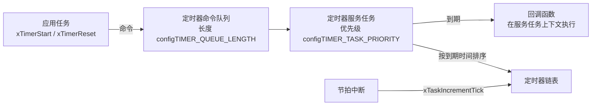
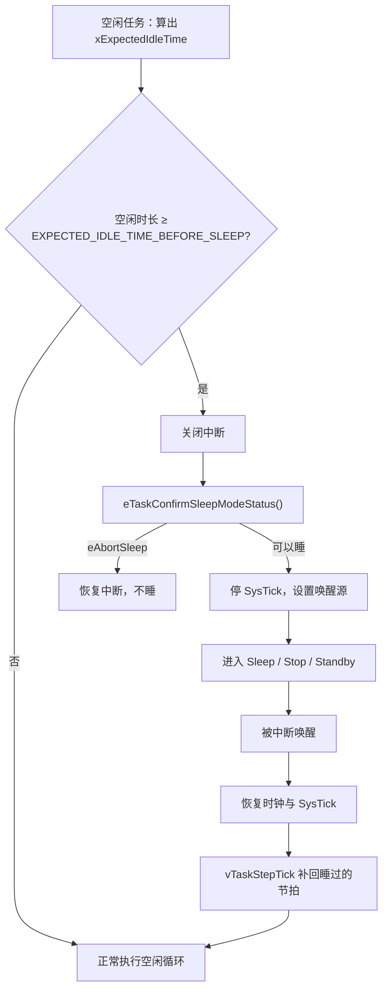

# 4.7 FreeRTOS

在前面的实践中，我们一直依托于预先搭建好的工程模板：只需运行 `cmake --build`，多任务便能在宿主机模拟器与目标开发板上平稳交替运转。模板之中封装着定制化的 `FreeRTOSConfig.h`、针对特定架构的 `portable` 移植层以及对应的堆内存方案。在许多初期项目中，开发者往往习惯于直接复用现成模板；然而一旦面对芯片型号更迭、交叉编译器切换，抑或是需要将系统深度休眠延伸至数十微安的极低功耗场景，原本被模板掩盖的底层机理便会接踵而至：内核到底由哪些不可或缺的文件构成？移植层如何与处理器汇编进行对接？配置文件中密密麻麻的宏选项又该如何精准裁剪？

理解一款 RTOS，有效的方式就是亲自拆解它的骨架。从内核核心源文件与硬件移植层的职责边界，到从零手写一份量体裁衣的 `FreeRTOSConfig.h`；从基于现代 CMake 体系的工程接入，到依赖独立守护任务的软件定时器与全生命周期钩子函数；再到依托外部唤醒源跨越时钟停摆的 Tickless 无节拍深度睡眠，本节将逐层剥开 FreeRTOS 内核的内部构造。文末还将针对工程中常见的 CMSIS-RTOS2 包装层与周边生态进行辨析，帮助建立清晰的工程集成范式。

## 1. 版本与许可

FreeRTOS-Kernel 以 MIT 许可发布。整份许可只有一段，要求保留版权声明与许可声明，剩下的可以商用、修改、闭源分发，没有 GPL 那种传染性。这一点比很多 RTOS 省心：链接进固件之后，固件本身仍然是自己的。

分发形式分两类。**FreeRTOS-Kernel** 仓库里只有内核源码与各平台的移植层，通过 Git 标签发布；**FreeRTOS/FreeRTOS** 总仓库把内核作为子模块，另外附带一批演示工程与附加库。做产品时只需要前者。

截至 2026 年 10 月，最新的是 202604 LTS，内核版本 V11.3.0，安全与关键修复支持到 2028-04-30。LTS 之外的常规版本大约每季度一个，新 API 先在常规版本里出现，进 LTS 要等下一个周期。本教程固定 V11.3.0，正文只用 V11.1 起就有的 API，这样照着书写出的代码在 202406 LTS 上也能编译。

::: tip 固定版本，定期看发布说明

`git clone --depth 1 --branch V11.3.0 https://github.com/FreeRTOS/FreeRTOS-Kernel.git`。升级之前先读 `History.txt` 与 release 说明里的 Breaking Changes——V11 起有几处默认值变了，例如 `configCHECK_HANDLER_INSTALLATION` 默认开启，老工程直接换内核会在启动时断言。

:::

## 2. 源码结构

删掉与构建无关的文件，内核仓库是这样：

```text:no-line-numbers
FreeRTOS-Kernel/
├── CMakeLists.txt          # 内核自带的 CMake 支持
├── tasks.c                 # 调度器、任务状态、延时列表
├── list.c                  # 通用双向链表，其他模块都用它
├── queue.c                 # 队列；信号量与互斥量也建在这上面
├── timers.c                # 软件定时器与定时器服务任务
├── event_groups.c          # 事件组
├── stream_buffer.c         # 流缓冲区与消息缓冲区
├── croutine.c              # 协程，已不推荐使用
├── include/                # 与 .c 一一对应的头文件，外加 FreeRTOS.h
│   ├── FreeRTOS.h
│   ├── task.h
│   ├── queue.h
│   ├── semphr.h            # 信号量与互斥量的宏
│   ├── timers.h
│   └── …
└── portable/               # 移植层
    ├── GCC/
    │   └── ARM_CM3/        # Cortex-M3 + GCC：port.c 与 portmacro.h
    ├── MSVC-MingW/         # Windows 模拟器用的移植层
    ├── ThirdParty/GCC/Posix/  # Linux、macOS 用的 Posix 移植层
    └── MemMang/            # heap_1.c 到 heap_5.c
```

一个 Cortex-M3 工程真正要编进固件的是七个文件：`tasks.c`、`list.c`、`queue.c`、`timers.c`、`event_groups.c`、`stream_buffer.c`，加 `portable/GCC/ARM_CM3/port.c`，再挑一个 `portable/MemMang/heap_x.c`。`croutine.c` 是 2007 年前后的协程实现，占用小但限制多，现在的项目不用它；不编它也就不会链接到任何符号。

`portable/` 下按「编译器/架构」分目录，同一个目录里只有两个文件：`port.c` 提供上下文切换、启动第一个任务、SysTick 初始化，`portmacro.h` 提供 `portYIELD()`、关中断宏和栈类型。换编译器就换目录（IAR 用 `IAR/ARM_CM3`，Keil 用 `RVDS/ARM_CM3`），换内核只换架构目录，应用代码一个字不改。

### 2.1 调度器用到的两张表

`tasks.c` 里两个静态数组是理解调度的入口：

```c
PRIVILEGED_DATA static List_t pxReadyTasksLists[ configMAX_PRIORITIES ];
PRIVILEGED_DATA static List_t xDelayedTaskList1;
PRIVILEGED_DATA static List_t xDelayedTaskList2;
```

`pxReadyTasksLists` 按优先级分组，每个优先级一条就绪链表，同优先级的任务按时间片轮转的次序排在里面。选出下一个任务就是找出「编号最大、且链表非空」的那一条，取它的表头。

`configUSE_PORT_OPTIMISED_TASK_SELECTION` 决定这一步怎么找。置 1 时，每个优先级在 `uxTopReadyPriority` 位图里占一位，找最高优先级就是一条 `CLZ`（Count Leading Zeros，数前导零）指令：

```c
/* portable/GCC/ARM_CM3/portmacro.h */
__attribute__ ((always_inline)) static inline uint8_t ucPortCountLeadingZeros(uint32_t ulBitmap) {
    uint8_t ucReturn;
    __asm volatile ("clz %0, %1" : "=r" (ucReturn) : "r" (ulBitmap) : "memory");
    return ucReturn;
}

#define portGET_HIGHEST_PRIORITY(uxTopPriority, uxReadyPriorities) \
    uxTopPriority = (31UL - (uint32_t)ucPortCountLeadingZeros((uxReadyPriorities)))
```

置 0 时退回 `while` 循环逐级往下找。用 arm-none-eabi-gcc 13.3 分别编 `tasks.c`，`vTaskSwitchContext` 里的差别很清楚：

::: terminal title="bash - 两种任务选择方式的反汇编"

```text
# configUSE_PORT_OPTIMISED_TASK_SELECTION = 1
     bb4: ldr  r3, [r4, #16]      ; uxTopReadyPriority
     bb6: clz  r3, r3             ; 一条指令得到最高就绪优先级
     bba: uxtb r3, r3
     bbc: rsb  r3, r3, #31

# configUSE_PORT_OPTIMISED_TASK_SELECTION = 0
     b6a: cbnz r0, bbc            ; 该级就绪表非空就跳出
     b6c: ldr  r0, [pc, #84]      ; 逐级往下的循环
     b6e: add  r2, r0
     b70: ldr  r1, [r2, #-20]!
     b74: subs r3, #1
     b76: cmp  r1, #0
     b78: beq  b70
```

:::

代价是前者只支持 `configMAX_PRIORITIES` 不超过 32。置 1 之后整个 `tasks.c` 的目标代码是 6716 字节，置 0 是 6548 字节——位图版本因为要维护 `uxTopReadyPriority`，反而略大一点。真正的收益在切换延迟：最高优先级一定时，`CLZ` 是固定一条指令，循环版最多要走 32 次。中断频繁的场合值得打开。

另外两个链表 `xDelayedTaskList1`、`xDelayedTaskList2` 装的是延时中的任务，按唤醒时刻 `xItemValue` 排序。`vTaskDelay` 结束或阻塞超时都从这里取出。用两张表是为了让节拍计数回绕时排序仍然正确：一张放未回绕的唤醒时刻，另一张放已回绕的，`xTaskIncrementTick` 在回绕的那一刻把两张表对调。

### 2.2 队列也是信号量

`queue.c` 里的 `xQueueGenericCreate` 是整个通信机制的底层。信号量、互斥量、递归互斥量、事件组内部用的都是队列，区别只在队列项长度和队列类型：

```c
/* include/semphr.h */
typedef QueueHandle_t SemaphoreHandle_t;

#define xSemaphoreCreateBinary() \
    xQueueGenericCreate((UBaseType_t)1, semSEMAPHORE_QUEUE_ITEM_LENGTH, queueQUEUE_TYPE_BINARY_SEMAPHORE)
```

二值信号量的队列长度是 1、每项长度为 0——它只关心「有没有」，不搬数据。互斥量在此基础上多一个持有者记录，用来做优先级继承（4.6）；递归互斥量再多一个嵌套计数。看懂这张关系，4.3 里那些 API 的相似行为就有了解释：`xSemaphoreGive` 相当于向长度 1、项长 0 的队列写一次，队列满时返回失败。

<Quiz
  type="single"
  :options="[
    { label: 'tasks.c、list.c、queue.c、timers.c、port.c，外加一个 heap_x.c', value: 'A' },
    { label: 'portable/ 下的全部移植层都要编进去，运行时再选', value: 'B' },
    { label: 'include/ 下的每个头文件都对应一个 .c，全部要编', value: 'C' },
    { label: '只要 port.c 与 heap_x.c，调度器在头文件里', value: 'D' }
  ]"
  answer="A"
>

<template #question>

把一个 Cortex-M3 工程里内核相关的源文件挑出来，最少的集合是哪个？

</template>

正确答案是 **A**。`portable/` 下按编译器和架构分了几十个目录，一个工程只取其中与自己的工具链、内核对应的一两个文件；`include/` 里只有头文件，对应的实现分散在根目录的七个 `.c` 里，其中 `croutine.c` 是协程，现代项目不编。

</Quiz>

## 3. FreeRTOSConfig.h 逐项说明

内核源码里没有 `FreeRTOSConfig.h`，它由工程提供，是唯一把内核接到具体芯片上的地方。下面是本节示例用的配置，放在 `code/嵌入式/4_RTOS与固件架构/4_7_FreeRTOS/FreeRTOSConfig.h`。同一份文件同时供模拟器与目标使用，与芯片有关的三项按 `__ARM_ARCH` 分开：

```c
#ifndef FREERTOS_CONFIG_H
#define FREERTOS_CONFIG_H

#include <stdint.h>

#define configUSE_PREEMPTION                    1
#define configUSE_PORT_OPTIMISED_TASK_SELECTION 0

/* tickless_stop 的构建用 -DconfigUSE_TICKLESS_IDLE=2 覆盖 */
#ifndef configUSE_TICKLESS_IDLE
#define configUSE_TICKLESS_IDLE                 0
#endif

#define configCPU_CLOCK_HZ                      ((unsigned long)72000000)
#define configTICK_RATE_HZ                      ((TickType_t)1000)
#define configMAX_PRIORITIES                    7
#define configMAX_TASK_NAME_LEN                 16
#define configUSE_16_BIT_TICKS                  0
#define configIDLE_SHOULD_YIELD                 1

/* 目标上只有 20 KiB SRAM；模拟器上用大堆，队列与任务都够用 */
#if defined(__ARM_ARCH)
#define configMINIMAL_STACK_SIZE                ((unsigned short)128)
#define configTOTAL_HEAP_SIZE                   ((size_t)(10 * 1024))
#else
#define configMINIMAL_STACK_SIZE                ((unsigned short)256)
#define configTOTAL_HEAP_SIZE                   ((size_t)(128 * 1024))
#endif

#define configUSE_TASK_NOTIFICATIONS            1
#define configUSE_MUTEXES                       1
#define configUSE_RECURSIVE_MUTEXES             1
#define configUSE_COUNTING_SEMAPHORES           1
#define configQUEUE_REGISTRY_SIZE               8
#define configUSE_QUEUE_SETS                    0
#define configUSE_TIME_SLICING                  1
#define configSUPPORT_STATIC_ALLOCATION         0
#define configSUPPORT_DYNAMIC_ALLOCATION        1

#define configUSE_TIMERS                        1
#define configTIMER_TASK_PRIORITY               (configMAX_PRIORITIES - 1)
#define configTIMER_QUEUE_LENGTH                8
#define configTIMER_TASK_STACK_DEPTH            (configMINIMAL_STACK_SIZE * 2)

/* 参数检查：断言失败时关中断停住，接调试器时换成 __asm volatile("bkpt 0") */
#define configASSERT(x)         \
    do {                        \
        if ((x) == 0) {         \
            taskDISABLE_INTERRUPTS(); \
            for (;;) {          \
            }                   \
        }                       \
    } while (0)

#define configUSE_IDLE_HOOK                     1
#define configUSE_TICK_HOOK                     1
#define configCHECK_FOR_STACK_OVERFLOW          2
#define configUSE_MALLOC_FAILED_HOOK            1

/* vTaskList 需要的两个开关 */
#define configUSE_TRACE_FACILITY                1
#define configUSE_STATS_FORMATTING_FUNCTIONS    1

#define INCLUDE_vTaskPrioritySet                1
#define INCLUDE_uxTaskPriorityGet               1
#define INCLUDE_vTaskDelete                     1
#define INCLUDE_vTaskSuspend                    1
#define INCLUDE_vTaskDelayUntil                 1
#define INCLUDE_vTaskDelay                      1
#define INCLUDE_xTaskGetSchedulerState          1
#define INCLUDE_xTaskGetCurrentTaskHandle       1
#define INCLUDE_uxTaskGetStackHighWaterMark     1

#if defined(__ARM_ARCH)
/* Cortex-M3：4 位有效优先级左移 4 位存放 */
#define configKERNEL_INTERRUPT_PRIORITY         (15u << 4)
#define configMAX_SYSCALL_INTERRUPT_PRIORITY    (5u << 4)

/* 让 ST 启动文件里的三个处理函数直接指向内核实现 */
#define vPortSVCHandler     SVC_Handler
#define xPortPendSVHandler  PendSV_Handler
#define xPortSysTickHandler SysTick_Handler
#endif

#endif /* FREERTOS_CONFIG_H */
```

公共目录 `code/嵌入式/common/freertos/` 下还有一份按构建目标拆成 `FreeRTOSConfig_sim.h` 与 `FreeRTOSConfig_stm32.h` 的模板，供第 4 章其他页面共用；那份打开的功能开关比这里少，以本节这份为准。逐项分五组看。

**时钟与节拍**。`configCPU_CLOCK_HZ` 是内核用来算 SysTick 重装值的 CPU 频率，F103 跑满 72 MHz 就写 72000000；如果 2.3 的 `clock_init_72mhz()` 没执行或者跑在 8 MHz 的 HSI 上，这里填 72 MHz 会让所有时间误差 9 倍。`configTICK_RATE_HZ` 是节拍频率，1000 表示每毫秒一次节拍。提高能换来更细的延时粒度，代价是中断次数线性上升；常见取值 100～1000，低功耗场景倾向取小。

**调度与内存**。`configMAX_PRIORITIES` 决定就绪表的数组长度，数值越大 RAM 占用越多（每条链表约 20 字节）；超出范围的优先级会被内核截断到最大值，任务不会报错，只是默默排在最高一级。`configMINIMAL_STACK_SIZE` 是空闲任务的栈深度，单位是**字**而不是字节——Cortex-M3 上一个字 4 字节，128 就是 512 字节。`configTOTAL_HEAP_SIZE` 是 `heap_4` 从 RAM 里切出来的堆，所有 `xTaskCreate`、`xQueueCreate` 都从这里分配。

**中断优先级**。Cortex-M3 的 4 位有效优先级在寄存器里占高 4 位，所以数值要左移 4 位写。`configKERNEL_INTERRUPT_PRIORITY` 是内核自己用的最低优先级（PendSV、SysTick 都设成这一级），`configMAX_SYSCALL_INTERRUPT_PRIORITY` 划出「能调用 FromISR API」的一条线：数值大于等于 5 的中断才能调 `xQueueSendFromISR` 这类函数，数值更小的中断里调了会导致优先级反转（4.4 讲过原因）。这两个宏算错的表现很隐蔽——不是编译错误，是偶尔丢中断或者 HardFault。

**功能开关**按项目裁剪。`configUSE_TIMERS` 置 1 会额外创建定时器服务任务，占一份栈；不用软件定时器就置 0，能省下几百字节。`configSUPPORT_STATIC_ALLOCATION` 置 1 后可以用 `xTaskCreateStatic`，编译期就把 TCB 和栈分配好，适合作安全认证的项目（4.5）。`INCLUDE_` 系列是按函数裁剪的开关，例如 `INCLUDE_vTaskDelayUntil` 置 0 后 `xTaskDelayUntil` 根本不会被编进去，调用就是链接错误——这是好事，比运行时才发现更早。

**处理函数名**。启动文件里的向量表用的是 ST 的名字 `SVC_Handler`、`PendSV_Handler`、`SysTick_Handler`，内核里叫 `vPortSVCHandler`、`xPortPendSVHandler`、`xPortSysTickHandler`。三个宏把后者定义成前者，向量表就直接指到内核实现。V11 起 `configCHECK_HANDLER_INSTALLATION` 默认为 1，`xPortStartScheduler` 会读向量表核对这两项，装错就在启动时断言。

::: details 哪些可以照抄，哪些必须按项目算

可以照抄的：功能开关那一组（除 `configUSE_TIMERS` 看项目需要）、`configMAX_TASK_NAME_LEN`、`configIDLE_SHOULD_YIELD`、三个处理函数名映射。

必须按项目算的：

- `configCPU_CLOCK_HZ`：换板子、换时钟树就要改。
- `configTICK_RATE_HZ`：跟延时精度和功耗预算有关，不能照搬。
- `configMAX_PRIORITIES`：按项目的任务优先级层数定，不要随手写 32。
- `configMINIMAL_STACK_SIZE`、`configTOTAL_HEAP_SIZE`：只能用 4.5 的方法测出来，照抄别人的数值是常见故障源。
- `configMAX_SYSCALL_INTERRUPT_PRIORITY`：要跟所有外设中断的 NVIC 优先级一起看，改了优先级分配就得重算。

:::

::: warning `configASSERT` 不定义就什么都不检查

内核里大量参数检查写成 `configASSERT(...)`，这个宏没定义时展开为空，传错参数的 API（例如给 `xQueueCreate` 传 0 长度）会静默返回，问题留到后面才爆。调试构建一定要定义它，推荐写成关中断后死循环：

```c
#define configASSERT(x) do { if ((x) == 0) { taskDISABLE_INTERRUPTS(); for (;;) {} } } while (0)
```

接了调试器就把 `for (;;) {}` 换成 `__asm volatile("bkpt 0")`，断言失败时 CPU 直接停住，调用栈还在。发布构建里可以让它接到 6.2 的故障记录函数，把出错位置写进 `.noinit` 再复位。

:::

## 4. 构建

FreeRTOS-Kernel 自带 CMake 支持，只要提供两样东西：一个叫 `freertos_config` 的接口库（给出 `FreeRTOSConfig.h` 所在目录），和 `FREERTOS_PORT`、`FREERTOS_HEAP` 两个 CMake 缓存项。本教程的 `code/嵌入式/common/freertos/freertos.cmake` 把这段包装成 `emb_freertos_add_kernel()`，按构建目标自动挑移植层与配置：

```cmake
function(emb_freertos_add_kernel)
    if(CMAKE_CROSSCOMPILING)
        set(_port "GCC_ARM_CM3")
        set(_cfg "${EMB_FREERTOS_DIR}/FreeRTOSConfig_stm32.h")
    elseif(WIN32)
        set(_port "MSVC_MINGW")
        set(_cfg "${EMB_FREERTOS_DIR}/FreeRTOSConfig_sim.h")
    else()
        set(_port "GCC_POSIX")
        set(_cfg "${EMB_FREERTOS_DIR}/FreeRTOSConfig_sim.h")
    endif()

    set(_cfg_dir "${CMAKE_BINARY_DIR}/freertos_config")
    file(MAKE_DIRECTORY "${_cfg_dir}")
    configure_file("${_cfg}" "${_cfg_dir}/FreeRTOSConfig.h" COPYONLY)

    add_library(freertos_config INTERFACE)
    target_include_directories(freertos_config SYSTEM INTERFACE "${_cfg_dir}")

    set(FREERTOS_PORT "${_port}" CACHE STRING "FreeRTOS 移植层" FORCE)
    set(FREERTOS_HEAP "4" CACHE STRING "FreeRTOS 堆实现" FORCE)
    add_subdirectory("${FREERTOS_KERNEL_PATH}" "${CMAKE_BINARY_DIR}/freertos_kernel")
endfunction()
```

`configure_file` 那一步不能省：内核的 CMake 只认 `FreeRTOSConfig.h` 这个文件名，而我们需要在同一份工程里同时保留模拟器版与目标版两个配置。

在 1–3 章的 `stm32f103_firmware()` 体系里接进来，本节 `code/嵌入式/4_RTOS与固件架构/4_7_FreeRTOS/CMakeLists.txt` 的目标分支是这样（它用的 `freertos.cmake` 是本节目录下的，只把配置来源换成一份共用的 `FreeRTOSConfig.h`）：

```cmake
if(CMAKE_CROSSCOMPILING)
    include("${CMAKE_CURRENT_LIST_DIR}/../../common/firmware.cmake")
    stm32f103_firmware(stm32_freertos
        "${CMAKE_CURRENT_LIST_DIR}/main_stm32.c"
        "${CMAKE_CURRENT_LIST_DIR}/target_hooks.c"
        "${EMB_FREERTOS_DIR}/rtos_console_uart.c")
    target_include_directories(stm32_freertos PRIVATE
        "${EMB_FREERTOS_DIR}" "${CMSIS_INCLUDE_DIR}")
    target_link_libraries(stm32_freertos PRIVATE freertos_kernel freertos_config)

    # tickless_stop.c 覆盖移植层的弱函数，单独编成目标文件做编译检查
    add_library(tickless_stop OBJECT "${CMAKE_CURRENT_LIST_DIR}/tickless_stop.c")
    ...
endif()
```

`main_stm32.c` 两个任务：`led` 每 500 ms 翻转 PC13，`print` 每 500 ms 经 USART1 打印节拍数。构建命令与真实输出：

::: terminal title="PowerShell - cmake --build build"

```text
# cmake -B build -G Ninja --toolchain common/arm-none-eabi.cmake ^
#       -DFREERTOS_KERNEL_PATH=<FreeRTOS-Kernel 目录> -DCMSIS_INCLUDE_DIR=<CMSIS 头文件目录>
[1/16] Building C object freertos_kernel/CMakeFiles/freertos_kernel.dir/croutine.c.obj
[2/16] Building C object freertos_kernel/CMakeFiles/freertos_kernel.dir/event_groups.c.obj
[3/16] Building C object freertos_kernel/CMakeFiles/freertos_kernel.dir/list.c.obj
[4/16] Building C object freertos_kernel/CMakeFiles/freertos_kernel.dir/portable/MemMang/heap_4.c.obj
[5/16] Building C object freertos_kernel/CMakeFiles/freertos_kernel.dir/stream_buffer.c.obj
[6/16] Building C object freertos_kernel/portable/CMakeFiles/freertos_kernel_port.dir/GCC/ARM_CM3/port.c.obj
[7/16] Building C object CMakeFiles/stm32_freertos.dir/target_hooks.c.obj
[8/16] Building C object freertos_kernel/CMakeFiles/freertos_kernel.dir/queue.c.obj
[9/16] Building C object freertos_kernel/CMakeFiles/freertos_kernel.dir/timers.c.obj
[10/16] Building C object emb_common/CMakeFiles/stm32f103_startup.dir/startup_stm32f103.c.obj
[11/16] Building C object CMakeFiles/stm32_freertos.dir/main_stm32.c.obj
[12/16] Building C object CMakeFiles/tickless_stop.dir/tickless_stop.c.obj
[13/16] Building C object CMakeFiles/stm32_freertos.dir/.../rtos_console_uart.c.obj
[14/16] Building C object freertos_kernel/CMakeFiles/freertos_kernel.dir/tasks.c.obj
[15/16] Linking C static library freertos_kernel\libfreertos_kernel.a
[16/16] Linking C executable stm32_freertos.elf
   text	   data	    bss	    dec	    hex	filename
  30128	     96	  12576	  42800	   a730	stm32_freertos.elf
```

:::

文本段 30128 字节里，内核贡献约 24.6 KB（`tasks.c` 13.3 KB、`queue.c` 5.6 KB、`stream_buffer.c` 3.9 KB、`timers.c` 2.5 KB、`heap_4.c` 1.7 KB、`port.c` 1.2 KB，`--gc-sections` 已经去掉没被引用的函数），newlib 的 `printf` 族与 `fflush` 等约 4.6 KB，剩下的几百字节是启动代码与本节的应用代码。`configASSERT` 打开之后内核比不打开时大约多 5 KB，这是值得的——没有它，参数传错只会静默返回。RAM 的 12576 字节 `.bss` 里，10240 字节是 `ucHeap`（`nm` 能看到它在 0x200001d0，长度 0x2800），其余是内核静态对象、空闲任务与定时器任务的栈、串口缓冲区。

`configCHECK_HANDLER_INSTALLATION` 那件事值得单独说一句。V11 之前，CubeMX 生成的工程习惯在 `stm32f1xx_it.c` 里写一个 `SVC_Handler`，里面再调用 `vPortSVCHandler()`；V11 默认开启的检查会读向量表，发现这一项不直接等于内核函数就断言。用这套间接路由的工程，要么改成直接映射，要么把 `configCHECK_HANDLER_INSTALLATION` 设为 0。

## 5. 软件定时器

软件定时器由内核的一个任务统一管理。`xTimerCreate` 只是建一个对象并挂进链表，真正的计时与回调都发生在**定时器服务任务**（timer service task，任务名 `Tmr Svc`）里。应用任务调用 `xTimerStart`、`xTimerReset`、`xTimerChangePeriod` 时不直接操作链表，而是把一条命令投进命令队列，服务任务醒来后按到期时间处理。



两条工程上的约束由此而来。第一，回调运行在服务任务里，不能调用会阻塞的 API：`vTaskDelay`、带非零超时的 `xQueueReceive`、等互斥量，都会让整个定时器系统停摆。第二，`configTIMER_TASK_PRIORITY` 要足够高——至少高于所有会调用定时器 API 的任务，否则命令排在队列里迟迟得不到处理，定时器看起来「不准」。本教程取 `configMAX_PRIORITIES - 1`。`configTIMER_QUEUE_LENGTH` 是命令队列深度，短时间内大量改周期要考虑它。

定时器分单次（one-shot）与自动重载（auto-reload）两种，`xTimerCreate` 的第四个参数 `uxAutoReload` 选。单次定时器到期后自己停下，适合做超时与去抖；自动重载的到期后自动重新计时，适合周期动作。下面的程序一个管心跳 LED，一个管按键去抖：

```c
/* code/嵌入式/4_RTOS与固件架构/4_7_FreeRTOS/sw_timer_sim.c */
static void heartbeat_callback(TimerHandle_t timer) {
    (void)timer;
    g_led_level = !g_led_level;
    console_printf("[heartbeat] LED -> %d (tick %lu)\n", g_led_level,
                   (unsigned long)xTaskGetTickCount());
}

static void debounce_expired(TimerHandle_t timer) {
    (void)timer;
    g_press_count++;
    console_printf("[debounce]  press accepted, count=%lu (tick %lu)\n",
                   (unsigned long)g_press_count,
                   (unsigned long)xTaskGetTickCount());
}

/* 模拟的按键中断：每个边沿都把单次定时器推后 20 ms */
static uint32_t button_isr(void) {
    BaseType_t woken = pdFALSE;
    g_bounce_count++;
    xTimerResetFromISR(g_debounce_timer, &woken);
    return (uint32_t)woken;
}
```

心跳用 `xTimerCreate("heartbeat", pdMS_TO_TICKS(500), pdTRUE, NULL, heartbeat_callback)`，自动重载，每 500 ms 翻转一次 LED。去抖用 `pdFALSE`，20 ms 内没有新边沿才判定按下。按键的抖动在模拟器里由模拟中断产生——`vPortGenerateSimulatedInterrupt()` 让处理函数在当前线程里以中断上下文执行，三个间隔 3 ms 的边沿正好能把定时器推后三轮：

::: terminal title="PowerShell - sw_timer_sim.exe"

```text
[button]   round 1 edges sent, bouncing=3
[debounce]  press accepted, count=1 (tick 28)
[heartbeat] LED -> 1 (tick 500)
[button]   round 2 edges sent, bouncing=6
[debounce]  press accepted, count=2 (tick 637)
[heartbeat] LED -> 0 (tick 1000)
[button]   round 3 edges sent, bouncing=9
[debounce]  press accepted, count=3 (tick 1246)
[heartbeat] LED -> 1 (tick 1500)
[button]   done: edges=9 presses=3 led=1
```

:::

九个边沿最终只产生三次「按下」，心跳与去抖互不干扰。`tick` 的数值来自模拟器，真实板上会有几毫秒的抖动。

去抖还有一处细节：中断里必须用 `xTimerResetFromISR`，不能用 `xTimerReset`。后者会向命令队列发送并可能阻塞，中断上下文里不许阻塞。修改周期用 `xTimerChangePeriod`，它同时会把定时器启动起来，所以「停止状态改周期」不必再调一次 `xTimerStart`。

<Quiz
  type="single"
  :options="[
    { label: '暂停当前定时器回调 20 ms，然后继续执行', value: 'A' },
    { label: '让整个定时器服务任务阻塞 20 ms，期间所有定时器都不走', value: 'B' },
    { label: '只影响当前这个定时器，其他定时器照常计时', value: 'C' },
    { label: '编译报错，回调里不允许调用任何 API', value: 'D' }
  ]"
  answer="B"
>

<template #question>

在一个软件定时器的回调里调用 `vTaskDelay(pdMS_TO_TICKS(20))`，会发生什么？

</template>

正确答案是 **B**。所有回调都在同一个定时器服务任务里执行，这个任务一阻塞，到期判断与命令队列的处理全部停摆。回调里要延后动作，应该用另一次 `xTimerStart` 或把工作投给别的任务。

</Quiz>

## 6. 钩子函数与断言

内核提供四个钩子（hook），都是弱符号，应用定义了就在指定时机被调用：

| 钩子 | 打开方式 | 调用时机 | 限制 |
| --- | --- | --- | --- |
| `vApplicationIdleHook` | `configUSE_IDLE_HOOK = 1` | 空闲任务每轮循环 | 不能阻塞；有低功耗需求时不要在里面做事 |
| `vApplicationTickHook` | `configUSE_TICK_HOOK = 1` | 每次节拍中断 | 运行在中断上下文，只能用 FromISR API，越短越好 |
| `vApplicationMallocFailedHook` | `configUSE_MALLOC_FAILED_HOOK = 1` | `pvPortMalloc` 返回 NULL | 只用于报告，不要试图恢复 |
| `vApplicationStackOverflowHook` | `configCHECK_FOR_STACK_OVERFLOW` 非 0 | 检测到任务栈越界 | 栈已经被写坏，只能记录后复位 |

空闲钩子的频率跟 CPU 空闲程度有关：系统越闲，调用越密。下面的程序同时打开空闲与节拍钩子，再用 `pvPortMalloc` 把堆耗尽：

```c
/* code/嵌入式/4_RTOS与固件架构/4_7_FreeRTOS/hooks_sim.c */
void vApplicationIdleHook(void) {
    g_idle_count++;
}

void vApplicationTickHook(void) {
    g_tick_count++;
}

void vApplicationMallocFailedHook(void) {
    g_malloc_failed = 1;
    console_printf("[hook] vApplicationMallocFailedHook: heap left=%u\n",
                   (unsigned)xPortGetFreeHeapSize());
}

static void worker(void *param) {
    (void)param;

    /* 反复申请不释放，直到堆耗尽 */
    for (int i = 0; i < 200 && !g_malloc_failed; ++i) {
        if (pvPortMalloc(1024) == NULL) {
            break;
        }
    }

    vTaskDelay(pdMS_TO_TICKS(20));
    console_printf("[worker] idle hook ran %lu times, tick hook %lu times\n",
                   (unsigned long)g_idle_count, (unsigned long)g_tick_count);
    sim_finish();
}
```

运行结果（模拟器上某次运行；空闲钩子的次数每次都不一样）：

::: terminal title="PowerShell - hooks_sim.exe"

```text
[hook] vApplicationMallocFailedHook: heap left=272
[worker] idle hook ran 18895562 times, tick hook 22 times
```

:::

20 ms 里节拍钩子被调用 22 次（1000 Hz 下理论值 20，多出来的是启动与调度开销），而空闲钩子调用了一千八百万次——任务阻塞时 CPU 全在空闲任务里打转。这两个数量级差得这么远，空闲钩子只适合做「顺便」的统计，不适合承担任何周期性的工作。也正因为如此，把喂狗放在空闲钩子里是最典型的错误：任何一个任务卡住，空闲任务仍然在跑，狗照样被喂，系统死没死就看不出来了（4.9 会用监视任务解决这件事）。

`configCHECK_FOR_STACK_OVERFLOW` 有两个级别。级别 1 只在任务切换时检查栈指针是否越界，级别 2 额外在栈末尾填一段标记，切换时看标记有没有被涂掉——能抓住「栈指针还在范围内但已经写穿」的情况，代价是每建一个任务多几次写内存。模拟器上栈高水位线与栈溢出检测没有意义（Windows 移植层用操作系统线程的栈），这些数字只能来自目标构建。

`configASSERT` 在 3 节已经给过定义。它和钩子的分工是：断言抓「参数不对、状态不对」，钩子抓「资源耗尽」。两类都应当在调试构建里打开，发布构建保留钩子、把断言转成故障记录。

## 7. 低功耗

空闲任务没事做的时候，CPU 还在执行「检查就绪表—什么也没有—再检查」的循环，白白耗电。无节拍空闲（tickless idle）的做法是：内核算出「下一个任务最早什么时候要醒」，如果这个时间比若干节拍更长，就把 SysTick 停掉、让 CPU 睡过去，醒来后把睡过的时间一次性补进节拍计数。

在 `FreeRTOSConfig.h` 中打开：

```c
#define configUSE_TICKLESS_IDLE                 1
#define configEXPECTED_IDLE_TIME_BEFORE_SLEEP   3
```

`configEXPECTED_IDLE_TIME_BEFORE_SLEEP` 是「至少空闲这么多节拍才值得睡」的门槛，判断在 `eTaskConfirmSleepModeStatus()` 里完成。内核在空闲任务中调用 `portSUPPRESS_TICKS_AND_SLEEP(xExpectedIdleTime)`，流程是：



ARM_CM3 移植层自带的 `vPortSuppressTicksAndSleep()` 已经实现了这条路径，它用的是「把 SysTick 重装值拉长」的办法：

```c
/* portable/GCC/ARM_CM3/port.c */
ulReloadValue = ulSysTickDecrementsLeft + (ulTimerCountsForOneTick * (xExpectedIdleTime - 1UL));
portNVIC_SYSTICK_LOAD_REG = ulReloadValue;
portNVIC_SYSTICK_CURRENT_VALUE_REG = 0UL;
portNVIC_SYSTICK_CTRL_REG |= portNVIC_SYSTICK_ENABLE_BIT;

xModifiableIdleTime = xExpectedIdleTime;
configPRE_SLEEP_PROCESSING(xModifiableIdleTime);
if (xModifiableIdleTime > 0) {
    __asm volatile ("dsb" ::: "memory");
    __asm volatile ("wfi");
    __asm volatile ("isb");
}
configPOST_SLEEP_PROCESSING(xExpectedIdleTime);
```

这条路径只能进入 Sleep 模式。SysTick 的时钟来自内核时钟，Sleep 模式下内核时钟还在跑，所以 SysTick 能把芯片叫醒；一旦进入 Stop 模式，内核时钟被关掉，SysTick 不再计数，也就叫不醒了。F103 在 72 MHz 下 Sleep 的电流是毫安级，Stop 是几十微安——要拿到后者，必须换一个在 Stop 下仍在工作的唤醒源。

RTC 闹钟正是这样一个源：LSE 由备份域供电，Stop 模式下继续走；闹钟触发经 EXTI 第 17 号线把内核唤醒。把 `configUSE_TICKLESS_IDLE` 设为 2（表示「我自己实现了 `vPortSuppressTicksAndSleep`」），再写一个同名函数覆盖移植层的弱实现。骨架在 `code/嵌入式/4_RTOS与固件架构/4_7_FreeRTOS/tickless_stop.c`，核心部分：

```c
void vPortSuppressTicksAndSleep(TickType_t xExpectedIdleTime) {
    static int s_rtc_ready;
    uint32_t sleep_seconds;
    uint32_t start;
    uint32_t elapsed;

    if (s_rtc_ready == 0) {
        rtc_init_lse();          /* LSE + 预分频 32767，计数器每秒加一 */
        s_rtc_ready = 1;
    }

    /* RTC 闹钟分辨率是 1 秒；不足两秒不划算，交回默认路径 */
    sleep_seconds = (uint32_t)xExpectedIdleTime / (uint32_t)configTICK_RATE_HZ;
    if (sleep_seconds < 2u) {
        return;
    }

    __asm volatile ("cpsid i" ::: "memory");
    __asm volatile ("dsb");
    __asm volatile ("isb");

    if (eTaskConfirmSleepModeStatus() == eAbortSleep) {
        __asm volatile ("cpsie i" ::: "memory");
        return;
    }

    SYST_CSR = 0;                        /* 停 SysTick */
    start = rtc_read_counter();
    rtc_set_alarm(start + sleep_seconds);

    __asm volatile ("cpsie i" ::: "memory");
    enter_stop();                        /* PWR_CR 设 LPDS，然后 WFI */

    clock_init_72mhz();                  /* 醒来先恢复 72 MHz（2.3） */
    elapsed = rtc_read_counter() - start;
    vTaskStepTick((TickType_t)elapsed * configTICK_RATE_HZ);

    SYST_RVR = (configCPU_CLOCK_HZ / configTICK_RATE_HZ) - 1UL;
    SYST_CVR = 0;
    SYST_CSR = 0x7u;
}
```

几个必须做对的地方：

- 进入 Stop 前把外设收拾干净。串口要等最后一帧移出移位寄存器，DMA 要停，否则醒来时数据已经丢了一半（2.10 有完整清单）。
- Stop 模式下内核时钟停摆，唤醒后 CPU 跑在 HSI 的 8 MHz 上，必须立刻重新配置 PLL。不调用 `clock_init_72mhz()` 的话，后面所有基于 72 MHz 计算的时间全部错 9 倍。
- 醒来后要重设 SysTick。Stop 期间 SysTick 的计数与重装值都没有意义，重新写入才是干净的状态。
- 节拍补偿用 `vTaskStepTick`，它把节拍计数往前推但不触发节拍中断，避免补的这几千个节拍一次性跑完所有延时任务。

这段代码用 arm-none-eabi-gcc 13.3 编译通过（`-mcpu=cortex-m3 -mthumb -O2 -Wall -Wextra`，424 字节目标代码）。实际能不能省电、能省多少，要用 6.5 的方法在板上测——模拟器上 `WFI` 就是一条空指令，测不出任何东西。

::: warning 无节拍空闲与调试器

Stop 模式下调试接口也可能断开。用 ST-LINK 调试这类固件时，先在调试器里让 CPU 保持在 Sleep，或者临时把 `configUSE_TICKLESS_IDLE` 改回 0，否则断点会莫名其妙地停在进入 Stop 的那一行。

:::

## 8. 调试

调试多任务程序，第一步是看见任务。`vTaskList` 把当前所有任务的名字、状态、优先级、剩余栈、任务号排成一张表：

```c
/* code/嵌入式/4_RTOS与固件架构/4_7_FreeRTOS/task_list_sim.c */
static void report_task(void *param) {
    (void)param;
    vTaskDelay(pdMS_TO_TICKS(100));

    char table[512];
    vTaskList(table);
    console_printf("Name           State  Prio  Stack  Num\n");
    console_printf("--------------------------------------\n");
    console_printf("%s", table);

    UBaseType_t count = uxTaskGetNumberOfTasks();
    console_printf("\nuxTaskGetNumberOfTasks() = %u\n", (unsigned)count);
    sim_finish();
}
```

三个任务：`sampler` 与 `logger` 各跑三步就挂起自己，`report` 稍后打印。输出：

::: terminal title="PowerShell - task_list_sim.exe"

```text
[sampler] step 1
[logger] step 1
[sampler] step 2
[logger] step 2
[sampler] step 3
[logger] step 3
Name           State  Prio  Stack  Num
--------------------------------------
report         	X	3	509	3
IDLE           	R	0	253	4
sampler        	B	2	253	1
logger         	B	1	253	2
Tmr Svc        	B	6	509	5

uxTaskGetNumberOfTasks() = 5
```

State 一列：`R` 是就绪或运行，`B` 是阻塞，`X` 是挂起。`report` 打印时正占着 CPU，所以是 `X`（先执行了 `vTaskList`，状态记录的时机如此）；`sampler`、`logger` 已经 `vTaskDelay(portMAX_DELAY)`，进入阻塞；`IDLE` 就绪。Stack 一列是**剩余**栈深度，单位是字，模拟器上的数字没有参考价值（4.5 解释过）。`Tmr Svc` 是定时器服务任务，优先级 6 来自 `configTIMER_TASK_PRIORITY = configMAX_PRIORITIES - 1`。

`vTaskList` 需要 `configUSE_TRACE_FACILITY = 1` 与 `configUSE_STATS_FORMATTING_FUNCTIONS = 1`，本身还会在栈上开一个缓冲区（本页用 512 字节），任务栈要留够。它内部会挂起调度器，所以输出是某一瞬间的快照，不会因为打印过程中任务切换而错乱。

比 `vTaskList` 更细的是 `uxTaskGetSystemState`，它把每个任务的状态填进一个 `TaskStatus_t` 数组，程序可以自己格式化。要查某个任务占了多少 CPU 则用运行时统计，那部分在 4.9。

在线调试时，OpenOCD 与 GDB 可以直接看任务。OpenOCD 的配置脚本里加一行：

```text
$_TARGETNAME configure -rtos FreeRTOS
```

之后 GDB 的 `info threads` 会列出每个任务，`thread N` 切过去就能看到该任务的栈。输出类似（按 OpenOCD 用户手册的示例，实际格式随版本变化）：

::: terminal title="gdb - info threads"

```text
(gdb) info threads
  Id   Target Id         Frame
* 1    Thread 1 (Name: IDLE, State: Running)  0x08000b1e in prvIdleTask ()
  2    Thread 2 (Name: led, State: Suspended) 0x0800054a in vTaskDelay ()
  3    Thread 3 (Name: print, State: Suspended) 0x0800054a in vTaskDelay ()
```

:::

这条命令依赖调试器能读到内核的符号表，所以 ELF 要带 `-g`，并且 OpenOCD 加载的是同一份构建的映像。断点停在某个任务里时，其他任务的状态也能看到，这比串口打印方便得多。

::: tip 出问题时先看任务表

调度相关的故障——某个任务饿死、栈溢出、优先级反转——在任务表里往往一眼能看出：状态一直 `R` 的是忙等，Stack 剩余接近 0 的是快溢出，Prio 与预期不符的是配置被截断。上板前先在模拟器上跑一次 `vTaskList`，把「正常时的表」记下来，出问题时对比。

:::

## 9. CubeMX 生成的工程

STM32CubeMX 勾上 FreeRTOS 之后，生成的工程不直接用原生 API，而是套了一层 CMSIS-RTOS2。`osThreadNew`、`osMessageQueuePut`、`osDelay` 这些函数由 `Middlewares/Third_Party/FreeRTOS/Source/CMSIS_RTOS_V2/cmsis_os2.c` 实现，内部转调原生函数：

::: compare left-title="CMSIS-RTOS2 包装层" right-title="FreeRTOS 原生 API"

```c
osThreadId_t osThreadNew(osThreadFunc_t func, void *argument,
                         const osThreadAttr_t *attr) {
    /* cmsis_os2.c 内部把 attr 拆成栈大小、优先级等参数，
       再调用 xTaskCreate */
}

osStatus_t osMessageQueuePut(osMessageQueueId_t mq_id, const void *msg_ptr,
                             uint8_t msg_prio, uint32_t timeout) {
    /* 转成 xQueueSend 或 xQueueSendToFront */
}

osStatus_t osDelay(uint32_t ticks) {
    /* 转成 vTaskDelay */
}
```

---

```c
TaskHandle_t task = xTaskCreate(func, "name", stack_words,
                                argument, priority, NULL);

BaseType_t ok = xQueueSend(queue, msg_ptr, pdMS_TO_TICKS(timeout_ms));

vTaskDelay(pdMS_TO_TICKS(ms));
```

:::

包装层的价值在于可移植：同一份应用代码换成 ThreadX、RTX 只改链接。代价是两处别扭。第一，CMSIS-RTOS2 的时间单位是「节拍」但语义与 FreeRTOS 的节拍不完全一致，`osDelay(1)` 在不同配置下差别很大；第二，包装层没有覆盖 FreeRTOS 的全部能力，任务通知、流缓冲区、事件组的一部分都得绕过它直接调原生 API，一个工程里两种风格混用更难读。

CubeMX 还会提示一件事：FreeRTOS 接管了 SysTick，HAL 的 `HAL_Delay` 与 HAL 的超时判断都依赖 SysTick，两者会打架。CubeMX 的做法是把 HAL 时基改成 TIM（`HAL_InitTick` 里换成另一个定时器）。这一点在手工集成时必须自己处理——`HAL_Init()` 之前先启动 FreeRTOS，或者显式改 `HAL_InitTick` 的时基。

在技术选型权衡上，成熟的工程建议通常是：新自研项目优先采用原生 FreeRTOS API，将 CMSIS-RTOS2 保留在那些有强跨内核移植诉求或芯片原厂中间件深度绑定的场景中。为了极少发生的底层更换假设而预先引入中间抽象层，往往会在联调与性能分析时付出额外的符号穿透与心智成本。

## 10. 生态

FreeRTOS 周边还有一批附加库，按需取用：

- **FreeRTOS-MPU**：带存储器保护单元的内核变体，任务可以跑在非特权级、访问受限的内存区域。需要 MPU，F103C8 没有，用不上。
- **SMP**：多核版本，V11 起内核原生支持，同一份代码可以配成单核或双核调度。Cortex-M3 单核芯片用不到。
- **FreeRTOS+TCP**：完整的 TCP/IP 协议栈，与内核配套设计，7.3 的联网固件会用到。
- **coreMQTT**：MQTT 3.1.1 客户端，与传输层解耦，可以接在 +TCP、lwIP 或者 AT 指令之上（7.3）。
- **backoffAlgorithm**：指数退避算法库，重连时用，代码量很小。
- **FreeRTOS+CLI**、**FreeRTOS+IO**、**FreeRTOS+FAT**：命令解析、外设流接口、FAT 文件系统，使用面比前几个窄。

在软件集成策略上，对待庞大的官方周边生态应坚持按需取用的轻量化原则。不同扩展库之间保持着良好的松耦合特性，固件设计中不宜盲目将全套组件打包引入工程，否则未被调用的冗余代码只会徒增编译耗时与安全审计负担。在绝大多数常规嵌入式设备中，始终以最小内核作为坚固基座，仅在特定网络或文件系统需求确立时才定向扩展对应组件，是保持固件稳健的务实路径。

## 11. 习题

### 11.1 巩固

<Exercise id="60453" :d="2" :w="3">

本节的目标构建把 `code/嵌入式/4_RTOS与固件架构/4_7_FreeRTOS/FreeRTOSConfig.h` 原样编进去，`__ARM_ARCH` 已定义。回答下面的问题，每题写出依据的宏：

(1) `configMINIMAL_STACK_SIZE` 是 128，空闲任务的栈占多少字节？`configTIMER_TASK_STACK_DEPTH` 展开后，定时器服务任务的栈又是多少字节？

(2) `configMAX_PRIORITIES` 是 7。在 `tasks.c` 的 `prvInitialiseNewTask` 里找到处理优先级的几行：截断到最大值发生在哪一行，它前面有没有 `configASSERT`？本节这份配置（`configASSERT` 已定义）下传入优先级 10，调试构建会怎样？把 `configASSERT` 改成空实现再跑，任务最终排在哪个优先级？

(3) 同一个 `vTaskDelay(500)` 调用，在 `configTICK_RATE_HZ` 为 1000 与 100 时各延时多少毫秒？

(4) 板子实际跑在 8 MHz 的 HSI 上，`configCPU_CLOCK_HZ` 却写着 72000000。此时 `vTaskDelay(pdMS_TO_TICKS(100))` 实际延时多久？

(5) 公司要求固件闭源发布，同时把内核源代码归档留档。按 MIT 许可，需要保留哪些内容、可以怎么改、有没有必须公开的部分？如果换成 GPL 的内核，同样的做法还成立吗？

</Exercise>

<Exercise id="60454" :d="2" :w="2">

某产品只用任务、队列与二值信号量：不用软件定时器、事件组、流缓冲区、互斥量、任务通知，也不需要 `vTaskList`。以本节的 `FreeRTOSConfig.h` 为起点改出一份专用配置。

(1) 列出要改的宏与目标值，写成 `宏 旧值 -> 新值` 的形式，功能开关与 `INCLUDE_` 系列都要列。

(2) 内核里哪几个 `.c` 可以不再编进固件？本节的哪几个模拟器示例会因此链接失败，各自的未定义符号是什么？

(3) 估算省下的 RAM 与 Flash：定时器服务任务的栈、命令队列、`timers.c` 的目标代码各是多少。后两项可以引用正文的数字，也可以自己用 `arm-none-eabi-size` 量。

(4) `configUSE_TIMERS` 置 0 之后，代码里如果还留着 `xTimerCreate` 调用，结果是编译错误、链接错误还是运行时失败？说明原因。

(5) 2.2 说二值信号量就是「队列长度 1、项长 0」的队列。把 `configUSE_MUTEXES` 与 `configUSE_COUNTING_SEMAPHORES` 都置 0 之后，`xSemaphoreCreateBinary`、`xSemaphoreCreateMutex`、`xSemaphoreCreateCounting` 三个宏各还能不能用？分别说明失败发生在预处理、编译还是链接阶段。

(6) 把 `configUSE_PORT_OPTIMISED_TASK_SELECTION` 从 0 改成 1。本节的 7 个优先级满足它的使用条件吗？改完之后用 `arm-none-eabi-size` 比较 `tasks.o` 的大小，与正文给出的两个数字对照，并说明这项开关换来的是什么。

</Exercise>

<Exercise id="60455" :d="3" :w="3">

在 `code/嵌入式/4_RTOS与固件架构/4_7_FreeRTOS/sw_timer_sim.c` 的基础上实现长按判定：按住超过 800 ms 才算长按，短按与长按分别计数。

(1) 用一个单次软件定时器实现：按下沿启动定时器，松开沿停止定时器，定时器到期即判定长按。写出 `button_isr` 的按下、松开两条分支与两个回调函数。

(2) 中断里启动、停止定时器各用什么函数？为什么不能用任务版？

(3) 用模拟中断产生三组输入：按下后 300 ms 松开、按下后 1200 ms 松开、按下后 850 ms 松开。给出程序应打印的计数（短按 1 次、长按 2 次），并说明长按判定之后松开沿为什么不能再计一次短按。

(4) 若把 `xTimerStopFromISR` 误写成 `xTimerStop(timer, 0)`，中断上下文里这个调用为什么不允许？在模拟器上可能看不出问题，原因是什么？

</Exercise>

### 11.2 编程

<Exercise id="60456" :d="3" :w="3">

把心跳定时器的周期做成可切换的：每 2 秒在 100 ms、250 ms、500 ms 之间轮换。

(1) 用 `xTimerChangePeriod` 实现 `set_heartbeat_period(TickType_t ticks)`，在定时器正在运行时调用。说明它会不会重新开始计时。

(2) 写一个 `period_task`，用 `vTaskDelayUntil` 每 2 秒切换一次，打印切换时刻的节拍数。

(3) 在模拟器上运行 7 秒，给出各段预期的心跳次数（100 ms 段约 20 次、250 ms 段约 8 次、500 ms 段约 4 次）。实际输出与预期有偏差时，说明偏差来自哪里。

(4) 如果调用 `set_heartbeat_period` 时定时器处于停止状态，还需要再调一次 `xTimerStart` 吗？

</Exercise>

<Exercise id="60457" :d="3" :w="3">

用节拍钩子做一个秒表：`vApplicationTickHook` 每 5000 个节拍释放一次二值信号量，一个任务收到信号量后打印累计秒数。

(1) 写出钩子与任务。钩子里只做计数与释放信号量，打印放在任务里，说明这样划分的理由。

(2) 钩子运行在什么上下文？`vTaskDelay`、`xSemaphoreGive`、`xSemaphoreGiveFromISR` 三个函数里哪些能用？为什么？

(3) 打印任务用什么方式等待信号量？如果改成在任务里轮询一个标志，CPU 占比会怎样？

(4) 模拟器上跑 20 秒，预期打印 4 行。给出输出，并解释第一行可能比 5 秒晚一点的原因。

</Exercise>

<Exercise id="60458" :d="4" :w="4">

`vTaskList` 的输出不能定制。改用 `uxTaskGetSystemState` 自己生成一张表。

(1) 用 `TaskStatus_t` 数组接收状态：先用 `uxTaskGetNumberOfTasks()` 取得数组长度，再按实际返回数遍历。写出完整的 `report_task`。

(2) 输出列与 `vTaskList` 相同：名字、状态、优先级、剩余栈（字）、任务号。先运行一次 `vTaskList` 确认它用哪些字母表示状态，再写映射函数。

(3) 在模拟器上运行本节 `task_list_sim` 的同一组任务，把两份输出贴出来逐行对照，有差异的地方解释原因。

(4) `uxTaskGetSystemState` 需要哪些配置宏？它执行期间调度器会不会被挂起？从 `tasks.c` 的实现里确认，不要凭印象回答。

</Exercise>

<Exercise id="60459" :d="4" :w="4">

把内核接进一个只有 `main.c` 的新工程，不使用本节的 `emb_freertos_add_kernel()`，直接按 FreeRTOS-Kernel 自带的 CMake 接口写。

(1) 写出 `CMakeLists.txt`：定义 `freertos_config` 接口库，设置 `FREERTOS_PORT` 与 `FREERTOS_HEAP`，再 `add_subdirectory` 内核。目标是 Windows 模拟器，移植层用 `MSVC_MINGW`。

(2) 为什么 `freertos_config` 的 include 目录必须指向一个含 `FreeRTOSConfig.h` 的目录，而不能把配置改成别的文件名？用 `configure_file` 解决，并写出这一步。

(3) 故意删掉 `configure_file`，贴出配置阶段或编译阶段的报错。

(4) 把 `FREERTOS_HEAP` 从 4 改成 3，内核照样能编过。说明两个 heap 实现的行为差异，以及换成 3 之后 `configTOTAL_HEAP_SIZE` 还有没有作用。

</Exercise>

<Exercise id="60460" :d="4" :w="4">

阅读 `code/嵌入式/4_RTOS与固件架构/4_7_FreeRTOS/main_stm32.c` 的两个任务（`led` 翻转 PC13、`print` 打印节拍数），做下面几件事。

(1) 用 CMSIS-RTOS2 的 `osThreadNew`、`osDelay` 重写同样的功能，写出两个线程函数与创建代码。栈大小与优先级怎么从 `osThreadAttr_t` 传入？

(2) `osDelay` 的参数单位是节拍。本节配置下 `osDelay(500)` 与原生 `vTaskDelay(pdMS_TO_TICKS(500))` 是否等价？工程改用 100 Hz 节拍之后呢？

(3) 包装层没有覆盖任务通知与流缓冲区。给出一个必须绕过包装层、直接调原生 API 的场景，并说明同一个工程里两种风格混用会带来什么阅读成本。

(4) 正文建议新项目优先采用原生 API。找一个包装层确实值得用的场合，说明理由。

</Exercise>

### 11.3 综合与挑战

<Exercise id="60461" :d="5" :w="4">

下面的 `vPortSuppressTicksAndSleep` 是一个学生照本节思路写的版本，编译通过，上板后出现「延时变长、偶发 HardFault」。其余函数与本节 `tickless_stop.c` 相同。

```c
void vPortSuppressTicksAndSleep(TickType_t xExpectedIdleTime) {
    uint32_t start = rtc_read_counter();
    uint32_t seconds = (uint32_t)xExpectedIdleTime / (uint32_t)configTICK_RATE_HZ;

    SYST_CSR = 0;
    rtc_set_alarm(start + seconds);
    enter_stop();

    vTaskStepTick((TickType_t)(rtc_read_counter() - start) * configTICK_RATE_HZ);

    SYST_RVR = (configCPU_CLOCK_HZ / configTICK_RATE_HZ) - 1UL;
    SYST_CSR = 0x7u;
}
```

(1) 列出至少四处缺陷，每处说明会引发什么现象。提示：`eTaskConfirmSleepModeStatus`、`clock_init_72mhz`、`seconds` 为 0、`vTaskStepTick` 的上限断言各对应一处。

(2) 写出改正后的版本。哪些语句必须放在关中断的区间里，为什么？

(3) 醒来的原因可能是 RTC 闹钟，也可能是更早到达的按键中断。两种情况下 `rtc_read_counter() - start` 的意义有什么不同？补的节拍数会不会错？

(4) 用 `arm-none-eabi-gcc -mcpu=cortex-m3 -mthumb -O2 -Wall -Wextra` 编译改正后的版本，确认无警告。上板验证需要什么仪器，看哪两个量？

</Exercise>

<Exercise id="60462" :d="6" :w="5" scope="*">

给 F103C8 设计一条完整的低功耗路径，做成可交付的工程方案。

(1) 需求：无任务活动超过 3 秒进入 Stop；RTC 闹钟每 10 秒唤醒一次做一次采样，采样完继续睡；按键 EXTI 唤醒后立刻恢复全速运行并记录唤醒原因。

(2) 画出任务与唤醒源的关系，说明 `configUSE_TICKLESS_IDLE` 取 1 与取 2 分别由谁决定睡多久，3 秒与 10 秒这两个时间各由哪一层实现。

(3) 写出进入 Stop 前的外设收尾清单，至少覆盖 USART、DMA、ADC、GPIO，并说明每一项不做会怎样。

(4) 给出验证方案：用什么仪器测电流，如何区分「真的进了 Stop」与「只是没有打印」，如何测量唤醒延迟。

(5) 说明这套方案在模拟器上哪些部分测不了，为什么。

</Exercise>

## 12. 参考资料

1. FreeRTOS, [*FreeRTOS-Kernel*](https://github.com/FreeRTOS/FreeRTOS-Kernel)：仓库 README 中的 CMake 用法、`include/FreeRTOS.h` 的配置项检查、`portable/GCC/ARM_CM3/port.c` 的移植实现。
2. FreeRTOS, [*FreeRTOS-Kernel releases*](https://github.com/FreeRTOS/FreeRTOS-Kernel/releases)：V11.3.0 与 202604 LTS 的版本说明。
3. FreeRTOS, [*FreeRTOS 202604 LTS*](https://www.freertos.org/Community/Blogs/2026/freertos-202604-lts-now-available)：LTS 的支持周期与所含内核版本。
4. FreeRTOS, [*Customization*](https://www.freertos.org/Documentation/02-Kernel/03-Supported-devices/02-Customization)：`FreeRTOSConfig.h` 各配置项的官方说明。
5. Richard Barry, [*Mastering the FreeRTOS Real Time Kernel*](https://github.com/FreeRTOS/FreeRTOS-Kernel-Book)：第 2 章 Heap Memory Management、第 6 章 Software Timer Management、第 11 章 Low Power Support、第 12 章 Developer Support。
6. OpenOCD, [*GDB and OpenOCD*](https://openocd.org/doc/html/GDB-and-OpenOCD.html)：RTOS Support 一节，`-rtos FreeRTOS` 的配置与 `info threads` 的输出。
7. Arm, [*CMSIS-RTOS2*](https://arm-software.github.io/CMSIS_6/latest/RTOS2/index.html)：`osThreadNew`、`osMessageQueuePut`、`osDelay` 的接口定义。
8. FreeRTOS, [*backoffAlgorithm*](https://github.com/FreeRTOS/backoffAlgorithm)：指数退避库的接口与用法。
9. STMicroelectronics, [*RM0008 Reference manual*, Rev 21](https://www.st.com/resource/en/reference_manual/rm0008-stm32f101xx-stm32f102xx-stm32f103xx-stm32f105xx-and-stm32f107xx-advanced-armbased-32bit-mcus-stmicroelectronics.pdf)：第 7 章 RCC、第 8 章 PWR、第 18 章 RTC。
