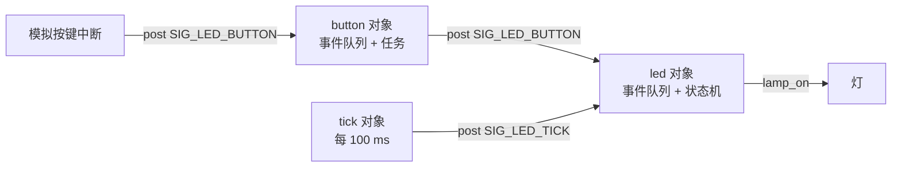
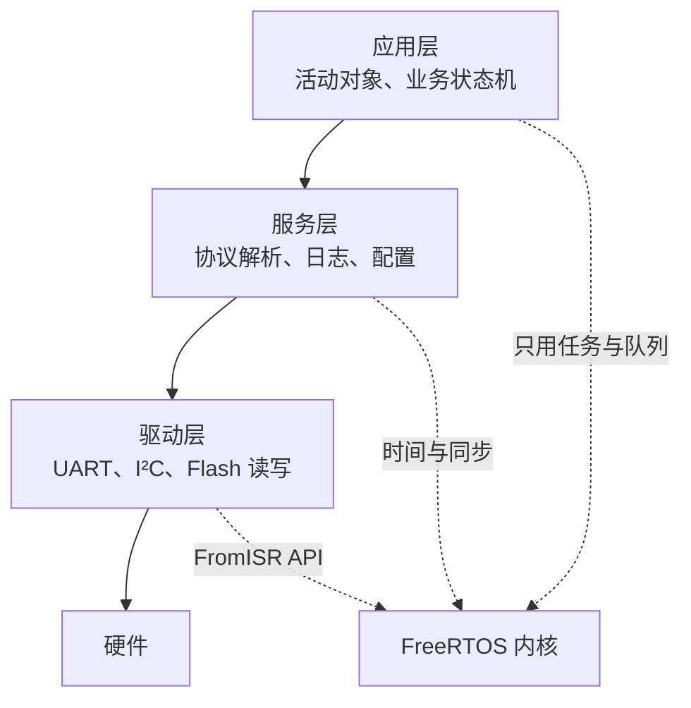

# 4.9 RTOS 固件架构、跟踪与测试

4.2 到 4.8 的任务都是三五个人工凑出来的示例：两个任务、一个队列，看得清谁在等谁。真实固件不是这样。任务一加就是十几个，共享对象散布在几个模块里，互斥量套着互斥量；某天现场返回一个「偶尔卡死」，串口没有输出，调试器连上去能看到八个任务，却不知道出事的那一秒哪个任务占着 CPU、哪个任务在等锁。

这一页解决三个问题：怎样把任务划分得让这类故障少发生，怎样在它发生时**看见**它，以及怎样在没有目标板的情况下把大部分逻辑测掉。前半是架构，后半是观测与测试。具体用到的 FreeRTOS 接口在 4.7 已经讲过，这里只引用。

## 1. 怎样划分任务

划分任务的依据有三种，按可靠性从高到低排：**按时间要求**、**按阻塞点**、按功能。

**按时间要求**。周期不同、截止时间不同的工作分给不同的任务。10 ms 采样一次与 1 s 上报一次放进同一个任务，采样周期会被上报的耗时拖长；如果上报里有阻塞（等串口发完、等网络确认），采样直接停摆。分开之后，采样任务的周期只受自己控制。

**按阻塞点**。每个会阻塞等待的外设配一个任务，或者配一个「守门」任务替大家阻塞。阻塞在 RTOS 里是正常的，问题在于**一个任务同时只能阻塞在一件事上**：一个任务既要等 UART 收到一整帧、又要等 I²C 传感器转换完成，两件事都等不了。把两种等待拆到两个任务，各自用队列或信号量接收结果。

**按功能**是最后才考虑的。按功能分（一个模块一个任务）看起来整齐，实际常常把几个不同周期的动作塞进同一个循环，前面两种问题都会出现。它适合的场合是「这个模块的状态机必须串行执行」，也就是下一节的活动对象。

任务不是越多越好。每个任务至少要一份任务控制块加一份栈（4.5 给过典型数值），切换要保存与恢复寄存器，还要多一次调度决策。十几个任务在 F103 上完全跑得动，几十个就要算一算 RAM 与切换开销了。

把 7.2 的设备（MPU6050 + ESP-AT + 日志）照这个思路拆一遍：

| 任务 | 依据 | 周期或触发 | 优先级 | 栈（字） |
| --- | --- | --- | --- | --- |
| `imu` | 时间要求：10 ms 硬截止 | 10 ms 周期 | 高（5） | 256 |
| `comm` | 阻塞点：等 ESP-AT 应答 | 事件驱动 | 中（4） | 512 |
| `logger` | 阻塞点：等 W25Q64 写入完成 | 事件驱动 | 低（2） | 384 |
| `supervisor` | 时间要求：100 ms 检查 | 100 ms 周期 | 最高（6） | 256 |

反模式有两种最常见。**一个功能一个任务**：`led_task`、`button_task`、`adc_task`、`uart_task`……十几个任务各做一件小事，每个都要一条队列接命令，任务间调用关系乱成一团。**任务之间共享大量全局对象**：`g_config`、`g_state`、`g_sample` 被五个任务读写，每个访问点都要一把锁，锁的顺序稍不留神就死锁（4.6）。

## 2. 活动对象

活动对象（active object）是把「私有数据 + 事件队列 + 状态机 + 一个任务」绑在一起的写法。对象的状态只有它自己的任务能改，别的对象想影响它，只能往它的事件队列里投一个事件。没有共享的可变数据，也就没有锁。

最小框架大约一百行，`code/嵌入式/4_RTOS与固件架构/4_9_RTOS固件架构_跟踪与测试/ao/ao.c`：

```c
/* ao.h 的核心结构：每个对象一条队列、一个任务、一个处理函数 */
struct ao {
    const char *name;
    QueueHandle_t queue;
    TaskHandle_t task;
    ao_handler_t handler;
    void *self;
};

/* ao.c：任务只做一件事——取事件、交给处理函数 */
static void ao_task(void *param) {
    ao_t *ao = (ao_t *)param;
    event_t ev;

    for (;;) {
        if (xQueueReceive(ao->queue, &ev, portMAX_DELAY) == pdPASS) {
            ao->handler(ao->self, &ev);
        }
    }
}

bool ao_post(ao_t *ao, uint16_t sig, intptr_t param, TickType_t wait) {
    event_t ev = { .sig = sig, .param = param };

    return xQueueSend(ao->queue, &ev, wait) == pdPASS;
}
```

事件只有一个信号号和一个整型参数，参数常用来传指针或小整数：

```c
typedef struct {
    uint16_t sig;
    intptr_t param;
} event_t;
```

`intptr_t` 保证能放下一个指针，8 位与 32 位目标上都成立。事件里不放「指向可变数据的指针」——对象 A 把 `&g_sample` 发出去、对象 B 去读、而 A 同时在写，共享数据又回来了。要传数据，传值，或者传一个由接收方负责释放的堆块。

把 3.4 的 LED 状态机装进活动对象，就是这个文件的全部内容（`ao/led_ao.c`）：

```c
static void led_ao_handle(void *self, const event_t *ev) {
    struct led_ao *led = (struct led_ao *)self;
    bool changed = led_fsm_dispatch(&led->fsm, ev);

    if (!changed) {
        return;
    }

    if (led->fsm.state == LED_BLINK) {
        led->lamp_on = !led->lamp_on;
        console_printf("[led] BLINK lamp=%s (tick %lu)\n",
                       led->lamp_on ? "on" : "off",
                       (unsigned long)xTaskGetTickCount());
    } else {
        led->lamp_on = led->fsm.state == LED_ON;
        console_printf("[led] state=%s lamp=%s (tick %lu)\n",
                       led_state_name(led->fsm.state),
                       led->lamp_on ? "on" : "off",
                       (unsigned long)xTaskGetTickCount());
    }
}
```

状态机本身（`led_fsm.c`）不包含任何 FreeRTOS 调用，可以单独在主机上编译测试——这一点第 7 节还会用到。

三个对象协作的完整程序（`ao/main_ao.c`）：按键中断只投递事件，按键对象收到事件后转给 LED 对象，心跳对象每 100 ms 发一个 TICK。四个模拟按下，每次推进一档：



模拟器上运行：

::: terminal title="PowerShell - ao_demo.exe"

```text
--- simulated press 1 ---
[button] press #1 -> post to led
[led] state=ON lamp=on (tick 702)
--- simulated press 2 ---
[button] press #2 -> post to led
[led] BLINK lamp=off (tick 1402)
[led] BLINK lamp=on (tick 1802)
--- simulated press 3 ---
[button] press #3 -> post to led
[led] state=OFF lamp=off (tick 2102)
--- simulated press 4 ---
[button] press #4 -> post to led
[led] state=ON lamp=on (tick 2802)
[main] done: presses=4 transitions=4 state=ON
```

:::

BLINK 状态下灯每 5 个 TICK（500 ms）翻转一次，正好对上 `led_fsm.c` 里的 `BLINK_HALF_PERIOD_TICKS`。整个程序没有一处 `xSemaphoreTake` 或互斥量。

::: compare left-title="共享对象 + 互斥量" right-title="事件 + 活动对象"

```c
/* 三个任务读写同一个 g_sample，谁都要加锁 */
static sample_t g_sample;
static SemaphoreHandle_t g_sample_lock;

void sampler_task(void *p) {
    sample_t s = read_sensor();
    xSemaphoreTake(g_sample_lock, portMAX_DELAY);
    g_sample = s;
    xSemaphoreGive(g_sample_lock);
}

void filter_task(void *p) {
    sample_t s;
    xSemaphoreTake(g_sample_lock, portMAX_DELAY);
    s = g_sample;
    xSemaphoreGive(g_sample_lock);
    filter_update(&s);
}
```

---

```c
/* 采样对象独占状态，只把事件投给滤波对象 */
static void sampler_handle(void *self, const event_t *ev) {
    struct sampler *s = self;
    sample_t sample = read_sensor();

    s->last = sample;
    ao_post(&s->filter_ao, SIG_NEW_SAMPLE,
            (intptr_t)&s->last, 0);
}
```

:::

活动对象不是银弹。它适合「一个模块有自己的状态机、要被多路事件驱动」的场合；一个纯粹的计算函数（滤波、校验、编解码）没有必要包成对象，直接当普通函数调用即可。作者判断：中等规模固件（十几个任务、四五个模块）用活动对象能去掉大部分锁，代码反而变短；只有两三个任务的简单设备，直接用队列就够了，多一层框架只是增加阅读成本。

<Quiz
  type="single"
  :options="[
    { label: '活动对象之间不共享可变数据，状态只由各自的任务修改', value: 'A' },
    { label: '活动对象框架内部替你拿了锁，所以外面看不到互斥量', value: 'B' },
    { label: '因为队列本身就是互斥的，所以任何用法都不需要互斥量', value: 'C' },
    { label: '因为所有对象跑在同一个优先级上，不会并发', value: 'D' }
  ]"
  answer="A"
>

<template #question>

用活动对象改写之后，`ao_demo` 里没有任何 `xSemaphoreTake`。原因是什么？

</template>

正确答案是 **A**。去掉锁靠的是数据归属：每份状态只有一个任务能写，其他对象只能投事件。队列的线程安全只保护事件传递这一小段，并不能让共享数据变安全——如果两个对象都通过指针去改同一个全局对象，该用的锁一个都少不了。

</Quiz>

与 Miro Samek 的 QP 框架相比，这里的一百行只保留了最核心的思想。QP 还提供状态机的层次化继承、事件的时间管理与完整的建模工具，代价是一套自己的建模约定与代码生成流程。项目里真用到层次状态机，可以引入 QP；只是想去掉锁，一百行足够。

::: generate ao-framework-analogy kind=explanation

面向只写过裸机前后台程序的读者，用「前台主循环 + 中断设标志」类比活动对象：中断投递事件相当于置标志，对象任务取事件相当于主循环检查标志，状态机相当于主循环里那个 switch。说明二者的区别——事件带参数且不会丢、对象可以按自己的节奏处理、多对象之间不需要共享标志位，也不会有标志被覆盖的问题。

:::

## 3. 分层与依赖

任务划分好之后，代码还要按依赖方向分层：



自下而上，每一层只依赖它下面的一层。驱动层处理寄存器与中断，把数据打包成「一帧」「一次转换完成」交给服务层；服务层做协议、缓存、重试；应用层是状态机与业务判断。

RTOS 的 API 只应该出现在少数几个地方：任务入口函数、队列的封装、延时与超时的调用点。其余代码写成普通函数，参数是数据，返回值是结果，不知道 RTOS 的存在。这样做的直接好处是**可测试**——第 7 节会把状态机拿到主机上直接跑。间接的好处是**可替换**：驱动换芯片、队列换实现，只改少数几个文件。

有一件事不值得做：为了「将来可能换 RTOS」在 RTOS 之上再写一层抽象（消息队列接口、线程接口、定时器接口）。这层抽象会把每个 API 的语义压成最保守的交集，超时、优先级、`FromISR` 的差别全部丢掉，最后既难用又难查。真到了换 RTOS 的那天，改动量主要来自任务创建与同步原语，按部就班改一遍比维护一层跑不动的抽象更省事。

作者判断：中小项目里，RTOS API 收敛在 `app/` 与 `bsp/` 两个目录的任务入口里就够了，不必建 `os/` 抽象层。

## 4. 监视任务与看门狗

2.10 讲过独立看门狗（IWDG）的基本原则：只有在**所有该做的工作都确实执行过**之后才喂狗。单任务程序里这很简单，主循环跑完一圈喂一次。多任务程序里，这条原则要落到「每个任务都按时打卡」上。

做法是这样的：每个被监视的任务定期把自己的「最后打卡时刻」更新一次；一个专门的监视任务每 100 ms 检查一轮，**所有任务都在超时之内**才喂狗。

```c
/* supervisor.c：打卡、检查、停止喂狗 */
struct checkpoint {
    const char *name;
    volatile TickType_t last;
};

static struct checkpoint g_watched[WATCHED_COUNT] = {
    { .name = "sampler" },
    { .name = "logger" },
    { .name = "comm" },
};

static void punch(struct checkpoint *cp) {
    cp->last = xTaskGetTickCount();
}

static void supervisor_task(void *param) {
    TickType_t last_wake = xTaskGetTickCount();

    (void)param;
    for (;;) {
        TickType_t now = xTaskGetTickCount();
        const char *stuck = NULL;

        for (int i = 0; i < WATCHED_COUNT; ++i) {
            if (now - g_watched[i].last > pdMS_TO_TICKS(TIMEOUT_MS)) {
                stuck = g_watched[i].name;
                break;
            }
        }

        if (stuck == NULL) {
            /* 喂狗：真实固件里是写 IWDG->KR = 0xAAAA */
        } else if (!g_starved) {
            g_starved = 1;
            strncpy(g_stuck_name, stuck, sizeof(g_stuck_name) - 1);
            console_printf("[watchdog] stop feeding: '%s' missed deadline at tick %lu\n",
                           g_stuck_name, (unsigned long)now);
        }

        vTaskDelayUntil(&last_wake, pdMS_TO_TICKS(CHECK_PERIOD_MS));
    }
}
```

用 32 位无符号减法算 `now - last`，节拍回绕时结果仍然正确，这一点与 4.2 讲 `xTaskDelayUntil` 时是同一个道理。

程序里让 `comm` 任务在第 2 次打卡之后停住（`vTaskSuspend(NULL)`，模拟等一个永远不会来的标志），监视任务在 3 个检查周期之后发现它超时，停止喂狗并记下名字：

::: terminal title="PowerShell - supervisor_demo.exe"

```text
[comm] stuck: no more punches (tick 122)
[watchdog] stop feeding: 'comm' missed deadline at tick 402
[main] fed 4 times, starved=1, stuck=comm
```

:::

真实硬件上，IWDG 超时复位之后芯片重新启动，`g_stuck_name` 已经不在了。想保留现场，要在停止喂狗之前把它写进 `.noinit` 段（2.10 讲过怎么保留），或者借助 6.2 的核心转储区。复位之后读出来，就知道是谁卡住了。

为什么不能在空闲钩子或定时器回调里喂狗？空闲任务在**所有任务都阻塞时**运行，一个任务卡死、其余任务正常阻塞时，空闲任务照样在跑，狗照样被喂——看门狗完全失效。定时器回调也一样：定时器服务任务如果比卡住的任务优先级低，它也可能被饿死；即使没被饿死，回调只能证明「服务任务活着」，证明不了「采样任务活着」。

::: warning 监视任务本身也要被监视

监视任务的优先级要高于所有被监视的任务（本页取 6，被监视的取 2～4），否则它自己可能抢不到 CPU。另外，监视任务只检查「打没打卡」，不检查「打卡时数据对不对」——一个死循环里仍在打卡的任务，只有校验输出值才能发现。

:::

<Quiz
  type="multi"
  :options="[
    { label: '空闲钩子里喂狗：空闲任务一直在跑，狗一直有人喂', value: 'A' },
    { label: '定时器回调里喂狗：证明定时器服务任务活着就够了', value: 'B' },
    { label: '每个任务打卡，监视任务确认全部按时才喂狗', value: 'C' },
    { label: '把喂狗放进优先级最高的任务里，它跑得最勤', value: 'D' }
  ]"
  :answer="['C']"
>

<template #question>

在多任务固件里，下面哪些喂狗方式是可靠的？

</template>

正确答案是 **C**。A、B 都只证明「某个与业务无关的任务还活着」，卡死的业务任务照样卡死。D 也一样：高优先级任务按时运行不代表低优先级任务有进展，反而可能把它饿死。

</Quiz>

## 5. 跟踪

任务表与运行时统计都是**某一时刻的快照**。真正难查的是「过去一秒里发生了什么」：哪个任务打断了谁、持锁用了多久、某个任务是不是被反复唤醒又立刻阻塞。这类问题要靠跟踪（tracing）——在任务切换的瞬间记一笔，事后把时间线画出来。

FreeRTOS 为此留了一组跟踪宏，名字形如 `traceTASK_SWITCHED_IN()`。它们在 `FreeRTOSConfig.h` 里定义，内核在对应位置展开调用。本页只用一个：

```c
/* FreeRTOSConfig.h：模拟器与目标各自映射到自己的函数 */
#if defined(__ARM_ARCH)
extern void target_trace_switch_in(void *task);
#define traceTASK_SWITCHED_IN()    target_trace_switch_in((void *)pxCurrentTCB)
#else
extern void sim_trace_switch_in(void *task);
#define traceTASK_SWITCHED_IN()    sim_trace_switch_in((void *)pxCurrentTCB)
#endif
```

钩子里做的事情越少越好——它在每次上下文切换时都会执行，直接决定切换开销。常见做法是只写两条 32 位数据：任务号与时间戳，写进一个预先分配好的 RAM 环形缓冲区。

```c
/* trace_buf.c：切换钩子只写一笔 */
#define TRACE_DEPTH 48

struct trace_entry {
    uint64_t time;
    const char *name;
};

static struct trace_entry g_trace[TRACE_DEPTH];
static volatile uint32_t g_trace_count;

void sim_trace_switch_in(void *task) {
    uint32_t index = g_trace_count;

    if (index < TRACE_DEPTH) {
        g_trace[index].time = sim_run_time_counter();
        g_trace[index].name = pcTaskGetName((TaskHandle_t)task);
    }
    g_trace_count = index + 1;
}
```

真实的跟踪库会把任务号存成 1 字节、时间戳存成 4 字节，一条记录 5 字节，1 KB 的缓冲区能放两百条。本页为了输出可读，直接存了任务名指针，缓冲区按条数而不是字节数算。

运行结束后把缓冲区打印成时间线（`trace/trace_buf.c`），模拟器上某次运行：

::: terminal title="PowerShell - trace_demo.exe"

```text
entries=42 (buffer 48)
   t/us  task
--------  ------
       0  Tmr Svc
     292  report
     329  worker_a
     361  worker_b
     395  IDLE
   34206  worker_a
   34218  IDLE
   56203  worker_a
   56213  IDLE
   66205  worker_b
   66215  IDLE
   76205  worker_a
   76214  IDLE
   96209  worker_a
   96219  IDLE
  116209  worker_b
  116218  worker_a
  116228  IDLE
  ...
  318289  report
```

:::

时间列是相对第一条记录的微秒数。`worker_a` 每 20 ms 醒一次、`worker_b` 每 50 ms 一次；每次任务醒来只运行几微秒就回到 `IDLE`。缓冲区 48 条，记录 42 条时程序结束，没有覆盖——如果运行更久，环形缓冲区会从头覆盖最老的记录，这是有意的取舍：**保留最近的一段，比保留最开始的一段有用**。

目标上的时间戳用 DWT 的周期计数器（`target/trace_dwt.c`）：

```c
#define DEMCR      (*(volatile uint32_t *)0xE000EDFCu)
#define DWT_CTRL   (*(volatile uint32_t *)0xE0001000u)
#define DWT_CYCCNT (*(volatile uint32_t *)0xE0001004u)

void dwt_timestamp_init(void) {
    DEMCR |= (1u << 24);        /* DEMCR.TRCENA */
    DWT_CYCCNT = 0;
    DWT_CTRL |= (1u << 0);      /* DWT_CTRL.CYCCNTENA */
}
```

`CYCCNT` 随内核时钟递增，72 MHz 下分辨率约 13.9 ns，比 SysTick 细得多。32 位计数在 72 MHz 下约 59.6 秒回绕一次，跟踪超过一分钟就要处理回绕。DWT 属于调试组件，需要 DEMCR 里的 TRCENA 打开；某些低功耗模式下它会停，测量方法学在 6.5。

工具方面，自己写钩子是轻量方案，功能更全的是两个现成的跟踪库：

- **Percepio Tracealyzer**：配套的开源库 `TraceRecorder` 接入 `traceTASK_SWITCHED_IN` 等一组钩子，把记录经流缓冲区送到上位机，显示成任务时间线、CPU 占用、事件交互。适合分析复杂的调度问题。
- **SEGGER SystemView**：配合 J-Link 与 RTT（Real Time Transfer），不需要额外的串口或网络，跟踪数据经调试口传出来。适合有 J-Link 的团队。

两者都只给接入方式与适用场合，安装与界面不在本页范围。

## 6. 运行时统计

跟踪回答「什么时候谁在跑」，运行时统计回答「一共各占多少 CPU」。后者在内核里打开两个开关：

```c
#define configGENERATE_RUN_TIME_STATS           1
#define configRUN_TIME_COUNTER_TYPE             uint64_t
#define portGET_RUN_TIME_COUNTER_VALUE()        sim_run_time_counter()
#define portCONFIGURE_TIMER_FOR_RUN_TIME_STATS() run_time_stats_init()
```

内核在每次任务切换时读一次这个计数器，把差值累加到「上一个任务」的 `ulRunTimeCounter` 上。所以计数器频率要足够高：官方建议是节拍频率的 10～100 倍。1000 Hz 的节拍，计数器至少 10 kHz；本页模拟器用 Windows 的高精度性能计数器（约 10 MHz），目标上可以用 DWT 或一个高速定时器。

```c
/* trace/runtime_stats_sim.c：三个任务各跑一段时间后打印 */
static void report_task(void *param) {
    char buf[1024];

    (void)param;
    vTaskDelay(pdMS_TO_TICKS(3000));

    vTaskGetRunTimeStats(buf);
    console_printf("Task            Abs Time        %% Time\n");
    console_printf("----------------------------------------\n");
    console_printf("%s", buf);
    sim_finish();
}
```

模拟器上运行 3 秒：

::: terminal title="PowerShell - runtime_stats_demo.exe"

```text
Task            Abs Time        % Time
----------------------------------------
report         	593		<1%
IDLE           	28601643		93%
logger         	52040		<1%
sampler        	1842558		6%
Tmr Svc        	2427		<1%
```

:::

`sampler` 每 10 ms 醒一次、每次做一圈计算，占了 6%；`logger` 每 50 ms 一次、计算量小，不到 1%。**空闲任务的占比就是空闲 CPU 的比例**——93% 意味着这颗 CPU 大部分时间在打转。这个数字在目标上有直接的工程含义：如果产品要求低功耗，93% 的空闲说明有大把时间可以睡（4.7 的无节拍空闲）；如果要求响应快，说明负载很轻，可以把采样周期缩短或加大滤波窗口。

`configUSE_STATS_FORMATTING_FUNCTIONS` 与 `configUSE_TRACE_FACILITY` 也要置 1，`vTaskGetRunTimeStats` 才可用。注意 `vTaskGetRunTimeStats` 在 V11 里是宏，实际调用 `vTaskGetRunTimeStatistics`，缓冲区长度由 `configSTATS_BUFFER_MAX_LENGTH` 给出：

```c
#define vTaskGetRunTimeStats(pcWriteBuffer) \
    vTaskGetRunTimeStatistics((pcWriteBuffer), configSTATS_BUFFER_MAX_LENGTH)
```

它内部依赖 `snprintf`，在目标上会把 newlib 的格式化代码拉进来，占用几 KB Flash 与不少栈。只用它做调试、发布构建里关掉，是很常见的做法。

模拟器的数字与目标不能直接对比：Windows 上任务切换的代价、系统调用的开销、调度器的抢占时机都与裸机不同。要看目标的真实占比，只能上板跑。

## 7. 测试

前面几节反复提到的「RTOS API 只出现在少数模块」，最大的回报在这里：**大部分逻辑可以离开 RTOS 测试**。

### 7.1 主机单元测试

`led_fsm.c` 不包含任何 RTOS 头文件，输入是一个事件结构，输出是「状态有没有变」。这种代码可以直接在主机上编译运行。测试程序 `unit_test/test_led_fsm.c` 甚至不需要 FreeRTOS：

```c
static void test_blink_toggles_every_five_ticks(void) {
    struct led_fsm fsm;

    led_fsm_init(&fsm);
    feed(&fsm, SIG_LED_BUTTON, 2); /* -> BLINK */
    CHECK(fsm.state == LED_BLINK);

    int toggles = 0;
    for (int i = 0; i < 20; ++i) {
        event_t ev = { .sig = SIG_LED_TICK, .param = 0 };
        if (led_fsm_dispatch(&fsm, &ev)) {
            toggles++;
        }
    }
    CHECK(toggles == 4);
}
```

运行结果：

::: terminal title="PowerShell - test_led_fsm.exe"

```text
12 checks, 0 failures
```

:::

这套测试没有框架，`CHECK` 宏记录失败次数，`main` 返回非零表示失败——足够进 CI。开发与工程基础第 11 章介绍了 Unity 等框架，换成哪个都不影响被测试的代码。

同样的做法适用于协议解析、校验、滤波、单位换算、参数校验。判据很简单：**函数不调用 RTOS API、不读全局的可变状态，就能在主机上测**。为了做到这一点，驱动层往往要把「读一次传感器」拆成「从缓冲区取一帧」加「解析这一帧」，解析部分纯函数化。

### 7.2 活动对象的事件分发

活动对象的处理函数 `ao->handler(self, ev)` 本身就是一个普通函数。测试它不需要启动调度器，直接构造事件调用 `ao_dispatch` 即可：

```c
ao_t ao = { .handler = led_ao_handle, .self = &led };
event_t ev = { .sig = SIG_LED_BUTTON };

ao_dispatch(&ao, &ev);
CHECK(led.fsm.state == LED_ON);
```

前提是处理函数里不直接调用 `xTaskGetTickCount` 之类需要调度器运行的 API。本页的 `led_ao.c` 里调用了 `xTaskGetTickCount` 只是为了打印，把它挪到一个注入的「时钟接口」后面，测试就完全独立。这是第 3 节「分层」的直接体现：打印是观测用的，逻辑是逻辑。

### 7.3 集成测试

逻辑测完，集成测试在 FreeRTOS 模拟器上跑：真的创建队列、真的起任务、真的用模拟中断驱动。本页中间几节的示例都是这种形态——`ao_demo`、`supervisor_demo`、`trace_demo` 都是集成测试的雏形，把断言加进去就是测试用例：

```c
/* 集成测试片段：驱动三个按键事件，检查最终状态 */
for (int i = 0; i < 3; ++i) {
    vPortGenerateSimulatedInterrupt(BUTTON_IRQ_APP);
    vTaskDelay(pdMS_TO_TICKS(50));
}
TEST_ASSERT_EQUAL(LED_OFF, led_ao_state().state);
```

模拟器上的集成测试可以放进 CI，每次提交都跑。**只有与真实时序有关的问题上不了模拟器**：中断延迟、抖动、真实外设的时序、电源管理下的唤醒。这些只能上板，用逻辑分析仪或 6.3 的硬件在环方案。

需要替换 RTOS API 时（例如让某个任务「一直等不到队列」），有两种办法。链接替换最直接：测试时链接一个假的 `xQueueReceive`，返回预先设定的值。更完整的是 CMock，FreeRTOS 自己的内核单元测试就用它：按头文件生成模拟函数，逐个用例设定返回值与调用次数。项目里用得多的还是第一种，因为内核源码本身就是可编译的，链接顺序即可替换。

::: tip 先让逻辑可测，再谈测试覆盖率

覆盖率数字好看不代表测试有用。先保证状态机、协议解析这类**纯逻辑**在主机上测透——它们出错概率最高、测起来最便宜。再补集成测试覆盖任务之间的交互。最后剩下的与时序相关的部分，靠现场记录与跟踪定位。倒过来做，大部分精力会花在给模拟器搭基础设施上。

:::

## 8. 习题

### 8.1 巩固

<Exercise id="64478" :d="1" :w="3">

一个数据记录仪要同时做四件事：每 5 ms 读一次 SPI Flash 的写状态寄存器（一次约 20 μs）；每 100 ms 从 I²C 传感器读一组数据（转换需要 30 ms，期间 CPU 可以等待）；收到一帧 LoRa 数据后解析并回一个 ACK（帧长不定，等完整帧可能几百毫秒）；每 1 s 把一行日志写进文件系统（写一次可能几十毫秒）。

(1) 按「时间要求」「阻塞点」「按功能」三种依据各划分一次，写出每种划分的任务数量与各自负责的工作。

(2) 三种划分里哪一种最可能导致 5 ms 的轮询被拖长？说明是哪两件事被放进了同一个任务、为什么会互相拖累。

(3) 给出你最终采用的任务表：任务名、划分依据、周期或触发方式、优先级、栈大小（字）。优先级按截止时间紧迫程度排，不要按功能重要性排。

(4) 指出一个不该拆成独立任务的动作，说明理由。

</Exercise>

<Exercise id="64479" :d="2" :w="2">

本节 `ao_demo` 的输出里，`[button] press #1 -> post to led` 与 `[led] state=ON lamp=on` 分属两个活动对象。回答：

(1) `led_ao_handle` 在哪个任务里执行？`button_handle` 呢？`button_isr` 呢？

(2) `button_handle` 里调用 `ao_post(&g_led_ao, SIG_LED_BUTTON, 0, 0)`，最后一个参数是 0。LED 对象的队列满时会发生什么？这条事件会丢吗？

(3) 如果把 `button_isr` 里改成 `ao_post(...)` 而不是 `ao_post_from_isr(...)`，可能出现什么问题？在模拟器上能复现吗？

(4) 三个对象里 `tick` 对象的队列深度是 4，心跳是 100 ms 一次。连续两次 TICK 之间 LED 对象还没处理完，队列会堆积吗？给出队列长度与 TICK 周期的关系式。

</Exercise>

<Exercise id="64480" :d="2" :w="2">

`supervisor.c` 里 `CHECK_PERIOD_MS` 为 100，`TIMEOUT_MS` 为 300，三个任务分别在 50 ms、80 ms、60 ms 周期打卡。

(1) 某个任务从节拍 1000 起停止打卡。监视任务最早在哪个节拍发现？最晚呢？写出计算过程。

(2) 把 `TIMEOUT_MS` 改成 250，发现时间怎么变？改成 50 又会怎样（打卡周期 80 ms 的任务正常工作时会发生什么）？

(3) 代码里用 `now - last` 而不是 `now > last + TIMEOUT`。解释前者在节拍回绕时为什么仍然正确，用 32 位无符号数举一个具体数值。

(4) 监视任务用 `vTaskDelayUntil` 而不是 `vTaskDelay`。如果某次检查因为优先级抢占晚醒了 30 ms，两种写法下一轮的检查时刻分别落在哪里？

</Exercise>

### 8.2 编程

<Exercise id="64481" :d="3" :w="3">

给 `led_fsm.c` 增加第四个状态 `LED_DOUBLE_BLINK`：进入后每 5 个 TICK 翻转一次，翻满 4 次（两个完整周期）后回到 `LED_OFF`。按键仍按 `OFF -> ON -> BLINK -> DOUBLE_BLINK -> OFF` 循环。

(1) 修改状态机。新增状态后 `led_state_name` 要补哪一项？不补会发生什么？

(2) 状态内的计时与状态切换都在 `led_fsm_dispatch` 里完成，不引入任何 RTOS 调用。写出 `SIG_LED_TICK` 分支的处理。

(3) 在 `unit_test/test_led_fsm.c` 里补三条测试：进入 DOUBLE_BLINK 后第 20 个 TICK 回到 OFF；中途再按一次键会立即跳到下一个状态并把 `ticks_in_state` 清零；OFF 状态下 TICK 不改变任何东西。

(4) 用 `gcc -std=c17 -Wall -Wextra` 在主机上编译运行，给出 `N checks, 0 failures` 的实际输出。改动后的测试一共多少条 `CHECK`？

</Exercise>

<Exercise id="64482" :d="3" :w="3">

活动对象的事件里只有 `intptr_t param`，放不下一条四通道采样。给 `ao` 增加一个固定块数的样本池，用「所有权转移」传递数据：

(1) 定义 `sample_t` 与一个 4 块的静态池，提供 `sample_t *sample_alloc(void)` 与 `void sample_free(sample_t *s)`。池空时 `sample_alloc` 返回 `NULL`，此时生产者丢弃本次采样并计数。

(2) 生产者对象把 `sample_alloc` 得到的指针放进事件参数投给消费者；消费者处理完调用 `sample_free`。写出两边的处理函数。

(3) 说明为什么不能像正文警告的那样直接投 `&g_sample`。用一段两任务的代码说明读到的数据会是什么。

(4) 队列满导致 `ao_post` 返回 false 时，这块样本由谁释放？在代码里补上这条路径，并用计数验证没有泄漏：运行 100 次采样、池 4 块，最后 `sample_alloc` 必须能连续取满 4 块。

(5) 池的块数取 4 是否够用？给出一个估算依据。

</Exercise>

<Exercise id="64483" :d="4" :w="4">

把 `supervisor.c` 改造成可注册的通用监视器。

(1) 定义接口：`int supervisor_watch(const char *name, uint32_t timeout_ms)` 返回打卡槽位号；被监视任务调用 `supervisor_punch(slot)`。最多 8 个槽位，槽满时返回负值。

(2) 监视任务按槽位各自的超时判断，超时时记录第一个超时槽位的名字与当时的节拍数，并停止喂狗。要求所有槽位名字总长不超过 64 字节，给出存储方案。

(3) 增加「恢复」逻辑：某任务超时之后又开始打卡，监视器要不要恢复喂狗？给出你的选择和理由，并写进代码注释。

(4) 运行一个包含 5 个任务的场景，其中一个在 1.3 秒后停住。给出输出，并计算从停住到停止喂狗的实际延迟，与 (2) 的理论值比较。

(5) 监视任务自身的优先级应该怎么定？如果它和被监视任务同优先级，会出现什么现象？

</Exercise>

<Exercise id="64484" :d="4" :w="4">

本节 `trace_buf.c` 的记录是 `{ uint64_t time; const char *name; }`，一条 12 或 16 字节，48 条就占掉几百字节。改写成真实跟踪库的紧凑格式：

(1) 记录改为 `{ uint32_t cycles; uint8_t task_id; }` 并按字节对齐压到 5 字节一条（用 `__attribute__((packed))` 或手工拼字节缓冲）。1 KiB 缓冲区能放多少条？

(2) 任务号从哪来？在 `ao` 之外的普通任务里怎么建立「任务 → 编号」的映射表？写出注册函数，并说明 `pcTaskGetName` 在中断上下文里能不能调用。

(3) 缓冲区写满后从头覆盖最老的记录。打印时怎么按时间顺序输出？写出打印函数，保证覆盖发生后时间戳仍然单调。

(4) 现在这份 `trace_buf.c` 只在 `index < TRACE_DEPTH` 时记录，写满之后就不再写任何东西，与正文说的「从头覆盖最老的记录」并不一致。把它改成真正的环形覆盖：用 `index % TRACE_DEPTH` 定位写入位置，并单独保留一个总序号。说明 `g_trace_count` 这种「先读 `index`、最后写 `index + 1`」的写法在两次切换嵌套时会不会丢记录，给出修正。

(5) 用模拟器跑 `trace_demo` 的同一组任务，把新旧两版的条目数与缓冲区占用对比，贴出数据。

</Exercise>

<Exercise id="64485" :d="4" :w="3">

正文的运行时统计表如下：

```text
Task            Abs Time        % Time
report         	593		<1%
IDLE           	28601643		93%
logger         	52040		<1%
sampler        	1842558		6%
Tmr Svc        	2427		<1%
```

(1) 用 Abs Time 求总和，逐个算出百分比，核对 `% Time` 列的取整方式。

(2) `vTaskGetRunTimeStats` 的输出顺序是按什么排的？如果自己用 `TaskStatus_t.ulRunTimeCounter` 重排成降序，写出排序代码。

(3) 增加一个不做任何延时、优先级 3 的 `busy` 任务，运行 3 秒。预测表中各行的变化，再实际运行验证。`IDLE` 会变成多少？这个结果说明什么？

(4) 目标上如果把运行时统计的计数器接到 DWT 的 `CYCCNT`，进入 Stop 模式后统计会怎样？指出这会造成什么错误结论，以及应该换成什么时钟源。

(5) 发布构建里要不要保留 `configGENERATE_RUN_TIME_STATS`？从 Flash、RAM、切换开销三方面说明。

</Exercise>

### 8.3 综合与挑战

<Exercise id="64486" :d="5" :w="5">

把 `ao_demo` 从「演示程序」改造成能进 CI 的集成测试，并补一个主机单元测试与一个链接替换测试。

(1) 集成测试：在模拟器上驱动四次按键，用 `CHECK` 断言最终状态为 `ON`、`transitions == 4`、按键对象计数为 4。断言失败时打印哪几项信息才有定位价值？给出完整测试函数与运行输出。

(2) 主机单元测试：把 `led_ao_handle` 里的 `xTaskGetTickCount` 抽到一个注入的时钟接口后面，使 `ao_dispatch` 可以在主机上直接测。写出接口定义、模拟实现与两条测试（进入 BLINK 时翻转、非 BLINK 状态不翻转）。

(3) 链接替换测试：把 `ao.c` 编进主机测试，用链接器替换掉 `xQueueReceive` 与 `xQueueSend`，让 `ao_task` 在不启动调度器的情况下跑有限轮次。写出假实现：`xQueueReceive` 依次返回预先排好的三条事件与两次超时，并在第 6 次调用时 `vTaskDelete(NULL)` 结束任务；`xQueueSend` 只记录投递的参数并返回 `pdPASS`。说明链接顺序怎么安排、为什么假符号能盖住内核里的同名函数，并给出 CMake 里对应的写法。

(4) 给出三条测试的分工表：各覆盖哪一类缺陷，哪一类缺陷三者都覆盖不到，只能靠上板或跟踪解决。

(5) 说明为什么 (1) 里的测试在 Windows 模拟器上能跑、在 CI 的 Linux 机器上需要换哪份移植层与哪一个模拟中断接口。

</Exercise>

## 9. 参考资料

1. Miro Samek, [*Quantum Leaps*](https://www.state-machine.com/)：活动对象、层次状态机与 QP 框架的官方资料。
2. Miro Samek, *Practical UML Statecharts in C/C++*, 2nd ed., Newnes, 2008（ISBN 978-0-7506-8706-5）：活动对象模型的系统论述。
3. FreeRTOS, [*Mastering the FreeRTOS Real Time Kernel*](https://github.com/FreeRTOS/FreeRTOS-Kernel-Book/blob/main/ch12.md)：第 12 章 Developer Support，跟踪钩子与运行时统计。
4. Percepio, [*TraceRecorder*](https://github.com/percepio/TraceRecorderSource)：开源跟踪库的接入方式。
5. SEGGER, [*SystemView*](https://www.segger.com/products/development-tools/systemview/)：基于 RTT 的跟踪工具。
6. FreeRTOS, [*CMock unit tests*](https://github.com/FreeRTOS/FreeRTOS/tree/main/FreeRTOS/Test/CMock)：内核本身的单元测试做法。
7. François Baldassari, [*Embedded C/C++ Unit Testing Basics*](https://interrupt.memfault.com/blog/unit-testing-basics), Memfault Interrupt：主机单元测试的组织方式。
8. Arm, [*PM0056 Programming manual: STM32F10xxx/20xxx/21xxx/L1xxxx Cortex-M3 programming manual*, Rev 7](https://www.st.com/resource/en/programming_manual/pm0056-stm32f10xxx20xxx21xxxl1xxxx-cortexm3-programming-manual-stmicroelectronics.pdf)：第 6 章 DWT 与 ITM，CYCCNT 的地址与使能位。
