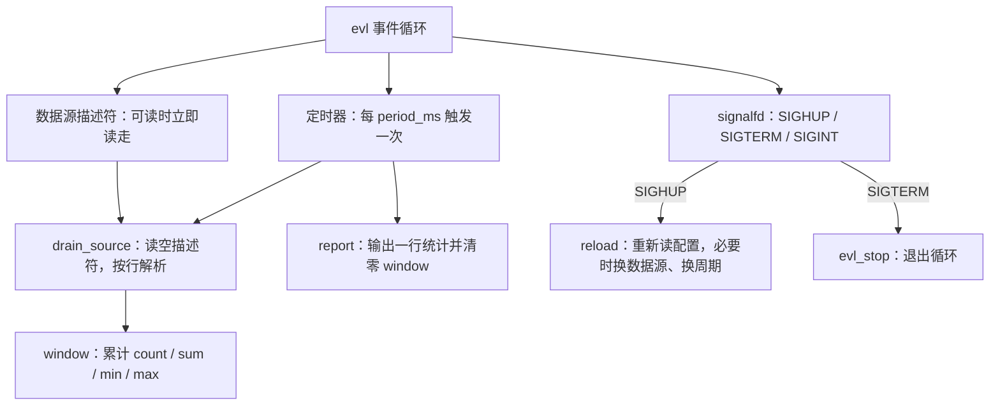
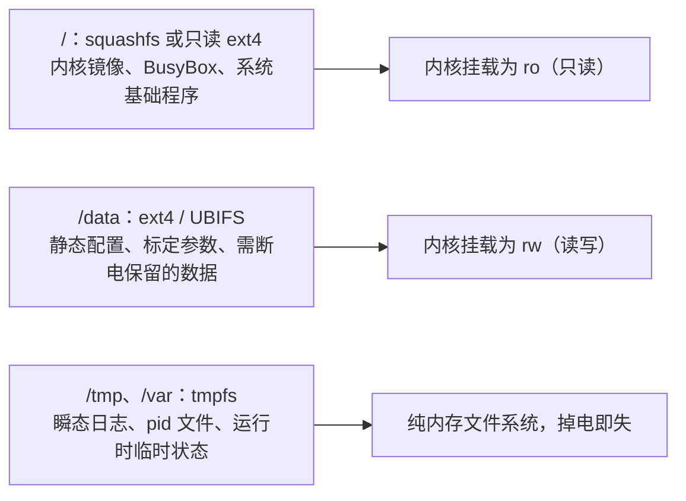

# 5.10 用户空间服务、部署与调试

在嵌入式 Linux 系统的整体软件栈中，内核驱动虽然完成了对物理外设时序、寄存器与中断的抽象，并将数据流汇聚映射至 `/dev` 字符节点或 `/sys` 属性文件中，但嵌入式设备最终向外界交付的业务功能——周期性多传感器融合采样、数字滤波与统计、上层网络报文封装上报、运行时动态配置重载以及异常崩溃下的快速自愈——均完全承载在用户空间的常驻后台服务程序（Daemon）中。从代码结构层面审视，嵌入式守护进程与通用服务端网络程序在底层 POSIX 系统调用上并没有本质分歧；然而，其赖以生存的物理运行环境却展现出极具挑战性的边界约束：

首先，嵌入式硬件绝大多数属于无外接显示屏与无交互式键盘的无头设备（Headless Devices），工程师无法在现场直接打开本地控制台审查终端打印；其次，为了抵抗突发断电带来的文件系统元数据损坏并规避闪存磨损，嵌入式根文件系统通常被全局挂载为严格只读（Read-Only），任何违背分层规范向只读目录写入的操作都会被内核立即驳回，且一旦重启便不留痕迹；再次，工业设备往往部署在无人值守的偏远机房、户外基站或高空探头中，一旦发生野指针崩溃或逻辑卡死，唯一的排障依据只能仰赖残存的日志摘要与磁盘崩溃转储（Core Dump）；最后，嵌入式受限的处理器主频与存储空间无法容纳庞大的编译器套件与本地 GDB，所有的调试交互必须依托跨体系结构的远程调试管道在宿主机与目标板之间无缝穿透。

本篇系统建立面向嵌入式工业环境的高可靠用户空间服务开发与调试范式。首先依托事件驱动模型编写一个工程级服务程序 `sensord`，剖析其如何借助 epoll、timerfd 与 signalfd 实现单线程无锁多路复用，并在非守护进程化（No-Fork）理念下实现优雅退出与配置无损热重载；随后对比 BusyBox init 与现代 systemd 两套主流服务管理机制，深入基于 UNIX 域套接字的 `sd_notify` 握手协议与看门狗心跳保活；进而解析底层物理看门狗 `/dev/watchdog` 的生命周期陷阱，结合闪存磨损防护建立读写分离的健壮存储拓扑；最后系统演示基于 NFS 快速迭代的构建部署链路，并综合运用 gdbserver 远程断点调试、core dump 事后栈分析与 strace 系统调用剖析，构筑起从开发、部署到现场排错的工业级闭环能力。

## 1. 服务程序的结构

在构建长期驻留系统的常驻服务时，软件设计必须严格遵循现代操作系统对后台服务的生命周期管控规范。在 [系统编程第 14 章](/教程/正文/系统编程/14_系统程序的健壮性与安全边界) 中，系统性阐述了高质量后台程序的黄金工程准则，本篇将其凝练为嵌入式服务落地的五大纪律：

1. **坚持前台运行，严禁自行执行传统的双重 `fork` 脱钩守护进程化**。服务的进程树治理、终端脱离与后台化收拢完全委托给外部服务管理器（如 systemd 或 BusyBox init）统一调度，防止进程脱钩导致外部 cgroup 追踪与信号链路彻底断裂。
2. **标准日志统一流向标准错误输出（stderr）**。服务内部严禁自行在只读文件系统硬编码打开 `/var/log` 下的文件，日志的收集、轮转、时间戳标注与存储下沉由系统日志设施统一托管。
3. **收到终止信号 `SIGTERM` 后执行优雅停机**。立即停止接入新的采样请求，从容将内存中正在计算或排队的一轮数据统计写入完毕并释放系统句柄后干净退出。
4. **收到挂起信号 `SIGHUP` 后执行配置热重载（Hot Reload）**。先将新配置载入临时内存结构执行严密校验，唯有全量通过才实施整体原子替换；若校验失败则立即保留旧配置继续运行，确保业务永不中断。
5. **赋予进程退出码严格的语义**：退出码 0 代表收到明确管理信号后的正常退出，非 0 退出码或异常信号终止代表业务崩溃，供服务管理器精准判定是否触发重启恢复。

基于上述准则设计的示范服务 `sensord`，其核心业务是对指定数据源（在嵌入式开发板上对应字符设备节点或 sysfs 属性文件，在宿主机仿真时对应命名管道或文本文件）按配置的 `period_ms` 周期采样，并在每个统计周期末尾对外导出统计指标（样本数、平均值、最小值与最大值）。整个服务的状态机流转如下图所示：



在程序骨架中，I/O 文件描述符的就绪检测、周期时钟触发以及系统信号捕获，全部被统一抽象为事件源并交付给轻量事件循环库（evl）进行多路复用调度。服务本身只需专心编写无阻塞的逻辑回调函数。在这一单线程驱动模型下，等待、事件分派与超时轮询完全被抹平，内存数据对象天然免疫了多线程锁竞态的开销与隐患。

### 1.1 配置与数据源

服务的静态运行参数由轻量的键值对（`key = value`）文本文件进行定义，程序内部编译有稳健的内置缺省值：若配置文件中缺失某项配置则自动回退至缺省值；若某项配置的取值超出合法边界，则立即触发加载失败并维持原有配置不变：

```text
# sensord.conf
source = sensors.txt
period_ms = 1000
```

配置项 `source` 声明了物理采集源的路径：在真实硬件板卡上，它指向 `/dev/mdr_mpu6050` 驱动节点或 `/sys/class/hwmon/...` 属性；在宿主机开发调试时，只需指向一个命名管道即可无缝接入模拟数据。配置项 `period_ms` 规定了周期统计的时间窗口（毫秒）。

服务通过命令行参数 `-f` 指定配置文件路径，默认回退读取当前工作目录下的 `sensord.conf`。在加载与重载配置时，代码遵循严格的“二阶段提交”逻辑——先读入一份独立的临时配置对象，注入缺省值后逐字段开展类型与数值合法性审查，所有审查均顺利通过后再执行原子赋值替换：

```c
static void reload(struct sensord *srv) {
    struct config next;

    if (config_load(srv->conf_path, &next) < 0) {
        logmsg("重载失败，继续使用旧配置");
        return;
    }
    bool reopen = strcmp(next.source, srv->cfg.source) != 0;
    bool period_changed = next.period_ms != srv->cfg.period_ms;

    srv->cfg = next;
    if (reopen) {
        reopen_source(srv);
    }
    if (period_changed) {
        evl_cancel_timer(srv->loop, srv->timer);
        srv->timer = evl_add_timer(srv->loop, srv->cfg.period_ms, srv->cfg.period_ms,
                                   on_tick, srv);
    }
    logmsg("重载配置: source=%s period_ms=%ld", srv->cfg.source, srv->cfg.period_ms);
}
```

若检测到采样周期变更，则优雅注销旧定时器并按新时序注册；若数据源路径更迭，则安全重新打开目标文件描述符。两部分逻辑彼此隔离解耦，实现了业务的平滑热迁移。

<Quiz
  type="multi"
  :options="[
    { label: '先把新配置完整读进临时对象，校验通过才整体替换', value: 'A' },
    { label: '边读边改，让新值尽早生效', value: 'B' },
    { label: '校验失败时保留旧配置并记一条日志', value: 'C' },
    { label: '重载过程中先停止数据采集，等配置全部生效再恢复', value: 'D' }
  ]"
  :answer="['A', 'C']"
>

<template #question>

`SIGHUP` 重载配置时，下面哪些做法是对的？

</template>

正确答案是 **A、C**。
- 先读全、再校验、最后整体替换，出错时旧配置原封不动，这是保障服务高可用的核心准则。
- B 读到中间某行才发现语法错误时，前面读取的配置已经生效，会导致服务处于配置半新半旧的裂脑状态。
- D 没有必要：重载完全在主事件循环回调里串行完成，期间没有任何并发的采集执行流，强行停掉采集反而会平白丢失采样数据。

</Quiz>

### 1.2 信号与退出

在传统的 Unix 编程中，为信号注册异步处理函数（Signal Handler）极易引发严重的竞态缺陷：信号可能在任意 CPU 指令执行间隙突然打断主执行流，处理函数内部受限于异步信号安全（Async-Signal-Safe）函数表，严禁调用绝大部分标准 C 库函数（如 `malloc`、`printf`）。为了消除这一隐患，`sensord` 全面拥抱 Linux 专有的 `signalfd` 机制：在程序启动伊始通过 `sigprocmask` 屏蔽关心的外部信号（`SIGHUP`、`SIGTERM`、`SIGINT`），随后通过 `signalfd` 将这些异步信号直接转化为一个可读的文件描述符并纳入 epoll 统一监听。如此一来，信号事件与常规的数据 I/O 事件完全在同一轮循环中串行消费，彻底消除了异步打断带来的数据结构破坏隐患：

```c
static void on_signal(evl_loop *loop, int fd, unsigned events, void *arg) {
    struct sensord *srv = arg;
    struct signalfd_siginfo info;

    (void)events;
    while (read(fd, &info, sizeof info) == sizeof info) {
        if (info.ssi_signo == SIGTERM || info.ssi_signo == SIGINT) {
            logmsg("收到信号 %u，退出", info.ssi_signo);
            evl_stop(loop);
        } else if (info.ssi_signo == SIGHUP) {
            reload(srv);
        }
    }
}
```

当捕获到 `SIGTERM` 终止信号时，回调仅调用 `evl_stop` 标记退出标志，事件循环在完成当前轮次的计算与统计输出后从容退出，所有的打开描述符在 `main` 函数终末统一关闭。此时返回的退出码 0 代表“遵从管理指令的正常退出”：systemd 的 `Restart=on-failure` 只看非零退出码与被信号杀死的进程，因此不会重启；BusyBox init 的 `respawn` 不看退出码，收到 `SIGTERM` 退出后照样会把它拉起来，这一点在第 2 节还会遇到。

### 1.3 一个容易踩的坑：普通文件与命名管道

在 Linux 系统调用底层，`epoll` 机制专用于具备“事件就绪与挂起”动态特性的异步文件类型（如套接字、管道、终端与字符设备）。对于存储在物理磁盘上的普通文件（Regular Files），VFS 规范假定其数据随时处于可直读的就绪态，因此若盲目将普通文件描述符注册进 epoll，`epoll_wait` 将会永远以零延迟立即返回就绪，直接诱发主事件循环陷入 CPU 100% 满负荷空转。为了使同一份服务既能在实体硬件设备上运行，又能在宿主机上直接读取测试文件，`sensord` 在打开数据源时通过 `fstat` 识别目标属性：仅当其为管道（`S_ISFIFO`）或字符设备时才挂入 epoll 监听，对于普通文件则退化为由周期定时器轮询拉取：

```c
static int source_open(const char *path, bool *is_stream) {
    int fd = open(path, O_RDONLY | O_NONBLOCK);

    *is_stream = false;
    if (fd < 0) {
        logmsg("open %s: %s", path, strerror(errno));
        return -1;
    }
    struct stat st;

    if (fstat(fd, &st) == 0 && S_ISFIFO(st.st_mode)) {
        close(fd);
        fd = open(path, O_RDWR | O_NONBLOCK);
        if (fd < 0) {
            logmsg("open %s: %s", path, strerror(errno));
            return -1;
        }
        *is_stream = true;
    }
    return fd;
}
```

在打开命名管道时，代码巧妙地采用了 `O_RDWR` 标志。若仅以只读（`O_RDONLY`）打开管道，一旦外部写入端进程退出关闭写端，读端在排空数据后会立即读到文件结束符（EOF，`read` 返回 0），迫使驱动程序在事件循环中必须不断重新打开该管道；而通过让自身进程同时占有写端，管道的写引用计数永远不会跌落归零，读端便永远不会遭遇虚假的 EOF，极大地简化了事件流的处理逻辑。在真实板卡上打开字符设备时不会出现 EOF 现象，这一技巧专为宿主机模拟测试而设。

::: tip 在宿主机上模拟设备

在没有物理开发板或实体传感器的情况下，只需执行命令 `mkfifo demo.fifo` 创建一个命名管道，在另一个后台终端通过 `printf` 模拟连续输入，即可在宿主机上把服务的所有业务逻辑、异常处理、配置重载与指标计算跑得通通透透。将程序迁移至真实设备时，仅需将配置文件中的 `source` 路径变更为对应字符设备节点。

:::

<Quiz
  type="single"
  :options="[
    { label: 'SIGTERM', value: 'A' },
    { label: 'SIGHUP', value: 'B' },
    { label: 'SIGINT', value: 'C' },
    { label: 'SIGKILL', value: 'D' }
  ]"
  answer="B"
>

<template #question>

服务管理器要求程序重新读取配置文件时，向它发哪个信号？

</template>

正确答案是 **B**。
- `SIGHUP` 是 Unix 传统中约定俗成的“重载配置”信号，`sensord` 在 `signalfd` 回调里重新加载并校验配置，失败时保留旧配置。
- `SIGTERM` 表达标准终止请求；`SIGINT` 是终端键盘输入的 Ctrl+C 中断；`SIGKILL` 具有不可被捕获或屏蔽的内核强制性，进程会被直接强行销毁，丧失一切清理退出的机会。

</Quiz>

## 2. 嵌入式上的 init

应用程序编写完成后，必须将其无缝挂接至系统的初始化系统（Init System，即 PID 1 根进程）中，以实现开机自启、进程监管以及故障崩溃后的自动重启恢复。嵌入式平台具体采用何种方案，完全取决于根文件系统的构建配置。

### 2.1 BusyBox init 与 inittab

在资源极其严苛的小型嵌入式系统（由 Buildroot 默认构建）中，BusyBox 提供的微型 init 工具作为系统首个进程启动。它在引导阶段负责读取配置文件 `/etc/inittab`。文件中的每一行均为一条确定的服务管理规则，遵循统一格式 `id:runlevels:action:process`：

```text
# /etc/inittab（BusyBox init）
::sysinit:/etc/init.d/rcS
::respawn:/usr/bin/sensord -f /data/sensord.conf
::respawn:/sbin/getty -L ttyS0 115200 vt100
::ctrlaltdel:/sbin/reboot
::shutdown:/bin/umount -a -r
```

在上述配置中，`::respawn:` 是实现进程自动恢复的核心动作。该动作指示 init 进程：无论目标子进程以何种形式退出（包括正常退出、段错误崩溃或被信号强行杀死），init 均会立即无条件将其重新派生拉起。这赋予了系统最基本的被动自愈能力。然而，这种简易机制也伴随着显而易见的副作用——若 `sensord` 由于配置文件语法崩溃而在启动阶段当场退出，BusyBox init 将在没有任何退避间隔的情况下疯狂重启该程序，陷入严重的 CPU 忙循环。因此在没有高级守护器保护的小系统中，服务内部必须具备防御性设计，在致命错误发生时通过睡眠重试规避忙等待。

行规则 `::sysinit:` 在引导最初阶段触发 `/etc/init.d/rcS` 脚本，该脚本按序号顺序遍历执行 `/etc/init.d/S??*` 下的一系列初始化与服务脚本。BusyBox init 支持的动作完整规范如下：

::: details inittab 的完整 action 列表

| action | 含义 |
| --- | --- |
| `sysinit` | 系统初始化的第一阶段同步执行一次，`rcS` 即依托该规则启动 |
| `wait` | 启动该进程并挂起 init，等待其彻底退出后再继续处理后续规则 |
| `once` | 系统启动时派生启动该进程一次，不等待其结束即继续处理后续规则 |
| `respawn` | 启动并持续监控该进程，一旦进程终止立即重新拉起 |
| `askfirst` | 类似于 `respawn`，但在串口控制台启动前先打印回车确认提示 |
| `ctrlaltdel` | 当捕获到键盘传递的 `SIGINT`（Ctrl+Alt+Del）组合按键时触发的指令 |
| `shutdown` | 系统关机或重启前触发执行，主要用于刷盘与安全卸载文件系统 |
| `restart` | 当 init 进程自身收到 `SIGTERM` 信号要求热重载时触发执行 |

由于 BusyBox init 裁撤了传统桌面系统的多运行级别概念，第二栏的运行级别（runlevels）字段留空，仅用于向前兼容 SysV init 的经典格式。

:::

在 Buildroot 环境中，为软件包配置随开机启动的标准方式是提供一个形如 `/etc/init.d/S50sensord` 的服务脚本：

```sh
#!/bin/sh
#
# 由 BusyBox init 在启动时执行（/etc/init.d/S50sensord）。
# start-stop-daemon 负责按 pid 文件启动与停止，避免重复启动。

DAEMON=/usr/bin/sensord
CONF=/data/sensord.conf
PIDFILE=/var/run/sensord.pid

start() {
    printf 'Starting sensord: '
    start-stop-daemon -S -q -b -m -p "$PIDFILE" -x "$DAEMON" -- -f "$CONF"
    [ $? -eq 0 ] && echo 'OK' || echo 'FAIL'
}

stop() {
    printf 'Stopping sensord: '
    start-stop-daemon -K -q -p "$PIDFILE"
    [ $? -eq 0 ] && echo 'OK' || echo 'FAIL'
}

case "$1" in
    start) start ;;
    stop) stop ;;
    restart) stop; sleep 1; start ;;
    *) echo "Usage: $0 {start|stop|restart}"; exit 1 ;;
esac
```

工具 `start-stop-daemon` 是 BusyBox 工具箱中用于守护进程启停的标准组件。参数 `-S -b -m` 表达：启动目标进程、在后台运行、并将新进程的实际 PID 写入指定的锁文件；`-K` 则读取 PID 文件并向对应进程投递 `SIGTERM` 信号实施终止。

在实际工程中，必须格外厘清 SysV 启动脚本与 `inittab` 中 `respawn` 规则的协作互斥关系：二者不宜对同一服务无序混合配置。若在 `inittab` 中显式配置了 `respawn`，同时又在启动脚本中调用启动，当运维人员手动执行 `S50sensord stop` 杀死进程后，init 进程检测到子进程消亡，会立刻遵照 `respawn` 规则再度将其强制拉起，导致人工维护时“永远停不掉服务”。因此在研发调测期推荐依托启动脚本配合 PID 文件进行按需启停；在量产锁定阶段再正式启用 `respawn` 监视规则。

### 2.2 systemd 单元

在算力充沛且架构复杂的嵌入式网关或车载计算平台中，systemd 是被广泛采用的服务编排基础设施。systemd 彻底摒弃了冗长易错的 Shell 脚本，每个独立服务通过结构化的单元（Unit）文件进行声明：

```ini
[Unit]
Description=mdr sensor daemon
After=network.target

[Service]
Type=notify
ExecStart=/usr/bin/sensord -f /data/sensord.conf
WatchdogSec=10s
Restart=on-failure
RestartSec=2s
User=sensord
Group=sensord
ReadWritePaths=/data
StandardOutput=journal
StandardError=journal

[Install]
WantedBy=multi-user.target
```

细致解析针对嵌入式场景量身定制的关键指令：

| 指令 | 作用 |
| --- | --- |
| `Type=notify` | 声明服务支持启动就绪协议，服务初始化完毕后必须显式向 systemd 发送就绪通知，在此之前系统判定其仍处于启动过渡态 |
| `WatchdogSec=10s` | 启用应用级看门狗监管，服务必须在该时间间隔内持续发送心跳保活信号，超时未见心跳 systemd 将强制将其击杀并重置 |
| `Restart=on-failure`、`RestartSec=2s` | 当服务因非零退出码或异常信号终止时自动重启，重启前施加 2 秒冷却退避以防忙死锁 |
| `User=`、`Group=` | 降权隔离执行，剥夺服务的 root 特权，以低权限系统账户运行 |
| `ReadWritePaths=/data` | 命名空间沙盒防护：在全局只读根文件系统背景下，单独为该服务放开 `/data` 分区的写入权限 |

其中，指令 `Type=notify` 与 `WatchdogSec=` 构成了服务健康监管的核心。这要求服务代码主动配合 systemd 规范：在启动完成各模块就绪后立即发出一帧 `READY=1`；在后续的业务循环中周期性发出心跳帧 `WATCHDOG=1`。心跳发送的时机不宜在代码中硬编码固定常数，因为 systemd 会将超时时限通过外部环境配置参数 `WATCHDOG_USEC`（单位微秒）注入进程环境，服务按其数值的一半左右安排心跳间隔，即可在后续修改服务单元配置时实现纯配置驱动。在完整的 glibc 环境下可以直接链接调用 `libsystemd` 库中的 `sd_notify()`；而在精简的嵌入式根文件系统中，开发者可以直接依据 [sd_notify(3)](https://www.freedesktop.org/software/systemd/man/latest/sd_notify.html) 规范，直接通过标准的 UNIX 数据报套接字实现零依赖握手协议。协议本身极度纯粹：`$NOTIFY_SOCKET` 环境参数给出一个 Unix 数据报套接字的路径，报文内容即为纯 ASCII 字符串 `KEY=VALUE\n`：

```c
int notify_send(const char *state) {
    const char *path = getenv("NOTIFY_SOCKET");

    if (path == NULL || *path == '\0' || state == NULL) {
        return -1;
    }
    int fd = socket(AF_UNIX, SOCK_DGRAM | SOCK_CLOEXEC, 0);

    if (fd < 0) {
        return -1;
    }
    struct sockaddr_un addr;
    size_t skip = path[0] == '@' ? 1 : 0;
    size_t len = strlen(path + skip);

    memset(&addr, 0, sizeof addr);
    addr.sun_family = AF_UNIX;
    if (len + 1 > sizeof addr.sun_path) {
        close(fd);
        return -1;
    }
    memcpy(addr.sun_path + skip, path + skip, len);
    /* 抽象命名空间：地址的第一个字节是 0，长度从 sun_path 起算。 */
    socklen_t addr_len = (socklen_t)(offsetof(struct sockaddr_un, sun_path) + skip + len);

    ssize_t sent = sendto(fd, state, strlen(state), 0, (struct sockaddr *)&addr,
                          addr_len);

    close(fd);
    return sent == (ssize_t)strlen(state) ? 0 : -1;
}
```

在 `sensord` 的主流程中，该通知逻辑被部署在两处关键节点：其一是在 `main` 函数完成配置文件解析、数据源成功打开且定时器就绪后，主动发送 `READY=1` 通知系统启动完毕，依赖它的下游服务得以解除阻塞；其二是在主循环回调 `on_tick` 完成一轮真实数据解析与计算之后，主动发出保活报文 `WATCHDOG=1`。务必注意，心跳信号决不能单纯放置在独立定时器中无条件发送，而必须紧密锚定在真实采样处理完成的终点——只有当业务流水线切实执行完毕，才能证明服务处于健康的活跃状态。若外部未配置 `$NOTIFY_SOCKET`（例如直接在普通 Shell 中调测），`notify_send` 安全忽略并返回。

在此处需要关注对 Linux 抽象命名空间（Abstract Namespace）的处理。当套接字路径以 `@` 字符起始时，代表其为一个不绑定在文件系统树中的纯内存抽象套接字，在填充 `sockaddr_un` 结构体时，`sun_path` 的第一个字节必须显式填充为 `0`，而套接字地址的长度必须精确计算包含该首字节。若长度计算失误，数据报将投递至错误的匿名管道并导致 systemd 彻底收不到心跳。

此协议的通信正确性无需依赖完整的 systemd 环境即可在本地验证：

::: terminal title="bash - 验证 notify_send（真实输出）"

```text
$ python3 -c 'import socket; s=socket.socket(socket.AF_UNIX, socket.SOCK_DGRAM); s.bind("notify.sock"); s.settimeout(5); print(repr(s.recvfrom(256)[0]))' &
$ NOTIFY_SOCKET=notify.sock ./notify_demo
notification sent
b'READY=1\nSTATUS=sensord started'
```

:::

接收端准确捕获到了就绪握手与业务状态文本，确凿证明手写的套接字协议封包完全符合标准。

### 2.3 选哪一个

在嵌入式选型决策中，若系统是针对轻量低成本微控制器（如 ARM9、Cortex-A7）定制的紧凑根文件系统，BusyBox init 凭借几百 KB 的极致轻量和清晰易懂的 Shell 流程成为极简系统的坚实基石；而若产品形态属于网关、工业边缘计算等具备复杂网络拓扑、需要依赖顺序拓扑编排、系统日志集中治理以及细粒度沙盒隔离的场景，systemd 带来的自动化恢复与资源切分优势将远超其数兆内存开销。两者的核心控制对比如下：

::: compare left-title="BusyBox init" right-title="systemd"

```text
# /etc/inittab
::respawn:/usr/bin/sensord -f /data/sensord.conf
```

---

```ini
# sensord.service
[Service]
Type=notify
ExecStart=/usr/bin/sensord -f /data/sensord.conf
WatchdogSec=10s
Restart=on-failure
RestartSec=2s
```

:::

两套框架在崩溃恢复的设计哲学上大相径庭：BusyBox init 的机制简单粗暴，只要进程消亡即刻盲目重新拉起；而 systemd 提供了完备的重启冷却间隔、最大失败频度上限控制（`StartLimitBurst=`），并能精准区分“受控退出”与“异常崩溃”，显著降低了系统因雪崩错误引发的死循环抖动风险。

## 3. 硬件看门狗

由 init 进程驱动的软件自愈机制存在一个无法回避的前提假定：操作系统的内核调度器必须仍然存活。若嵌入式系统遭遇驱动级空指针内核恐慌（Kernel Panic）、多核中断风暴陷入软锁死（Soft Lockup）、或者系统物理内存彻底耗尽导致内核陷入沉重的 OOM 页面颠簸，此时处于用户空间的 init 进程根本得不到任何 CPU 调度时间片，所有的软件进程监视机制都将陷入瘫痪。为了在极端系统卡死状态下实施终极自愈，嵌入式工业板卡标配了硬件看门狗（Hardware Watchdog）电路：这是一个依托独立物理时钟源运转的递减定时器计数器，运行正常的软件系统必须在设定的窗口期内定期向其发出刷新电平脉冲（通称“喂狗”）；若软件一旦陷入停摆导致计数器归零溢出，看门狗硬件会直接向 CPU 芯片的 RESET 引脚拉低复位电平，强行重启整台设备的物理电源。

在 Linux 内核架构中，各厂商的物理看门狗控制器被标准抽象为统一的 `/dev/watchdog` 字符设备。驱动接口规范由 [内核文档](https://docs.kernel.org/watchdog/watchdog-api.html) 做出清晰约束：

| 操作 | 行为 |
| --- | --- |
| `open("/dev/watchdog")` | 启动底层硬件定时器。**打开设备的瞬间硬件即刻开始倒计时** |
| `write(fd, &c, 1)` | 喂狗操作，刷新重置硬件倒计时计数器，写入任意字符均可生效 |
| `ioctl(fd, WDIOC_KEEPALIVE)` | 基于 ioctl 的标准化喂狗指令 |
| `ioctl(fd, WDIOC_SETTIMEOUT, &s)`、`WDIOC_GETTIMEOUT` | 动态配置与查询硬件超时的秒数 |
| `write(fd, "V", 1)` 后执行 `close` | 触发魔术安全关闭（Magic Close）：向芯片发送停用指令，平稳关闭看门狗并不触发系统复位 |
| 直接调用 `close`（未提前写入字符 `'V'`） | 内核驱动判定为异常退出，看门狗**在硬件底层继续倒计时**，超时后强制复位系统 |

表格终末两行是初学者最常遭遇的物理陷阱：在 Linux 看门狗规范中，调用用户态的 `close()` 函数绝不等于停止硬件计时！为了防止看门狗管理进程因段错误崩溃或被非法 `kill -9` 杀死后导致设备永远丧失硬件监视保护，驱动核心明确要求：只有在执行 `close` 系统调用前，向设备节点明确写入特定魔术字符 `'V'`，驱动才会真正通知物理芯片关闭时钟源；若直接关闭文件句柄，硬件定时器将继续在后台无情倒计时，数秒后直接拉低复位引脚触发整机冷重启。这种防御性设计恰好契合了高可用系统的需求——当服务异常崩溃导致句柄被系统被动释放时，看门狗将坚决代为执行整机复位。

::: concept emb-watchdog-open-start title="/dev/watchdog 的生命周期"

打开字符节点 `/dev/watchdog` 的瞬间，物理芯片内部的硬件递减计数器即刻被激活启动，与用户是否紧接着写入数据无关。写入单字节字符或调用 `WDIOC_KEEPALIVE` 会重置计数器倒计时；直接关闭文件描述符不会停止计数，唯有先写入魔术字符 `'V'` 再行关闭（Magic Close）才能安全关停。因此在编写代码时，看门狗的“打开初始化”与“周期刷新喂狗”必须作为强相关的整体逻辑同步编排，严禁出现打开后因初始化异常未及喂狗而导致系统猝死复位的状况。

:::

在系统治理中，看门狗的托管通常有两种实践路径：一种是托付给 systemd 集中管理，在配置文件 `/etc/systemd/system.conf` 中声明 `RuntimeWatchdogSec=10s`，由 PID 1 进程直接掌控 `/dev/watchdog`，并在前台配合服务单元的 `WatchdogSec=` 级联监管；而在未装配 systemd 的轻量系统中，则由核心服务自行打开看门狗实施保活：

```c
static int watchdog_open(struct watchdog *wd, const char *path, int timeout_s) {
    wd->fd = open(path, O_WRONLY | O_CLOEXEC);
    if (wd->fd < 0) {
        return -1;
    }
    if (timeout_s > 0) {
        int value = timeout_s;

        if (ioctl(wd->fd, WDIOC_SETTIMEOUT, &value) < 0) {
            /* 某些底层驱动受分频系数限制会微调该时限，忽略返回微小差异保持原样 */
        }
    }
    return 0;
}

static int watchdog_feed(struct watchdog *wd) {
    static const char ping = 'k';

    return write(wd->fd, &ping, 1) == 1 ? 0 : -1;
}
```

在工程架构中，**喂狗的时机远比喂狗的代码动作本身更为重要**。若在代码中单独开辟一个独立的定时器线程，仅仅机械地周期发送刷新脉冲，这种设计无异于掩耳盗铃——主业务线程即使由于死锁、内存泄露或外设 I/O 挂死而在后台彻底瘫痪，看门狗定时器依然在定期汇报“系统健康”，导致硬件监视彻底失效。真正稳健的喂狗位置必须深植于业务主流程的核心终点：唯有一轮传感器数据被真实读出、校验解析通过、且统计指标成功落盘或投递之后，才触发一次 `watchdog_feed`。正如在 [4.9 RTOS 固件架构、跟踪与测试](/教程/正文/嵌入式/4_RTOS与固件架构/4_9_RTOS固件架构_跟踪与测试) 中阐明的原则一样：看门狗监测的永远应当是“业务产出切实完成”，而非单纯的“程序主循环仍在空转”。

## 4. 存储与配置

嵌入式系统的非易失性物理存储介质（如 SPI NOR Flash、Raw NAND、eMMC 或工业 SD 卡）与传统服务器的机械硬盘或数据中心 NVMe SSD 相比，存在着两大严峻的物理制约：其一是容量极其有限，往往仅在百兆至数吉字节区间；其二是闪存物理单元（Flash Cells）的擦除寿命极其宝贵（NOR Flash 通常约为 10 万次，SLC NAND 约为几万次，而主流 eMMC/TLC 仅有数千次）。尽管存储控制器内部运行着闪存转换层（FTL）实施动态磨损均衡（Wear Leveling），但若一个后台服务每秒不加节制地向磁盘写入一条文本日志，只需数月时间就足以将局部物理块的寿命彻底耗尽，诱发只读锁定或物理坏块。

为了同时化解闪存磨损与工业现场突发断电带来的文件系统元数据损坏风险，嵌入式 Linux 普遍采用经典的读写分层存储拓扑：



在这一架构拓扑中，系统的各个组件被严格规约至适配其物理特性的分区上：

- **系统固件与程序库**被固化在只读（`ro`）挂载的根分区中（通常采用具备高压缩比与结构坚固性的 SquashFS 格式）。在此模式下，任何恶意篡改或异常写入均被底层 VFS 直接驳回；设备即便在频繁的剧烈意外断电中断，根分区元数据绝不会遭遇逻辑损坏，OTA 固件升级时亦通过 A/B 双系统分区实施整块无缝切换。
- **动态配置文件与传感器标定参数**被收敛存放至独立的读写分区 `/data` 中。在工厂下线生产时在此预置出厂基准参数，运行中的更新操作严格局限在此分区内。
- **高频日志流与 PID 锁文件**则被引导至纯内存虚拟文件系统 `tmpfs`（挂载于 `/tmp` 与 `/var/run`）。写入这些目录的数据直接驻留在 CPU 内存页框中，不仅吞吐速率极高，而且完全旁路了底层物理闪存芯片，实现了真正的物理零磨损；设备重启或断电后内存自动清空，天然规避了因残留陈旧 PID 文件导致服务启动误判的历史包袱。

应用程序在设计上必须严谨适配这种分层规范：首先，应用程序内部必须静态硬编码一份完整的缺省配置对象。当系统处于首次出厂启动、`/data` 分区尚未初始化配置文件时，服务能够优雅地依赖内置参数平稳拉起，并在此后异步创建默认文件，杜绝因找不到文件直接崩溃的脆断行为。其次，向 `/data` 分区持久化配置文件时必须执行**原子落盘保障**：严格遵循“写入临时文件 -> `fsync` 刷入存储介质 -> `rename` 覆盖目标文件 -> 针对父目录执行 `fsync`”的完整四步协议，坚决防止写入中途突发断电产生残缺截断的破损文件。

对于日志治理，常规服务输出应直接打向标准错误输出（stderr），由 systemd-journald 统一收集，或由 BusyBox 的 `syslogd` 将内存中的环形日志实时通过网络转发至局域网日志汇聚服务器；若确实需要将关键报警日志落入本地存储，必须通过轮转（Logrotate）限制固定大小的环形文件深度，严防日志文件无序膨胀最终撑爆 `/data` 磁盘空间。

## 5. 部署

在工程研发与迭代阶段，若每次修改一行代码都要重新构建整包镜像并经历漫长的烧录与重启流程，将严重阻碍调试效率。工业界通常采用两条高频的极速直通部署路径：

**基于 NFS 的网络根文件系统（NFS Rootfs）** 是底层研发最优雅的开发模式。在 U-Boot 引导阶段，通过内核启动参数将根文件系统的挂载目标重定向至局域网宿主机的网络共享目录：

```text
root=/dev/nfs nfsroot=192.168.1.1:/srv/nfs/rootfs,vers=4 ip=dhcp rw
```

在此模式下，嵌入式板卡在引导后直接通过网络驱动透视宿主机导出的文件夹。开发者在宿主机上完成交叉编译后，只需将新的二进制文件直接覆盖至对应导出目录，目标板卡无需重启即可即时执行最新编译的程序。

**基于轻量 SSH 的快速下发（SCP 模式）**。在目标开发板的非生产镜像中运行 Dropbear 等轻量级 SSH 守护进程，宿主机通过交叉编译生成单体二进制后，直接通过安全传输协议覆盖写入目标目录：`scp sensord root@192.168.1.10:/usr/bin/`。这一方案仅适用于原型调测期，在量产的只读根文件系统中由于缺失写权限及安全隔离要求而必须停用。

当项目步入量产发布阶段时，标准部署形态是将其封装为 Buildroot 专属软件包（Package）或 Yocto 语法配方（Recipe），将其编译流、安装路径与启动守护脚本全量融入自动化根文件系统构建管线中（参见 [5.4 Buildroot与Yocto](/教程/正文/嵌入式/5_嵌入式Linux/5_4_Buildroot与Yocto)）。同时，出于工业网络安全加固规范，量产服务严禁以 root 超级权限盲目裸奔，应在构建阶段为其分配专属的受限系统用户与用户组（如 `sensord:sensord`），并通过 udev 或 mdev 设备规则（例如在 `/etc/mdev.conf` 中追加设备节点属主调整规则）将 `/dev/mdr_mpu6050` 等硬件节点的读写权能精准委托给该专用用户，构筑最小特权（Least Privilege）的安全防线。

## 6. 调试

在嵌入式目标板卡上，通常既没有配备本地 GCC 编译工具链，亦缺乏充足的内存来承载庞大 GDB 的符号表解析。嵌入式领域的经典调试思想，是在目标板卡上仅部署极度轻量化的执行代理服务端，而将重度消耗算力与内存的符号检索、源代码展示与断点控制完全留在高性能宿主机端完成。

### 6.1 gdbserver 远程调试

在目标板卡上运行轻量级控制代理 `gdbserver`。它可以接管一个新派生进程的启动，亦能附加（Attach）至已在后台运转的进程 PID 上，并通过 TCP 端口向外部暴露标准的 GDB 远程调试协议接口：

::: terminal title="目标板 - gdbserver（输出类似，取自 GDB 文档 Remote Debugging）"

```text
# gdbserver :2345 /usr/bin/sensord -f /data/sensord.conf
Process /usr/bin/sensord created; pid = 812
Listening on port 2345
```

:::

在宿主机开发机一侧，开发者必须调用与目标架构严格匹配的交叉 GDB 工具（如 `arm-linux-gnueabihf-gdb`）。在此过程中，最为关键的配置是指定系统根目录 `sysroot`——它必须精确指向 Buildroot 构建产物中的目标库集成目录 `output/staging`：

::: terminal title="宿主机 - 交叉 gdb（输出类似，取自 GDB 文档 Remote Debugging 与 Bootlin 实验手册）"

```text
$ arm-linux-gnueabihf-gdb ./sensord
(gdb) set sysroot output/staging
(gdb) target remote 192.168.1.10:2345
Remote debugging using 192.168.1.10:2345
Reading symbols from output/staging/lib/ld-linux-armhf.so.3...
(gdb) break handle_line
Breakpoint 1 at 0x10a4c: file sensord.c, line 182.
(gdb) continue
Continuing.
Breakpoint 1, handle_line (srv=0x7efff2a0, line=0x7efff0c0 "10:00:00 21.5") at sensord.c:182
182	    snprintf(copy, sizeof copy, "%s", line);
```

:::

必须深刻理解 `set sysroot` 的物理价值：嵌入式动态链接程序在启动时依赖目标板上的 C 运行库与动态链接加载器（如 `ld-linux-armhf.so.3`）。若未正确设置 sysroot，宿主机的 GDB 将会盲目去读取宿主机本地系统目录（如 x86_64 架构的 `/lib`），当解析器遭遇 ELF 机器字长与指令架构不匹配的冲突时，共享库的符号解析将全线崩溃。通过正确配置 sysroot 与源码检索目录（`directory`），远程断点拦截、单步汇编推进与局部对象审查即可在宿主机的大屏 IDE 中流畅展开。

若在 QEMU 仿真环境下开展远程调试，由于 QEMU 虚拟机的内部网络对宿主机通常处于单向隔离态，启动虚拟机时需借助端口转发机制：

```text
-netdev user,id=net0,hostfwd=tcp::2345-:2345 -device virtio-net-device,netdev=net0
```

随后宿主机 GDB 直接连接本地回环端口 `localhost:2345` 即可穿透进入虚拟机内部。

### 6.2 core dump

对于那些难以在测试台稳定复现、在户外实际现场偶然发生的罕见崩溃（如偶发性的空指针解引用或内存破坏引发的 `SIGSEGV`），远程连线往往无能为力。此时最有效的离线“黑匣子”排查武器是核心转储（Core Dump）：当进程遭受致命信号终止时，操作系统内核能够将该进程瞬时的整个虚拟地址空间内存页、通用寄存器状态与调用栈完整捕获并序列化成 core 镜像文件落盘保存。

在嵌入式目标板上启用核心转储需要两步前置配置：解除系统对 core 文件大小的零配额限制，并规划可写存储路径：

::: terminal title="目标板 - 打开 core dump（输出类似，取自 core(5)）"

```text
# ulimit -c unlimited
# echo '/data/cores/core.%e.%p' > /proc/sys/kernel/core_pattern
```

:::

其中模式占位符 `%e` 对应崩溃程序的可执行文件名，`%p` 对应崩溃时刻的进程 PID。将生成的 core 文件通过网络或存储卡拉取回宿主机，直接配合带有调试符号的原生二进制程序送入交叉 GDB 展开“尸检”回溯：

::: terminal title="宿主机 - 分析 core（输出类似）"

```text
$ arm-linux-gnueabihf-gdb ./sensord core.sensord.812
(gdb) bt
#0  0x00010b28 in handle_line (srv=0x0, line=0x0) at sensord.c:182
#1  0x00010d10 in drain_source (srv=0x7efff2a0) at sensord.c:220
#2  0x00010e44 in on_tick (...) at sensord.c:258
```

:::

GDB 能够瞬间将崩溃现场还原并精确定位至触发非法解引用的源码具体行数，调阅局部对象的内存快照。由于嵌入式 `/data` 空间极其紧张，必须通过脚本或应用程序自编排机制限制 `/data/cores/` 下的历史文件保留总数，防止连续多次崩溃耗尽分区容量。

### 6.3 strace

当服务程序并没有遭遇段错误崩溃、但其业务行为完全脱离预期（例如卡在某处不再输出、无法读取数据或 CPU 异常高负载）时，系统调用跟踪工具 `strace` 是透视用户态程序与内核交互的最锐利透镜。它利用系统的 `ptrace` 机制无死角捕获应用程序向 Linux 内核发起的每一个系统调用、入参结构体以及最终的系统返回值：

::: terminal title="bash - strace 观察 sensord（真实输出，已省略加载器与本地时区的部分）"

```text
$ strace -o trace.err -e trace=openat,read,epoll_wait,epoll_ctl,signalfd4,close ./sensord -f t.conf
$ sed -n '/t.conf/,$p' trace.err | grep -v 'localtime\|TZif'
openat(AT_FDCWD, "t.conf", O_RDONLY)    = 3
read(3, "source = t.fifo\nperiod_ms = 2000"..., 4096) = 33
read(3, "", 4096)                       = 0
close(3)                                = 0
openat(AT_FDCWD, "t.fifo", O_RDONLY|O_NONBLOCK) = 3
close(3)                                = 0
openat(AT_FDCWD, "t.fifo", O_RDWR|O_NONBLOCK) = 3
epoll_ctl(4, EPOLL_CTL_ADD, 3, {events=EPOLLIN, data=0x3}) = 0
signalfd4(-1, [HUP INT TERM], 8, SFD_CLOEXEC|SFD_NONBLOCK) = 5
epoll_ctl(4, EPOLL_CTL_ADD, 5, {events=EPOLLIN, data=0x5}) = 0
epoll_wait(4, [{events=EPOLLIN, data=0x3}], 64, 2000) = 1
read(3, "10:00:00 21.5\n", 512)         = 14
read(3, 0x7ffec8cc7930, 512)            = -1 EAGAIN (Resource temporarily unavailable)
epoll_wait(4, [{events=EPOLLIN, data=0x5}], 64, 1201) = 1
read(5, "\1\0\0\0\0\0\0\0\0\0\0\0\310\27\22\0\353\3\0\0\0\0\0\0\0\0\0\0\0\0\0\0"..., 128) = 128
openat(AT_FDCWD, "t.conf", O_RDONLY)    = 6
read(6, "source = t.fifo\nperiod_ms = 2000"..., 4096) = 33
read(6, "", 4096)                       = 0
close(6)                                = 0
read(5, 0x7ffec8cc79a0, 128)            = -1 EAGAIN (Resource temporarily unavailable)
epoll_wait(4, [{events=EPOLLIN, data=0x5}], 64, 599) = 1
read(5, "\17\0\0\0\0\0\0\0\0\0\0\0\310\27\22\0\353\3\0\0\0\0\0\0\0\0\0\0\0\0\0\0"..., 128) = 128
read(5, 0x7ffec8cc79a0, 128)            = -1 EAGAIN (Resource temporarily unavailable)
close(4)                                = 0
close(5)                                = 0
close(3)                                = 0
+++ exited with 0 +++
```

:::

在这段详细的调用轨迹中，`sensord` 的生命周期被完全透明化：从最初两次打开 `t.fifo` 并利用 `O_RDWR` 规避管道断开，到通过 `signalfd4` 将三大信号映射为文件句柄，再到 epoll 依据当前消耗时间将后续等待超时动态衰减为 1201 毫秒；读取到 `read(5, ...)` 返回的 128 字节 `struct signalfd_siginfo` 结构中，首字节为十六进制 `\1` 准确对应了捕获到的 `SIGHUP` 重载信号；而在末尾再次捕获到十六进制 `\17`（即十进制 15，`SIGTERM`）后，所有文件句柄被依次安全调用 `close` 并以退出码 0 优雅停机。一旦程序出现文件路径找不到、非阻塞被误写为阻塞导致死锁等异常，结合 strace 的调用序列能够在一分钟内锁定问题根源。

针对内核一侧的排障，则主要通过读取 `dmesg` 结合动态调试（Dynamic Debug）设施展开：若内核编译启用了 `CONFIG_DYNAMIC_DEBUG`，开发者可以在运行时直接向控制节点写入指令（例如 `echo 'file mdr_mpu6050.c +p' > /sys/kernel/debug/dynamic_debug/control`），动态激活目标驱动文件内部的 `dev_dbg` 诊断日志，无须重新编译内核模块即可实时排查驱动通信时序。

## 7. 在宿主机上先测

为确保嵌入式用户态服务的可靠性，建立脱离实体开发板、在宿主机开发环境上一键全自动回归测试的能力至关重要。利用标准的 Shell 脚本配合命名管道模拟数据注入、利用 `kill -HUP` 模拟热重载并在终末下发 `kill -TERM`，整个闭环可以在常规 Linux 工作站上于数秒内自动化验证完毕：

::: terminal title="bash - 在宿主机上运行 sensord（真实输出）"

```text
$ ./demo.sh
--- SIGHUP，周期改为 2000 ms
--- SIGTERM
--- stdout
20:32:10 samples=0
20:32:11 samples=3 mean=22.33 min=21.50 max=23.50
20:32:12 samples=2 mean=22.75 min=20.40 max=25.10
--- stderr
sensord 启动: pid=1188663 source=demo.fifo period_ms=1000
重载配置: source=demo.fifo period_ms=2000
收到信号 15，退出
```

:::

输出日志清晰证实：启动阶段正确汇报参数；第一周期由于无数据注入正常输出 `samples=0`；第二周期精准捕获 3 条样本并推导出均值 22.33；收到重载信号后平稳将时钟窗口拉长至 2000 毫秒；收到终止信号后从容收尾退出。这种完全旁路物理外设与 root 特权的单元回归设计，能够在代码提交进版本库的第一时间拦截绝大部分逻辑协议缺陷。

## 8. 习题

### 8.1 巩固

<Exercise id="60501" :d="1" :w="1">

在 `code/嵌入式/5_嵌入式Linux/5_10_用户空间服务_部署与调试/` 下编译并运行示例，比较命名管道与普通文件两种数据源。

(1) 执行 `make` 与 `./demo.sh`，贴出 stdout 与 stderr。解释第一行为什么是 `samples=0`，第二行的 `mean=22.33` 与哪三行数据对得上。

(2) 用同目录的 `sensord.conf`（`source = sensors.txt`）启动 `sensord`，运行两个周期后按 Ctrl+C。贴出输出，说明这个数据源为什么没有登记进 epoll，统计却照样进行。

(3) 在 (2) 运行期间，另开一个终端执行 `echo '10:00:09 30.0' >> sensors.txt`，观察下一个周期的输出。普通文件的「就绪」与命名管道的「就绪」差别在哪里？

</Exercise>

<Exercise id="60502" :d="2" :w="2">

`config_load` 的规则是缺省值先填、认不出的项忽略、取值无效则整体失败。用下面这份配置逐项验证：

```text
# t.conf
source = sensors.txt
period_ms = 0
unknown_key = 1
这一行没有等号
```

(1) 先写下你认为的 stderr 与退出码，再运行 `sensord -f t.conf`，对照实际结果。

(2) 依次把 `period_ms` 改成 `70000`、`abc`、`2000 # 两秒`，各运行一次并记录结果。第三项失败与哪一条检查有关？把注释单独写成一行（行首 `#`）又会怎样？

(3) 用一份正常配置启动服务，运行中把文件换成 (1) 的内容，发 `SIGHUP`。贴出 stderr，指出哪一行日志证明旧配置仍然有效，再用 stdout 的间隔确认 `period_ms` 没有改变。

</Exercise>

<Exercise id="60503" :d="2" :w="3">

把 `sensord` 装进 BusyBox init 的根文件系统。

(1) 写出 `/etc/inittab` 里让 `sensord` 崩溃后自动重启的一行，逐字段说明含义。它与 `::sysinit:` 那一行各在什么时候执行？

(2) 同目录的 `S50sensord` 在「只读根文件系统加 tmpfs 的 `/var`」布局下会失败：`/var/run` 可能还不存在，`start-stop-daemon` 写 pid 文件时出错。补上创建目录的语句，并说明 pid 文件为什么不能放在 `/data`。

(3) 如果 inittab 里保留了 `::respawn:`，同时 `S50sensord` 的 `start` 也照常执行，手工运行 `S50sensord stop` 之后会发生什么？给出两种改法，说明调试阶段与量产阶段各选哪一种。

(4) 给 `/dev/mdr_mpu6050` 写一条 `/etc/mdev.conf` 规则，属主与属组都是 `sensord`，权限 `0660`。说明这条规则省掉了什么，以及为什么不应把服务改成用 root 运行。

(5) 开发期用 NFS 根文件系统：写出内核命令行与宿主机 `/etc/exports` 里对应的一行，说明改一次 `sensord` 之后板上要做什么才能看到新版本。再写出 `scp` 那条路所需的命令与目标上的前置条件（dropbear、可写目录），并说明为什么这两条路都不能用在量产的只读根文件系统上。

</Exercise>

### 8.2 编程

<Exercise id="60504" :d="3" :w="3">

不链接 libsystemd，自己验证 `notify_send` 的协议。

(1) 写 `notify_recv.c`：创建 `AF_UNIX`、`SOCK_DGRAM` 套接字，绑定到 `argv[1]` 给出的路径，`recvfrom` 一次，把收到的字节按 `%s` 打印，退出码 0。

(2) 用 `fork` 加 `execv` 启动 `notify_demo`，在子进程的环境里设 `NOTIFY_SOCKET` 指向 (1) 的路径。父进程打印收到的内容。验收：输出中出现 `READY=1` 与 `STATUS=sensord started` 两行，子进程退出码 0。

(3) 把接收端改绑到抽象命名空间：`sun_path[0]` 置 0，名字从 `sun_path + 1` 开始，`bind` 的长度用 `offsetof(struct sockaddr_un, sun_path) + 1 + strlen(名字)`；发送端设 `NOTIFY_SOCKET=@名字`。如果 `bind` 的长度少算了开头那个 0 字节，`sendto` 会成功还是失败？用实验回答。

(4) `notify_send` 里的 `addr_len` 对普通路径与抽象路径分别是多少？两种情况是否都要把结尾的 0 字节算进去？结合 (2)(3) 的结果说明。

(5) 给 `sensord` 写 systemd 单元：`Type=notify`、`WatchdogSec=10s`、`Restart=on-failure`、`RestartSec=2s`、`User=sensord`、`ReadWritePaths=/data`。再给 `on_tick` 加上按 `WATCHDOG_USEC` 推算的 `WATCHDOG=1`：读取外部环境配置参数、除以 2 得到间隔、只在距上次发送超过这个间隔时才发。说明为什么不能把喂狗间隔写死成某个秒数。没有 systemd 的主机上，用 (2) 的接收端设置 `NOTIFY_SOCKET` 与 `WATCHDOG_USEC` 环境参数，观察实际发出的数据报来验证。

</Exercise>

<Exercise id="60505" :d="3" :w="2">

用普通文件冒充看门狗设备，验证 `watchdog_keepalive.c` 写出的字节。

(1) 把设备路径改成从 `argv[1]` 取，用一个新文件 `./fake_watchdog` 运行。用 `od -An -c fake_watchdog` 查看内容，指出哪些字节来自 `watchdog_feed`，哪个来自 `watchdog_close`。

(2) 把 `main` 末尾的 `watchdog_close(&wd)` 换成 `_exit(0)`，重新运行，比较文件内容。在真实设备上，这两种结束方式对计时器的影响有什么不同？程序崩溃时属于哪一种？

(3) `WDIOC_SETTIMEOUT` 在普通文件上失败，`watchdog_open` 选择忽略它。打印出 `errno` 对应的错误，说明它表示这个文件不是看门狗设备，并解释这里为什么可以忽略。

(4) 给程序加一个「某轮工作卡住」的分支：第 2 轮 `sleep(30)`，打开时把超时设为 5 秒。在真实设备上会发生什么？只说明，不要对 `/dev/watchdog` 运行。

</Exercise>

<Exercise id="60506" :d="3" :w="3">

`/data` 上的配置与 core 文件都要能承受随时断电。

(1) 写 `config_save(const char *path, const struct config *cfg)`：在同一目录用 `mkstemp` 建临时文件，写入 `source = ...` 与 `period_ms = ...`，`fsync` 文件，`fchmod` 成 0644，`rename` 覆盖，最后 `fsync` 目录；任何一步失败都清理临时文件并返回 -1。

(2) 写一个测试脚本，循环 30 次：启动一个反复调用 `config_save` 的进程，随机等 0～20 毫秒后 `kill -9` 它，然后用 `sensord -f` 加载目标文件。验收：30 次加载全部成功，目录里没有残留的临时文件。

(3) `rename` 之后为什么还要 `fsync` 目录？只读根文件系统上，这个函数应该把文件写到哪里？

(4) `core_pattern` 也指向 `/data/cores/` 时，一次崩溃留下的 core 可能比整个 `/data` 还大。给出两条限制办法（一条在 `core_pattern` 里做，一条在进程里做），并说明 `%e`、`%p` 各占一位时目录里会攒下多少文件。日志同样不能无限增长，比较 `syslogd` 转发与固定大小环形文件的取舍。

</Exercise>

<Exercise id="60507" :d="4" :w="4">

`sensord` 的 `reload()` 有一个缺陷：配置里只改 `source`，而新路径打不开时，`srv->cfg` 已经被替换，旧的数据源描述符却还在用，日志还会打印一条「重载配置」表明成功。

(1) 复现：用命名管道跑起 `sensord`，把配置里的 `source` 改成一个不存在的路径，发 `SIGHUP`。贴出 stderr 与随后几个周期的 stdout，说明实际在读哪个数据源。

(2) 指出缺陷在 `reload()` 的哪几行。`reopen_source` 的返回值被丢弃之后，`cfg` 与 `src_fd` 为什么不一致？

(3) 改写 `reload()`：先按新配置打开数据源，成功后再替换 `cfg`、切换描述符；失败时保留旧配置并记日志。`period_ms` 的更换也放在成功之后。

(4) 回归：先用 (1) 的步骤验证失败路径，再分别只改 `period_ms`、只改 `source` 验证成功路径。两次都要在日志里看到正确的结果。

</Exercise>

<Exercise id="60508" :d="5" :w="4">

在宿主机上把 6.1 到 6.3 的三件调试工具各用一遍，整理成一份排错记录。

准备：用 `-g -O0` 编译 `sensord`，并故意埋一个缺陷——删掉 `handle_line` 里 `reading == NULL` 的那段检查，让只有一列数据的行（例如 `10:00:00`）走到 `strtod(NULL, &end)`。不埋缺陷时程序会打印「跳过不完整的数据行」，埋了之后会段错误。

(1) gdbserver：在目标侧（可以用同一个宿主机模拟）运行 `gdbserver :2345 ./sensord -f t.conf`，宿主机 `gdb ./sensord` 连接后设置 `break handle_line`、`continue`。贴出断点命中时的输出，解释为什么这里的 `set sysroot` 可以省略，什么情况下必须加。

(2) core dump：打开 `ulimit -c unlimited`，把 `core_pattern` 改成 `core.%e.%p`（需要 root；没有时用 `su` 或只写命令并说明）。让程序崩溃，用 `gdb ./sensord core.sensord.<pid>` 打开，执行 `bt`、`frame 0`、`p reading`。贴出调用栈，指出哪一帧对应缺陷。

(3) strace：换回没有埋缺陷的版本，用 `strace -f -e trace=openat,read,epoll_wait,signalfd4 ./sensord -f t.conf` 跑两个周期。贴出关键行，指出哪一次 `read` 返回 `EAGAIN`、为什么它不是错误。再把 `O_NONBLOCK` 从 `source_open` 的第二次 `open` 里去掉，观察程序卡在哪一次 `read` 上，并说明此时 `SIGTERM` 为什么得不到处理。

(4) 三者的分工：分别说明哪种问题用哪一种工具最快——启动时找不到配置文件、每 1000 次调用崩一次、统计周期没有按配置改变。各给出你实际用到的命令。

(5) 把 (1) 到 (3) 的过程写成 `debug.md`，包含每条命令、预期输出与失败时的下一步。这份记录的价值在于换一块板子时能照着再做一遍。

</Exercise>

### 8.3 综合与挑战

<Exercise id="60509" :d="6" :w="5" scope="*">

写一个迷你服务管理器 `minit`，补上 BusyBox init 没有的重启退避与次数上限。

要求：

1. 配置文件每行是一条 `名字 命令 [参数...]`，`#` 开头为注释。
2. 每个服务用 `fork` 加 `execvp` 启动；子进程退出后按 1、2、4、8 秒退避重启，10 秒内连续退出 5 次就放弃并记一条日志。
3. 收到 `SIGTERM` 时向所有子进程转发 `SIGTERM`，最多等 5 秒再自己退出；收到 `SIGHUP` 重读配置，新增的服务启动，删掉的服务停止。
4. 信号走 `signalfd`，不用处理函数；子进程用 `waitpid(-1, ..., WNOHANG)` 回收，不能留下僵尸。等待事件用 `poll` 或 `epoll`。
5. 验收脚本：启动两个服务，一个正常循环，一个每 100 毫秒退出一次。运行 20 秒后检查日志里的重启次数与放弃记录，用 `ps` 确认没有僵尸，`kill -TERM` 后 5 秒内全部退出。

</Exercise>

## 9. 参考资料

1. systemd project, [*systemd.service(5)*](https://www.freedesktop.org/software/systemd/man/latest/systemd.service.html)：`Type=`、`Restart=`、`WatchdogSec=` 等指令。
2. systemd project, [*sd_notify(3)*](https://www.freedesktop.org/software/systemd/man/latest/sd_notify.html)：通知协议的地址、消息格式与 `READY=1`、`WATCHDOG=1`。
3. systemd project, [*daemon(7)*](https://www.freedesktop.org/software/systemd/man/latest/daemon.html)：为什么新服务不需要自己 `fork` 成守护进程。
4. The Linux kernel project, [*The Linux Watchdog driver API*](https://docs.kernel.org/watchdog/watchdog-api.html)：`/dev/watchdog` 的打开、喂狗、设置超时与 magic close。
5. BusyBox, [*examples/inittab*](https://git.busybox.net/busybox/tree/examples/inittab)：inittab 的字段与 action 列表。
6. GNU Project, [*GDB, Remote Debugging*](https://sourceware.org/gdb/current/onlinedocs/gdb.html/Remote-Debugging.html)：`gdbserver` 与 `target remote`。
7. Linux man-pages project, [*core(5)*](https://man7.org/linux/man-pages/man5/core.5.html)：`core_pattern` 的格式与 `%e`、`%p` 等占位符。
8. Linux man-pages project, [*signalfd(2)*](https://man7.org/linux/man-pages/man2/signalfd.2.html)、[*timerfd_create(2)*](https://man7.org/linux/man-pages/man2/timerfd_create.2.html)、[*epoll(7)*](https://man7.org/linux/man-pages/man7/epoll.7.html)：本页事件循环用到的三个接口。
9. The Buildroot project, [*The Buildroot user manual*](https://buildroot.org/downloads/manual/manual.html)：`BR2_ENABLE_DEBUG` 与调试符号、软件包的安装路径。
10. Bootlin, [*STM32MP1 lab manual*](https://bootlin.com/doc/training/embedded-linux/embedded-linux-stm32mp1-labs.pdf)：Application development and remote debugging 一章。
