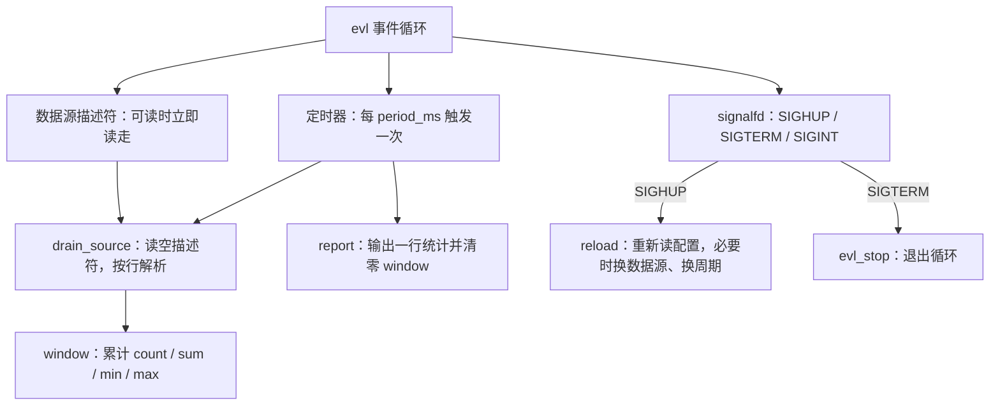
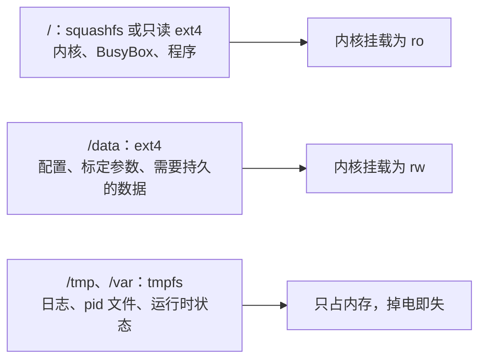

# 5.10 用户空间服务、部署与调试

驱动把传感器的读数放进 `/dev` 与 `/sys`，产品真正对外提供的功能却写在用户态：周期采样、统计、上报、响应配置变更、在崩溃后被拉起来。这样一个程序与第四部分写的服务器没有本质区别，难的是它运行的环境：没有显示器，没法直接敲命令看输出；根文件系统往往是只读的，写错一个文件重启就没了；机器在现场，出了故障只能靠日志与 core dump 回溯；调试器不在目标上，得从宿主机连过去。

这一页把这几件事补齐：先写出一个结构完整的服务程序 `sensord`，再讲它怎样被 BusyBox init 或 systemd 拉起、怎样喂硬件看门狗、配置与日志放在哪里，然后讲怎么把程序送到目标上，最后用 gdbserver、core dump 与 strace 定位问题。示例在宿主机的 Linux 上就能跑通，不需要开发板。

## 1. 服务程序的结构

[系统编程第 14 章](/教程/正文/系统编程/14_系统程序的健壮性与安全边界) 已经把长期运行的服务该有的样子列清楚了，这里只重复一遍清单，细节回那一章看：

1. 前台运行，不自己 `fork` 成守护进程。谁把它放到后台，由服务管理器决定。
2. 日志写标准错误，不自己打开 `/var/log` 下的文件。
3. 收到 `SIGTERM` 后停止接受新工作，把手上的一轮做完再退出。
4. 收到 `SIGHUP` 后重新读取配置，校验通过才整体替换。
5. 退出码有意义：0 表示正常结束，非 0 表示出错，让服务管理器据此决定要不要重启。

`sensord` 按这五条写。它周期读取一个数据源（开发板上是字符设备或 sysfs 属性，宿主机上是普通文件或命名管道），每个周期输出一行统计：样本数、均值、最小值、最大值。程序结构分为四块：



描述符、定时器与信号都交给 [第 12 章的事件循环](/教程/正文/系统编程/12_事件循环) 的 evl 库管理，`sensord` 自己只写回调。这样等待、分派与超时都不用自己算，单线程里也不存在数据竞争。

### 1.1 配置与数据源

配置是一个简单的 `key = value` 文本文件，缺省值编在程序里：文件里没写的项用缺省值，写错取值范围的项让加载失败、保留原来的配置：

```text
# sensord.conf
source = sensors.txt
period_ms = 1000
```

配置里的 `source` 指向数据源。在开发板上它会是 `/dev/mdr_mpu6050`（5.8 的驱动）或 `/sys/class/hwmon/...` 下的属性；在宿主机上换成普通文件或命名管道就能完整地调试逻辑。`period_ms` 决定统计周期。

程序用 `-f` 指定配置文件路径，缺省读当前目录下的 `sensord.conf`。启动时文件打不开就退出并返回非零，重载时打不开则保留旧配置。加载配置的函数先读到一份临时对象里，缺省值先填进去，再逐项校验，全部通过才整体替换；这是 14.2 讲过的重载顺序，`reload()` 直接复用了它：

```c
static void reload(struct sensord *srv) {
    struct config next;

    if (config_load(srv->conf_path, &next) < 0) {
        logmsg("重载失败，继续使用旧配置");
        return;
    }
    bool reopen = strcmp(next.source, srv->cfg.source) != 0;
    bool period_changed = next.period_ms != srv->cfg.period_ms;

    srv->cfg = next;
    if (reopen) {
        reopen_source(srv);
    }
    if (period_changed) {
        evl_cancel_timer(srv->loop, srv->timer);
        srv->timer = evl_add_timer(srv->loop, srv->cfg.period_ms, srv->cfg.period_ms,
                                   on_tick, srv);
    }
    logmsg("重载配置: source=%s period_ms=%ld", srv->cfg.source, srv->cfg.period_ms);
}
```

周期变了就换一个定时器，数据源路径变了就重新打开描述符，两件事互不影响。

<Quiz
  type="multi"
  :options="[
    { label: '先把新配置完整读进临时对象，校验通过才整体替换', value: 'A' },
    { label: '边读边改，让新值尽早生效', value: 'B' },
    { label: '校验失败时保留旧配置并记一条日志', value: 'C' },
    { label: '重载过程中先停止数据采集，等配置全部生效再恢复', value: 'D' }
  ]"
  :answer="['A', 'C']"
>

<template #question>

`SIGHUP` 重载配置时，下面哪些做法是对的？

</template>

正确答案是 **A、C**。

- 先读全、再校验、最后整体替换，出错时旧配置原封不动，这是 14.2 讲过的顺序。
- B 读到第三行才发现语法错误时，前两行已经生效，系统处于半新半旧的状态。
- D 没有必要：重载在事件循环回调里完成，期间没有并发的采集在跑，停采集只会丢数据。

</Quiz>

### 1.2 信号与退出

信号不走处理函数，走 `signalfd`。`sensord` 启动时把 `SIGHUP`、`SIGTERM`、`SIGINT` 加进屏蔽字，再用 `signalfd` 变成一个可以放进 epoll 的描述符。这样信号与文件事件在同一轮循环里处理，回调里不会打断任何数据结构：

```c
static void on_signal(evl_loop *loop, int fd, unsigned events, void *arg) {
    struct sensord *srv = arg;
    struct signalfd_siginfo info;

    (void)events;
    while (read(fd, &info, sizeof info) == sizeof info) {
        if (info.ssi_signo == SIGTERM || info.ssi_signo == SIGINT) {
            logmsg("收到信号 %u，退出", info.ssi_signo);
            evl_stop(loop);
        } else if (info.ssi_signo == SIGHUP) {
            reload(srv);
        }
    }
}
```

`SIGTERM` 只做一件事：让循环在下一轮检查时停下。手上那一轮统计照常输出，描述符在 `main` 返回前统一关闭。退出码 0 表示「按请求正常退出」：systemd 的 `Restart=on-failure` 只看非零退出码与被信号杀死的进程，所以不会重启；BusyBox init 的 `respawn` 不看退出码，收到 `SIGTERM` 退出后照样会把它拉起来，这一点在第 2 节还会遇到。

### 1.3 一个容易踩的坑：普通文件与命名管道

`epoll` 只对有「就绪」概念的对象有意义。普通文件永远处于就绪状态，把它登记进 epoll，`epoll_wait` 会立刻返回，循环就开始空转，CPU 占用冲到 100%。`sensord` 的判断是：`fstat` 看到 `S_ISFIFO` 才登记，普通文件只靠定时器读：

```c
static int source_open(const char *path, bool *is_stream) {
    int fd = open(path, O_RDONLY | O_NONBLOCK);

    *is_stream = false;
    if (fd < 0) {
        logmsg("open %s: %s", path, strerror(errno));
        return -1;
    }
    struct stat st;

    if (fstat(fd, &st) == 0 && S_ISFIFO(st.st_mode)) {
        close(fd);
        fd = open(path, O_RDWR | O_NONBLOCK);
        if (fd < 0) {
            logmsg("open %s: %s", path, strerror(errno));
            return -1;
        }
        *is_stream = true;
    }
    return fd;
}
```

命名管道用 `O_RDWR` 打开，而不是只读。只读打开时，唯一写端关闭后读端会读到文件结束，事件循环里就得反复重开；自己同时持有写端，读端永远看不到结束，逻辑简单不少。真实设备文件不需要这一步，字符设备不会返回 0。

::: tip 在宿主机上模拟设备

`mkfifo` 造一个命名管道，用 `printf` 往里写带时间戳的采样行，就能在没有硬件的情况下把服务逻辑、信号处理与统计全部跑通。开发板换回来时只要改配置里的 `source`。

:::

<Quiz
  type="single"
  :options="[
    { label: 'SIGTERM', value: 'A' },
    { label: 'SIGHUP', value: 'B' },
    { label: 'SIGINT', value: 'C' },
    { label: 'SIGKILL', value: 'D' }
  ]"
  answer="B"
>

<template #question>

服务管理器要求程序重新读取配置文件时，向它发哪个信号？

</template>

正确答案是 **B**。

- `SIGHUP` 是约定俗成的「重载配置」信号，`sensord` 在 `signalfd` 回调里重新加载并校验配置，失败时保留旧配置。
- `SIGTERM` 表示要求退出；`SIGINT` 是终端上的 Ctrl+C；`SIGKILL` 无法被捕获或屏蔽，进程直接消失，没有机会收尾。

</Quiz>

## 2. 嵌入式上的 init

程序写好了，接下来要让它开机就运行、崩溃后自动重启。谁来负责这件事，取决于根文件系统里装的是哪个 init。

### 2.1 BusyBox init 与 inittab

Buildroot 默认装 BusyBox，其中的 init 程序是 PID 1。它读 `/etc/inittab`，每条规则一行，格式是 `id:runlevels:action:process`：

```text
# /etc/inittab（BusyBox init）
::sysinit:/etc/init.d/rcS
::respawn:/usr/bin/sensord -f /data/sensord.conf
::respawn:/sbin/getty -L ttyS0 115200 vt100
::ctrlaltdel:/sbin/reboot
::shutdown:/bin/umount -a -r
```

`::respawn:` 是这里的关键。它表示进程无论以什么方式退出（正常返回、崩溃、被信号杀死），init 都会把它重新启动。服务因此有了最基本的自愈能力，代价是崩溃后立刻重启可能形成紧循环——如果 `sensord` 一启动就因为配置错误退出，它会在一秒内被拉起无数次。BusyBox init 没有退避机制，防这一点的责任在服务自己：启动时把致命错误记进日志，或者干脆在配置无效时进入一个长时间的重试间隔。

`::sysinit:` 那一行执行 `/etc/init.d/rcS`，后者按文件名顺序运行 `/etc/init.d/S??*` 下的脚本。BusyBox init 认的 action 不止这两种：

::: details inittab 的完整 action 列表

| action | 含义 |
| --- | --- |
| `sysinit` | 在启动的最初阶段执行一次，`rcS` 就是它 |
| `wait` | 等这个进程结束，再继续下一条规则 |
| `once` | 启动时执行一次，不等它结束 |
| `respawn` | 启动并监视它，退出后重新启动 |
| `askfirst` | 像 `respawn`，但先在控制台问一句要不要运行 |
| `ctrlaltdel` | 收到 `SIGINT`（Ctrl+Alt+Del）时执行 |
| `shutdown` | 关机时执行，用来卸载文件系统 |
| `restart` | 收到 `SIGTERM` 重启 init 时执行 |

runlevels 那一栏在本页的写法里全部留空。BusyBox init 不区分运行级别，字段保留只是为了兼容 SysV init 的 inittab 格式。

:::

Buildroot 给每个带服务的软件包自动生成一个 `S50xxx` 脚本，手写的服务照同样的格式放进去：

```sh
#!/bin/sh
#
# 由 BusyBox init 在启动时执行（/etc/init.d/S50sensord）。
# start-stop-daemon 负责按 pid 文件启动与停止，避免重复启动。

DAEMON=/usr/bin/sensord
CONF=/data/sensord.conf
PIDFILE=/var/run/sensord.pid

start() {
    printf 'Starting sensord: '
    start-stop-daemon -S -q -b -m -p "$PIDFILE" -x "$DAEMON" -- -f "$CONF"
    [ $? -eq 0 ] && echo 'OK' || echo 'FAIL'
}

stop() {
    printf 'Stopping sensord: '
    start-stop-daemon -K -q -p "$PIDFILE"
    [ $? -eq 0 ] && echo 'OK' || echo 'FAIL'
}

case "$1" in
    start) start ;;
    stop) stop ;;
    restart) stop; sleep 1; start ;;
    *) echo "Usage: $0 {start|stop|restart}"; exit 1 ;;
esac
```

`start-stop-daemon` 是 BusyBox 自带的小工具，按 pid 文件判断服务是否已经在跑，避免重复启动。`-S -b -m` 表示启动、转入后台、写 pid 文件；`-K` 加 pid 文件表示停止时向这个进程发 `SIGTERM`。写 pid 文件这一步在 systemd 下不需要，在 BusyBox init 下是标准做法。

这个脚本与 inittab 里那行 `respawn` 只能选一个用。脚本负责手工启停与开机启动，`respawn` 负责崩溃后拉起；两者同时存在时，手工执行 `S50sensord stop` 之后，`respawn` 会立刻把它重新拉起来，停不掉。Buildroot 的做法是只靠 `rcS` 启动，不在 inittab 里另写 `respawn`；需要崩溃自愈时，保留 `respawn` 那一行、去掉脚本里的 `start` 分支，手工启停时改 inittab 或者直接按 pid 操作。调试阶段用脚本更方便，量产时把 `respawn` 加上。

### 2.2 systemd 单元

资源充足的板子上会装 systemd。它不用 inittab，每个服务一个单元文件：

```ini
[Unit]
Description=mdr sensor daemon
After=network.target

[Service]
Type=notify
ExecStart=/usr/bin/sensord -f /data/sensord.conf
WatchdogSec=10s
Restart=on-failure
RestartSec=2s
User=sensord
Group=sensord
ReadWritePaths=/data
StandardOutput=journal
StandardError=journal

[Install]
WantedBy=multi-user.target
```

几项与嵌入式相关的设置：

| 指令 | 作用 |
| --- | --- |
| `Type=notify` | 服务启动完成后主动通知 systemd，在此之前 systemd 认为它「正在启动」 |
| `WatchdogSec=10s` | 服务必须在 10 秒内至少喂一次狗，超时后 systemd 重启它 |
| `Restart=on-failure`、`RestartSec=2s` | 非正常退出后等 2 秒重启 |
| `User=`、`Group=` | 以非 root 用户运行 |
| `ReadWritePaths=/data` | 只读根文件系统下，单独放开 `/data` 供服务写入 |

`Type=notify` 与 `WatchdogSec=` 都需要服务配合：启动完成时发一条 `READY=1`，之后周期性发 `WATCHDOG=1`。喂狗间隔不要写死，systemd 把超时时间放进 `WATCHDOG_USEC` 环境变量（单位微秒），服务按它的一半左右安排，改单元文件时不用改代码。glibc 系统上可以直接链接 `libsystemd` 调用 `sd_notify()`；Buildroot 的小系统常常不装它，这时按 [sd_notify(3)](https://www.freedesktop.org/software/systemd/man/latest/sd_notify.html) 的协议自己发一个数据报即可。协议本身很简单：`$NOTIFY_SOCKET` 环境变量给出一个 Unix 数据报套接字的地址，消息体是一串 `KEY=VALUE\n`：

```c
int notify_send(const char *state) {
    const char *path = getenv("NOTIFY_SOCKET");

    if (path == NULL || *path == '\0' || state == NULL) {
        return -1;
    }
    int fd = socket(AF_UNIX, SOCK_DGRAM | SOCK_CLOEXEC, 0);

    if (fd < 0) {
        return -1;
    }
    struct sockaddr_un addr;
    size_t skip = path[0] == '@' ? 1 : 0;
    size_t len = strlen(path + skip);

    memset(&addr, 0, sizeof addr);
    addr.sun_family = AF_UNIX;
    if (len + 1 > sizeof addr.sun_path) {
        close(fd);
        return -1;
    }
    memcpy(addr.sun_path + skip, path + skip, len);
    /* 抽象命名空间：地址的第一个字节是 0，长度从 sun_path 起算。 */
    socklen_t addr_len = (socklen_t)(offsetof(struct sockaddr_un, sun_path) + skip + len);

    ssize_t sent = sendto(fd, state, strlen(state), 0, (struct sockaddr *)&addr,
                          addr_len);

    close(fd);
    return sent == (ssize_t)strlen(state) ? 0 : -1;
}
```

`sensord` 把这两个函数用在两处：`main` 里配置加载完、定时器登记好之后发一条 `READY=1`；`on_tick` 里统计输出完、窗口清零之后发一条 `WATCHDOG=1`。后者与第 3 节的喂狗原则一致——工作真正完成了才通知，而不是定时无条件发送。`$NOTIFY_SOCKET` 不存在时（直接跑在 shell 里）`notify_send` 返回 -1，`sensord` 忽略这个返回值。

地址以 `@` 开头时表示抽象命名空间，此时 `sun_path` 的第一个字节写 0，长度也要把它算进去；这个细节写错，数据报会被投递到错误的地方而没有任何报错。`READY=1` 之外还有 `RELOADING=1`、`STOPPING=1`、`STATUS=一行说明`，`STATUS` 的内容会出现在 `systemctl status` 的输出里。

这套逻辑可以在普通 shell 里验证，不需要 systemd。启动一个 Python 的数据报接收端，把地址告诉 `notify_demo`：

::: terminal title="bash - 验证 notify_send（真实输出）"

```text
$ python3 -c 'import socket; s=socket.socket(socket.AF_UNIX, socket.SOCK_DGRAM); s.bind("notify.sock"); s.settimeout(5); print(repr(s.recvfrom(256)[0]))' &
$ NOTIFY_SOCKET=notify.sock ./notify_demo
notification sent
b'READY=1\nSTATUS=sensord started'
```

:::

抽象命名空间同样能测：把接收端绑到 `"\0sensord-notify-test"`，发送端用 `NOTIFY_SOCKET=@sensord-notify-test`，收到的内容一样。

### 2.3 选哪一个

Buildroot 生成的小系统用 BusyBox init 就够了。一个 `respawn` 加一个 `S50sensord` 脚本，能启动、能重启、能手工启停，脚本只有二十行，出问题时用 `sh -x` 就能查。systemd 带来的是依赖排序、并行启动、日志收集、资源限制与看门狗，这些能力在网关类产品上有用，代价是几 MB 的二进制与一套要学的单元文件语法。选择标准很简单：根文件系统里已经有 systemd（Yocto 的某些发行版配置会装），就用它；没有，不要为了一个服务装它。

::: compare left-title="BusyBox init" right-title="systemd"

```text
# /etc/inittab
::respawn:/usr/bin/sensord -f /data/sensord.conf
```

---

```ini
# sensord.service
[Service]
Type=notify
ExecStart=/usr/bin/sensord -f /data/sensord.conf
WatchdogSec=10s
Restart=on-failure
RestartSec=2s
```

:::

两者都能做到「崩溃后重启」，差别在控制粒度：BusyBox init 的重启是立刻拉起，没有退避；systemd 可以设延时、限次数（`StartLimitBurst=`），还能通过 `Restart=` 区分「正常退出」与「异常退出」。

## 3. 硬件看门狗

软件层面的重启有个前提：操作系统还活着。如果内核卡死、内存耗尽导致 init 也调度不上，`respawn` 什么也做不了。这时需要硬件看门狗：一个独立的计数器，软件定期重置它，软件一旦停摆，计数器溢出，芯片被强制复位。

Linux 把看门狗统一成 `/dev/watchdog` 字符设备，接口在 [内核文档](https://docs.kernel.org/watchdog/watchdog-api.html) 里写得很清楚：

| 操作 | 行为 |
| --- | --- |
| `open("/dev/watchdog")` | 启动计时器。**打开即开始倒计时** |
| `write(fd, &c, 1)` | 喂狗，重置计时器，任何字节都行 |
| `ioctl(fd, WDIOC_KEEPALIVE)` | 喂狗的另一种方式 |
| `ioctl(fd, WDIOC_SETTIMEOUT, &s)`、`WDIOC_GETTIMEOUT` | 设置、读取超时秒数 |
| `write(fd, "V", 1)` 后 `close` | magic close：关闭看门狗，不让它复位 |
| 直接 `close`（没有写 `V`） | 看门狗**继续运行**，超时后复位系统 |

最后两行是初学最容易出错的地方。`close` 并不等于关掉看门狗；要让设备安静下来，必须在关闭之前写入字符 `V`。有些驱动在加载时带 `nowayout` 参数，连 magic close 都不再放行，这条参数一般由内核配置或模块参数决定。反过来说，程序崩溃时文件描述符被内核关闭，没有 `V`，看门狗照样计时然后复位整台设备——这正是我们想要的。

::: concept emb-watchdog-open-start title="/dev/watchdog 的生命周期"

打开 `/dev/watchdog` 的那一刻硬件计时器开始倒计时，与是否写入无关。写入任意字节或调用 `WDIOC_KEEPALIVE` 重置计时；关闭文件描述符不会停止计时，只有先写入字符 `V` 再关闭（magic close）才会停止。因此「打开看门狗」必须与「喂狗」在同一段代码里设计好，不能只打开不管。

:::

由谁喂狗有两种安排。systemd 装了以后可以自己喂：`/etc/systemd/system.conf` 里的 `RuntimeWatchdogSec=10s` 让 systemd 打开看门狗并周期性喂它，`RebootWatchdogSec=` 控制重启阶段。服务自己喂则适合不用 systemd 的系统，代码大致是：

```c
static int watchdog_open(struct watchdog *wd, const char *path, int timeout_s) {
    wd->fd = open(path, O_WRONLY | O_CLOEXEC);
    if (wd->fd < 0) {
        return -1;
    }
    if (timeout_s > 0) {
        int value = timeout_s;

        if (ioctl(wd->fd, WDIOC_SETTIMEOUT, &value) < 0) {
            /* 驱动可以拒绝这个值，超时保持原样。 */
        }
    }
    return 0;
}

static int watchdog_feed(struct watchdog *wd) {
    static const char ping = 'k';

    return write(wd->fd, &ping, 1) == 1 ? 0 : -1;
}
```

喂狗的时机比喂狗的动作重要。放在定时器回调里无条件喂，等于告诉看门狗「我还活着」，而程序可能正卡在某个死循环里，采集早就停了。正确的位置是一轮工作真正完成之后：读到了数据、算出了结果、写出了日志，再喂。这与 [4.9 RTOS 固件架构、跟踪与测试](/教程/正文/嵌入式/4_RTOS与固件架构/4_9_RTOS固件架构_跟踪与测试) 里监视任务的思路相同——检查的是「活干完了」，不是「循环还在转」。

完整程序在 `code/嵌入式/5_嵌入式Linux/5_10_用户空间服务_部署与调试/watchdog_keepalive.c`。它只编译，不在练习环境里运行：打开 `/dev/watchdog` 会真的启动硬件计时器，写错一步就可能让宿主机重启。

## 4. 存储与配置

嵌入式设备的存储有两个特点：容量小，写入寿命有限。SD 卡与 eMMC 内部的闪存单元能承受的擦写次数有限，卡上的磨损均衡只能把写摊开，摊不开的部分照样会被反复擦除。一个每秒写一行日志的程序跑上几个月，足以让常用的那几个块先坏掉。

常见的布局是把根文件系统做成只读，另开一个可写分区：



这样安排之后，几件事各归各位：

- 程序与库放在只读的根文件系统里，升级时整块替换，不会出现升到一半断电导致的半新半旧。
- 配置与标定参数放在 `/data`，出厂时预置一份缺省值，运行中修改写在这里。
- 日志写到 `/tmp`（tmpfs）或经 `syslogd` 转发到别处，重启就清空，Flash 上不留痕迹。
- pid 文件放 `/var/run`，同样是 tmpfs，不存在掉电后残留一个陈旧 pid 的问题。

程序侧要配合的有两点。第一，配置文件的缺省值要编进程序：`/data` 上第一次启动时没有配置文件，程序必须能靠内建缺省值跑起来，而不是直接退出。`sensord` 的 `config_defaults()` 就是这个作用。第二，写 `/data` 上的文件要原子：先写临时文件、`fsync`、再 `rename` 覆盖，避免写到一半断电留下一个截断的文件。

日志的去向值得单独说。直接 `printf` 到标准输出，在 BusyBox init 下就是串口，在 systemd 下进 journal；两种都不落盘。需要落盘的日志用 `syslogd`（BusyBox 自带）转发到网络上的日志服务器，或者写进一份固定大小的环形文件，写满就覆盖最旧的。后一种做法要自己控制大小，不要让日志无限增长把 `/data` 撑满。

## 5. 部署

开发阶段程序改得勤，每次重新生成整个根文件系统太慢。两种常用的快速通道：

**NFS 根文件系统**。内核命令行改成从网络挂载根：

```text
root=/dev/nfs nfsroot=192.168.1.1:/srv/nfs/rootfs,vers=4 ip=dhcp rw
```

宿主机导出根文件系统目录，目标板每次启动都从宿主机拉最新的版本。改一个程序只要在宿主机上重新编译、覆盖文件，目标板重启即可，不用重新烧卡。代价是依赖网络，且 NFS 的读写性能不适合做压力测试。

**scp 到目标**。板子上跑 dropbear（一个轻量的 SSH 服务），宿主机直接 `scp sensord root@192.168.1.10:/usr/bin/`。这只适合开发期：生产环境的根文件系统是只读的，也没有 ssh 服务。

产品阶段的部署是把程序做成 Buildroot 软件包，随根文件系统一起生成映像（写法在 5.4）。Buildroot 的软件包机制会自动处理交叉编译、安装路径、启动脚本与依赖，生成的映像烧到板上就是最终形态。

运行权限也在这里定下来。`sensord` 不需要 root：它读的是 `/dev/mdr_mpu6050` 或 sysfs 属性，两者都可以通过 udev 或 mdev 规则把属主改成 `sensord` 用户、权限设成 `0660`。设备节点的权限规则通常放在 `/etc/udev/rules.d/` 或 `/etc/mdev.conf`，一行一条，随根文件系统一起发布。

## 6. 调试

目标上没有编译器，也没有 gdb。调试的办法是把调试器留在宿主机，让它在目标上操控一个很小的服务端。

### 6.1 gdbserver 远程调试

目标上跑 `gdbserver`，它接管一个程序的执行，通过 TCP 端口接受宿主机 gdb 的命令：

::: terminal title="目标板 - gdbserver（输出类似，取自 GDB 文档 Remote Debugging）"

```text
# gdbserver :2345 /usr/bin/sensord -f /data/sensord.conf
Process /usr/bin/sensord created; pid = 812
Listening on port 2345
```

:::

宿主机上用同一套交叉工具链里的 gdb，先指定目标根文件系统的 staging 目录作为 sysroot，再连过去：

::: terminal title="宿主机 - 交叉 gdb（输出类似，取自 GDB 文档 Remote Debugging 与 Bootlin 实验手册）"

```text
$ arm-linux-gnueabihf-gdb ./sensord
(gdb) set sysroot output/staging
(gdb) target remote 192.168.1.10:2345
Remote debugging using 192.168.1.10:2345
Reading symbols from output/staging/lib/ld-linux-armhf.so.3...
(gdb) break handle_line
Breakpoint 1 at 0x10a4c: file sensord.c, line 182.
(gdb) continue
Continuing.
Breakpoint 1, handle_line (srv=0x7efff2a0, line=0x7efff0c0 "10:00:00 21.5") at sensord.c:182
182	    snprintf(copy, sizeof copy, "%s", line);
```

:::

`set sysroot` 指向的是 Buildroot 的 `output/staging`，里面是按目标布局放好的库与头文件。没有这一步，gdb 会去读宿主机的 `/lib`，遇到 ARM 与 x86 的库混在一起，加载共享库的符号时就会报错。源码路径也要对：gdb 按编译时记录的路径找源文件，路径不一致时用 `directory` 补上。

QEMU 里调试要先把端口从虚拟机转到宿主机。用用户态网络时加一条转发规则：

```text
-netdev user,id=net0,hostfwd=tcp::2345-:2345 -device virtio-net-device,netdev=net0
```

之后宿主机连 `localhost:2345` 即可。

::: tip QEMU 的端口转发

`hostfwd=tcp::宿主机端口-:目标端口` 可以写多条。QEMU 的用户态网络里，目标看不到宿主机的地址，宿主机连目标却要靠这种映射，调试与网页服务都常用它。

:::

### 6.2 core dump

程序崩溃时，内核可以把整个进程的内存写到磁盘上，形成一个 core 文件，事后用 gdb 打开就能看到崩溃时的调用栈与局部对象。目标上的准备是两步：去掉 core 文件大小限制，指定它写到哪里。

::: terminal title="目标板 - 打开 core dump（输出类似，取自 core(5)）"

```text
# ulimit -c unlimited
# echo '/data/cores/core.%e.%p' > /proc/sys/kernel/core_pattern
```

:::

`%e` 是程序名，`%p` 是进程号。core 文件拿到宿主机上，用交叉 gdb 打开：

::: terminal title="宿主机 - 分析 core（输出类似）"

```text
$ arm-linux-gnueabihf-gdb ./sensord core.sensord.812
(gdb) bt
#0  0x00010b28 in handle_line (srv=0x0, line=0x0) at sensord.c:182
#1  0x00010d10 in drain_source (srv=0x7efff2a0) at sensord.c:220
#2  0x00010e44 in on_tick (...) at sensord.c:258
```

:::

栈上直接给出了出错的函数与行号。core 文件一般不小，嵌入式设备上要控制数量，`core_pattern` 加 `%p` 就是个简单办法；也可以在程序里自己装一个 `SIGSEGV` 处理函数，只保留最近一份。

### 6.3 strace

程序没有崩溃，但行为不对时，`strace` 能看到它到底向内核请求了什么。在 SignalX 上对一个用命名管道作数据源的 `sensord` 跑一遍，只留下与事件循环、信号有关的调用：

::: terminal title="bash - strace 观察 sensord（真实输出，已省略加载器与本地时区的部分）"

```text
$ strace -o trace.err -e trace=openat,read,epoll_wait,epoll_ctl,signalfd4,close ./sensord -f t.conf
$ sed -n '/t.conf/,$p' trace.err | grep -v 'localtime\|TZif'
openat(AT_FDCWD, "t.conf", O_RDONLY)    = 3
read(3, "source = t.fifo\nperiod_ms = 2000"..., 4096) = 33
read(3, "", 4096)                       = 0
close(3)                                = 0
openat(AT_FDCWD, "t.fifo", O_RDONLY|O_NONBLOCK) = 3
close(3)                                = 0
openat(AT_FDCWD, "t.fifo", O_RDWR|O_NONBLOCK) = 3
epoll_ctl(4, EPOLL_CTL_ADD, 3, {events=EPOLLIN, data=0x3}) = 0
signalfd4(-1, [HUP INT TERM], 8, SFD_CLOEXEC|SFD_NONBLOCK) = 5
epoll_ctl(4, EPOLL_CTL_ADD, 5, {events=EPOLLIN, data=0x5}) = 0
epoll_wait(4, [{events=EPOLLIN, data=0x3}], 64, 2000) = 1
read(3, "10:00:00 21.5\n", 512)         = 14
read(3, 0x7ffec8cc7930, 512)            = -1 EAGAIN (Resource temporarily unavailable)
epoll_wait(4, [{events=EPOLLIN, data=0x5}], 64, 1201) = 1
read(5, "\1\0\0\0\0\0\0\0\0\0\0\0\310\27\22\0\353\3\0\0\0\0\0\0\0\0\0\0\0\0\0\0"..., 128) = 128
openat(AT_FDCWD, "t.conf", O_RDONLY)    = 6
read(6, "source = t.fifo\nperiod_ms = 2000"..., 4096) = 33
read(6, "", 4096)                       = 0
close(6)                                = 0
read(5, 0x7ffec8cc79a0, 128)            = -1 EAGAIN (Resource temporarily unavailable)
epoll_wait(4, [{events=EPOLLIN, data=0x5}], 64, 599) = 1
read(5, "\17\0\0\0\0\0\0\0\0\0\0\0\310\27\22\0\353\3\0\0\0\0\0\0\0\0\0\0\0\0\0\0"..., 128) = 128
read(5, 0x7ffec8cc79a0, 128)            = -1 EAGAIN (Resource temporarily unavailable)
close(4)                                = 0
close(5)                                = 0
close(3)                                = 0
+++ exited with 0 +++
```

:::

这段输出把整个结构都露出来了。`openat` 两次打开 `t.fifo`，先用只读试探、发现是 FIFO 后关掉，再用 `O_RDWR|O_NONBLOCK` 打开——正是 1.3 那个判断。`signalfd4` 把三个信号变成一个描述符，`epoll_ctl` 把数据源与信号描述符都加进同一个 epoll 实例。`epoll_wait` 的超时 2000 毫秒来自配置的 `period_ms`，第二次返回时超时变成 1201 毫秒，是因为循环已经过了约 800 毫秒。`read(5, ...)` 返回 128 字节，恰好是一个 `struct signalfd_siginfo`；第一个字节 `\1` 是 `SIGHUP`，第二个数据报的第一个字节 `\17` 是 15，即 `SIGTERM`。最后三个 `close` 与 `exited with 0` 说明退出路径干净。

信号那一行的 `\1` 与 `\17` 是理解 `signalfd_siginfo` 的线索：结构体开头四个字节是 `ssi_signo`（小端），标志与设备信息为 0，然后是 pid 与 uid。gdb 里 `p *info` 能直接看到这些字段。

内核一侧的问题用 `dmesg` 看。驱动 probe 失败、I2C 传输超时、设备树解析错误都会打在这里。`dynamic debug` 可以按文件或函数打开驱动里被编译进去的调试语句，`echo 'file mdr_mpu6050.c +p' > /sys/kernel/debug/dynamic_debug/control` 之后，这个文件里的 `dev_dbg()` 才开始输出。

## 7. 在宿主机上先测

`sensord` 的逻辑可以在开发板之外完整验证。用命名管道作数据源，脚本做三件事：喂两批数据、改配置并发 `SIGHUP`、最后 `SIGTERM` 退出。脚本 `demo.sh` 是 `code/嵌入式/5_嵌入式Linux/5_10_用户空间服务_部署与调试/` 下的一部分，只结束自己记下的 PID：

::: terminal title="bash - 在宿主机上运行 sensord（真实输出）"

```text
$ ./demo.sh
--- SIGHUP，周期改为 2000 ms
--- SIGTERM
--- stdout
20:32:10 samples=0
20:32:11 samples=3 mean=22.33 min=21.50 max=23.50
20:32:12 samples=2 mean=22.75 min=20.40 max=25.10
--- stderr
sensord 启动: pid=1188663 source=demo.fifo period_ms=1000
重载配置: source=demo.fifo period_ms=2000
收到信号 15，退出
```

:::

三行 stdout 对应三个周期。第一行 `samples=0` 是因为第一批数据还没写进管道；第二行统计了三行数据，均值 22.33 与按 `(21.5+22.0+23.5)/3` 算出来的一致；第三行是第二批的两行。`SIGHUP` 之后周期从 1000 变成 2000 毫秒，后续输出间隔随之变化。

stderr 上三行日志的顺序说明了几件事：启动时打印了 pid、数据源与周期，便于对照 `ps`；重载成功才打印新值；`SIGTERM` 之后循环退出，进程正常结束，退出码 0。

这类脚本值得为每个服务写一个。它不需要 root，不碰 `/dev` 与 `/sys`，在任何 Linux 上都跑得起来，能在把程序烧进板子之前抓出大部分逻辑错误。

## 8. 习题

### 8.1 巩固

<Exercise id="65501" :d="1" :w="2">

在 `code/嵌入式/5_嵌入式Linux/5_10_用户空间服务_部署与调试/` 下编译并运行示例，比较命名管道与普通文件两种数据源。

(1) 执行 `make` 与 `./demo.sh`，贴出 stdout 与 stderr。解释第一行为什么是 `samples=0`，第二行的 `mean=22.33` 与哪三行数据对得上。

(2) 用同目录的 `sensord.conf`（`source = sensors.txt`）启动 `sensord`，运行两个周期后按 Ctrl+C。贴出输出，说明这个数据源为什么没有登记进 epoll，统计却照样进行。

(3) 在 (2) 运行期间，另开一个终端执行 `echo '10:00:09 30.0' >> sensors.txt`，观察下一个周期的输出。普通文件的「就绪」与命名管道的「就绪」差别在哪里？

</Exercise>

<Exercise id="65502" :d="2" :w="2">

`config_load` 的规则是缺省值先填、认不出的项忽略、取值无效则整体失败。用下面这份配置逐项验证：

```text
# t.conf
source = sensors.txt
period_ms = 0
unknown_key = 1
这一行没有等号
```

(1) 先写下你认为的 stderr 与退出码，再运行 `sensord -f t.conf`，对照实际结果。

(2) 依次把 `period_ms` 改成 `70000`、`abc`、`2000 # 两秒`，各运行一次并记录结果。第三项失败与哪一条检查有关？把注释单独写成一行（行首 `#`）又会怎样？

(3) 用一份正常配置启动服务，运行中把文件换成 (1) 的内容，发 `SIGHUP`。贴出 stderr，指出哪一行日志证明旧配置仍然有效，再用 stdout 的间隔确认 `period_ms` 没有改变。

</Exercise>

<Exercise id="65503" :d="2" :w="3">

把 `sensord` 装进 BusyBox init 的根文件系统。

(1) 写出 `/etc/inittab` 里让 `sensord` 崩溃后自动重启的一行，逐字段说明含义。它与 `::sysinit:` 那一行各在什么时候执行？

(2) 同目录的 `S50sensord` 在「只读根文件系统加 tmpfs 的 `/var`」布局下会失败：`/var/run` 可能还不存在，`start-stop-daemon` 写 pid 文件时出错。补上创建目录的语句，并说明 pid 文件为什么不能放在 `/data`。

(3) 如果 inittab 里保留了 `::respawn:`，同时 `S50sensord` 的 `start` 也照常执行，手工运行 `S50sensord stop` 之后会发生什么？给出两种改法，说明调试阶段与量产阶段各选哪一种。

(4) 给 `/dev/mdr_mpu6050` 写一条 `/etc/mdev.conf` 规则，属主与属组都是 `sensord`，权限 `0660`。说明这条规则省掉了什么，以及为什么不应把服务改成用 root 运行。

(5) 开发期用 NFS 根文件系统：写出内核命令行与宿主机 `/etc/exports` 里对应的一行，说明改一次 `sensord` 之后板上要做什么才能看到新版本。再写出 `scp` 那条路所需的命令与目标上的前置条件（dropbear、可写目录），并说明为什么这两条路都不能用在量产的只读根文件系统上。

</Exercise>

### 8.2 编程

<Exercise id="65504" :d="3" :w="3">

不链接 libsystemd，自己验证 `notify_send` 的协议。

(1) 写 `notify_recv.c`：创建 `AF_UNIX`、`SOCK_DGRAM` 套接字，绑定到 `argv[1]` 给出的路径，`recvfrom` 一次，把收到的字节按 `%s` 打印，退出码 0。

(2) 用 `fork` 加 `execv` 启动 `notify_demo`，在子进程的环境里设 `NOTIFY_SOCKET` 指向 (1) 的路径。父进程打印收到的内容。验收：输出中出现 `READY=1` 与 `STATUS=sensord started` 两行，子进程退出码 0。

(3) 把接收端改绑到抽象命名空间：`sun_path[0]` 置 0，名字从 `sun_path + 1` 开始，`bind` 的长度用 `offsetof(struct sockaddr_un, sun_path) + 1 + strlen(名字)`；发送端设 `NOTIFY_SOCKET=@名字`。如果 `bind` 的长度少算了开头那个 0 字节，`sendto` 会成功还是失败？用实验回答。

(4) `notify_send` 里的 `addr_len` 对普通路径与抽象路径分别是多少？两种情况是否都要把结尾的 0 字节算进去？结合 (2)(3) 的结果说明。

(5) 给 `sensord` 写 systemd 单元：`Type=notify`、`WatchdogSec=10s`、`Restart=on-failure`、`RestartSec=2s`、`User=sensord`、`ReadWritePaths=/data`。再给 `on_tick` 加上按 `WATCHDOG_USEC` 推算的 `WATCHDOG=1`：读环境变量、除以 2 得到间隔、只在距上次发送超过这个间隔时才发。说明为什么不能把喂狗间隔写死成某个秒数。没有 systemd 的主机上，用 (2) 的接收端设 `NOTIFY_SOCKET` 与 `WATCHDOG_USEC`，观察实际发出的数据报来验证。

</Exercise>

<Exercise id="65505" :d="3" :w="2">

用普通文件冒充看门狗设备，验证 `watchdog_keepalive.c` 写出的字节。

(1) 把设备路径改成从 `argv[1]` 取，用一个新文件 `./fake_watchdog` 运行。用 `od -An -c fake_watchdog` 查看内容，指出哪些字节来自 `watchdog_feed`，哪个来自 `watchdog_close`。

(2) 把 `main` 末尾的 `watchdog_close(&wd)` 换成 `_exit(0)`，重新运行，比较文件内容。在真实设备上，这两种结束方式对计时器的影响有什么不同？程序崩溃时属于哪一种？

(3) `WDIOC_SETTIMEOUT` 在普通文件上失败，`watchdog_open` 选择忽略它。打印出 `errno` 对应的错误，说明它表示这个文件不是看门狗设备，并解释这里为什么可以忽略。

(4) 给程序加一个「某轮工作卡住」的分支：第 2 轮 `sleep(30)`，打开时把超时设为 5 秒。在真实设备上会发生什么？只说明，不要对 `/dev/watchdog` 运行。

</Exercise>

<Exercise id="65506" :d="3" :w="3">

`/data` 上的配置与 core 文件都要能承受随时断电。

(1) 写 `config_save(const char *path, const struct config *cfg)`：在同一目录用 `mkstemp` 建临时文件，写入 `source = ...` 与 `period_ms = ...`，`fsync` 文件，`fchmod` 成 0644，`rename` 覆盖，最后 `fsync` 目录；任何一步失败都清理临时文件并返回 -1。

(2) 写一个测试脚本，循环 30 次：启动一个反复调用 `config_save` 的进程，随机等 0～20 毫秒后 `kill -9` 它，然后用 `sensord -f` 加载目标文件。验收：30 次加载全部成功，目录里没有残留的临时文件。

(3) `rename` 之后为什么还要 `fsync` 目录？只读根文件系统上，这个函数应该把文件写到哪里？

(4) `core_pattern` 也指向 `/data/cores/` 时，一次崩溃留下的 core 可能比整个 `/data` 还大。给出两条限制办法（一条在 `core_pattern` 里做，一条在进程里做），并说明 `%e`、`%p` 各占一位时目录里会攒下多少文件。日志同样不能无限增长，比较 `syslogd` 转发与固定大小环形文件的取舍。

</Exercise>

<Exercise id="65507" :d="4" :w="4">

`sensord` 的 `reload()` 有一个缺陷：配置里只改 `source`，而新路径打不开时，`srv->cfg` 已经被替换，旧的数据源描述符却还在用，日志还会打印一条「重载配置」表明成功。

(1) 复现：用命名管道跑起 `sensord`，把配置里的 `source` 改成一个不存在的路径，发 `SIGHUP`。贴出 stderr 与随后几个周期的 stdout，说明实际在读哪个数据源。

(2) 指出缺陷在 `reload()` 的哪几行。`reopen_source` 的返回值被丢弃之后，`cfg` 与 `src_fd` 为什么不一致？

(3) 改写 `reload()`：先按新配置打开数据源，成功后再替换 `cfg`、切换描述符；失败时保留旧配置并记日志。`period_ms` 的更换也放在成功之后。

(4) 回归：先用 (1) 的步骤验证失败路径，再分别只改 `period_ms`、只改 `source` 验证成功路径。两次都要在日志里看到正确的结果。

</Exercise>

<Exercise id="65508" :d="5" :w="4">

在宿主机上把 6.1 到 6.3 的三件调试工具各用一遍，整理成一份排错记录。

准备：用 `-g -O0` 编译 `sensord`，并故意埋一个缺陷——删掉 `handle_line` 里 `reading == NULL` 的那段检查，让只有一列数据的行（例如 `10:00:00`）走到 `strtod(NULL, &end)`。不埋缺陷时程序会打印「跳过不完整的数据行」，埋了之后会段错误。

(1) gdbserver：在目标侧（可以用同一个宿主机模拟）运行 `gdbserver :2345 ./sensord -f t.conf`，宿主机 `gdb ./sensord` 连接后设置 `break handle_line`、`continue`。贴出断点命中时的输出，解释为什么这里的 `set sysroot` 可以省略，什么情况下必须加。

(2) core dump：打开 `ulimit -c unlimited`，把 `core_pattern` 改成 `core.%e.%p`（需要 root；没有时用 `su` 或只写命令并说明）。让程序崩溃，用 `gdb ./sensord core.sensord.<pid>` 打开，执行 `bt`、`frame 0`、`p reading`。贴出调用栈，指出哪一帧对应缺陷。

(3) strace：换回没有埋缺陷的版本，用 `strace -f -e trace=openat,read,epoll_wait,signalfd4 ./sensord -f t.conf` 跑两个周期。贴出关键行，指出哪一次 `read` 返回 `EAGAIN`、为什么它不是错误。再把 `O_NONBLOCK` 从 `source_open` 的第二次 `open` 里去掉，观察程序卡在哪一次 `read` 上，并说明此时 `SIGTERM` 为什么得不到处理。

(4) 三者的分工：分别说明哪种问题用哪一种工具最快——启动时找不到配置文件、每 1000 次调用崩一次、统计周期没有按配置改变。各给出你实际用到的命令。

(5) 把 (1) 到 (3) 的过程写成 `debug.md`，包含每条命令、预期输出与失败时的下一步。这份记录的价值在于换一块板子时能照着再做一遍。

</Exercise>

### 8.3 综合与挑战

<Exercise id="65509" :d="6" :w="5" scope="*">

写一个迷你服务管理器 `minit`，补上 BusyBox init 没有的重启退避与次数上限。

要求：

1. 配置文件每行是一条 `名字 命令 [参数...]`，`#` 开头为注释。
2. 每个服务用 `fork` 加 `execvp` 启动；子进程退出后按 1、2、4、8 秒退避重启，10 秒内连续退出 5 次就放弃并记一条日志。
3. 收到 `SIGTERM` 时向所有子进程转发 `SIGTERM`，最多等 5 秒再自己退出；收到 `SIGHUP` 重读配置，新增的服务启动，删掉的服务停止。
4. 信号走 `signalfd`，不用处理函数；子进程用 `waitpid(-1, ..., WNOHANG)` 回收，不能留下僵尸。等待事件用 `poll` 或 `epoll`。
5. 验收脚本：启动两个服务，一个正常循环，一个每 100 毫秒退出一次。运行 20 秒后检查日志里的重启次数与放弃记录，用 `ps` 确认没有僵尸，`kill -TERM` 后 5 秒内全部退出。

</Exercise>

## 9. 参考资料

1. systemd project, [*systemd.service(5)*](https://www.freedesktop.org/software/systemd/man/latest/systemd.service.html)：`Type=`、`Restart=`、`WatchdogSec=` 等指令。
2. systemd project, [*sd_notify(3)*](https://www.freedesktop.org/software/systemd/man/latest/sd_notify.html)：通知协议的地址、消息格式与 `READY=1`、`WATCHDOG=1`。
3. systemd project, [*daemon(7)*](https://www.freedesktop.org/software/systemd/man/latest/daemon.html)：为什么新服务不需要自己 `fork` 成守护进程。
4. The Linux kernel project, [*The Linux Watchdog driver API*](https://docs.kernel.org/watchdog/watchdog-api.html)：`/dev/watchdog` 的打开、喂狗、设置超时与 magic close。
5. BusyBox, [*examples/inittab*](https://git.busybox.net/busybox/tree/examples/inittab)：inittab 的字段与 action 列表。
6. GNU Project, [*GDB, Remote Debugging*](https://sourceware.org/gdb/current/onlinedocs/gdb.html/Remote-Debugging.html)：`gdbserver` 与 `target remote`。
7. Linux man-pages project, [*core(5)*](https://man7.org/linux/man-pages/man5/core.5.html)：`core_pattern` 的格式与 `%e`、`%p` 等占位符。
8. Linux man-pages project, [*signalfd(2)*](https://man7.org/linux/man-pages/man2/signalfd.2.html)、[*timerfd_create(2)*](https://man7.org/linux/man-pages/man2/timerfd_create.2.html)、[*epoll(7)*](https://man7.org/linux/man-pages/man7/epoll.7.html)：本页事件循环用到的三个接口。
9. The Buildroot project, [*The Buildroot user manual*](https://buildroot.org/downloads/manual/manual.html)：`BR2_ENABLE_DEBUG` 与调试符号、软件包的安装路径。
10. Bootlin, [*STM32MP1 lab manual*](https://bootlin.com/doc/training/embedded-linux/embedded-linux-stm32mp1-labs.pdf)：Application development and remote debugging 一章。
