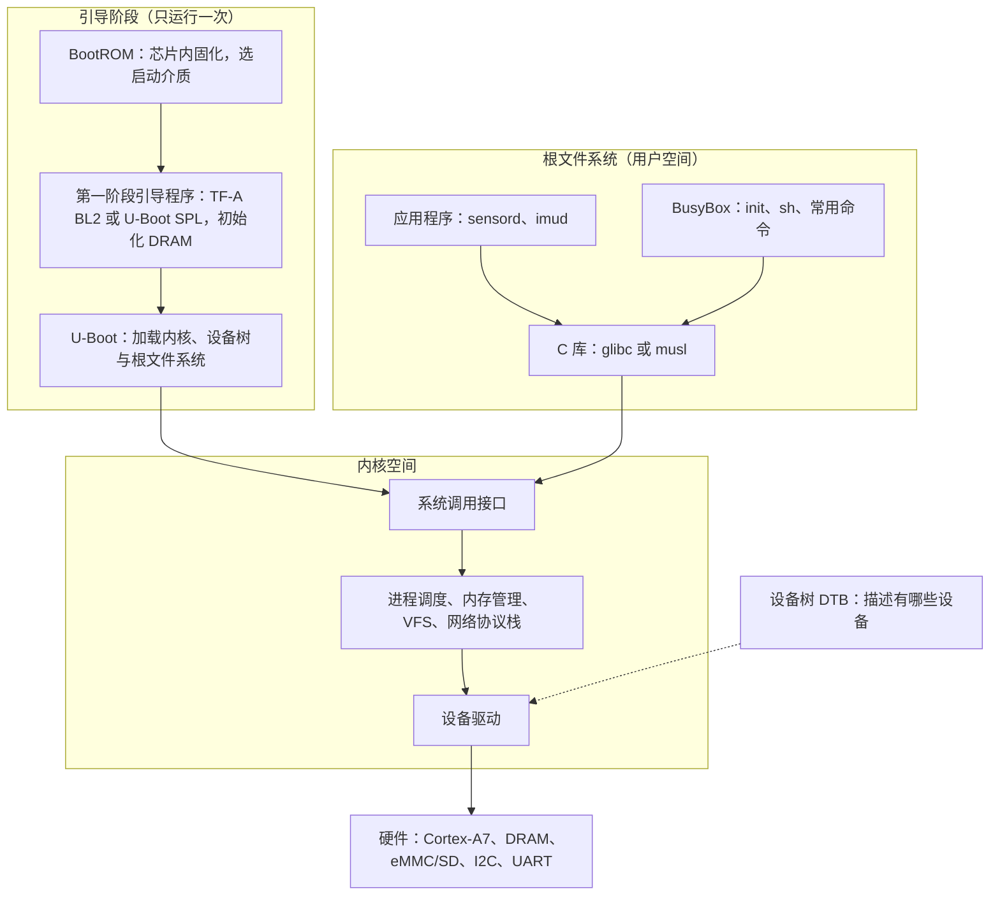

# 5.1 嵌入式 Linux 与系统编程边界

同一个「读取姿态传感器、每秒钟算一次平均值」的功能，在 STM32F103 上是一个 `.bin` 文件：上电后从向量表跳到 `main`，I2C 驱动、换算、串口输出全在那一个文件里。换到 STM32MP157 上，它变成了五样东西：芯片里固化的 BootROM、SD 卡上的引导程序、内核与设备树、装着 C 库和 BusyBox 的根文件系统，以及最后那个读取 `/dev/i2c-5` 的守护进程。哪一样归芯片厂提供，哪一样由社区维护，哪一样要自己写，是本章首先要分清的事。

这一页先把这个五层的系统拆开，再看第四部分学过的系统编程知识有多少能原样搬过来、哪些必须换做法，然后用一张表和几条判据回答「这个产品到底该用 MCU 加 RTOS 还是 Linux」。最后把本章的实验平台搭起来：没有开发板的人用 QEMU 跑 Buildroot 生成的 ARM 系统，有 STM32MP157 Discovery 的人直接用板子；两种路线跑的是同一套内核与同一批示例。

## 1. 系统的组成

把一块运行 Linux 的 ARM 板子上电，到出现登录提示符，中间经过的软件可以按下图分层。最上面一组只在启动时运行一次，中间两层一直存在：内核管硬件，根文件系统管用户态的程序。



这五部分各有各的来源，弄混了就会在错误的地方找问题。

| 部分 | 由谁提供 | 出问题时先看哪里 |
| --- | --- | --- |
| BootROM | 芯片厂，固化在片内，改不了 | 启动引脚、启动介质、串口有无输出 |
| 引导程序 | 芯片厂（TF-A）与社区（U-Boot） | U-Boot 命令行、环境变量、能否加载内核 |
| 内核 | 社区（kernel.org），芯片厂提供补丁 | 启动日志停在哪个 `printk` |
| 设备树 | 芯片厂与板厂提供 `.dts`，自己改 | `/proc/device-tree`、驱动有没有 probe |
| 根文件系统 | 自己用 Buildroot 或 Yocto 生成 | 能否挂载、`init` 能否执行 |
| 应用 | 自己写 | 应用日志、退出码、core dump |

本章的其余各节就按这张表展开：[5.2](/教程/正文/嵌入式/5_嵌入式Linux/5_2_BootROM_U-Boot_内核与根文件系统) 讲前三行的启动过程，[5.3](/教程/正文/嵌入式/5_嵌入式Linux/5_3_交叉工具链_sysroot与根文件系统) 和 [5.4](/教程/正文/嵌入式/5_嵌入式Linux/5_4_Buildroot与Yocto) 讲工具链与根文件系统的制作，[5.5](/教程/正文/嵌入式/5_嵌入式Linux/5_5_设备树) 讲设备树，[5.6](/教程/正文/嵌入式/5_嵌入式Linux/5_6_内核模块与驱动模型) 到 [5.9](/教程/正文/嵌入式/5_嵌入式Linux/5_9_中断_DMA与并发) 讲驱动，[5.10](/教程/正文/嵌入式/5_嵌入式Linux/5_10_用户空间服务_部署与调试) 回到应用，讲服务、部署与调试。

与 MCU 上的固件相比，最根本的变化是**内核把硬件挡住了**。STM32F103 上写 `GPIOA->BSRR = 1u << 5` 就改了引脚，在 Linux 上同样的地址属于内核空间，用户态程序碰不到。应用要做的事，是通过内核提供的接口去请求。

## 2. 用户空间与内核空间

ARM 处理器有特权级，Linux 用它把代码分成两半。内核运行在特权级，能访问全部内存与外设寄存器；应用运行在非特权级，访问外设的那条路被 MMU 掐断了。唯一被允许的过界方式是系统调用 (system call)：应用把调用号与参数放进约定的寄存器，执行一条 `svc` 指令，处理器切换到特权级，跳到内核里的处理函数。

在 [系统编程第 1 章](/教程/正文/系统编程/1_平台边界_POSIX与系统调用) 里，这套机制是在 PC 上讲的；在嵌入式 Linux 上它一字不差。C 库的 `read`、`write`、`ioctl`、`mmap` 最终都通向系统调用，驱动则挂在这些调用的另一端。应用访问硬件有三条正路：

| 接口 | 位置 | 适合什么 |
| --- | --- | --- |
| 设备文件 | `/dev` 下，字符设备或块设备 | 读写数据流、`ioctl` 控制 |
| sysfs | `/sys` 下，一个属性一个文件 | 读状态、改配置、看设备树信息 |
| procfs | `/proc` 下 | 进程信息、内核参数、`/proc/device-tree` |

一次读取要走完下面这条路，每一层都有自己的缓冲区与错误码：


5.7 会用 `mdr_fifo` 演示一个字符设备从驱动到 `read`/`write` 的完整路径，5.8 会演示 sysfs 属性怎么对应到 I2C 传感器的采样率。

::: concept emb-linux-user-kernel-access title="用户态访问硬件只经由内核"

在带 MMU 的嵌入式 Linux 上，用户态程序不能直接读写外设寄存器。所有硬件访问都要经过内核：设备文件、sysfs、procfs，或者由驱动导出的其他接口。直接映射物理地址的 `/dev/mem` 与 UIO 框架只用于原型验证，产品代码不走这条路。

:::

有一个例外值得知道：`/dev/mem` 可以在 root 权限下把一段物理地址映射进用户空间，绕过驱动直接点寄存器。它在调试一个新外设时很省事，但没有任何保护，也绕过了内核的电源管理与并发控制。UIO（Userspace I/O）是同一思路的封装版本，把寄存器映射与中断处理包成一对设备文件与 sysfs 属性，适合那些逻辑简单、不值得写完整内核驱动的外设。

::: generate emb-linux-mmio-compare kind=explanation concepts=emb-linux-user-kernel-access

面向刚从 STM32 裸机转过来的读者，以「点亮一个 LED」与「读一次 I2C 传感器」为例，对照 `GPIOA->BSRR` 与 `/sys/class/leds` 两种写法，说明地址、权限、谁在中间做了什么事，以及为什么产品代码不能沿用 `/dev/mem` 的做法。

:::

## 3. 第四部分的知识哪些原样可用

先给结论：第四部分讲的大部分接口，在嵌入式 Linux 上原样可用，因为 Linux 的 POSIX 接口在 ARM 上与 x86 上没有区别。需要换的是**做法**，不是**接口**。

| 第四部分的内容 | 在嵌入式 Linux 上 | 需要注意的地方 |
| --- | --- | --- |
| [文件描述符与非缓冲 I/O](/教程/正文/系统编程/2_文件描述符与非缓冲IO) | 原样可用 | 设备文件、sysfs 属性也是描述符，`read` 与 `write` 的语义由驱动决定 |
| [虚拟内存与 mmap](/教程/正文/系统编程/4_虚拟内存与内存映射) | 原样可用 | 通常没有交换分区，内存不够就是 `ENOMEM` |
| [进程的创建、执行与回收](/教程/正文/系统编程/5_进程的创建_执行与回收) | 原样可用 | 内存小，`fork` 的页表复制代价更明显，常改用 `posix_spawn` |
| [信号](/教程/正文/系统编程/6_信号_时间与定时器) | 原样可用 | 无 |
| [线程与同步](/教程/正文/系统编程/8_操作系统线程与同步) | 原样可用 | 换 musl 后默认线程栈更小，按需显式指定 |
| [套接字](/教程/正文/系统编程/10_套接字编程) | 原样可用 | 无 |
| [事件循环](/教程/正文/系统编程/12_事件循环) | 原样可用 | `epoll`、`signalfd`、`timerfd` 在 ARM 上齐全 |
| [服务管理](/教程/正文/系统编程/14_系统程序的健壮性与安全边界) | 部分可用 | 嵌入式上常是 BusyBox init 而不是 systemd，见 5.10 |

要换做法的有四处，都是环境逼出来的：

1. **构建**。目标板跑不动编译器，程序在宿主机上交叉编译，链接时用目标的 C 库与头文件。工具链、sysroot 与根文件系统的关系在 5.3。
2. **存储**。根文件系统常在只读的 squashfs 或 ext4 上，写入次数有限的 eMMC、SD 卡与 NOR Flash 经不起频繁写。日志写到 tmpfs 或转发出去，配置放在单独的数据分区。
3. **初始化与服务**。Buildroot 默认装 BusyBox init，读 `/etc/inittab`；systemd 在资源充足的板子上才常见。两者怎么写服务，5.10 有对照。
4. **调试**。目标上没有 gdb，也没有编译器。程序在宿主机上编，用 gdbserver 连过去；程序崩了靠 core dump 与 strace，这两样也在 5.10。

还有一处容易被忽略的差异：C 库不一定是 glibc。Buildroot 与 Yocto 都能选 glibc、musl 或 uClibc-ng，Buildroot 自己建工具链时缺省选 uClibc-ng，追求体积时多换 musl，需要完整 POSIX 与 NSS 时用 glibc。几者在 POSIX 接口上兼容，在 `iconv`、`NSS`、`dlopen`、线程栈缺省大小这些细节上有出入；自己写的代码只要不依赖 glibc 扩展，换库不用改。

## 4. 什么时候用 Linux

选型的判据不复杂：需要内存隔离、完整网络协议栈、文件系统、图形界面或大量现成软件时，Linux 省下的工作量远超它带来的开销；只需要按时翻转几个引脚、采样几路 ADC 时，Linux 的启动时间和功耗都不划算。

| 维度 | MCU + RTOS | 嵌入式 Linux |
| --- | --- | --- |
| 参考芯片 | STM32F103C8，Cortex-M3，72 MHz | STM32MP157，双核 Cortex-A7 加一个 Cortex-M4 |
| 内存 | 20 KB SRAM | 数百 MB DDR |
| 存储 | 64 KB Flash | GB 级 eMMC 或 SD 卡 |
| 启动时间 | 毫秒级 | 通常数秒 |
| 隔离 | 无 MMU，一个野指针可以改坏任何对象 | MMU 与权限，进程之间互不影响 |
| 实时性 | 中断延迟微秒级，行为确定 | 通用内核有毫秒级抖动；PREEMPT_RT 明显改善，仍需实测 |
| 软件生态 | 驱动自己写，协议栈有限 | 完整 TCP/IP、文件系统、Python、数据库 |
| 功耗 | 休眠可到微安级 | 数百毫瓦到数瓦 |
| 典型场景 | 电机控制、电子秤、传感器节点 | 网关、HMI、摄像头、数据采集 |

关于实时性要多说一句。PREEMPT_RT 的补丁集在 Linux 6.12 进入主线，最初只支持 x86、arm64 与 RISC-V 三种架构，用 ARM32 之前先确认自己那版内核有没有把实时支持并进来。即便有实时补丁，最坏延迟也要在自己的板子上用 `cyclictest` 实测，不能照搬别人的数字。对硬实时的控制环，把循环放在 Cortex-M4 上跑、Linux 只做上层，往往比在 A7 上调实时性更省事。

STM32MP157 正好提供了这种折中：一颗芯片里有一个双核 Cortex-A7 和一个 Cortex-M4，A7 跑 Linux 管网络与界面，M4 跑 RTOS 管电机。另一种常见做法是 Linux 主控加一颗独立的 MCU，两者用串口或 SPI 通信。两种做法的分工是一样的：确定性的活交给 MCU，复杂的活交给 Linux。

<Quiz
  type="single"
  :options="[
    { label: '带触摸屏、Wi-Fi 与本地数据库的工业数据采集网关', value: 'A' },
    { label: '每 50 微秒更新一次占空比的无刷电机驱动器', value: 'B' },
    { label: '用四节干电池供电、每天上报两次温度的传感器节点', value: 'C' },
    { label: '需要运行现成 MQTT broker 与 Web 配置页的楼宇控制器', value: 'D' }
  ]"
  answer="B"
>

<template #question>

下面哪一个产品最不适合用嵌入式 Linux？

</template>

正确答案是 **B**。

- 50 微秒的控制周期要求确定的中断响应，通用 Linux 内核给不了这种保证，Cortex-M 加 RTOS 才是正路。
- A、D 需要文件系统、网络协议栈与现成软件，正是 Linux 的强项。
- C 的瓶颈是功耗，Linux 的休眠电流与启动开销都太大，MCU 更合适。

</Quiz>

## 5. 本章的实验平台

宿主机用 Linux，Windows 上装 WSL2 也可以。整章只用两样工具：交叉工具链与 Buildroot，两者都在宿主机上跑。

没有开发板的人走 QEMU 路线。Buildroot 2026.02 LTS 自带 `qemu_arm_vexpress_defconfig`，生成一个能在 QEMU 里启动的 ARM 系统，CPU 是 Cortex-A9，32 位 armhf，与 STM32MP157 的 A7 同为 ARMv7：

```text
$ make qemu_arm_vexpress_defconfig
$ make
```

首次构建要下载内核、BusyBox 与工具链，视网络情况在一小时上下。构建完成后，`output/images/` 下有内核、设备树与根文件系统映像，`start-qemu.sh` 负责把它们拼成一条 QEMU 命令：

::: terminal title="bash - 启动 QEMU 中的 Buildroot 系统（输出类似，取自 Buildroot 的 board/qemu/arm-vexpress/readme.txt）"

```text
$ ./output/images/start-qemu.sh
...
Welcome to Buildroot
buildroot login:
```

:::

看到 `buildroot login:` 就说明引导程序、内核、设备树与根文件系统这四样都对了。默认没有密码，直接敲 `root` 进去。启动日志怎么读、卡住了怎么查，是 5.2 的内容。

有开发板的人用 STM32MP157 Discovery（DK1 或 DK2）。它和前面用的 STM32F103 同属 ST，资料与工具链一致，Bootlin 的嵌入式 Linux 课程也用它。整章的内核统一为 Linux 6.18 LTS；Buildroot 用 2026.02 LTS，Yocto 用 6.0 Wrynose，版本约定见 5.4。

本章的例子前后串成一条线，都在后面的节里出现：

| 例子 | 位置 | 说明 |
| --- | --- | --- |
| `mdr_fifo` | 5.7 | 纯软件的字符设备，演示 `read`、`write`、`poll` |
| `mdr_serial` | 5.8、5.9 | QEMU 的第二个 PL011 串口，演示 platform 驱动与中断 |
| `mdr_mpu6050` | 5.8、5.9、7.4 | 开发板上的 I2C 传感器驱动 |
| `sensord` | 5.10 | 用户态守护进程，周期读数据、响应信号、可被调试 |

::: tip QEMU 里没有真实硬件怎么办

`mdr_serial` 用 QEMU 的第二个 PL011，`mdr_fifo` 完全不碰硬件。MPU6050 只在真实开发板上才有，没有板子时把 5.8 的驱动读通、在 QEMU 上用 `mdr_serial` 做同样的实验即可，接口与驱动模型是同一套。

:::

## 6. 第一个交叉编译的程序（预览）

先建立最直观的印象：同一份源码，编出来的文件有什么不同。源码在 `code/嵌入式/5_嵌入式Linux/5_1_嵌入式Linux与系统编程边界/hello.c`，只打印一行：

```c
#include <stdio.h>

int main(void) {
    puts("hello from the target");
    return 0;
}
```

在 x86-64 的 Linux 上本机编译，再换成交叉工具链编译，两次的命令只差编译器名字：

::: terminal title="bash - 本机编译与交叉编译（真实输出）"

```text
$ gcc -std=c17 -Wall -Wextra hello.c -o hello_native
$ clang --target=arm-linux-gnueabihf -std=c17 -Wall -Wextra -O2 -s hello.c -o hello_arm
$ file hello_native hello_arm
hello_native: ELF 64-bit LSB pie executable, x86-64, version 1 (SYSV), dynamically linked, interpreter /lib64/ld-linux-x86-64.so.2, BuildID[sha1]=d41720666de5adfb965920e01d2b85f27a0da1c2, for GNU/Linux 3.2.0, not stripped
hello_arm:    ELF 32-bit LSB executable, ARM, EABI5 version 1 (SYSV), dynamically linked, interpreter /lib/ld-linux-armhf.so.3, for GNU/Linux 2.0.0, stripped
```

:::

`file` 输出的第一句就说明了两个程序的身份：一个是 64 位 x86-64 的 PIE，一个是 32 位 ARM 的可执行文件。本机版由 SignalX 上的 GCC 14.2 编出；ARM 版在本机用 Clang 以 `--target=arm-linux-gnueabihf` 交叉编译，所以上面的命令里写的是 `clang --target`。读者手上如果有 Arm 官方的工具链，把这条命令换成 `arm-linux-gnueabihf-gcc -std=c17 -Wall -Wextra -s hello.c -o hello_arm` 即可，`BuildID`、入口地址与 `for GNU/Linux` 后的最低版本会变，下面要看的 `Class`、`Machine`、`Flags` 三项一样。`readelf -h` 把差别拆成字段：

::: terminal title="bash - 两个 ELF 头的关键字段（真实输出）"

```text
$ readelf -h hello_native | grep -E 'Class|Type|Machine|Flags'
  Class:                             ELF64
  Type:                              DYN (Position-Independent Executable file)
  Machine:                           Advanced Micro Devices X86-64
  Flags:                             0x0
$ readelf -h hello_arm | grep -E 'Class|Type|Machine|Flags'
  Class:                             ELF32
  Type:                              EXEC (Executable file)
  Machine:                           ARM
  Flags:                             0x5000400, Version5 EABI, hard-float ABI
```

:::

三处差别各有含义：

- `Class` 为 `ELF32`：目标机是 32 位，指针 4 字节。
- `Machine` 为 `ARM`：这是给 ARM 处理器编的机器码，x86 的 CPU 不认识。
- `Flags` 里的 `hard-float ABI`：浮点参数通过 VFP 寄存器传递，与软浮点 (soft-float) 的调用约定不兼容。工具链与根文件系统必须用同一种，混用会在链接或运行时出错。

把 ARM 程序拿到 x86 的机器上执行，内核在加载时读到 `Machine` 字段不认识，以 `ENOEXEC` 拒绝，shell 把错误翻译成一句话：

::: terminal title="bash - 在 x86 上运行 ARM 程序（真实输出）"

```text
$ ./hello_arm
bash: ./hello_arm: cannot execute binary file: Exec format error
$ echo $?
126
```

:::

退出码 126 表示「找到了但无法执行」，与 127「找不到命令」不同。看到这个错误，先查目标架构，再查动态链接器路径：ARM 程序要的是 `/lib/ld-linux-armhf.so.3`，x86 机器上没有这个文件。

::: warning 宿主机上的交叉编译器不等于目标上的运行环境

交叉编译只保证生成 ARM 指令，不保证程序在目标上跑得起来。头文件与库来自工具链的 sysroot，它必须与目标根文件系统里的版本一致，否则会出现「能链接、一运行就报找不到符号」。sysroot 怎么配、根文件系统怎么生成，是 5.3 与 5.4 的内容。

:::

<Quiz
  type="single"
  :options="[
    { label: 'ELF 头里的 Machine 字段与宿主机的 CPU 不符', value: 'A' },
    { label: '可执行权限没有设置', value: 'B' },
    { label: '程序是用静态库链接的', value: 'C' },
    { label: '源码里用到了 ARM 专有的指令', value: 'D' }
  ]"
  answer="A"
>

<template #question>

`file` 已经显示 `hello_arm` 是 ARM 可执行文件，在 x86 主机上运行时报 `Exec format error`，最直接的原因是哪一个？

</template>

正确答案是 **A**。

- 内核加载 ELF 时读头部的 `e_machine`，发现不是本机架构就返回 `ENOEXEC`，与文件权限、链接方式无关。
- B 会得到 `Permission denied`，退出码 126 相同但提示不同。
- C 的静态库照样是 ARM 机器码，问题相同。
- D 在 x86 上根本走不到执行指令这一步。

</Quiz>

## 7. 习题

### 7.1 巩固

<Exercise id="65510" :d="1" :w="2">

用 `code/嵌入式/5_嵌入式Linux/5_1_嵌入式Linux与系统编程边界/hello.c` 把第 6 节的命令重做一遍。

(1) 本机编译后执行 `readelf -l hello_native`，找到 `INTERP` 段，写出它指向的加载器路径。这个文件属于五层系统里的哪一层？

(2) 交叉编译出 `hello_arm`，执行 `readelf -l hello_arm | grep -A1 INTERP` 与 `readelf -d hello_arm | head`，写出加载器路径与 `NEEDED` 项。把它拿到 x86 上运行，记录 shell 的提示与 `echo $?` 的结果。

(3) 把 (2) 的交叉编译命令加上 `-static`，重新生成后比较 `file` 的输出与 `readelf -l` 里 `INTERP` 段的有无，解释静态链接省掉了哪一层。

(4) 静态链接的 ARM 程序拿到 x86 上能不能运行？结合 (3) 的结果说明原因，指出这与动态链接器缺失是两件不同的事。

(5) 如果装了 QEMU 的用户态模拟器，用 `qemu-arm -L output/staging ./hello_arm` 直接跑动态链接的 `hello_arm`。`-L` 指向的是 Buildroot 的 `output/staging`。去掉 `-L` 再运行一次，记录报错。说明 `-L` 替代了哪一步，以及它和 5.10 里 gdbserver 的 `set sysroot` 在做同一件事的哪一部分。

</Exercise>

<Exercise id="65511" :d="2" :w="2">

交叉编译器的预定义宏能直接看出目标 ABI，比读文档快。

(1) 用 `arm-linux-gnueabihf-gcc -dM -E - < /dev/null`（或本页用的 `clang --target=arm-linux-gnueabihf -dM -E - < /dev/null`）导出全部预定义宏，`grep` 出 `__SIZEOF_POINTER__`、`__SIZEOF_LONG__`、`__ARM_EABI__`、`__ARM_PCS_VFP`、`__BYTE_ORDER__` 五项，与 x86-64 上同一组宏对照，列成两列表格。

(2) 由 `__SIZEOF_POINTER__` 与 `__SIZEOF_LONG__` 推出目标上 `sizeof(void *)` 与 `sizeof(long)`。写一段 `printf` 验证本机的结果，ARM 上的结果只能靠宏推断，说明为什么不能用本机运行来验证。

(3) `__ARM_PCS_VFP` 存在说明什么？如果用它编出的目标文件与一个软浮点工具链编出的库一起链接，会在什么时候、以什么形式出错？

(4) 用 `readelf -h hello_arm` 的 `Flags` 一行印证 (3) 的结论，写出这一行里与浮点调用约定对应的文字。

</Exercise>

<Exercise id="65512" :d="2" :w="2">

写一个 `readattr` 程序，参数是一个路径，行为是打开、读一次、打印读到的字节数和内容。用它读下面四个文件：

```text
./readattr /proc/self/status
./readattr /proc/uptime
./readattr /sys/devices/system/cpu/online
./readattr /etc/hostname
```

(1) 记录每个文件的返回值。哪些内容是一行一个 `键: 值`，哪些是单个数字或字符串？这与第 2 节那张接口表的哪一列对应？

(2) 在同一个描述符上不 `lseek` 直接读第二次，打印第二次的返回值。四类文件的第二次读是不是都读到内容？读不到时返回 0 说明什么？

(3) 给程序加 `-n 次数` 参数，每次读之前 `lseek(fd, 0, SEEK_SET)`，再把四类文件读一遍。哪些文件的内容每次都能完整读到？`/sys/devices/system/cpu/online` 与 `/etc/hostname` 在两次读取之间内容可能不同，说明这份差别来自哪里。

(4) 把 `/sys/devices/system/cpu/online` 的内容与 `nproc`、`sysconf(_SC_NPROCESSORS_ONLN)` 对照，说明三者是否一致。

</Exercise>

### 7.2 编程

<Exercise id="65513" :d="3" :w="3">

系统调用的边界可以用 `strace` 直接看见。

(1) 写 `twice.c`：先用 `write(1, "libc\n", 6)` 输出一行，再用 `syscall(SYS_write, 1, "raw\n", 4)` 输出一行。用 `strace -e trace=write ./twice` 运行，贴出结果，说明两行在系统调用层面有没有区别。

(2) 把 `write` 换成 `getpid`，分别调用 `getpid()` 与 `syscall(SYS_getpid)`，各打印结果。用 `strace -c -e trace=getpid` 统计次数，解释 C 库在这里有没有做缓存。

(3) 写一段打开不存在文件的代码，`open` 失败后依次打印 `errno` 的数值、`strerror(errno)` 与 `errno == ENOENT` 的结果。用 `strace` 找到对应的 `openat` 行，指出内核返回的负值与 C 库设置的 `errno` 是什么关系。

(4) 用 `strace -e trace=%file ./readattr /proc/self/status` 观察 65512 写的 `readattr`，列出它实际发出的全部与文件有关的系统调用。C 库的 `fopen`/`fgets` 会多出哪些调用？

</Exercise>

<Exercise id="65514" :d="3" :w="3">

写一个 `sysinfo` 小工具，作为选型时的第一手数据。

要求：

1. 用 `uname` 打印 `machine`、`release`、`sysname`；用 `sysconf` 打印 `_SC_NPROCESSORS_ONLN`、`_SC_PAGESIZE`、`_SC_CLK_TCK`。
2. 用 `sysinfo()` 打印 `totalram`、`freeram`、`uptime`，把字节数换算成 MiB。
3. 用 `getauxval(AT_HWCAP)` 打印硬件能力字，十六进制即可。
4. 编译成两个版本：本机 x86-64 与 ARM 交叉版，分别用 `file` 与 `readelf -h` 确认架构。
5. 在一台 Linux 主机上运行本机版，把输出与 `nproc`、`free -m`、`getconf PAGE_SIZE` 对照。ARM 版没有板子时只要求编译通过，指出输出里哪几项是运行时才确定的、哪几项在编译时由 ABI 决定。
6. 用它回答第 4 节的选型问题：以「每 50 微秒更新一次占空比的无刷电机驱动器」为例，写出第 4 节那张表里这个工具能填的几行，指出哪几行它填不了（实时性、功耗），并说明缺的这几行要靠什么手段测。

验收：三项数字与系统命令一致（允许 1 MiB 的舍入差），程序在 `-Wall -Wextra` 下无警告。

</Exercise>

<Exercise id="65515" :d="4" :w="3">

模拟一次「能链接、一运行就找不到库」的故障，弄清 sysroot 与运行时搜索路径的关系。

准备：

```text
mkdir -p lib app
```

1. 写 `greet.c` 与 `main.c`，把 `greet` 编成 `lib/libgreet.so`；`main.c` 调用它，链接命令用 `-Llib -lgreet -Wl,-rpath,'$ORIGIN/../lib'`，可执行文件放在 `app/`。
2. 运行 `app/main`，确认成功。用 `readelf -d app/main` 找出 `NEEDED` 与 `RUNPATH` 两项，写出它们的值。
3. 把 `lib/libgreet.so` 改名，再运行。记录 `ldd app/main` 与直接运行时的错误信息，指出这一步对应正文警告里说的哪个场景。
4. 用 `LD_LIBRARY_PATH` 临时救回来，然后说明为什么产品里不应该依赖它。
5. 把 `-Wl,-rpath` 去掉重新链接，只靠 `LD_LIBRARY_PATH` 运行，比较 `readelf -d` 的输出。交叉编译到 ARM 时，`RUNPATH` 应该写成目标上的哪个路径？

</Exercise>

<Exercise id="65516" :d="5" :w="4">

写一个统一的传感器读取函数，把第 2 节的三条路合成一个接口。

```c
/* 读一个传感器值。成功返回 0 并把读数写入 *out，失败返回 -1。 */
int sensor_read(const char *path, double *out);
```

要求：

1. 打开时带 `O_CLOEXEC`；`fstat` 后区分普通文件、字符设备与其他类型。
2. 用 `fstatfs` 的 `f_type` 判断是不是 sysfs（`SYSFS_MAGIC` 为 `0x62656572`，`fstatfs` 声明在 `sys/vfs.h`）；是的话先 `lseek(fd, 0, SEEK_SET)` 再读到文件结束。
3. 字符设备只读一次，最多 4096 字节；普通文件读最后一行。
4. 从读到的文本里取出最后一个数（`strtod`），前面允许有 `时间戳 ` 之类的前缀；取不到数时返回 -1 并把原因写进 `errno`。
5. 写一个测试程序，对下面四类输入各跑一次，打印返回值与结果：

```text
/data/sensors.txt            普通文件，内容 10:00:00 21.5
/sys/devices/system/cpu/online   sysfs 属性
/dev/zero                    字符设备
/tmp/空文件                   空文件
```

验收：前两项返回 0 且数值正确；后两项返回 -1，`strerror` 的输出能说清原因。给函数写一段注释，说明调用方需要负责什么。

</Exercise>

### 7.3 综合与挑战

<Exercise id="65517" :d="6" :w="5" scope="*">

把一份依赖 glibc 扩展的小程序移植到只依赖 POSIX 的写法，为换成 musl 做准备。

初始代码：

```c
#define _GNU_SOURCE
#include <errno.h>
#include <error.h>
#include <stdio.h>
#include <stdlib.h>
#include <string.h>
#include <unistd.h>

int main(int argc, char **argv) {
    char *cwd = get_current_dir_name();
    char *path;

    if (asprintf(&path, "%s/%s", cwd, argc > 1 ? argv[1] : "data.txt") < 0) {
        error(EXIT_FAILURE, errno, "asprintf");
    }
    printf("path=%s\n", path);
    if (access(path, R_OK) != 0) {
        error(EXIT_FAILURE, errno, "access %s", path);
    }
    puts("readable");
    free(path);
    free(cwd);
    return 0;
}
```

(1) 在 glibc 上编译运行，记录正常与文件不存在两种情况的输出。用 `nm -D` 或 `objdump -T` 找出它引用的非 POSIX 符号，列成清单。

(2) 逐项替换：`get_current_dir_name` 改成 `getcwd` 加 `PATH_MAX` 的处理，`asprintf` 改成先 `snprintf(NULL, 0, ...)` 量长度再分配，`error` 改成 `fprintf` 加 `strerror`。改写后只定义 `_POSIX_C_SOURCE 200809L`，用 `-std=c17 -Wall -Wextra -Werror` 编译通过。

(3) 用 `gcc -std=c17 -D_POSIX_C_SOURCE=200809L -U_GNU_SOURCE -Werror=implicit-function-declaration` 编译原版，把报错贴出来，说明哪几个函数在没有 `_GNU_SOURCE` 时根本不可见。这一步用什么办法在不用 musl 的机器上完成对 glibc 扩展的审计？

(4) 有 `musl-gcc` 时，把改写前后的程序各静态编译一次，比较 `size` 与 `ls -l` 的结果，说明体积差来自哪里；没有时说明为什么静态链接下 glibc 的体积劣势更明显（提示：NSS 与 `dlopen`）。

(5) 给出一份「不依赖 glibc 扩展」的检查清单，至少五条，指出其中哪一条只能靠编译发现、哪一条只能靠阅读代码发现。

</Exercise>

## 8. 参考资料

1. Bootlin, [*Embedded Linux system development*](https://bootlin.com/doc/training/embedded-linux/embedded-linux-slides.pdf)：系统组成、启动链与开发流程的培训幻灯片。
2. Bootlin, [*STM32MP157 lab manual*](https://bootlin.com/doc/training/embedded-linux/embedded-linux-stm32mp1-labs.pdf)：内核 6.18、crosstool-NG 1.28.0 的实验步骤。
3. The Buildroot project, [*The Buildroot user manual*](https://buildroot.org/downloads/manual/manual.html)：`qemu_arm_vexpress_defconfig` 的构建流程与目录布局。
4. The Buildroot project, [*board/qemu/arm-vexpress/readme.txt*](https://gitlab.com/buildroot.org/buildroot/-/blob/master/board/qemu/arm-vexpress/readme.txt)：QEMU 启动命令与 `start-qemu.sh`。
5. The Linux Kernel Organization, [*Releases*](https://www.kernel.org/category/releases.html)：长期支持版本的列表，本页取 6.18 LTS。
6. Michael Larabel, [*Real-Time PREEMPT_RT Support Merged For Linux 6.12*](https://www.phoronix.com/news/Linux-6.12-Does-Real-Time), Phoronix，2024。
7. STMicroelectronics, [*STM32MP157x-DKx - hardware description*](https://wiki.st.com/stm32mpu/wiki/STM32MP157x-DKx_-_hardware_description)：Discovery 板的接口与 I2C 连接。
8. Frank Vasquez, Chris Simmonds, *Mastering Embedded Linux Development*, 4th ed., Packt, 2025（ISBN 978-1-80323-259-1）。
