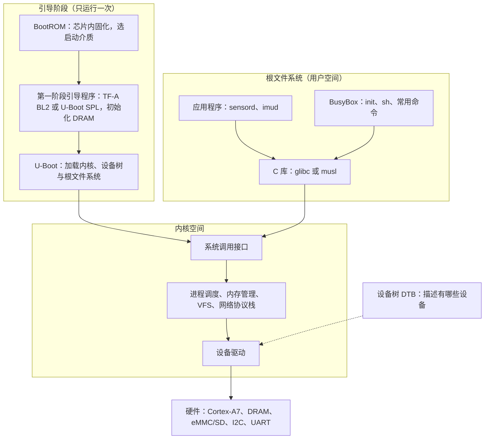

# 5.1 嵌入式 Linux 与系统编程边界

同一个「读取姿态传感器、每秒钟算一次平均值」的功能，在 STM32F103 这类单片机上通常被组织为一个平铺直叙的 `.bin` 文件：芯片上电后直接循着中断向量表跳入 `main`，I2C 驱动、工程换算与串口发送逻辑全部交织在同一个固件镜像里。当同样的业务逻辑迁移到 STM32MP157 这类跑着嵌入式 Linux 的处理器上时，整个系统的纵深被彻底拉开了。原本单一的二进制文件解构成了五个权责分明的层级：芯片内部出厂固化的 BootROM、存放于存储介质上的引导程序、负责资源抽象的内核与设备树、收纳了 C 运行库与常用系统工具的根文件系统，以及最终挂载在 `/dev/i2c-5` 节点上运行的用户态守护进程。面对这样一套体系，开发者的首要任务是分清各层软件的边界与供应方：究竟哪些属于芯片原厂提供的底层固件，哪些源自开源社区的通用组件，而哪些才需要工程团队亲手实现。

面对这样一套复杂的层级，此前在系统编程部分积累的用户空间接口知识，大部分依然可以直接复用，但背后的软硬件交互模式与约束条件却发生了根本转变。同时，工程实践中往往面临更关键的技术选型裁决：到底何时该停留在单片机配合实时操作系统的方案，又在什么条件下必须引入 Linux。厘清这些权衡之后，我们便可以在实验宿主机上搭建起一致的开发环境——无论使用 QEMU 模拟的 ARM 目标机，还是真实的 STM32MP157 开发板，两者在内核驱动模型与核心示例上都完全同源。

## 1. 系统的组成

当给一块运行 Linux 的 ARM 目标板接入电源，直到串口终端或屏幕上浮现出登录提示符，这数秒的启动过程实质上跨越了层次分明的软件阶梯。整个体系可以清晰地划分为两大生命周期：一类是仅仅在引导阶段短暂执行一次、负责为后续环节铺平道路的引导程序；另一类则是开机后始终常驻系统、共同支撑业务逻辑的运行时实体——内核在底层全权掌管并抽象硬件资源，根文件系统则为用户空间的应用程序提供基础执行环境与运行库支撑。



这五部分各有各的来源，弄混了就会在错误的地方找问题。

| 部分 | 由谁提供 | 出问题时先看哪里 |
| --- | --- | --- |
| BootROM | 芯片厂，固化在片内，改不了 | 启动引脚、启动介质、串口有无输出 |
| 引导程序 | 芯片厂（TF-A）与社区（U-Boot） | U-Boot 命令行、环境参数配置、能否加载内核 |
| 内核 | 社区（kernel.org），芯片厂提供补丁 | 启动日志停在哪个 `printk` |
| 设备树 | 芯片厂与板厂提供 `.dts`，自己改 | `/proc/device-tree`、驱动有没有 probe |
| 根文件系统 | 自己用 Buildroot 或 Yocto 生成 | 能否挂载、`init` 能否执行 |
| 应用 | 自己写 | 应用日志、退出码、core dump |

与单片机开发体验相比，嵌入式 Linux 带来的根本性认知转变，在于硬件外设被内核的保护屏障完全隔离开来。在 STM32F103 这类无 MMU 的裸机或 RTOS 环境中，只要知道某个外设的物理基地址，写下一行 `GPIOA->BSRR = 1u << 5` 就能直接在总线上翻转引脚电平；但在 Linux 治下，同样的物理地址受虚拟内存机制保护，属于特权级独占的内核空间，任何普通用户空间进程若直接进行指针解引用，只会被 MMU 拦截并触发段错误。应用程序如果需要与外设打交道，必须收敛为标准化的系统请求，交由内核代为履行。

## 2. 用户空间与内核空间

现代 ARM 处理器（例如 Cortex-A 系列）原生支持多级运行特权级，Linux 内核正是依托处理器的硬件特权级与内存管理单元（MMU），在地址空间中划出了一道分明的界限。内核本体常驻于高特权级，拥有无限制读写全部物理内存与外设映射寄存器的权限；与之相对，用户空间的各类应用程序则被限定在非特权级运行，不仅无法直接触碰外设地址，甚至彼此之间的虚拟内存空间也被完全隔离。

在这种架构约束下，非特权程序要访问外设或获取系统服务，系统调用（system call）是受硬件和内核双重认可的合法跨界通路。当应用层发起请求时，标准库会把对应的系统调用号与参数填入约定的通用寄存器，随后触发一条特权陷入指令（在 32 位 ARM 上为 `svc` 指令）。此时处理器硬件自动完成特权级的上下文切换，将执行流平稳移交给内核预设的中断与异常向量表，由内核中经过安全校验的处理逻辑完成后续操作。

这套机制在通用服务器或个人计算机上早已被广泛认知，而在资源受限的嵌入式场景中，其背后的抽象契约同样严丝合缝。C 标准运行库提供的 `read`、`write`、`ioctl` 以及 `mmap` 等系统级封装，最终都会汇聚到这道特权闸门上，而各类具体的设备驱动程序则稳稳承接在这些系统调用的内核侧末端。通常情况下，用户空间应用程序访问硬件主要依托三条标准通路：

| 接口 | 位置 | 适合什么 |
| --- | --- | --- |
| 设备文件 | `/dev` 下，字符设备或块设备 | 读写数据流、`ioctl` 控制 |
| sysfs | `/sys` 下，一个属性一个文件 | 读状态、改配置、看设备树信息 |
| procfs | `/proc` 下 | 进程信息、内核参数、`/proc/device-tree` |

一次读取要走完下面这条路，每一层都有自己的缓冲区与错误码：


在后续章节中，5.7 会用 `mdr_fifo` 演示一个字符设备从驱动到 `read`/`write` 的完整路径，5.8 则会展示 sysfs 属性如何对应到 I2C 传感器的采样率调节。

::: concept emb-linux-user-kernel-access title="用户态访问硬件只经由内核"

在带 MMU 的嵌入式 Linux 上，用户态程序不能直接读写外设寄存器。所有硬件访问都要经过内核：设备文件、sysfs、procfs，或者由驱动导出的其他接口。直接映射物理地址的 `/dev/mem` 与 UIO 框架只用于原型验证，产品代码不走这条路。

:::

在实际工程调试中，也存在一种旁路机制：在具备超级用户权限的前提下，程序可以通过打开 `/dev/mem` 设备节点，将一段特定的物理地址空间通过 `mmap` 直接映射到用户空间的虚拟地址中，从而绕开常规内核驱动直接操作外设控制寄存器。这种手法在硬件点亮初期或验证外设通信时极为高效，但在生产级固件与产品代码中应当坚决避免——它瓦解了操作系统的内存保护屏障，同时绕过了内核的电源管理调度、时钟树管控以及多进程并发互斥机制。UIO（Userspace I/O）子系统则是对这种需求的一种规范化折中封装，它将物理寄存器映射与基础的中断通知抽象为标准字符设备节点与 sysfs 属性，比较适合那些业务逻辑非常轻量、开发周期紧迫且无需深度融入内核现有子系统的非标准硬件。

::: generate emb-linux-mmio-compare kind=explanation concepts=emb-linux-user-kernel-access

面向刚从 STM32 裸机转过来的读者，以「点亮一个 LED」与「读一次 I2C 传感器」为例，对照 `GPIOA->BSRR` 与 `/sys/class/leds` 两种写法，说明地址、权限、谁在中间做了什么事，以及为什么产品代码不能沿用 `/dev/mem` 的做法。

:::

## 3. 第四部分的知识哪些原样可用

系统编程所涉及的绝大多数 POSIX 标准接口，在嵌入式 Linux 体系中完全保持一致。无论是文件描述符、多进程模型、线程同步原语还是网络套接字，Linux 在 ARM、RISC-V 与 x86 架构之间始终维护着一套统一的 API 规范。真正发生转变的，并非应用层调用的函数签名与语义，而是为了应对嵌入式硬件严苛物理约束所采取的工程实践方式。

| 第四部分的内容 | 在嵌入式 Linux 上 | 需要注意的地方 |
| --- | --- | --- |
| [文件描述符与非缓冲 I/O](/教程/正文/系统编程/2_文件描述符与非缓冲IO) | 原样可用 | 设备文件、sysfs 属性也是描述符，`read` 与 `write` 的语义由驱动决定 |
| [虚拟内存与 mmap](/教程/正文/系统编程/4_虚拟内存与内存映射) | 原样可用 | 通常没有交换分区，内存不够就是 `ENOMEM` |
| [进程的创建、执行与回收](/教程/正文/系统编程/5_进程的创建_执行与回收) | 原样可用 | 内存小，`fork` 的页表复制代价更明显，常改用 `posix_spawn` |
| [信号](/教程/正文/系统编程/6_信号_时间与定时器) | 原样可用 | 无 |
| [线程与同步](/教程/正文/系统编程/8_操作系统线程与同步) | 原样可用 | 换 musl 后默认线程栈更小，按需显式指定 |
| [套接字](/教程/正文/系统编程/10_套接字编程) | 原样可用 | 无 |
| [事件循环](/教程/正文/系统编程/12_事件循环) | 原样可用 | `epoll`、`signalfd`、`timerfd` 在 ARM 上齐全 |
| [服务管理](/教程/正文/系统编程/14_系统程序的健壮性与安全边界) | 部分可用 | 嵌入式上常是 BusyBox init 而不是 systemd，见 5.10 |

在实践中，由于硬件环境与资源受限带来的差异主要体现在四个维度：

1. **构建环节的重心转移**：目标板往往缺乏足够的计算性能与内存空间来直接运行编译器，因此全部编译、链接操作都在性能强大的开发宿主机上由交叉工具链完成。链接阶段所依赖的头文件与共享库必须严格源自目标环境的 sysroot 副本，工具链、sysroot 与最终根文件系统之间的镜像关系将在 5.3 中详细拆解。
2. **存储寿命与分区规整**：嵌入式设备通常依赖 eMMC、SD 卡或 SPI NOR/NAND Flash 作为存储介质，这些介质普遍存在擦写寿命上限与意外掉电导致文件系统损坏的风险。工程中根文件系统往往被部署为只读挂载（如 squashfs 或只读 ext4），运行期动态产生的日志通常重定向到基于内存的 tmpfs 或通过网络转发，而持久化配置与运行数据则隔离在独立的读写分区。
3. **初始化与服务生命周期管理**：在资源受限的环境中，体积庞大、依赖繁琐的 systemd 往往难以施展，Buildroot 等构建系统默认采用经典的 BusyBox init，依靠简明轻巧的 `/etc/inittab` 和 `/etc/init.d/` 脚本管理开机自启。两类初始化系统的服务编排规范在 5.10 中有清晰对比。
4. **受限环境下的远程调试工作流**：目标机不仅不具备本地编译能力，通常也不会安装庞大的完整调试套件。排查故障的主流工作流依赖宿主机上的交叉 GDB 通过网络或串口连接目标板上的轻量级 `gdbserver` 进行联合调试；对于现场偶发的异常崩溃，则主要依托内核生成的 core dump 镜像与 strace 跟踪记录展开离线分析。

另一个容易在初期被忽略的隐性差异在于 C 运行库的选型。在桌面与服务器 Linux 上，glibc 几乎是不二之选；但在嵌入式领域，构建系统支持在 glibc、musl 以及历史悠久的 uClibc-ng 之间灵活切换。如果追求极其紧凑的文件系统体积与内存占用，musl 凭借精简清晰的代码实现成为了当下的首选；若应用高度依赖完整的宽字符国际化转换（`iconv`）、复杂的动态名称解析服务（NSS）或复杂的 `dlopen` 机制，glibc 仍然是兼容性最稳妥的基石。虽然各家运行库均在 POSIX 标准子集上高度兼容，但在诸如线程创建时的默认栈空间大小、对非标准 GNU 扩展函数的支持度等细节上存在细微分歧。只要业务代码在编写时自觉恪守通用标准、避免引入特定库的私有扩展，更换底层 C 库通常无需对源码进行伤筋动骨的修改。

## 4. 什么时候用 Linux

技术选型本质上是在软件生态红利与硬件物理代价之间寻求最佳平衡。当产品需要稳固的进程级内存隔离、多用户访问控制、完备的 TCP/IP 协议栈（例如 TLS 加密、HTTP/2、MQTT 协议）、工业级文件系统、精美的图形人机交互界面，抑或是需要直接引入成熟的开源数据库与通用服务组件时，嵌入式 Linux 带来的丰富生态能够节省难以估量的研发工作量。相反，若系统核心诉求仅仅是极低功耗待机、毫秒级的冷启动响应，以及微秒级确定性的硬实时控制闭环（例如伺服电机高频矢量控制、纳秒级 ADC 采样触发），通用 Linux 系统本身的内核内存开销、多任务调度抖动以及数秒级的引导时间，就会成为显著的工程阻碍。

| 维度 | MCU + RTOS | 嵌入式 Linux |
| --- | --- | --- |
| 参考芯片 | STM32F103C8，Cortex-M3，72 MHz | STM32MP157，双核 Cortex-A7 加一个 Cortex-M4 |
| 内存 | 20 KB SRAM | 数百 MB DDR |
| 存储 | 64 KB Flash | GB 级 eMMC 或 SD 卡 |
| 启动时间 | 毫秒级 | 通常数秒 |
| 隔离 | 无 MMU，一个野指针可以改坏任何对象 | MMU 与权限，进程之间互不影响 |
| 实时性 | 中断延迟微秒级，行为确定 | 通用内核有毫秒级抖动；PREEMPT_RT 明显改善，仍需实测 |
| 软件生态 | 驱动自己写，协议栈有限 | 完整 TCP/IP、文件系统、Python、数据库 |
| 功耗 | 休眠可到微安级 | 数百毫瓦到数瓦 |
| 典型场景 | 电机控制、电子秤、传感器节点 | 网关、HMI、摄像头、数据采集 |

在实时性指标上，通用 Linux 内核由于自旋锁临界区、中断底半部处理以及虚拟内存换页等机制，不可避免地伴随着毫秒级的响应抖动。尽管 PREEMPT_RT 补丁集已在 Linux 6.12 逐步融入主线内核，但针对特定架构与 SoC（特别是 32 位 ARM 平台），依然需要确认芯片原厂维护的内核分支是否已完整合入该特性。即使运行在全抢占实时内核下，最坏情况的中断延迟依然取决于具体板级的总线争用与 Cache 命中状况，必须在真实硬件上通过 `cyclictest` 展开长周期的压力实测，而不能脱离具体硬件配置直接引用公开指标。对于强确定性要求的控制环路，将硬实时控制逻辑部署在专用的 Cortex-M4 协处理器上运行、由 Cortex-A7 上的 Linux 专司网络通信与业务呈现，通常比强行调优通用 Linux 的实时延迟更为稳妥可靠。

STM32MP157 芯片便采用了这种典型的非对称异构多核架构（AMP）：片内同时容纳了双核 Cortex-A7 与单个 Cortex-M4 核心。A7 核心负责运行功能完备的 Linux 系统以管理网络堆栈与用户界面，M4 核心则专职运行 RTOS 掌控电机控制与高频采样，两者通过片上共享内存和硬件信号量进行高效交互。工业界另一种屡见不鲜的对等方案，则是选用一颗运行 Linux 的通用应用处理器外接一颗独立的工业级单片机，两者依托 UART 或 SPI 建立数据通道。这两种架构的工程设计哲学高度一致：将对确定性响应有严苛要求的控制任务留给单片机，将高并发、高吞吐量以及复杂业务抽象全面交托给 Linux。

<Quiz
  type="single"
  :options="[
    { label: '带触摸屏、Wi-Fi 与本地数据库的工业数据采集网关', value: 'A' },
    { label: '每 50 微秒更新一次占空比的无刷电机驱动器', value: 'B' },
    { label: '用四节干电池供电、每天上报两次温度的传感器节点', value: 'C' },
    { label: '需要运行现成 MQTT broker 与 Web 配置页的楼宇控制器', value: 'D' }
  ]"
  answer="B"
>

<template #question>

下面哪一个产品最不适合用嵌入式 Linux？

</template>

正确答案是 **B**。

- 50 微秒的控制周期要求确定的中断响应，通用 Linux 内核给不了这种保证，Cortex-M 加 RTOS 才是正路。
- A、D 需要文件系统、网络协议栈与现成软件，正是 Linux 的强项。
- C 的瓶颈是功耗，Linux 的休眠电流与启动开销都太大，MCU 更合适。

</Quiz>

## 5. 本章的实验平台

宿主机环境使用标准的 Linux 系统即可，在 Windows 环境下采用 WSL2 亦能获得几乎无异的开发体验。全章实验主要围绕两套核心构建支撑：交叉工具链与 Buildroot 自动化构建框架，二者均运行在宿主机之上。

在缺乏物理硬件开发板的情况下，建议优先采用 QEMU 仿真方案。Buildroot 官方发布分支自带了 `qemu_arm_vexpress_defconfig` 配置文件，能够自动构建并生成一套可在 QEMU 中完整启动的 ARM 模拟系统。该系统所模拟的 CPU 为 Cortex-A9（32 位 armhf 架构），与 STM32MP157 内部的 Cortex-A7 同属 ARMv7-A 体系架构：

```text
$ make qemu_arm_vexpress_defconfig
$ make
```

在初次构建过程中，构建脚本需要自网络拉取内核源码、BusyBox 源码以及交叉编译器，通常需要耗费一定时间。构建流程全部收尾后，`output/images/` 目录下将整齐生成内核镜像、编译好的扁平设备树（DTB）以及根文件系统镜像文件；随附生成的 `start-qemu.sh` 脚本则将这些要素整合为一条完整的 QEMU 启动指令：

::: terminal title="bash - 启动 QEMU 中的 Buildroot 系统（输出类似，取自 Buildroot 的 board/qemu/arm-vexpress/readme.txt）"

```text
$ ./output/images/start-qemu.sh
...
Welcome to Buildroot
buildroot login:
```

:::

当终端输出 `buildroot login:` 登录提示时，表明从引导加载程序、内核镜像、设备树配置直至根文件系统挂载的整条链路均已正确闭环。默认配置下系统未设密码，直接以 `root` 用户登录即可交互。关于底层启动日志的剖析与挂载阶段常见故障的诊断思路，将在 5.2 展开详述。

若手头备有现成硬件，推荐使用官方的 STM32MP157 Discovery 套件（DK1 或 DK2）。其与前期接触的 STM32F103 同属意法半导体生态，硬件参考手册与原厂工具链一脉相承。配套示例所依托的系统内核版本锁定在长期支持版 Linux 6.18 LTS，Buildroot 版本选用 2026.02 LTS，Yocto 选用 6.0 Wrynose 分支，具体的版本规范与构建约束详见 5.4。

为了让知识点前后呼应，后续各节将围绕几个循序渐进的驱动与应用范例展开：

| 例子 | 位置 | 说明 |
| --- | --- | --- |
| `mdr_fifo` | 5.7 | 纯软件的字符设备，演示 `read`、`write`、`poll` |
| `mdr_serial` | 5.8、5.9 | QEMU 的第二个 PL011 串口，演示 platform 驱动与中断 |
| `mdr_mpu6050` | 5.8、5.9、7.4 | 开发板上的 I2C 传感器驱动 |
| `sensord` | 5.10 | 用户态守护进程，周期读数据、响应信号、可被调试 |

::: tip QEMU 里没有真实硬件怎么办

`mdr_serial` 挂载在 QEMU 仿真环境所提供的第二个 PL011 串口上，而 `mdr_fifo` 则是纯内存数据环，完全不触碰外设总线。MPU6050 六轴传感器仅存在于真实的物理开发板扩展接口上；在没有实体板卡的情况下，只要通读 5.8 节关于传感器驱动与设备树绑定的核心原理，并在 QEMU 环境中把玩验证 `mdr_serial` 即可，二者在底层依附的 Linux 驱动模型与设备抽象框架完全同构。

:::

## 6. 第一个交叉编译的程序（预览）

在展开复杂的系统级构建前，不妨先在微观层面对比同一份 C 源代码分别经过本机编译器与交叉工具链编译后，最终生成的目标文件究竟存在哪些底层差异。测试源码存放于 `code/嵌入式/5_嵌入式Linux/5_1_嵌入式Linux与系统编程边界/hello.c`，仅执行单次终端输出：

```c
#include <stdio.h>

int main(void) {
    puts("hello from the target");
    return 0;
}
```

在 x86-64 架构的 Linux 宿主机上分别执行本地编译与交叉编译，两次调用的命令行差异仅仅在于所选用的编译器驱动程序不同：

::: terminal title="bash - 本机编译与交叉编译（真实输出）"

```text
$ gcc -std=c17 -Wall -Wextra hello.c -o hello_native
$ clang --target=arm-linux-gnueabihf -std=c17 -Wall -Wextra -O2 -s hello.c -o hello_arm
$ file hello_native hello_arm
hello_native: ELF 64-bit LSB pie executable, x86-64, version 1 (SYSV), dynamically linked, interpreter /lib64/ld-linux-x86-64.so.2, BuildID[sha1]=d41720666de5adfb965920e01d2b85f27a0da1c2, for GNU/Linux 3.2.0, not stripped
hello_arm:    ELF 32-bit LSB executable, ARM, EABI5 version 1 (SYSV), dynamically linked, interpreter /lib/ld-linux-armhf.so.3, for GNU/Linux 2.0.0, stripped
```

:::

`file` 命令行工具输出的概要信息直观揭示了两个可执行文件的底层属性：前者是被组织为面向宿主机 x86-64 架构的 64 位位置无关可执行程序（PIE），而后者则是专为 32 位 ARM 平台生成的目标程序。在实验宿主机上，既可以直接借助 Clang 传入 `--target=arm-linux-gnueabihf` 交叉构建，也可以使用 ARM 官方提供的交叉套件 `arm-linux-gnueabihf-gcc -std=c17 -Wall -Wextra -s hello.c -o hello_arm`。尽管不同编译器生成的符号哈希、构建标识（BuildID）及标称的最低内核版本微有差异，但下层决定的二进制规范完全一致。借助 `readelf -h` 工具透视 ELF 文件头，关键元数据字段的对比一目了然：

::: terminal title="bash - 两个 ELF 头的关键字段（真实输出）"

```text
$ readelf -h hello_native | grep -E 'Class|Type|Machine|Flags'
  Class:                             ELF64
  Type:                              DYN (Position-Independent Executable file)
  Machine:                           Advanced Micro Devices X86-64
  Flags:                             0x0
$ readelf -h hello_arm | grep -E 'Class|Type|Machine|Flags'
  Class:                             ELF32
  Type:                              EXEC (Executable file)
  Machine:                           ARM
  Flags:                             0x5000400, Version5 EABI, hard-float ABI
```

:::

三处差异分别揭示了运行时的核心契约：

- `Class` 标注为 `ELF32`：宣告目标系统寻址空间为 32 位，所有数据指针与通用地址宽度均固定为 4 字节。
- `Machine` 明确标示为 `ARM`：内部存放的所有机器指令均按 ARM 指令集格式编码，x86 宿主机的 CPU 译码逻辑无法识别这些指令模式。
- `Flags` 中出现的 `hard-float ABI`（硬浮点接口）：表明编译器遵循将浮点参数直接装入硬件 VFP 寄存器进行传递的高效调用约定，该约定与基于通用整型寄存器模拟传参的软浮点（soft-float）机制在二进制层面互不兼容。交叉工具链生成的二进制程序与目标板上运行的 C 库及根文件系统必须严格保持浮点 ABI 的统一，否则不仅无法正常完成动态符号链接，在运行时加载时也会直接崩溃。

若将编译出的 ARM 二进制程序直接置于 x86 宿主机上强行运行，Linux 内核在装载 ELF 阶段解析 `Machine` 字段时发现架构不匹配，将直接向调用者返回 `ENOEXEC` 错误，shell 终端进而将其转化为明确的错误提示：

::: terminal title="bash - 在 x86 上运行 ARM 程序（真实输出）"

```text
$ ./hello_arm
bash: ./hello_arm: cannot execute binary file: Exec format error
$ echo $?
126
```

:::

在 POSIX shell 语义中，退出状态码 126 意味着“文件存在但格式异常导致无法执行”，这与状态码 127 所代表的“找不到指定命令”存在根本不同。排查此类错误时，首先应当验证可执行文件的目标架构与本地 CPU 体系是否吻合，其次需要检查动态链接器加载路径——ARM 二进制程序在加载阶段必须索取 `/lib/ld-linux-armhf.so.3`，该路径在常规的 x86-64 宿主机文件系统上默认是不存在的。

::: warning 宿主机上的交叉编译器不等于目标上的运行环境

交叉编译仅能确保生成符合目标架构指令集规范的机器指令，并不代表该可执行程序在目标硬件上能够直接无缝运行。编译链接期所依赖的 C 库头文件及共享库均提取自交叉工具链的 sysroot 目录，其版本、API 契约必须与目标板根文件系统中实际部署的动态库严格对齐，否则极易出现“编译链接顺利通过、目标板上一跑便报符号缺失”的经典故障。sysroot 的规范布局以及根文件系统的整洁生成，将在 5.3 与 5.4 节中逐步剖析。

:::

<Quiz
  type="single"
  :options="[
    { label: 'ELF 头里的 Machine 字段与宿主机的 CPU 不符', value: 'A' },
    { label: '可执行权限没有设置', value: 'B' },
    { label: '程序是用静态库链接的', value: 'C' },
    { label: '源码里用到了 ARM 专有的指令', value: 'D' }
  ]"
  answer="A"
>

<template #question>

`file` 已经显示 `hello_arm` 是 ARM 可执行文件，在 x86 主机上运行时报 `Exec format error`，最直接的原因是哪一个？

</template>

正确答案是 **A**。

- 内核加载 ELF 时读头部的 `e_machine`，发现不是本机架构就返回 `ENOEXEC`，与文件权限、链接方式无关。
- B 会得到 `Permission denied`，退出码 126 相同但提示不同。
- C 的静态库照样是 ARM 机器码，问题相同。
- D 在 x86 上根本走不到执行指令这一步。

</Quiz>

## 7. 习题

### 7.1 巩固

<Exercise id="60510" :d="1" :w="1">

用 `code/嵌入式/5_嵌入式Linux/5_1_嵌入式Linux与系统编程边界/hello.c` 把第 6 节的命令重做一遍。

(1) 本机编译后执行 `readelf -l hello_native`，找到 `INTERP` 段，写出它指向的加载器路径。这个文件属于五层系统里的哪一层？

(2) 交叉编译出 `hello_arm`，执行 `readelf -l hello_arm | grep -A1 INTERP` 与 `readelf -d hello_arm | head`，写出加载器路径与 `NEEDED` 项。把它拿到 x86 上运行，记录 shell 的提示与 `echo $?` 的结果。

(3) 把 (2) 的交叉编译命令加上 `-static`，重新生成后比较 `file` 的输出与 `readelf -l` 里 `INTERP` 段的有无，解释静态链接省掉了哪一层。

(4) 静态链接的 ARM 程序拿到 x86 上能不能运行？结合 (3) 的结果说明原因，指出这与动态链接器缺失是两件不同的事。

(5) 如果装了 QEMU 的用户态模拟器，用 `qemu-arm -L output/staging ./hello_arm` 直接跑动态链接的 `hello_arm`。`-L` 指向的是 Buildroot 的 `output/staging`。去掉 `-L` 再运行一次，记录报错。说明 `-L` 替代了哪一步，以及它和 5.10 里 gdbserver 的 `set sysroot` 在做同一件事的哪一部分。

</Exercise>

<Exercise id="60511" :d="2" :w="2">

交叉编译器的预定义宏能直接看出目标 ABI，比读文档快。

(1) 用 `arm-linux-gnueabihf-gcc -dM -E - < /dev/null`（或本页用的 `clang --target=arm-linux-gnueabihf -dM -E - < /dev/null`）导出全部预定义宏，`grep` 出 `__SIZEOF_POINTER__`、`__SIZEOF_LONG__`、`__ARM_EABI__`、`__ARM_PCS_VFP`、`__BYTE_ORDER__` 五项，与 x86-64 上同一组宏对照，列成两列表格。

(2) 由 `__SIZEOF_POINTER__` 与 `__SIZEOF_LONG__` 推出目标上 `sizeof(void *)` 与 `sizeof(long)`。写一段 `printf` 验证本机的结果，ARM 上的结果只能靠宏推断，说明为什么不能用本机运行来验证。

(3) `__ARM_PCS_VFP` 存在说明什么？如果用它编出的目标文件与一个软浮点工具链编出的库一起链接，会在什么时候、以什么形式出错？

(4) 用 `readelf -h hello_arm` 的 `Flags` 一行印证 (3) 的结论，写出这一行里与浮点调用约定对应的文字。

</Exercise>

<Exercise id="60512" :d="2" :w="2">

写一个 `readattr` 程序，参数是一个路径，行为是打开、读一次、打印读到的字节数和内容。用它读下面四个文件：

```text
./readattr /proc/self/status
./readattr /proc/uptime
./readattr /sys/devices/system/cpu/online
./readattr /etc/hostname
```

(1) 记录每个文件的返回值。哪些内容是一行一个 `键: 值`，哪些是单个数字或字符串？这与第 2 节那张接口表的哪一列对应？

(2) 在同一个描述符上不 `lseek` 直接读第二次，打印第二次的返回值。四类文件的第二次读是不是都读到内容？读不到时返回 0 说明什么？

(3) 给程序加 `-n 次数` 参数，每次读之前 `lseek(fd, 0, SEEK_SET)`，再把四类文件读一遍。哪些文件的内容每次都能完整读到？`/sys/devices/system/cpu/online` 与 `/etc/hostname` 在两次读取之间内容可能不同，说明这份差别来自哪里。

(4) 把 `/sys/devices/system/cpu/online` 的内容与 `nproc`、`sysconf(_SC_NPROCESSORS_ONLN)` 对照，说明三者是否一致。

</Exercise>

### 7.2 编程

<Exercise id="60513" :d="3" :w="3">

系统调用的边界可以用 `strace` 直接看见。

(1) 写 `twice.c`：先用 `write(1, "libc\n", 6)` 输出一行，再用 `syscall(SYS_write, 1, "raw\n", 4)` 输出一行。用 `strace -e trace=write ./twice` 运行，贴出结果，说明两行在系统调用层面有没有区别。

(2) 把 `write` 换成 `getpid`，分别调用 `getpid()` 与 `syscall(SYS_getpid)`，各打印结果。用 `strace -c -e trace=getpid` 统计次数，解释 C 库在这里有没有做缓存。

(3) 写一段打开不存在文件的代码，`open` 失败后依次打印 `errno` 的数值、`strerror(errno)` 与 `errno == ENOENT` 的结果。用 `strace` 找到对应的 `openat` 行，指出内核返回的负值与 C 库设置的 `errno` 是什么关系。

(4) 用 `strace -e trace=%file ./readattr /proc/self/status` 观察 65512 写的 `readattr`，列出它实际发出的全部与文件有关的系统调用。C 库的 `fopen`/`fgets` 会多出哪些调用？

</Exercise>

<Exercise id="60514" :d="3" :w="3">

写一个 `sysinfo` 小工具，作为选型时的第一手数据。

要求：

1. 用 `uname` 打印 `machine`、`release`、`sysname`；用 `sysconf` 打印 `_SC_NPROCESSORS_ONLN`、`_SC_PAGESIZE`、`_SC_CLK_TCK`。
2. 用 `sysinfo()` 打印 `totalram`、`freeram`、`uptime`，把字节数换算成 MiB。
3. 用 `getauxval(AT_HWCAP)` 打印硬件能力字，十六进制即可。
4. 编译成两个版本：本机 x86-64 与 ARM 交叉版，分别用 `file` 与 `readelf -h` 确认架构。
5. 在一台 Linux 主机上运行本机版，把输出与 `nproc`、`free -m`、`getconf PAGE_SIZE` 对照。ARM 版没有板子时只要求编译通过，指出输出里哪几项是运行时才确定的、哪几项在编译时由 ABI 决定。
6. 用它回答第 4 节的选型问题：以「每 50 微秒更新一次占空比的无刷电机驱动器」为例，写出第 4 节那张表里这个工具能填的几行，指出哪几行它填不了（实时性、功耗），并说明缺的这几行要靠什么手段测。

验收：三项数字与系统命令一致（允许 1 MiB 的舍入差），程序在 `-Wall -Wextra` 下无警告。

</Exercise>

<Exercise id="60515" :d="4" :w="3">

模拟一次「能链接、一运行就找不到库」的故障，弄清 sysroot 与运行时搜索路径的关系。

准备：

```text
mkdir -p lib app
```

1. 写 `greet.c` 与 `main.c`，把 `greet` 编成 `lib/libgreet.so`；`main.c` 调用它，链接命令用 `-Llib -lgreet -Wl,-rpath,'$ORIGIN/../lib'`，可执行文件放在 `app/`。
2. 运行 `app/main`，确认成功。用 `readelf -d app/main` 找出 `NEEDED` 与 `RUNPATH` 两项，写出它们的值。
3. 把 `lib/libgreet.so` 改名，再运行。记录 `ldd app/main` 与直接运行时的错误信息，指出这一步对应正文警告里说的哪个场景。
4. 用 `LD_LIBRARY_PATH` 临时救回来，然后说明为什么产品里不应该依赖它。
5. 把 `-Wl,-rpath` 去掉重新链接，只靠 `LD_LIBRARY_PATH` 运行，比较 `readelf -d` 的输出。交叉编译到 ARM 时，`RUNPATH` 应该写成目标上的哪个路径？

</Exercise>

<Exercise id="60516" :d="5" :w="4">

写一个统一的传感器读取函数，把第 2 节的三条路合成一个接口。

```c
/* 读一个传感器值。成功返回 0 并把读数写入 *out，失败返回 -1。 */
int sensor_read(const char *path, double *out);
```

要求：

1. 打开时带 `O_CLOEXEC`；`fstat` 后区分普通文件、字符设备与其他类型。
2. 用 `fstatfs` 的 `f_type` 判断是不是 sysfs（`SYSFS_MAGIC` 为 `0x62656572`，`fstatfs` 声明在 `sys/vfs.h`）；是的话先 `lseek(fd, 0, SEEK_SET)` 再读到文件结束。
3. 字符设备只读一次，最多 4096 字节；普通文件读最后一行。
4. 从读到的文本里取出最后一个数（`strtod`），前面允许有 `时间戳 ` 之类的前缀；取不到数时返回 -1 并把原因写进 `errno`。
5. 写一个测试程序，对下面四类输入各跑一次，打印返回值与结果：

```text
/data/sensors.txt            普通文件，内容 10:00:00 21.5
/sys/devices/system/cpu/online   sysfs 属性
/dev/zero                    字符设备
/tmp/空文件                   空文件
```

验收：前两项返回 0 且数值正确；后两项返回 -1，`strerror` 的输出能说清原因。给函数写一段注释，说明调用方需要负责什么。

</Exercise>

### 7.3 综合与挑战

<Exercise id="60517" :d="6" :w="5" scope="*">

把一份依赖 glibc 扩展的小程序移植到只依赖 POSIX 的写法，为换成 musl 做准备。

初始代码：

```c
#define _GNU_SOURCE
#include <errno.h>
#include <error.h>
#include <stdio.h>
#include <stdlib.h>
#include <string.h>
#include <unistd.h>

int main(int argc, char **argv) {
    char *cwd = get_current_dir_name();
    char *path;

    if (asprintf(&path, "%s/%s", cwd, argc > 1 ? argv[1] : "data.txt") < 0) {
        error(EXIT_FAILURE, errno, "asprintf");
    }
    printf("path=%s\n", path);
    if (access(path, R_OK) != 0) {
        error(EXIT_FAILURE, errno, "access %s", path);
    }
    puts("readable");
    free(path);
    free(cwd);
    return 0;
}
```

(1) 在 glibc 上编译运行，记录正常与文件不存在两种情况的输出。用 `nm -D` 或 `objdump -T` 找出它引用的非 POSIX 符号，列成清单。

(2) 逐项替换：`get_current_dir_name` 改成 `getcwd` 加 `PATH_MAX` 的处理，`asprintf` 改成先 `snprintf(NULL, 0, ...)` 量长度再分配，`error` 改成 `fprintf` 加 `strerror`。改写后只定义 `_POSIX_C_SOURCE 200809L`，用 `-std=c17 -Wall -Wextra -Werror` 编译通过。

(3) 用 `gcc -std=c17 -D_POSIX_C_SOURCE=200809L -U_GNU_SOURCE -Werror=implicit-function-declaration` 编译原版，把报错贴出来，说明哪几个函数在没有 `_GNU_SOURCE` 时根本不可见。这一步用什么办法在不用 musl 的机器上完成对 glibc 扩展的审计？

(4) 有 `musl-gcc` 时，把改写前后的程序各静态编译一次，比较 `size` 与 `ls -l` 的结果，说明体积差来自哪里；没有时说明为什么静态链接下 glibc 的体积劣势更明显（提示：NSS 与 `dlopen`）。

(5) 给出一份「不依赖 glibc 扩展」的检查清单，至少五条，指出其中哪一条只能靠编译发现、哪一条只能靠阅读代码发现。

</Exercise>

## 8. 参考资料

1. Bootlin, [*Embedded Linux system development*](https://bootlin.com/doc/training/embedded-linux/embedded-linux-slides.pdf)：系统组成、启动链与开发流程的培训幻灯片。
2. Bootlin, [*STM32MP157 lab manual*](https://bootlin.com/doc/training/embedded-linux/embedded-linux-stm32mp1-labs.pdf)：内核 6.18、crosstool-NG 1.28.0 的实验步骤。
3. The Buildroot project, [*The Buildroot user manual*](https://buildroot.org/downloads/manual/manual.html)：`qemu_arm_vexpress_defconfig` 的构建流程与目录布局。
4. The Buildroot project, [*board/qemu/arm-vexpress/readme.txt*](https://gitlab.com/buildroot.org/buildroot/-/blob/master/board/qemu/arm-vexpress/readme.txt)：QEMU 启动命令与 `start-qemu.sh`。
5. The Linux Kernel Organization, [*Releases*](https://www.kernel.org/category/releases.html)：长期支持版本的列表，本页取 6.18 LTS。
6. Michael Larabel, [*Real-Time PREEMPT_RT Support Merged For Linux 6.12*](https://www.phoronix.com/news/Linux-6.12-Does-Real-Time), Phoronix，2024。
7. STMicroelectronics, [*STM32MP157x-DKx - hardware description*](https://wiki.st.com/stm32mpu/wiki/STM32MP157x-DKx_-_hardware_description)：Discovery 板的接口与 I2C 连接。
8. Frank Vasquez, Chris Simmonds, *Mastering Embedded Linux Development*, 4th ed., Packt, 2025（ISBN 978-1-80323-259-1）。
