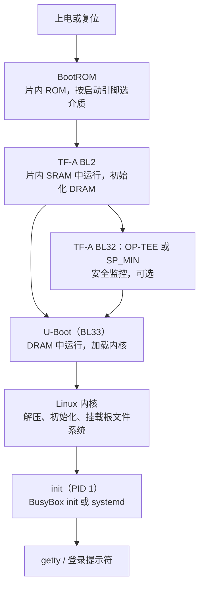

# 5.2 BootROM、U-Boot、内核与根文件系统

在 STM32F103 这类传统微控制器上按下复位按键，硬件层面的执行链条极其简明利落：芯片内部逻辑自动从 `0x0800_0000` 地址抓取初始栈顶指针与复位异常向量，随后直接跃迁入 `Reset_Handler`。在这段启动汇编中，CPU 迅速完成 `.data` 段由 Flash 向 SRAM 的搬运与 `.bss` 段的内存清零，紧接着便直接调用 `main` 函数接管全局控制权。这一系列动作在数微秒之内一气呵成。

然而，在面对 STM32MP157 这类应用处理器时，按下复位键后数秒内展开的软硬件重构过程要深邃得多。上电伊始，外部大容量 DDR 内存因尚未配置时序参数而处于完全不可用状态；功能庞大的 Linux 内核仍静默存放在外部 SD 卡或 eMMC 存储介质的特定扇区中；板载调试串口尚未建立波特率分频，没有任何一段上层代码能够预先假定运行环境完备。从晶圆上电到最终向用户交付可交互的控制台，这数秒的启动过程必须依托多级引导程序像接力赛一样精密衔接——每一级程序在极其严苛的物理限制下被唤醒，竭尽全力初始化下一阶段所需的最小硬件子集，并将控制权稳妥下放。

顺着这条启动链逐步下潜，我们可以清晰地理顺各级引导组件的分工协作：片内出厂固化的 BootROM 如何根据硬件电平仲裁启动介质，第一阶段引导程序为何必须承担起唤醒 DRAM 控制器的重任，功能完备的 U-Boot 如何调度内核镜像、扁平设备树与根文件系统的装载，以及内核在解析启动参数后如何顺利挂载根文件系统并派生出全系统的首个用户空间进程。理解这条链条上的交接契约，是排查板级启动停滞故障的核心根基。

## 1. 启动链总览

先看全貌。下面这条链对应 STM32MP157，每一级都跑在上一条已经初始化好的环境里：



各阶段的职责与运行位置：

| 阶段 | 运行在 | 由谁加载 | 主要职责 |
| --- | --- | --- | --- |
| BootROM | 片内 ROM | 芯片内部 | 读启动引脚或熔丝，从 SD、eMMC、NOR、USB 里找下一级 |
| TF-A BL2 | 片内 SRAM | BootROM | 初始化时钟与 DDR，把后续映像搬进 DRAM |
| BL32（可选） | DRAM 的安全世界 | BL2 | OP-TEE 或 SP_MIN，提供安全监控调用 |
| U-Boot（BL33） | DRAM | BL2 | 加载内核与设备树，准备命令行，跳转 |
| 内核 | DRAM | U-Boot | 初始化子系统与驱动，挂载根文件系统 |
| init | DRAM | 内核 | 第一个用户态进程，拉起服务与登录 |

QEMU 等虚拟化仿真平台上的引导链路则精炼得多。由于虚拟机管理器可以直接将宿主机内存空间映射并填充到虚拟客户机中，`qemu-system-arm` 的 `-kernel` 与 `-dtb` 参数能够直接跨越底层的物理存储读取与时序配置，将内核镜像与设备树直接置入虚拟内存空间，而 `-drive` 参数则将外部文件系统镜像无缝挂载为模拟块设备。这实际上直接省去了芯片片内的 BootROM 与外部次级引导加载程序两道环节：


这一架构差异在开发排错时具有极高的分流参考价值：如果在 QEMU 环境中系统无法正常拉起，故障根因必然收敛在内核配置、驱动缺失或根文件系统的制作缺陷上；但若在实体硬件开发板上遇到启动停滞，则必须将排查视线向前推移，逐级审视 BootROM 采样、供电轨时序、DDR 训练以及 U-Boot 引导参数的交互状态。

::: concept emb-boot-sram-dram title="为什么需要第一阶段引导程序"

复位时片上 SRAM 可以直接使用，DRAM 还不能：它的时序参数要由软件配置，配置之前无法读写。因此 BootROM 只能把很小的第一级程序放进片内 SRAM，由它完成 DRAM 控制器初始化，之后才能把体积以兆字节计的内核搬进 DRAM。BootROM 自己不初始化 DRAM，因为 DRAM 的型号与参数随板子而变，固化在芯片里的代码不可能预先知道。

:::

::: generate emb-boot-chain-relay kind=explanation concepts=emb-boot-sram-dram

面向刚接触 ARM Linux 的读者，用一场接力赛作类比讲这条链：每一棒在哪个场地跑（片内 SRAM 还是 DRAM）、上一棒交给下一棒什么东西、交接失败时会在哪里掉棒（串口没有任何输出、U-Boot 提示找不到内核、内核停在 Starting kernel），以及为什么 DRAM 必须先初始化才能把内核搬进去。

:::

## 2. BootROM

BootROM 是芯片出厂制造时掩膜固化在片内只读存储器（ROM）中的一段底层微码，出厂后无法覆写也无法剔除。它的功能极为纯粹：在处理器复位信号撤销后率先接管执行流，依据预设的启动模式（boot mode）搜寻合法的次级引导程序，完成基础完整性校验，随后无条件跳转执行。

启动模式的裁决通常依赖专用的硬件引脚电平采样或片内一次性可编程熔丝（OTP fuse）。以 STM32MP157 为例，芯片通过 `BOOT0`、`BOOT1` 和 `BOOT2` 三个引脚的逻辑高低电平组合对启动源进行硬件编码，支持包括 MicroSD 卡、板载 eMMC、SPI NOR/NAND Flash 以及 USB/串口在内的多种介质通路。上电瞬间，BootROM 依次扫描选定介质的头部扇区，检索带有特定厂商格式描述表与数据校验和的镜像结构；若系统启用了硬件安全启动机制，BootROM 还将基于片内烧录的安全公钥散列执行非对称数字签名验签，一旦校验未达标便判定该启动项失效。当所有候选介质均检索失败时，处理器自动切入 USB DFU 或 UART 下载模式，在死循环中静候上位机烧录工具灌入恢复固件。

这种硬件仲裁机制与 STM32F103 的 `BOOT` 引脚设计在设计理念上一脉相承，但功能维度有了质的跃迁。在传统 Cortex-M 单片机中，引脚切换主要用于在内部 Flash 运行与片内固化串口 ISP 之间做简单的二选一；而在功能丰富的高性能应用处理器上，BootROM 已经具备了基础的文件系统读取能力、多介质轮询逻辑与高强度的硬件安全验签能力：

| | STM32F103（Cortex-M3） | STM32MP157（Cortex-A7） |
| --- | --- | --- |
| 启动选择的来源 | BOOT0、BOOT1 两个引脚 | BOOT0～BOOT2 三个引脚，也可用熔丝固定 |
| 可选的介质 | 主 Flash、系统存储器、SRAM | SD、eMMC、NOR、NAND、USB、串口 |
| 第一级程序从哪来 | 主 Flash 起始处，或系统存储器 | 所选介质的第一扇区 |
| 是否校验签名 | 不校验 | 可校验，安全启动时强制（见 6.7） |
| 找不到映像时 | 从主 Flash 取到的可能是空白，表现为 HardFault | 进入 USB/串口下载模式 |

在硬件调试初期，最常遭遇的挫折莫过于「板子上电后串口一片沉寂、未见任何字符吐出」。面对此种状态，首要排查的通常是启动引脚的物理逻辑电平：若拨码开关接触不良或引脚上拉配置错误，BootROM 将在错误的接口总线上盲目寻址，后续所有引导阶段根本无法被装入内存，控制台自然无从输出。开发板的硬件参考手册中通常会给出各模式对应的拨码开关真值表，必须确保其与当前烧录介质严格对应。

<Quiz
  type="single"
  :options="[
    { label: 'DRAM 的时序参数要由软件配置，配置前无法读写', value: 'A' },
    { label: 'DRAM 的容量太小，装不下 BootROM', value: 'B' },
    { label: 'BootROM 只能访问 SD 卡，不能访问内存', value: 'C' },
    { label: 'Cortex-A7 上电后不能直接执行 DRAM 里的代码', value: 'D' }
  ]"
  answer="A"
>

<template #question>

STM32MP157 的启动链里，BootROM 之后还要有 TF-A BL2 这一步，主要原因是哪一个？

</template>

正确答案是 **A**。

- DRAM 控制器要先配置时序、刷新率等参数才能工作，这段配置必须由软件完成；片内 SRAM 容量只有几百 KB，放不下内核，所以中间的 BL2 负责把 DRAM 拉起来。
- B 把两件事弄反了，BootROM 在片内 ROM 里，与 DRAM 容量无关。
- C 与 D 都不是原因：BootROM 能访问多种介质，Cortex-A7 也能执行 DRAM 里的代码，前提是 DRAM 已经可用。

</Quiz>

## 3. U-Boot

作为引导链条中最具灵活性的一环，U-Boot（Universal Boot Loader）是整个启动体系中唯一提供了完备人机交互命令行的阶段。当 DRAM 与核心外设就绪后，U-Boot 在串口控制台上打印系统版本信息并开启数秒的倒计时等待：若在此期间检测到串口终端有按键敲入，执行流将立即挂起并驻留在交互式命令行中；若超时未收到中断信号，则自动执行预设的环境配置指令 `bootcmd`，按既定流程拉起操作系统内核。

### 3.1 构建

U-Boot 沿用了与 Linux 内核高度相似的 Kconfig 配置体系与 Makefile 构建机制。针对 STM32MP15 系列评估板，官方通常维护有不同安全特性的默认配置文件：当系统采用 ARM 可信固件（TF-A）接管第一阶段引导与 DRAM 初始化时，应选用 `stm32mp15_trusted_defconfig`；若由 U-Boot 自带的 SPL（Secondary Program Loader）独立承担 DRAM 控制器初始化，则对应选用 `stm32mp15_basic_defconfig`：

```text
$ make stm32mp15_trusted_defconfig
$ make CROSS_COMPILE=arm-linux-gnueabihf- -j4
```

在这里，`CROSS_COMPILE` 用于向构建系统传递交叉工具链的前缀标识，构建脚本将自动补全调用 `arm-linux-gnueabihf-gcc`、`ld`、`objcopy` 等一系列二进制处理工具。最终的构建产物中，最关键的文件包括交付给 TF-A BL2 阶段负责装载的完整引导镜像 `u-boot.bin`（充当 BL33），以及作为 SPL 独立运行的第一阶段镜像 `u-boot-spl.stm32`。在工业开发与板卡交付场景中，方案商通常会利用烧写脚本将分立的 TF-A、U-Boot 及初始分区表打包为整块二进制 `.img` 镜像，支持开发者使用 `dd` 命令直接刷写入 SD 卡或 eMMC。

### 3.2 常用命令与环境配置参数

U-Boot 的交互终端在形式上酷似精简版的 Unix shell，但其底层所有指令均由编译时静态注册的 C 函数派生而来，指令的语法解析与参数传递风格也完全取决于对应命令的内部实现。在日常调试与板级适配过程中，以下常用指令构成了交互操作的核心基石：

| 命令 | 作用 |
| --- | --- |
| `help` | 列出当前固件支持的所有内置命令，`help mmc` 可查询特定命令的参数语法 |
| `printenv` | 打印当前内存中生效的全部环境参数键值对 |
| `setenv name value`、`setenv name` | 设置特定环境参数的取值，省略值时表示删除该键 |
| `saveenv` | 将当前内存中的环境参数持久化写回存储介质（如 Flash、eMMC） |
| `mmc list`、`mmc dev 0` | 扫描并列出板载 MMC 控制器挂载的设备，切换当前活跃的 MMC 控制器索引 |
| `fatload mmc 0:1 ${kernel_addr_r} zImage` | 从指定 MMC 设备的 FAT 文件系统分区中提取文件并读入指定的内存地址 |
| `ext4load`、`load` | 从 ext4 文件系统分区或自动识别的文件系统分区加载目标文件 |
| `tftp ${kernel_addr_r} zImage` | 通过网络协议自 TFTP 服务器远程拉取镜像文件到内存地址 |
| `bootz ${kernel_addr_r} - ${fdt_addr_r}` | 引导 32 位 ARM 自解压内核镜像 zImage，参数依次为内核地址、可选 initrd 地址与设备树地址 |
| `booti`、`bootm` | 引导 64 位 ARM 非压缩镜像 Image、引导旧式 uImage 或通用 FIT 复合镜像 |
| `fdt addr`、`fdt print` | 选定内存中存放的扁平设备树并展开查看特定节点的内容 |

在由键值对构成的环境配置体系中，有四组核心参数对引导流程起着决定性作用：

- `bootcmd`：开机倒计时归零后系统自动触发的命令执行流，通常由一系列 `run` 指令串联而成。
- `bootargs`：在向操作系统内核转交控制权时，由 U-Boot 打包压入内存寄存器的内核命令行参数，详见第 4 节。
- `kernel_addr_r` 与 `fdt_addr_r`：分别指定操作系统内核镜像与设备树文件在 DDR 内存空间中的暂存基地址。这类参数在 U-Boot 中属于板级强相关的基地址定义，由板卡硬件拓扑与内存安全分布严格限定，切忌在调试中随意篡改。

`printenv` 命令打印出的配置条目取决于具体板级头文件与用户的修改沉淀，下述代码片段展示了典型的终端输出片段：

::: terminal title="U-Boot - printenv 片段（输出类似，取自 Bootlin STM32MP1 实验手册）"

```text
STM32MP> printenv
baudrate=115200
bootcmd=run bootcmd_mmc0
bootargs=console=ttySTM0,115200 root=/dev/mmcblk0p5 rootwait rw
fdt_addr_r=0xc4000000
kernel_addr_r=0xc2000000
...
Environment size: 4096/16384 bytes
```

:::

一次完整的手动引导流程能够清晰串联上述命令。假设内核镜像、设备树与根文件系统分别存放在 SD 卡的第四个 FAT 分区与第五个 ext4 分区：

::: terminal title="U-Boot - 手动加载并启动内核（输出类似，取自 Bootlin STM32MP1 实验手册）"

```text
STM32MP> mmc dev 0
switch to partitions #0, OK
mmc0 is current device
STM32MP> fatload mmc 0:4 ${kernel_addr_r} zImage
reading zImage
8430224 bytes read in 351 ms (22.9 MiB/s)
STM32MP> fatload mmc 0:4 ${fdt_addr_r} stm32mp157d-dk1.dtb
reading stm32mp157d-dk1.dtb
74213 bytes read in 12 ms (5.9 MiB/s)
STM32MP> setenv bootargs console=ttySTM0,115200 root=/dev/mmcblk0p5 rootwait rw
STM32MP> bootz ${kernel_addr_r} - ${fdt_addr_r}
## Flattened Device Tree blob at c4000000
   Booting using the fdt blob at 0xc4000000
   Loading Kernel Image
   Loading Device Tree to c3ffc000, end c3fff21f ... OK
Starting kernel ...
```

:::

在执行 `bootz` 之后，当串口终端打出 `Starting kernel ...` 这一关键提示时，标志着 U-Boot 已经完成了 CPU 运行模式配置、寄存器传参以及设备树加载地址重定位，整个系统的控制权自此正式移交给 Linux 内核。对于系统级排错而言，这一行日志构成了最醒目的责任分水岭：如果控制台未能打印出此行，问题必然收敛在 U-Boot 寻找镜像、内存越界覆盖或文件读取失败；若该行已经顺利打出但随后终端陷入长久沉寂，则说明内核解压执行受阻、串口控制台参数传递有误，或是设备树与当前物理硬件引脚定义发生了脱节。

在现代嵌入式发行版与新版 U-Boot 中，标准启动架构（bootstd）正逐步取代手工堆砌复杂的 `bootcmd` 脚本。在标准启动模型下，U-Boot 会自动按策略轮询各个存储介质分区下的 `/boot/extlinux/extlinux.conf` 配置文件，以标准化格式解析内核镜像路径、设备树版本与启动参数。Buildroot 以及主流 Linux 发行版所产出的系统镜像普遍内建该配置结构，这使得板卡上电后的自动化引导逻辑大幅简化，默认的 `bootcmd` 往往只需简练地声明一条 `bootflow scan -lb` 即可全自动寻径。

### 3.3 在 QEMU 上体验 U-Boot

在没有物理开发板的环境下，同样可以借助仿真器探索 U-Boot 的交互机制。U-Boot 源码树中维护的 `qemu_arm_defconfig` 专门面向 QEMU 的通用 `virt` 虚拟机平台：

::: terminal title="bash - QEMU 中的 U-Boot（输出类似，取自 U-Boot 文档 QEMU ARM 一节）"

```text
$ make qemu_arm_defconfig
$ make CROSS_COMPILE=arm-linux-gnueabihf-
$ qemu-system-arm -M virt -bios u-boot.bin -nographic
U-Boot 2026.01 ...
DRAM:  128 MiB
...
=> help
```

:::

虽然 `virt` 纯仿真平台缺少真实芯片的外设控制寄存器，但核心的命令行人机交互体验是一脉相承的：`printenv`、`setenv`、`fdt` 以及 `bootz` 的调用规范与物理单板高度统一，而 `mmc` 和 `tftp` 则依赖 QEMU 启动时挂载的虚拟外设接口。把这套交互命令熟记于心后，面对真实物理板卡时，开发者所面对的仅仅是具体硬件对应的环境参数取值差异。

## 4. 内核映像与命令行

### 4.1 几种内核映像

内核镜像格式的演进折射出嵌入式存储介质容量与引导灵活性之间的权衡。在 32 位 ARM 系统中，经典的 `zImage` 自解压格式在传统开发中应用广泛，它将经过压缩的内核二进制段与一段微型解压执行器整合为单个文件，显著减少了存储占用与网络下载耗时，但代价是每次冷启动均需付出若干毫秒的片上解压计算；在 64 位 ARM（AArch64）架构中，官方内核构建已经全面弃用自解压包装，而是直接交付未压缩的纯二进制 `Image`，由引导器直接将其加载至对齐地址执行。早期的 `uImage` 格式是在纯二进制文件头前置了 64 字节的 U-Boot 专有私有协议头，随着技术演进目前已逐步被现代化标准所淘汰。针对工业设备与安全启动要求，现代系统普遍倾向于采用扁平镜像树（FIT Image）格式，它依托设备树的节点层级语法，能够将多个不同板型的 DTB、内核主体、初始内存盘以及 RSA 数字签名无缝整合在单一打包文件中，为安全链条的校验提供标准化支撑：

| 格式 | 内容 | 谁加载 |
| --- | --- | --- |
| `Image` | 未压缩的内核，arm64 常用 | U-Boot 的 `booti` |
| `zImage` | 自解压的 ARM32 内核，头部带解压代码 | U-Boot 的 `bootz` |
| `uImage` | 在 zImage 前面加 64 字节的 U-Boot 头，带加载地址与校验和 | 老式 `bootm` |
| FIT | 把内核、DTB、initramfs、签名打包成一个设备树结构 | `bootm` |

zImage 与 Image 的区别在体积与启动时间：压缩过的 zImage 小，但启动时要先解压；Image 大，省掉解压。开发阶段常用 zImage 省下载时间，产品里两者都常见。uImage 是 U-Boot 自己的私有格式，新项目一般不再用。FIT 是为安全启动准备的，签名与校验放在 6.7 讲。

### 4.2 命令行的常用参数

内核命令行是引导阶段由 U-Boot 打包移交给 Linux 内核的核心引导配置字符串，内核在初生期会按照预设的 `参数=值` 规范逐项完成切分与运行时解构。在系统适配过程中，以下基础参数直接决定了内核的输入输出行为与根挂载路径：

| 参数 | 作用 |
| --- | --- |
| `console=ttyAMA0,115200` | 指定内核启动日志输出以及后续用户态 `init` 的标准控制台绑定接口与波特率 |
| `root=/dev/mmcblk0p5` | 明确系统根文件系统所在的底层块设备节点或具体物理分区 |
| `rootwait` | 阻塞引导流程直至底层异步存储设备完成探测就绪，针对 MMC、NVMe 与 USB 介质通常必须声明 |
| `rw`、`ro` | 指定初始根文件系统的挂载权限（读写或只读模式） |
| `init=/sbin/init` | 声明由内核挂载根目录后拉起的首个用户态进程执行体路径，默认值为 `/sbin/init` |
| `loglevel=7`、`quiet` | 调整内核控制台日志打印等级，`quiet` 将屏蔽大部分信息级打印，仅保留关键告警与致命错误 |
| `nfsroot=192.168.1.1:/srv/nfs` | 配合 `root=/dev/nfs` 指定远端宿主机导出的网络文件系统根目录与网络挂载选项 |

在板级现场排查中，`console=` 的配置差错往往是引发「内核疑似假死、终端毫无反应」的高频源头。当波特率不匹配或接口名称混淆时，内核实际上已经在底层默默完成了全部驱动探测并将日志吐向了未连接的引脚，外部观察者却只看到终端长久定格。而一旦 `root=` 参数所指向的分区路径或设备节点存在拼写笔误，内核便会在历经挂载尝试失败后抛出致命的 Kernel panic 恐慌，并在终端回显中明确指出块设备搜寻失败。

### 4.3 读一段启动日志

在基于 Buildroot 构建的 ARM Versatile Express 仿真系统中，内核自接管控制权至拉起系统的串口输出包含了极其标准的状态转换。将其按生命周期阶段解构，有助于建立对底层初始化节拍的直观认知：

::: terminal title="QEMU vexpress-a9 - 内核启动日志（输出类似，取自 Buildroot 的 board/qemu/arm-vexpress/readme.txt 与 Bootlin 实验手册）"

```text
Booting Linux on physical CPU 0x0
Linux version 6.18.0 (buildroot@buildroot) (arm-buildroot-linux-gnueabihf-gcc 14.2.0) #1 SMP
CPU: ARMv7 Processor [410fc090] revision 0 (ARMv7), cr=10c5387d
OF: fdt: Machine model: V2P-CA9
Memory: 253756K/262144K available (8192K kernel code, 512K rwdata, 2048K rodata)
...
Run /sbin/init as init process
```

:::

首行 `Booting Linux on physical CPU 0x0` 宣告着上一级引导加载程序已安全退出舞台，内核开始以主 CPU 独占模式接管硬件控制权。第二行输出包含了构建内核时的源码基线版本与交叉编译工具链标识，其版本特征串由内核编译根目录下的 `.config` 宏（如 `CONFIG_LOCALVERSION`）决定。紧随其后的 `CPU:` 打印行是内核直接自处理器主 ID 寄存器中回读的物理核心构架信息，该输出需与扁平设备树中声明的 `compatible` 属性实现精确匹配。`Machine model:` 字符串则直接提取自 DTB 的根节点模型声明；如果在自己的硬件单板上看到了非预期的板卡名称，表明引导器在加载时指引了错误的设备树文件。`Memory:` 统计了物理 DDR 内存的实测容量与初始保留段分布，若报告的内存可用总量远小于硬件标称物理规格，则通常需要复核 U-Boot 向内核传递的 `memory` 设备树节点地址与范围定义。

日志中部省略的大量输出则是各内核子系统与总线设备驱动的探测（probe）过程。驱动匹配成功时通常伴随一行硬件识别摘要，而若存在引脚复用冲突、电源轨缺失或总线通信无应答，内核则会输出显式的 `probe failed` 及对应的负值错误码。当末尾输出 `Run /sbin/init as init process` 时，宣告着虚拟文件系统（VFS）已经成功完成对目标介质根目录的挂载，系统即将跨入用户空间的自治阶段。

完整展开的启动日志保留于下，可供后续对照调试：

::: details 完整的 QEMU vexpress 启动日志（输出类似）

```text
Booting Linux on physical CPU 0x0
Linux version 6.18.0 (buildroot@buildroot) (arm-buildroot-linux-gnueabihf-gcc 14.2.0) #1 SMP Mon Oct 19 09:12:31 UTC 2026
CPU: ARMv7 Processor [410fc090] revision 0 (ARMv7), cr=10c5387d
CPU: PIPT / VIPT nonaliasing data cache, VIPT nonaliasing instruction cache
OF: fdt: Machine model: V2P-CA9
Memory: 253756K/262144K available (8192K kernel code, 512K rwdata, 2048K rodata, 1024K init, 256K bss, 8388K reserved, 0K cma-reserved)
Virtual kernel memory layout:
    vector  : 0xffff0000 - 0xffff1000   (   4 kB)
    ...
rcu: Preemptible hierarchical RCU implementation.
...
Serial: AMBA PL011 UART driver
9000a000.serial: ttyAMA0 at MMIO 0x9000a000 (irq = 34, base_baud = 0) is a PL011 rev1
...
VFS: Mounted root (ext2 filesystem) on device 179:1.
devtmpfs: mounted
Freeing unused kernel image (initmem) memory: 1024K
Run /sbin/init as init process
```

:::

::: warning 停在 `Starting kernel ...` 之后没有输出

先查 `console=` 与 DTB。串口参数写错，内核的日志全跑到另一个端口上；设备树传错，内核找不到串口控制器，同样没有输出。两者都在 U-Boot 的 `bootargs` 与 `bootz` 的参数里，改之前先 `printenv` 看一眼。

:::

## 5. 根文件系统与 init

在所有的片上外设总线与物理驱动探测就绪之后，内核必须进入用户空间才能支撑具体的业务应用。构建这一用户空间运行态的初始基石，正是系统根文件系统。

### 5.1 两种形态

依据存储介质的物理属性与可靠性设计，根文件系统在工程中主要采用持久化块设备驻留或内存全量展开两种形态：

| 形态 | 存储 | 特点 |
| --- | --- | --- |
| ext4 | eMMC、SD 卡 | 可读写，掉电可能损坏，通常挂成只读并用数据分区 |
| squashfs | NOR、NAND、eMMC | 压缩只读，占空间小，产品常用 |
| UBIFS | NAND、SPI NOR | 带磨损均衡与坏块管理，裸闪存上必须用 |
| initramfs | 内核映像内部 | 由内核解压到 tmpfs，不依赖任何块设备 |

`initramfs` 机制本质上是一个经过打包压缩的 `cpio` 格式归档文件，在构建期既可以直接编入内核映像的数据段，也可以由 U-Boot 单独搬运至内存特定地址供内核解压。当内核完成自举后，它将直接在内存驻留的 `tmpfs` 实例中解开该归档，并将其直接确立为初始根目录。这一架构在两类工程场景中极为常见：一是追求极致轻量化的救援系统或只读监控节点（仅打包 BusyBox 与必要调试脚本）；二是面对带加密解密或复杂软件 RAID 的主存储介质时，充当承前启后的过渡层，负责执行介质解锁、网络认证与真正的根设备切换（`pivot_root`）。该方案的优势在于完全不受外部存储总线异步探测时序的干扰，劣势则是归档内容需要长期常驻物理 DDR 内存，造成内存预算的硬性挤占。

当内核在指定设备路径上无法寻找到合法的根文件系统超级块时，将在控制台抛出明确的诊断信息并触发 Panic 异常：

::: terminal title="内核 - 找不到根文件系统（输出类似）"

```text
VFS: Cannot open root device "mmcblk0p5" or unknown-block(179,5): error -6
Please append a correct "root=" boot option; here are the available partitions:
...
Kernel panic - not syncing: VFS: Unable to mount root fs on unknown-block(179,5)
```

:::

终端回显的 `error -6` 对应标准 POSIX 错误码 `ENXIO`（No such device or address），代表内核 VFS 层依据给定的主次设备号未能定位到已注册的物理块设备。诱发该现象的原因通常有二：一是存储控制器驱动或总线支持未被编入内核静态镜像，或由于缺少 `rootwait` 声明导致在 MMC 控制器完成枚举前就触发了挂载；二是 `root=` 启动参数所指定的设备名或分区编号存在偏移。此时，观察日志上方的 `here are the available partitions` 列表即可获悉内核当前实际检测到了哪些有效分区，进而校准配置。

<Quiz
  type="multi"
  :options="[
    { label: 'root= 里的设备名或分区号写错了', value: 'A' },
    { label: 'MMC 驱动没有编进内核', value: 'B' },
    { label: '块设备还没有枚举完就开始挂载，缺 rootwait', value: 'C' },
    { label: 'U-Boot 的 bootcmd 里没有 saveenv', value: 'D' }
  ]"
  :answer="['A', 'B', 'C']"
>

<template #question>

内核报 `VFS: Cannot open root device` 并 panic，可能的原因有哪些？

</template>

正确答案是 **A、B、C**。

- `root=` 写错是最常见的：名字拼错或分区号差一，内核按这个设备号找不到块设备。
- 驱动没编进内核时，设备根本不会出现在分区列表里。
- eMMC 与 SD 卡的枚举是异步的，没有 `rootwait` 时内核可能在设备就绪之前就去挂载。
- D 与挂载无关，`saveenv` 仅影响环境配置参数是否持久化存储。

</Quiz>

### 5.2 init 是第一个用户进程

根文件系统顺利挂载后，内核将正式脱离特权引导模式，调用预设参数中的可执行程序（缺省为 `/sbin/init`）作为系统的 1 号进程（PID 1）。作为所有后续系统进程的共同根祖先，PID 1 全权负责派生各类守护服务，并在后续运行中承担对孤儿进程的资源回收重任。由于它维系着整个用户空间的生命线，内核机制严禁 PID 1 发生异常退出——一旦 1 号进程退出，内核将判定系统处于不可挽回的瘫痪状态并立即触发 Panic。

在资源敏感的嵌入式设备中，BusyBox 内置的精简 `init` 占据着主导地位。它通过解析 `/etc/inittab` 文本配置文件，依照自上而下的规则定义驱动进程生命周期：

```text
# /etc/inittab（BusyBox init）
::sysinit:/etc/init.d/rcS
::respawn:/usr/bin/sensord -f /data/sensord.conf
::respawn:/sbin/getty -L ttyS0 115200 vt100
::ctrlaltdel:/sbin/reboot
::shutdown:/bin/umount -a -r
```

配置行遵循 `id:runlevels:action:process` 的经典格式规范。其中 `::respawn:` 声明了故障监视机制：一旦指定的守护进程异常崩溃或主动退出，`init` 将无条件重新拉起该任务，保障关键服务的持续在线；`::sysinit:` 仅在开机初始化时刻触发一次，在 Buildroot 构建出的系统中，它通常负责执行 `/etc/init.d/rcS` 批处理总脚本，该脚本进而按文件数字前缀顺次调度执行 `S??*` 初始化服务；`::shutdown:` 则在捕获关机或重启信号时负责反向卸载外部挂载点以避免数据损坏。BusyBox init 虽缺乏复杂的依赖拓扑分析与多线程并发调度能力，但其结构精炼直观、开销极低，在千兆以内的轻量级嵌入式网关中表现优异。

在硬件配置更充裕的平台中，工业系统同样会引入功能宏大的 systemd，两类初始化框架的设计哲学与服务单元编排将在 5.10 展开深入剖析。

一个功能完备的最小根文件系统在磁盘上至少需要具备几个关键支撑：作为入口执行体的 `/sbin/init`（或软链接至 BusyBox 的符号文件）、存放静态配置的 `/etc` 目录、提供设备与内核虚拟接口的 `/dev`、`/proc`、`/sys` 挂载点，以及支撑动态链接的 C 运行库。在现代内核中，`devtmpfs` 会由内核在启动阶段直接自动挂载至 `/dev`，硬件设备节点随着各级驱动的注册与注销动态呈现；而虚拟内存文件系统 `procfs` 与 `sysfs` 则通常依托系统初始化脚本挂载就位。根文件系统的构建工具链与包组织规范将在 5.3 与 5.4 节全面铺开。

::: info 根文件系统的目录结构

最小系统只需要 `/bin`、`/sbin`、`/etc`、`/dev`、`/proc`、`/sys`、`/lib`、`/usr`、`/tmp`、`/var`、`/data` 这几个目录。前四个放程序与配置，`/lib` 放 C 库与内核模块，`/tmp` 与 `/var` 在只读根文件系统上通常挂成 tmpfs，`/data` 是留给应用的可写分区。

:::

## 6. 启动时间

在启动时间敏感的产品领域（例如车载环视影像系统通常受到法规约束，要求自电源上电至输出实时视频画面的时间控制在 1 秒以内），清晰量化启动链各阶段的时间消耗是展开针对性调优的前提。在典型 ARM 嵌入式架构中，时间预算的宏观分布通常遵循如下梯队：

| 阶段 | 典型耗时 | 优化方向 |
| --- | --- | --- |
| BootROM | 几十毫秒 | 固定，改不了 |
| 第一阶段引导程序 | 几十到几百毫秒 | 关掉不必要的初始化，DDR 训练参数固定 |
| U-Boot | 数百毫秒到数秒 | 去掉倒数等待（`bootdelay=0`），关掉用不到的命令与驱动 |
| 内核 | 一秒到数秒 | 裁掉不用的驱动与子系统，改压缩方式，并行探测 |
| init 与服务 | 数百毫秒到数秒 | 精简启动脚本，服务延迟启动或按需启动 |

在启动时间优化工程中，最忌讳在缺乏基准度量数据的前提下盲目修改系统编译选项。未经剖析的优化尝试往往极易陷入事倍功半的泥潭——开发者可能费尽心力去重构精简启动脚本，最终却发现真正的启动瓶颈源自某个低速总线外设在驱动探测（probe）阶段长达数百毫秒的无谓阻塞重试。因此，工程上的通用准则是坚持「度量先行」：首先通过内核时间戳打点工具导出完整的时序基线，对每一阶段的绝对耗时与增量占比展开严格量化排序，集中力量攻克耗时最集中的主要矛盾。

内核本身提供了开箱即用的量化工具：向内核命令行追加 `initcall_debug` 可以打印出每个驱动模块初始化函数的微秒级执行耗时，而配置 `printk.time=1` 则能为串口吐出的每一行日志打上相对时间戳。在宿主机串口捕获侧，还可以借助高精度时间戳记录工具建立物理时间基线，通过计算各关键节点的绝对时间跨度，精准描摹出冷启动时钟图谱。

## 7. 习题

### 7.1 巩固

<Exercise id="60518" :d="1" :w="1">

下面是一段启动日志，行首的编号只是为了引用：

```text
1  U-Boot 2026.01 (Oct 19 2026 - 09:12:31 +0000)
2  DRAM:  512 MiB
3  ...
4  Loading Kernel Image
5  Starting kernel ...
6  Booting Linux on physical CPU 0x0
7  OF: fdt: Machine model: STM32MP157D-DK1
8  VFS: Mounted root (ext4 filesystem) on device 179:5.
9  Run /sbin/init as init process
10 Starting sensord: OK
```

(1) 把每一行归到第 1 节表格里的某一级，写出该级的运行位置（片内 SRAM、DRAM、用户空间）。

(2) 如果日志只到第 3 行就没有了，问题最可能在哪一级？如果到第 5 行就没有第 6 行，问题在哪一级？如果第 6 行有而第 7 行的机型不对，问题在哪一级？

(3) 第 8 行的 `179:5` 与启动参数里的哪个值对应？`179` 是什么设备的主设备号？

(4) 第 9 行出现之后，第 10 行的 `sensord` 由谁拉起？结合 5.10 说明这一行来自哪个文件。

</Exercise>

<Exercise id="60519" :d="2" :w="2">

STM32MP157 的 BootROM 与 STM32F103 的启动方式对照。

(1) 查本页第 2 节那张表，写出两者在启动来源、可选介质、签名校验、找不到映像时的表现四项上的差别。

(2) MP157 上 `BOOT0～BOOT2` 三个引脚最多能编码 8 种启动源，实际只用了其中几种。引脚接错时串口为什么一个字都没有？用「BootROM 找错介质，后面所有阶段都不运行」解释。

(3) 打开安全启动但签名验不过时，BootROM 的行为是「当作没找到」。说明这个设计保证了什么，以及为什么它比「报错停机」更适合现场设备。

(4) 你的板子上 `BOOT` 引脚是怎么接的？查板子文档或原理图写出来，并给出把启动源改回 SD 卡的操作步骤。

</Exercise>

<Exercise id="60520" :d="2" :w="2">

第 4.2 节的命令行参数在排错时用得上。给定下面三条 `bootargs`，指出各自会导致什么现象：

```text
A: console=ttyS0,115200 root=/dev/mmcblk0p5 rootwait rw
B: console=ttySTM0,9600 root=/dev/mmcblk0p5
C: console=ttySTM0,115200 root=/dev/mmcblk0p9 rootwait rw
```

(1) 板子的调试串口是 `ttySTM0`，波特率 115200。逐条写出 A、B、C 的可见现象与原因。

(2) C 的日志里会出现 `error -6`。写出完整的 panic 消息，并指出 `-6` 对应的 `errno` 名与含义。

(3) 给 A 补上缺少的参数。为什么 MMC 设备几乎必须加 `rootwait`，而 initramfs 不需要？

(4) 写一条从网络挂载根文件系统的 `bootargs`，服务器地址 `192.168.1.1`，导出目录 `/srv/nfs/rootfs`，NFSv4。

</Exercise>

<Exercise id="60521" :d="3" :w="3">

在第 3.2 节的 U-Boot 命令行里完成一次手动启动，再把它换成 `bootstd`，并分析两边的差别。

(1) 写出从 `mmc dev` 到 `bootz` 的完整命令序列，逐条说明参数里 `${kernel_addr_r}` 与 `${fdt_addr_r}` 为什么不能随便改。`bootz` 的第二个参数是 `-`，它表示什么？

(2) 写出 `/boot/extlinux/extlinux.conf`，要求有两个启动项：一个 `loglevel=7` 的调试项，一个 `quiet` 的正常项，默认选后者，超时 3 秒。说明哪个字段对应 (1) 里的哪条命令。

(3) 把 `printenv` 里的 `bootcmd` 改成 `bootflow scan -lb`，写出 `setenv` 与 `saveenv` 两步。`saveenv` 写入哪里？不执行它重启后会怎样？`bootflow scan -lb` 按什么顺序扫描介质，SD 卡与 eMMC 上都有配置时选哪一个？

(4) 把 (2) 的文件故意写坏（少一个 `label`，或 `kernel` 路径不存在），观察 `bootflow scan -lb` 的报错。它会不会自动换下一个启动项？与 (1) 手动序列里命令写错时的表现有什么不同？

(5) 按 3.1 节构建一次，两个 defconfig 各产出什么：`stm32mp15_trusted_defconfig` 与 `stm32mp15_basic_defconfig` 生成的产物里，哪一个是给 BL2 加载的 BL33，哪一个是自己初始化 DRAM 的第一阶段？`CROSS_COMPILE` 前缀后面会拼上哪些工具名？两个配置的差别落在启动链的哪一级上？

没有板子时用 `qemu_arm_defconfig` 完成 (4)，其余三问照写。

</Exercise>

### 7.2 编程

<Exercise id="60522" :d="3" :w="3">

写 `bootargs` 工具 `btool`，有两个子命令：从配置文件生成命令行，以及检查一条现成的命令行。

```text
./btool gen boot.conf        # 输出一行 bootargs 到标准输出
./btool check 'console=ttySTM0,115200 root=/dev/mmcblk0p5 rw'
```

`gen` 读每行一个 `key = value`、`#` 开头为注释的配置文件：

1. 必须有 `console`，否则退出码 1 并在标准错误上说明缺哪一项。
2. 必须有 `root` 或 `nfsroot` 之一；两者都有时以 `root=/dev/nfs` 为准并打印一行提示。
3. `root` 不以 `/dev/` 开头时报错。
4. `root=/dev/mmcblk*` 或 `/dev/sd*` 而没写 `rootwait` 时自动补上，并在标准错误上提示。
5. 输出顺序固定为 `console`、`root`、`rootwait`、`rw`/`ro`，其余项按配置里的顺序附在后面。

`check` 解析一条已有的命令行，逐项输出结论，全部通过时退出码 0：

1. 重复的键报错，指出两个位置。
2. `console` 的波特率不在 9600、19200、38400、57600、115200 之中时警告。
3. `root` 以 `/dev/mmcblk`、`/dev/sd`、`/dev/nvme` 开头而缺 `rootwait` 时报错；`root=/dev/nfs` 而没有 `nfsroot` 时报错。
4. `root=` 与 `nfsroot=` 同时给出且指向不同来源时，按正文的优先级给出警告，指出最终生效的是哪一个。

验收：用下面三份配置各跑一次 `gen`；再把 60520 里的 A、B、C 三条各跑一次 `check`。B 的 9600 是合法波特率，工具不会报警，据此说明「参数本身合法但与这块板子不符」的错误为什么只能靠板子文档或设备树发现。

```text
# 1.conf
console = ttySTM0,115200
root = /dev/mmcblk0p5
rw = 1

# 2.conf
console = ttySTM0,115200
root = mmcblk0p5

# 3.conf
root = /dev/nfs
nfsroot = 192.168.1.1:/srv/nfs/rootfs,vers=4
ip = dhcp
```

</Exercise>

<Exercise id="60523" :d="4" :w="3">

`zImage` 与 `uImage` 的区别可以写程序验证。`uImage` 在 zImage 前面加了 64 字节的头，字段按大端存放：

| 偏移 | 长度 | 字段 |
| --- | --- | --- |
| 0 | 4 | magic，固定 `0x27051956` |
| 4 | 4 | header CRC32，计算时该字段按 0 计 |
| 8 | 4 | 时间戳 |
| 12 | 4 | 数据长度 |
| 16 | 4 | 加载地址 |
| 20 | 4 | 入口地址 |
| 24 | 4 | 数据 CRC32 |
| 28 | 1 | OS，Linux 为 5 |
| 29 | 1 | 架构，ARM 为 2 |
| 30 | 1 | 类型，kernel 为 2 |
| 31 | 1 | 压缩方式，gzip 为 1 |
| 32 | 32 | 映像名，以 0 结尾 |

写 `uimage_info`：

1. 读文件头，校验 magic 与 header CRC32（IEEE 多项式 `0xEDB88320`，初值与结果异或均为 `0xFFFFFFFF`）。
2. 打印各字段，地址与长度用十六进制，并校验数据 CRC32。
3. 头部不合法时打印原因并以退出码 1 结束。

自己造测试数据：用 `printf` 拼一个 64 字节头加 16 字节正文的文件，CRC 用你的程序先算出来再填进去（写一个 `--fix` 选项自动填两个 CRC）。验收：`--fix` 生成的文件再跑一次校验通过；把任意一个字节改掉，报告 CRC 不匹配。

</Exercise>

<Exercise id="60524" :d="4" :w="3">

写 `bootstat`：从一份带时间戳的启动日志算出各阶段的耗时。

输入是 `dmesg` 风格的行，时间戳在行首方括号里，单位秒，例如：

```text
[    0.000000] Booting Linux on physical CPU 0x0
[    0.000000] Linux version 6.18.0
[    0.412331] Run /sbin/init as init process
[    1.208774] systemd[1]: Reached target multi-user.target
```

要求：

1. 从标准输入读，跳过没有时间戳的行。
2. 按关键字把日志分成内核早期（到 `Run /sbin/init`）、用户态（其后到 `multi-user.target`）两段，打印各段的耗时与总耗时。
3. 支持 `--mark 关键字=名字` 参数，最多 8 个，按给定顺序打印每个标记的时间点。
4. 时间戳用 `double` 解析，输出保留三位小数，对齐成表格。
5. 支持 `--initcalls`：从 `initcall_debug` 产生的行里取出每个初始化函数的耗时，按耗时从大到小打印前 10 项。这类行的格式是 `initcall 0x... returned 0 after 1234 usecs`。

验收：用上面四行加一份你手头真实的 `dmesg` 输出各跑一次，打印的总耗时与最后一行的时间戳一致；`--initcalls` 在打开 `initcall_debug` 抓的日志上输出的十项之和，不超过内核早期一段的总耗时。

</Exercise>

<Exercise id="60525" :d="5" :w="4">

做一个最小 initramfs 并交给 QEMU 启动，验证第 5.1 节的描述。

要求：

1. 用静态链接的 BusyBox 或自己写的小程序做 `/init`，它挂上 `/proc` 与 `/sys`、打印一行 `hello from initramfs`、再 `execve("/bin/sh", ...)`。
2. 按 cpio 的 `newc` 格式打包，用 `find . | cpio -o -H newc > ../initramfs.cpio` 生成；说明为什么打包时文件属主必须写成 0（或使用 `--owner=0:0`）。
3. 用 `qemu-system-arm -M vexpress-a9 -kernel zImage -dtb vexpress-v2p-ca9.dtb -initrd initramfs.cpio -append "console=ttyAMA0" -nographic` 启动，贴出串口输出。
4. 在 `-append` 里再加 `init=/bin/sh`（initramfs 里要有这个文件），观察第 1 步的 `/init` 是否还执行，据此说明命令行与 initramfs 里 `/init` 的优先级。再换成 `init=/不存在` 启动一次，记录内核的报错。
5. 把 initramfs 换成空归档再启动，记录内核的报错。这一步与「找不到根文件系统」是同一类失败吗？

需要 QEMU 与 ARM 内核；没有时把 cpio 打包与 (3) 的命令写全，说明每一步的作用。

</Exercise>

### 7.3 综合与挑战

<Exercise id="60526" :d="6" :w="5" scope="*">

给一块板子做启动时间分析并给出优化方案，结论要有数据。

要求：

1. 在内核命令行加 `initcall_debug printk.time=1`，用串口抓一份完整启动日志，从第一行到登录提示符。
2. 用 60524 的 `bootstat`（或自己写）按第 6 节那张表分阶段统计耗时，列成表格，标出最长的一段。
3. 至少做三项可测量的改动，例如 `bootdelay=0`、裁掉不用的驱动、把 U-Boot 的 `bootcmd` 换成 `bootflow scan -lb`、把某个服务的启动推迟。每改一项重新测三次，记录中位数。
4. 用数据说明哪一项收益最大。如果某一项几乎没有变化，分析原因，不要把它算进结论。
5. 写出最终方案与剩余瓶颈，指出哪些耗时是改不动的（BootROM、DDR 训练）。

只做能重复测量的改动，不做压力测试；每次测量前确认系统状态相同。

</Exercise>

## 8. 参考资料

1. The U-Boot project, [*U-Boot documentation*](https://docs.u-boot.org/en/latest/)：命令、环境配置与 `bootstd` 的参考。
2. The U-Boot project, [*QEMU ARM*](https://docs.u-boot.org/en/latest/board/emulation/qemu-arm.html)：`qemu_arm_defconfig` 与 `virt` 机器的用法。
3. STMicroelectronics, [*Boot chain overview*](https://wiki.st.com/stm32mpu/wiki/Boot_chain_overview)：STM32MP157 从 BootROM 到 U-Boot 的各级映像。
4. Trusted Firmware-A, [*Trusted Firmware-A documentation*](https://trustedfirmware-a.readthedocs.io/)：BL2 的职责与 DDR 初始化。
5. The Linux kernel project, [*The kernel's command-line parameters*](https://docs.kernel.org/admin-guide/kernel-parameters.html)：`console=`、`root=`、`rootwait` 等参数的含义。
6. The Linux kernel project, [*Ramfs, rootfs and initramfs*](https://docs.kernel.org/filesystems/ramfs-rootfs-initramfs.html)：initramfs 的构造与挂载过程。
7. Bootlin, [*Embedded Linux system development*](https://bootlin.com/training/embedded-linux/)：STM32MP1 实验手册中的 U-Boot 会话与启动日志。
8. The Buildroot project, [*board/qemu/arm-vexpress/readme.txt*](https://gitlab.com/buildroot.org/buildroot/-/blob/master/board/qemu/arm-vexpress/readme.txt)：QEMU 启动命令与根文件系统映像。
9. The QEMU project, [*Arm Versatile Express boards*](https://www.qemu.org/docs/master/system/arm/vexpress.html)：`vexpress-a9` 机器与 `-kernel`、`-drive` 参数。
10. BusyBox, [*examples/inittab*](https://git.busybox.net/busybox/tree/examples/inittab)：`/etc/inittab` 的字段格式与常用 action。
