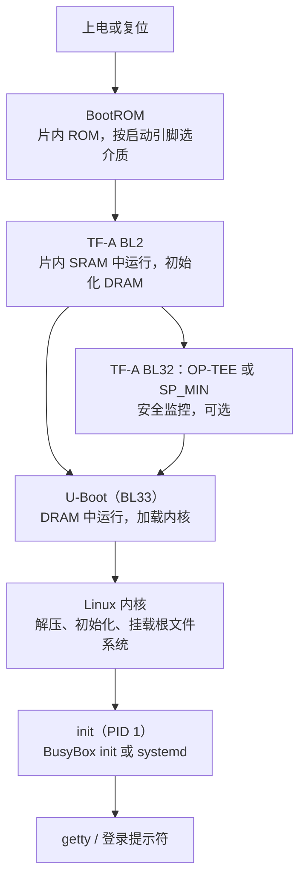

# 5.2 BootROM、U-Boot、内核与根文件系统

在 STM32F103 上按一下复位键，[1.8 复位、启动与链接](/教程/正文/嵌入式/1_平台与工具链/1_8_复位_启动与链接) 讲过的流程立刻开始：硬件从 0x0800_0000 取初始栈指针与复位向量，`Reset_Handler` 复制 `.data`、清零 `.bss`，然后调用 `main`。三个动作，几微秒。同样按一下 STM32MP157 的复位键，几秒钟之内发生的事情多得多：DRAM 还不能用，内核躺在 SD 卡上，串口还没初始化，没有任何一段代码知道该从哪里开始。这几秒钟由好几级程序接力完成，每一级都在为下一级铺路。

这一页按顺序走完这条链：BootROM 怎么决定从哪里启动，第一阶段引导程序为什么要先初始化 DRAM，U-Boot 用什么命令把内核、设备树和根文件系统凑到一起，内核拿到命令行后怎样挂载根文件系统并启动第一个进程。读完应该能读懂一段启动日志，并在启动停在某个位置时判断问题出在哪一级。

## 1. 启动链总览

先看全貌。下面这条链对应 STM32MP157，每一级都跑在上一条已经初始化好的环境里：



各阶段的职责与运行位置：

| 阶段 | 运行在 | 由谁加载 | 主要职责 |
| --- | --- | --- | --- |
| BootROM | 片内 ROM | 芯片内部 | 读启动引脚或熔丝，从 SD、eMMC、NOR、USB 里找下一级 |
| TF-A BL2 | 片内 SRAM | BootROM | 初始化时钟与 DDR，把后续映像搬进 DRAM |
| BL32（可选） | DRAM 的安全世界 | BL2 | OP-TEE 或 SP_MIN，提供安全监控调用 |
| U-Boot（BL33） | DRAM | BL2 | 加载内核与设备树，准备命令行，跳转 |
| 内核 | DRAM | U-Boot | 初始化子系统与驱动，挂载根文件系统 |
| init | DRAM | 内核 | 第一个用户态进程，拉起服务与登录 |

QEMU 上这条链短得多。`qemu-system-arm -kernel` 直接把内核与 DTB 放进内存，`-drive` 把根文件系统映像挂成一块 SD 卡，等价于省掉了 BootROM 与引导程序两级：


这个差别在调试时很有用：QEMU 上启动不了，问题一定在内核或根文件系统；开发板上启动不了，还要往前面两级查。

::: concept emb-boot-sram-dram title="为什么需要第一阶段引导程序"

复位时片上 SRAM 可以直接使用，DRAM 还不能：它的时序参数要由软件配置，配置之前无法读写。因此 BootROM 只能把很小的第一级程序放进片内 SRAM，由它完成 DRAM 控制器初始化，之后才能把体积以兆字节计的内核搬进 DRAM。BootROM 自己不初始化 DRAM，因为 DRAM 的型号与参数随板子而变，固化在芯片里的代码不可能预先知道。

:::

::: generate emb-boot-chain-relay kind=explanation concepts=emb-boot-sram-dram

面向刚接触 ARM Linux 的读者，用一场接力赛作类比讲这条链：每一棒在哪个场地跑（片内 SRAM 还是 DRAM）、上一棒交给下一棒什么东西、交接失败时会在哪里掉棒（串口没有任何输出、U-Boot 提示找不到内核、内核停在 Starting kernel），以及为什么 DRAM 必须先初始化才能把内核搬进去。

:::

## 2. BootROM

BootROM 是芯片出厂时固化在片内的一段只读代码，改不了，也删不掉。它做的事情只有一件：按启动方式 (boot mode) 找到下一级引导程序，验证它，然后跳过去。

启动方式由引脚或熔丝 (fuse) 决定。STM32MP157 用 BOOT0 到 BOOT2 三个引脚编码启动源，常见的几种是 SD 卡、eMMC、NOR Flash、串口与 USB 下载。上电时 BootROM 按顺序扫描每个候选介质，寻找带 STM32 头部表与校验和的映像，找到就加载；打开了安全启动还会先验签，验不过就当没找到。全部候选都失败时进入 USB 或串口下载模式，等着主机把映像灌进来。

这和 STM32F103 的 BOOT 引脚是同一件事的两个版本。[1.6 构建、烧录与调试](/教程/正文/嵌入式/1_平台与工具链/1_6_构建_烧录与调试) 里那张表说，BOOT0 = 1、BOOT1 = 0 时芯片从系统存储器启动，里面是 ST 固化的串口下载程序；那其实就是 F103 的 BootROM。区别在于 F103 的系统存储器只提供串口下载，而 MP157 的 BootROM 能识别文件系统、能校验签名、能从多种介质里挑一个。

| | STM32F103（Cortex-M3） | STM32MP157（Cortex-A7） |
| --- | --- | --- |
| 启动选择的来源 | BOOT0、BOOT1 两个引脚 | BOOT0～BOOT2 三个引脚，也可用熔丝固定 |
| 可选的介质 | 主 Flash、系统存储器、SRAM | SD、eMMC、NOR、NAND、USB、串口 |
| 第一级程序从哪来 | 主 Flash 起始处，或系统存储器 | 所选介质的第一扇区 |
| 是否校验签名 | 不校验 | 可校验，安全启动时强制（见 6.7） |
| 找不到映像时 | 从主 Flash 取到的可能是空白，表现为 HardFault | 进入 USB/串口下载模式 |

调试时最常见的现象是「串口一个字都没有」。这时先确认启动引脚：引脚接错，BootROM 找错了介质，后面所有阶段都不会运行，自然也没有任何输出。开发板上通常有一个拨码开关或跳线帽负责这件事，板子的文档里会写清楚每种组合。

<Quiz
  type="single"
  :options="[
    { label: 'DRAM 的时序参数要由软件配置，配置前无法读写', value: 'A' },
    { label: 'DRAM 的容量太小，装不下 BootROM', value: 'B' },
    { label: 'BootROM 只能访问 SD 卡，不能访问内存', value: 'C' },
    { label: 'Cortex-A7 上电后不能直接执行 DRAM 里的代码', value: 'D' }
  ]"
  answer="A"
>

<template #question>

STM32MP157 的启动链里，BootROM 之后还要有 TF-A BL2 这一步，主要原因是哪一个？

</template>

正确答案是 **A**。

- DRAM 控制器要先配置时序、刷新率等参数才能工作，这段配置必须由软件完成；片内 SRAM 容量只有几百 KB，放不下内核，所以中间的 BL2 负责把 DRAM 拉起来。
- B 把两件事弄反了，BootROM 在片内 ROM 里，与 DRAM 容量无关。
- C 与 D 都不是原因：BootROM 能访问多种介质，Cortex-A7 也能执行 DRAM 里的代码，前提是 DRAM 已经可用。

</Quiz>

## 3. U-Boot

U-Boot 是这条链上唯一一个带交互界面的阶段。它跑起来之后会倒数几秒，等串口上有人按键，按下就停在命令行，不按就执行 `bootcmd` 里的命令继续启动。

### 3.1 构建

U-Boot 用 Kconfig 与自己的构建系统，两条命令。STM32MP15 的板子有区分：让 TF-A 负责第一阶段时用 `stm32mp15_trusted_defconfig`，由 U-Boot SPL 自己初始化 DRAM 时用 `stm32mp15_basic_defconfig`：

```text
$ make stm32mp15_trusted_defconfig
$ make CROSS_COMPILE=arm-linux-gnueabihf- -j4
```

`CROSS_COMPILE` 是工具链前缀，U-Boot 会在这个前缀后面拼上 `gcc`、`ld`、`objcopy`。构建产物里最重要的是 `u-boot.bin`（给 BL2 加载的 BL33）与 `u-boot-spl.stm32`（SPL 版的第一阶段）。开发板厂商通常会提供打包好的 `.img`，把 TF-A、U-Boot 与分区表拼成一个文件，直接 dd 到 SD 卡上。

### 3.2 常用命令与环境变量

U-Boot 的命令行与 shell 有几分像，但每一条命令都是编译进去的子命令，参数风格由各自实现决定。下面这些覆盖了日常使用的绝大部分：

| 命令 | 作用 |
| --- | --- |
| `help` | 列出所有命令，`help mmc` 看某条命令的用法 |
| `printenv` | 打印全部环境变量 |
| `setenv name value`、`setenv name` | 设置、删除一个环境变量 |
| `saveenv` | 把环境变量写回存储介质 |
| `mmc list`、`mmc dev 0` | 列出、切换 MMC 设备 |
| `fatload mmc 0:1 ${kernel_addr_r} zImage` | 从 FAT 分区读文件到内存 |
| `ext4load`、`load` | 从 ext4 分区读、从任意支持的文件系统读 |
| `tftp ${kernel_addr_r} zImage` | 从 TFTP 服务器下载 |
| `bootz ${kernel_addr_r} - ${fdt_addr_r}` | 启动 ARM zImage，参数依次是内核、initrd、DTB |
| `booti`、`bootm` | 启动 arm64 Image、启动 uImage 或 FIT |
| `fdt addr`、`fdt print` | 在内存里选中设备树并查看节点 |

环境变量里最要紧的四个：

- `bootcmd`：上电后自动执行的命令，通常是一串 `run` 组合。
- `bootargs`：传给内核的命令行，见第 4 节。
- `kernel_addr_r`、`fdt_addr_r`：内核与设备树要加载到的内存地址。这两项属于 U-Boot 的「分布式环境变量」，由板子的配置给出，不能随便改。

`printenv` 的输出随板子而定，下面是一段典型的片段：

::: terminal title="U-Boot - printenv 片段（输出类似，取自 Bootlin STM32MP1 实验手册）"

```text
STM32MP> printenv
baudrate=115200
bootcmd=run bootcmd_mmc0
bootargs=console=ttySTM0,115200 root=/dev/mmcblk0p5 rootwait rw
fdt_addr_r=0xc4000000
kernel_addr_r=0xc2000000
...
Environment size: 4096/16384 bytes
```

:::

一次手动启动把上面的命令串起来。假设内核、设备树与根文件系统都在 SD 卡的第四个 FAT 分区与第五个 ext4 分区上：

::: terminal title="U-Boot - 手动加载并启动内核（输出类似，取自 Bootlin STM32MP1 实验手册）"

```text
STM32MP> mmc dev 0
switch to partitions #0, OK
mmc0 is current device
STM32MP> fatload mmc 0:4 ${kernel_addr_r} zImage
reading zImage
8430224 bytes read in 351 ms (22.9 MiB/s)
STM32MP> fatload mmc 0:4 ${fdt_addr_r} stm32mp157d-dk1.dtb
reading stm32mp157d-dk1.dtb
74213 bytes read in 12 ms (5.9 MiB/s)
STM32MP> setenv bootargs console=ttySTM0,115200 root=/dev/mmcblk0p5 rootwait rw
STM32MP> bootz ${kernel_addr_r} - ${fdt_addr_r}
## Flattened Device Tree blob at c4000000
   Booting using the fdt blob at 0xc4000000
   Loading Kernel Image
   Loading Device Tree to c3ffc000, end c3fff21f ... OK
Starting kernel ...
```

:::

`bootz` 之后串口上出现 `Starting kernel ...`，控制权就交给了内核，U-Boot 的戏份结束。这一行也是排错的分界点：它没出现，问题在 U-Boot；它出现了但后面没了，问题在内核参数或设备树。

现代 U-Boot 支持标准启动 (bootstd)：不用手写 `bootcmd`，它按固定顺序扫描各介质上的 `/boot/extlinux/extlinux.conf`，从配置文件里读内核路径与命令行。发行版与 Buildroot 生成的系统都带这种配置，板子上电后自动就用，`bootcmd` 只写一句 `bootflow scan -lb`。

### 3.3 在 QEMU 上体验 U-Boot

没有开发板也可以摸一摸 U-Boot。U-Boot 文档里的 `qemu_arm_defconfig` 面向 QEMU 的 `virt` 机器：

::: terminal title="bash - QEMU 中的 U-Boot（输出类似，取自 U-Boot 文档 QEMU ARM 一节）"

```text
$ make qemu_arm_defconfig
$ make CROSS_COMPILE=arm-linux-gnueabihf-
$ qemu-system-arm -M virt -bios u-boot.bin -nographic
U-Boot 2026.01 ...
DRAM:  128 MiB
...
=> help
```

:::

`virt` 机器没有真实的外设，能练的是命令本身：`printenv`、`setenv`、`fdt`、`bootz` 的用法与真板一致，`mmc`、`tftp` 则要看 QEMU 给了哪些设备。把命令练熟，换到真板上只是环境变量的取值不同。

## 4. 内核映像与命令行

### 4.1 几种内核映像

内核编出来有好几种包装，用途不同：

| 格式 | 内容 | 谁加载 |
| --- | --- | --- |
| `Image` | 未压缩的内核，arm64 常用 | U-Boot 的 `booti` |
| `zImage` | 自解压的 ARM32 内核，头部带解压代码 | U-Boot 的 `bootz` |
| `uImage` | 在 zImage 前面加 64 字节的 U-Boot 头，带加载地址与校验和 | 老式 `bootm` |
| FIT | 把内核、DTB、initramfs、签名打包成一个设备树结构 | `bootm` |

zImage 与 Image 的区别在体积与启动时间：压缩过的 zImage 小，但启动时要先解压；Image 大，省掉解压。开发阶段常用 zImage 省下载时间，产品里两者都常见。uImage 是 U-Boot 自己的私有格式，新项目一般不再用。FIT 是为安全启动准备的，签名与校验放在 6.7 讲。

### 4.2 命令行的常用参数

内核命令行是 U-Boot 交给内核的一串字符串，内核按 `参数=值` 解析。下面几个是必须知道的：

| 参数 | 作用 |
| --- | --- |
| `console=ttyAMA0,115200` | 把内核日志与 `init` 的输入输出接到哪个串口、什么波特率 |
| `root=/dev/mmcblk0p5` | 根文件系统在哪个块设备或分区上 |
| `rootwait` | 等这个块设备出现再挂载，MMC 与 USB 设备几乎必须加 |
| `rw`、`ro` | 根文件系统以读写还是只读方式挂载 |
| `init=/sbin/init` | 第一个用户进程的路径，默认是 `/sbin/init` |
| `loglevel=7`、`quiet` | 控制日志级别，`quiet` 只留警告与错误 |
| `nfsroot=192.168.1.1:/srv/nfs` | 配合 `root=/dev/nfs` 从网络挂载根文件系统 |

`console=` 写错是「内核启动了但串口没输出」的首要原因。内核把日志送到一个你根本没在看的串口上，现象与死机一样。`root=` 写错则会在挂载失败后 panic，日志里会明确说找不到根文件系统。

### 4.3 读一段启动日志

Buildroot 的 vexpress 系统启动时，串口上的输出大致如下。这里按功能分成几段，每段后面说明它在做什么：

::: terminal title="QEMU vexpress-a9 - 内核启动日志（输出类似，取自 Buildroot 的 board/qemu/arm-vexpress/readme.txt 与 Bootlin 实验手册）"

```text
Booting Linux on physical CPU 0x0
Linux version 6.18.0 (buildroot@buildroot) (arm-buildroot-linux-gnueabihf-gcc 14.2.0) #1 SMP
CPU: ARMv7 Processor [410fc090] revision 0 (ARMv7), cr=10c5387d
OF: fdt: Machine model: V2P-CA9
Memory: 253756K/262144K available (8192K kernel code, 512K rwdata, 2048K rodata)
...
Run /sbin/init as init process
```

:::

第一行 `Booting Linux on physical CPU 0x0` 说明内核已经接管，前面的引导程序把控制权交出来了。第二行给出内核版本与编译它的工具链，版本号与 `.config` 里的 `CONFIG_LOCALVERSION` 一致。`CPU:` 一行是内核读出的处理器型号，与设备树里的 `compatible` 对得上。`Machine model:` 直接来自 DTB 的根节点，这一行如果与你的板子不符，说明加载了错设备树。`Memory:` 说明 DRAM 有多大，数字偏小多半是 U-Boot 传给内核的 memory 节点不对。

中间省略的部分是驱动探测。每个驱动 probe 成功时打一行，失败的会打 `probe failed` 或错误码。最后一行 `Run /sbin/init as init process` 表示根文件系统已经挂载、`init` 已经开始执行，启动链走完了。

完整的日志放在下面，便于对照：

::: details 完整的 QEMU vexpress 启动日志（输出类似）

```text
Booting Linux on physical CPU 0x0
Linux version 6.18.0 (buildroot@buildroot) (arm-buildroot-linux-gnueabihf-gcc 14.2.0) #1 SMP Mon Oct 19 09:12:31 UTC 2026
CPU: ARMv7 Processor [410fc090] revision 0 (ARMv7), cr=10c5387d
CPU: PIPT / VIPT nonaliasing data cache, VIPT nonaliasing instruction cache
OF: fdt: Machine model: V2P-CA9
Memory: 253756K/262144K available (8192K kernel code, 512K rwdata, 2048K rodata, 1024K init, 256K bss, 8388K reserved, 0K cma-reserved)
Virtual kernel memory layout:
    vector  : 0xffff0000 - 0xffff1000   (   4 kB)
    ...
rcu: Preemptible hierarchical RCU implementation.
...
Serial: AMBA PL011 UART driver
9000a000.serial: ttyAMA0 at MMIO 0x9000a000 (irq = 34, base_baud = 0) is a PL011 rev1
...
VFS: Mounted root (ext2 filesystem) on device 179:1.
devtmpfs: mounted
Freeing unused kernel image (initmem) memory: 1024K
Run /sbin/init as init process
```

:::

::: warning 停在 `Starting kernel ...` 之后没有输出

先查 `console=` 与 DTB。串口参数写错，内核的日志全跑到另一个端口上；设备树传错，内核找不到串口控制器，同样没有输出。两者都在 U-Boot 的 `bootargs` 与 `bootz` 的参数里，改之前先 `printenv` 看一眼。

:::

## 5. 根文件系统与 init

内核把驱动都初始化完之后，需要一个用户空间才能做有用的事。这个用户空间的起点就是根文件系统。

### 5.1 两种形态

根文件系统可以放在块设备上，也可以整个塞进内存：

| 形态 | 存储 | 特点 |
| --- | --- | --- |
| ext4 | eMMC、SD 卡 | 可读写，掉电可能损坏，通常挂成只读并用数据分区 |
| squashfs | NOR、NAND、eMMC | 压缩只读，占空间小，产品常用 |
| UBIFS | NAND、SPI NOR | 带磨损均衡与坏块管理，裸闪存上必须用 |
| initramfs | 内核映像内部 | 由内核解压到 tmpfs，不依赖任何块设备 |

initramfs 是一个 cpio 归档，编译时被塞进内核映像（或由 U-Boot 单独加载）。内核启动时把它解开、挂成根文件系统。它适合两种情况：根文件系统很小（BusyBox 加几个程序），或者需要一个临时的根去挂载真正的根（比如加密分区）。initramfs 的好处是不必等块设备就绪，坏处是占 RAM。

根文件系统找不到时，内核会在最后打出一段明确的错误，然后 panic：

::: terminal title="内核 - 找不到根文件系统（输出类似）"

```text
VFS: Cannot open root device "mmcblk0p5" or unknown-block(179,5): error -6
Please append a correct "root=" boot option; here are the available partitions:
...
Kernel panic - not syncing: VFS: Unable to mount root fs on unknown-block(179,5)
```

:::

`error -6` 是 `ENXIO`，表示这个设备号没有对应的块设备。两种可能：设备本身没被识别（驱动没编进去，或 `rootwait` 没加导致挂载时 MMC 还没枚举完），或者 `root=` 里的分区号写错了。日志上面那行 `here are the available partitions` 会列出内核看到的全部分区，照着改即可。

<Quiz
  type="multi"
  :options="[
    { label: 'root= 里的设备名或分区号写错了', value: 'A' },
    { label: 'MMC 驱动没有编进内核', value: 'B' },
    { label: '块设备还没有枚举完就开始挂载，缺 rootwait', value: 'C' },
    { label: 'U-Boot 的 bootcmd 里没有 saveenv', value: 'D' }
  ]"
  :answer="['A', 'B', 'C']"
>

<template #question>

内核报 `VFS: Cannot open root device` 并 panic，可能的原因有哪些？

</template>

正确答案是 **A、B、C**。

- `root=` 写错是最常见的：名字拼错或分区号差一，内核按这个设备号找不到块设备。
- 驱动没编进内核时，设备根本不会出现在分区列表里。
- eMMC 与 SD 卡的枚举是异步的，没有 `rootwait` 时内核可能在设备就绪之前就去挂载。
- D 与挂载无关，`saveenv` 只影响环境变量是否持久化。

</Quiz>

### 5.2 init 是第一个用户进程

内核挂好根文件系统之后，执行命令行指定的 `init`（默认 `/sbin/init`），它的进程号是 1。PID 1 负责拉起其他所有进程，并且在任何子进程退出时负责回收，所以它不能随便退出——PID 1 退出，内核就 panic。

嵌入式上最常见的 init 是 BusyBox 的 init 程序。它读 `/etc/inittab`，按里面的规则启动进程：

```text
# /etc/inittab（BusyBox init）
::sysinit:/etc/init.d/rcS
::respawn:/usr/bin/sensord -f /data/sensord.conf
::respawn:/sbin/getty -L ttyS0 115200 vt100
::ctrlaltdel:/sbin/reboot
::shutdown:/bin/umount -a -r
```

每一行的格式是 `id:runlevels:action:process`。`::respawn:` 表示「进程退出就重新启动」，服务崩溃后自动拉起靠的就是它；`::sysinit:` 只在启动时执行一次，Buildroot 用它跑 `/etc/init.d/rcS`，后者按文件名顺序执行 `S??*` 脚本。`::shutdown:` 在关机时执行。BusyBox 的 inittab 不支持依赖关系与并行启动，规则简单，顺序由脚本编号决定，够用就好。

资源充足的板子上可能装 systemd，它的单元文件与 BusyBox 的 inittab 是两种思路：在 5.10 里对照着讲。

根文件系统里至少要有这几样东西：`/sbin/init`（或指向 BusyBox 的链接）、`/etc` 下的配置、`/dev`、`/proc`、`/sys` 三个挂载点，以及 C 库。`devtmpfs` 由内核自动挂到 `/dev`，设备节点随驱动注册自动出现；`proc` 与 `sysfs` 一般由 `rcS` 或 init 脚本挂上。根文件系统怎么做出来是 5.3 与 5.4 的内容。

::: info 根文件系统的目录结构

最小系统只需要 `/bin`、`/sbin`、`/etc`、`/dev`、`/proc`、`/sys`、`/lib`、`/usr`、`/tmp`、`/var`、`/data` 这几个目录。前四个放程序与配置，`/lib` 放 C 库与内核模块，`/tmp` 与 `/var` 在只读根文件系统上通常挂成 tmpfs，`/data` 是留给应用的可写分区。

:::

## 6. 启动时间

产品对启动时间敏感时（车载倒车影像要求上电一秒内出画面），需要知道时间花在哪里。粗略的分布是这样的：

| 阶段 | 典型耗时 | 优化方向 |
| --- | --- | --- |
| BootROM | 几十毫秒 | 固定，改不了 |
| 第一阶段引导程序 | 几十到几百毫秒 | 关掉不必要的初始化，DDR 训练参数固定 |
| U-Boot | 数百毫秒到数秒 | 去掉倒数等待（`bootdelay=0`），关掉用不到的命令与驱动 |
| 内核 | 一秒到数秒 | 裁掉不用的驱动与子系统，改压缩方式，并行探测 |
| init 与服务 | 数百毫秒到数秒 | 精简启动脚本，服务延迟启动或按需启动 |

这些数字只是量级，具体到一块板子必须实测。内核自带两个工具：命令行的 `initcall_debug` 会打印每个初始化函数的耗时，`printk.time=1` 给每条日志加上时间戳。串口一侧还可以用带时间戳的抓取工具，把从第一行输出到登录提示符的每一行都标上时间，两者的差值就是各级的耗时。

作者的建议是：先测，再改。启动时间优化很容易变成一场没有终点的猜谜，改了一堆配置，最后发现瓶颈在一个没人注意的驱动 probe 上。把日志时间戳打出来，按阶段排序，先动最大的那一块。

## 7. 习题

### 7.1 巩固

<Exercise id="65518" :d="1" :w="2">

下面是一段启动日志，行首的编号只是为了引用：

```text
1  U-Boot 2026.01 (Oct 19 2026 - 09:12:31 +0000)
2  DRAM:  512 MiB
3  ...
4  Loading Kernel Image
5  Starting kernel ...
6  Booting Linux on physical CPU 0x0
7  OF: fdt: Machine model: STM32MP157D-DK1
8  VFS: Mounted root (ext4 filesystem) on device 179:5.
9  Run /sbin/init as init process
10 Starting sensord: OK
```

(1) 把每一行归到第 1 节表格里的某一级，写出该级的运行位置（片内 SRAM、DRAM、用户空间）。

(2) 如果日志只到第 3 行就没有了，问题最可能在哪一级？如果到第 5 行就没有第 6 行，问题在哪一级？如果第 6 行有而第 7 行的机型不对，问题在哪一级？

(3) 第 8 行的 `179:5` 与启动参数里的哪个值对应？`179` 是什么设备的主设备号？

(4) 第 9 行出现之后，第 10 行的 `sensord` 由谁拉起？结合 5.10 说明这一行来自哪个文件。

</Exercise>

<Exercise id="65519" :d="2" :w="2">

STM32MP157 的 BootROM 与 STM32F103 的启动方式对照。

(1) 查本页第 2 节那张表，写出两者在启动来源、可选介质、签名校验、找不到映像时的表现四项上的差别。

(2) MP157 上 `BOOT0～BOOT2` 三个引脚最多能编码 8 种启动源，实际只用了其中几种。引脚接错时串口为什么一个字都没有？用「BootROM 找错介质，后面所有阶段都不运行」解释。

(3) 打开安全启动但签名验不过时，BootROM 的行为是「当作没找到」。说明这个设计保证了什么，以及为什么它比「报错停机」更适合现场设备。

(4) 你的板子上 `BOOT` 引脚是怎么接的？查板子文档或原理图写出来，并给出把启动源改回 SD 卡的操作步骤。

</Exercise>

<Exercise id="65520" :d="2" :w="2">

第 4.2 节的命令行参数在排错时用得上。给定下面三条 `bootargs`，指出各自会导致什么现象：

```text
A: console=ttyS0,115200 root=/dev/mmcblk0p5 rootwait rw
B: console=ttySTM0,9600 root=/dev/mmcblk0p5
C: console=ttySTM0,115200 root=/dev/mmcblk0p9 rootwait rw
```

(1) 板子的调试串口是 `ttySTM0`，波特率 115200。逐条写出 A、B、C 的可见现象与原因。

(2) C 的日志里会出现 `error -6`。写出完整的 panic 消息，并指出 `-6` 对应的 `errno` 名与含义。

(3) 给 A 补上缺少的参数。为什么 MMC 设备几乎必须加 `rootwait`，而 initramfs 不需要？

(4) 写一条从网络挂载根文件系统的 `bootargs`，服务器地址 `192.168.1.1`，导出目录 `/srv/nfs/rootfs`，NFSv4。

</Exercise>

<Exercise id="65521" :d="3" :w="3">

在第 3.2 节的 U-Boot 命令行里完成一次手动启动，再把它换成 `bootstd`，并分析两边的差别。

(1) 写出从 `mmc dev` 到 `bootz` 的完整命令序列，逐条说明参数里 `${kernel_addr_r}` 与 `${fdt_addr_r}` 为什么不能随便改。`bootz` 的第二个参数是 `-`，它表示什么？

(2) 写出 `/boot/extlinux/extlinux.conf`，要求有两个启动项：一个 `loglevel=7` 的调试项，一个 `quiet` 的正常项，默认选后者，超时 3 秒。说明哪个字段对应 (1) 里的哪条命令。

(3) 把 `printenv` 里的 `bootcmd` 改成 `bootflow scan -lb`，写出 `setenv` 与 `saveenv` 两步。`saveenv` 写入哪里？不执行它重启后会怎样？`bootflow scan -lb` 按什么顺序扫描介质，SD 卡与 eMMC 上都有配置时选哪一个？

(4) 把 (2) 的文件故意写坏（少一个 `label`，或 `kernel` 路径不存在），观察 `bootflow scan -lb` 的报错。它会不会自动换下一个启动项？与 (1) 手动序列里命令写错时的表现有什么不同？

(5) 按 3.1 节构建一次，两个 defconfig 各产出什么：`stm32mp15_trusted_defconfig` 与 `stm32mp15_basic_defconfig` 生成的产物里，哪一个是给 BL2 加载的 BL33，哪一个是自己初始化 DRAM 的第一阶段？`CROSS_COMPILE` 前缀后面会拼上哪些工具名？两个配置的差别落在启动链的哪一级上？

没有板子时用 `qemu_arm_defconfig` 完成 (4)，其余三问照写。

</Exercise>

### 7.2 编程

<Exercise id="65522" :d="3" :w="3">

写 `bootargs` 工具 `btool`，有两个子命令：从配置文件生成命令行，以及检查一条现成的命令行。

```text
./btool gen boot.conf        # 输出一行 bootargs 到标准输出
./btool check 'console=ttySTM0,115200 root=/dev/mmcblk0p5 rw'
```

`gen` 读每行一个 `key = value`、`#` 开头为注释的配置文件：

1. 必须有 `console`，否则退出码 1 并在标准错误上说明缺哪一项。
2. 必须有 `root` 或 `nfsroot` 之一；两者都有时以 `root=/dev/nfs` 为准并打印一行提示。
3. `root` 不以 `/dev/` 开头时报错。
4. `root=/dev/mmcblk*` 或 `/dev/sd*` 而没写 `rootwait` 时自动补上，并在标准错误上提示。
5. 输出顺序固定为 `console`、`root`、`rootwait`、`rw`/`ro`，其余项按配置里的顺序附在后面。

`check` 解析一条已有的命令行，逐项输出结论，全部通过时退出码 0：

1. 重复的键报错，指出两个位置。
2. `console` 的波特率不在 9600、19200、38400、57600、115200 之中时警告。
3. `root` 以 `/dev/mmcblk`、`/dev/sd`、`/dev/nvme` 开头而缺 `rootwait` 时报错；`root=/dev/nfs` 而没有 `nfsroot` 时报错。
4. `root=` 与 `nfsroot=` 同时给出且指向不同来源时，按正文的优先级给出警告，指出最终生效的是哪一个。

验收：用下面三份配置各跑一次 `gen`；再把 65520 里的 A、B、C 三条各跑一次 `check`。B 的 9600 是合法波特率，工具不会报警，据此说明「参数本身合法但与这块板子不符」的错误为什么只能靠板子文档或设备树发现。

```text
# 1.conf
console = ttySTM0,115200
root = /dev/mmcblk0p5
rw = 1

# 2.conf
console = ttySTM0,115200
root = mmcblk0p5

# 3.conf
root = /dev/nfs
nfsroot = 192.168.1.1:/srv/nfs/rootfs,vers=4
ip = dhcp
```

</Exercise>

<Exercise id="65523" :d="4" :w="3">

`zImage` 与 `uImage` 的区别可以写程序验证。`uImage` 在 zImage 前面加了 64 字节的头，字段按大端存放：

| 偏移 | 长度 | 字段 |
| --- | --- | --- |
| 0 | 4 | magic，固定 `0x27051956` |
| 4 | 4 | header CRC32，计算时该字段按 0 计 |
| 8 | 4 | 时间戳 |
| 12 | 4 | 数据长度 |
| 16 | 4 | 加载地址 |
| 20 | 4 | 入口地址 |
| 24 | 4 | 数据 CRC32 |
| 28 | 1 | OS，Linux 为 5 |
| 29 | 1 | 架构，ARM 为 2 |
| 30 | 1 | 类型，kernel 为 2 |
| 31 | 1 | 压缩方式，gzip 为 1 |
| 32 | 32 | 映像名，以 0 结尾 |

写 `uimage_info`：

1. 读文件头，校验 magic 与 header CRC32（IEEE 多项式 `0xEDB88320`，初值与结果异或均为 `0xFFFFFFFF`）。
2. 打印各字段，地址与长度用十六进制，并校验数据 CRC32。
3. 头部不合法时打印原因并以退出码 1 结束。

自己造测试数据：用 `printf` 拼一个 64 字节头加 16 字节正文的文件，CRC 用你的程序先算出来再填进去（写一个 `--fix` 选项自动填两个 CRC）。验收：`--fix` 生成的文件再跑一次校验通过；把任意一个字节改掉，报告 CRC 不匹配。

</Exercise>

<Exercise id="65524" :d="4" :w="3">

写 `bootstat`：从一份带时间戳的启动日志算出各阶段的耗时。

输入是 `dmesg` 风格的行，时间戳在行首方括号里，单位秒，例如：

```text
[    0.000000] Booting Linux on physical CPU 0x0
[    0.000000] Linux version 6.18.0
[    0.412331] Run /sbin/init as init process
[    1.208774] systemd[1]: Reached target multi-user.target
```

要求：

1. 从标准输入读，跳过没有时间戳的行。
2. 按关键字把日志分成内核早期（到 `Run /sbin/init`）、用户态（其后到 `multi-user.target`）两段，打印各段的耗时与总耗时。
3. 支持 `--mark 关键字=名字` 参数，最多 8 个，按给定顺序打印每个标记的时间点。
4. 时间戳用 `double` 解析，输出保留三位小数，对齐成表格。
5. 支持 `--initcalls`：从 `initcall_debug` 产生的行里取出每个初始化函数的耗时，按耗时从大到小打印前 10 项。这类行的格式是 `initcall 0x... returned 0 after 1234 usecs`。

验收：用上面四行加一份你手头真实的 `dmesg` 输出各跑一次，打印的总耗时与最后一行的时间戳一致；`--initcalls` 在打开 `initcall_debug` 抓的日志上输出的十项之和，不超过内核早期一段的总耗时。

</Exercise>

<Exercise id="65525" :d="5" :w="4">

做一个最小 initramfs 并交给 QEMU 启动，验证第 5.1 节的描述。

要求：

1. 用静态链接的 BusyBox 或自己写的小程序做 `/init`，它挂上 `/proc` 与 `/sys`、打印一行 `hello from initramfs`、再 `execve("/bin/sh", ...)`。
2. 按 cpio 的 `newc` 格式打包，用 `find . | cpio -o -H newc > ../initramfs.cpio` 生成；说明为什么打包时文件属主必须写成 0（或使用 `--owner=0:0`）。
3. 用 `qemu-system-arm -M vexpress-a9 -kernel zImage -dtb vexpress-v2p-ca9.dtb -initrd initramfs.cpio -append "console=ttyAMA0" -nographic` 启动，贴出串口输出。
4. 在 `-append` 里再加 `init=/bin/sh`（initramfs 里要有这个文件），观察第 1 步的 `/init` 是否还执行，据此说明命令行与 initramfs 里 `/init` 的优先级。再换成 `init=/不存在` 启动一次，记录内核的报错。
5. 把 initramfs 换成空归档再启动，记录内核的报错。这一步与「找不到根文件系统」是同一类失败吗？

需要 QEMU 与 ARM 内核；没有时把 cpio 打包与 (3) 的命令写全，说明每一步的作用。

</Exercise>

### 7.3 综合与挑战

<Exercise id="65526" :d="6" :w="5" scope="*">

给一块板子做启动时间分析并给出优化方案，结论要有数据。

要求：

1. 在内核命令行加 `initcall_debug printk.time=1`，用串口抓一份完整启动日志，从第一行到登录提示符。
2. 用 65524 的 `bootstat`（或自己写）按第 6 节那张表分阶段统计耗时，列成表格，标出最长的一段。
3. 至少做三项可测量的改动，例如 `bootdelay=0`、裁掉不用的驱动、把 U-Boot 的 `bootcmd` 换成 `bootflow scan -lb`、把某个服务的启动推迟。每改一项重新测三次，记录中位数。
4. 用数据说明哪一项收益最大。如果某一项几乎没有变化，分析原因，不要把它算进结论。
5. 写出最终方案与剩余瓶颈，指出哪些耗时是改不动的（BootROM、DDR 训练）。

只做能重复测量的改动，不做压力测试；每次测量前确认系统状态相同。

</Exercise>

## 8. 参考资料

1. The U-Boot project, [*U-Boot documentation*](https://docs.u-boot.org/en/latest/)：命令、环境变量与 `bootstd` 的参考。
2. The U-Boot project, [*QEMU ARM*](https://docs.u-boot.org/en/latest/board/emulation/qemu-arm.html)：`qemu_arm_defconfig` 与 `virt` 机器的用法。
3. STMicroelectronics, [*Boot chain overview*](https://wiki.st.com/stm32mpu/wiki/Boot_chain_overview)：STM32MP157 从 BootROM 到 U-Boot 的各级映像。
4. Trusted Firmware-A, [*Trusted Firmware-A documentation*](https://trustedfirmware-a.readthedocs.io/)：BL2 的职责与 DDR 初始化。
5. The Linux kernel project, [*The kernel's command-line parameters*](https://docs.kernel.org/admin-guide/kernel-parameters.html)：`console=`、`root=`、`rootwait` 等参数的含义。
6. The Linux kernel project, [*Ramfs, rootfs and initramfs*](https://docs.kernel.org/filesystems/ramfs-rootfs-initramfs.html)：initramfs 的构造与挂载过程。
7. Bootlin, [*Embedded Linux system development*](https://bootlin.com/training/embedded-linux/)：STM32MP1 实验手册中的 U-Boot 会话与启动日志。
8. The Buildroot project, [*board/qemu/arm-vexpress/readme.txt*](https://gitlab.com/buildroot.org/buildroot/-/blob/master/board/qemu/arm-vexpress/readme.txt)：QEMU 启动命令与根文件系统映像。
9. The QEMU project, [*Arm Versatile Express boards*](https://www.qemu.org/docs/master/system/arm/vexpress.html)：`vexpress-a9` 机器与 `-kernel`、`-drive` 参数。
10. BusyBox, [*examples/inittab*](https://git.busybox.net/busybox/tree/examples/inittab)：`/etc/inittab` 的字段格式与常用 action。
