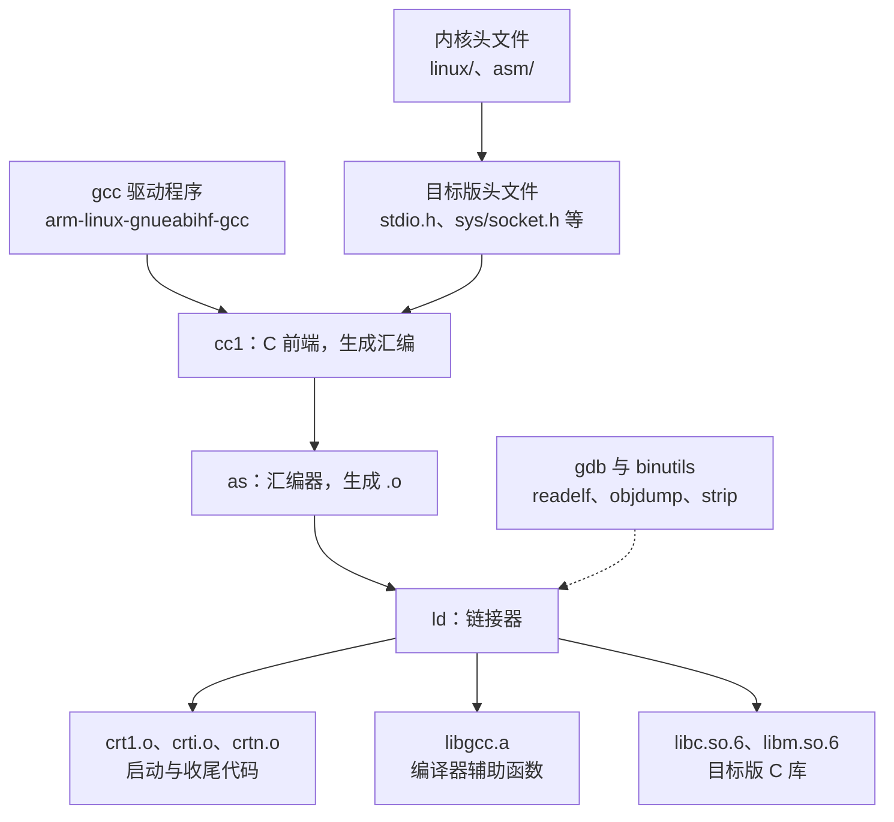

# 5.3 交叉工具链、sysroot 与根文件系统

[5.1](/教程/正文/嵌入式/5_嵌入式Linux/5_1_嵌入式Linux与系统编程边界) 里已经把同一个 `hello.c` 编成了两份：x86 版在本机跑，ARM 版在 x86 上跑不起来。那一次只用了交叉编译器一个命令，库从哪里来、头文件是哪一份、目标机上的动态链接器长什么名字，都没有交代。

这一页补上这三样。先拆开交叉工具链，看清里面装的是哪几个程序、三元组 (triplet) 的每一段是什么意思；再讲 sysroot，也就是目标系统的头文件与库在宿主机上的那一份副本；然后用 CMake 工具链文件、pkg-config 和 Makefile 前缀把它接到实际的工程里，用 `file` 与 `readelf` 检查产物；最后不借助任何构建系统，用 BusyBox 和 C 库手工拼出一个最小根文件系统，打包成 initramfs 在 QEMU 里启动。做完这一页，再看到「能链接、一运行就找不到符号」这类问题时，知道该去查工具链的哪一层。

## 1. 工具链里有什么

交叉工具链 (cross toolchain) 是在宿主机 (host) 上运行、生成目标机 (target) 代码的一整套程序。`arm-linux-gnueabihf-gcc` 只是入口，它背后是下面这些部件：



四类东西必须都是给目标机编的：头文件、C 库、编译器辅助库 `libgcc`、启动文件 `crt*.o`。宿主机上 `/usr/include/stdio.h` 是 x86-64 的，里面的 `size_t` 是 8 字节，结构体布局也按 x86-64 对齐；把它喂给 ARM 编译器，编出来的结构体偏移全错。工具链把目标版的那一套放在自己的 sysroot 里，与宿主机的分开。

工具链的身份写在名字里。GNU 的三元组形如 `arch-vendor-os-abi`：

| 三元组 | 体系结构 | 厂商 | 操作系统 | ABI | 用途 |
| --- | --- | --- | --- | --- | --- |
| `arm-none-eabi` | arm | none | eabi | 无 | 裸机，STM32F103 用的就是它 |
| `arm-none-linux-gnueabihf` | arm | none | linux-gnu | eabihf | Arm 官方发布的 32 位 Linux 工具链 |
| `arm-buildroot-linux-gnueabihf` | arm | buildroot | linux-gnu | eabihf | Buildroot 自己编出来的工具链 |
| `aarch64-linux-gnu` | aarch64 | 空 | linux-gnu | 默认 | 64 位 ARM Linux，发行版常备 |

每一段都有信息量：

- 第一段是 CPU 架构。`arm` 指 32 位 ARM，`aarch64` 指 64 位 ARM。
- 第二段是厂商字段，多数工具链写 `none`，Buildroot 生成时写 `buildroot`。这一字段不影响代码，只用来区分来源。
- 第三段是操作系统。`eabi` 表示裸机上的 ARM EABI，`linux-gnu` 表示 Linux 加 glibc。操作系统的名字决定了 C 库提供的系统调用封装，也决定了链接时要不要找动态链接器。
- 第四段是 ABI。`hf` 是 hard-float 的缩写，表示浮点参数经 VFP 寄存器传递；没有 `hf` 的是软浮点 (soft-float) ABI，浮点参数经整数寄存器传递。两种 ABI 的目标文件不能混链。

裸机工具链与 Linux 工具链的差别不只是有没有操作系统这几个字。用 `arm-none-eabi-gcc` 编一个带 `printf` 的程序，编译能过，链接时停住：

::: terminal title="bash - 裸机工具链链接 Linux 程序"

```text
$ arm-none-eabi-gcc -mcpu=cortex-m3 -mthumb -O2 hello.c -o hello_bare -lm
.../arm-none-eabi/bin/ld.exe: .../libc.a(libc_a-exit.o): in function `exit':
exit.c:(.text.exit+0x14): undefined reference to `_exit'
.../arm-none-eabi/bin/ld.exe: .../libc.a(libc_a-closer.o): in function `_close_r':
closer.c:(.text._close_r+0xc): undefined reference to `_close'
.../arm-none-eabi/bin/ld.exe: .../libc.a(libc_a-signalr.o): in function `_kill_r':
signalr.c:(.text._kill_r+0xe): undefined reference to `_kill'
collect2.exe: error: ld returned 1 exit status
```

:::

`arm-none-eabi` 带的是 newlib，不是 glibc。newlib 里 `printf` 最终要调 `_write`、`_sbrk` 这类由系统提供的函数，裸机上它们由板级支持包实现，Linux 上则由 glibc 直接发起系统调用。`_exit`、`_close`、`_kill` 这些名字是 newlib 要求的系统接口 (system call stub)，没人实现，链接器就报未定义。**看到 `undefined reference to '_sbrk'`，先确认用的是不是 Linux 工具链，而不是去补一个 `_sbrk` 函数。**

::: concept emb53-triplet title="三元组决定目标环境"

三元组由体系结构、厂商、操作系统和 ABI 四段组成。前两段决定生成的机器码，第三段决定链接哪套 C 库与启动代码，第四段（`hf` 后缀）决定浮点参数的传递方式。同一段代码用错三元组，轻则链接失败，重则在目标机上算出错误结果。

:::

每个 GNU 工具链都有 `-dumpmachine` 与 `-print-sysroot` 两个查询选项，看一眼就知道手上这套是给谁的：

::: terminal title="bash - 查询工具链身份"

```console
$ arm-none-eabi-gcc -dumpmachine
arm-none-eabi
$ arm-none-eabi-gcc -print-sysroot
C:/.../arm-gnu-toolchain-13.3.rel1-mingw-w64-i686-arm-none-eabi/bin/../arm-none-eabi
```

:::

`-print-sysroot` 返回的那条路径就是这套工具链的根，头文件在 `<sysroot>/include`，库在 `<sysroot>/lib`。交叉编译时编译器默认就在这里找东西，所以单独的 `arm-none-eabi-gcc` 不需要额外指定 `--sysroot`。

<Quiz
  type="single"
  :options="[
    { label: 'arm-none-eabi', value: 'A' },
    { label: 'arm-none-linux-gnueabihf', value: 'B' },
    { label: 'aarch64-linux-gnu', value: 'C' },
    { label: 'x86_64-w64-mingw32', value: 'D' }
  ]"
  answer="B"
>

<template #question>

要给 STM32MP157（Cortex-A7，32 位 Linux，硬件浮点）编一个用户态程序，应该用哪一个工具链？

</template>

正确答案是 **B**。`arm` 对应 32 位，`linux-gnu` 表示目标运行 Linux 且 C 库是 glibc，`hf` 表示硬件浮点 ABI。A 是裸机工具链，没有 Linux 的系统调用；C 是 64 位，指令集与 A7 的 32 位模式不兼容；D 是 Windows 的编译器。

</Quiz>

## 2. 从哪拿一套工具链

四条路都能得到可用的工具链，区别在可控程度和入手难度：

| 来源 | 特点 | 适用 |
| --- | --- | --- |
| Arm GNU Toolchain | 官方预编译，带 glibc，三个宿主平台都有安装包 | 想最快跑通，不介意换 C 库版本 |
| Bootlin toolchains | 每个架构提供 glibc、musl、uClibc-ng 多种组合，带完整 sysroot | 需要 musl 或想对比不同 C 库 |
| Buildroot 生成 | 与它产出的根文件系统同源，版本完全对应 | 已经用 Buildroot 做产品 |
| crosstool-NG | 从源码构建，任意组合，构建一次要几十分钟 | 需要固定、可复现的工具链 |

Bootlin 的实验手册用 crosstool-NG 给 STM32MP157 编了一套 musl 工具链，原因是官方 ST 工具链用的是 glibc，而课程想演示 musl 更小的体积。这是教学上的选择，产品上未必适用：芯片厂提供的 BSP 与二进制库通常只针对 glibc 与特定工具链版本编译。

选择上有两条经验。第一，工具链与根文件系统必须同源。用 Arm 官方工具链编出的程序，拿到 Buildroot 生成的根文件系统上跑，glibc 版本低于目标机时能跑，高于目标机时会报 `GLIBC_2.34 not found` 之类的错。第二，团队里固定版本号，把编译器路径写进构建脚本或容器镜像，不要依赖 `PATH` 里恰好是哪一个。换工具链应当是一次有记录、会重新跑测试的动作。

::: tip 一次下载，全组共用

Arm GNU Toolchain 的解压目录可以直接放进版本库之外的一个共享位置（如 `/opt/toolchains/`），构建脚本用绝对路径引用。工具链有几百 MB，不要提交进仓库。Buildroot 生成的工具链在 `output/host/bin/` 下，跟着构建目录走，不要单独拷出来用。

:::

## 3. sysroot

sysroot 是目标系统根目录在宿主机上的一份副本，只含编译和链接需要的东西：头文件、库、`pkg-config` 的 `.pc` 文件。编译时加上 `--sysroot=<目录>`，编译器就会把 `#include <stdio.h>` 解析到 `<目录>/usr/include/stdio.h`，把 `-lm` 解析到 `<目录>/usr/lib/libm.so`。

Buildroot 的输出目录里有三份容易混淆的东西：


`output/host` 是给宿主机用的：交叉编译器、`pkg-config`、`cmake` 都在这里，它们的路径前缀是 `output/host/bin`。`output/staging` 是 sysroot，里面的库保留了符号表，方便调试与链接，但不该原样放进设备。`output/target` 才是最终根文件系统的内容，库经过了 `strip`，体积小得多。

这三者不能混用。拿 `output/target` 当 sysroot，链接时可能因为符号被剥掉而失败；把 `output/staging` 整个拷到设备上，根文件系统会大出一倍。Buildroot 的手册明确写了 `output/staging` 是「给编译器看的」，`output/target` 是「给设备用的」。

::: concept emb53-sysroot-staging-vs-target title="staging 与 target 的分工"

`output/staging` 是 sysroot，保存目标系统的头文件与未剥离的库，供交叉编译器在编译和链接时使用。`output/target` 是根文件系统的内容，保存剥离后的库与可执行文件，供打包成映像。同一个库在两处都有，用途不同，不能互相替代。

:::

用错 sysroot 的后果很直接。指向一个空目录，预处理阶段就停住：

::: compare left-title="--sysroot 指向不存在的目录" right-title="指向真正的 sysroot"

```console
$ gcc --sysroot=/nonexistent/sysroot -std=c17 hello.c -o hello
hello.c:1:10: fatal error: stdio.h: No such file or directory
    1 | #include <stdio.h>
      |          ^~~~~~~~~
compilation terminated.
```

---

```console
$ arm-buildroot-linux-gnueabihf-gcc \
      --sysroot=$BR/output/staging \
      -std=c17 hello.c -o hello
$ file hello
hello: ELF 32-bit LSB executable, ARM, EABI5 version 1 (SYSV),
       dynamically linked, interpreter /lib/ld-linux-armhf.so.3
```

:::

更隐蔽的一种是漏掉 `--sysroot` 但补上了 `-I` 和 `-L`。头文件能找对，链接却可能链接到宿主机上的库，因为链接器默认还会搜 `/usr/lib`。两个层次不同的 ELF 混在一起，链接器会拒绝：

::: terminal title="bash - 把 x86-64 的目标文件链进 ARM 程序（真实输出）"

```text
$ ld.lld: error: hello_x86.o is incompatible with armelf_linux_eabi
```

:::

GNU ld 的说法略有不同，意思一样：`file format not recognized` 或 `incompatible with armelf_linux_eabi`。看到这类错误，先查 `file` 里那个 `.o` 的架构，再查 `-L` 顺序里有没有混进宿主机的路径。

## 4. 把 sysroot 接进构建

手工调编译器的写法最直观。下面这个程序依赖 `libm`，用 `sqrt` 算平方根，源码在 `code/嵌入式/5_嵌入式Linux/5_3_交叉工具链_sysroot与根文件系统/calc.c`：

```c
#include <math.h>
#include <stdio.h>
#include <stdlib.h>

int main(int argc, char **argv)
{
    if (argc != 2) {
        fprintf(stderr, "usage: calc NUMBER\n");
        return 1;
    }
    double x = strtod(argv[1], NULL);
    printf("sqrt(%g) = %.6f\n", x, sqrt(x));
    return 0;
}
```

本机编译时忘了 `-lm`，数学库没有链进来：

::: terminal title="bash - 漏掉 -lm 的链接错误"

```text
$ gcc -std=c17 -Wall -Wextra -O2 calc.c -o calc
/usr/bin/ld: /tmp/ccuFsJfh.o: in function `main':
calc.c:(.text.startup+0x42): undefined reference to `sqrt'
collect2: error: ld returned 1 exit status
$ gcc -std=c17 -Wall -Wextra -O2 calc.c -o calc -lm
$ ./calc 2
sqrt(2) = 1.414214
```

:::

交叉编译只是把 `gcc` 换成 `arm-linux-gnueabihf-gcc`，再加 `--sysroot`：

::: terminal title="bash - 交叉编译（输出类似）"

```console
$ arm-linux-gnueabihf-gcc --sysroot=$BR/output/staging \
      -std=c17 -Wall -Wextra -O2 calc.c -o calc_arm -lm
$ file calc_arm
calc_arm: ELF 32-bit LSB executable, ARM, EABI5 version 1 (SYSV),
          dynamically linked, interpreter /lib/ld-linux-armhf.so.3,
          for GNU/Linux 3.2.0, not stripped
```

:::

工程里不会每次都手写这一长串。Makefile 的习惯是把前缀单独写成一个 make 对象，交叉编译时只改它的值：

```make
CROSS_COMPILE ?=
CC := $(CROSS_COMPILE)gcc
CFLAGS := -std=c17 -Wall -Wextra -O2
LDLIBS := -lm

calc: calc.c
	$(CC) $(CFLAGS) $< -o $@ $(LDLIBS)
```

本机构建 `make`，交叉构建 `make CROSS_COMPILE=arm-linux-gnueabihf-`。`?=` 让命令行传进来的值覆盖默认值，这是内核与 U-Boot 都用同一套约定的原因。sysroot 可以写进 `CFLAGS`，也可以交给工具链默认值：Buildroot 导出的工具链把自己包装过，默认就指向 `output/staging`。

CMake 工程用工具链文件 (toolchain file) 描述目标平台。文件在配置阶段用 `-DCMAKE_TOOLCHAIN_FILE=` 传入，不能等配置完了再改。完整文件在 `code/嵌入式/5_嵌入式Linux/5_3_交叉工具链_sysroot与根文件系统/toolchain-arm.cmake`，核心是这几行：

```cmake
set(CMAKE_SYSTEM_NAME Linux)
set(CMAKE_SYSTEM_PROCESSOR arm)

set(CMAKE_C_COMPILER arm-linux-gnueabihf-gcc)
set(CMAKE_CXX_COMPILER arm-linux-gnueabihf-g++)

if(DEFINED ENV{ARM_SYSROOT})
    set(CMAKE_SYSROOT $ENV{ARM_SYSROOT})
endif()

set(CMAKE_FIND_ROOT_PATH ${CMAKE_SYSROOT})
set(CMAKE_FIND_ROOT_PATH_MODE_PROGRAM NEVER)
set(CMAKE_FIND_ROOT_PATH_MODE_LIBRARY ONLY)
set(CMAKE_FIND_ROOT_PATH_MODE_INCLUDE ONLY)
set(CMAKE_FIND_ROOT_PATH_MODE_PACKAGE ONLY)
```

`CMAKE_SYSTEM_NAME` 一设成 `Linux`，CMake 就知道这是交叉编译，不再把宿主机当目标。四个 `FIND_ROOT_PATH_MODE` 决定 `find_package`、`find_library` 去哪找：程序（如 `pkg-config` 本身）只在宿主机找，库与头文件只在目标 sysroot 找。少写这几行，`find_package(ZLIB)` 可能找到宿主机的 zlib，链接时才发现架构不对。sysroot 用环境对象传入，同一个文件能在不同人的机器上复用：

```console
$ ARM_SYSROOT=$HOME/buildroot/output/staging \
  cmake -S . -B build-arm -DCMAKE_TOOLCHAIN_FILE=toolchain-arm.cmake
```

配置输出大致是这样，编译器版本号随安装而变：

::: terminal title="bash - 用工具链文件配置 CMake（输出类似）"

```text
$ cmake -S . -B build-arm -DCMAKE_TOOLCHAIN_FILE=toolchain-arm.cmake
-- The C compiler identification is GNU 14.2.0
-- The CXX compiler identification is GNU 14.2.0
-- Detecting C compiler ABI info
-- Detecting C compiler ABI info - done
-- Check for working C compiler: /opt/arm/bin/arm-linux-gnueabihf-gcc - skipped
-- Detecting C compile features
-- Detecting C compile features - done
-- Configuring done
-- Generating done
-- Build files have been written to: /home/mdr/calc/build-arm
```

:::

第三方库通过 `pkg-config` 报告自己的编译与链接参数。交叉编译时，`.pc` 文件里的 `-I/usr/include` 是目标机上的路径，必须加上 sysroot 前缀才有意义。`pkg-config` 提供了两个环境变量做这件事：

::: terminal title="bash - pkg-config 的 sysroot 处理（真实输出）"

```text
$ PKG_CONFIG_LIBDIR=$PWD/optarm/usr/lib/pkgconfig pkg-config --cflags --libs mdrutil
-lmdrutil
$ PKG_CONFIG_SYSROOT_DIR=/opt/arm-sysroot \
  PKG_CONFIG_LIBDIR=$PWD/optarm/usr/lib/pkgconfig pkg-config --cflags --libs mdrutil
-I/opt/arm-sysroot/usr/include -L/opt/arm-sysroot/usr/lib -lmdrutil
```

:::

`PKG_CONFIG_LIBDIR` 替换默认的搜索目录，指向 sysroot 里的 `.pc` 文件；不设它，`pkg-config` 会用宿主机的 `/usr/lib/pkgconfig`，返回宿主机库的参数。`PKG_CONFIG_SYSROOT_DIR` 只做路径前缀拼接，不改 `.pc` 的内容。两个都要设，缺一个就出错。

autotools 的项目用 `--host` 而不是环境变量：

```console
$ ./configure --host=arm-linux-gnueabihf \
      --prefix=/usr --disable-shared
```

`--host` 告诉 `configure` 目标三元组，它会据此挑交叉工具链、关掉运行时探测。`--build` 是宿主机，通常不用写，`configure` 自己猜。

<Quiz
  type="multi"
  :options="[
    { label: 'CMAKE_SYSTEM_NAME 设为 Linux', value: 'A' },
    { label: 'CMAKE_SYSROOT 指向目标 sysroot', value: 'B' },
    { label: 'CMAKE_FIND_ROOT_PATH_MODE_LIBRARY 设为 ONLY', value: 'C' },
    { label: '把 CMAKE_C_COMPILER 换成宿主机 gcc 并把 CFLAGS 改成 -march=armv7-a', value: 'D' }
  ]"
  :answer="['A', 'B', 'C']"
>

<template #question>

用 CMake 交叉编译一个依赖 zlib 的工程，下面哪些做法是必需的？

</template>

正确答案是 **A、B、C**。A 让 CMake 进入交叉编译模式；B 指定目标头文件与库的位置；C 保证 `find_library` 只在 sysroot 里找，不会误用宿主机的库。D 不行：宿主机 gcc 没有 ARM 后端，`-march` 只影响它自己支持的架构，遇到 `armv7-a` 会直接报错。

</Quiz>

## 5. 检查产物

编完先看 `file`。一行输出里包含了体系结构、字节序、链接方式和动态链接器路径：

::: terminal title="bash - file 的三种结果（真实输出）"

```text
$ file hello_a64
hello_a64: ELF 64-bit LSB pie executable, ARM aarch64, version 1 (SYSV), dynamically linked, interpreter /lib/ld-linux-aarch64.so.1, BuildID[sha1]=26f2900e39328d7a8cba831b5aef9fdf1e0543af, for GNU/Linux 3.7.0, stripped
$ file hello_musl
hello_musl: ELF 32-bit LSB executable, ARM, EABI5 version 1 (SYSV), statically linked, stripped
```

:::

第一份是 64 位 ARM 的动态链接程序，第二份是 32 位、静态链接。`statically linked` 意味着没有 `interpreter`，内核加载后直接从程序入口开始执行；`dynamically linked` 要先加载 `interpreter` 指定的动态链接器，再由它把 `libc.so.6` 映射进来。

`readelf -h` 把 ELF 头拆成字段，其中 `Machine` 与 `Flags` 是交叉编译最容易看错的两项：

::: terminal title="bash - readelf -h（真实输出）"

```text
$ readelf -h hello_a64 | grep -E 'Class|Type|Machine|Flags'
  Class:                             ELF64
  Type:                              DYN (Position-Independent Executable file)
  Machine:                           AArch64
  Flags:                             0x0
$ readelf -h calc_arm | grep -E 'Class|Machine|Flags'
  Class:                             ELF32
  Machine:                           ARM
  Flags:                             0x5000400, Version5 EABI, hard-float ABI
```

:::

`Flags` 里的 `hard-float ABI` 是链接期就定死的。软浮点工具链编出来的同一份代码，这一项写的是 `soft-float ABI`，动态链接器名字也变成 `/lib/ld-linux.so.3`（没有 `hf`）。两个名字对应两套根文件系统，装错了机器上根本找不到那个文件。

`readelf -d` 列出程序运行时要哪些共享库。`calc` 用了 `sqrt`，链接时加了 `-lm`，所以 `libm.so.6` 单独占一条：

::: terminal title="bash - readelf -d 与 -l（真实输出）"

```text
$ readelf -d calc_a64 | grep NEEDED
 0x0000000000000001 (NEEDED)             Shared library: [libm.so.6]
 0x0000000000000001 (NEEDED)             Shared library: [libc.so.6]
$ readelf -l calc_a64 | grep -A1 INTERP
  INTERP         0x00000294 0x00000294 0x00000294
                 0x0000001b 0x0000001b  R      0x1
      [Requesting program interpreter: /lib/ld-linux-aarch64.so.1]
```

:::

glibc 2.34 起把 `libpthread`、`libdl`、`librt` 并进了 C 库，`-lpthread` 不再出现在 `NEEDED` 里；`libm` 没有合并，数学函数仍在 `libm.so.6` 中。`INTERP` 里的路径是运行时查找的绝对路径，目标机的根文件系统里必须有这个文件，名字必须完全一致。

想知道浮点与指令集按哪个 CPU 编译的，看属性段：

::: terminal title="bash - readelf -A（真实输出）"

```text
$ readelf -A calc_a7 | head -8
Attribute Section: aeabi
File Attributes
  Tag_CPU_name: "cortex-a7"
  Tag_CPU_arch: v7
  Tag_CPU_arch_profile: Application
  Tag_FP_arch: VFPv4
  Tag_Advanced_SIMD_arch: NEONv1 with Fused-MAC
```

:::

`Tag_CPU_arch` 为 v7、`Tag_FP_arch` 为 VFPv4，与 `-mcpu=cortex-a7 -mfpu=neon-vfpv4 -mfloat-abi=hard` 对应。Cortex-A7 支持这些特性，Cortex-A9 也支持 VFPv3 与 NEON，但编译选项若写成 `-mfpu=neon-vfpv4`，在只有 VFPv3 的 A9 上执行到 VFPv4 指令就会触发未定义指令异常。

静态链接与动态链接的选择，看两件事：根文件系统里有没有对应的 C 库，以及是否需要单独升级程序。同一份 `calc`，一份动态链接 glibc，一份用 musl 静态链接，`size` 给出的体积是这样：

::: terminal title="bash - 两种链接方式的体积（真实输出）"

```text
$ arm-linux-gnueabihf-size calc_dyn calc_musl
   text	   data	    bss	    dec	    hex	filename
  38681	    240	   1628	  40549	   9e65	calc_dyn
  25064	    328	   4636	  30028	   754c	calc_musl
```

:::

这里的静态版反而更小，因为它用的是 musl，一个为静态链接优化过的 C 库：动态 glibc 版的 38 KB 只是程序本身，运行时还要加载约 2 MB 的 `libc.so.6`；musl 静态版把需要的那部分库代码编进程序，25 KB 就是全部。同一个 glibc 下静态链接通常要大得多，因为 `libc.a` 里用到的目标文件会被整块拖进来。作者的建议是：正常情况用动态链接，根文件系统里既然已经有 glibc，就没有理由再塞一份静态副本；只有 recovery 分区里的救援程序、`init` 之前的早期用户态程序、或者要拷到未知系统上运行的小工具，才值得静态链接。

没有开发板时，`qemu-arm` 可以用户态模拟单个程序：

::: terminal title="bash - 用 qemu-arm 跑 ARM 程序（输出类似）"

```text
$ qemu-arm -L $BR/output/staging ./calc_arm 2
sqrt(2) = 1.414214
```

:::

`-L` 指向目标 sysroot，让 QEMU 找到 `/lib/ld-linux-armhf.so.3`。这种模式只模拟 CPU 与系统调用，不模拟硬件，用来快速验证程序能否运行、输出是否正确已经够用。它不能替代在真实内核上测试，`/proc`、`/sys`、设备节点与内核驱动的行为都不在内。

## 6. 手工拼一个根文件系统

内核启动的最后一步是执行根文件系统里的 `init`。内核本身不带 `ls`、`sh` 这些程序，它们都在根文件系统 (root filesystem) 里。一个能用的最小系统需要三样东西：一个 `init` 程序、一个 shell、以及 C 库与动态链接器。

BusyBox 把上百个常用命令编进一个可执行文件，按调用名分派，是最省事的来源。构建过程只有三步：

::: terminal title="bash - 构建 BusyBox"

```console
$ wget https://busybox.net/downloads/busybox-1.37.0.tar.bz2
$ tar xf busybox-1.37.0.tar.bz2 && cd busybox-1.37.0
$ make ARCH=arm CROSS_COMPILE=arm-linux-gnueabihf- defconfig
$ make ARCH=arm CROSS_COMPILE=arm-linux-gnueabihf- menuconfig
$ make ARCH=arm CROSS_COMPILE=arm-linux-gnueabihf- -j$(nproc)
$ make ARCH=arm CROSS_COMPILE=arm-linux-gnueabihf- CONFIG_PREFIX=../rootfs install
```

:::

`defconfig` 给出一份通用配置，`menuconfig` 里要改三处：`Settings → Build static binary` 按需要选，`Settings → Cross compiler prefix` 填 `arm-linux-gnueabihf-`，`Settings → Destination path` 填 `../rootfs`。`CONFIG_PREFIX` 在命令行上给也一样，它会覆盖配置文件里的值。

`make install` 在目标目录下生成 `bin/`、`sbin/`、`usr/` 和一堆指向 `busybox` 的符号链接。动态链接时还要把 C 库与动态链接器从 sysroot 拷进来：

::: terminal title="bash - 补齐 C 库"

```console
$ SYSROOT=$BR/output/staging
$ cp -a $SYSROOT/lib/ld-linux-armhf.so.3 rootfs/lib/
$ cp -a $SYSROOT/lib/libc.so.6 rootfs/lib/
```

:::

只拷这两个通常就够 `sh` 与常用命令跑起来。用 `arm-linux-gnueabihf-readelf -d rootfs/bin/busybox | grep NEEDED` 确认还需要哪些，漏了会在启动时报 `not found`。

接着补上目录与启动脚本。内核挂载 rootfs 之后执行 `/sbin/init`，BusyBox 的 `init` 读 `/etc/inittab`：

```text
::sysinit:/etc/init.d/rcS
::askfirst:-/bin/sh
::ctrlaltdel:/sbin/reboot
::shutdown:/bin/umount -a -r
```

`::sysinit:` 指定的脚本在内核启动时最先执行，`rcS` 负责挂载伪文件系统：

```sh
#!/bin/sh

mount -t proc none /proc
mount -t sysfs none /sys
mount -t devtmpfs none /dev

echo "mdr rootfs ready"
```

`devtmpfs` 让内核自动在 `/dev` 下生成设备节点，省去手工 `mknod`。作为交换，内核配置里要打开 `CONFIG_DEVTMPFS`（大多数 ARM 默认配置已经打开）。不挂 `devtmpfs` 的话，`/dev/console` 必须事先用 `mknod` 建好，主机上非 root 用户建不了设备节点。

目录结构凑齐后是这样：

```text
rootfs/
├── bin/
│   ├── busybox
│   ├── ls -> busybox
│   └── sh -> busybox
├── dev/
├── etc/
│   ├── init.d/
│   │   └── rcS
│   └── inittab
├── lib/
│   ├── ld-linux-armhf.so.3
│   └── libc.so.6
├── proc/
├── sbin/
│   └── init -> ../bin/busybox
└── sys/
```

打包成 initramfs。内核支持的格式是 cpio 的 newc 变体，外面可以再套一层 gzip。`cpio` 必须在根文件系统的顶层目录里执行，否则归档里的路径会带上目录本身的名字：

::: terminal title="bash - 打包 initramfs（真实输出）"

```console
$ cd rootfs
$ find . | cpio -o -H newc | gzip -9 > ../rootfs.cpio.gz
$ ls -l ../rootfs.cpio.gz
-rw-rw-r-- 1 mdr mdr 332 Oct 21 20:01 ../rootfs.cpio.gz
```

:::

332 字节是只有空目录时的体积，装上 BusyBox 之后会到几百 KB 到 1 MB 量级。上面这一整套步骤（构建 BusyBox、拷 C 库、写 inittab、打包）在 `code/嵌入式/5_嵌入式Linux/5_3_交叉工具链_sysroot与根文件系统/mkrootfs.sh` 里写成了一个脚本，可以对着脚本再看一遍顺序。用 QEMU 启动时，内核与 initramfs 一起给：

::: terminal title="bash - 在 QEMU 中启动 initramfs（输出类似）"

```text
$ qemu-system-arm -M vexpress-a9 -m 256M -kernel zImage \
      -dtb vexpress-v2p-ca9.dtb -initrd rootfs.cpio.gz \
      -append "console=ttyAMA0 rdinit=/sbin/init" -nographic
...
[    2.418077] Run /sbin/init as init process
mdr rootfs ready
Please press Enter to activate this console.

/ #
```

:::

命令行里有三处要留意。`-append "console=ttyAMA0"` 把内核控制台指到第一个 PL011 串口，`-nographic` 把它连到当前终端。`rdinit=/sbin/init` 指定 initramfs 里的 init 程序，不写时内核按 `/init`、`/sbin/init`、`/etc/init`、`/bin/init`、`/bin/sh` 的顺序找。`-dtb` 指定设备树，QEMU 的 vexpress-a9 需要它，`-M virt` 之类的机器则由 QEMU 自己生成。

initramfs 是内存文件系统：内核启动时把整个 cpio 解开到内存里的 tmpfs，之后对它的读写只在内存中，重启就没了。它适合做早期挂载与救援，做产品根文件系统要换真正的存储介质，或者用 initramfs 里的小 init 去挂载 eMMC 上的根分区再 `switch_root`。

手工走完这一趟，5.4 要讲的 Buildroot 就好理解了：它把「下载、配置、交叉编译、安装到 staging、复制到 target、打包映像」这一串动作写成规则，每个软件包一份 `.mk` 文件，`make` 一条命令跑完。

## 7. 习题

### 7.1 巩固

<Exercise id="65527" :d="1" :w="2">

先把手上的工具链身份查清楚。没有 Linux 交叉工具链时，用 Arm GNU Toolchain 的 `arm-none-eabi-gcc` 做完全部四问，第四问按裸机工具链回答。

(1) 依次运行 `-dumpmachine`、`-print-sysroot`、`-print-file-name=libc.a`、`-print-prog-name=ld`，抄下四条输出，指出哪一条里带 `..` 这样的相对跳转。

(2) 再用 `-print-file-name=libnosuch.a` 查一个不存在的库。它是报错退出，还是把名字原样返回？这个行为对写构建脚本有什么影响？

(3) 写一个只有 `int main(void) { return 0; }` 的 `probe.c`，用 `-v -c` 编译，从输出里找 `COLLECT_GCC_OPTIONS` 与 `#include <...> search starts here` 之后的那串目录，标出哪些目录在 (1) 给出的 sysroot 之下。

(4) 用 `readelf -h` 读一个用 `-c` 生成的目标文件，抄下 `Flags` 一行。对照 [5.1](/教程/正文/嵌入式/5_嵌入式Linux/5_1_嵌入式Linux与系统编程边界) 里 `hello_arm` 的 `Flags`，说明三元组第四段取 `hf` 与不取时这一行会有什么不同，以及为什么裸机工具链编译出的目标文件里读不到 `INTERP`。

</Exercise>

<Exercise id="65528" :d="2" :w="2">

给正文的 Makefile 加一个可选的 `SYSROOT`，不设置时行为与正文完全一致，设置时把 `--sysroot=$(SYSROOT)` 同时加进编译和链接命令。

(1) 写出改后的 Makefile。说明 `CROSS_COMPILE` 为什么用 `?=`，`CC` 为什么用 `:=`，以及 `$(LDLIBS)` 为什么放在命令的最后。

(2) 用 `make -n` 打印两种配置下的命令行，确认 `--sysroot` 只在该出现时出现。

(3) 用 `SYSROOT=/nonexistent` 复现正文里 `stdio.h: No such file or directory`，再指向真实 sysroot 编译成功，用 `file` 确认产物是 ARM。

(4) 同一个工程改用 autotools 时写出 `configure` 的命令行，说明 `--host` 与 `--prefix` 各自作用在什么阶段，以及 `--prefix` 为什么写 `/usr` 而不是 sysroot 的绝对路径。

</Exercise>

<Exercise id="65529" :d="3" :w="2">

浮点 ABI 在编译期就写进了目标文件。用 `arm-none-eabi-gcc` 观察它。

(1) 写 `double dadd(double a, double b) { return a + b; }`，分别以 `-mfloat-abi=soft`、`-mfloat-abi=softfp -mfpu=vfpv3-d16`、`-mfloat-abi=hard -mfpu=vfpv3-d16` 编译成三个 `.o`，抄下 `readelf -A` 里的 `Tag_FP_arch` 与 `Tag_ABI_VFP_args`。三个版本里哪一个两项都没有、哪一个只有 `Tag_FP_arch`、哪一个两项都有？softfp 与 hard 生成的浮点指令相同，差别为什么仍然要写进目标文件？

(2) 用 `objdump -d` 指出软浮点版调用的是哪个辅助函数、硬浮点版用的是哪条浮点指令，比较三个 `.o` 的大小并解释差别。

(3) 把软浮点版与硬浮点版的目标文件用 `arm-none-eabi-ld` 链接到一起，抄下链接器诊断的原文，说明它凭哪个属性判断不能合并。

(4) 再用 `-mcpu=cortex-a7 -mfpu=neon-vfpv4` 编一次，把 `Tag_CPU_arch`、`Tag_FP_arch`、`Tag_Advanced_SIMD_arch` 列成表，指出这份目标文件放到只有 VFPv3 的 Cortex-A9 上会在哪类指令上出错。

</Exercise>

<Exercise id="65530" :d="3" :w="3">

`pkg-config` 的两个环境对象各自负责什么，用一组最小文件做实验。

(1) 写一个最小静态库 `libmdrutil.a`（一个函数 `int mdr_twice(int)` 即可）和一个 `mdrutil.pc`：`prefix=/usr`，`Cflags: -I${prefix}/include`，`Libs: -L${prefix}/lib -lmdrutil`。把它放进 `optarm/usr/lib/pkgconfig/`。

(2) 只设 `PKG_CONFIG_LIBDIR` 运行 `pkg-config --cflags --libs mdrutil`，抄下输出；再加上 `PKG_CONFIG_SYSROOT_DIR=/opt/arm-sysroot` 运行一次，比较两次的差别。

(3) 只设 `PKG_CONFIG_SYSROOT_DIR`、不设 `PKG_CONFIG_LIBDIR`，说明这次为什么找不到 `mdrutil`。如果宿主机恰好装了一个同名的包，这时的输出会是什么样，为什么仍然不能用。

(4) 在 Makefile 里用 `PKG_CONFIG ?= pkg-config` 与 `$(shell $(PKG_CONFIG) --exists mdrutil; echo $$?)` 取返回值，返回非 0 时用 `$(error ...)` 中止。分别在缺少 `.pc` 与有 `.pc` 时跑 `make`，记录输出与退出码。

</Exercise>

### 7.2 编程

<Exercise id="65531" :d="3" :w="3">

CMake 的 `FIND_ROOT_PATH_MODE` 与 `CMAKE_SYSROOT` 可以脱离交叉编译单独观察，用宿主机 gcc 加一棵假根目录就能做完。

(1) 建 `fakeroot/usr/lib/libz.a`（空文件即可）与 `fakeroot/usr/include/zlib.h`。

(2) 写 `CMakeLists.txt`：`find_library(ZLIB_LIB z)`、`find_path(ZLIB_INC zlib.h)`、`find_program(PC_BIN pkg-config)` 各自 `message` 出结果，再 `set(CMAKE_FIND_ROOT_PATH ${CMAKE_SOURCE_DIR}/fakeroot)`。

(3) 让 `CMAKE_FIND_ROOT_PATH_MODE_LIBRARY` 分别取 `NEVER`、`ONLY`、`BOTH` 配置三次，把 `ZLIB_LIB` 的取值列成表。再让 `PROGRAM` 取 `NEVER` 与 `ONLY`，观察 `PC_BIN` 的变化，说明工具链文件里为什么把程序设成 `NEVER`。

(4) 加上 `set(CMAKE_SYSROOT ${CMAKE_SOURCE_DIR}/fakeroot)` 再配一次，用 `-DCMAKE_EXPORT_COMPILE_COMMANDS=ON` 生成的 `compile_commands.json` 看编译器命令行多了什么，说明 `CMAKE_SYSROOT` 与 `CMAKE_FIND_ROOT_PATH` 各自还做了什么。

</Exercise>

<Exercise id="65532" :d="4" :w="4">

写一个 `checkrootfs.sh`，在打包 initramfs 之前检查一棵根文件系统目录，列出问题并以非零状态退出。

(1) 遍历目录下所有 ELF 文件（以 `readelf -h` 是否成功判定），检查 `Class` 与 `Machine` 是否与预期架构一致，不一致时指出文件名与实际值。

(2) 用 `readelf -l` 取出 `INTERP`，确认该路径在根文件系统里存在且本身是 ELF。

(3) 用 `readelf -d` 取出 `NEEDED`，逐个确认对应库能在 `lib/` 或 `usr/lib/` 下找到，注意 `libm.so.6` 常是指向 `libm-2.xx.so` 的符号链接。

(4) 用 `readelf -V` 读出程序要求的最高 `GLIBC_` 版本，与 `lib/libc.so.6` 能提供的最高版本比较，高于时报警。

(5) 从 Buildroot 的 `output/staging` 与 `output/target` 各取一份 `libc.so.6`，用 `file`、`ls -l`、`readelf -s` 比较两者，说明为什么 `staging` 不能直接打包、`target` 不能当 sysroot。

验收：(1) 到 (4) 对完整目录运行应无输出并返回 0；删掉 `lib/libc.so.6` 再运行，应报出所有依赖它的程序；混入一个 x86-64 的程序再运行，应报架构不符。

</Exercise>

<Exercise id="65533" :d="5" :w="4">

把正文第 6 节的手工步骤做成可重复执行的 `initramfs.sh`，比 `mkrootfs.sh` 多三件事：

1. 打包前跑一遍上一题的检查（或自己实现等价的最小检查），有问题就中止，不生成损坏的映像。
2. 支持 `--static` 与 `--dynamic`：前者给 BusyBox 传 `CONFIG_STATIC=y`，不拷 C 库；后者拷动态链接器与 `libc.so.6`。
3. 打包后用 `cpio -it` 列一遍内容，确认顶层是 `bin/`、`etc/` 而不是 `rootfs/`，并把清单写进 `.manifest`。

验收：两种模式各跑一次，比较两个 `.cpio.gz` 的大小并解释倍数关系；删掉 `rootfs/lib/ld-linux-armhf.so.3`，确认脚本在打包前就失败，而不是等到 QEMU 启动才报错。

</Exercise>

### 7.3 综合与挑战

<Exercise id="65534" :d="6" :w="5">

下面四段错误分别来自工具链、根文件系统、链接方式与 C 库版本四个层次。为每一段写出：故障在哪一层、用什么命令确认、怎么修。

```text
A: .../libc.a(libc_a-exit.o): in function `exit': undefined reference to `_exit'
B: ./app: error while loading shared libraries: libm.so.6: cannot open shared object file: No such file or directory
C: bash: ./app: No such file or directory
D: ./app: /lib/ld-linux-armhf.so.3: version `GLIBC_2.34' not found
```

(1) 逐条给出判断依据。B 与 C 的报错里都出现 `No such file or directory`，含义却不同：一个缺的是依赖库，另一个缺的是动态链接器本身。说明为什么 C 这种情形在 `ls` 明明能看到 `./app` 的时候仍然报「找不到文件」。

(2) 为 D 写一段检查脚本：读程序 `readelf -V` 要求的最高 `GLIBC_` 版本，读目标 rootfs 里 `libc.so.6` 能提供的最高版本，比较后给出结论。

(3) D 的根因是工具链与根文件系统不同源。按 [5.4](/教程/正文/嵌入式/5_嵌入式Linux/5_4_Buildroot与Yocto) 里 Buildroot 的做法，说明怎样保证两者同源；再说明团队固定工具链版本要固定到哪一级（发行版、小版本还是构建号），以及换工具链后必须重跑哪些测试。

(4) 用 `qemu-arm -L` 分别指向两个 `libc` 版本不同的 sysroot 跑同一个程序，记录两次结果，说明 `-L` 能验证到哪一层、验证不到哪一层。

(5) 给下面两个项目各选一条工具链来源，并写出理由：甲、一块刚拿到手的 STM32MP157 开发板，两周内要出演示，板厂只提供了基于 glibc 的二进制库；乙、一款要卖五年、需要 musl 以压缩镜像体积的产品。四个候选是 Arm GNU Toolchain、Bootlin toolchains、Buildroot 生成、crosstool-NG。说明选中的那一条在换版本、复现构建、体积控制上各要付出什么。

</Exercise>

## 8. 参考资料

- Bootlin，*Embedded Linux system development* 培训幻灯片，Cross-compiling toolchains 与 Root filesystem 两章：<https://bootlin.com/doc/training/embedded-linux/embedded-linux-slides.pdf>
- Bootlin，*STM32MP157 lab manual*，用 crosstool-NG 构建 musl 工具链的步骤：<https://bootlin.com/doc/training/embedded-linux/embedded-linux-stm32mp1-labs.pdf>
- Bootlin toolchains，各架构与 C 库组合的预编译工具链：<https://toolchains.bootlin.com/>
- Arm GNU Toolchain 下载页：<https://developer.arm.com/downloads/-/arm-gnu-toolchain-downloads>
- crosstool-NG 文档：<https://crosstool-ng.github.io/>
- CMake，`cmake-toolchains(7)`，工具链文件与 `CMAKE_FIND_ROOT_PATH_MODE_*` 的说明：<https://cmake.org/cmake/help/latest/manual/cmake-toolchains.7.html>
- GNU Autoconf，`--host` 与交叉编译：<https://www.gnu.org/software/autoconf/manual/autoconf.html#Cross-Compilation>
- `pkg-config(1)`，`PKG_CONFIG_SYSROOT_DIR` 与 `PKG_CONFIG_LIBDIR`：<https://manpages.debian.org/unstable/pkg-config/pkg-config.1.en.html>
- The Buildroot user manual，`output/` 目录布局与 `output/staging` 的用途：<https://buildroot.org/downloads/manual/manual.html#_output_directory_layout>
- BusyBox，构建与安装说明：<https://busybox.net/FAQ.html#build>
- musl libc：<https://musl.libc.org/>
- Linux 内核文档，*Ramfs, rootfs and initramfs*：<https://docs.kernel.org/filesystems/ramfs-rootfs-initramfs.html>
- `cpio(1)` 与 `file(1)`、`readelf(1)` 手册页：<https://man7.org/linux/man-pages/man1/cpio.1.html>、<https://man7.org/linux/man-pages/man1/readelf.1.html>
