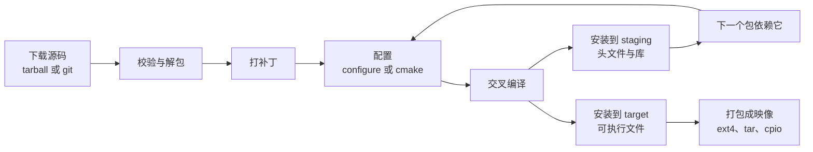

# 5.4 Buildroot 与 Yocto

[5.3](/教程/正文/嵌入式/5_嵌入式Linux/5_3_交叉工具链_sysroot与根文件系统) 手工做根文件系统的那一整套步骤，换一块板子、换一个内核版本，全都要重来一遍：下载 BusyBox、配交叉编译前缀、拷 C 库、写 inittab、打包。步骤本身不难，难在每次都要一致，难在半年后还能复现出同一份映像。

构建系统把这些步骤写成规则。一份配置文件描述了「用哪个架构、哪个 C 库、哪个内核版本、装哪些软件包」，`make` 一条命令跑完下载、打补丁、交叉编译、安装、打包。这一页讲两个最常用的：Buildroot 与 Yocto。读完能在 Buildroot 里从零构建一个 QEMU 系统，能给自己的程序和内核模块写软件包，能用外部树管理定制而不碰 Buildroot 源码；也能看懂 Yocto 的层与配方，写出最小配方，并按项目规模在两者之间做选择。

## 1. 构建系统做什么

手工流程里每一步都对应一个软件包，每个软件包都遵循同一个套路：



Buildroot 把这个流程写成 `generic-package` 基础设施：每个包一个 `.mk` 文件，声明版本、源码地址、依赖、配置与安装命令，剩下的事由框架按依赖图调度。几百个包共用一套规则，跨平台编译的细节被收进一处。

不手工做的理由有三条，都比「省事」重要：

| 理由 | 具体含义 |
| --- | --- |
| 可重复 | 同一条 `make` 在干净目录里得到同一份映像，配置文件进版本库就能复现 |
| 版本可追溯 | 每个包的版本号写在 `.mk` 里，`make show-info` 能导出成机器可读的清单 |
| 许可证清单 | `make legal-info` 收集所有包的许可证文本与源码，交付时直接给客户 |

第三条在商业项目里往往是刚需。手工构建时，谁记得清镜像里那两百个软件包各自是什么许可证？Buildroot 在构建过程中就把这些信息记下来了。

## 2. Buildroot 上手

Buildroot 的用法只有三条命令。拿一份发布版解压，或者从 git 检出固定的 tag：

::: terminal title="bash - 获取与配置 Buildroot"

```console
$ wget https://buildroot.org/downloads/buildroot-2026.02.tar.gz
$ tar xf buildroot-2026.02.tar.gz && cd buildroot-2026.02
$ make qemu_arm_vexpress_defconfig
$ make menuconfig
$ make -j$(nproc)
```

:::

`qemu_arm_vexpress_defconfig` 是官方提供的板级配置，Cortex-A9、32 位 armhf、vexpress-a9 机器，与本教程的实验平台一致。`menuconfig` 用来改配置，不熟悉界面时可以先不改，直接 `make` 跑一遍。首次构建要下载内核、BusyBox、工具链并全部编译，视网络与机器性能在一小时上下，占用十几 GB 磁盘。

构建完成后，`output/` 下会分成几个目录：

```text
output/
├── build/          # 每个软件包解包后的源码与构建目录
├── host/           # 在宿主机上运行的工具：交叉编译器、cmake、pkg-config
├── staging/        # sysroot：目标头文件与未剥离的库
├── target/         # 将打包成根文件系统的内容
└── images/         # 最终映像：zImage、rootfs.ext4、vexpress-v2p-ca9.dtb
```

`build/`、`host/`、`staging/`、`target/`、`images/` 这五层与 [5.3 第 3 节](/教程/正文/嵌入式/5_嵌入式Linux/5_3_交叉工具链_sysroot与根文件系统) 讲的分工一样：`host` 是给人用的工具，`staging` 是给编译器用的库，`target` 是给设备用的内容。`images/` 里通常是内核、设备树与根文件系统三样。

日常用得最多的 `make` 目标有这么几个：

| 目标 | 作用 |
| --- | --- |
| `make` | 增量构建，只重编改过的包 |
| `make <包>-rebuild` | 重新编译某个包，不重新下载 |
| `make <包>-dirclean` | 删掉某个包的构建目录，下次从头来 |
| `make linux-menuconfig` | 打开内核的 `menuconfig`，改完自动重编内核 |
| `make savedefconfig` | 把当前配置保存成精简的 defconfig |
| `make legal-info` | 收集许可证与源码清单到 `output/legal-info/` |
| `make graph-size` | 生成各包占用空间的气泡图（需要 Python 与 `matplotlib`） |
| `make show-info` | 以 JSON 输出所有包的版本、许可证、依赖 |

`savedefconfig` 值得单独讲。`menuconfig` 改完之后 `.config` 里有上千行，直接提交进版本库既难读又难合并。`savedefconfig` 只保留与默认值不同的那些项，通常几十行，这份文件才是应该进版本库的东西：

::: terminal title="bash - 保存精简配置（输出类似）"

```console
$ make savedefconfig BR2_DEFCONFIG=configs/mdr_qemu_defconfig
$ wc -l configs/mdr_qemu_defconfig
47 configs/mdr_qemu_defconfig
```

:::

`BR2_DEFCONFIG` 指到哪，就写到哪。不加这个参数会写到 `output/defconfig`，还要自己拷回去。

::: tip 构建失败的第一次排查

`output/build/<包名>/` 下有该包的 `config.log`、`build.log` 与 `cmake` 的 `CMakeError.log`。`make <包>-rebuild V=1` 会打开详细输出。不要从最后一行错误倒着猜，先看 `output/build/` 里正在编的是哪个包，再看那个包的日志。

:::

## 3. 定制根文件系统

根文件系统里往往要放一些自己的文件：`/etc/hostname`、启动脚本、默认配置、授权文件。这些不是软件包，写成包太重。Buildroot 提供了两条路：覆盖层 (rootfs overlay) 与 post-build 脚本。

覆盖层是一个普通的目录树，内容原样拷进 `target/` 里：

```text
board/mdr/rootfs-overlay/
├── etc/
│   ├── hostname
│   └── init.d/
│       └── S40network
└── root/
    └── .profile
```

配置里加上 `BR2_ROOTFS_OVERLAY="board/mdr/rootfs-overlay"`（用外部树时写绝对路径或 `$(BR2_EXTERNAL_MDR_PATH)`），构建时这棵树的每个文件都会覆盖到 `target/` 的对应位置。覆盖层的语义是「拷过去」，不删除、不合并，同路径的文件直接替换。

::: concept emb54-overlay-semantics title="覆盖层只覆盖，不删除"

`BR2_ROOTFS_OVERLAY` 列出的每个目录按顺序拷进 `target/`：同路径的文件与目录被覆盖，`target/` 里原有的、覆盖层里没有的文件保持不变。要删除文件、创建空目录、修改所有者或权限，只能写在 `BR2_ROOTFS_POST_BUILD_SCRIPT` 指定的脚本里。两份内容冲突时，后列的覆盖层赢。

:::

post-build 脚本在覆盖层拷完之后、打包之前执行，参数是 `target/` 目录。它适合做覆盖层做不到的事：

- 建空目录（覆盖层里放 `.gitkeep` 太别扭）；
- 改所有者与权限，比如把某个目录 chown 给服务账号；
- 删文件，比如去掉调试用的 `ssh` 主机密钥；
- 从构建环境里取信息，比如把当前 git 提交号写进 `/etc/version`。

```sh
#!/bin/sh
set -eu

TARGET_DIR="$1"

mkdir -p "$TARGET_DIR/data"
chmod 0755 "$TARGET_DIR/data"
mkdir -p "$TARGET_DIR/var/run" "$TARGET_DIR/var/log"
rm -rf "$TARGET_DIR/etc/dropbear"
```

权限上两个脚本都要可执行，路径在配置里写绝对路径，否则 `make` 找不到。脚本里的失败会中止构建，所以 `set -eu` 是必要的。

::: compare left-title="把文件直接改在 buildroot 源码里" right-title="放进覆盖层与外部树"

```text
$ cd buildroot-2026.02
$ vi board/qemu/arm-vexpress/rootfs-overlay/etc/hostname
$ git checkout .   # 升级时全丢，或者和上游冲突
```

---

```text
$ tree br2-external/board/mdr/rootfs-overlay
br2-external/board/mdr/rootfs-overlay
├── etc
│   ├── hostname
│   └── init.d
│       └── S40network
└── root
    └── .profile
$ make BR2_EXTERNAL=../br2-external mdr_qemu_defconfig
```

:::

init 的选择也在配置里。`BR2_INIT_BUSYBOX` 用 BusyBox 的 `init`，小巧，启动脚本是 `/etc/init.d/S??*` 按名字排序执行；`BR2_INIT_SYSTEMD` 用 systemd，功能全，体积大几十 MB，还需要更多内核选项。QEMU 上的实验用 BusyBox 足够，正式产品里如果有 D-Bus、定时器、socket 激活这类需求，systemd 更省事。C 库同样可选 glibc、musl、uClibc-ng，`BR2_TOOLCHAIN_BUILDROOT_GLIBC` 一类选项决定。

<Quiz
  type="single"
  :options="[
    { label: '把文件拷进去，并允许删掉已存在的文件', value: 'A' },
    { label: '把目录树原样覆盖到 target，不能删除已有文件', value: 'B' },
    { label: '在构建前修改 Buildroot 源码树', value: 'C' },
    { label: '只对内核生效，不影响根文件系统', value: 'D' }
  ]"
  answer="B"
>

<template #question>

`BR2_ROOTFS_OVERLAY` 指定的目录，Buildroot 会怎么处理？

</template>

正确答案是 **B**。覆盖层只做拷贝与替换，不删除；要删文件、建空目录、改权限，写 post-build 脚本。C 在升级时会把改动冲掉，正是外部树要避免的。

</Quiz>

## 4. 添加软件包

软件包分两部分：`package/<名>/Config.in` 声明配置项，`package/<名>/<名>.mk` 声明构建规则。以 5.10 的 `sensord` 为例。

`Config.in` 就是 Kconfig 语法，`bool` 后面是菜单里显示的名字：

```text
config BR2_PACKAGE_SENSORD
	bool "sensord"
	depends on BR2_USE_MMU
	help
	  MDR 的传感器轮询服务。周期读取数据源，往标准输出打印
	  一行统计；SIGHUP 重载配置，SIGTERM 干净退出。

	  https://github.com/Mdr-C-Tutorial/C
```

`depends on BR2_USE_MMU` 表示这个包需要内存管理单元，`fork` 在无 MMU 的平台上不可用，`sensord` 用了 `signalfd` 与 `epoll`，必须有 MMU。

`.mk` 文件声明版本、源码位置、许可证，然后用一句 `$(eval $(cmake-package))` 让框架接管。`sensord` 有自己的 `CMakeLists.txt`，所以走 `cmake-package`：

```make
SENSORD_VERSION = 1.0
SENSORD_SITE = $(BR2_EXTERNAL_MDR_PATH)/package/sensord/src
SENSORD_SITE_METHOD = local
SENSORD_LICENSE = CC-BY-NC-SA-4.0
SENSORD_CONF_OPTS = -DCMAKE_BUILD_TYPE=Release

define SENSORD_INSTALL_CONF
	$(INSTALL) -D -m 0644 $(SENSORD_PKGDIR)/sensord.conf \
		$(TARGET_DIR)/etc/sensord.conf
endef

define SENSORD_INSTALL_INIT_SYSV
	$(INSTALL) -D -m 0755 $(SENSORD_PKGDIR)/S50sensord \
		$(TARGET_DIR)/etc/init.d/S50sensord
endef

SENSORD_POST_INSTALL_TARGET_HOOKS += SENSORD_INSTALL_CONF

$(eval $(cmake-package))
```

四个变量值得记：

- `_VERSION` 与 `_SITE` 一起决定源码在哪。`_SITE_METHOD = local` 表示不下载，直接从本地目录拷，开发阶段用它最方便，改完源码 `make sensord-rebuild` 就重新编译。
- `_LICENSE` 是许可证标识，`make legal-info` 会汇总它。`_LICENSE_FILES` 指向源码里的许可证文本，`CLOSED` 表示不公开。
- `_DEPENDENCIES` 列出构建期依赖，比如 `host-pkgconf`、`zlib`。运行期依赖不用写，Buildroot 会从链接关系里推断。
- `_INSTALL_INIT_SYSV` 是一个约定名字，框架会在安装阶段调用它。这个名字不能改。

`_POST_INSTALL_TARGET_HOOKS` 是另一种做法：把自定义的安装步骤挂到框架的标准安装之后。上面用它装配置文件，因为 `cmake-package` 的 `install` 规则只处理 `CMakeLists.txt` 里 `install()` 声明的东西，而 `sensord.conf` 不属于 CMake 的安装规则。

内核模块的写法不一样。它在配置里依赖内核，在 `.mk` 里要 `eval` 两次：

```make
MDR_FIFO_VERSION = 1.0
MDR_FIFO_SITE = $(BR2_EXTERNAL_MDR_PATH)/package/mdr-fifo/src
MDR_FIFO_SITE_METHOD = local
MDR_FIFO_LICENSE = GPL-2.0

$(eval $(kernel-module))
$(eval $(generic-package))
```

`kernel-module` 必须先 `eval`，它提供模块的编译与安装规则；`generic-package` 后 `eval`，它负责下载与解包。顺序写反，`generic-package` 先接管整个包的构建，模块规则不会生效，编出来的不是内核模块。模块源码就是 [5.7](/教程/正文/嵌入式/5_嵌入式Linux/5_7_字符设备与用户空间接口) 的 `mdr_fifo.c`，它目录下的 `Makefile` 只有一行：

```make
obj-m += mdr_fifo.o
```

模块编完自动装进 `target/lib/modules/<内核版本>/extra/`，`depmod` 由框架跑。要让它开机自动加载，在覆盖层里写 `/etc/modules`，或者在初始化脚本里执行 `modprobe mdr_fifo`。

::: warning 包名与变量前缀要一致

`.mk` 文件名、`Config.in` 里的 `BR2_PACKAGE_` 名、变量前缀三者必须对应：`mdr-fifo.mk` 里的变量前缀是 `MDR_FIFO_`，短横线变成下划线，大写。写错一个字母，Buildroot 不会报错，只会静默使用默认值，构建出来的东西不对。

:::

<Quiz
  type="multi"
  :options="[
    { label: 'SENSORD_SITE_METHOD = local 让构建直接用本地源码', value: 'A' },
    { label: 'SENSORD_POST_INSTALL_TARGET_HOOKS 可以在标准安装后追加步骤', value: 'B' },
    { label: '内核模块包要先 eval kernel-module，再 eval generic-package', value: 'C' },
    { label: '包的 .mk 文件名可以与变量前缀无关', value: 'D' }
  ]"
  :answer="['A', 'B', 'C']"
>

<template #question>

关于 Buildroot 的软件包，下列说法正确的是哪些？

</template>

正确答案是 **A、B、C**。D 错：`.mk` 文件名、`Config.in` 里的名字与变量前缀必须对应，短横线在下划线处转换，大小写也要对上，否则框架读不到你写的变量。

</Quiz>

## 5. BR2_EXTERNAL 外部树

把定制直接改在 Buildroot 源码树里，升级时要么手工合并，要么全部丢失。Buildroot 提供的解法是外部树 (external tree)：一个独立的目录，在构建时用 `BR2_EXTERNAL=` 指过去。

外部树的骨架是固定的四样：

```text
br2-external/
├── external.desc          # 名字与描述，一行 name、一行 desc
├── external.mk            # 引入所有 .mk
├── Config.in              # 引入所有 Config.in
├── configs/               # 板级 defconfig
├── board/<板>/            # 覆盖层、post-build 脚本、内核配置片段
└── package/<包>/           # 自己的软件包
```

`external.desc` 只有两行：

```text
name: MDR
desc: MDR 板级定制：sensord 服务与 mdr_fifo 内核模块
```

`name` 会被转成大写，作为变量前缀 `BR2_EXTERNAL_MDR_PATH`，所有路径都靠它拼。改名会让所有 `.mk` 里的路径失效，定下来就别动。

`external.mk` 与 `Config.in` 各一行引入语句，用 `wildcard` 自动收集：

```make
include $(sort $(wildcard $(BR2_EXTERNAL_MDR_PATH)/package/*/*.mk))
```

```text
source "$BR2_EXTERNAL_MDR_PATH/package/sensord/Config.in"
source "$BR2_EXTERNAL_MDR_PATH/package/mdr-fifo/Config.in"
```

`Config.in` 的 `source` 要逐个写，因为 Kconfig 不支持通配。新增一个包时别忘了回来加一行。

用外部树构建时，命令行要带上路径，`defconfig` 也来自外部树的 `configs/`：

::: terminal title="bash - 用外部树构建（输出类似）"

```console
$ make BR2_EXTERNAL=/home/mdr/br2-external mdr_qemu_defconfig
$ make BR2_EXTERNAL=/home/mdr/br2-external
$ ls output/images/
rootfs.ext2  rootfs.tar  vexpress-v2p-ca9.dtb  zImage
```

:::

每次 `make` 都要带 `BR2_EXTERNAL` 很啰嗦。Buildroot 支持把多个外部树记在一个文件里：`output/.br2-external.mk` 由上次的 `make` 自动生成，也可以手工维护 `BR2_EXTERNAL` 环境对象。实际工程里更常见的做法是写一个三行的 `build.sh`：

```sh
#!/bin/sh
set -eu

BR2_EXTERNAL="$(cd "$(dirname "$0")" && pwd)/br2-external"
export BR2_EXTERNAL

make -C buildroot O=output mdr_qemu_defconfig
make -C buildroot O=output "$@"
```

`O=output` 把构建产物放到源码树外面，Buildroot 源码目录保持干净，升级时 `git checkout` 或直接换一份 tar 包都不会碰到自己的东西。

版本固定有两条路：把 Buildroot 作为子模块 (submodule) 挂在项目仓库里，或者写脚本按 tag 下载并校验哈希。前者的优点是 `git submodule update` 一步到位，缺点是与主仓库的提交历史耦合；后者简单，CI 里也好用。都不选、直接 `git clone master` 是最糟的做法，某天上游改了一个包的版本，你的构建结果就变了，而且没人知道为什么。

## 6. Yocto 概览

Yocto 解决同一个问题，设计上更重。它由 OpenEmbedded 的构建框架 BitBake 加上一套元数据 (metadata) 组成，参考发行版叫 Poky。要理解 Yocto，先记住三个词：层 (layer)、配方 (recipe)、任务 (task)。

层是配方的容器，形如 `meta-<名字>`。名字前缀 `meta-` 是约定，Yocto 靠它把层与普通目录区分开。一个层里常见这几类目录：

```text
meta-mdr/
├── conf/
│   └── layer.conf           # 层自身的声明：优先级、兼容的版本
├── recipes-apps/            # 应用类配方，目录名习惯按类别取
│   └── sensord/
│       └── sensord_1.0.bb
└── recipes-kernel/
    └── mdr-fifo/
        └── mdr-fifo_1.0.bb
```

`layer.conf` 声明这一层叫什么、优先级多少、兼容哪个 Yocto 版本：

```text
BBPATH .= ":${LAYERDIR}"
BBFILES += "${LAYERDIR}/recipes-*/*/*.bb \
            ${LAYERDIR}/recipes-*/*/*.bbappend"

BBFILE_COLLECTIONS += "meta-mdr"
BBFILE_PATTERN_meta-mdr = "^${LAYERDIR}/"
BBFILE_PRIORITY_meta-mdr = "10"

LAYERDEPENDS_meta-mdr = "core"
LAYERSERIES_COMPAT_meta-mdr = "scarthgap wrynose"
```

`LAYERSERIES_COMPAT` 写的是这一段支持的发布代号。截至 2026 年 10 月，两个长期支持版本是 5.0 Scarthgap（维护到 2028 年 4 月）与 6.0 Wrynose（维护到 2030 年 4 月）。版本代号不匹配时 BitBake 直接拒绝构建，这是有意的：配方里用到的变量名在版本之间会变。

配方是 `.bb` 文件，语法是 BitBake 的变量赋值加 shell 函数。最小的一条应用配方长这样：

```text
SUMMARY = "MDR 的传感器轮询服务"
LICENSE = "CLOSED"

SRC_URI = "file://sensord.c \
           file://evl.c \
           file://evl.h \
           file://sdnotify.c \
           file://sdnotify.h \
           file://CMakeLists.txt \
           file://sensord.conf \
           file://S50sensord"

S = "${UNPACKDIR}"

inherit cmake update-rc.d

INITSCRIPT_NAME = "S50sensord"
INITSCRIPT_PARAMS = "defaults 50"

do_install:append() {
    install -d ${D}${sysconfdir}
    install -m 0644 ${UNPACKDIR}/sensord.conf ${D}${sysconfdir}/sensord.conf
}

FILES:${PN} += "${sysconfdir}/sensord.conf"
```

几条与 Buildroot 不同的规矩：

- `SRC_URI` 里每一条 `file://` 都相对于配方所在目录的 `files/` 子目录（或者 `FILESPATH`），不是相对当前目录。上面这版把所有文件放在配方的 `files/` 下，构建时拷进工作目录。
- `S` 是解包后的源码目录。**Yocto 5.1 起不允许 `S = "${WORKDIR}"`**，必须写 `${UNPACKDIR}` 或更具体的子目录，老教程里的配方照抄会直接报错。
- `do_install` 是标准任务，用 `:append` 追加而不是覆盖，否则会丢掉 `cmake` 已经做好的安装。
- `FILES:${PN}` 声明最终包装进哪个子包。`${PN}` 是配方名，默认的打包规则只收 `bin`、`lib`、`share` 等几个标准位置，`/etc` 下的自定义文件要显式列出来。

内核模块配方更短，因为 `inherit module` 已经提供了一切：

```text
SUMMARY = "MDR 的纯软件 FIFO 字符设备"
LICENSE = "GPL-2.0-only"
LIC_FILES_CHKSUM = "file://${COMMON_LICENSE_DIR}/GPL-2.0-only;md5=801f80980d171dd6425610833a22dbe6"

SRC_URI = "file://mdr_fifo.c file://Makefile"

S = "${UNPACKDIR}"

inherit module

RPROVIDES:${PN} += "kernel-module-mdr-fifo"
```

`LIC_FILES_CHKSUM` 计算许可证文本的校验值，BitBake 在构建时验证它。`file://${COMMON_LICENSE_DIR}/...` 指向 Poky 自带的许可证文本，`md5` 用 `md5sum` 算。写错校验值时构建会停在 `do_populate_lic`，报「license file checksum mismatch」。

快速构建的流程固定：

::: terminal title="bash - Yocto 快速构建（输出类似）"

```text
$ git clone -b wrynose git://git.yoctoproject.org/poky
$ cd poky
$ source oe-init-build-env build
### Shell environment set up for builds.
$ bitbake core-image-minimal
...
NOTE: Tasks Summary: Attempted 3721 tasks of which 0 didn't need to be rerun and all succeeded.
$ ls tmp/deploy/images/qemuarm/
core-image-minimal-qemuarm.rootfs.ext4 ...
```

:::

`oe-init-build-env` 做三件事：建立构建目录 `conf/`、把 `poky/meta` 等层写进 `bblayers.conf`、把 `MACHINE`、`DISTRO`、`IMAGE_FEATURES` 写进 `local.conf`。要加自己的层，编辑 `conf/bblayers.conf`：

```text
BBLAYERS += "/home/mdr/meta-mdr"
```

再在 `local.conf` 里把配方装进映像：

```text
IMAGE_INSTALL:append = " sensord mdr-fifo"
```

`IMAGE_INSTALL:append` 追加到镜像的软件包列表。注意冒号与 `append` 之间没有空格，这是 BitBake 的覆盖语法 (override)，写错成 `IMAGE_INSTALL_append` 在旧版本能工作，新版本里会被当成一个全新的变量，不生效。

`devtool` 是 Yocto 里改配方源码的工具。它把配方指向一个本地工作目录，改完之后 `devtool update-recipe` 把改动写回 `.bbappend`，不用手工改 SRC_URI：

::: terminal title="bash - devtool 的典型用法"

```console
$ devtool modify sensord
$ cd build/workspace/sources/sensord
$ vi sensord.c
$ devtool build sensord
$ devtool deploy-target sensord root@192.168.7.2
$ devtool finish sensord ../meta-mdr
```

:::

`deploy-target` 通过 ssh 把编好的程序拷到目标板的对应位置，比重新打包整个镜像快得多。这是开发阶段最常用的循环。

::: tip 构建时间与磁盘

Yocto 的首次构建比 Buildroot 慢得多：`core-image-minimal` 在 8 核机器上约半小时到一小时，磁盘占用 50 GB 起步；加 `core-image-sato`（带图形）会到一两百 GB。Buildroot 的同类构建十几分钟、十几 GB。这不是配置没调好，是两者规模不同。

:::

## 7. 怎么选

两个系统都能做出可用的产品，选择的依据是团队规模、产品线数量与维护周期，而不是「哪个更先进」。

| 维度 | Buildroot | Yocto |
| --- | --- | --- |
| 学习成本 | 一个下午能跑通 | 一两周才摸清变量与任务 |
| 构建时间（QEMU 最小系统） | 十几分钟 | 半小时到一小时 |
| 磁盘占用 | 十几 GB | 50 GB 起 |
| 配方/包的粒度 | 一个 `.mk`，语法简单 | `.bb` 加任务、覆盖、类，可扩展 |
| 二进制包管理 | 无，每次都整编 | 有 `package_rpm`/`package_deb`，可增量 |
| SDK | 有 `make sdk` | 有 `bitbake -c populate_sdk` 与 eSDK |
| 芯片厂支持 | 部分有 | ST 的 OpenSTLinux、NXP 的 i.MX BSP 都基于它 |
| 长期维护 | 版本间变化小，升级容易 | 分层与版本策略明确，适合多产品复用 |

作者的建议分两种情况。单一产品、小团队、构建机资源有限，用 Buildroot：一份 defconfig 加一个外部树，全组都能看懂，CI 里十几分钟出一份镜像，出了问题就在 `output/build/` 里查。多产品线、需要长期维护、需要增量更新或复用芯片厂 BSP，用 Yocto：层能按产品组合，`bbappend` 能让不同产品改同一份配方而不冲突，ST 与 NXP 的官方 BSP 本身就在这个体系里。

两者都别在源码树里改东西。Buildroot 用 `BR2_EXTERNAL`，Yocto 用独立的层，这是它们各自的设计意图，绕过去以后升级一定会痛。

## 8. 习题

### 8.1 巩固

<Exercise id="65535" :d="1" :w="2">

读 `code/嵌入式/5_嵌入式Linux/5_4_Buildroot与Yocto/br2-external/configs/mdr_qemu_defconfig`，不构建，只回答：

(1) 哪几行决定 CPU 架构、C 库与工具链？文件里没有出现任何 `BR2_INIT_*` 选项，说明 init 用的是默认值。这个默认值是什么？构建完成后怎样在 `output/target/sbin/` 下确认？

(2) `BR2_ROOTFS_OVERLAY` 里的 `$(BR2_EXTERNAL_MDR_PATH)` 是从 `external.desc` 的 `name:` 变出来的变量，由 Buildroot 在解析外部树时定义。按你机器上的路径把它展开，写出展开后的完整值，并说明为什么 `external.desc` 改名会让这个变量失效。

(3) `BR2_LINUX_KERNEL_INTREE_DTS_NAME="arm/vexpress-v2p-ca9"` 指向 [5.5](/教程/正文/嵌入式/5_嵌入式Linux/5_5_设备树) 里的哪个文件？`BR2_LINUX_KERNEL_CUSTOM_VERSION_VALUE` 与 `BR2_LINUX_KERNEL_USE_DEFCONFIG` 一起决定了哪两件事？

(4) 按配置推断构建完成后 `output/images/` 会出现哪些文件，把每个文件对应到产生它的选项。再说明 `output/build/`、`output/host/`、`output/staging/`、`output/target/` 各自在什么阶段被读写。

</Exercise>

<Exercise id="65536" :d="2" :w="2">

覆盖层「只覆盖、不删除」的语义可以用二十行 shell 复现，不必真的跑 Buildroot。

(1) 写 `apply-overlay.sh <target> <overlay>...`：按给出的顺序把每个 overlay 目录的内容拷进 target，同路径文件被覆盖，target 里多出来的文件保留；每处理一个 overlay 打印一行，最后统计新增、覆盖、保留各多少个文件。加 `--dry-run`，只打印不落盘。

(2) 构造验收数据：`target/` 有 `a.txt`、`keep.txt`；`overlay1/` 有内容不同的 `a.txt` 与 `b.txt`；`overlay2/` 有内容又不同的 `b.txt`。运行后检查 `a.txt` 来自 overlay1、`b.txt` 来自 overlay2、`keep.txt` 仍在。

(3) 写 `post-build.sh <target>`：删 `keep.txt`、建空目录 `data/`、把 `data/` 的权限设成 0755。把两步串起来，说明为什么删除只能放在第二步。

(4) 把 `apply-overlay.sh` 里的拷贝命令换成 `cp -r` 与 `cp -a` 各跑一次，说明符号链接与权限上的差别，以及 Buildroot 为什么用保权限的拷贝。

</Exercise>

### 8.2 编程

<Exercise id="65537" :d="3" :w="3">

给外部树加一个自己的包 `mdr-hello`，装一个程序和一份配置。

(1) 写 `package/mdr-hello/Config.in`：符号 `BR2_PACKAGE_MDR_HELLO`，`bool "mdr-hello"`，`depends on BR2_USE_MMU`，`help` 写三行说明。

(2) 写 `package/mdr-hello/src/` 下的 `hello.c` 与 `Makefile`（`CC ?= cc`、`CFLAGS ?= -O2 -Wall -Wextra`），程序打印一行版本信息；在包目录下再放一份 `mdr-hello.conf`，内容自定，用来练安装配置文件的写法。

(3) 写 `mdr-hello.mk`，用 `generic-package`，`SITE_METHOD = local`，自己实现 `_BUILD_CMDS` 与 `_INSTALL_TARGET_CMDS`：把程序装到 `/usr/bin/mdr-hello`，把 `mdr-hello.conf` 装到 `/etc/`。可能用到的变量有 `$(TARGET_MAKE_ENV)`、`$(TARGET_CONFIGURE_OPTS)`、`$(@D)`、`$(TARGET_DIR)`、`$(INSTALL)`、`$(MDR_HELLO_PKGDIR)`。

(4) 把它登记到 `external.mk` 与顶层 `Config.in`，构建后确认 `output/target/usr/bin/mdr-hello` 与 `output/target/etc/mdr-hello.conf` 都存在。

(5) 改一行源码，只运行 `make mdr-hello-rebuild`，确认改动进了 target；再运行 `make mdr-hello-dirclean mdr-hello`，比较两次的耗时。

(6) 用 `make show-info` 的输出片段核对这个包的版本、许可证与依赖。

</Exercise>

<Exercise id="65538" :d="3" :w="3">

包名、配置符号与变量前缀三者不一致时，Buildroot 不会报错，只会静默用默认值。写一个静态检查脚本把这类问题提前找出来。

(1) 写 `check-external.sh <external 树>`，检查四件事：

- 每个 `package/NAME/NAME.mk` 里出现的 `<PREFIX>_VERSION` 一类变量，其前缀等于文件名去掉 `.mk`、短横线换下划线、转大写；
- 每个包目录下都有 `Config.in`，其中定义的符号是 `BR2_PACKAGE_` 加同样转换后的大写名；
- 顶层 `Config.in` 里 `source` 了每个包的 `Config.in`；
- `external.mk` 的 `wildcard` 能匹配到每个 `.mk`。

(2) 对仓库里的 `br2-external/` 跑一次，应当全部通过；把 `sensord.mk` 里的 `SENSORD_` 改成 `SENSOR_` 再跑，应当指出具体文件与行号。

(3) 说明这四类错误在构建时各自的症状：哪一类会让 `menuconfig` 里根本没有这个选项，哪一类会让选项出现但构建出来的是空壳，哪一类会让包在 `make` 时被跳过。

(4) `mdr-fifo.mk` 里 `kernel-module` 与 `generic-package` 的 `eval` 顺序不能反。对调两行后构建（或只读 Makefile 推演），说明 `generic-package` 先接管后会漏掉哪些规则，产物会变成什么。

</Exercise>

<Exercise id="65539" :d="4" :w="4">

按照 `code/嵌入式/5_嵌入式Linux/5_4_Buildroot与Yocto/meta-mdr/` 的结构，写一个 `hello` 配方并把它装进镜像。

(1) 建层 `meta-hello`：`conf/layer.conf` 里写 `BBFILE_PRIORITY`、`LAYERSERIES_COMPAT`，兼容 `scarthgap` 与 `wrynose`。说明 `LAYERDEPENDS` 为什么写 `core`。

(2) 写 `recipes-apps/hello/hello_1.0.bb`：`SRC_URI` 用 `file://` 引入 `hello.c`、`Makefile` 与 `LICENSE`，`S = "${UNPACKDIR}"`，`do_install:append()` 把程序装进 `${bindir}`，`FILES:${PN}` 确保装进去的文件被打进包。

(3) `LICENSE` 写 `MIT`，用 `md5sum` 算出 `LIC_FILES_CHKSUM` 并写进配方；再故意改错一位，记录构建停在哪一步、报什么。

(4) 把层加进 `bblayers.conf`，用 `IMAGE_INSTALL:append = " hello"` 装进 `core-image-minimal`，用 `bitbake -e hello | grep -E '^(S|D|WORKDIR)='` 核对三个目录。

(5) 用 `devtool modify hello` 改一行源码，`devtool build hello` 后 `devtool finish hello ../meta-hello`，说明 `finish` 在层里生成了什么文件、配方本身有没有被改动。

(6) 回答三处容易照抄老教程出错的地方：`S = "${WORKDIR}"` 为什么在新版本里不能用、`do_install` 为什么必须用 `:append`、`IMAGE_INSTALL_append` 为什么失效。

</Exercise>

<Exercise id="65540" :d="4" :w="4">

团队里两个人各改了一份 defconfig，合并前要看差异。写 `br2diff.sh <旧> <新>`：

(1) 归一化两份文件：去掉注释与空行，把 `# CONFIG_FOO is not set` 记成 `CONFIG_FOO=n`，把 `BR2_FOO="value"` 与 `BR2_BAR=y` 解析成键值对，按键排序。

(2) 输出三张表：新增的选项、删除的选项、取值改变的选项，每张表按前缀分类（`BR2_TOOLCHAIN`、`BR2_PACKAGE`、`BR2_LINUX_KERNEL`、`BR2_TARGET_ROOTFS`、其他）。

(3) 对 `BR2_PACKAGE_*` 的变化额外标出方向：`=y` 变 `=n` 是「移除软件包」，反之是「增加软件包」。汇总行给出镜像会因此变大还是变小。

(4) 验收数据自己造：复制 `mdr_qemu_defconfig`，改五处（加一个包、去一个包、改内核版本、改主机名、改一个工具链选项），运行脚本，核对五处全部出现在正确的表里且分类正确。

</Exercise>

<Exercise id="65541" :d="5" :w="4">

把 [5.3](/教程/正文/嵌入式/5_嵌入式Linux/5_3_交叉工具链_sysroot与根文件系统) 手工拼的根文件系统搬到 Buildroot 里，并比较两种做法。

(1) 在外部树里加一个覆盖层，放入 5.3 的 `/etc/hostname`、`/etc/init.d/S40network`（内容改成 `ip link set eth0 up` 与 `udhcpc -i eth0`）和 `/root/.profile`。`BR2_ROOTFS_OVERLAY` 指向它，构建后到 `output/target/` 里核对三个文件。

(2) 5.3 手工拼根文件系统时靠 `mkdir`、`chmod` 补齐的目录与权限，在 Buildroot 里要由 post-build 脚本完成。把建 `/data`、建 `/var/run` 与 `/var/log`、设这三个目录的权限、删掉 `/etc/dropbear` 写进 `post-build.sh`，构建后逐项核对。

(3) 用同一个 QEMU 命令分别启动手工 initramfs 与 Buildroot 的 `rootfs.ext2`，记录从上电到出现 shell 提示符的时间（`-append` 加 `printk.time=1`，以日志第一条与最后一条的时间戳相减）。

(4) 列出两种做法的差异表：镜像大小、占用 RAM 的方式、可写性、换一块板子时要改什么。说明为什么 Buildroot 产物的启动时间不能直接与手工 initramfs 比。

(5) 假设两个项目：一个是单一产品的量产板，构建机只有 16 GB 内存、需要每周出一版；另一个是同一套硬件衍生的三种型号，要长期维护并复用芯片厂 BSP。按第 7 节的维度各选一个构建系统，写出理由与预估的构建时间、磁盘占用。

</Exercise>

### 8.3 综合与挑战

<Exercise id="65542" :d="5" :w="4">

下面这棵外部树有七处问题，构建会以不同的方式失败或者静默出错。

```text
br2-broken/
├── external.desc
├── external.mk
├── Config.in
├── configs/mdr_qemu_defconfig
├── board/mdr/
│   ├── post-build.sh                # 权限 0644
│   └── rootfs-overlay/etc/hostname
└── package/
    ├── sensord/{Config.in, sensord.mk}
    └── mdr-fifo/{Config.in, mdr-fifo.mk}
```

```text
# external.desc
Name: MDR
desc: broken example

# external.mk
include $(sort $(wildcard $(BR2_EXTERNAL_MDR_PATH)/package/*/*.mk))

# Config.in（顶层）
source "$BR2_EXTERNAL_MDR_PATH/package/sensord/Config.in"

# configs/mdr_qemu_defconfig（节选）
BR2_ROOTFS_OVERLAY="board/mdr/rootfs-overlay"
BR2_ROOTFS_POST_BUILD_SCRIPT="board/mdr/post-build.sh"
BR2_PACKAGE_MDR_FIFO=y
```

```make
# package/sensord/sensord.mk
SENSOR_VERSION = 1.0
SENSOR_SITE = $(BR2_EXTERNAL_MDR_PATH)/package/sensord/src
SENSOR_SITE_METHOD = local
$(eval $(cmake-package))

# package/mdr-fifo/mdr-fifo.mk
$(eval $(generic-package))
$(eval $(kernel-module))
```

(1) 这七处问题互相遮蔽：第一处不修，后面的症状根本看不到。先按「修一处、构建一次、记录新症状」的顺序走一遍，逐处说明它属于哪一类：`external.desc` 解析失败、`menuconfig` 里看不到包选项、覆盖层路径解析成相对源码树的路径、`post-build` 脚本找不到、`post-build` 报权限错误、变量被静默忽略、内核模块编不成。

(2) 为每一处给出修复后的内容，只改必要的那几行。

(3) 写一个 `check-broken-tree.sh`，能静态查出其中至少四处，对修复后的树返回 0。

(4) 说明为什么第 (2) 步修完之后 `BR2_EXTERNAL` 的路径还要在命令行上传一次，而第二次 `make` 可以省略。

</Exercise>

<Exercise id="65543" :d="6" :w="5" scope="*">

Buildroot 的 `generic-package` 本质上是一套模板加依赖调度。写一个 `mini-build`（Makefile 或 shell 脚本），用三个小包演示这套机制：

- `libfoo`：一个静态库；
- `app`：依赖 `libfoo`，链接它；
- `hostgen`：在宿主机上运行的工具，`app` 的构建过程要调用它生成一个头文件。

要求：

(1) 每个包一个 `.mk` 片段，声明 `_VERSION`、`_SITE`（本地目录）、`_DEPENDENCIES`、`_BUILD_CMDS`、`_INSTALL_STAGING_CMDS`、`_INSTALL_TARGET_CMDS`。

(2) 构建按依赖图进行，`make app` 会自动先构建 `libfoo` 与 `hostgen`；`make graph` 打印依赖关系。

(3) `staging/` 与 `target/` 分开，`libfoo` 的头文件与静态库只进 staging，`app` 的可执行文件只进 target，`hostgen` 只进 host。

(4) 增量构建：改 `libfoo` 的源码后 `make app` 会重编 `libfoo` 与 `app`，但不重编 `hostgen`；用文件时间戳或 `.stamp` 实现，并打印本次实际执行了哪几步。

(5) `make show-info` 输出三个包的版本、依赖与许可证的 JSON。

(6) 最后写一份对照表，把你实现的每一步映射到 Buildroot 的哪个变量或目录（`output/build`、`output/host`、`output/staging`、`output/target`）。

</Exercise>

## 9. 参考资料

- The Buildroot project，*The Buildroot user manual*，`generic-package`、`cmake-package`、`kernel-module`、`BR2_EXTERNAL` 各节：<https://buildroot.org/downloads/manual/manual.html>
- The Buildroot project，下载与发布版本：<https://buildroot.org/download.html>
- The Buildroot project，`board/qemu/arm-vexpress/readme.txt`，QEMU 启动命令：<https://gitlab.com/buildroot.org/buildroot/-/blob/master/board/qemu/arm-vexpress/readme.txt>
- Yocto Project，完整文档集：<https://docs.yoctoproject.org/>
- Yocto Project，*Quick Build*：<https://docs.yoctoproject.org/brief-yoctoprojectqs/index.html>
- Yocto Project，*Releases* 与各版本的维护周期：<https://wiki.yoctoproject.org/wiki/Releases>
- Yocto Project，*Migration guide 5.1*，`UNPACKDIR` 与 `S` 的变化：<https://docs.yoctoproject.org/migration-guides/migration-5.1.html>
- BitBake User Manual，变量语法、覆盖与任务：<https://docs.yoctoproject.org/bitbake/>
- Bootlin，*Embedded Linux system development* 培训幻灯片，Build systems 一章：<https://bootlin.com/doc/training/embedded-linux/embedded-linux-slides.pdf>
