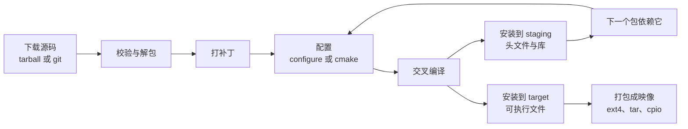

# 5.4 Buildroot 与 Yocto

在 [5.3](/教程/正文/嵌入式/5_嵌入式Linux/5_3_交叉工具链_sysroot与根文件系统) 中，我们通过手工执行的一整套步骤拼装出了一个可引导的根文件系统。然而，在实际工程生命周期中，一旦面临更换处理器硬件平台、升级 Linux 内核版本或变更 C 运行库，这套纯手工流程便需要完全重来一遍：重新下载解压 BusyBox 源码、校准交叉编译器前缀、从 sysroot 中提取共享库、编排 inittab 启动脚本并执行 cpio 归档打包。单纯的手工敲击命令并不深奥，真正的挑战在于如何在长时间跨度中保持构建过程的绝对确定性，确保数月乃至数年后整个研发团队依然能够精准复现出字节级一致的系统固件镜像。

自动化构建系统正是为了将这些离散的手工步骤沉淀为标准化、受版本控制的工程规则。只需维护一份简明的全局配置文件，声明目标 CPU 指令集架构、底层 C 运行库版本、内核基线分支以及所需装载的用户态组件列表，一条 `make` 构建指令便能全自动驱动从外网拉取源码、应用定制补丁、执行交叉编译、组装文件系统直至生成最终可烧录镜像的全流程。本节将深入剖析嵌入式领域最核心的两大构建框架：Buildroot 与 Yocto（Poky）。通过本节的实践，你将能够在 Buildroot 体系中从零构建出一套完整的 QEMU 仿真镜像，为自己的应用程序与底层内核模块编写规范的构建包定义，运用外部树（external tree）实现业务代码与开源框架的物理解耦；同时，还将掌握 Yocto 架构下的层（Layer）与配方（Recipe）组织哲学，并能根据项目研发规模、维护周期与团队资源在两者之间做出审慎的技术选型裁决。

## 1. 构建系统做什么

在手工构建的流程中，系统镜像中的每一个功能组件在本质上都映射为一个独立的软件包，且每个软件包的生命周期均遵循高度一致的管线规律：



Buildroot 将这种重复性的管线行为高度凝练为通用的基础包调度框架（如 `generic-package`、`cmake-package` 等）：每个软件包仅需收纳在一个独立的 `.mk` Makefile 片段中，清晰声明自身的软件版本、源码下载 URI、前置构建依赖以及具体的编译与安装规则。框架层则基于全局依赖拓扑图，全自动计算构建优先级并按序触发编译。数百个形态各异的开源包因此遵循同一套行为契约，繁复琐碎的跨平台交叉编译细节被统一收敛。

在现代嵌入式研发中，采用自动化构建系统取代手工拼装的核心驱动力远不止于「操作省事」，而是依托三项关乎工程质量与合规性的硬性指标：

| 理由 | 具体含义 |
| --- | --- |
| 可重复 | 同一条 `make` 在干净目录里得到同一份映像，配置文件进版本库就能复现 |
| 版本可追溯 | 每个包的版本号写在 `.mk` 里，`make show-info` 能导出成机器可读的清单 |
| 许可证清单 | `make legal-info` 收集所有包的许可证文本与源码，交付时直接给客户 |

第三项合规要求在商业产品量产交付时往往构成不可妥协的法律红线。在全手工管理模式下，面对镜像中内嵌的数百个开源组件，几乎没有任何团队能够准确审计出每个程序对应的具体开源许可证类型及分发约束；而在标准构建系统中，元数据追踪机制在编译阶段便已全自动完成了许可证文本的汇聚与源码归档。

## 2. Buildroot 上手

Buildroot 的上手门槛极低，基础构建流程仅涉及三条核心命令。直接下载官方发布的稳定版本归档解包，或自官方 Git 仓库检出长期支持分支对应的发行标签：

::: terminal title="bash - 获取与配置 Buildroot"

```console
$ wget https://buildroot.org/downloads/buildroot-2026.02.tar.gz
$ tar xf buildroot-2026.02.tar.gz && cd buildroot-2026.02
$ make qemu_arm_vexpress_defconfig
$ make menuconfig
$ make -j$(nproc)
```

:::

`qemu_arm_vexpress_defconfig` 是 Buildroot 官方源码树中维护的标准板级基线，其预设了 Cortex-A9 处理器架构、32 位 armhf 硬浮点调用约定以及对 QEMU ARM Versatile Express 平台的完整支持，与本教程所使用的仿真环境高度对齐。当执行 `menuconfig` 时，终端将弹出典型的 ncurses 文本图形配置界面，支持直观调整内核、工具链与组件树；在初次探索时无需急于修改，直接触发全局 `make` 即可。初次完整构建需要经历从远端镜像拉取内核源码、BusyBox 源码、编译交叉工具链并逐项完成目标系统构建的全过程，根据宿主机 CPU 核心数与网络吞吐，耗时通常在数十分钟至一小时不等，并需占用十余吉字节（GB）的磁盘构建缓存。

构建顺利收官后，`output/` 工作目录下将分门别类呈现五个层级的成果物：

```text
output/
├── build/          # 每个软件包解包后的源码与构建目录
├── host/           # 在宿主机上运行的工具：交叉编译器、cmake、pkg-config
├── staging/        # sysroot：目标头文件与未剥离的库
├── target/         # 将打包成根文件系统的内容
└── images/         # 最终映像：zImage、rootfs.ext4、vexpress-v2p-ca9.dtb
```

这五处目录严格延续了前期所确立的系统分层契约：`host/` 存放宿主机运行的交叉构建工具链，`staging/` 专供交叉编译器在链接时解析符号，而 `target/` 则是经过裁剪与符号剥离（strip）后即将封装进硬件存储介质的物理根文件系统。`images/` 最终产出供仿真或烧写的内核镜像、设备树与文件系统镜像。

在日常迭代与增量开发中，以下构建目标构成了最高频的操作入口：

| 目标 | 作用 |
| --- | --- |
| `make` | 增量构建，只重编改过的包 |
| `make <包>-rebuild` | 重新编译某个包，不重新下载 |
| `make <包>-dirclean` | 删掉某个包的构建目录，下次从头来 |
| `make linux-menuconfig` | 打开内核的 `menuconfig`，改完自动重编内核 |
| `make savedefconfig` | 把当前配置保存成精简的 defconfig |
| `make legal-info` | 收集许可证与源码清单到 `output/legal-info/` |
| `make graph-size` | 生成各包占用空间的气泡图（需要 Python 与 `matplotlib`） |
| `make show-info` | 以 JSON 输出所有包的版本、许可证、依赖 |

`savedefconfig` 这一操作目标在工程协作中极为关键。当开发者在 `menuconfig` 界面中仅微调了少数选项后，生成的 `.config` 文件由于展开了全量系统参数，通常会膨胀至数千行之巨。若将此类全量展开的文件直接纳入 Git 版本控制，不仅可读性极差，在多人并行开发或合并分支时更极易诱发海量冲突。执行 `make savedefconfig` 会自动对配置进行差异化提取，仅保留那些明确偏离系统默认值的关键选项，产出的精简 defconfig 文件通常只有数十行，这才是真正应当提交至代码仓库受版本管理的核心资产：

::: terminal title="bash - 保存精简配置（输出类似）"

```console
$ make savedefconfig BR2_DEFCONFIG=configs/mdr_qemu_defconfig
$ wc -l configs/mdr_qemu_defconfig
47 configs/mdr_qemu_defconfig
```

:::

通过 `BR2_DEFCONFIG` 能够精确重定向精简配置的输出文件路径；若省略该参数，内容将默认输出至 `output/defconfig`，尚需开发者手动复制归档。

::: tip 构建失败的第一次排查

`output/build/<包名>/` 下有该包的 `config.log`、`build.log` 与 `cmake` 的 `CMakeError.log`。`make <包>-rebuild V=1` 会打开详细输出。不要从最后一行错误倒着猜，先看 `output/build/` 里正在编的是哪个包，再看那个包的日志。

:::

## 3. 定制根文件系统

根文件系统里往往要放一些自己的文件：`/etc/hostname`、启动脚本、默认配置、授权文件。这些文件各自写成一个软件包太重。Buildroot 提供了两条路：覆盖层 (rootfs overlay) 与 post-build 脚本。

覆盖层是一个普通的目录树，内容原样拷进 `target/` 里：

```text
board/mdr/rootfs-overlay/
├── etc/
│   ├── hostname
│   └── init.d/
│       └── S40network
└── root/
    └── .profile
```

配置里加上 `BR2_ROOTFS_OVERLAY="board/mdr/rootfs-overlay"`（用外部树时写绝对路径或 `$(BR2_EXTERNAL_MDR_PATH)`），构建时这棵树的每个文件都会覆盖到 `target/` 的对应位置。覆盖层的语义是「拷过去」，不删除、不合并，同路径的文件直接替换。

::: concept emb54-overlay-semantics title="覆盖层只覆盖，不删除"

`BR2_ROOTFS_OVERLAY` 列出的每个目录按顺序拷进 `target/`：同路径的文件与目录被覆盖，`target/` 里原有的、覆盖层里没有的文件保持不变。要删除文件、创建空目录、修改所有者或权限，只能写在 `BR2_ROOTFS_POST_BUILD_SCRIPT` 指定的脚本里。两份内容冲突时，后列的覆盖层赢。

:::

post-build 脚本在覆盖层拷完之后、打包之前执行，参数是 `target/` 目录。它适合做覆盖层做不到的事：

- 建空目录（覆盖层里放 `.gitkeep` 太别扭）；
- 改所有者与权限，比如把某个目录 chown 给服务账号；
- 删文件，比如去掉调试用的 `ssh` 主机密钥；
- 从构建环境里取信息，比如把当前 git 提交号写进 `/etc/version`。

```sh
#!/bin/sh
set -eu

TARGET_DIR="$1"

mkdir -p "$TARGET_DIR/data"
chmod 0755 "$TARGET_DIR/data"
mkdir -p "$TARGET_DIR/var/run" "$TARGET_DIR/var/log"
rm -rf "$TARGET_DIR/etc/dropbear"
```

权限上两个脚本都要可执行，路径在配置里写绝对路径，否则 `make` 找不到。脚本里的失败会中止构建，所以 `set -eu` 是必要的。

::: compare left-title="把文件直接改在 buildroot 源码里" right-title="放进覆盖层与外部树"

```text
$ cd buildroot-2026.02
$ vi board/qemu/arm-vexpress/rootfs-overlay/etc/hostname
$ git checkout .   # 升级时全丢，或者和上游冲突
```

---

```text
$ tree br2-external/board/mdr/rootfs-overlay
br2-external/board/mdr/rootfs-overlay
├── etc
│   ├── hostname
│   └── init.d
│       └── S40network
└── root
    └── .profile
$ make BR2_EXTERNAL=../br2-external mdr_qemu_defconfig
```

:::

init 的选择也在配置里。`BR2_INIT_BUSYBOX` 用 BusyBox 的 `init`，小巧，启动脚本是 `/etc/init.d/S??*` 按名字排序执行；`BR2_INIT_SYSTEMD` 用 systemd，功能全，体积大几十 MB，还需要更多内核选项。QEMU 上的实验用 BusyBox 足够，正式产品里如果有 D-Bus、定时器、socket 激活这类需求，systemd 更省事。C 库同样可选 glibc、musl、uClibc-ng，`BR2_TOOLCHAIN_BUILDROOT_GLIBC` 一类选项决定。

<Quiz
  type="single"
  :options="[
    { label: '把文件拷进去，并允许删掉已存在的文件', value: 'A' },
    { label: '把目录树原样覆盖到 target，不能删除已有文件', value: 'B' },
    { label: '在构建前修改 Buildroot 源码树', value: 'C' },
    { label: '只对内核生效，不影响根文件系统', value: 'D' }
  ]"
  answer="B"
>

<template #question>

`BR2_ROOTFS_OVERLAY` 指定的目录，Buildroot 会怎么处理？

</template>

正确答案是 **B**。覆盖层只做拷贝与替换，不删除；要删文件、建空目录、改权限，写 post-build 脚本。C 在升级时会把改动冲掉，正是外部树要避免的。

</Quiz>

## 4. 添加软件包

软件包分两部分：`package/<名>/Config.in` 声明配置项，`package/<名>/<名>.mk` 声明构建规则。以 5.10 的 `sensord` 为例。

`Config.in` 就是 Kconfig 语法，`bool` 后面是菜单里显示的名字：

```text
config BR2_PACKAGE_SENSORD
	bool "sensord"
	depends on BR2_USE_MMU
	help
	  MDR 的传感器轮询服务。周期读取数据源，往标准输出打印
	  一行统计；SIGHUP 重载配置，SIGTERM 干净退出。

	  https://github.com/Mdr-C-Tutorial/C
```

`depends on BR2_USE_MMU` 表示这个包需要内存管理单元，`fork` 在无 MMU 的平台上不可用，`sensord` 用了 `signalfd` 与 `epoll`，必须有 MMU。

`.mk` 文件声明版本、源码位置、许可证，然后用一句 `$(eval $(cmake-package))` 让框架接管。`sensord` 有自己的 `CMakeLists.txt`，所以走 `cmake-package`：

```make
SENSORD_VERSION = 1.0
SENSORD_SITE = $(BR2_EXTERNAL_MDR_PATH)/package/sensord/src
SENSORD_SITE_METHOD = local
SENSORD_LICENSE = CC-BY-NC-SA-4.0
SENSORD_CONF_OPTS = -DCMAKE_BUILD_TYPE=Release

define SENSORD_INSTALL_CONF
	$(INSTALL) -D -m 0644 $(SENSORD_PKGDIR)/sensord.conf \
		$(TARGET_DIR)/etc/sensord.conf
endef

define SENSORD_INSTALL_INIT_SYSV
	$(INSTALL) -D -m 0755 $(SENSORD_PKGDIR)/S50sensord \
		$(TARGET_DIR)/etc/init.d/S50sensord
endef

SENSORD_POST_INSTALL_TARGET_HOOKS += SENSORD_INSTALL_CONF

$(eval $(cmake-package))
```

四组配置键值至关重要：

- `_VERSION` 与 `_SITE`：共同锁定源码的来源与拉取方式。声明 `_SITE_METHOD = local` 意味着跳过网络拉取，直接拷贝本地路径下的源码，这在内部算法与业务守护进程的迭代期极为高效，源码修改后仅需执行 `make sensord-rebuild` 即可快速触发重新编译。
- `_LICENSE`：声明许可证协议标识，`make legal-info` 在归集系统合规资产时将全量抓取该字段。配套的 `_LICENSE_FILES` 则指向源码目录内的许可证原文，若涉及专有商业闭源资产，通常标记为 `CLOSED`。
- `_DEPENDENCIES`：显式声明该包在构建期依赖的前置软件包列表（如 `host-pkgconf`、`zlib` 等），框架将确保依赖项完成 staging 安装后才启动当前包的构建；运行期的动态依赖通常无需冗余声明，构建系统会根据 ELF 共享库的 NEEDED 字段自动分析。
- `_INSTALL_INIT_SYSV`：遵循框架约定的初始化安装钩子，Buildroot 在组装 SysVinit 或 BusyBox 初始化环境时会自动回调该代码块，将预置的启动脚本精准安装至目标文件系统目录。

`_POST_INSTALL_TARGET_HOOKS` 则是另一种极具弹性的机制：它允许开发者将定制的安装动作挂接在框架的标准安装流程之后。上文范例正是利用它补全配置文件的安装，因为 `cmake-package` 内置的 `install` 目标仅负责执行项目 `CMakeLists.txt` 中所声明的 `install()` 规则，而外部的独立配置文件 `sensord.conf` 往往独立于构建规则之外。

对于底层内核模块，其配置体系有着本质的不同：它在 Kconfig 逻辑上强依赖内核子系统，在 Makefile 中则需要通过连续两次 `eval` 嵌套注册：

```make
MDR_FIFO_VERSION = 1.0
MDR_FIFO_SITE = $(BR2_EXTERNAL_MDR_PATH)/package/mdr-fifo/src
MDR_FIFO_SITE_METHOD = local
MDR_FIFO_LICENSE = GPL-2.0

$(eval $(kernel-module))
$(eval $(generic-package))
```

这里 `kernel-module` 的求值必须严格置于 `generic-package` 之前：前者专职生成面向内核树的编译指令与模块签名安装规则；后者则负责顶层的目录解包与基础设施钩子。若次序颠倒，`generic-package` 会先行抢占包的构建生命周期，导致内核模块专有的交叉编译规则被架空，最终无法正确产出 `.ko` 目标文件。配套的驱动源码即为 [5.7](/教程/正文/嵌入式/5_嵌入式Linux/5_7_字符设备与用户空间接口) 中将实现的 `mdr_fifo.c`，其同级目录下的 `Makefile` 仅需精炼的一行声明：

```make
obj-m += mdr_fifo.o
```

编译产出的驱动模块会自动安装至 `target/lib/modules/<内核版本>/extra/` 目录之下，模块依赖映射表（`modules.dep`）亦由构建框架自动调用 `depmod` 工具生成。若希望模块随系统自启动加载，只需在文件系统覆盖层的 `/etc/modules` 中声明模块名，或在开机启动脚本中追加显式的 `modprobe mdr_fifo` 指令。

::: warning 包名与前缀标识要严格一致

`.mk` 文件名、`Config.in` 内部声明的 `BR2_PACKAGE_` 符号以及 Makefile 中的宏前缀三者必须严格保持字符对齐：例如对于 `mdr-fifo.mk`，其内部全部配置项的前缀必须统一定义为 `MDR_FIFO_`（连字符需统一转换为下划线并全部转为大写）。若发生字符拼写偏差，Buildroot 并不会中断报错，而是会因无法在命名空间中匹配到定制声明而静默退化为使用框架默认值，导致构建出的目标产物与预期脱节。

:::

<Quiz
  type="multi"
  :options="[
    { label: 'SENSORD_SITE_METHOD = local 让构建直接用本地源码', value: 'A' },
    { label: 'SENSORD_POST_INSTALL_TARGET_HOOKS 可以在标准安装后追加步骤', value: 'B' },
    { label: '内核模块包要先 eval kernel-module，再 eval generic-package', value: 'C' },
    { label: '包的 .mk 文件名可以与配置前缀无关', value: 'D' }
  ]"
  :answer="['A', 'B', 'C']"
>

<template #question>

关于 Buildroot 的软件包，下列说法正确的是哪些？

</template>

正确答案是 **A、B、C**。D 选项错误：`.mk` 文件名、`Config.in` 中的配置项符号与 Makefile 内部的前缀标识必须严格保持映射一致（短横线转换为下划线且大写字母对齐），否则构建框架无法读取并解析对应的配置项定义。

</Quiz>

## 5. BR2_EXTERNAL 外部树

将项目专有的业务定制直接涂改在 Buildroot 官方源码树内，是嵌入式维护中的大忌：一旦后续面临上游安全漏洞修复或大版本升级，开发者将陷入要么手工合并冲突、要么改动全盘丢失的被动局面。为此，Buildroot 原生提供了外部树（external tree）隔离架构：允许将全部项目独有的配置、包定义与补丁隔绝在一个独立的外部代码仓库中，仅在构建时通过 `BR2_EXTERNAL=` 参数将其挂接至构建上下文中。

外部树的标准骨架由四组核心资产构成：

```text
br2-external/
├── external.desc          # 名字与描述，一行 name、一行 desc
├── external.mk            # 引入所有 .mk
├── Config.in              # 引入所有 Config.in
├── configs/               # 板级 defconfig
├── board/<板>/            # 覆盖层、post-build 脚本、内核配置片段
└── package/<包>/           # 自己的软件包
```

`external.desc` 声明了该外部树的身份标识，仅包含两行纯文本：

```text
name: MDR
desc: MDR 板级定制：sensord 服务与 mdr_fifo 内核模块
```

其中声明的 `name` 会被构建系统自动转换为全大写形式，派生出全局定位宏 `BR2_EXTERNAL_MDR_PATH`，外部树内部所有的相对寻址均以此宏作为基准路径展开。标识一旦确立切忌随意更名，否则会导致所有引用它的 `.mk` 脚本路径集体失效。

`external.mk` 与根目录下的 `Config.in` 则充当包定义的索引枢纽，通常借助通配符函数展开收集：

```make
include $(sort $(wildcard $(BR2_EXTERNAL_MDR_PATH)/package/*/*.mk))
```

```text
source "$BR2_EXTERNAL_MDR_PATH/package/sensord/Config.in"
source "$BR2_EXTERNAL_MDR_PATH/package/mdr-fifo/Config.in"
```

由于 Kconfig 语法解析器底层不支持直接通配加载，`Config.in` 内部必须显式为每一个新增包书写一条 `source` 引入语句。每当在树内新增自定义软件包时，切记同步补充该索引。

借助外部树执行完整构建时，命令行需明确传递树的绝对路径，对应的板级精简配置亦直接自外部树的 `configs/` 目录中寻径：

::: terminal title="bash - 用外部树构建（输出类似）"

```console
$ make BR2_EXTERNAL=/home/mdr/br2-external mdr_qemu_defconfig
$ make BR2_EXTERNAL=/home/mdr/br2-external
$ ls output/images/
rootfs.ext2  rootfs.tar  vexpress-v2p-ca9.dtb  zImage
```

:::

在持续开发中，每次手工敲入 `BR2_EXTERNAL` 参数较为繁琐。Buildroot 会自动在工作区记录上次生效的路径映射并生成 `output/.br2-external.mk`，亦支持在终端环境中直接导出的环境配置。在实际工业工程中，最为推崇的做法是编写一个简洁自洽的根级调用脚本 `build.sh`：

```sh
#!/bin/sh
set -eu

BR2_EXTERNAL="$(cd "$(dirname "$0")" && pwd)/br2-external"
export BR2_EXTERNAL

make -C buildroot O=output mdr_qemu_defconfig
make -C buildroot O=output "$@"
```

通过传递 `O=output` 参数，构建产物被强制重定向至外部工作空间，Buildroot 自身的源码树始终维持原始洁净状态。当未来需要迁移至新版 Buildroot 时，只需更新基座源码或替换 Git 分支，完全不会对项目自身的业务代码构成任何侵入。

对于外部树与 Buildroot 基座的版本固化，主流方案包括将 Buildroot 作为 Git Submodule 挂接在主仓中，或通过持续集成脚本按确定标签进行离线解包校验。前者支持通过 `git submodule update` 实现单一工程全量闭环，后者则有助于降低主仓库的历史容量。无论采取何种方案，严禁在 CI 构建中直接追踪 `git clone master` 最新分支，上游不可预期的包升级可能随时破坏生产固件的复现能力。

## 6. Yocto 概览

Yocto 解决同一个问题，设计上更重。它由 OpenEmbedded 的构建框架 BitBake 加上一套元数据 (metadata) 组成，参考发行版叫 Poky。要理解 Yocto，先记住三个词：层 (layer)、配方 (recipe)、任务 (task)。

层是配方的容器，形如 `meta-<名字>`。名字前缀 `meta-` 是约定，Yocto 靠它把层与普通目录区分开。一个层里常见这几类目录：

```text
meta-mdr/
├── conf/
│   └── layer.conf           # 层自身的声明：优先级、兼容的版本
├── recipes-apps/            # 应用类配方，目录名习惯按类别取
│   └── sensord/
│       └── sensord_1.0.bb
└── recipes-kernel/
    └── mdr-fifo/
        └── mdr-fifo_1.0.bb
```

`layer.conf` 声明这一层叫什么、优先级多少、兼容哪个 Yocto 版本：

```text
BBPATH .= ":${LAYERDIR}"
BBFILES += "${LAYERDIR}/recipes-*/*/*.bb \
            ${LAYERDIR}/recipes-*/*/*.bbappend"

BBFILE_COLLECTIONS += "meta-mdr"
BBFILE_PATTERN_meta-mdr = "^${LAYERDIR}/"
BBFILE_PRIORITY_meta-mdr = "10"

LAYERDEPENDS_meta-mdr = "core"
LAYERSERIES_COMPAT_meta-mdr = "scarthgap wrynose"
```

`LAYERSERIES_COMPAT` 显式列出了该层当前所支持的 Poky 发行版本代号。截至 2026 年 10 月，两个主流的长期支持（LTS）分支分别为 5.0 Scarthgap（维护支持至 2028 年 4 月）与 6.0 Wrynose（维护支持至 2030 年 4 月）。一旦元数据中声明的版本代号与当前宿主 BitBake 执行环境不匹配，BitBake 将会直接拒绝执行构建。这一强制拦截设计具有明确意图：Yocto 各大版本在元数据语法、类继承机制与底层操作符上持续迭代演进，盲目跨版本混合引入极易诱发隐蔽的解析崩溃。

配方以 `.bb` 文件组织，其基础语法由 BitBake 规范的键值赋值语句与原生 shell 执行函数交织而成。一个典型的最小应用配方结构如下：

```text
SUMMARY = "MDR 的传感器轮询服务"
LICENSE = "CLOSED"

SRC_URI = "file://sensord.c \
           file://evl.c \
           file://evl.h \
           file://sdnotify.c \
           file://sdnotify.h \
           file://CMakeLists.txt \
           file://sensord.conf \
           file://S50sensord"

S = "${UNPACKDIR}"

inherit cmake update-rc.d

INITSCRIPT_NAME = "S50sensord"
INITSCRIPT_PARAMS = "defaults 50"

do_install:append() {
    install -d ${D}${sysconfdir}
    install -m 0644 ${UNPACKDIR}/sensord.conf ${D}${sysconfdir}/sensord.conf
}

FILES:${PN} += "${sysconfdir}/sensord.conf"
```

这套配方规范体现了若干鲜明的 Yocto 语法契约：

- `SRC_URI` 中通过 `file://` 引用的本地资产，其相对寻址基准严格锚定在配方同级目录的 `files/` 子目录（或由 `FILESPATH` 拓展的匹配路径）之下，与开发人员触发构建命令时的工作目录彻底解耦。
- `S` 指向解包后的源码根目录。**自 Yocto 5.1 起，框架已全面废止 `S = "${WORKDIR}"` 这一历史用法**，强制要求显式指定 `${UNPACKDIR}` 或其下级专用子目录，直接套用旧版教程配方将触发致命构建中断。
- `do_install` 是由 BitBake 标准执行流驱动的核心任务。若需为已有的构建流追加安装步骤，必须通过 `:append` 语法进行修饰；若直接重写赋值，将抹除由 `inherit cmake` 类所预先织入的自动化构建逻辑。
- `FILES:${PN}` 显式声明了哪些文件最终归集并打包进 `${PN}`（即主软件包）中。BitBake 默认打包策略仅收敛诸如 `bin/`、`lib/`、`share/` 等常规系统路径，任何部署于 `/etc` 等非标目录下的独立配置文件必须在此明确声明，否则将被丢弃在打包阶段之外。

对于底层内核模块，得益于 `inherit module` 类的高度封装，配方写法甚至更为简练：

```text
SUMMARY = "MDR 的纯软件 FIFO 字符设备"
LICENSE = "GPL-2.0-only"
LIC_FILES_CHKSUM = "file://${COMMON_LICENSE_DIR}/GPL-2.0-only;md5=801f80980d171dd6425610833a22dbe6"

SRC_URI = "file://mdr_fifo.c file://Makefile"

S = "${UNPACKDIR}"

inherit module

RPROVIDES:${PN} += "kernel-module-mdr-fifo"
```

`LIC_FILES_CHKSUM` 负责在构建初生期计算并校对许可证文本的散列校验和。`file://${COMMON_LICENSE_DIR}/...` 直接指向 Poky 源码树内置的开源许可文本池，校验散列通常使用标准的 `md5sum` 计算生成。若实际计算值与配方声明不符，任务将在 `do_populate_lic` 阶段被立即熔断并抛出 `license file checksum mismatch` 告警。

标准的快速构建链路高度清晰：

::: terminal title="bash - Yocto 快速构建（输出类似）"

```text
$ git clone -b wrynose git://git.yoctoproject.org/poky
$ cd poky
$ source oe-init-build-env build
### Shell environment set up for builds.
$ bitbake core-image-minimal
...
NOTE: Tasks Summary: Attempted 3721 tasks of which 0 didn't need to be rerun and all succeeded.
$ ls tmp/deploy/images/qemuarm/
core-image-minimal-qemuarm.rootfs.ext4 ...
```

:::

`oe-init-build-env` 负责完成基础环境的自举：自动初始化构建目录结构，在 `conf/bblayers.conf` 中注册核心层依赖，并在 `conf/local.conf` 中为目标板型（`MACHINE`）、发行版特性（`DISTRO`）及功能特性集合设立基线。引入自定义业务层时，只需在 `conf/bblayers.conf` 中追加一行层路径声明：

```text
BBLAYERS += "/home/mdr/meta-mdr"
```

随后在 `local.conf` 中将业务配方挂接至系统镜像清单：

```text
IMAGE_INSTALL:append = " sensord mdr-fifo"
```

注意冒号与 `append` 之间严禁出现空格，这是 BitBake 标准的覆写操作符（override）；若写成旧式的 `IMAGE_INSTALL_append`，新版解析器将无法识别操作语义，而是将其视为一个全新的配置标识，导致依赖注入静默失效。

在日常交互开发中，`devtool` 命令行套件是改动配方源码的高效利器。它能将远程或打包的配方源码瞬时映射至本地临时工作区，改动完成后通过一条 `devtool update-recipe` 即可自动将补丁集回写至层内的 `.bbappend` 文件中，免去了反复重算校验和的手工痛点：

::: terminal title="bash - devtool 的典型用法"

```console
$ devtool modify sensord
$ cd build/workspace/sources/sensord
$ vi sensord.c
$ devtool build sensord
$ devtool deploy-target sensord root@192.168.7.2
$ devtool finish sensord ../meta-mdr
```

:::

`deploy-target` 会直接利用 SSH 协议将交叉编译出的单个更新二进制精准热推至测试板卡的目标路径中，省去了重新编译与刷写整块文件系统镜像的漫长等待，是板级现场迭代最高效的工程闭环。

::: tip 构建时间与磁盘

Yocto 的首次构建比 Buildroot 慢得多：`core-image-minimal` 在 8 核机器上约半小时到一小时，磁盘占用 50 GB 起步；加 `core-image-sato`（带图形）会到一两百 GB。Buildroot 的同类构建十几分钟、十几 GB。两者的构建规模本来就不同。

:::

## 7. 怎么选

两个系统都能做出可用的产品，选择依据是团队规模、产品线数量与维护周期。

| 维度 | Buildroot | Yocto |
| --- | --- | --- |
| 学习成本 | 一个下午能跑通 | 一两周才摸清语法配置与任务流 |
| 构建时间（QEMU 最小系统） | 十几分钟 | 半小时到一小时 |
| 磁盘占用 | 十几 GB | 50 GB 起 |
| 配方/包的粒度 | 一个 `.mk`，语法简单 | `.bb` 加任务、覆盖、类，可扩展 |
| 二进制包管理 | 无，每次都整编 | 有 `package_rpm`/`package_deb`，可增量 |
| SDK | 有 `make sdk` | 有 `bitbake -c populate_sdk` 与 eSDK |
| 芯片厂支持 | 部分有 | ST 的 OpenSTLinux、NXP 的 i.MX BSP 都基于它 |
| 长期维护 | 版本间变化小，升级容易 | 分层与版本策略明确，适合多产品复用 |

在团队进行工程技术选型时，通常依据两类典型场景做出取舍：面对单款硬件产品、规模较小的研发团队或持续集成算力与存储预算有限的场景，Buildroot 凭借极低的认知负荷与清爽的体系结构展现出压倒性优势——一份精简 defconfig 配合一个外部树即可实现全员看懂、分钟级出包；而面对拥有多条产品线衍生、需要支撑现场增量升级包（OTA）、或必须深度整合芯片原厂（如 ST OpenSTLinux、NXP i.MX BSP）分层资产的复杂工业项目，Yocto 的层分治哲学与 `bbappend` 差异化继承能力则构成了不可替代的技术壁垒。

无论最终选定哪一条技术路线，工程底线始终如一：坚决杜绝在开源框架本体源码树中直接涂改项目定制逻辑。Buildroot 依托 `BR2_EXTERNAL` 实现外部树隔离，Yocto 依托独立的 `meta-` 层实施分层扩展，遵循这种解耦契约，未来的系统大版本升级与底层安全演进方能从容落地。

## 8. 习题

### 8.1 巩固

<Exercise id="65535" :d="1" :w="2">

读 `code/嵌入式/5_嵌入式Linux/5_4_Buildroot与Yocto/br2-external/configs/mdr_qemu_defconfig`，不构建，只回答：

(1) 哪几行决定 CPU 架构、C 库与工具链？文件里没有出现任何 `BR2_INIT_*` 选项，说明 init 用的是默认值。这个默认值是什么？构建完成后怎样在 `output/target/sbin/` 下确认？

(2) `BR2_ROOTFS_OVERLAY` 里的 `$(BR2_EXTERNAL_MDR_PATH)` 是从 `external.desc` 的 `name:` 派生出来的宏路径，由 Buildroot 在解析外部树时定义。按你机器上的路径把它展开，写出展开后的完整值，并说明为什么 `external.desc` 改名会让这个宏路径失效。

(3) `BR2_LINUX_KERNEL_INTREE_DTS_NAME="arm/vexpress-v2p-ca9"` 指向 [5.5](/教程/正文/嵌入式/5_嵌入式Linux/5_5_设备树) 里的哪个文件？`BR2_LINUX_KERNEL_CUSTOM_VERSION_VALUE` 与 `BR2_LINUX_KERNEL_USE_DEFCONFIG` 一起决定了哪两件事？

(4) 按配置推断构建完成后 `output/images/` 会出现哪些文件，把每个文件对应到产生它的选项。再说明 `output/build/`、`output/host/`、`output/staging/`、`output/target/` 各自在什么阶段被读写。

</Exercise>

<Exercise id="65536" :d="2" :w="2">

覆盖层「只覆盖、不删除」的语义可以用二十行 shell 复现，不必真的跑 Buildroot。

(1) 写 `apply-overlay.sh <target> <overlay>...`：按给出的顺序把每个 overlay 目录的内容拷进 target，同路径文件被覆盖，target 里多出来的文件保留；每处理一个 overlay 打印一行，最后统计新增、覆盖、保留各多少个文件。加 `--dry-run`，只打印不落盘。

(2) 构造验收数据：`target/` 有 `a.txt`、`keep.txt`；`overlay1/` 有内容不同的 `a.txt` 与 `b.txt`；`overlay2/` 有内容又不同的 `b.txt`。运行后检查 `a.txt` 来自 overlay1、`b.txt` 来自 overlay2、`keep.txt` 仍在。

(3) 写 `post-build.sh <target>`：删 `keep.txt`、建空目录 `data/`、把 `data/` 的权限设成 0755。把两步串起来，说明为什么删除只能放在第二步。

(4) 把 `apply-overlay.sh` 里的拷贝命令换成 `cp -r` 与 `cp -a` 各跑一次，说明符号链接与权限上的差别，以及 Buildroot 为什么用保权限的拷贝。

</Exercise>

### 8.2 编程

<Exercise id="65537" :d="3" :w="3">

给外部树加一个自己的包 `mdr-hello`，装一个程序和一份配置。

(1) 写 `package/mdr-hello/Config.in`：符号 `BR2_PACKAGE_MDR_HELLO`，`bool "mdr-hello"`，`depends on BR2_USE_MMU`，`help` 写三行说明。

(2) 写 `package/mdr-hello/src/` 下的 `hello.c` 与 `Makefile`（`CC ?= cc`、`CFLAGS ?= -O2 -Wall -Wextra`），程序打印一行版本信息；在包目录下再放一份 `mdr-hello.conf`，内容自定，用来练安装配置文件的写法。

(3) 写 `mdr-hello.mk`，用 `generic-package`，`SITE_METHOD = local`，自己实现 `_BUILD_CMDS` 与 `_INSTALL_TARGET_CMDS`：把程序装到 `/usr/bin/mdr-hello`，把 `mdr-hello.conf` 装到 `/etc/`。可能用到的内置宏有 `$(TARGET_MAKE_ENV)`、`$(TARGET_CONFIGURE_OPTS)`、`$(@D)`、`$(TARGET_DIR)`、`$(INSTALL)`、`$(MDR_HELLO_PKGDIR)`。

(4) 把它登记到 `external.mk` 与顶层 `Config.in`，构建后确认 `output/target/usr/bin/mdr-hello` 与 `output/target/etc/mdr-hello.conf` 都存在。

(5) 改一行源码，只运行 `make mdr-hello-rebuild`，确认改动进了 target；再运行 `make mdr-hello-dirclean mdr-hello`，比较两次的耗时。

(6) 用 `make show-info` 的输出片段核对这个包的版本、许可证与依赖。

</Exercise>

<Exercise id="65538" :d="3" :w="3">

包名、配置符号与宏前缀三者不一致时，Buildroot 不会报错，只会静默用默认值。写一个静态检查脚本把这类问题提前找出来。

(1) 写 `check-external.sh <external 树>`，检查四件事：

- 每个 `package/NAME/NAME.mk` 里出现的 `<PREFIX>_VERSION` 一类配置项，其前缀等于文件名去掉 `.mk`、短横线换下划线、转大写；
- 每个包目录下都有 `Config.in`，其中定义的符号是 `BR2_PACKAGE_` 加同样转换后的大写名；
- 顶层 `Config.in` 里 `source` 了每个包的 `Config.in`；
- `external.mk` 的 `wildcard` 能匹配到每个 `.mk`。

(2) 对仓库里的 `br2-external/` 跑一次，应当全部通过；把 `sensord.mk` 里的 `SENSORD_` 改成 `SENSOR_` 再跑，应当指出具体文件与行号。

(3) 说明这四类错误在构建时各自的症状：哪一类会让 `menuconfig` 里根本没有这个选项，哪一类会让选项出现但构建出来的是空壳，哪一类会让包在 `make` 时被跳过。

(4) `mdr-fifo.mk` 里 `kernel-module` 与 `generic-package` 的 `eval` 顺序不能反。对调两行后构建（或只读 Makefile 推演），说明 `generic-package` 先接管后会漏掉哪些规则，产物会变成什么。

</Exercise>

<Exercise id="65539" :d="4" :w="4">

按照 `code/嵌入式/5_嵌入式Linux/5_4_Buildroot与Yocto/meta-mdr/` 的结构，写一个 `hello` 配方并把它装进镜像。

(1) 建层 `meta-hello`：`conf/layer.conf` 里写 `BBFILE_PRIORITY`、`LAYERSERIES_COMPAT`，兼容 `scarthgap` 与 `wrynose`。说明 `LAYERDEPENDS` 为什么写 `core`。

(2) 写 `recipes-apps/hello/hello_1.0.bb`：`SRC_URI` 用 `file://` 引入 `hello.c`、`Makefile` 与 `LICENSE`，`S = "${UNPACKDIR}"`，`do_install:append()` 把程序装进 `${bindir}`，`FILES:${PN}` 确保装进去的文件被打进包。

(3) `LICENSE` 写 `MIT`，用 `md5sum` 算出 `LIC_FILES_CHKSUM` 并写进配方；再故意改错一位，记录构建停在哪一步、报什么。

(4) 把层加进 `bblayers.conf`，用 `IMAGE_INSTALL:append = " hello"` 装进 `core-image-minimal`，用 `bitbake -e hello | grep -E '^(S|D|WORKDIR)='` 核对三个目录。

(5) 用 `devtool modify hello` 改一行源码，`devtool build hello` 后 `devtool finish hello ../meta-hello`，说明 `finish` 在层里生成了什么文件、配方本身有没有被改动。

(6) 回答三处容易照抄老教程出错的地方：`S = "${WORKDIR}"` 为什么在新版本里不能用、`do_install` 为什么必须用 `:append`、`IMAGE_INSTALL_append` 为什么失效。

</Exercise>

<Exercise id="65540" :d="4" :w="4">

团队里两个人各改了一份 defconfig，合并前要看差异。写 `br2diff.sh <旧> <新>`：

(1) 归一化两份文件：去掉注释与空行，把 `# CONFIG_FOO is not set` 记成 `CONFIG_FOO=n`，把 `BR2_FOO="value"` 与 `BR2_BAR=y` 解析成键值对，按键排序。

(2) 输出三张表：新增的选项、删除的选项、取值改变的选项，每张表按前缀分类（`BR2_TOOLCHAIN`、`BR2_PACKAGE`、`BR2_LINUX_KERNEL`、`BR2_TARGET_ROOTFS`、其他）。

(3) 对 `BR2_PACKAGE_*` 的变化额外标出方向：`=y` 变 `=n` 是「移除软件包」，反之是「增加软件包」。汇总行给出镜像会因此变大还是变小。

(4) 验收数据自己造：复制 `mdr_qemu_defconfig`，改五处（加一个包、去一个包、改内核版本、改主机名、改一个工具链选项），运行脚本，核对五处全部出现在正确的表里且分类正确。

</Exercise>

<Exercise id="65541" :d="5" :w="4">

把 [5.3](/教程/正文/嵌入式/5_嵌入式Linux/5_3_交叉工具链_sysroot与根文件系统) 手工拼的根文件系统搬到 Buildroot 里，并比较两种做法。

(1) 在外部树里加一个覆盖层，放入 5.3 的 `/etc/hostname`、`/etc/init.d/S40network`（内容改成 `ip link set eth0 up` 与 `udhcpc -i eth0`）和 `/root/.profile`。`BR2_ROOTFS_OVERLAY` 指向它，构建后到 `output/target/` 里核对三个文件。

(2) 5.3 手工拼根文件系统时靠 `mkdir`、`chmod` 补齐的目录与权限，在 Buildroot 里要由 post-build 脚本完成。把建 `/data`、建 `/var/run` 与 `/var/log`、设这三个目录的权限、删掉 `/etc/dropbear` 写进 `post-build.sh`，构建后逐项核对。

(3) 用同一个 QEMU 命令分别启动手工 initramfs 与 Buildroot 的 `rootfs.ext2`，记录从上电到出现 shell 提示符的时间（`-append` 加 `printk.time=1`，以日志第一条与最后一条的时间戳相减）。

(4) 列出两种做法的差异表：镜像大小、占用 RAM 的方式、可写性、换一块板子时要改什么。说明为什么 Buildroot 产物的启动时间不能直接与手工 initramfs 比。

(5) 假设两个项目：一个是单一产品的量产板，构建机只有 16 GB 内存、需要每周出一版；另一个是同一套硬件衍生的三种型号，要长期维护并复用芯片厂 BSP。按第 7 节的维度各选一个构建系统，写出理由与预估的构建时间、磁盘占用。

</Exercise>

### 8.3 综合与挑战

<Exercise id="65542" :d="5" :w="4">

下面这棵外部树有七处问题，构建会以不同的方式失败或者静默出错。

```text
br2-broken/
├── external.desc
├── external.mk
├── Config.in
├── configs/mdr_qemu_defconfig
├── board/mdr/
│   ├── post-build.sh                # 权限 0644
│   └── rootfs-overlay/etc/hostname
└── package/
    ├── sensord/{Config.in, sensord.mk}
    └── mdr-fifo/{Config.in, mdr-fifo.mk}
```

```text
# external.desc
Name: MDR
desc: broken example

# external.mk
include $(sort $(wildcard $(BR2_EXTERNAL_MDR_PATH)/package/*/*.mk))

# Config.in（顶层）
source "$BR2_EXTERNAL_MDR_PATH/package/sensord/Config.in"

# configs/mdr_qemu_defconfig（节选）
BR2_ROOTFS_OVERLAY="board/mdr/rootfs-overlay"
BR2_ROOTFS_POST_BUILD_SCRIPT="board/mdr/post-build.sh"
BR2_PACKAGE_MDR_FIFO=y
```

```make
# package/sensord/sensord.mk
SENSOR_VERSION = 1.0
SENSOR_SITE = $(BR2_EXTERNAL_MDR_PATH)/package/sensord/src
SENSOR_SITE_METHOD = local
$(eval $(cmake-package))

# package/mdr-fifo/mdr-fifo.mk
$(eval $(generic-package))
$(eval $(kernel-module))
```

(1) 这七处问题互相遮蔽：第一处不修，后面的症状根本看不到。先按「修一处、构建一次、记录新症状」的顺序走一遍，逐处说明它属于哪一类：`external.desc` 解析失败、`menuconfig` 里看不到包选项、覆盖层路径解析成相对源码树的路径、`post-build` 脚本找不到、`post-build` 报权限错误、配置项被静默忽略、内核模块编不成。

(2) 为每一处给出修复后的内容，只改必要的那几行。

(3) 写一个 `check-broken-tree.sh`，能静态查出其中至少四处，对修复后的树返回 0。

(4) 说明为什么第 (2) 步修完之后 `BR2_EXTERNAL` 的路径还要在命令行上传一次，而第二次 `make` 可以省略。

</Exercise>

<Exercise id="65543" :d="6" :w="5" scope="*">

Buildroot 的 `generic-package` 是一套模板加依赖调度。写一个 `mini-build`（Makefile 或 shell 脚本），用三个小包演示这套机制：

- `libfoo`：一个静态库；
- `app`：依赖 `libfoo`，链接它；
- `hostgen`：在宿主机上运行的工具，`app` 的构建过程要调用它生成一个头文件。

要求：

(1) 每个包一个 `.mk` 片段，声明 `_VERSION`、`_SITE`（本地目录）、`_DEPENDENCIES`、`_BUILD_CMDS`、`_INSTALL_STAGING_CMDS`、`_INSTALL_TARGET_CMDS`。

(2) 构建按依赖图进行，`make app` 会自动先构建 `libfoo` 与 `hostgen`；`make graph` 打印依赖关系。

(3) `staging/` 与 `target/` 分开，`libfoo` 的头文件与静态库只进 staging，`app` 的可执行文件只进 target，`hostgen` 只进 host。

(4) 增量构建：改 `libfoo` 的源码后 `make app` 会重编 `libfoo` 与 `app`，但不重编 `hostgen`；用文件时间戳或 `.stamp` 实现，并打印本次实际执行了哪几步。

(5) `make show-info` 输出三个包的版本、依赖与许可证的 JSON。

(6) 最后写一份对照表，把你实现的每一步映射到 Buildroot 的哪个配置宏或目录（`output/build`、`output/host`、`output/staging`、`output/target`）。

</Exercise>

## 9. 参考资料

- The Buildroot project，*The Buildroot user manual*，`generic-package`、`cmake-package`、`kernel-module`、`BR2_EXTERNAL` 各节：<https://buildroot.org/downloads/manual/manual.html>
- The Buildroot project，下载与发布版本：<https://buildroot.org/download.html>
- The Buildroot project，`board/qemu/arm-vexpress/readme.txt`，QEMU 启动命令：<https://gitlab.com/buildroot.org/buildroot/-/blob/master/board/qemu/arm-vexpress/readme.txt>
- Yocto Project，完整文档集：<https://docs.yoctoproject.org/>
- Yocto Project，*Quick Build*：<https://docs.yoctoproject.org/brief-yoctoprojectqs/index.html>
- Yocto Project，*Releases* 与各版本的维护周期：<https://wiki.yoctoproject.org/wiki/Releases>
- Yocto Project，*Migration guide 5.1*，`UNPACKDIR` 与 `S` 的变化：<https://docs.yoctoproject.org/migration-guides/migration-5.1.html>
- BitBake User Manual，语法语义、覆盖与任务：<https://docs.yoctoproject.org/bitbake/>
- Bootlin，*Embedded Linux system development* 培训幻灯片，Build systems 一章：<https://bootlin.com/doc/training/embedded-linux/embedded-linux-slides.pdf>
