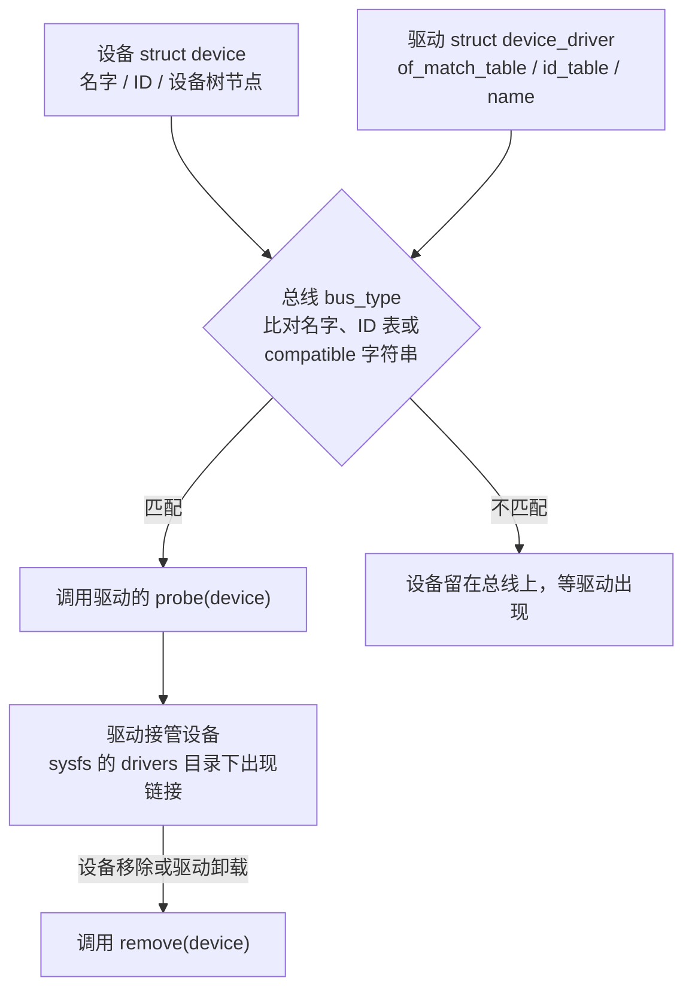

# 5.6 内核模块与驱动模型

在传统微控制器或单片机（MCU）上开发外设驱动时，驱动源码最终会与业务逻辑 `main` 函数一同链接为一个不可分割的单体固件二进制镜像，烧录进片上 Flash。这意味着在调试外设逻辑时，哪怕仅仅修改了一条寄存器位掩码，也必须经历重编译、整片重新烧写以及硬件复位重启的全套闭环。

Linux 内核则确立了完全不同的动态模块化体系：设备驱动在逻辑上隶属于内核空间，既可以选择静态编入单体内核镜像，也可以在源码树外部被独立编译为标准的可加载内核模块（Loadable Kernel Module, LKM，产物为 `.ko` 目标文件）。在嵌入式系统持续运行的状态下，开发人员可以通过 `insmod` 将驱动模块动态载入内存执行，亦可通过 `rmmod` 将其安全卸载。这种机制使得调试传感器或总线驱动时彻底摆脱了反复重启目标板的痛点。

本节将从一个自洽的基础内核模块起步，剖析内核特权态编程相对于用户空间应用程序的底层环境约束；随后系统性展开 Linux 统一设备驱动模型（Driver Model）的宏观骨架，理清总线（Bus）、设备（Device）与驱动（Driver）三者之间的动态匹配节拍，观察 sysfs 虚拟文件系统中呈现的设备拓扑树；最后结合现代内核推崇的设备资源管理（`devm`）机制，掌握如何书写出生命周期严密、无资源泄漏的模块初始化与卸载逻辑。后续的 5.7 字符设备、5.8 平台与总线驱动以及 5.9 中断并发控制，都将深深扎根于本节所构筑的模型地基之上。

## 1. 第一个模块

内核模块是一个没有标准 `main` 入口函数的独立 ELF 重定位目标文件。它的执行生命周期由两个核心钩子驱动：装载入内核时由动态加载器触发由 `module_init` 宏登记的初始化函数；当从内核卸载时，则触发由 `module_exit` 宏登记的注销函数。下述范例展示了一个具备运行时参数传递能力的最小化模块实现：

```c
#include <linux/init.h>
#include <linux/kernel.h>
#include <linux/module.h>

static char *who = "world";
module_param(who, charp, 0444);
MODULE_PARM_DESC(who, "打招呼的对象");

static int repeat = 1;
module_param(repeat, int, 0444);
MODULE_PARM_DESC(repeat, "打印次数");

static int __init hello_init(void)
{
	int i;

	for (i = 0; i < repeat; i++)
		pr_info("hello, %s\n", who);
	return 0;
}

static void __exit hello_exit(void)
{
	pr_info("goodbye, %s\n", who);
}

module_init(hello_init);
module_exit(hello_exit);

MODULE_LICENSE("GPL");
MODULE_AUTHOR("Mdr");
MODULE_DESCRIPTION("最小内核模块：带参数");
```

`__init` 宏作为函数修饰符，通知链接器将该函数放置在内核专用的初始化代码段中（如 `.init.text`）。当系统启动或模块初始化函数执行完毕后，内核内存管理系统将主动释放该段所占用的物理内存页面，将其归还给通用内存池；`__exit` 宏修饰卸载函数，若该模块未来被静态编入单体内核镜像中（非模块化模式），该函数因永远不可能被卸载调用，链接器会在构建期将其完全丢弃以节省 Flash 空间。`pr_info` 是内核特权级的标准化日志打印接口，其格式化字符串被灌入内核循环日志缓冲区，可通过用户态的 `dmesg` 工具或串口控制台回读。

`module_param` 宏负责将普通的 C 全局数据对象提升为可在装载时传入的模块参数，其第三个实参声明了该参数在 `/sys/module/<模块名>/parameters/` 虚拟目录下对应属性文件的访问权限，`0444` 代表仅允许用户读取。模块参数类型遵循内核专有的命名规则：例如 `charp` 对应字符指针，`int` 对应标准整型，若需接收数组则需配套使用 `module_param_array` 宏。

在内核源码树外部构建独立模块时，需要依托 Linux 强大的 Kbuild 构建系统。该目录下通常维护一个 `Kbuild` 规则文件，向构建系统明确声明当前模块由哪些目标对象构成：

```make
obj-m += hello.o
```

随附的普通 `Makefile` 则负责将编译上下文委托给内核源码树中的主构建系统：

```make
KDIR ?= /lib/modules/$(shell uname -r)/build
PWD := $(shell pwd)

all:
	$(MAKE) -C $(KDIR) M=$(PWD) modules

clean:
	$(MAKE) -C $(KDIR) M=$(PWD) clean
```

`KDIR` 必须指向一棵已经配置好并生成了必要头文件与符号表的内核源码树。在宿主机本机开发时，该路径通常软链接至 `/lib/modules/$(uname -r)/build`；而在嵌入式交叉编译场景中，则必须将其重定向至目标板运行内核的源码根目录，并显式指定目标架构（`ARCH=arm`）与交叉编译器前缀（`CROSS_COMPILE`）：

::: terminal title="bash - 交叉编译 hello 模块（输出类似）"

```text
$ make -C ~/linux-6.18 M=$PWD ARCH=arm CROSS_COMPILE=arm-buildroot-linux-gnueabihf- modules
make[1]: Entering directory '/home/mdr/linux-6.18'
  CC [M]  /home/mdr/hello/hello.o
  MODPOST /home/mdr/hello/Module.symvers
  CC [M]  /home/mdr/hello/hello.mod.o
  LD [M]  /home/mdr/hello/hello.ko
make[1]: Leaving directory '/home/mdr/linux-6.18'
```

:::

编译产物 `hello.ko` 就是可装载的模块。它依赖的内核符号、版本信息和参数说明都写在文件里，`modinfo` 能读出来：

::: terminal title="bash - modinfo（输出类似）"

```text
$ modinfo hello.ko
filename:       /home/mdr/hello/hello.ko
license:        GPL
author:         Mdr
description:    最小内核模块：带参数
parm:           who:打招呼的对象 (charp)
parm:           repeat:打印次数 (int)
depends:
name:           hello
vermagic:       6.18.0 SMP mod_unload modversions ARMv7 p2v8
```

:::

装载、查看、卸载的会话如下（输出类似，各内核版本的模块大小不同）：

::: terminal title="bash - insmod、lsmod 与 dmesg"

```text
$ sudo insmod hello.ko who=mdr repeat=2
$ dmesg | tail -3
[  812.441902] hello: loading out-of-tree module taints kernel.
[  812.443208] hello, mdr
[  812.443377] hello, mdr
$ lsmod | head -3
Module                  Size  Used by
hello                  12288  0
$ cat /sys/module/hello/parameters/who
mdr
$ cat /sys/module/hello/parameters/repeat
2
$ sudo rmmod hello
$ dmesg | tail -1
[  864.109774] goodbye, mdr
```

:::

装载时追加的 `who=mdr repeat=2` 就是模块参数，写法与内核命令行参数一致。参数值在 `/sys/module/hello/parameters/` 下各占一个文件，权限决定它能不能被改写。

`insmod` 只认文件路径，不处理依赖。`modprobe` 按模块名在 `/lib/modules/$(uname -r)/` 下查找，读 `modules.dep` 先把依赖装好，再装目标模块。开发阶段用 `insmod` 直接指定 `.ko` 最省事，产品里由 udev 或 mdev 按设备别名自动调用 `modprobe`。

## 2. 内核代码的规矩

内核模块和用户态程序用的是同一套 C 语法，但在一个没有 C 库、栈很小、随时可能被中断打断的环境里运行。写惯用户态代码的人最容易在这里出问题，下面这几条是必须换过来的习惯。

### 2.1 没有 C 库

内核不链接 glibc，用户态那些函数一个都不能用。内核自己提供了一套功能相近的接口，名字往往相同，实现和语义却不一样。

| 用户态 | 内核 | 说明 |
| --- | --- | --- |
| `printf` | `pr_info`、`pr_err`、`dev_info` | 输出进内核日志，不直接到终端 |
| `malloc`、`free` | `kmalloc`、`kfree`、`kzalloc` | 内存来自内核堆，大小受限于伙伴系统 |
| `memcpy`、`strlen`、`strcmp` | 同名函数 | 在 `linux/string.h` 里，不是标准库里的那份 |
| `snprintf` | `snprintf`、`scnprintf` | 同名，返回值语义与标准库一致 |
| `errno` | 函数的返回值 | 内核函数出错返回负的错误码，如 `-ENOMEM` |
| `open`、`read`、`write` | `file_operations` | 驱动注册回调，由内核在系统调用里调用，见 5.7 |
| `pthread_create` | `kthread_run` | 内核线程 |
| `sleep`、`usleep` | `msleep`、`udelay` | 睡眠时间与可用的上下文不同 |
| `fopen`、`fprintf` | 不用 | 内核里没有文件流，写文件要显式走 `kernel_write` |

内核里能用的头文件是 `linux/` 开头的那一套，路径在内核源码树的 `include/linux` 与 `include/uapi` 下，不在 `/usr/include`。写模块时不要 `#include <stdio.h>`，哪怕编译器碰巧找得到它。

### 2.2 栈很小

用户态线程的栈默认 8 MB，几千字节的局部数组随便放。内核态的栈是按 CPU 分配的，32 位 ARM 上一个任务的内核栈只有 8 KiB，而且中断处理也压在同一个栈上。在函数里放一个 4 KiB 的局部数组，再调用两层，栈就溢出了；栈溢出不会给出好错误，通常是一次莫名其妙的 oops。

大对象一律动态分配，或者做成静态的全局对象：

```c
static int mdr_parse_frame(const u8 *in, size_t len)
{
	struct mdr_frame *frame;
	int ret;

	frame = kmalloc(sizeof(*frame), GFP_KERNEL);
	if (!frame)
		return -ENOMEM;
	ret = mdr_parse_into(frame, in, len);
	kfree(frame);
	return ret;
}
```

帧结构体越大，越应该这样写。反过来，局部放几个 `int`、一个指针数组没有问题，内核代码并不要求所有对象都上堆。

### 2.3 错误码是负值

内核函数约定：出错返回负的错误码，成功返回 0 或非负的长度、编号。错误码就是 `errno` 的取值加上负号，`-ENOMEM`、`-EINVAL`、`-EIO`、`-EBUSY` 都可以直接返回，不需要再设什么全局对象。

返回指针的函数没法用返回 0 表示错误，内核的办法是把错误码塞进指针：`ERR_PTR(-EINVAL)` 造出一个非法地址，调用者用 `IS_ERR` 判断、用 `PTR_ERR` 取回错误码。

```c
struct clk *clk;
int ret;

clk = clk_get(&pdev->dev, NULL);
if (IS_ERR(clk))
	return PTR_ERR(clk);
```

不要写 `if (clk == NULL)` 来判断这类函数，它们失败时不返回 NULL；也不要对 `ERR_PTR` 的返回值解引用，那个地址永远不能访问。

### 2.4 用 goto 做链式清理

一个实际项目里的 `probe` 要申请好几样资源：内存、寄存器映射、时钟、中断。任何一步失败，前面申请到的都要还回去。每个失败分支各写一遍清理代码，改起来必然漏。内核里的通行写法是一条 `goto` 链，按申请的反序释放：

::: compare left-title="每个分支各写一遍" right-title="goto 链式清理"

```c
static int mdr_probe(struct platform_device *pdev)
{
	struct mdr_dev *d;
	struct resource *res;
	int ret;

	res = platform_get_resource(pdev, IORESOURCE_MEM, 0);
	d = kzalloc(sizeof(*d), GFP_KERNEL);
	if (!d)
		return -ENOMEM;
	d->base = ioremap(res->start, resource_size(res));
	if (!d->base)
		return -ENOMEM;          /* d 泄漏 */
	d->clk = clk_get(&pdev->dev, NULL);
	if (IS_ERR(d->clk))
		return PTR_ERR(d->clk);  /* d 与 base 都泄漏 */
	ret = mdr_hw_init(d);
	if (ret)
		return ret;              /* 三样都泄漏 */
	return 0;
}
```

---

```c
static int mdr_probe(struct platform_device *pdev)
{
	struct mdr_dev *d;
	struct resource *res;
	int ret;

	res = platform_get_resource(pdev, IORESOURCE_MEM, 0);
	d = kzalloc(sizeof(*d), GFP_KERNEL);
	if (!d)
		return -ENOMEM;
	d->base = ioremap(res->start, resource_size(res));
	if (!d->base) {
		ret = -ENOMEM;
		goto err_free;
	}
	d->clk = clk_get(&pdev->dev, NULL);
	if (IS_ERR(d->clk)) {
		ret = PTR_ERR(d->clk);
		goto err_unmap;
	}
	ret = mdr_hw_init(d);
	if (ret)
		goto err_clk;
	return 0;

err_clk:
	clk_put(d->clk);
err_unmap:
	iounmap(d->base);
err_free:
	kfree(d);
	return ret;
}
```

:::

右栏的标签按申请的反序排列，新加一步资源就在最前面加一个标签、在末尾加一段释放，失败分支本身只负责 `goto`。第 5 节的 `devm` 接口能把这整段清理代码也省掉，但读别人的驱动时，这种写法到处都是，必须认得。

### 2.5 哪些上下文可以睡眠

内核代码运行在几种上下文里：进程上下文、软中断上下文、硬中断上下文。只有在进程上下文里才能睡眠，也就是让出 CPU 等一件事完成。中断上下文里不能睡眠，持有自旋锁时也不能睡眠。

分配内存的 `kmalloc` 有一个参数说明能不能睡眠：`GFP_KERNEL` 允许睡眠，适合 `probe`、系统调用这类进程上下文；`GFP_ATOMIC` 不允许睡眠，用在中断处理里。用错的后果不会立刻显现，可能在某个负载下卡死，或者触发调度器警告。中断、锁与上下文的完整讨论在 5.9，这里只需要记住：`probe` 里可以放心用 `GFP_KERNEL`，中断处理函数里不行。

### 2.6 导出符号与许可证

一个模块可以把函数导出给别的模块用：

```c
EXPORT_SYMBOL_GPL(mdr_frame_parse);
```

`EXPORT_SYMBOL_GPL` 导出的符号只对声明了 GPL 兼容许可证的模块可见，普通 `EXPORT_SYMBOL` 则对所有模块可见。模块里 `MODULE_LICENSE("GPL")` 这一行还有实际作用：没有它，内核会拒绝让这个模块使用 GPL 专用的导出符号，装载时报 `Unknown symbol`，还会给内核打上污染 (taint) 标记。

许可证字符串必须是内核认识的写法，`"GPL"`、`"GPL v2"`、`"Dual BSD/GPL"` 都行，随便写一句 "free" 会被当作非 GPL。

### 2.7 内核编码风格

内核代码有自己的风格：Tab 缩进（Tab 宽 8 列）、左花括号不换行、函数名后的左括号前不加空格、行宽尽量不超过 80 列。本教程其余 C 代码按 README 的 LLVM 风格写，内核模块是唯一的例外，因为驱动迟早要给别人看、甚至提交上游，跟着内核风格写才改得动。

::: tip checkpatch.pl

内核源码树的 `scripts/checkpatch.pl` 检查补丁和源文件的风格问题：

```text
$ ./scripts/checkpatch.pl --no-tree -f hello.c
total: 0 errors, 0 warnings, 24 lines checked

hello.c has no style problems
```

它只查风格，不查逻辑。提交驱动前跑一遍，能省掉评审人的一轮意见。

:::

<Quiz
  type="multi"
  :options="[
    { label: '模块里可以调用 printf 打印调试信息', value: 'A' },
    { label: '从 kmalloc 返回的指针必须判空，失败时返回 -ENOMEM 给调用者', value: 'B' },
    { label: 'probe 里可以用 GFP_KERNEL 分配内存，因为它运行在进程上下文', value: 'C' },
    { label: '函数出错时应设置全局的 errno，再用 return -1 告诉调用者', value: 'D' }
  ]"
  :answer="['B', 'C']"
>

<template #question>

关于内核模块的编程约束，下列说法正确的是哪些？

</template>

正确答案是 **B、C**。A 错在内核不链接 C 库，打印用 `pr_info` 或 `dev_info`；D 错在内核没有全局 errno，出错返回负的错误码本身，例如 `-ENOMEM`。

</Quiz>

## 3. 设备模型

内核里同时存在几百种驱动和几千个设备，谁该管谁不能写死。Linux 的设备模型 (driver model) 用三个概念把这件事做成通用的匹配过程：总线 (bus)、设备 (device)、驱动 (driver)。

- 总线是一套匹配规则，比如 `platform`、`i2c`、`spi`、`usb`，与物理总线不一定对应。`platform` 总线就没有对应的物理线路，它代表“SoC 内部那些不能用别的总线枚举的外设”这个集合。
- 设备描述“有一个什么东西在这里”，包含它占的地址、中断号等信息。设备来自设备树、ACPI、USB 枚举，或者驱动自己注册。
- 驱动描述“我会驱动哪一类东西”，里面有一张匹配表。

设备和驱动都注册到同一条总线上，总线拿设备的标识去比对驱动的匹配表，匹配成功就调用驱动的 `probe` 函数，把设备交给它。设备消失或驱动卸载时调用 `remove`。



`platform` 总线的匹配表叫 `of_match_table`，里面是一串 `compatible` 字符串，和设备树节点的 `compatible` 属性比对。没有设备树的场合可以用设备名或一张 `id_table` 匹配。匹配成功后调用的 `probe` 是驱动真正开始工作的地方。

::: concept emb-kmod-probe-timing title="probe 的调用时机"

`probe` 由总线在设备和驱动完成匹配时调用，调用发生在进程上下文，可以睡眠，可以等待时钟稳定、可以读 I²C 寄存器。设备和驱动谁先注册都可以：先有设备，驱动注册时触发 `probe`；先有驱动，设备注册时触发 `probe`。同一个设备可以被解绑再绑定，`probe` 因此可能被调用不止一次，每次都要能独立完成初始化。

:::

`probe` 返回 0 表示接管成功，返回负的错误码表示放弃，总线会把这个设备留给别的驱动再试。`probe` 成功之后，驱动的 `remove` 与它成对：`remove` 要释放 `probe` 申请的一切，并让硬件回到安全状态，比如关掉输出、让芯片休眠。

在 `/sys` 里能看到这套关系。`/sys/devices` 是按物理拓扑组织的树，是设备对象真正待的地方；`/sys/bus/<总线>/devices` 和 `/sys/bus/<总线>/drivers/<驱动>` 里都是指向它的符号链接，按总线和驱动重新排了一遍；`/sys/class/<类>` 再按功能排一遍，比如所有网卡都在 `/sys/class/net` 下。同一个设备会在好几处出现，但只有一个实体。

除 sysfs 之外，内核在设备出现和消失时会发出 uevent，消息里带一个 `MODALIAS`，值是由设备标识拼出来的字符串。用户空间的 udev 或 mdev 收到 uevent 后做两件事：在 `/dev` 下创建设备节点，以及按这个别名调用 `modprobe`。模块里的 `MODULE_DEVICE_TABLE(of, mdr_demo_of_match)` 就是告诉构建系统把匹配表写进 `modules.alias`，这样插上一个设备，对应的驱动模块会被自动装载。

<Quiz
  type="single"
  :options="[
    { label: '设备注册时，因为驱动已经先注册好了', value: 'A' },
    { label: '驱动注册时，因为匹配在设备和驱动都就位的一刻发生', value: 'B' },
    { label: '只有用户手动写 sysfs 的 bind 文件时才会调用', value: 'C' },
    { label: '内核启动完成、initcall 执行完之后统一调用一次', value: 'D' }
  ]"
  answer="B"
>

<template #question>

一个 `platform` 设备先注册、`platform` 驱动后注册，`probe` 在什么时候被调用？

</template>

正确答案是 **B**。设备已经等在总线上，驱动注册进来时总线立刻比对并调用 `probe`；两者顺序反过来也一样，谁后到就由谁触发匹配。C 是手动重绑定的调试手段，`probe` 在设备与驱动匹配的那一刻就会调用。

</Quiz>

和 RT-Thread 的设备框架对照：RT-Thread 里设备注册进一个全局对象容器，应用用 `rt_device_find` 按名字找设备，再 `open`、`read`，没有“总线匹配”这一步，驱动在注册时自己就完成了初始化。Linux 把“找到设备”和“驱动设备”拆成两个对象，匹配由总线统一做，这是它能同时支持热插拔和几千种板子的原因。和内核自身的初始化对照：驱动编进内核时，`module_init` 会被展开成 initcall，链接时按段顺序排在 `.initcall` 系列段里，内核启动时统一按级别调用；编成模块时，同一个函数改成在 `insmod` 时调用。

## 4. 用一个模块看见绑定

光看概念不算懂。下面这个模块在装载时自己注册一个 `platform` 设备，同时注册一个 `platform` 驱动，让匹配过程在眼前发生一次。

```c
#include <linux/init.h>
#include <linux/module.h>
#include <linux/platform_device.h>

#define MDR_DEMO_NAME "mdr_demo"
#define MDR_DEMO_ID   0

struct mdr_demo {
	int id;
};

static int mdr_demo_probe(struct platform_device *pdev)
{
	struct mdr_demo *d;

	d = devm_kzalloc(&pdev->dev, sizeof(*d), GFP_KERNEL);
	if (!d)
		return -ENOMEM;
	d->id = pdev->id;
	platform_set_drvdata(pdev, d);

	dev_info(&pdev->dev, "probe: id = %d\n", d->id);
	return 0;
}

static void mdr_demo_remove(struct platform_device *pdev)
{
	struct mdr_demo *d = platform_get_drvdata(pdev);

	dev_info(&pdev->dev, "remove: id = %d\n", d->id);
}

static const struct of_device_id mdr_demo_of_match[] = {
	{ .compatible = "mdr,demo" },
	{ }
};
MODULE_DEVICE_TABLE(of, mdr_demo_of_match);

static struct platform_driver mdr_demo_driver = {
	.probe = mdr_demo_probe,
	.remove = mdr_demo_remove,
	.driver = {
		.name = MDR_DEMO_NAME,
		.of_match_table = mdr_demo_of_match,
	},
};

static struct platform_device *mdr_demo_pdev;

static int __init mdr_demo_init(void)
{
	int ret;

	mdr_demo_pdev = platform_device_register_simple(MDR_DEMO_NAME, MDR_DEMO_ID,
							NULL, 0);
	if (IS_ERR(mdr_demo_pdev))
		return PTR_ERR(mdr_demo_pdev);

	ret = platform_driver_register(&mdr_demo_driver);
	if (ret) {
		platform_device_unregister(mdr_demo_pdev);
		return ret;
	}
	return 0;
}

static void __exit mdr_demo_exit(void)
{
	platform_driver_unregister(&mdr_demo_driver);
	platform_device_unregister(mdr_demo_pdev);
}

module_init(mdr_demo_init);
module_exit(mdr_demo_exit);

MODULE_LICENSE("GPL");
MODULE_DESCRIPTION("platform 设备与驱动的匹配演示");
```

`platform_device_register_simple` 造一个没有任何资源的平台设备，名字和 id 就是它的标识，设备在 sysfs 里叫 `名字.id`。驱动这边的匹配根据有两处：`driver.name` 与设备名相同，或者 `of_match_table` 里的 `compatible` 与设备树节点相同。演示里没有设备树节点，靠名字匹配，所以两边的名字都写成 `mdr_demo`。

装载后 `probe` 立即被调用，因为设备先注册、驱动后注册，驱动一出现总线就去比对已有的设备。卸载时 `remove` 先执行，再注销设备。

::: terminal title="bash - mdr_demo 的装载与卸载（输出类似）"

```text
$ sudo insmod mdr_demo.ko
$ dmesg | tail -1
[ 1204.338112] mdr_demo mdr_demo.0: probe: id = 0
$ ls /sys/bus/platform/devices/ | grep mdr
mdr_demo.0
$ ls /sys/bus/platform/drivers/mdr_demo/
bind  mdr_demo.0  module  uevent  unbind
$ ls -l /sys/bus/platform/drivers/mdr_demo/mdr_demo.0
lrwxrwxrwx 1 root root 0 Sep 12 10:22 mdr_demo.0 -> ../../../devices/platform/mdr_demo.0
```

:::

`/sys/bus/platform/devices/mdr_demo.0` 是设备，`/sys/bus/platform/drivers/mdr_demo/` 是驱动，驱动目录里出现一个指向设备的链接，就表示这两个绑定了。链接的目标 `../../../devices/platform/mdr_demo.0` 说明设备的实体挂在 `/sys/devices/platform/` 下。

`bind` 和 `unbind` 两个文件可以手动拆开和恢复这层绑定，调试驱动的 `remove` 路径时很方便：

::: terminal title="bash - 手动 unbind 与 bind（输出类似）"

```text
$ echo mdr_demo.0 | sudo tee /sys/bus/platform/drivers/mdr_demo/unbind
mdr_demo.0
$ dmesg | tail -1
[ 1350.774905] mdr_demo mdr_demo.0: remove: id = 0
$ ls /sys/bus/platform/drivers/mdr_demo/
bind  module  uevent  unbind
$ echo mdr_demo.0 | sudo tee /sys/bus/platform/drivers/mdr_demo/bind
mdr_demo.0
$ dmesg | tail -1
[ 1372.018441] mdr_demo mdr_demo.0: probe: id = 0
```

:::

解绑之后驱动目录里的链接消失，设备还在 `/sys/bus/platform/devices/` 下等着，重新 bind 会再走一遍 `probe`。这正好印证了第 3 节那条：`probe` 可能被调用多次，每次都要能从干净状态开始。

真实平台上没有人手写 `platform_device_register_simple`。设备由设备树节点生成，内核启动时把每个 `status = "okay"` 的节点变成一个 `platform_device`，驱动只提供 `of_match_table`，等着被匹配。5.8 会拿 QEMU 的第二个串口把这个流程走完。

## 5. devm 资源管理

上一节的 `probe` 用到了 `devm_kzalloc`。`devm` 是 device-managed 的缩写，这类接口申请的资源挂在设备对象上，设备解绑或 `probe` 失败时由驱动核心统一释放，驱动不用写 `goto` 链。

以内存为例，两种写法的差别只在几个字母：

::: compare left-title="手动管理" right-title="devm 管理"

```c
static int mdr_probe(struct platform_device *pdev)
{
	struct mdr_dev *d;

	d = kzalloc(sizeof(*d), GFP_KERNEL);
	if (!d)
		return -ENOMEM;
	d->clk = clk_get(&pdev->dev, NULL);
	if (IS_ERR(d->clk)) {
		kfree(d);
		return PTR_ERR(d->clk);
	}
	platform_set_drvdata(pdev, d);
	dev_info(&pdev->dev, "ready\n");
	return 0;
}

static void mdr_remove(struct platform_device *pdev)
{
	struct mdr_dev *d = platform_get_drvdata(pdev);

	clk_put(d->clk);
	kfree(d);
}
```

---

```c
static int mdr_probe(struct platform_device *pdev)
{
	struct mdr_dev *d;

	d = devm_kzalloc(&pdev->dev, sizeof(*d), GFP_KERNEL);
	if (!d)
		return -ENOMEM;
	d->clk = devm_clk_get(&pdev->dev, NULL);
	if (IS_ERR(d->clk))
		return PTR_ERR(d->clk);
	platform_set_drvdata(pdev, d);
	dev_info(&pdev->dev, "ready\n");
	return 0;
}

static void mdr_remove(struct platform_device *pdev)
{
	/* 内存与时钟由 devm 释放，这里什么都不用做 */
}
```

:::

右栏连 `remove` 都空了。每加一个 `devm_` 资源，就少一段释放代码，也少一个忘记释放的机会。`devm` 覆盖的资源很多：`devm_kzalloc`、`devm_ioremap_resource`、`devm_clk_get`、`devm_request_irq`、`devm_regulator_get`、`devm_gpiod_get`，名字里带 `devm_` 的都可以查一查。

释放顺序是申请顺序的反序，和手写 `goto` 链一致，所以两种写法可以混用，只要自己的资源释放放在 `remove` 里、并且不去碰 devm 已经释放过的对象。

::: concept emb-kmod-devm-lifetime title="devm 资源的释放时机"

用 `devm_` 申请的资源在三种情况下自动释放：`probe` 返回错误、设备与驱动解绑（驱动的 `remove` 返回之后统一释放）、设备被销毁。释放顺序与申请顺序相反。因此 `devm` 资源只能跟着设备走，不能用于全模块共享、要在模块卸载时才释放的对象，这类对象仍要用 `kzalloc` 加 `module_exit` 里的 `kfree`。

:::

新驱动尽量用 `devm`，这是内核社区的共识，也是现在驱动代码的常态。只有 `devm` 管不到的事情才写进 `remove`，比如向芯片写一条关机命令、注销自己创建的字符设备。近些年的内核里，`platform_driver` 的 `remove` 返回值从 `int` 改成了 `void`（6.11 起，截至 2026 年 10 月的 6.18 仍然如此），因为清理失败也没有补救的余地。读老驱动时会看到返回 `int` 的写法，知道那是旧接口即可。

## 6. 模块与内核版本

模块装载进一个已经运行的内核，必须与那个内核的接口完全对得上。内核在模块里写了一个叫 vermagic 的字符串，装载时逐字比对，`modinfo` 的输出里已经见过它：

```text
vermagic:       6.18.0 SMP mod_unload modversions ARMv7 p2v8
```

这个串包含内核版本、体系结构、是否启用模块卸载、是否启用符号版本等配置。任何一项不一致，`insmod` 都会拒绝：

::: terminal title="bash - 版本不匹配"

```text
$ sudo insmod hello.ko
insmod: ERROR: could not insert module hello.ko: Invalid module format
$ dmesg | tail -1
[ 1590.114220] hello: version magic '5.15.0 SMP mod_unload ARMv7 p2v8' should be '6.18.0 SMP mod_unload ARMv7 p2v8'
```

:::

`Invalid module format` 有两个常见来源：模块编译时用的内核树和目标板运行的内核不是同一个版本（或者 SMP、抢占等选项不同），以及体系结构不同——在 x86 主机上编的模块拷到 ARM 板子上。两种情况都会在 vermagic 里体现出来：`modinfo` 看模块的这一行，`uname -r` 与 `/proc/config.gz` 看目标内核，一对就知道是哪种。

::: warning 模块必须对准目标内核编译

在主机上给 x86 编的模块，拷到 ARM 板子上一定装不进去，体系结构不同。交叉编译时 `ARCH` 与 `CROSS_COMPILE` 要与目标内核构建时一致，`KDIR` 指向目标内核的源码树，而且这棵树要先跑过 `make modules_prepare`，准备好头文件与构建脚本。只做 `modules_prepare` 不会生成 `Module.symvers`，构建外部模块时会警告拿不到符号版本；需要符号版本校验时，先完整编译一次内核。

:::

内核源码树里的 `Module.symvers` 记录了每个导出符号的校验值。外部模块构建时会读它，把用到的符号版本写进 `.ko`，装载时再由内核比对。这棵树的配置必须与目标板运行的内核一致，否则编出来的模块即使 vermagic 相同，也会在装载时因为 `disagrees about version of symbol` 被拒。

Buildroot 里不必手工做这些。内核模块可以写成一个软件包，`generic-package` 的构建规则里调用内核的 `modules` 目标，产物自动装进根文件系统的 `/lib/modules/$(uname -r)/extra/`。Buildroot 的软件包机制在 [5.4](/教程/正文/嵌入式/5_嵌入式Linux/5_4_Buildroot与Yocto) 讲过，`linux/linux.mk` 里的 `LINUX_MODULE_MAKE_OPTS` 里已经设好 `ARCH`、`CROSS_COMPILE` 等参数，写包时直接引用即可。

## 7. 习题

### 7.1 巩固

<Exercise id="65554" :d="1" :w="2">

从第 1 节的 `hello` 模块出发，把模块参数用一遍。

(1) 增加一个 `uint` 类型、权限 `0644` 的参数 `loud`，默认 0；`loud` 非 0 时在 init 里多打印一行 `loud mode`。编译装载，用 `modinfo hello.ko` 确认新参数在 `parm:` 行里的类型写法。

(2) 装载后执行 `echo 1 > /sys/module/hello/parameters/loud`，`rmmod` 后重新 `insmod`，这次不带 `loud` 参数。两次读回 `/sys/module/hello/parameters/loud`，说明运行中改写与下一次装载的初值为什么不同。

(3) 把权限改成 `0444` 重新编译装载，再 `echo` 一次，记录 shell 的报错，并说明 `0444` 对应的是哪一种访问。

(4) 用 `insmod hello.ko who=` 给一个空字符串，观察 `dmesg` 里打印出什么。`charp` 类型的参数接受空串吗？

</Exercise>

<Exercise id="65555" :d="2" :w="3">

下面是 `mdr_probe` 的骨架，资源申请顺序是内存、寄存器映射、时钟、中断。补全失败分支与清理标签，使它满足内核的 goto 链写法。

```c
static int mdr_probe(struct platform_device *pdev)
{
	struct resource *res;
	struct mdr_dev *d;
	int ret;

	d = kzalloc(sizeof(*d), GFP_KERNEL);
	if (!d)
		return -ENOMEM;

	res = platform_get_resource(pdev, IORESOURCE_MEM, 0);
	d->base = ioremap(res->start, resource_size(res));
	/* TODO: 失败时释放 d */

	d->clk = clk_get(&pdev->dev, NULL);
	/* TODO: 失败时释放 base 与 d */

	d->irq = platform_get_irq(pdev, 0);
	/* TODO: 失败时释放 clk、base 与 d */

	ret = request_irq(d->irq, mdr_irq, 0, "mdr", d);
	/* TODO: 失败时释放前三样 */

	return 0;
}
```

(1) 写出完整的函数，标签按申请的反序排列。

(2) 用列表写出每个标签释放哪些资源，并说明标签为什么不能按申请的同一顺序排列。

(3) 在 `clk_get` 与取中断号之间新增一步 `d->reset = reset_control_get(&pdev->dev, NULL)`。列出要改动的三处，验证「新增一步只加一个标签、一段释放」这个说法。

(4) 如果把 `res` 取回后不判空，`ioremap` 会在什么时候出问题？`platform_get_resource` 失败时返回什么？

</Exercise>

<Exercise id="65556" :d="3" :w="3">

下面这个模块有六处不符合第 2 节的规矩，编译能过，装载后却会出问题或者根本装不进去。

```c
#include <linux/module.h>
#include <stdio.h>

static int mdr_init(void)
{
	char frame[8192];
	struct clk *clk;
	int ret;

	sprintf(frame, "hello from %s\n", "mdr");
	printf("%s", frame);

	ret = mdr_hw_probe();
	if (ret < 0) {
		errno = -ret;
		return -1;
	}

	clk = clk_get(NULL, "uart");
	if (clk == NULL)
		return -ENODEV;

	return 0;
}
```

(1) 逐处指出问题，写出每一处对应的正确写法。

(2) 改写成能编译的模块骨架：补上 `module_exit`、`module_init` 与 `MODULE_LICENSE`，把 `mdr_hw_probe` 换成一个自己写的、总是返回 `-EIO` 的空函数。

(3) `frame` 为什么不能放在栈上？按第 2.2 节给的两种替代写法各写一遍，并说明本例更适合哪一种。

(4) 第 (2) 步的模块装载后 `probe` 一定失败，`insmod` 的返回码与 `dmesg` 里各能看到什么？

</Exercise>

<Exercise id="65557" :d="3" :w="3">

把第 4 节的 `mdr_demo` 扩成两个设备一个驱动，观察匹配过程与绑定关系。

(1) 在 init 里注册 id 为 0 和 1 的两个 `platform_device`，驱动不变。先写下你预期的 `dmesg` 顺序，装载后对照。两个 `probe` 的先后由什么决定？

(2) 列出 `/sys/bus/platform/drivers/mdr_demo/` 的内容，用 `ls -l` 确认两个链接指向哪里；`/sys/bus/platform/devices/` 下两个设备的名字各是什么？

(3) 对 `mdr_demo.1` 做一次 `unbind` 再 `bind`，记录 `dmesg`。`remove` 之后 `platform_get_drvdata` 返回的对象还在不在？`devm_kzalloc` 分配的那份内存是什么时候释放的？

(4) 把 `mdr_demo_exit` 里两行注销的顺序对调，再卸载一次，比较 `dmesg`。两种顺序都能走完 `remove`，说明原因。

</Exercise>

### 7.2 编程

<Exercise id="65558" :d="4" :w="3">

一个 `probe` 同时用了 devm 接口和手动申请的资源：

```c
struct mdr_dev {
	void __iomem *base;
	struct clk *clk;
	struct mdr_stats *stats;	/* 模块级统计，所有实例共享 */
	int irq;
};

static int mdr_probe(struct platform_device *pdev)
{
	struct mdr_dev *d = devm_kzalloc(&pdev->dev, sizeof(*d), GFP_KERNEL);

	if (!d)
		return -ENOMEM;
	d->base = devm_platform_ioremap_resource(pdev, 0);
	if (IS_ERR(d->base))
		return PTR_ERR(d->base);
	d->clk = devm_clk_get(&pdev->dev, NULL);
	if (IS_ERR(d->clk))
		return PTR_ERR(d->clk);
	d->irq = platform_get_irq(pdev, 0);
	if (d->irq < 0)
		return d->irq;
	if (request_irq(d->irq, mdr_irq, 0, "mdr", d))
		return -EBUSY;
	d->stats = kzalloc(sizeof(*d->stats), GFP_KERNEL);
	if (!d->stats) {
		free_irq(d->irq, d);
		return -ENOMEM;
	}
	return 0;
}
```

(1) 写出配套的 `remove`：哪些资源要手动释放，哪些不能碰，顺序是什么？

(2) `stats` 是模块级共享对象，为什么不能用 `devm_kzalloc` 分配？如果用了，第一个设备解绑之后会发生什么？

(3) 把 `stats` 改成每实例一份，`probe` 与 `remove` 各要改哪几行？

(4) `request_irq` 失败时返回的错误码被换成了 `-EBUSY`，这样做的代价是什么？改成原样返回要怎么写？

(5) 编译时若把 `remove` 写成返回 `int`，在 6.18 上会得到什么诊断？读老驱动时看到这种写法该怎么理解？

</Exercise>

<Exercise id="65559" :d="4" :w="3">

用两个模块验证导出符号与许可证的关系。

(1) 写 `mdr_parse` 模块，导出一个 `int mdr_checksum(const u8 *p, size_t n)`，用 `EXPORT_SYMBOL_GPL`。再写 `mdr_user` 模块，在 init 里调用它。两个模块分别 `insmod`，记录装载顺序与 `lsmod` 的 `Used by` 列。

(2) 把 `mdr_user` 的 `MODULE_LICENSE` 换成 `"Proprietary"`，重新编译装载，记录 `dmesg` 里的 `Unknown symbol`，并读 `cat /proc/sys/kernel/tainted` 的值。

(3) 换回 GPL，先 `depmod -a` 再 `modprobe mdr_user`。说明 `modules.dep` 里为什么会出现依赖关系，以及 `insmod mdr_user.ko` 为什么不会自动先装 `mdr_parse`。

(4) 把导出宏换成 `EXPORT_SYMBOL`，(2) 的结果会怎样变化？写出原因。

(5) 用一个既没有 `MODULE_LICENSE` 也没有导出符号的模块验证：不声明许可证但只使用普通内核接口的模块，会不会照样给内核打上污染标记？

</Exercise>

<Exercise id="65560" :d="5" :w="4">

三种 `insmod` 失败各对应一类原因，判断并给出下一步。

- 场景 A：模块在 x86 主机上编译，拷到 ARM 板子上装载，报 `Invalid module format`，`dmesg` 里 vermagic 的两段只差体系结构一项。
- 场景 B：模块与目标板内核版本相同，`modinfo` 的 vermagic 一字不差，装载却报 `disagrees about version of symbol`。
- 场景 C：交叉编译时 `KDIR` 指向的树只跑过 `make modules_prepare`，构建日志里有拿不到符号版本的警告，装到板子上被拒。

(1) 为三种情况各写出你会执行的三条命令，以及每条命令里要看的那一行。

(2) 各写一句结论：问题在模块、在内核树，还是在目标板的内核配置。

(3) 写一个检查脚本 `check-module.sh <目标内核版本> <模块.ko>`，用 `modinfo -F vermagic` 取出模块的 vermagic，把版本段与体系结构段分别与参数、`uname -m` 比对，不一致时打印是哪一段不同并退出 1，全对时退出 0。用两个自己编的模块（一个对准、一个改过 `ARCH`）验证两种输出。

(4) 说明 `Module.symvers` 为什么必须来自与目标板内核相同的配置，而不是同一版本号的任意一次构建。

</Exercise>

### 7.3 综合与挑战

<Exercise id="65561" :d="6" :w="5" scope="*">

写一个 `mdr_leds` 模块，把这一页的模块参数、platform 匹配、devm 与 sysfs 串成一个能反复装卸的驱动。

要求：

1. 模块参数 `count`，取值 1～4，默认 2。init 里用 `platform_device_register_simple` 注册 `count` 个名为 `mdr_led` 的设备，id 从 0 到 `count - 1`；参数越界时 init 返回 `-EINVAL`。
2. 一个 `platform_driver`，名字 `mdr_led`。`probe` 用 `devm_kzalloc` 分配每实例状态，并把属性组挂在 `driver.dev_groups` 上，属性名 `brightness`，可读写，只接受 0 和 1，其他输入返回 `-EINVAL`。
3. `remove` 里打印 `id` 与当前 `brightness`，不手动释放 devm 资源。
4. 验收：

```text
insmod mdr_leds.ko count=3
ls /sys/bus/platform/devices/ | grep mdr_led
mdr_led.0
mdr_led.1
mdr_led.2
cat /sys/bus/platform/devices/mdr_led.2/brightness
0
echo 1 > /sys/bus/platform/devices/mdr_led.2/brightness
cat /sys/bus/platform/devices/mdr_led.2/brightness
1
echo 2 > /sys/bus/platform/devices/mdr_led.2/brightness
-bash: echo: write error: Invalid argument
```

5. 对三个设备各做 10 次 `unbind` 与 `bind`，`dmesg` 里 `probe` 与 `remove` 的次数应当相等，且没有 `WARNING` 或 `BUG`。
6. 卸载模块，确认 `/sys/bus/platform/devices/` 下三个设备全部消失，`/sys/bus/platform/drivers/mdr_led/` 也消失。

提示：属性组用 `ATTRIBUTE_GROUPS` 生成后填进 `platform_driver.driver.dev_groups`，驱动核心会在匹配时自动创建。写完用第 2.7 节的 `checkpatch.pl` 检查一遍。

</Exercise>

## 8. 参考资料

- Building External Modules：https://docs.kernel.org/kbuild/modules.html
- Driver Model：https://docs.kernel.org/driver-api/driver-model/index.html
- Devres - Managed Device Resource：https://docs.kernel.org/driver-api/driver-model/devres.html
- Linux kernel coding style：https://docs.kernel.org/process/coding-style.html
- Bootlin, Linux kernel and driver development 培训幻灯片：https://bootlin.com/doc/training/linux-kernel/linux-kernel-slides.pdf
- Linux Device Drivers, 3rd ed.（第 1～2 章，接口已有变化，只作概念参考）：https://lwn.net/Kernel/LDD3/
- Elixir Cross Referencer, Linux v6.18（include/linux/platform_device.h、include/linux/module.h、include/linux/device.h）：https://elixir.bootlin.com/linux/v6.18/source
