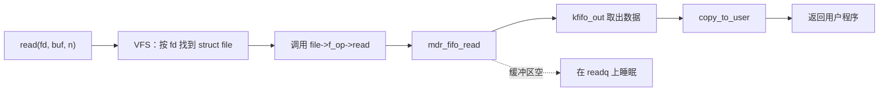
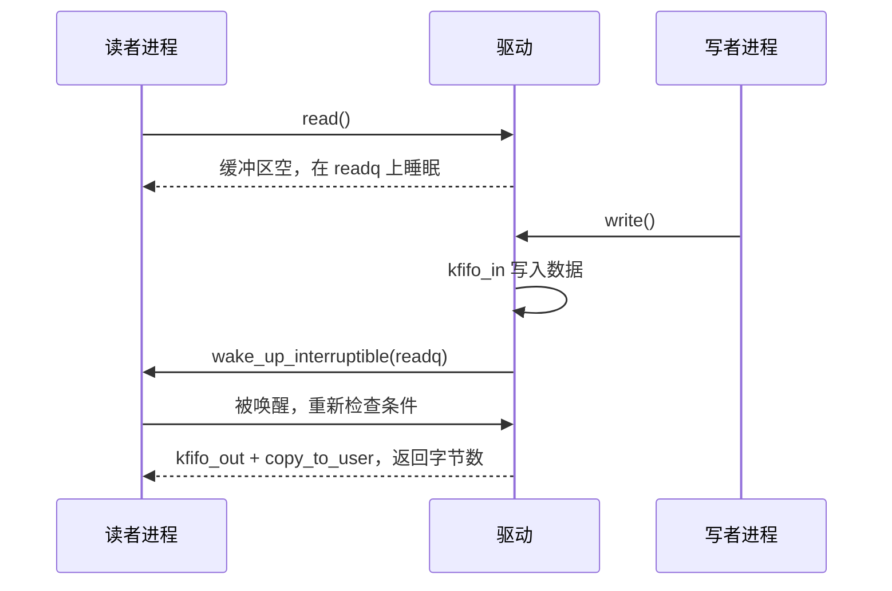

# 5.7 字符设备与用户空间接口

用户程序 `open("/dev/mdr_fifo")` 之后得到的文件描述符，`read` 和 `write` 都作用在这个描述符上，可数据实际存在内核里的一块缓冲区中。把这块缓冲区接到系统调用上的，是驱动注册的一组回调函数：`read` 进入内核后落到驱动的 `.read`，`write` 落到 `.write`，`poll` 落到 `.poll`。这一页把这组回调写全，做出一个能在用户空间收发的设备。

具体地说，读完这一页，读者能分配设备号并让 `/dev` 节点自动出现，能正确地在用户空间与内核之间搬运数据，能用等待队列把空缓冲区上的读者挂起、由写者唤醒，能设计 ioctl 命令号和 sysfs 属性，能判断一个设备到底该用现成子系统还是自己写字符设备，也能写出配套的用户态测试程序。示例设备 `mdr_fifo` 是一个纯软件的先进先出缓冲区，不碰任何硬件，QEMU 和开发板上都能加载。

## 1. 字符设备与设备号

Linux 把设备分成字符设备 (character device)、块设备和网络设备三类。字符设备按字节流访问，读写不经过页缓存，`/dev` 下绝大多数节点都是它：串口、按键、传感器、GPIO。块设备按块访问，有页缓存和文件系统；网络设备走套接字，不经过 `/dev`。这一页只讲字符设备。

每个设备节点对应一对设备号：主设备号 (major number) 标识用哪个驱动，次设备号 (minor number) 标识这个驱动下的第几个设备。一个驱动管四个串口，就是同一个主设备号配四个次设备号。

设备号由内核分配。老的写法是让驱动自己挑一个没被占用的主设备号，现在一律用 `alloc_chrdev_region` 让内核动态分配：

```c
#include <linux/cdev.h>
#include <linux/fs.h>

static dev_t mdr_fifo_devno;
static struct cdev mdr_fifo_cdev;

static int mdr_fifo_register(void)
{
	int ret;

	ret = alloc_chrdev_region(&mdr_fifo_devno, 0, 1, "mdr_fifo");
	if (ret)
		return ret;

	cdev_init(&mdr_fifo_cdev, &mdr_fifo_fops);
	mdr_fifo_cdev.owner = THIS_MODULE;
	ret = cdev_add(&mdr_fifo_cdev, mdr_fifo_devno, 1);
	if (ret) {
		unregister_chrdev_region(mdr_fifo_devno, 1);
		return ret;
	}
	return 0;
}
```

`alloc_chrdev_region` 只是占住号段，`cdev_add` 才把设备号和 `file_operations` 关联起来。到这一步，内核已经能处理 `mknod` 出来的节点，但 `/dev` 下还什么都没有。

节点由用户空间创建。现代系统里 `/dev` 是一个 devtmpfs，内核在设备注册时会在里面建好节点，前提是驱动通过 `class_create` 和 `device_create` 把自己登记成一个类下的设备：

```c
static struct class *mdr_fifo_class;

mdr_fifo_class = class_create("mdr_fifo");
if (IS_ERR(mdr_fifo_class))
	return PTR_ERR(mdr_fifo_class);

if (IS_ERR(device_create(mdr_fifo_class, NULL, mdr_fifo_devno, NULL, "mdr_fifo"))) {
	class_destroy(mdr_fifo_class);
	return -ENODEV;
}
```

`class_create` 从 6.4 起只有一个参数，不再需要 `THIS_MODULE`。`device_create` 在 `/sys/class/mdr_fifo/` 下建一个设备条目，同时发出 uevent，udev 或 mdev 收到后按条目里的设备号创建 `/dev/mdr_fifo`；devtmpfs 则会直接把节点建好。两种机制的效果一样，节点都会在设备出现时自动出现，在设备消失时自动删掉，不需要用户手工 `mknod`。

::: terminal title="bash - 设备节点（输出类似）"

```text
$ ls -l /dev/mdr_fifo
crw------- 1 root root 240, 0 Sep 12 10:31 /dev/mdr_fifo
$ cat /sys/class/mdr_fifo/mdr_fifo/dev
240:0
```

:::

开头的 `c` 表示字符设备，`240, 0` 是主、次设备号，与 `/sys` 里登记的一致。动态分配的主设备号每次启动都可能不同，所以任何代码都不要假设它是某个固定值；需要设备号的地方从 `/sys` 或 `stat` 读。

## 2. file_operations

`struct file_operations` 是一张函数指针表，每个成员对应一个系统调用或一种文件操作。用户进程调用 `read(3)` 时，虚拟文件系统 (Virtual File System, VFS) 从描述符找到打开文件，从打开文件找到 `file_operations`，调用里面的 `.read`。

| 系统调用或操作 | `file_operations` 成员 | 何时调用 |
| --- | --- | --- |
| `open` | `.open` | 每次打开设备节点 |
| `close` | `.release` | 最后一个描述符关闭时 |
| `read` | `.read` | 每次读 |
| `write` | `.write` | 每次写 |
| `ioctl` | `.unlocked_ioctl` | 设备控制命令 |
| `poll`、`select`、`epoll` | `.poll` | 查询设备是否可读可写 |
| `mmap` | `.mmap` | 把设备内存映射进进程地址空间 |
| `lseek` | `.llseek` | 调整文件偏移 |

打开文件时，VFS 造一个 `struct file` 表示这一次打开。它有一个 `void *private_data` 成员，专给驱动用，驱动可以把设备自己的结构挂在上面，后续的 `read`、`write`、`ioctl` 都从 `file->private_data` 取回来，不必用全局对象去找。

一次打开对应一个 `struct file`，同一个设备被两个进程打开就是两个 `file`，各有各的 `private_data`。设备本身的状态（缓冲区、锁、等待队列）应该放在驱动自己的结构里，由所有打开共享；`private_data` 指向它即可。

`mdr_fifo` 只有一个实例，后面各节的回调直接用全局对象，不经过 `private_data`，`.open` 与 `.release` 什么都不用做：

```c
static int mdr_fifo_open(struct inode *inode, struct file *file)
{
	return 0;
}

static int mdr_fifo_release(struct inode *inode, struct file *file)
{
	return 0;
}
```

一个驱动管多个同类设备时（比如四个串口），才需要把每个设备的结构挂在 `private_data` 上，靠它区分这一次打开的是哪一个。

字符设备默认不可定位，`read` 和 `write` 不需要维护文件偏移，`*ppos` 参数可以不管。用户程序对这类设备调用 `lseek` 会得到 `ESPIPE`。

关于 `read` 的返回值，规则与普通文件一致：返回实际读到的字节数，没有数据可读且是非阻塞模式时返回 `-EAGAIN`，被信号打断返回 `-ERESTARTSYS` 由内核转成 `EINTR`。`write` 返回实际写入的字节数，小于请求的字节数是允许的，用户程序要自己循环补齐；这一点在 [2. 文件描述符与非缓冲 I/O](/教程/正文/系统编程/2_文件描述符与非缓冲IO) 里已经讲过，驱动这边只是把它实现出来。

## 3. 数据复制

内核不能直接解引用用户传进来的指针。原因有两层：用户地址在当前进程的地址空间里才有意义，换一个进程或换一个上下文就指向别处；用户指针可能根本无效，直接读会触发内核缺页，而内核缺页的后果比用户态严重得多。所以内核提供了一对函数专门搬运数据：

```c
unsigned long copy_to_user(void __user *to, const void *from, unsigned long n);
unsigned long copy_from_user(void *to, const void __user *from, unsigned long n);
```

::: concept emb-char-copy-user-return title="copy_*_user 的返回值"

`copy_to_user` 与 `copy_from_user` 返回**没有复制成功的字节数**，全部成功时返回 0。判断成败要写 `if (copy_to_user(...))` 或 `if (ret != 0)`，不能把返回值当成功复制的字节数用。它们在复制期间可能睡眠，只能用在允许睡眠的上下文。

:::

`__user` 这个标注没有运行时作用，它是给编译器和静态检查工具看的，提醒这个指针来自用户空间，不能直接解引用。驱动里凡是带 `__user` 的指针，都必须经过 `copy_*_user` 或 `get_user`、`put_user`。

::: compare left-title="直接解引用用户指针" right-title="经 copy_to_user 复制"

```c
static ssize_t bad_read(struct file *file, char __user *ubuf,
			size_t count, loff_t *ppos)
{
	/* 用户地址在内核里没有保证，可能指向别的进程或无效页 */
	memcpy(ubuf, "hello", 5);
	return 5;
}
```

---

```c
static ssize_t good_read(struct file *file, char __user *ubuf,
			 size_t count, loff_t *ppos)
{
	static const char msg[] = "hello";
	size_t n = min(count, sizeof msg - 1);

	if (copy_to_user(ubuf, msg, n))
		return -EFAULT;
	return n;
}
```

:::

左栏在 x86 上可能碰巧能跑，换了架构或开了页保护就崩，而且崩的是整个内核。右栏的写法在任何架构上都正确。

`mdr_fifo` 的缓冲区用内核的 `kfifo`。它是一个无锁的单生产者单消费者环形缓冲区，提供了 `kfifo_in`、`kfifo_out`、`kfifo_len`、`kfifo_is_empty` 等操作，正好用来做先进先出。设备自己的状态放在一个结构里：

```c
#define MDR_FIFO_SIZE 256

struct mdr_fifo_dev {
	struct kfifo fifo;
	struct mutex lock;
	wait_queue_head_t readq;
	wait_queue_head_t writeq;
};

static struct mdr_fifo_dev mdr_fifo;
```

第 5 节会讲 `lock` 与两个等待队列的用法，这里先看数据怎么进出。

把数据从用户空间搬进 `kfifo`，中间需要一个内核缓冲区，因为 `kfifo_in` 接收的是内核指针。`memdup_user` 一次完成分配与复制：

```c
static ssize_t mdr_fifo_write(struct file *file, const char __user *ubuf,
			      size_t count, loff_t *ppos)
{
	struct mdr_fifo_dev *d = &mdr_fifo;
	unsigned char *tmp;
	unsigned int n;
	int ret;

	if (count == 0)
		return 0;
	if (count > MDR_FIFO_SIZE)
		count = MDR_FIFO_SIZE;

	tmp = memdup_user(ubuf, count);
	if (IS_ERR(tmp))
		return PTR_ERR(tmp);

	n = 0;
	for (;;) {
		ret = mutex_lock_interruptible(&d->lock);
		if (ret)
			break;
		n = kfifo_in(&d->fifo, tmp, count);
		mutex_unlock(&d->lock);
		if (n > 0)
			break;
		if (file->f_flags & O_NONBLOCK) {
			ret = -EAGAIN;
			break;
		}
		ret = wait_event_interruptible(d->writeq, !kfifo_is_full(&d->fifo));
		if (ret)
			break;
	}
	kfree(tmp);

	if (n == 0)
		return ret;
	wake_up_interruptible(&d->readq);
	return n;
}
```

缓冲区满时，阻塞模式在 `writeq` 上等一会儿，非阻塞模式直接返回 `-EAGAIN`。写进去之后唤醒可能在 `readq` 上睡着的读者。读的一侧对称：先从 `kfifo` 取出到临时缓冲区，再 `copy_to_user` 交给用户。

```c
static ssize_t mdr_fifo_read(struct file *file, char __user *ubuf,
			     size_t count, loff_t *ppos)
{
	struct mdr_fifo_dev *d = &mdr_fifo;
	unsigned char *tmp;
	unsigned int n;
	int ret;

	if (count == 0)
		return 0;
	if (count > MDR_FIFO_SIZE)
		count = MDR_FIFO_SIZE;

	tmp = kmalloc(count, GFP_KERNEL);
	if (!tmp)
		return -ENOMEM;

	n = 0;
	for (;;) {
		ret = mutex_lock_interruptible(&d->lock);
		if (ret)
			break;
		n = kfifo_out(&d->fifo, tmp, count);
		mutex_unlock(&d->lock);
		if (n > 0)
			break;
		if (file->f_flags & O_NONBLOCK) {
			ret = -EAGAIN;
			break;
		}
		ret = wait_event_interruptible(d->readq, !kfifo_is_empty(&d->fifo));
		if (ret)
			break;
	}

	if (n > 0) {
		if (copy_to_user(ubuf, tmp, n))
			ret = -EFAULT;
		else {
			wake_up_interruptible(&d->writeq);
			ret = n;
		}
	}
	kfree(tmp);
	return ret;
}
```

这段代码的形状在字符驱动里很常见：申请临时缓冲区、循环取数据、空的时候要么返回 `-EAGAIN` 要么睡眠、成功后唤醒对面。`kfifo_out` 与 `kfifo_in` 都带 `unsigned int` 的长度，返回值也是实际处理的长度，不会超过缓冲区大小。

用户态那条路径可以从系统调用一直画到 `kfifo`：



注意 `kfifo_out` 之后还调用了 `copy_to_user`，两次复制（用户缓冲区到临时缓冲区是一份，`kfifo` 到用户是另一份）在这里是必要的，因为 `kfifo` 要求读写的是内核地址。想省掉一次复制可以用 `kfifo_to_user`，它内部做好 `copy_to_user`，代价是错误处理不如自己写清楚。

::: tip 缓冲区大小要是 2 的幂

`kfifo` 用位掩码代替取模，大小必须是 2 的幂，`kfifo_alloc` 会把请求的大小向上取到最近的 2 的幂。写 `mdr_fifo` 时直接用 `256`、`1024` 这类值，免得记错；写 `1000` 实际得到的是 `1024`，`kfifo_size` 返回的也是 `1024`。

:::

<Quiz
  type="single"
  :options="[
    { label: '5，表示复制成功 5 字节', value: 'A' },
    { label: '0，表示全部复制成功', value: 'B' },
    { label: '-EFAULT，表示用户地址无效', value: 'C' },
    { label: '非 0 值，具体是没复制成功的字节数', value: 'D' }
  ]"
  answer="B"
>

<template #question>

`copy_to_user(ubuf, msg, 5)` 成功复制了 5 个字节，返回值是什么？

</template>

正确答案是 **B**。`copy_*_user` 返回没复制成功的字节数，全部成功才返回 0；复制了一部分时返回剩下的字节数。所以驱动的判断写成 `if (copy_to_user(...)) return -EFAULT;`。

</Quiz>

## 4. misc 设备

上面那套 `alloc_chrdev_region` + `cdev_add` + `class_create` + `device_create` 是一个完整的字符设备注册流程，四步缺一不可。设备只有一个、又不需要自己挑主设备号时，内核提供了一个简化框架：misc 设备 (misc device)。

misc 设备共用主设备号 10，次设备号动态分配。驱动只需要填一个 `struct miscdevice`，`misc_register` 一步完成号段分配、`cdev` 注册和 `/dev` 节点创建，卸载时 `misc_deregister` 一次撤掉：

```c
static struct miscdevice mdr_fifo_misc = {
	.minor = MISC_DYNAMIC_MINOR,
	.name = "mdr_fifo",
	.fops = &mdr_fifo_fops,
	.mode = 0666,
};
```

`.mode` 决定节点的权限，不给的话默认 `0600`，普通用户打不开。`.` 前面的 `mode` 与 `name` 在 `misc_register` 之后会被填上实际分配到的次设备号。

注册部分的代码因此短了很多：

::: compare left-title="cdev 版" right-title="misc 版"

```c
static dev_t devno;
static struct cdev cdev;
static struct class *cls;

static int fifo_register(void)
{
	int ret;

	ret = alloc_chrdev_region(&devno, 0, 1, "mdr_fifo");
	if (ret)
		return ret;
	cdev_init(&cdev, &mdr_fifo_fops);
	cdev.owner = THIS_MODULE;
	ret = cdev_add(&cdev, devno, 1);
	if (ret)
		goto err_region;
	cls = class_create("mdr_fifo");
	if (IS_ERR(cls)) {
		ret = PTR_ERR(cls);
		goto err_cdev;
	}
	if (IS_ERR(device_create(cls, NULL, devno, NULL, "mdr_fifo"))) {
		ret = -ENODEV;
		goto err_class;
	}
	return 0;

err_class:
	class_destroy(cls);
err_cdev:
	cdev_del(&cdev);
err_region:
	unregister_chrdev_region(devno, 1);
	return ret;
}
```

---

```c
static struct miscdevice mdr_fifo_misc = {
	.minor = MISC_DYNAMIC_MINOR,
	.name = "mdr_fifo",
	.fops = &mdr_fifo_fops,
	.mode = 0666,
};

static int fifo_register(void)
{
	return misc_register(&mdr_fifo_misc);
}
```

:::

右栏一行顶左栏二十多行，清理也只剩一行 `misc_deregister`，回调函数的逻辑一个字都不用改。

有一处容易忽略：misc 框架在调用完驱动的 `.open` 之后，会把 `file->private_data` 改成它自己的 `miscdevice` 指针。所以如果一个驱动既用 misc 注册、又想靠 `private_data` 存设备指针，取的时候要把 `miscdevice` 从外层结构里反推出来，或者干脆不用 `private_data`。`mdr_fifo` 是单实例，用全局对象最省事。

网络的字符设备里，单个设备、不需要固定主设备号的占了大多数，misc 是它们的默认选择。反过来，一个驱动要管理多个同类设备（比如四个串口），或者需要自己控制次设备号的分配，就该用 cdev 那套，否则 `misc_register` 每次只能得到一个动态次设备号。内核里用 misc 框架的驱动很多，看源码时注意它们的 `file_operations` 与 cdev 版完全一样，差别只在注册。

## 5. 阻塞读与 poll

第 3 节的循环在缓冲区为空时把进程挂起，靠的是等待队列 (wait queue)。等待队列是内核里“等一件事”的标准机制：一个队列上可以挂多个等待者，事件发生时由另一个上下文把它们全部或部分唤醒。

两个等待队列头一个给读者等“有数据”，一个给写者等“有空位”；再加上保护 `kfifo` 的互斥量，都在模块初始化时建好：

```c
static int mdr_fifo_init(void)
{
	int ret;

	ret = kfifo_alloc(&mdr_fifo.fifo, MDR_FIFO_SIZE, GFP_KERNEL);
	if (ret)
		return ret;
	mutex_init(&mdr_fifo.lock);
	init_waitqueue_head(&mdr_fifo.readq);
	init_waitqueue_head(&mdr_fifo.writeq);
	return 0;
}
```

等待方用 `wait_event_interruptible`：它接收队列和条件表达式，条件为假时把当前进程挂到队列上并让出 CPU，被唤醒后重新判断条件，条件成立才返回。第三个参数必须是能反复求值的表达式，不能有副作用。

唤醒方用 `wake_up_interruptible`，它把队列上所有处于可中断睡眠的等待者叫醒。唤醒之后等待者重新检查条件，条件不成立就继续睡，所以多叫醒几次是安全的。

两个函数的名字都带 `_interruptible`，意思是睡眠可以被信号打断，被打断时返回 `-ERESTARTSYS`，用户程序看到的是 `EINTR`。字符设备几乎都用这一对，因为用户在 `read` 上等数据时按 Ctrl+C 应该能退出。

`read` 与 `write` 的对称关系可以画成一条时序：



`poll` 是同一件事的查询版本。用户程序调用 `poll`、`select`、`epoll_wait` 时，驱动不需要睡眠，只要告诉内核当前可读还是可写：

```c
static __poll_t mdr_fifo_poll(struct file *file, poll_table *wait)
{
	struct mdr_fifo_dev *d = &mdr_fifo;
	__poll_t mask = 0;

	poll_wait(file, &d->readq, wait);
	poll_wait(file, &d->writeq, wait);

	if (!kfifo_is_empty(&d->fifo))
		mask |= EPOLLIN | EPOLLRDNORM;
	if (!kfifo_is_full(&d->fifo))
		mask |= EPOLLOUT | EPOLLWRNORM;
	return mask;
}
```

`poll_wait` 不睡眠，它只是把当前进程登记到队列上，这样条件变化时内核能重新调用 `.poll`。返回值的类型是 `__poll_t`，不是 `unsigned int`，这一点在较新的内核里改过，抄老代码时容易撞上。`EPOLLIN` 与 `EPOLLRDNORM` 通常成对返回，`EPOLLOUT` 与 `EPOLLWRNORM` 同理。

用户在 `poll` 上等待时，第 3 节的 `wake_up_interruptible` 同样会唤醒这个 `poll` 等待者，因为 `poll_wait` 把它挂在了同一个队列上。所以驱动里只要保证“状态改变时唤醒相应的队列”，阻塞读和 `poll` 都能正常工作。

::: concept emb-char-waitqueue-wake title="等待队列的唤醒必须发生在状态改变之后"

等待者醒来之后会重新检查条件，条件仍不成立就接着睡。所以唤醒必须发生在状态改变之后：先把数据放进 `kfifo` 或从里面取走，再调用 `wake_up_*`。顺序反过来，被叫醒的等待者重新检查时状态还没变，会回去继续睡，而这一次状态改变之后没有人再叫它，进程就停在 `read` 里不动了。写驱动时把 `kfifo_in`、`kfifo_out` 放在 `wake_up` 之前，不要用唤醒去代替状态改变。

:::

并发访问先用一把互斥量 (mutex) 保护。`kfifo` 自己保证单生产者单消费者安全，但 `mdr_fifo` 允许多个读者或多个写者同时打开，`kfifo_in` 与 `kfifo_out` 的配对就需要锁。锁的选择与执行上下文有关：`mutex` 会睡眠，只能用在进程上下文；中断处理里要唤醒读者、只能用自旋锁 (spinlock)，那是 5.9 的内容。这里的 `read`、`write`、`ioctl` 都在进程上下文，用 `mutex` 正确。

<Quiz
  type="multi"
  :options="[
    { label: '读者在空缓冲区上调用 read，进程在 readq 上睡眠', value: 'A' },
    { label: '写者写入数据后调用 wake_up_interruptible，读者被唤醒', value: 'B' },
    { label: '读者被唤醒后直接返回，不再检查缓冲区是否真的有数据', value: 'C' },
    { label: '用户程序用 poll 等待时，poll_wait 把进程挂到同一个队列上', value: 'D' }
  ]"
  :answer="['A', 'B', 'D']"
>

<template #question>

关于 mdr_fifo 的阻塞读与 poll，下列说法正确的是哪些？

</template>

正确答案是 **A、B、D**。C 错在被唤醒之后必须重新判断条件，条件不成立要继续睡；`wait_event_interruptible` 的第二个参数就是每次醒来都要重新求值的条件。

</Quiz>

## 6. ioctl

`read` 和 `write` 能传字节流，传不了“清空缓冲区”“把阈值设成 100”这类命令。这类操作走 `ioctl`：用户程序给出一个 32 位的命令号，驱动按号分发。

命令号不是随便编的整数，它的位段由内核规定：

| 位 | 宽度 | 名称 | 含义 |
| --- | --- | --- | --- |
| 31～30 | 2 | 方向 | 无数据、写、读、双向 |
| 29～16 | 14 | 大小 | 参数类型的大小，最大 16384 |
| 15～8 | 8 | 类型 | 一个字符，标识是哪个设备或子系统 |
| 7～0 | 8 | 序号 | 这个设备内的第几条命令 |

这四个位段由 `_IO`、`_IOR`、`_IOW`、`_IOWR` 四个宏拼出来。`_IO` 表示没有参数，`_IOR` 表示内核向用户写回数据，`_IOW` 表示用户向内核传入数据，`_IOWR` 表示双向。方向是从内核的视角说的，容易记反，写的时候看一眼宏名后面的 R 和 W 在哪一侧。

`mdr_fifo` 要两个命令：查当前字节数、清空缓冲区。它们放在一个用户态与内核共用的头文件里：

```c
/* mdr_fifo.h：用户程序和驱动都包含 */
#ifndef MDR_FIFO_H
#define MDR_FIFO_H

#include <linux/ioctl.h>

#define MDR_FIFO_MAGIC 'k'

#define MDR_FIFO_GET_COUNT _IOR(MDR_FIFO_MAGIC, 1, int)
#define MDR_FIFO_CLEAR     _IO(MDR_FIFO_MAGIC, 2)

#endif
```

类型字母用一个字符。正式项目要先查内核源码里的 `Documentation/userspace-api/ioctl/ioctl-number.rst`，那张表按字母列出了已经被各子系统占用的范围，挑一个没人用的；示例里的 `k` 只用于演示，换个设备就应换成别的字母。

驱动这边实现 `.unlocked_ioctl`：

```c
static long mdr_fifo_ioctl(struct file *file, unsigned int cmd,
			   unsigned long arg)
{
	struct mdr_fifo_dev *d = &mdr_fifo;

	switch (cmd) {
	case MDR_FIFO_GET_COUNT:
		return put_user((int)kfifo_len(&d->fifo), (int __user *)arg);
	case MDR_FIFO_CLEAR:
		mutex_lock(&d->lock);
		kfifo_reset(&d->fifo);
		mutex_unlock(&d->lock);
		wake_up_interruptible(&d->writeq);
		return 0;
	default:
		return -ENOTTY;
	}
}
```

`put_user` 把内核里的一个值写进用户给出的地址，返回值同样是 0 或 `-EFAULT`。`default` 分支返回 `-ENOTTY`，用户程序收到的 `errno` 是 `ENOTTY`，`perror` 会打印 “Inappropriate ioctl for device”，这是“命令号不认识”的标准回答。

::: warning ioctl 只用来做“动作”

状态查询与配置优先用 sysfs。sysfs 的属性一个文件一个值，用户态用 `cat` 和 `echo` 就能读写，脚本和监控工具天然支持；ioctl 要写专门的程序、要共用头文件、命令号还要抢。mdr_fifo 的 `count` 既可以用 `MDR_FIFO_GET_COUNT` 查，也可以用 sysfs 的 `count` 属性读，两者保留一个就够了，示例里两个都写只是为了演示接口。

:::

## 7. sysfs 属性

sysfs 属性由 `struct device_attribute` 描述，两个回调分别处理读和写：

```c
static ssize_t count_show(struct device *dev, struct device_attribute *attr,
			  char *buf)
{
	return sysfs_emit(buf, "%u\n", kfifo_len(&mdr_fifo.fifo));
}
static DEVICE_ATTR_RO(count);

static ssize_t capacity_show(struct device *dev, struct device_attribute *attr,
			     char *buf)
{
	return sysfs_emit(buf, "%u\n", kfifo_size(&mdr_fifo.fifo));
}
static DEVICE_ATTR_RO(capacity);
```

`DEVICE_ATTR_RO` 展开出一个 `dev_attr_count` 对象，里面已经有 `show` 和属性名，不需要手写 `struct device_attribute`。可读写的属性用 `DEVICE_ATTR_RW`，它会要求同时提供 `show` 和 `store`。

`sysfs_emit` 是专用的格式化函数，它知道缓冲区只有一页，超出会截断；不要用 `sprintf`，也不要手写 `strcpy`。

::: concept emb-char-sysfs-one-value title="一个 sysfs 文件一个值"

sysfs 的每个属性文件只放一个值，格式是能被 `cat` 读出、被 `echo` 写回的东西：一个整数、一个字符串、一组用空格分隔的同类型数。不要在属性里输出多行报表或带说明文字的内容，那会让脚本解析变得困难；需要结构化输出时，用 debugfs 或用户态程序读设备。

:::

让属性出现在 sysfs 里有两种方式。总线驱动的 `struct device_driver` 有 `dev_groups` 成员，把属性组成 `ATTRIBUTE_GROUPS` 的组挂上去，驱动核心会在匹配时自动创建：

```c
static struct attribute *mdr_fifo_attrs[] = {
	&dev_attr_count.attr,
	&dev_attr_capacity.attr,
	NULL,
};
ATTRIBUTE_GROUPS(mdr_fifo);

/* 在 platform_driver 或 i2c_driver 里 */
.driver = {
	.name = "mdr_fifo",
	.dev_groups = mdr_fifo_groups,
},
```

misc 设备没有这个成员，只能在注册成功之后手动创建，卸载前删除：

```c
ret = device_create_file(mdr_fifo_misc.this_device, &dev_attr_count);
if (ret)
	goto err_misc;
ret = device_create_file(mdr_fifo_misc.this_device, &dev_attr_capacity);
if (ret)
	goto err_count;
```

属性文件出现在 `/sys/class/misc/mdr_fifo/` 下，因为 misc 设备都归在 `misc` 这个类里：

::: terminal title="bash - sysfs 属性（输出类似）"

```text
$ cat /sys/class/misc/mdr_fifo/count
0
$ printf 'hello' > /dev/mdr_fifo
$ cat /sys/class/misc/mdr_fifo/count
5
$ cat /sys/class/misc/mdr_fifo/capacity
256
```

:::

`count` 与 `capacity` 都是只读的，写它们会得到 `EACCES`。如果要做可写的配置项，`store` 里用 `kstrtoint` 解析用户写入的字符串，它处理了十进制、十六进制和负号，失败时返回 `-EINVAL`。用户写 `echo 128 > ...` 时字符串末尾带一个换行，`kstrtoint` 会接受它；自己用 `simple_strtoul` 就要处理这个换行。

## 8. 选择用户空间接口

字符设备加 ioctl 只是众多方案中的一种。内核已经为常见设备类型准备好子系统，用现成的子系统比自己写一套接口省事得多，用户态也有现成的库和工具。

| 方案 | 适合的设备 | 用户态怎么用 |
| --- | --- | --- |
| 现成子系统：input | 按键、鼠标、触摸屏 | 读 `/dev/input/event*`，或经 libinput |
| 现成子系统：IIO | 加速度计、陀螺仪、ADC、温湿度传感器 | 读 `/sys/bus/iio/devices/iio:device*/` 下的属性 |
| 现成子系统：hwmon | 温度、电压、风扇转速监控 | 读 `/sys/class/hwmon/` 下的属性 |
| 现成子系统：LED | 指示灯 | 写 `/sys/class/leds/*/brightness` |
| GPIO 字符设备 | 单个 GPIO 的输入输出 | 用 libgpiod 的 `gpioset`、`gpioget` |
| RTC、watchdog | 实时时钟、看门狗 | `/dev/rtc0`、`/dev/watchdog`，标准 ioctl |
| 自定义字符设备 | 私有协议、没有对应子系统的设备 | 自己写的 `read`、`write`、`ioctl` |
| sysfs 属性 | 简单配置与状态 | `cat`、`echo` |
| debugfs | 只用于调试的统计与寄存器 | 挂载后读，不进入产品接口 |
| netlink | 需要批量、异步、带属性的通信 | 套接字，适合网络与路由类 |

判断顺序是：先看内核有没有对应子系统，有就写该子系统的驱动；没有子系统、但接口只是几个配置项，用 sysfs；只有需要流式数据或复杂命令时，才自己写字符设备加 ioctl。传感器用 IIO、按键用 input、指示灯用 LED，这是内核社区的通行做法，用户态的工具链也围绕这些接口建好了。7.4 还会回到这个选择，那时会看到自己写接口要额外维护多少用户态代码。

::: tip 先看同类驱动怎么写

给一个陌生设备写驱动之前，在内核源码里找同类设备的驱动读一遍。`drivers/iio/` 下有各类传感器，`drivers/input/keyboard/` 下有各种按键，`drivers/misc/` 下有各种杂项设备。它们的 `probe`、`file_operations`、sysfs 属性的组织方式可以直接借鉴，比从零设计接口可靠。

:::

<Quiz
  type="single"
  :options="[
    { label: '自己写字符设备，用 ioctl 读三轴数据', value: 'A' },
    { label: '写成 IIO 驱动，用户态读 /sys/bus/iio/devices 下的属性', value: 'B' },
    { label: '注册成 input 设备，把加速度当成按键上报', value: 'C' },
    { label: '只挂一个 debugfs 文件，让脚本定期读', value: 'D' }
  ]"
  answer="B"
>

<template #question>

为一个三轴加速度计选用户空间接口，最合适的做法是哪个？

</template>

正确答案是 **B**。IIO 子系统就是为这类传感器准备的，通道、量程、采样率都有统一的属性，用户态工具直接可用。A 要自己设计 ioctl 和维护配套程序；C 把连续量硬塞进按键事件；D 只能用于调试，不能作为产品接口。

</Quiz>

## 9. 用户态测试程序

驱动写完了，需要一个程序去打开节点、写数据、读回来、查属性。这段逻辑不必等驱动加载才能验证：`open`、`write`、`poll`、`read` 的调用顺序在命名管道 (named pipe) 上完全一样，先把测试程序在工作目录里跑通，再换成设备节点，问题就一定出在驱动一侧。

```c
#define _POSIX_C_SOURCE 200809L

#include <errno.h>
#include <fcntl.h>
#include <poll.h>
#include <stdio.h>
#include <stdlib.h>
#include <string.h>
#include <unistd.h>

#define BUFFER_SIZE 1024

int main(int argc, char *argv[]) {
    const char *path = argc > 1 ? argv[1] : "demo.fifo";
    int fd = open(path, O_RDWR | O_NONBLOCK);
    if (fd == -1) {
        perror("open");
        return EXIT_FAILURE;
    }

    char buf[BUFFER_SIZE];
    ssize_t n = read(fd, buf, sizeof buf);
    if (n == -1 && (errno == EAGAIN || errno == EWOULDBLOCK)) {
        printf("read: 缓冲区为空，errno = EAGAIN\n");
    }

    const char *frame = "t=1.000 ax=12 ay=-3 az=1004\n";
    ssize_t written = write(fd, frame, strlen(frame));
    printf("write: %zd 字节\n", written);

    struct pollfd pfd = {.fd = fd, .events = POLLIN};
    int ready = poll(&pfd, 1, 100);
    printf("poll: 返回 %d，revents = 0x%02x\n", ready, pfd.revents);

    n = read(fd, buf, sizeof buf);
    if (n > 0) {
        printf("read: %zd 字节 -> %.*s", n, (int)n, buf);
    }
    close(fd);
    return EXIT_SUCCESS;
}
```

`open` 用了 `O_RDWR | O_NONBLOCK`，因为命名管道在只读模式下打开会阻塞到有写者为止。对 `mdr_fifo` 来说 `O_RDWR` 没有特别含义，驱动不区分读写方向。先读一次，此时缓冲区为空，非阻塞模式下得到 `EAGAIN`；写入一帧后再 `poll`，`revents` 应该只有 `POLLIN`；最后读出来。

在 SignalX 的工作目录里编译并对命名管道运行，输出如下：

::: terminal title="bash - mdr_fifo_test 对命名管道运行（SignalX 实际输出）"

```text
$ gcc -std=c17 -Wall -Wextra -O2 mdr_fifo_test.c -o mdr_fifo_test
$ mkfifo demo.fifo
$ ./mdr_fifo_test demo.fifo
read: 缓冲区为空，errno = EAGAIN
write: 28 字节
poll: 返回 1，revents = 0x01
read: 28 字节 -> t=1.000 ax=12 ay=-3 az=1004
```

:::

`revents` 的 `0x01` 就是 `POLLIN`。把程序里的路径换成 `/dev/mdr_fifo`，在 QEMU 里加载模块后运行，行为应当完全一致：

::: terminal title="bash - QEMU 中运行（输出类似）"

```text
$ sudo insmod mdr_fifo.ko
$ ls -l /dev/mdr_fifo
crw-rw-rw- 1 root root 10, 122 Sep 12 10:31 /dev/mdr_fifo
$ ./mdr_fifo_test /dev/mdr_fifo
read: 缓冲区为空，errno = EAGAIN
write: 28 字节
poll: 返回 1，revents = 0x01
read: 28 字节 -> t=1.000 ax=12 ay=-3 az=1004
$ cat /sys/class/misc/mdr_fifo/count
28
```

:::

主设备号是 10，次设备号是动态分配的 122，这两点与命名管道的输出不同，其余一致。阻塞模式下的行为也要试一次：去掉程序里的 `O_NONBLOCK`，在 `read` 处停住，另开一个终端往设备里写数据，`read` 应当立刻返回。这一步验证的是等待队列的唤醒，不是数据通路的正确性，但两者都要过。

## 10. 习题

### 10.1 巩固

<Exercise id="65562" :d="1" :w="2">

装载 `mdr_fifo`（源码在 `code/嵌入式/5_嵌入式Linux/5_4_Buildroot与Yocto/br2-external/package/mdr-fifo/src/mdr_fifo.c`），沿设备号走一遍。

(1) `ls -l /dev/mdr_fifo` 与 `cat /sys/class/mdr_fifo/mdr_fifo/dev`，写出主、次设备号。用 `stat -c '%t %T' /dev/mdr_fifo` 得到十六进制值，与十进制对照。

(2) 手工建一个同设备号的节点：`mknod /tmp/fifo_copy c 主 次`，打开它读写，行为是否与 `/dev/mdr_fifo` 相同？说明节点与设备号、`cdev` 三者的关系。

(3) 用 `mknod /tmp/fifo_bad c 主 次+1` 建一个次设备号不存在的节点，`cat` 它，记录 `errno` 的文字（`perror` 或 shell 的报错）。`cdev_add` 登记了几个次设备号？

(4) 卸载模块后立刻 `cat /dev/mdr_fifo`，记录结果。节点为什么随模块卸载消失？如果 `/dev` 不是 devtmpfs 而是手工维护的目录，这一步会怎样？

</Exercise>

<Exercise id="65563" :d="2" :w="2">

下面这段 `read` 有三处不符合第 2、3 节的要求。

```c
static ssize_t mdr_read(struct file *file, char __user *ubuf,
			size_t count, loff_t *ppos)
{
	unsigned char tmp[256];
	unsigned int n;
	int ret;

	n = kfifo_out(&mdr_fifo.fifo, tmp, count);
	ret = copy_to_user(ubuf, tmp, n);
	if (ret)
		return -EFAULT;
	return count;
}
```

(1) 指出三处问题，分别说明用户程序会观察到什么错误。用 `dd if=/dev/mdr_fifo bs=1000 count=1 | wc -c` 复现返回值那一处。

(2) 改写：`count` 超过缓冲区容量时按容量截断，返回实际读到的字节数；没有数据时按阻塞与非阻塞分别处理。阻塞部分的骨架可以从第 3 节的 `mdr_fifo_read` 抄。

(3) `tmp` 为什么可以是 256 字节的局部数组，而第 3 节的写法用了 `kmalloc`？两种写法各适合什么场合？

(4) 给 `write` 补一条规则：请求超过容量时只写进去一部分并返回实际值。用 `dd if=/dev/zero of=/dev/mdr_fifo bs=1000 count=1` 验证返回值，再用 `cat /sys/class/misc/mdr_fifo/count` 确认缓冲区里的字节数。

</Exercise>

<Exercise id="65564" :d="3" :w="2">

`mdr_fifo.h` 里定义了 `MDR_FIFO_GET_COUNT _IOR('k', 1, int)` 与 `MDR_FIFO_CLEAR _IO('k', 2)`。按第 6 节的位段自己算一遍命令号。

(1) 写出四个宏各自展开出的 32 位值（十六进制），列出方向、大小、类型、序号四段各占多少位、值是多少。`_IOR` 的方向位为什么是 2 而不是 1？

(2) 写一个用户态程序，打印这两个值，再用 `_IOC_DIR`、`_IOC_SIZE`、`_IOC_TYPE`、`_IOC_NR` 从命令号里把四段取回来，与 (1) 的表格对照。程序里不包含驱动的私有头文件，宏参数自己写。

(3) 新增一条命令 `MDR_FIFO_SET_WATERMARK`，参数是 `int`，用户向内核传入阈值。选择正确的宏并算出命令号。写一个调用它的程序，在驱动还没实现时说清楚会得到什么 `errno`。

(4) 把类型字母从 `k` 换成 `K`，命令号变了没有？内核的 `ioctl-number.rst` 为什么把大小写当作不同的范围？

</Exercise>

### 10.2 编程

<Exercise id="65565" :d="3" :w="3">

用实验确认字符设备注册四步各自缺了会怎样。以 5.4 的 `mdr_fifo.c` 为底，加一个模块参数 `stop_after`（1～4），在第 N 步之后提前 `return 0`：

```c
static int mdr_fifo_init(void)
{
	/* 第 1 步：alloc_chrdev_region */
	/* 第 2 步：cdev_init + cdev_add */
	/* 第 3 步：class_create */
	/* 第 4 步：device_create */
}
```

(1) 让 `stop_after` 取 1、2、3，各装载一次。每次记录：`/dev/mdr_fifo` 在不在、`/sys/class/mdr_fifo/` 在不在、`/sys/class/mdr_fifo/mdr_fifo/dev` 能不能读。

(2) 对每个 `stop_after`，用 `cat /sys/class/mdr_fifo/mdr_fifo/dev` 或 `/proc/devices` 找到主设备号，手工 `mknod` 一个节点再 `write`。哪一种配置下 `mknod` 出来的节点能真正读写？哪一种下 `open` 返回 `ENODEV`？

(3) 把 `stop_after` 设成 1 时手工 `mknod` 并打开，记录 `open` 的结果。设备号已经登记，为什么打开仍然失败？`alloc_chrdev_region` 与 `cdev_add` 各自登记了什么？

(4) 写出 `stop_after` 提前返回时正确的清理：第 1 步后返回要撤掉号段，第 2 步后要多撤 `cdev`，第 3 步后还要撤掉类。把这套清理改写成 `goto` 链，四种配置都用同一条链。

验收：四种配置下 `dmesg` 都没有 `WARNING`；`rmmod` 之后 `/proc/devices` 里不再有 `mdr_fifo`。

</Exercise>

<Exercise id="65566" :d="3" :w="3">

第 9 节的 `mdr_fifo_test` 只覆盖了非阻塞的顺利路径。扩成完整的验收工具。

要求：命令行 `mdr_fifo_test [-b] [-t 毫秒] 路径`，`-b` 用阻塞模式打开，`-t` 给 `poll` 的超时，默认 100。

1. 依次完成：空缓冲区读一次、写入一帧、`poll` 等待可读、读出、再 `poll` 等待可读。第二次 `poll` 必须在超时后返回 0，`revents` 为 0。
2. 打印每一步的返回值与 `errno`，格式与第 9 节的样例一致。
3. 加一项容量测试：一次写入 1000 字节，打印 `write` 的返回值；再读 1000 字节，打印实际读到的字节数。
4. 加一项阻塞测试：`-b` 模式下先读，另一个终端写入，打印从 `read` 进入到返回的毫秒数（`clock_gettime(CLOCK_MONOTONIC)`）。

验收：

- 对 `demo.fifo` 与 `/dev/mdr_fifo` 各跑一遍，输出除设备号外一致。
- 容量测试里 `write` 返回 256，紧接着的 `read` 返回 256。
- 阻塞测试里 `read` 返回写入的字节数，耗时与你两次操作的间隔同量级。
- 不给 `-b` 时，空缓冲区上的 `read` 立即返回 `EAGAIN`。

</Exercise>

<Exercise id="65567" :d="4" :w="3">

`mdr_fifo` 现在有只读的 `count` 与 `capacity`。加一个可写的 `watermark`：水位达到它时，`poll` 额外返回 `EPOLLPRI`，用户程序可以用 `POLLPRI` 单独等待。

(1) 写 `watermark_show` 与 `watermark_store`，用 `DEVICE_ATTR_RW` 生成属性。`store` 用 `kstrtoint` 解析，只接受 0～`capacity`，越界返回 `-EINVAL`。

(2) 在 misc 设备的注册路径里创建这个属性，卸载路径里删除，补上出错时的清理顺序。

(3) 修改 `.poll`：`kfifo_len` 达到水位时置 `EPOLLPRI`。`watermark` 为 0 时永不置位。

(4) 验收：

```text
cat /sys/class/misc/mdr_fifo/watermark
0
echo 3 > /sys/class/misc/mdr_fifo/watermark
cat /sys/class/misc/mdr_fifo/watermark
3
echo abc > /sys/class/misc/mdr_fifo/watermark
-bash: echo: write error: Invalid argument
echo 9999 > /sys/class/misc/mdr_fifo/watermark
-bash: echo: write error: Invalid argument
```

(5) 写一个小程序，用 `poll` 等 `POLLPRI`，先写 2 字节确认超时，再写 1 字节确认立刻返回。`revents` 里应同时有 `POLLPRI`。

(6) 说明 `watermark_store` 改写值时为什么要持锁，以及为什么改完之后要唤醒 `readq` 与 `writeq`。不唤醒时，已经睡在 `poll` 上的进程要等到什么才会看到新状态？

</Exercise>

<Exercise id="65568" :d="4" :w="4">

下面这个字符设备驱动有五处缺陷，其中两处会让进程永久睡眠。

```c
static ssize_t demo_read(struct file *file, char __user *ubuf,
			 size_t count, loff_t *ppos)
{
	unsigned int n;

	mutex_lock(&demo.lock);
	if (kfifo_is_empty(&demo.fifo)) {
		if (file->f_flags & O_NONBLOCK)
			return -EAGAIN;
		wait_event_interruptible(demo.readq, !kfifo_is_empty(&demo.fifo));
	}
	n = kfifo_out(&demo.fifo, demo.tmp, min(count, sizeof demo.tmp));
	mutex_unlock(&demo.lock);
	if (copy_to_user(ubuf, demo.tmp, n))
		return -EFAULT;
	return n;
}

static ssize_t demo_write(struct file *file, const char __user *ubuf,
			  size_t count, loff_t *ppos)
{
	unsigned int n;

	memcpy(demo.tmp, ubuf, count);
	mutex_lock(&demo.lock);
	n = kfifo_in(&demo.fifo, demo.tmp, count);
	mutex_unlock(&demo.lock);
	wake_up_interruptible(&demo.writeq);
	return n;
}

static long demo_ioctl(struct file *file, unsigned int cmd, unsigned long arg)
{
	switch (cmd) {
	case DEMO_GET_COUNT:
		return copy_to_user((int __user *)arg, &demo.count, sizeof(int));
	default:
		return -EINVAL;
	}
}
```

(1) 指出五处缺陷，说明每一处的现象：永久睡眠、数据泄漏、返回错误、`errno` 不对、内核崩溃。

(2) 改写 `demo_read`：`mutex` 不能带着进入 `wait_event_interruptible`，被信号打断时要返回 `-ERESTARTSYS`。写出完整函数。

(3) 改写 `demo_write`：用户指针要经 `copy_from_user`；`count` 要限制；写入后应该唤醒哪个队列？照着现有代码写为什么会丢唤醒。

(4) 改写 `demo_ioctl`：用 `put_user`，未知命令返回 `-ENOTTY`。

(5) 用 `mdr_fifo` 的测试程序跑改后的驱动，给出一条能区分「改前」与「改后」的测试命令，并说明改前会看到什么。

</Exercise>

### 10.3 综合与挑战

<Exercise id="65569" :d="5" :w="4">

把 `mdr_fifo` 从单实例改成多实例：一个驱动，四个设备节点 `/dev/mdr_fifo0` 到 `mdr_fifo3`，每个有自己的缓冲区、锁与等待队列。

要求：

1. 用 `alloc_chrdev_region(&devno, 0, 4, "mdr_fifo")` 一次占四个次设备号，`cdev_add` 一次登记 4 个。
2. `probe` 不存在，初始化在 `module_init`；四个实例放在一个静态数组里。`.open` 里用 `iminor(inode)` 选实例，把它的指针放进 `file->private_data`。
3. `read`、`write`、`poll`、`ioctl` 都从 `file->private_data` 取实例，不再用全局对象。
4. 每个实例一个 sysfs 属性 `count`，出现在 `/sys/class/mdr_fifo/mdr_fifoN/` 下。

验收：

- `ls /dev/mdr_fifo*` 有四个节点，`ls /sys/class/mdr_fifo/` 有四个条目。
- 往 `mdr_fifo2` 写 5 字节，`mdr_fifo0` 的 `count` 仍是 0，`mdr_fifo2` 的 `count` 是 5。
- 一个进程阻塞读 `mdr_fifo1`，另一个进程写 `mdr_fifo2`，前者不被唤醒；写 `mdr_fifo1` 才唤醒。
- `rmmod` 之后四个节点与四个 `/sys` 条目全部消失，没有 `WARNING`。

提示：`device_create` 的第四个参数是设备号，循环里写成 `MKDEV(MAJOR(devno), i)`；最后一个参数 `fmt` 写 `"mdr_fifo%d", i`。`misc` 框架只能给一个设备，所以这里必须用 `cdev` 那一套。

</Exercise>

<Exercise id="65570" :d="6" :w="4">

下面这个 misc 驱动想管三个实例，用了 `file->private_data` 保存每实例的状态。它装载成功，`open` 成功，第一次 `read` 就崩。

```c
struct mdr_slot {
	struct miscdevice misc;
	struct kfifo fifo;
	struct mutex lock;
	wait_queue_head_t readq;
	int index;
};

static struct mdr_slot mdr_slots[3];

static int slot_open(struct inode *inode, struct file *file)
{
	int i = iminor(inode) % 3;

	file->private_data = &mdr_slots[i];
	return 0;
}

static ssize_t slot_read(struct file *file, char __user *ubuf,
			 size_t count, loff_t *ppos)
{
	struct mdr_slot *s = file->private_data;
	unsigned int n;
	char tmp[64];

	mutex_lock(&s->lock);
	n = kfifo_out(&s->fifo, tmp, min(count, sizeof tmp));
	mutex_unlock(&s->lock);
	if (!n)
		return -EAGAIN;
	if (copy_to_user(ubuf, tmp, n))
		return -EFAULT;
	return n;
}
```

(1) 说明 `misc_register` 之后、`.open` 返回之后，`file->private_data` 里实际是什么。为什么 `s->lock` 与 `s->fifo` 的地址都错位，而 `open` 里刚设好的值看起来是对的？

(2) 用 `container_of` 改写 `slot_read`，从 `miscdevice` 反推出 `struct mdr_slot`。写出这一行并说明偏移量由什么决定。

(3) 换一种改法：不用 `private_data`，在 `read` 里用 `iminor(file_inode(file))` 查出下标再取 `mdr_slots[i]`。两种改法各自的适用场合是什么？多实例时哪一种更稳？

(4) 补充 `.write` 与 `.poll`，都用改后的取法；写一个用户程序打开 `/dev/mdr_slot0` 与 `/dev/mdr_slot1`，验证两个实例的缓冲区互不影响。

(5) 回归测试：用 (4) 的程序在改前改后各跑一次，指出改前崩溃时 `dmesg` 里 oops 的调用栈第一行指向哪个函数，并说明为什么它指向 `mutex_lock` 而不是 `slot_read` 的第一行。

</Exercise>

<Exercise id="65571" :d="6" :w="5" scope="*">

为一款「脉冲计数器」设计并实现完整的用户空间接口。

硬件行为：一个 32 位计数器，每来一个脉冲加一，可以清零，可以设一个阈值并在达到时产生中断。寄存器由 FPGA 映射到一段 `reg` 里，地址与位定义由你自己假设并写清楚。

要求：

1. 先写一页接口设计说明，回答：为什么不用 IIO 或 counter 子系统？流式数据与配置项分别走哪条路？`read` 返回什么格式的样本？
2. 实现一个 misc 字符设备，提供：
   - `read`：返回自上次读以来的脉冲数，格式为一行十进制文本加换行；没有新脉冲时阻塞，`O_NONBLOCK` 时返回 `-EAGAIN`。
   - `ioctl`：清零计数器、设置阈值。命令号按第 6 节的位段自己设计，写进共用的头文件。
   - sysfs：`total`（累计数，只读）、`threshold`（可读写）。
   - `poll`：有新脉冲时报告 `POLLIN`。
3. 写用户态程序 `pulse_test`，覆盖四条路径：阻塞读、非阻塞读、`poll` 超时、`ioctl` 清零。打印每一步的返回值与 `errno`。
4. 没有硬件时用 `i2c-stub` 的思路不可行（这是内存映射设备）。给出替代方案：把寄存器访问封装成两个函数指针，编译时切换成内存数组，模块参数 `simulate=1` 时用数组，`0` 时用 `readl`、`writel`。说明这样做的代价。
5. 验收：`simulate=1` 时，写一个内核线程每秒往数组里加 10 个脉冲，`pulse_test` 读到的数在 10 上下；`poll` 在 1 秒内返回；清零后 `total` 不变而 `read` 从 0 重新计数。
6. 最后回答：如果这个计数器要接进现有的 `counter` 子系统，驱动要改成什么形状？只写结论与需要实现的回调，不要求代码。

</Exercise>

## 11. 参考资料

- Linux Device Drivers, 3rd ed., ch3 Char Drivers、ch6 Advanced Char Driver Operations（接口已有变化，只作概念参考）：https://lwn.net/Kernel/LDD3/
- Ioctl Numbers：https://docs.kernel.org/userspace-api/ioctl/ioctl-number.html
- ioctl based interfaces：https://docs.kernel.org/driver-api/ioctl.html
- sysfs：https://docs.kernel.org/filesystems/sysfs.html
- Driver Model：https://docs.kernel.org/driver-api/driver-model/index.html
- Bootlin, Linux kernel and driver development 培训幻灯片：https://bootlin.com/doc/training/linux-kernel/linux-kernel-slides.pdf
- Elixir Cross Referencer, Linux v6.18（include/linux/miscdevice.h、include/linux/kfifo.h、include/linux/wait.h、include/linux/cdev.h）：https://elixir.bootlin.com/linux/v6.18/source
- poll(2)：https://man7.org/linux/man-pages/man2/poll.2.html
- libgpiod：https://git.kernel.org/pub/scm/libs/libgpiod/libgpiod.git/about/
