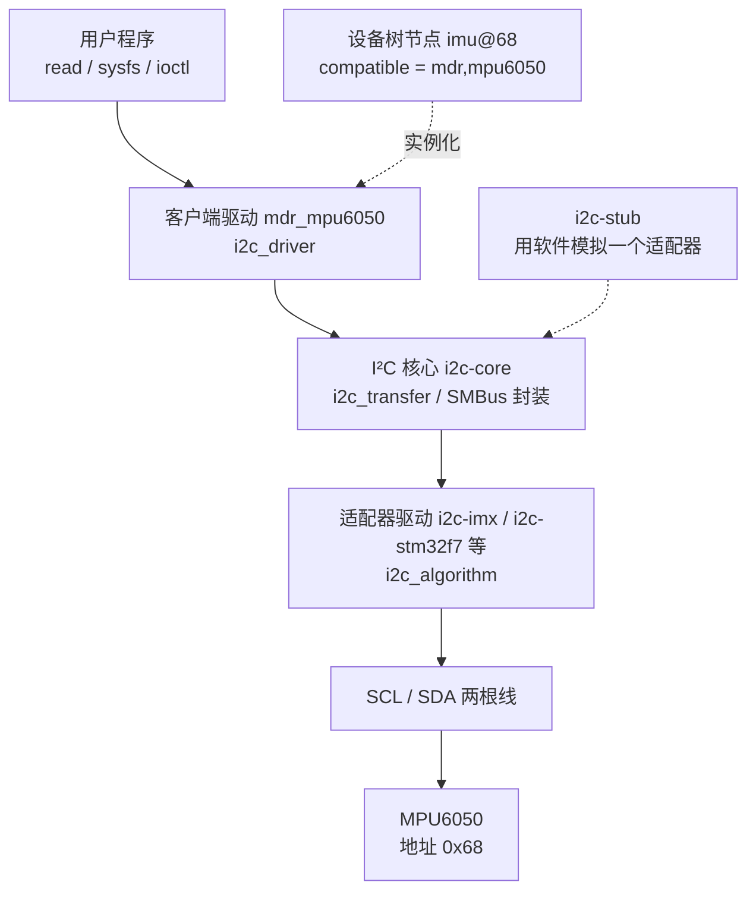

# 5.8 platform、I²C 与 SPI 驱动

同一个 MPU6050，在 [7.1 裸机外设驱动](/教程/正文/嵌入式/7_综合实践/7_1_裸机外设驱动) 里由我们逐位翻转 I²C 的时钟线，自己发出地址字节、自己读应答。到了 Linux，I²C 控制器由 SoC 厂商的驱动负责，时序、时钟、DMA 全都处理好了；我们只需要写“总线上挂着一个什么设备、它的寄存器怎么读”这一层。SoC 内部那些直接映射到地址空间的外设也一样，地址怎么分配、中断是几号，由设备树告诉内核，驱动只管去取。

这一页走完三条路：用 platform 驱动接管 QEMU 的第二个串口，从零驱动一块内存映射外设；用 I²C 客户端驱动读取 MPU6050 的加速度并经 sysfs 导出；用最小的 SPI 驱动读一颗 SPI NOR 的 JEDEC ID。中间穿插没有硬件时怎么用 i2c-stub 和用户态接口做调试，最后给出 `probe` 没有被调用时的排查顺序。设备树的写法在 [5.5](/教程/正文/嵌入式/5_嵌入式Linux/5_5_设备树)，字符设备与 sysfs 的细节在 [5.7](/教程/正文/嵌入式/5_嵌入式Linux/5_7_字符设备与用户空间接口)，这里直接使用。

## 1. platform 总线与资源

platform 总线 (platform bus) 是一个假总线，专门收留那些不能用硬件枚举的 SoC 内部外设：UART、I²C 控制器、SPI 控制器、定时器、看门狗。这些外设的地址和中断号是固定的，内核没法像 USB 那样问设备“你是谁、要多少地址”，只能从设备树里读。

设备树里每个 `status = "okay"` 的节点，内核启动时都会变成一个 `platform_device`。节点里的 `reg` 变成一段 I/O 资源，`interrupts` 变成一条中断资源，其余属性留给驱动自己读。驱动这边写一个 `platform_driver`：

```c
static int mdr_demo_probe(struct platform_device *pdev);
static void mdr_demo_remove(struct platform_device *pdev);

static const struct of_device_id mdr_demo_of_match[] = {
	{ .compatible = "mdr,demo" },
	{ }
};
MODULE_DEVICE_TABLE(of, mdr_demo_of_match);

static struct platform_driver mdr_demo_driver = {
	.probe = mdr_demo_probe,
	.remove = mdr_demo_remove,
	.driver = {
		.name = "mdr_demo",
		.of_match_table = mdr_demo_of_match,
	},
};
module_platform_driver(mdr_demo_driver);
```

`module_platform_driver` 一个宏顶掉 `module_init` 与 `module_exit` 两个函数，做的事情就是注册与注销这个 `platform_driver`。驱动的匹配依据是 `of_match_table` 里的 `compatible`，与设备树节点比对，所以 `.name` 只用于 sysfs 里的目录名，不参与匹配。

`probe` 收到的 `struct platform_device *pdev` 就是那个设备。取资源有三组接口：

| 要取的东西 | 接口 | 说明 |
| --- | --- | --- |
| 内存映射寄存器 | `devm_platform_ioremap_resource(pdev, 0)` | 取第 0 段 `reg` 并 `ioremap`，返回 `void __iomem *` |
| 中断号 | `platform_get_irq(pdev, 0)` | 取第 0 条中断，返回 Linux 中断号 |
| 设备树属性 | `device_property_read_u32(&pdev->dev, "mdr,size", &v)` | 读一个 32 位整数 |
| 设备树属性（字符串） | `device_property_read_string(&pdev->dev, "label", &s)` | 读一个字符串 |
| 任意资源 | `platform_get_resource(pdev, IORESOURCE_MEM, 0)` | 拿到 `struct resource`，自己映射 |

`devm_platform_ioremap_resource` 是“取资源 + 映射”的合并版，省掉了 `platform_get_resource` 与 `devm_ioremap_resource` 两步。老代码里经常看到分开写的两行，效果一样。

映射得到的指针必须用 `readl`、`writel` 访问，不能直接解引用。原因在 [2.2 内存映射 I/O、寄存器与 volatile](/教程/正文/嵌入式/2_MCU裸机开发/2_2_内存映射IO_寄存器与volatile) 讲过：编译器不知道这块地址会在背后变化，会优化掉重复读；`readl` 与 `writel` 除了告诉编译器“这里有副作用”，还处理了不同架构的大小端差异。在 ARM 上 `readl` 还带一个内存屏障，保证读写顺序。

::: concept emb-plat-ioremap-rule title="MMIO 指针只能经 readl/writel 访问"

`devm_platform_ioremap_resource` 返回的 `void __iomem *` 不能直接解引用，也不能传给 `memcpy`。寄存器访问一律用 `readl`、`writel`、`readb`、`writeb` 等函数，位操作在取出的值上做。这个限制是编译器层面的：`__iomem` 标注让稀疏检查工具 (sparse) 能发现直接解引用，普通编译不加 `__CHECKER__` 时它不报错，出错要等到运行。

:::

## 2. 从零驱动第二个 PL011

QEMU 的 vexpress-a9 机器上有四块 PL011 串口。第一块被内核拿来当控制台，输出 `dmesg` 和登录提示；另外三块平时由内核自带的 `amba-pl011` 驱动接管，注册成 `ttyAMA1` 到 `ttyAMA3`。这一节把第二块从它手里拿过来，写一个只支持写的驱动，往 `/dev/mdr_serial` 写什么，QEMU 窗口里对应的串口就出现什么。

PL011 是 Arm 的 PrimeCell 串口，寄存器布局写在 DDI0183 里。我们要用的只有两个：

| 偏移 | 名称 | 作用 |
| --- | --- | --- |
| 0x00 | UARTDR | 数据寄存器，写入即发送，读出即接收 |
| 0x18 | UARTFR | 标志寄存器，读它判断发送 FIFO 满没满 |

UARTFR 的位分配（从高到低）：

| 位 | 名称 | 含义 |
| --- | --- | --- |
| 31～9 | 保留 | 读回 0 |
| 8 | RI | 振铃指示，modem 信号，本例不用 |
| 7 | TXFE | 发送 FIFO 为空 |
| 6 | RXFF | 接收 FIFO 已满 |
| 5 | TXFF | 发送 FIFO 已满，此时不能写 UARTDR |
| 4 | RXFE | 接收 FIFO 为空 |
| 3 | BUSY | UART 正在发送 |
| 2 | DCD | 载波检测，modem 信号 |
| 1 | DSR | 数据装置就绪，modem 信号 |
| 0 | CTS | 清除发送，modem 信号 |

发送一个字节的流程是：读 UARTFR，若 TXFF 为 1 就等，为 0 就把字节写进 UARTDR。

设备树要改一处：把第二块串口的 `compatible` 从 `arm,pl011` 换成我们自己的字符串，`amba-pl011` 就不再认领这个节点，控制台那几块不受影响。QEMU vexpress-a9 的四块 PL011 在 `vexpress-v2m.dtsi` 里依次是 `serial@9000`、`serial@a000`、`serial@b000`、`serial@c000`，标签为 `v2m_serial0` 到 `v2m_serial3`。在板级文件里覆盖第二个节点：

```text
&v2m_serial1 {
	compatible = "mdr,serial";
	status = "okay";
};
```

`reg` 与 `interrupts` 不用重写，覆盖只改 `compatible`。重新编译 DTB 后启动，`/sys/bus/platform/devices/` 下会出现 `a000.serial` 这个设备，但没有任何驱动认领它，`/sys/bus/platform/devices/a000.serial/driver` 不存在。

驱动本体如下。它注册一个 misc 设备，`.write` 把用户写进来的字节逐个送进 UARTDR：

```c
#include <linux/bits.h>
#include <linux/fs.h>
#include <linux/io.h>
#include <linux/iopoll.h>
#include <linux/miscdevice.h>
#include <linux/mod_devicetable.h>
#include <linux/module.h>
#include <linux/platform_device.h>
#include <linux/string.h>
#include <linux/uaccess.h>

#define MDR_UART_DR 0x00
#define MDR_UART_FR 0x18

#define MDR_UART_FR_TXFF BIT(5)

struct mdr_serial {
	void __iomem *base;
	struct miscdevice misc;
};

static ssize_t mdr_serial_write(struct file *file, const char __user *ubuf,
				size_t count, loff_t *ppos)
{
	struct mdr_serial *s = container_of(file->private_data,
					    struct mdr_serial, misc);
	u8 *buf;
	size_t i;
	int ret = 0;

	if (count == 0)
		return 0;
	buf = memdup_user(ubuf, count);
	if (IS_ERR(buf))
		return PTR_ERR(buf);

	for (i = 0; i < count; i++) {
		u32 fr;

		if (readl_poll_timeout(s->base + MDR_UART_FR, fr,
				       !(fr & MDR_UART_FR_TXFF), 10, 10000)) {
			ret = -ETIMEDOUT;
			break;
		}
		writel(buf[i], s->base + MDR_UART_DR);
	}
	kfree(buf);
	return ret ? ret : (ssize_t)count;
}

static const struct file_operations mdr_serial_fops = {
	.owner = THIS_MODULE,
	.write = mdr_serial_write,
};

static int mdr_serial_probe(struct platform_device *pdev)
{
	struct mdr_serial *s;
	int ret;

	s = devm_kzalloc(&pdev->dev, sizeof(*s), GFP_KERNEL);
	if (!s)
		return -ENOMEM;

	s->base = devm_platform_ioremap_resource(pdev, 0);
	if (IS_ERR(s->base))
		return PTR_ERR(s->base);

	s->misc.minor = MISC_DYNAMIC_MINOR;
	s->misc.name = "mdr_serial";
	s->misc.fops = &mdr_serial_fops;
	s->misc.mode = 0666;
	s->misc.parent = &pdev->dev;
	ret = misc_register(&s->misc);
	if (ret)
		return ret;

	platform_set_drvdata(pdev, s);
	dev_info(&pdev->dev, "映射到 %pR\n", &pdev->resource[0]);
	return 0;
}

static void mdr_serial_remove(struct platform_device *pdev)
{
	struct mdr_serial *s = platform_get_drvdata(pdev);

	misc_deregister(&s->misc);
}

static const struct of_device_id mdr_serial_of_match[] = {
	{ .compatible = "mdr,serial" },
	{ }
};
MODULE_DEVICE_TABLE(of, mdr_serial_of_match);

static struct platform_driver mdr_serial_driver = {
	.probe = mdr_serial_probe,
	.remove = mdr_serial_remove,
	.driver = {
		.name = "mdr_serial",
		.of_match_table = mdr_serial_of_match,
	},
};
module_platform_driver(mdr_serial_driver);

MODULE_LICENSE("GPL");
MODULE_DESCRIPTION("QEMU vexpress 第二块 PL011 的写驱动");
```

`container_of` 从 `file->private_data` 反推出 `struct mdr_serial`：misc 框架在 `open` 之后把 `private_data` 设成它自己的 `miscdevice` 指针，而 `miscdevice` 又是 `struct mdr_serial` 的成员，按成员偏移一减就得到外层结构的地址。这样 `probe` 里不需要全局对象，同一个驱动可以管多个串口。

`readl_poll_timeout` 是内核里的轮询宏：它在 `timeout_us` 微秒内反复读地址、检查条件，每两次之间用 `sleep_us` 让出一次 CPU。发送 FIFO 满时进程会睡一小会儿，而不是空转。`write` 回调运行在进程上下文，睡眠是允许的。

`remove` 返回 `void`。`platform_driver` 的 `remove` 从 6.11 起改成 `void`，本页按 6.18 的接口写，读更老的驱动时会看到返回 `int` 的版本。`misc_deregister` 必须在 `remove` 里调，`devm` 管不到它；`misc` 结构体本身来自 `devm_kzalloc`，由驱动核心释放。

装载模块后，往设备里写一行，QEMU 的第二块串口（启动命令里第二个 `-serial` 参数接出的窗口或文件）会出现同样的内容。控制台上则能看到 `probe` 的打印：

::: terminal title="bash - mdr_serial（输出类似）"

```text
$ sudo insmod mdr_serial.ko
$ dmesg | tail -2
[   38.771402] mdr_serial a000.serial: 映射到 [mem 0x1000a000-0x1000afff]
$ ls -l /dev/mdr_serial
crw-rw-rw- 1 root root 10, 123 Sep 12 11:02 /dev/mdr_serial
$ echo "hello from mdr_serial" > /dev/mdr_serial
$ cat /sys/bus/platform/devices/a000.serial/driver/uevent
DRIVER=mdr_serial
MODALIAS=of:NserialT(null)Cmdr,serial
```

:::

第二块串口上出现 `hello from mdr_serial`，控制台没有这行，因为两块串口接的是不同的后端。

::: tip 真实硬件上还要配置波特率

示例能在 QEMU 上直接出字，是因为 QEMU 的 PL011 模型不检查波特率，写 UARTDR 就送到字符后端。真实芯片上 `probe` 还要配置 UARTIBRD、UARTFBRD、UARTLCR_H 与 UARTCR：以 vexpress 的 24 MHz 参考时钟、115200 波特率为例，`UARTIBRD = 13`、`UARTFBRD = round(0.0208 × 64) = 1`，再置 UARTCR 的 TXE 与 UARTE 位。不配置的话，寄存器写进去了，线上没有波形。

:::

和 [2.7 UART](/教程/正文/嵌入式/2_MCU裸机开发/2_7_UART) 的裸机写法对照，本质完全一样：都是“等标志位、写数据寄存器”。差别有三处。地址从常量变成了 `ioremap` 返回的指针，因为内核开了 MMU，物理地址不能直接用；寄存器访问要经过 `readl`、`writel`，保证不被优化、顺序正确；外设的地址和中断号不再写死，而是来自设备树，同一份驱动可以配到地址不同的板子上。

真实产品中，PL011 由内核自带的 `amba-pl011` 驱动负责，它把串口注册成 tty 设备，支持控制台、终端、流控、DMA。这里自己写一个，只是为了在能跑起来的机器上看见 platform 驱动的完整流程，不要拿它替换现成驱动。

<Quiz
  type="multi"
  :options="[
    { label: '映射得到的 void __iomem 指针可以直接解引用读寄存器', value: 'A' },
    { label: 'devm_platform_ioremap_resource 取第 0 段 reg 并完成映射', value: 'B' },
    { label: '寄存器访问用 readl、writel，能保证不被编译器优化掉', value: 'C' },
    { label: '设备树的 reg 与 interrupts 由驱动自己解析后再映射', value: 'D' }
  ]"
  :answer="['B', 'C']"
>

<template #question>

关于 platform 驱动取资源与访问寄存器，下列说法正确的是哪些？

</template>

正确答案是 **B、C**。A 错在 `__iomem` 指针不能解引用，要经 `readl`、`writel`；D 错在 `reg` 与 `interrupts` 已经由内核转成资源，驱动用 `devm_platform_ioremap_resource` 与 `platform_get_irq` 取即可，不需要自己解析设备树。

</Quiz>

## 3. I²C 子系统

I²C 的驱动分成两层。控制器驱动叫适配器 (adapter)，由 SoC 厂商提供，负责产生起始位、地址字节、时钟拉伸、仲裁；挂在总线上的设备驱动叫客户端驱动 (client driver)，也就是我们要写的东西。两层之间由 I²C 核心 (i2c core) 连接。



写客户端驱动只需要和中间的 I²C 核心打交道，适配器是谁、是真是假都无所谓。这也是后面用 i2c-stub 能在没有硬件时测试的原因。

客户端驱动用 `struct i2c_driver` 描述：

```c
static const struct of_device_id mdr_mpu6050_of_match[] = {
	{ .compatible = "mdr,mpu6050" },
	{ }
};
MODULE_DEVICE_TABLE(of, mdr_mpu6050_of_match);

static const struct i2c_device_id mdr_mpu6050_id[] = {
	{ "mdr_mpu6050", 0 },
	{ }
};
MODULE_DEVICE_TABLE(i2c, mdr_mpu6050_id);

static struct i2c_driver mdr_mpu6050_driver = {
	.probe = mdr_mpu6050_probe,
	.remove = mdr_mpu6050_remove,
	.id_table = mdr_mpu6050_id,
	.driver = {
		.name = "mdr_mpu6050",
		.of_match_table = mdr_mpu6050_of_match,
	},
};
module_i2c_driver(mdr_mpu6050_driver);
```

和 platform 驱动比，多了一张 `id_table`。设备树实例化的设备用 `of_match_table` 匹配；用户空间通过 sysfs 的 `new_device` 手工实例化的设备没有设备树节点，靠 `id_table` 里的名字匹配。两种都写上，调试时两种方式都能用。

`probe` 的参数是 `struct i2c_client *client`，只有这一个。6.3 之前它有两个参数（`client` 和 `id`），老代码与老教程里还能见到。`client->addr` 就是设备的 7 位地址。

读写的接口分两类。简单寄存器用 SMBus 封装：

| 函数 | 作用 | 返回 |
| --- | --- | --- |
| `i2c_smbus_read_byte_data(client, reg)` | 读一个字节寄存器 | 0～255，或负的错误码 |
| `i2c_smbus_write_byte_data(client, reg, val)` | 写一个字节寄存器 | 0 或负的错误码 |
| `i2c_smbus_read_word_data(client, reg)` | 读一个 16 位寄存器（小端） | 0～65535，或负的错误码 |
| `i2c_smbus_read_i2c_block_data(client, reg, len, buf)` | 从 reg 起连续读 len 字节 | 实际读到的字节数，或负的错误码 |

返回值一律要判负。`i2c_smbus_read_byte_data` 返回 `int` 而不是 `u8`，就是为了留出负的错误码。

设备要求把“写寄存器地址 + 重复起始 + 读数据”组合成一次不可打断的事务时，用 `i2c_transfer` 自己拼 `struct i2c_msg`：

```c
static int mdr_read_regs(struct i2c_client *client, u8 reg, u8 *buf, int len)
{
	struct i2c_msg msgs[2] = {
		{ .addr = client->addr, .flags = 0, .len = 1, .buf = &reg },
		{ .addr = client->addr, .flags = I2C_M_RD, .len = len, .buf = buf },
	};
	int ret = i2c_transfer(client->adapter, msgs, 2);

	return ret == 2 ? 0 : (ret < 0 ? ret : -EIO);
}
```

`i2c_transfer` 返回成功传输的消息条数，不是字节数，所以判断条件是 `ret == 2`。两条消息之间的重复起始位由适配器产生，中间不会插入别的设备的事务。

`regmap` 是再往上一层的封装，它把寄存器读写、缓存、位域更新统一成一套接口，还自带 debugfs 视图。寄存器多、有读写权限差异的设备用它更省事；只有几个寄存器的传感器，直接调 SMBus 函数更直观。这一页的手写驱动用 SMBus，7.4 会讨论 regmap 的取舍。

## 4. MPU6050 客户端驱动

MPU6050 是六轴传感器：三轴加速度、三轴陀螺仪，外加一个温度计。I²C 地址 0x68（由 AD0 引脚决定，接高电平是 0x69），寄存器地址 8 位。用到的寄存器不多：

| 地址 | 名称 | 说明 |
| --- | --- | --- |
| 0x19 | SMPLRT_DIV | 采样率分频，复位值 0x07 |
| 0x1A | CONFIG | 数字低通滤波器配置 |
| 0x1B | GYRO_CONFIG | 陀螺仪量程，位 4:3 选择 ±250～±2000 °/s |
| 0x1C | ACCEL_CONFIG | 加速度量程，位 4:3 选择 ±2/±4/±8/±16 g |
| 0x3B～0x40 | ACCEL_XOUT_H … ACCEL_ZOUT_L | 三轴加速度，每轴 2 字节，高字节在前 |
| 0x41～0x42 | TEMP_OUT_H、TEMP_OUT_L | 温度，每摄氏度 340 LSB，偏移 −521 |
| 0x43～0x48 | GYRO_XOUT_H … GYRO_ZOUT_L | 三轴角速度 |
| 0x6B | PWR_MGMT_1 | 位 6 是 SLEEP，位 2:0 是时钟源 |
| 0x6C | PWR_MGMT_2 | 各轴待机控制 |
| 0x75 | WHO_AM_I | 固定读回 0x68，用于确认芯片在线 |

::: concept emb-i2c-address-7bit title="I²C 地址是 7 位的"

I²C 设备地址指 7 位地址，MPU6050 是 `0x68`。总线上实际传输的地址字节是 8 位：7 位地址左移一位，最低位放读写方向位，写是 `0xD0`、读是 `0xD1`。数据手册与 `i2cdetect` 用的都是 7 位写法，`client->addr` 与设备树 `reg` 也写 7 位；把 `0xD0` 填进 `reg` 会让设备匹配不到，表现为 `probe` 永远不被调用。

:::

驱动读加速度、换算成 mg、经 sysfs 导出：

```c
#include <linux/delay.h>
#include <linux/i2c.h>
#include <linux/mod_devicetable.h>
#include <linux/module.h>
#include <linux/mutex.h>
#include <linux/sysfs.h>

#define MDR_MPU6050_REG_ACCEL_CONFIG 0x1C
#define MDR_MPU6050_REG_ACCEL_XOUT_H 0x3B
#define MDR_MPU6050_REG_PWR_MGMT_1   0x6B
#define MDR_MPU6050_REG_WHO_AM_I     0x75
#define MDR_MPU6050_WHO_AM_I_VAL     0x68

/* ±2 g 量程下的灵敏度，16384 LSB/g */
#define MDR_MPU6050_LSB_PER_G 16384

struct mdr_mpu6050 {
	struct i2c_client *client;
	struct mutex lock;
};

static int mdr_mpu6050_read_accel(struct mdr_mpu6050 *priv, s16 xyz[3])
{
	u8 raw[6];
	int i, ret;

	ret = i2c_smbus_read_i2c_block_data(priv->client,
					    MDR_MPU6050_REG_ACCEL_XOUT_H,
					    sizeof raw, raw);
	if (ret < 0)
		return ret;
	if (ret != (int)sizeof raw)
		return -EIO;

	for (i = 0; i < 3; i++)
		xyz[i] = (s16)((raw[2 * i] << 8) | raw[2 * i + 1]);
	return 0;
}

static int mdr_mpu6050_axis_mg(struct mdr_mpu6050 *priv, int axis, int *mg)
{
	s16 xyz[3];
	int ret;

	mutex_lock(&priv->lock);
	ret = mdr_mpu6050_read_accel(priv, xyz);
	mutex_unlock(&priv->lock);
	if (ret)
		return ret;

	*mg = (int)xyz[axis] * 1000 / MDR_MPU6050_LSB_PER_G;
	return 0;
}

static ssize_t accel_show(struct device *dev, int axis, char *buf)
{
	struct mdr_mpu6050 *priv = dev_get_drvdata(dev);
	int mg, ret;

	ret = mdr_mpu6050_axis_mg(priv, axis, &mg);
	if (ret)
		return ret;
	return sysfs_emit(buf, "%d\n", mg);
}

static ssize_t accel_x_show(struct device *dev,
			    struct device_attribute *attr, char *buf)
{
	return accel_show(dev, 0, buf);
}
static DEVICE_ATTR_RO(accel_x);

static ssize_t accel_y_show(struct device *dev,
			    struct device_attribute *attr, char *buf)
{
	return accel_show(dev, 1, buf);
}
static DEVICE_ATTR_RO(accel_y);

static ssize_t accel_z_show(struct device *dev,
			    struct device_attribute *attr, char *buf)
{
	return accel_show(dev, 2, buf);
}
static DEVICE_ATTR_RO(accel_z);

static struct attribute *mdr_mpu6050_attrs[] = {
	&dev_attr_accel_x.attr,
	&dev_attr_accel_y.attr,
	&dev_attr_accel_z.attr,
	NULL,
};
ATTRIBUTE_GROUPS(mdr_mpu6050);

static int mdr_mpu6050_probe(struct i2c_client *client)
{
	struct mdr_mpu6050 *priv;
	int ret;

	priv = devm_kzalloc(&client->dev, sizeof(*priv), GFP_KERNEL);
	if (!priv)
		return -ENOMEM;
	priv->client = client;
	mutex_init(&priv->lock);
	i2c_set_clientdata(client, priv);

	ret = i2c_smbus_read_byte_data(client, MDR_MPU6050_REG_WHO_AM_I);
	if (ret < 0)
		return ret;
	if (ret != MDR_MPU6050_WHO_AM_I_VAL) {
		dev_err(&client->dev, "WHO_AM_I = 0x%02x，不是 MPU6050\n", ret);
		return -ENODEV;
	}

	/* 清 SLEEP 位唤醒，时钟源选内部 8 MHz 振荡器 */
	ret = i2c_smbus_write_byte_data(client, MDR_MPU6050_REG_PWR_MGMT_1, 0x00);
	if (ret < 0)
		return ret;
	msleep(100);

	/* ACCEL_CONFIG 位 4:3 = 00，对应 ±2 g 量程 */
	ret = i2c_smbus_write_byte_data(client, MDR_MPU6050_REG_ACCEL_CONFIG, 0x00);
	if (ret < 0)
		return ret;

	dev_info(&client->dev, "MPU6050 就绪，地址 0x%02x\n", client->addr);
	return 0;
}

static void mdr_mpu6050_remove(struct i2c_client *client)
{
	/* 让芯片回到休眠 */
	i2c_smbus_write_byte_data(client, MDR_MPU6050_REG_PWR_MGMT_1, 0x40);
}
```

`mdr_mpu6050_read_accel` 里那个循环把 6 个字节拼成 3 个 16 位有符号数。MPU6050 的数据寄存器是高字节在前（大端），而 ARM 是小端，所以不能直接 `memcpy` 到 `s16` 数组里，要手动移位拼接。这一步在 7.1 的裸机驱动里也做过，代码几乎一样，区别只是数据来源从“自己发起一次读”变成了一次 `i2c_smbus_read_i2c_block_data`。

`mdr_mpu6050_axis_mg` 用整数除法把原始值换成 mg。16384 LSB/g 的量程下，1 mg 对应 16.384 个 LSB，换算成整数会丢掉末端几毫克的精度，对报警、姿态这类用途够用；需要更精确时把原始值直接导出，让用户空间用浮点算。

`mutex` 保护的是“读六个字节”这一整段。`i2c_smbus_*` 函数内部会睡眠，因为传输慢的时候要等中断；多个用户进程同时 `cat` 三个属性时，没有这把锁，两次块读可能交错。I²C 核心只保证单次传输本身不被别的传输插进来，跨多次传输的临界区要驱动自己管。

`ATTRIBUTE_GROUPS(mdr_mpu6050)` 生成一个 `mdr_mpu6050_groups` 数组，把它填进 `i2c_driver` 的 `driver` 成员：

```c
static struct i2c_driver mdr_mpu6050_driver = {
	/* probe、remove、id_table 同上 */
	.driver = {
		.name = "mdr_mpu6050",
		.of_match_table = mdr_mpu6050_of_match,
		.dev_groups = mdr_mpu6050_groups,
	},
};
```

驱动核心会在设备匹配时按这个数组自动创建 `accel_x`、`accel_y`、`accel_z` 三个属性文件。这比在 `probe` 里手动 `device_create_file` 干净，尤其是出错路径不用逐个删除。

设备树节点写在 I²C 控制器下：

```text
&i2c5 {
	status = "okay";

	imu@68 {
		compatible = "mdr,mpu6050";
		reg = <0x68>;
	};
};
```

`imu@68` 的单元地址要与 `reg` 一致，`compatible` 要与 `of_match_table` 一致。内核自带的 `inv_mpu6050` 驱动匹配的是 `invensense,mpu6050`，所以这里必须换一个厂商前缀，否则两个驱动会抢同一个设备：先注册的赢，另一个的 `probe` 不执行。这也是 [5.5](/教程/正文/嵌入式/5_嵌入式Linux/5_5_设备树) 里给练习节点另起 `compatible` 的原因。

驱动加载并匹配成功后，`/sys/bus/i2c/devices/<总线号>-0068/` 下就有属性。总线号由设备树的 aliases 决定，DK 板上 I²C5 对应 5：

::: terminal title="bash - 读取加速度（输出类似）"

```text
$ sudo insmod mdr_mpu6050.ko
$ dmesg | tail -1
[  102.418077] mdr_mpu6050 5-0068: MPU6050 就绪，地址 0x68
$ cat /sys/bus/i2c/devices/5-0068/accel_x
12
$ cat /sys/bus/i2c/devices/5-0068/accel_y
-3
$ cat /sys/bus/i2c/devices/5-0068/accel_z
1004
```

:::

三个数字是 mg：传感器平放时 z 轴读到 1004 mg，接近 1 g 的重力加速度，x、y 接近 0 但受安装误差影响不为零。原始值换算的除法是整数除法，末端几个 mg 被截断，对报警、姿态这类用途够用；需要更精确时把原始值直接导出，由用户空间换算。

::: compare left-title="7.1 的寄存器级读法" right-title="Linux 客户端驱动"

```c
/* 自己产生起始位、地址字节、寄存器地址，再逐位收 6 字节 */
i2c_start();
i2c_write_byte(MPU6050_ADDR << 1);
i2c_write_byte(0x3B);
i2c_start();
i2c_write_byte((MPU6050_ADDR << 1) | 1);
for (int i = 0; i < 6; i++)
    raw[i] = i2c_read_byte(i == 5);
i2c_stop();
```

---

```c
/* 时序、重复起始、应答全由适配器驱动处理 */
u8 raw[6];

ret = i2c_smbus_read_i2c_block_data(client, 0x3B, 6, raw);
if (ret < 0)
    return ret;
```

:::

和 7.1 的裸机读法对照：裸机里要先发起始位、写地址字节、等应答、写寄存器地址、再发重复起始位、读数据，每一步都在操作 SCL 与 SDA 的电平，出错要对着逻辑分析仪找时序。Linux 里同样的动作压缩成右栏那一行，时序由适配器驱动保证。代价是我们看不到位，也改不了位；要调时序只能改控制器驱动或设备树里的时钟频率。这正是分层的价值：应用开发者不必为每颗 I²C 芯片重写一遍位操作。

<Quiz
  type="single"
  :options="[
    { label: 'client->addr 是 0xD0，reg 也写 0xD0', value: 'A' },
    { label: 'client->addr 是 0x68，reg 写 0x68', value: 'B' },
    { label: 'client->addr 是 0x68，reg 写 0xD0', value: 'C' },
    { label: 'client->addr 是 0xD1，reg 写 0x68', value: 'D' }
  ]"
  answer="B"
>

<template #question>

MPU6050 的 7 位地址是 0x68，设备树节点与 `client->addr` 应该怎么写？

</template>

正确答案是 **B**。设备树 `reg` 与 `client->addr` 都用 7 位地址；0xD0 是左移一位后加上写方向位的总线地址字节，填进 `reg` 会导致设备匹配不上。

</Quiz>

## 5. 没有硬件时怎么调

驱动写完，手边没有传感器，或者板子还没焊好，调试不能停。I²C 给了三级办法，从最接近硬件的一级往软件一侧走。

第一级在开发板上，用 i2c-tools 确认接线。`i2cdetect` 扫描总线上的地址，`i2cget` 读某个寄存器，`i2cset` 写一个：

::: terminal title="bash - 开发板上用 i2c-tools（输出类似）"

```text
$ sudo i2cdetect -y 5
     0  1  2  3  4  5  6  7  8  9  a  b  c  d  e  f
00:                         -- -- -- -- -- -- -- --
10: -- -- -- -- -- -- -- -- -- -- -- -- -- -- -- --
20: -- -- -- -- -- -- -- -- -- -- -- -- -- -- -- --
30: -- -- -- -- -- -- -- -- -- -- -- -- -- -- -- --
40: -- -- -- -- -- -- -- -- -- -- -- -- -- -- -- --
50: 50 -- -- -- -- -- -- -- -- -- -- -- -- -- -- --
60: -- -- -- -- -- -- -- -- -- -- -- -- -- -- -- 68
70: -- -- -- -- -- -- -- --
$ sudo i2cget -y 5 0x68 0x75
0x68
$ sudo i2cget -y 5 0x68 0x3b w
0x00f8
```

:::

`i2cdetect` 的输出里，地址位置显示的是十六进制地址，`--` 表示没有应答。`0x68` 上有芯片，`0x75` 读回 `0x68`，说明接的是 MPU6050 且工作正常。`i2cget ... 0x3b w` 读一个字，`0x00f8` 是某一个轴加速度的原始值，按 16384 LSB/g 折算约 15 mg。`i2cdetect` 输出里的 `UU` 表示该地址已被内核驱动占用，不能再去探测，探测会与驱动的传输冲突。

第二级在 QEMU 上，用 i2c-stub 模块模拟一颗芯片。它注册一个假的 I²C 适配器，适配器后面没有真实硬件，所有读写都落在模块内部一个 256 字节的寄存器数组里。这正好可以注入 MPU6050 的寄存器值，然后让驱动去读。

::: terminal title="bash - i2c-stub 预置寄存器（输出类似）"

```text
$ sudo modprobe i2c-stub chip_addr=0x68
$ sudo i2cset -y 0 0x68 0x75 0x68
$ sudo i2cset -y 0 0x68 0x3b 0x01 0x90 0xff 0xae 0x40 0x00 i
$ sudo i2cset -y 0 0x68 0x6b 0x00
```

:::

`chip_addr` 参数告诉 stub 这条“总线”上有个 0x68 的设备，其余地址不应答。三行 `i2cset` 分别预置 WHO_AM_I、六个加速度字节、PWR_MGMT_1。最后一行用 `i` 后缀表示块写，一次写连续 6 个字节。

接下来把驱动绑到一个手工实例化的设备上。I²C 核心允许从用户空间创建设备，写在 `/sys/bus/i2c/devices/i2c-0/new_device` 里：

::: terminal title="bash - i2c-stub 上测试 mdr_mpu6050（输出类似）"

```text
$ echo mdr_mpu6050 0x68 > /sys/bus/i2c/devices/i2c-0/new_device
$ dmesg | tail -2
[  201.553301] i2c i2c-0: new_device: Instantiated device mdr_mpu6050 at 0x68
[  201.554120] mdr_mpu6050 0-0068: MPU6050 就绪，地址 0x68
$ cat /sys/bus/i2c/devices/0-0068/accel_x
24
$ cat /sys/bus/i2c/devices/0-0068/accel_y
-5
$ cat /sys/bus/i2c/devices/0-0068/accel_z
-1000
```

:::

数据完全来自我们写进 stub 的字节：x 轴 `0x0190` 是 400，按 16384 LSB/g 换算成 24 mg；y 轴 `0xffae` 是有符号的 −82，换算成 −5 mg；z 轴 `0x4000` 是 16384，正好 1000 mg。能对上这些数，就说明驱动的块读、大端拼接、量程换算、sysfs 导出全都正确，与硬件是否在场无关。删除设备用 `delete_device`，写地址即可。

第三级是完全不写驱动的用户态替代：直接打开 `/dev/i2c-0`，用 ioctl 告诉内核要访问哪个地址，再读寄存器。这条路适合快速验证接线和寄存器值，也常用来在产品里做一个不做驱动的简单工具。

```c
#define _POSIX_C_SOURCE 200809L

#include <errno.h>
#include <fcntl.h>
#include <stdio.h>
#include <stdlib.h>
#include <sys/ioctl.h>
#include <unistd.h>

#include <linux/i2c-dev.h>
#include <linux/i2c.h>

#define MPU6050_ADDR 0x68
#define MPU6050_WHO_AM_I 0x75

int main(int argc, char *argv[]) {
    if (argc != 2) {
        fprintf(stderr, "用法: %s /dev/i2c-N\n", argv[0]);
        return EXIT_FAILURE;
    }
    int fd = open(argv[1], O_RDWR);
    if (fd == -1) {
        perror("open");
        return EXIT_FAILURE;
    }
    if (ioctl(fd, I2C_SLAVE, MPU6050_ADDR) == -1) {
        perror("ioctl I2C_SLAVE");
        close(fd);
        return EXIT_FAILURE;
    }

    struct i2c_smbus_ioctl_data args = {
        .read_write = I2C_SMBUS_READ,
        .command = MPU6050_WHO_AM_I,
        .size = I2C_SMBUS_BYTE_DATA,
        .data = &(union i2c_smbus_data){.byte = 0},
    };
    if (ioctl(fd, I2C_SMBUS, &args) == -1) {
        perror("ioctl I2C_SMBUS");
        close(fd);
        return EXIT_FAILURE;
    }
    printf("WHO_AM_I = 0x%02x\n", args.data->byte);
    close(fd);
    return EXIT_SUCCESS;
}
```

`I2C_SLAVE` 是给后续所有传输指定从设备地址，`I2C_SMBUS` 才真正发起一次 SMBus 事务。这两步替代了 `i2c_smbus_read_byte_data` 一行，因为用户态没有 `struct i2c_client`。程序在 SignalX 上只做编译检查，不运行，因为那台机器没有也不该去访问 `/dev/i2c-*`：

::: terminal title="bash - 编译用户态程序"

```text
$ gcc -std=c17 -Wall -Wextra -O2 -c i2c_read_whoami.c -o i2c_read_whoami.o
$ gcc -std=c17 -Wall -Wextra -O2 i2c_read_whoami.c -o i2c_read_whoami
```

:::

两条命令都没有输出，`-Wall -Wextra` 下没有警告，说明头文件与结构体初始化都与系统里的 `linux/i2c.h` 对得上。

换到有 I²C 总线的板子上，运行 `./i2c_read_whoami /dev/i2c-5`，输出 `WHO_AM_I = 0x68`。这条路径与 `i2cdetect` 是同一套底层接口，i2c-tools 本身就是一个这样的用户态程序。

## 6. SPI 驱动

SPI 比 I²C 快得多，线也多两根。它的设备模型和 I²C 平行：控制器驱动叫控制器 (controller)，过去的叫法是主控 (master)，挂在控制器下的设备驱动用 `struct spi_driver`。设备树里 SPI 设备是控制器的子节点，`reg` 表示片选编号。

```text
&spi1 {
	status = "okay";

	flash@0 {
		compatible = "mdr,w25q64";
		reg = <0>;
		spi-max-frequency = <10000000>;
		spi-cpol;
		spi-cpha;
	};
};
```

SPI 的模式不能像 I²C 那样由地址推出，必须显式写在设备树里。`spi-cpol` 表示时钟空闲时为高，`spi-cpha` 表示在第二个边沿采样，两个属性合起来就是模式 3。`spi-max-frequency` 是这条设备允许的最高时钟，控制器驱动会取它和控制器上限中较小的那个。片选由 `reg` 决定，控制器驱动负责在传输前后拉低、拉高对应的片选线。

SPI 的传输单位是消息 (message)，一条消息由若干段 (transfer) 组成，段与段之间片选不放松。`spi_write_then_read` 是最常用的封装：先写一段，再读一段，两段合成一条消息：

| 函数 | 用途 |
| --- | --- |
| `spi_write_then_read(spi, tx, tx_len, rx, rx_len)` | 先写后读，读的长度由参数给出 |
| `spi_write(spi, buf, len)` | 只写 |
| `spi_read(spi, buf, len)` | 只读 |
| `spi_sync(spi, msg)` | 发一条自定义消息，消息里的段由 `spi_transfer` 描述 |

W25Q64 是 8 MiB 的 SPI NOR Flash。读 JEDEC ID 的命令是 0x9F，先发命令字节，再连续读 3 个字节，依次是厂商号与两个容量字节，W25Q64 应读到 `EF 40 17`。最小的驱动只需要这一个操作：

```c
#include <linux/mod_devicetable.h>
#include <linux/module.h>
#include <linux/spi/spi.h>

#define MDR_W25Q_JEDEC_ID 0x9F

static int mdr_w25q_probe(struct spi_device *spi)
{
	u8 cmd = MDR_W25Q_JEDEC_ID;
	u8 id[3];
	int ret;

	ret = spi_write_then_read(spi, &cmd, 1, id, sizeof id);
	if (ret)
		return ret;

	dev_info(&spi->dev, "JEDEC ID: %02x %02x %02x\n", id[0], id[1], id[2]);
	if (id[0] != 0xef)
		dev_warn(&spi->dev, "厂商号不是 Winbond\n");
	return 0;
}

static const struct of_device_id mdr_w25q_of_match[] = {
	{ .compatible = "mdr,w25q64" },
	{ }
};
MODULE_DEVICE_TABLE(of, mdr_w25q_of_match);

static struct spi_driver mdr_w25q_driver = {
	.probe = mdr_w25q_probe,
	.driver = {
		.name = "mdr_w25q",
		.of_match_table = mdr_w25q_of_match,
	},
};
module_spi_driver(mdr_w25q_driver);

MODULE_LICENSE("GPL");
MODULE_DESCRIPTION("读 W25Q64 的 JEDEC ID");
```

`spi_device` 里已经带了模式、频率、片选，驱动不需要再配置这些；它们来自设备树，由控制器驱动在传输时应用到硬件上。这是 SPI 与裸机写法最大的不同：裸机里我们要自己算分频、自己控制片选引脚，Linux 里这些都在控制器驱动与设备树之间完成了。

::: tip 真要用 SPI NOR，别再写驱动

内核里已经有 `spi-nor` 与 MTD 子系统，能把 W25Q64 注册成一个 MTD 设备，上面可以挂 JFFS2、UBIFS 或者直接当块设备用，还支持擦除、写入、保护、四线快速读。设备树里写 `compatible = "jedec,spi-nor"` 就会自动匹配，不需要任何自写代码。上面的驱动只适合验证接线与片选是否正常，或者处理片上寄存器里厂商特有的功能。

原型阶段还可以用 spidev：设备树里给节点加一个 `spidev` 兼容字符串，用户态就能用 `/dev/spidevB.C` 直接发 SPI 消息，配套的 `spidev_test` 工具可以发任意字节并打印返回值。spidev 不适合产品，因为它绕过了内核的所有抽象，但调通硬件很快。

:::

## 7. probe 不被调用时的排查

驱动加载了，`lsmod` 里能看到，`dmesg` 里没有 `probe` 的打印，设备也没出现在 `/sys/bus/.../drivers/...` 下。这类问题占了驱动调试的一大半，按顺序查三步就能定位绝大多数。

第一步，设备的 `compatible` 与驱动的 `of_match_table` 是否一字不差。字符串比对是精确的，大小写、连字符、逗号位置都算。查目标设备真正的 `compatible`：

::: terminal title="bash - 读实际生效的 compatible（输出类似）"

```text
$ cat /proc/device-tree/soc/serial@a000/compatible
mdr,serial
```

:::

注意 `cat` 出来的字符串末尾带一个空字符，看起来像多了个空格，实际没有。设备树编译错误导致的 `compatible` 被截断也很常见。

第二步，节点的 `status` 是不是 `okay`。没有 `status` 属性等价于 `okay`，写成 `disabled` 或拼错的 `ok` 都不会实例化设备。检查这个节点在 `/sys/bus/platform/devices/` 或 `/sys/bus/i2c/devices/` 下存不存在，不存在就是设备树的问题，与驱动无关。

第三步，驱动模块是否真的加载了，以及是否被别的驱动抢先匹配。`lsmod` 确认模块在，`/sys/bus/<总线>/drivers/<驱动名>/` 目录确认驱动注册了。两个驱动匹配同一个设备时，先注册的赢，后者的 `probe` 不执行，`dmesg` 里只有前者的一句话。把自写驱动的 `compatible` 换成独有的厂商前缀就能排除。

::: tip 另外两个常见错误

I²C 设备树里把 `reg` 写成 8 位地址 `0xD0`，应当写 7 位 `0x68`，症状同样是 `probe` 不执行。在中断处理或持有自旋锁的上下文里调用 `i2c_smbus_*` 也会出问题，这些函数会睡眠，会触发 “scheduling while atomic” 的内核警告，[5.9 中断、DMA 与并发](/教程/正文/嵌入式/5_嵌入式Linux/5_9_中断_DMA与并发) 讲怎么把这类工作放到允许睡眠的地方。

:::

<Quiz
  type="multi"
  :options="[
    { label: '/proc/device-tree 中节点的 compatible 与驱动 of_match_table 逐字比对', value: 'A' },
    { label: '确认节点的 status 是 okay，且设备出现在 /sys/bus/<总线>/devices/ 下', value: 'B' },
    { label: '确认驱动模块已加载，且设备没有被别的驱动抢先匹配', value: 'C' },
    { label: '把驱动的 probe 函数改成 __init 就能强制它被调用', value: 'D' }
  ]"
  :answer="['A', 'B', 'C']"
>

<template #question>

驱动装上了但 `probe` 没有被调用，应该按什么顺序排查？

</template>

正确答案是 **A、B、C**。这三步依次排除“名字不对”“设备没实例化”“驱动没加载或被抢先”三类原因。D 没有依据，`__init` 只影响内存回收，不会改变匹配结果。

</Quiz>

## 8. 习题

### 8.1 巩固

<Exercise id="65572" :d="1" :w="2">

第 2 节的发送循环用 UARTFR 的 TXFF 位决定能不能写 UARTDR。

(1) 写出 `MDR_UART_FR_TXFF` 的值，并判断下面四个 FR 读数分别对应哪种情况：`0x00000090`、`0x000000A0`、`0x00000010`、`0x00000020`。哪些可以直接写 UARTDR，哪些必须等？

(2) `readl_poll_timeout(..., 10, 10000)` 的两个时间参数各是什么单位？最坏情况下一个字节要等多久？把这个上限乘以 256 字节，说明为什么 `write` 的耗时需要一个上界。

(3) 条件写成 `!(fr & MDR_UART_FR_TXFF)` 而不是 `fr & MDR_UART_FR_TXFF`，宏的语义有什么不同？

(4) 把 `writel(buf[i], ...)` 改成 `writeb(buf[i], ...)`，在 ARM 上会发生什么？UARTDR 在 PL011 里是几个字节宽的寄存器？

(5) 如果发送 FIFO 一直不空（比如没接线的板子上流控引脚被拉低），`write` 返回什么？用返回值的用户程序该怎么处理？

</Exercise>

<Exercise id="65573" :d="2" :w="2">

下面五段代码各自有一处与第 1 节的表格或 concept 块对不上。

```c
/* A */
s->base = devm_platform_ioremap_resource(pdev, 0);
if (!s->base)
	return -ENOMEM;
s->base[0] = 1;

/* B */
irq = platform_get_irq(pdev, 0);
if (irq == 0)
	return -ENXIO;

/* C */
ret = device_property_read_u32(&pdev->dev, "size", &v);

/* D */
res = platform_get_resource(pdev, IORESOURCE_MEM, 0);
s->base = ioremap(res->start, resource_size(res));

/* E */
u32 v;
readl(s->base + 0x10);
```

(1) 逐段指出错误，并给出改法。

(2) C 段里设备树属性实际叫 `mdr,size`，把查询名写成 `size` 会返回什么？设备树属性的名字为什么要带厂商前缀？

(3) D 段与 `devm_platform_ioremap_resource` 相比少了哪一层管理？驱动卸载后这段映射会怎样？

(4) E 段的返回值被丢弃。什么情况下读寄存器必须保留返回值？`readl` 本身解决了哪两个问题？

(5) 把五段合成一个能通过编译的 `probe` 骨架，只保留取资源与映射两步，错误路径用 devm 的写法。

</Exercise>

<Exercise id="65574" :d="2" :w="2">

第 4 节的驱动把 6 个字节拼成三个 16 位数，再换算成 mg。用下面这组字节手算一遍：

```text
0x3B: 01 90  ff AE  40 00
```

(1) 按 `(s16)((raw[2 * i] << 8) | raw[2 * i + 1])` 算出三个原始值，再按 16384 LSB/g 与整数除法算出 mg，写出完整过程。

(2) 去掉 `(s16)` 强制转换，y 轴的结果是多少？用户 `cat` 到的数字会怎么变，为什么这种错误在 x 轴为正、z 轴为正时看不出来？

(3) `i2c_smbus_read_i2c_block_data` 的返回值该用什么类型接？判断写成 `if (ret < 0)` 与 `if (ret != 6)` 各排除了哪一种情况？

(4) 把量程换成 ±8 g 后，同一个原始值 `0x0190` 对应多少 mg？驱动里除了常数，还有哪一处要跟着改？

(5) 设备树里 `reg` 写 `0x68`，而某个同学写成了 `0xD0`。分别说明这两件事会怎样表现：设备能不能创建、`probe` 会不会被调用。

</Exercise>

<Exercise id="65575" :d="3" :w="3">

第 7 节给出三步排查。下面四份配置各不相同，驱动都是本页的 `mdr_mpu6050`。

```text
/* 甲 */
imu@68 { compatible = "mdr,mpu6050x"; reg = <0x68>; };

/* 乙 */
imu@68 { compatible = "mdr,mpu6050"; reg = <0xD0>; };

/* 丙 */
imu@68 { compatible = "mdr,mpu6050"; reg = <0x68>; status = "ok"; };

/* 丁 */
imu@68 { compatible = "mdr,mpu6050"; reg = <0x68>; };
/* 驱动里漏了 MODULE_DEVICE_TABLE(i2c, mdr_mpu6050_id);
   也漏了 MODULE_DEVICE_TABLE(of, mdr_mpu6050_of_match); */
```

(1) 为每一份写出你会执行的检查命令与看到的现象，指出它对应三步里的哪一步。

(2) 甲与丙的症状都是「设备不存在」，用 `/proc/device-tree` 与 `/sys/bus/i2c/devices/` 里的输出区分它们。

(3) 丁的驱动手工 `insmod` 之后 `probe` 会执行吗？把 `echo mdr_mpu6050 0x68 > /sys/bus/i2c/devices/i2c-0/new_device` 之后呢？分别说明。

(4) 甲、乙、丙三份改对之后，还有一处会让 `probe` 执行但返回 `-ENODEV`。指出是哪一处，并给出一条能从 `dmesg` 看出原因的检查。

(5) 给这四份配置各写一句一句话结论，格式为「问题在设备树 / 在驱动 / 在匹配表」。

</Exercise>

### 8.2 编程

<Exercise id="65576" :d="3" :w="3">

给第 2 节的 `mdr_serial` 补上接收方向，只用轮询，不用中断（中断在 [5.9](/教程/正文/嵌入式/5_嵌入式Linux/5_9_中断_DMA与并发)）。

要求：

1. 加 `.read`：用 `readl_poll_timeout` 等 UARTFR 的 RXFE 位清零，读到字节后写进内核缓冲区，全部取完后 `copy_to_user`，返回实际字节数。
2. 阻塞模式下，最多等 100 ms 就返回已经收到的字节数；一个字节都没等到时返回 `-ETIMEDOUT`。
3. `O_NONBLOCK` 时不等，FIFO 里没有数据就直接返回 `-EAGAIN`。
4. 一次最多读 `count` 字节，`count` 为 0 时返回 0。
5. 写完后回答：这个实现为什么在 `count` 很大时会变慢，中断为什么能解决它。只写结论。

验收（QEMU，第二块串口接一个可以输入的字符后端）：

- 往 `/dev/mdr_serial` 写 `abc`，第二块串口窗口出现 `abc`。
- 在第二块串口窗口里敲 `xyz`，`cat /dev/mdr_serial` 打印 `xyz`。
- 不改任何代码，把 `read` 的等待时间从 100 ms 改成 1000 ms，`cat` 在无输入时由 0.1 秒返回变成 1 秒返回，用 `time` 确认。

</Exercise>

<Exercise id="65577" :d="3" :w="3">

用户态也能直接操作 I²C 总线。写一个工具 `i2c_tool`。

要求：命令行 `i2c_tool /dev/i2c-N scan`、`i2c_tool /dev/i2c-N whoami [地址]`、`i2c_tool /dev/i2c-N accel [地址]`。

1. `scan`：对 0x08～0x77 逐个 `ioctl(fd, I2C_SLAVE, addr)` 加一次 `I2C_SMBUS` 读，有应答的地址按 `i2cdetect` 的格式打印成一行。
2. `whoami`：读地址 0x75，打印 `WHO_AM_I = 0x68` 或读到的其他值。
3. `accel`：从 0x3B 起块读 6 字节，按本页的规则换算成三个 mg 值打印。
4. 所有 `ioctl` 都要检查返回值。地址上没有芯片时，`I2C_SLAVE` 与 `I2C_SMBUS` 哪一个先失败？记录 `errno` 并打印 `strerror`。

验收：

- 在 SignalX 上只做编译检查：`gcc -std=c17 -Wall -Wextra -O2 i2c_tool.c -o i2c_tool`，无警告。
- 在接有 MPU6050 的板子上：`scan` 报出 `68`（若引脚接高则是 `69`），`whoami` 与 `accel` 的数字与 5.7 的驱动读到的同量级。

(5) 与 `i2cdetect`、`i2cget` 的行为对照：为什么 `scan` 遇到被内核驱动占用的地址会得到 `EBUSY` 而不是正常应答？

</Exercise>

<Exercise id="65578" :d="4" :w="3">

用 i2c-stub 给 `mdr_mpu6050` 做一次数值链路的验证，并补上调试用的 sysfs 属性。

(1) 按第 5 节预置寄存器：`WHO_AM_I = 0x68`，加速度 `01 90 FF AE 40 00`，`PWR_MGMT_1 = 0x00`。实例化设备后，先写下三个属性应该输出的值，再实际 `cat` 对照。

(2) 把预置的 `WHO_AM_I` 改成 `0x70`，重新实例化，记录 `probe` 的失败信息与 `dmesg`。`i2cset` 写 `0x75` 之前为什么要先 `delete_device`？

(3) 给驱动加两个只读属性：`accel_raw` 输出三个空格分隔的十进制原始值，`who_am_i` 输出十六进制。写进同一个 `ATTRIBUTE_GROUPS`，用 `cat` 验证与 (1) 的字节一致。

(4) 说明 `sysfs_emit(buf, "%d %d %d\n", ...)` 为什么符合「一个文件一个值」的要求，而输出三行带说明文字就不符合。

(5) 删除设备：写 `0x68` 到 `delete_device`，确认 `/sys/bus/i2c/devices/0-0068/` 消失、驱动的 `remove` 执行（让 `remove` 打印一行）。

</Exercise>

<Exercise id="65579" :d="4" :w="4">

第 6 节的 `mdr_w25q` 只用 `spi_write_then_read` 读了 JEDEC ID。扩成能读状态寄存器，并改用消息级接口。

W25Q64 的两条命令：`0x9F` 读 JEDEC ID（3 字节），`0x05` 读状态寄存器 1（1 字节）。

(1) 用 `spi_write_then_read` 加一个属性 `status`，`cat` 它输出状态寄存器 1 的值。装载后与数据手册的复位值对照。

(2) 改用 `spi_sync` 加 `struct spi_message`、`struct spi_transfer` 手写同一次读 ID：一段发命令，一段收 3 字节。写完后说明两段为什么必须在同一条消息里，分成两次 `spi_sync` 会怎样。

(3) 读出三段 `spi_transfer` 的写法：命令段、空段、数据段。若把接收段的 `rx_buf` 改成 `tx_buf`，会得到什么？

(4) 设备树里把 `spi-cpol` 与 `spi-cpha` 删掉，重新编译 DTB 启动，再读一次 ID，记录结果并解释原因。

(5) 设计对比：把这颗 Flash 注册成 `jedec,spi-nor` 的 MTD 设备，`cat /proc/mtd` 与 `mtdinfo` 的输出会是什么形状？说明为什么产品里不再需要 (1) 到 (4) 的自写代码，而自写驱动仍适合验证片选与接线。

验收：在没有硬件时只要求编译通过（对着目标内核树 `make M=$PWD modules`），有 W25Q64 的板子上 ID 读回 `EF 40 17`。

</Exercise>

### 8.3 综合与挑战

<Exercise id="65580" :d="6" :w="5" scope="*">

给 `mdr_mpu6050` 建一套能在没有硬件的机器上自动跑的回归测试，并让它在出错时指出是哪一层坏了。

要求：

1. 准备脚本 `run-tests.sh`：加载 `i2c-stub chip_addr=0x68`，按测试用例预置寄存器，实例化设备，读 sysfs，比对期望值，最后清理。每条用例打印 `PASS`、`FAIL` 与实测值，退出码等于失败条数。
2. 用例至少覆盖五类：
   - 正常值：`01 90 FF AE 40 00` 对应 `24 -5 1000`；
   - 全负值：三个轴都是负数，验证符号扩展；
   - 满量程：`0x7FFF` 与 `0x8000` 两个边界值，验证换算不溢出；
   - `WHO_AM_I` 不符：`probe` 必须失败，设备目录下没有属性；
   - 写 `accel_x` 属性：必须失败，`errno` 是 `EACCES`。
3. 再加一组「量程切换」用例：要求驱动支持可写的 `accel_range` 属性（0～3 对应 ±2/±4/±8/±16 g），切换后同一个原始值的 mg 读数按比例变化。用 `0x0190` 在四档下各验证一次，写出四个期望值。
4. 一条用例验证「驱动被抢先匹配」：先 `modprobe inv_mpu6050`，再实例化设备，确认本驱动的 `probe` 不执行、`/sys/bus/i2c/devices/0-0068/driver` 指向另一个驱动。说明这和 `compatible` 写错有什么区别，脚本怎样区分这两种失败。
5. 最后写一段说明：哪些行为 i2c-stub 测不了，必须上硬件；这些项与 [5.9](/教程/正文/嵌入式/5_嵌入式Linux/5_9_中断_DMA与并发) 的哪些内容对应。

提示：i2c-stub 的寄存器数组只有 256 字节，`0x75` 与 `0x3B` 都在范围内；块写用 `i2cset ... i`；读 sysfs 前确认设备已经实例化，必要时轮询目录是否存在。

</Exercise>

## 9. 参考资料

- Bootlin, Linux kernel and driver development 培训幻灯片（platform drivers、I2C API、I/O memory）：https://bootlin.com/doc/training/linux-kernel/linux-kernel-slides.pdf
- Implementing I2C device drivers：https://docs.kernel.org/i2c/writing-clients.html
- How to instantiate I2C devices：https://docs.kernel.org/i2c/instantiating-devices.html
- i2c-stub：https://docs.kernel.org/i2c/i2c-stub.html
- Implementing I2C device drivers in userspace：https://docs.kernel.org/i2c/dev-interface.html
- Overview of Linux kernel SPI support：https://docs.kernel.org/spi/spi-summary.html
- SPI userspace API（spidev）：https://docs.kernel.org/spi/spidev.html
- Driver Model：https://docs.kernel.org/driver-api/driver-model/index.html
- Arm PrimeCell UART (PL011) Technical Reference Manual（DDI0183）：https://developer.arm.com/documentation/ddi0183/latest/
- InvenSense MPU-6000/MPU-6050 Register Map and Descriptions（RM-MPU-6000A）：https://invensense.tdk.com/products/motion-tracking/6-axis/mpu-6050/
- Winbond W25Q64JV 数据手册：https://www.winbond.com/
- Elixir Cross Referencer, Linux v6.18（include/linux/platform_device.h、include/linux/i2c.h、include/linux/spi/spi.h、include/linux/iopoll.h）：https://elixir.bootlin.com/linux/v6.18/source
